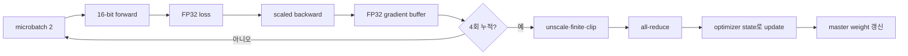

# 11. 학습 system과 수치 정밀도

[← 이전](10-attention-and-transformers.md) · [목차](README.md) · [다음 →](12-ai-ran-and-operational-evaluation.md)

**자료형(dtype, data type)**은 tensor 원소를 몇 bit와 어떤 규칙으로 저장·계산할지 정한다. **부동소수점**은 부호, 지수, 유효숫자로 매우 크고 작은 실수를 근사 표현한다. 모든 실수를 정확히 담을 수 없어 가장 가까운 표현값으로 **반올림(rounding)**한다.


## 1. FP32, FP16, BF16

**FP32**는 32-bit 부동소수점, **FP16**은 16-bit IEEE half, **BF16**은 bfloat16이다. FP16과 BF16은 둘 다 2 bytes지만 지수와 유효숫자 bit 배분이 다르다. BF16은 FP32와 비슷한 지수 범위를 가지며 유효숫자가 짧다. FP16은 더 정밀한 유효숫자를 가지지만 범위가 좁다.

가까운 두 값이 같은 표현으로 반올림되면 작은 update가 사라질 수 있다. 표현 가능한 최댓값을 넘으면 **overflow**로 infinity가 되고, 너무 작은 값은 **underflow**로 0 또는 거친 subnormal이 된다. Dtype 선택은 memory·throughput과 수치 오차의 trade-off다.

Parameter 1,000,000개의 순수 payload는 FP32 4,000,000 bytes≈3.81 MiB, 16-bit 2,000,000 bytes≈1.91 MiB다. Training peak에는 gradient, optimizer state, activation, temporary workspace가 더해져 정확히 절반이 아니다.

## 2. Mixed precision과 master weight

**혼합 정밀도(mixed precision)**는 연산과 저장 목적에 따라 여러 dtype을 함께 쓰는 방식이다. 큰 행렬 곱은 16-bit 입력을 쓰고 누적은 FP32로 할 수 있다. **Master weight**는 update의 작은 변화를 보존하기 위해 FP32로 유지하는 parameter 복사본이다.

예를 들어 weight 1.0에 update `-0.0001`을 더할 때 낮은 정밀도에서는 같은 1.0으로 반올림될 수 있다. FP32 master에 update를 적용한 뒤 계산용 16-bit weight를 만들면 누적된 작은 변화가 보존된다. 모든 framework와 optimizer가 같은 방식인 것은 아니므로 실제 구현을 확인한다.

## 3. Loss scaling

**Loss scaling**은 backward 전에 loss에 scale S를 곱해 작은 gradient를 표현 가능한 범위로 키우고, optimizer 전 다시 S로 나누는 기법이다. Gradient `1e-8`, S=1024면 scaled gradient `1.024e-5`다. Unscale 뒤 다시 `1e-8`이 된다.

큰 gradient도 1024배 되어 overflow할 수 있다. **Dynamic loss scaling**은 finite 여부를 검사해 overflow step을 건너뛰고 scale을 줄이며, 일정 기간 안전하면 키운다. Unscale 전에 clipping하면 threshold 의미가 S배 달라지므로 일반적으로 unscale 후 clipping한다.

Loss scaling은 FP16 underflow 완화에 특히 쓰인다. BF16은 지수 범위가 넓어 같은 필요가 덜할 수 있지만 모든 model이 안전하다고 단정하지 않는다.

## 4. Batch, microbatch, accumulation

**표본(sample)**은 입력과 정답 한 쌍이다. **배치(batch)**는 한 optimizer update의 통계 단위로 묶은 표본 집합이다. GPU memory에 한꺼번에 들어가는 작은 묶음이 **마이크로배치(microbatch)**다.

**기울기 누적(gradient accumulation)**은 여러 microbatch의 backward 기울기를 buffer에 더한 뒤 한 번 update하는 방법이다. Microbatch A gradient 2, B gradient 6을 동일 크기 평균으로 쓰면 `(2+6)/2=4`다. 합 8을 그대로 쓰면 learning rate 효과가 두 배다.

Microbatch 크기가 3과 1이면 각 microbatch 평균을 단순 평균해 `(2+6)/2`로 계산하는 것은 표본 평균이 아니다. Sum gradient를 합친 뒤 총 표본 4로 나누거나 loss를 표본 수에 맞게 scale한다. Token sequence도 유효 token 수가 다르면 padding을 제외한 분모를 명시한다.

## 5. 한 학습 step 전체 trace

Model parameter 1,000개, effective batch 8, microbatch 2, accumulation 4회를 가정한다.



1. Data loader가 표본 2개를 GPU tensor로 만든다.
2. Autocast가 지원 연산 dtype을 선택해 forward한다.
3. Loss를 FP32로 계산하고 scale한다.
4. Backward가 gradient buffer에 더한다.
5. 네 microbatch 뒤 unscale한다.
6. NaN/Inf를 검사하고 필요하면 step을 skip한다.
7. 여러 GPU면 gradient를 all-reduce한다.
8. Optimizer가 master weight와 state를 갱신한다.
9. Gradient buffer를 0으로 만든다.

어느 순서를 쓰는지는 framework 구현과 병렬 방식에 따라 달라질 수 있다. 중요한 것은 scale, 평균 분모, 통신, update가 한 번씩 올바른 의미로 적용되는지다.

## 6. All-reduce

**All-reduce**는 여러 process의 같은 위치 tensor를 합산하고 그 결과를 모든 process에 돌려주는 집단 통신이다. GPU 두 개에서 gradient 2와 6을 sum all-reduce하면 둘 다 8을 받는다. 평균을 원하면 world size 2로 나눠 4를 쓴다.

통신 library가 sum을 제공하고 framework가 별도로 나누기도 한다. 합/평균 규칙을 중복 적용하면 2가 되고, 둘 다 안 하면 8이 된다. Single-GPU와 distributed run의 한 step update를 작은 tensor로 비교한다.

All-reduce 성공은 model convergence를 보장하지 않는다. Rank마다 다른 parameter 순서, 누락 gradient, data sampler 중복, scale 불일치가 있을 수 있다.

## 7. Optimizer state와 memory 계산

SGD momentum은 parameter마다 velocity 하나를 저장한다. Adam은 보통 1차 moment와 2차 moment 두 state를 저장한다. FP32 master weight를 함께 쓰면 16-bit model weight만 보고 memory를 계산할 수 없다.

Parameter N개에서 단순 byte model을 보자.

- 16-bit parameter: `2N`
- 16-bit gradient라 가정: `2N`
- FP32 master: `4N`
- Adam m,v: `8N`
- 합: `16N bytes`

N=1억이면 약 1.6GB decimal payload다. Activation, allocator, communication buffer가 별도다. 실제 framework가 gradient와 state를 어떤 dtype으로 두는지 확인한다.

## 8. FSDP의 조건

**FSDP**, Fully Sharded Data Parallel은 parameter, gradient, optimizer state를 process 사이에 shard하여 각 GPU가 전체를 상시 보관하지 않게 하는 방식이다. **Shard**는 큰 tensor의 일부 조각이다.

Forward 전에 필요한 layer parameter shard를 all-gather해 잠시 완성하고 계산 뒤 다시 해제할 수 있다. Backward에서는 gradient를 reduce-scatter해 각 rank가 자기 shard만 가진다. 이 통신과 materialization 때문에 memory는 줄지만 latency와 bandwidth 비용이 생긴다.

2 GPU에서 8GB parameter/state를 이상적으로 반씩 나누면 GPU당 4GB지만, 실행 중 all-gather한 layer, activation, buffer 때문에 peak가 정확히 절반은 아니다. Wrap 단위와 prefetch가 peak와 통신을 바꾼다.

Checkpoint도 sharded일 수 있다. 한 rank 파일만 복사하면 전체 model이 아니다. World size 변경 복원, optimizer state 재조립과 format version을 검증한다.

## 9. 정확도와 성능 trade-off

FP16 tensor core가 빠르더라도 overflow로 step이 자주 skip되면 time-to-accuracy가 나빠질 수 있다. BF16이 안정적이지만 hardware 지원이 없으면 느릴 수 있다. Throughput samples/s와 최종 validation metric, step skip 수를 함께 본다.

큰 batch는 GPU utilization을 높이지만 optimizer dynamics와 generalization을 바꾼다. Learning rate를 자동 선형 증가시켜야 한다는 보장은 없다. Warmup과 schedule도 실험 조건이다.

Gradient checkpointing은 activation memory를 줄이고 forward 일부를 재계산하므로 compute가 늘어난다. FSDP는 state memory를 줄이고 network traffic을 늘린다. 어떤 병목인지 측정한다.

## 10. 실패 진단

Loss가 갑자기 NaN이면 입력 NaN, overflow, invalid log/division, 너무 큰 learning rate를 본다. Loss scale만 줄여 원인을 숨기지 않는다. Underflow는 gradient histogram이 0에 몰리는지 FP32 baseline과 비교한다.

Distributed hang은 rank별 collective 순서 불일치, 한 rank OOM, network 문제일 수 있다. GPU utilization 0만 보고 data loader로 단정하지 않는다. Rank log와 collective timeout을 시간축으로 맞춘다.

Train/eval mode는 dropout과 batch normalization을 바꾼다. 평가에서 train mode면 같은 입력 결과가 흔들리고 running statistics가 변할 수 있다.

## 11. 연구 결과의 범위

새 precision 연구는 hardware, kernel, model, sequence length, batch, accuracy target 조건을 확인한다. Peak TFLOPS와 end-to-end tokens/s는 다르다. Memory 절감과 통신 증가, convergence step 수를 함께 본다.

FSDP benchmark를 다른 network fabric에 옮길 때 bandwidth와 latency를 맞춘다. 기능 지원이 같은 성능을 뜻하지 않는다.

## 같은 실수를 다른 bit로 저장한다는 뜻

부동소수점은 대략 부호, 지수(exponent), 유효숫자(mantissa/significand)로 값을 나타낸다. 지수 bit는 큰 값과 작은 값의 범위, 유효숫자 bit는 가까운 값 사이 정밀도에 영향을 준다. 모든 실수를 정확히 저장할 수 없어 가장 가까운 표현값으로 **반올림(rounding)**한다.

FP32는 4 bytes, FP16과 BF16은 2 bytes지만 둘은 같다가 아니다. BF16은 FP32와 비슷한 지수 범위를 유지하고 유효숫자가 짧다. FP16은 더 많은 유효숫자 bit를 가지지만 지수 범위가 좁어 overflow·underflow 위험이 다르다.

예를 들어 parameter 1,000,000개 payload는 FP32 약 4 MB, 16-bit 약 2 MB다. 실제 training peak에는 gradient, optimizer state, activation, workspace가 더해져 정확히 절반이라고 단정할 수 없다.

**Overflow**는 표현 가능한 최대 범위를 넘어 infinity가 되는 일이고 **underflow**는 작은 값이 0 또는 매우 거친 값으로 사라지는 일이다. Gradient `1e-8`에 loss scale 1024를 곱하면 `1.024e-5`가 된다. Backward 뒤 **unscale**로 1024를 나눠 원래 크기로 돌린 다음 clipping과 optimizer step을 수행한다.

큰 gradient도 1024배 되어 overflow하면 유한값 검사에서 step을 건너뛰고 scale을 줄일 수 있다. Loss scaling은 FP16에서 특히 쓰이며 BF16에도 무조건 같은 필요가 있다고 일반화하지 않는다.

**Gradient accumulation**은 여러 microbatch backward 결과를 buffer에 더하고 한 번 update하는 방법이다. Microbatch A gradient 2, B gradient 6을 평균하려면 `(2+6)/2=4`를 쓴다. 합 8을 그대로 쓰면 학습률 효과가 두 배가 된다. 유효 token 수가 다르면 단순 batch 수 평균이 token 평균과 다를 수 있다.

Train/eval mode는 dropout과 BatchNorm 동작을 바꾼다. Train dropout은 일부 activation을 무작위로 끄고, eval은 모두 사용한다. BatchNorm train은 batch 통계를 사용·갱신하고 eval은 저장된 running 통계를 사용한다.

Gradient mode는 별도다. Eval이어도 gradient 기록이 켜질 수 있고, no-grad여도 model이 train mode면 dropout은 무작위일 수 있다. 두 상태를 목적에 맞게 각각 설정한다.

FlashInfer 같은 serving 연구에서 CUDA Graph는 반복 launch overhead를 줄일 수 있지만 dynamic request shape와 KV layout이 graph 재사용을 제한할 수 있다. Training mixed precision의 수치 안정성과 serving graph 최적화는 같은 문제가 아니다.

## 유도 문제 5개

1. FP32 2M parameter payload는? **해설:** 8,000,000 bytes로 약 7.63 MiB다.
2. Gradient `1e-5`, scale 1024의 scaled 값은? **해설:** 0.01024다.
3. Unscale 전 clipping하면? **해설:** 확대된 기준으로 잘라 원래 의도와 다른 threshold가 된다.
4. Eval이 autograd를 끄는가? **해설:** 아니다. Layer mode와 gradient 기록은 별도다.
5. BF16과 FP16 차이는? **해설:** 둘 다 16-bit지만 지수 범위와 유효숫자 배분이 달라 overflow·정밀도 trade-off가 다르다.


학습 system은 data loader, CPU, accelerator, memory, network가 함께 동작한다.

FP32, BF16, FP16은 숫자를 저장하는 bit 구성과 표현 범위가 다르다.

낮은 정밀도는 memory와 계산 이점을 줄 수 있지만 overflow와 underflow 조건을 확인해야 한다.

## 입력에서 결과까지

1. Storage에서 sample을 읽는다.
2. CPU worker가 decode와 augmentation을 한다.
3. Batch를 host memory에 만든다.
4. Accelerator로 복사한다.
5. Forward와 loss를 계산한다.
6. Scaled backward 또는 일반 backward를 수행한다.
7. 유한값 검사와 unscale을 한다.
8. Optimizer가 parameter와 state를 갱신한다.


## 작은 숫자로 한 번 계산하기

Parameter 1,000개를 FP32로 저장하면 4,000 bytes다.

FP16 또는 BF16이면 payload는 2,000 bytes다.

이는 parameter payload만 계산한 값이다.

Gradient 0.00001에 scale 1024를 곱하면 0.01024다.

Backward 뒤 1024로 나누면 원래 0.00001이다.

Scaled 값이 overflow면 optimizer step을 건너뛸 수 있다.

Batch 4개를 두 번 누적하면 effective batch는 단순 조건에서 8이다.

Sample weighting과 분산 실행 조건을 함께 확인한다.

| 구분 | 값 또는 책임 |
|---|---|
| FP32 | 4 bytes, 넓은 일반 정밀도 |
| BF16 | 2 bytes, 넓은 지수 범위 |
| FP16 | 2 bytes, 좁은 지수 범위 |
| INT8 | 1 byte 정수 표현, scale 필요 |

## train 모드와 eval 모드는 무엇을 바꾸는가

`train`은 매개변수를 반드시 갱신한다는 명령이 아니라 일부 층에 학습 동작을 사용하라는 모드다.

Dropout은 train 모드에서 활성값 일부를 무작위로 0으로 만들어 특정 경로에만 의존하는 것을 줄인다.

Eval 모드에서는 보통 dropout을 끄고 모든 활성값을 사용한다.

Batch Normalization은 train 모드에서 현재 batch의 평균과 분산을 사용하고 이동 평균 통계를 갱신할 수 있다.

Eval 모드에서는 저장된 running mean과 variance를 사용한다.

따라서 같은 입력도 train/eval 모드에 따라 출력이 달라질 수 있다.

반면 gradient 기록 여부는 별도다.

Eval 모드에서도 gradient 기록이 켜져 있으면 graph가 만들어질 수 있다.

No-grad context를 사용해도 model이 train 모드면 dropout의 무작위 동작은 남을 수 있다.

두 스위치를 목적에 맞게 각각 설정한다.

## FP16 손실 배율 조정의 조건

Gradient가 `1×10^-8`처럼 매우 작으면 FP16 표현에서 정밀도를 잃거나 0에 가까워질 수 있다.

Loss에 1024를 곱하면 backward의 모든 gradient도 1024배가 된다.

Optimizer 전에 다시 1024로 나누면 원래 수학적 scale로 돌아온다.

```text
원래 gradient = 0.00000001
scaled gradient = 0.00000001 × 1024 = 0.00001024
unscaled gradient = 0.00001024 / 1024 = 0.00000001
```

그러나 큰 gradient도 함께 1024배가 되어 FP16 최대 범위를 넘을 수 있다.

유한값 검사에서 infinity나 NaN이 나오면 해당 optimizer step을 건너뛰고 scale을 줄일 수 있다.

BF16은 FP16보다 지수 범위가 넓어 같은 이유의 loss scaling 필요성이 다를 수 있다.

어떤 dtype을 쓰든 reduction과 optimizer state를 더 높은 정밀도로 유지할지 구현을 확인한다.

“16-bit이므로 항상 두 배 빠르고 memory가 절반”이라는 결론은 weight 외 activation, optimizer, communication과 hardware 지원을 무시한 것이다.

## Shape·단위·시각 점검

입력 shape를 적는다.

각 축이 sample, channel, sequence 중 무엇인지 적는다.

숫자의 단위가 dB, ms, byte, 무차원 중 무엇인지 적는다.

Model이 값을 읽는 시각에 실제로 알 수 있었는지 확인한다.

평균의 분모가 sample인지 token인지 요청인지 적는다.

Parameter와 관측값을 구분한다.

## 구현에서 달라지는 것

Library는 여러 연산을 합쳐 실행할 수 있다.

Memory allocator와 queue가 추가 지연을 만든다.

Finite precision 때문에 손계산과 마지막 자리에서 다를 수 있다.

Version이 바뀌면 API 기본값이 달라질 수 있다.

따라서 식, code, 실행 환경을 함께 기록한다.

## 흔한 오해와 반례

- BF16과 FP16은 같은 숫자 형식이 아니다.
- Memory가 정확히 절반으로 줄었다고 전체 peak에 일반화하지 않는다.
- eval()이 gradient 기록을 자동으로 모두 끄는 것은 아니다.
- no-grad가 dropout을 evaluation 동작으로 바꾸는 것도 아니다.

## 확인 문제와 해설

### 문제 1

1M FP32 parameter payload는?

**해설:** 4,000,000 bytes로 약 3.81 MiB다.

### 문제 2

Loss scaling의 목적은?

**해설:** 작은 FP16 gradient가 표현 과정에서 사라지는 위험을 줄이는 것이다.

### 문제 3

train/eval mode가 주로 바꾸는 예는?

**해설:** Dropout과 BatchNorm 같은 layer의 동작이다.

## 12. 완전 풀이 문제

1. FP32 parameter 200만개의 payload는?
   **해설:** 800만 bytes, 약 7.63 MiB다.

2. Gradient `2e-8`, scale 4096의 scaled 값은?
   **해설:** `8.192e-5`다. Update 전 4096으로 나눈다.

3. Microbatch gradient 2,4,6,8의 평균은?
   **해설:** 합 20을 4로 나눠 5다.

4. 두 rank gradient 3과 7을 평균 all-reduce하면?
   **해설:** sum 10, world size 2로 나눠 각 rank가 5를 쓴다.

5. 16-bit parameter, FP32 master와 Adam m,v만 N개일 때 byte는?
   **해설:** `2N+4N+8N=14N bytes`다. Gradient·activation은 별도다.

6. Loss scale overflow step을 update하면 왜 위험한가?
   **해설:** Inf/NaN gradient가 weight와 optimizer state를 오염시킨다. Step을 건너뛰고 scale을 조정한다.

7. FSDP가 memory를 정확히 world size로 나누지 못하는 이유는?
   **해설:** All-gather 중인 layer, activation, communication buffer, allocator와 복제 state가 남기 때문이다.

## 확인 문제와 해설

### 문제 1

1M FP32 parameter payload는?

**해설:** 4,000,000 bytes로 약 3.81 MiB다.

### 문제 2

Loss scaling의 목적은?

**해설:** 작은 FP16 gradient가 표현 과정에서 사라지는 위험을 줄이는 것이다.

### 문제 3

train/eval mode가 주로 바꾸는 예는?

**해설:** Dropout과 BatchNorm 같은 layer의 동작이다.

## 공식 자료

- [ISLP 2023](https://www.statlearning.com/home)
- [Dive into Deep Learning](https://d2l.ai/)
- [PyTorch Automatic Mixed Precision examples](https://docs.pytorch.org/docs/stable/notes/amp_examples.html)

공식 근거 확인일: **2026-10-11**.

[← 이전](10-attention-and-transformers.md) · [목차](README.md) · [다음 →](12-ai-ran-and-operational-evaluation.md)
