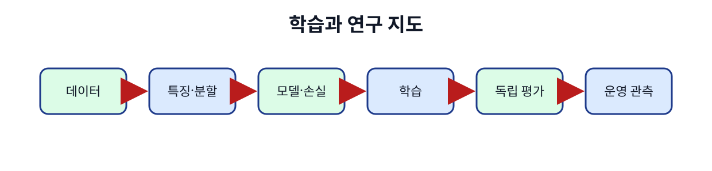

# 11. 학습 system과 수치 정밀도

[← 이전](10-attention-and-transformers.md) · [목차](README.md) · [다음 →](12-ai-ran-and-operational-evaluation.md)

학습 system은 data loader, CPU, accelerator, memory, network가 함께 동작한다.

FP32, BF16, FP16은 숫자를 저장하는 bit 구성과 표현 범위가 다르다.

낮은 정밀도는 memory와 계산 이점을 줄 수 있지만 overflow와 underflow 조건을 확인해야 한다.

## 이 장의 목표

1. 처음 나오는 단어와 기호를 설명한다.
2. 작은 입력의 모든 중간값을 계산한다.
3. 계산 결과와 실제 system 주장을 구분한다.



## 기본 단어와 기호

**batch**는 한 번에 처리하는 sample 묶음이다.

**mini-batch**는 전체 data의 작은 부분이다.

**data loader**는 sample을 읽고 batch로 만드는 구성요소이다.

**accelerator**는 GPU 같은 계산 가속 장치이다.

**FP32**는 32-bit floating point이다.

**FP16**는 16-bit, 좁은 지수 범위의 floating point이다.

**BF16**는 FP32와 비슷한 지수 범위의 16-bit 형식이다.

**overflow**는 표현 최대 범위를 넘음이다.

**underflow**는 아주 작은 값이 0에 가까워짐이다.

**loss scaling**는 loss와 gradient를 확대 후 되돌리는 기법이다.

**mixed precision**는 값별로 다른 dtype 사용이다.

**gradient accumulation**는 여러 mini-batch gradient를 한 update에 누적이다.

## 왜 필요한가

- Model 계산만 빨라도 data loader가 느리면 accelerator가 기다린다.
- FP16과 BF16은 둘 다 16-bit지만 범위와 정밀도가 다르다.
- Loss scaling은 주로 작은 FP16 gradient 보존에 쓰며 항상 필요한 보편 규칙은 아니다.
- Train/eval mode는 gradient 기록과 같은 스위치가 아니다.

## 입력에서 결과까지

1. Storage에서 sample을 읽는다.
2. CPU worker가 decode와 augmentation을 한다.
3. Batch를 host memory에 만든다.
4. Accelerator로 복사한다.
5. Forward와 loss를 계산한다.
6. Scaled backward 또는 일반 backward를 수행한다.
7. 유한값 검사와 unscale을 한다.
8. Optimizer가 parameter와 state를 갱신한다.


## 작은 숫자로 한 번 계산하기

Parameter 1,000개를 FP32로 저장하면 4,000 bytes다.

FP16 또는 BF16이면 payload는 2,000 bytes다.

이는 parameter payload만 계산한 값이다.

Gradient 0.00001에 scale 1024를 곱하면 0.01024다.

Backward 뒤 1024로 나누면 원래 0.00001이다.

Scaled 값이 overflow면 optimizer step을 건너뛸 수 있다.

Batch 4개를 두 번 누적하면 effective batch는 단순 조건에서 8이다.

Sample weighting과 분산 실행 조건을 함께 확인한다.

| 구분 | 값 또는 책임 |
|---|---|
| FP32 | 4 bytes, 넓은 일반 정밀도 |
| BF16 | 2 bytes, 넓은 지수 범위 |
| FP16 | 2 bytes, 좁은 지수 범위 |
| INT8 | 1 byte 정수 표현, scale 필요 |

## train 모드와 eval 모드는 무엇을 바꾸는가

`train`은 매개변수를 반드시 갱신한다는 명령이 아니라 일부 층에 학습 동작을 사용하라는 모드다.

Dropout은 train 모드에서 활성값 일부를 무작위로 0으로 만들어 특정 경로에만 의존하는 것을 줄인다.

Eval 모드에서는 보통 dropout을 끄고 모든 활성값을 사용한다.

Batch Normalization은 train 모드에서 현재 batch의 평균과 분산을 사용하고 이동 평균 통계를 갱신할 수 있다.

Eval 모드에서는 저장된 running mean과 variance를 사용한다.

따라서 같은 입력도 train/eval 모드에 따라 출력이 달라질 수 있다.

반면 gradient 기록 여부는 별도다.

Eval 모드에서도 gradient 기록이 켜져 있으면 graph가 만들어질 수 있다.

No-grad context를 사용해도 model이 train 모드면 dropout의 무작위 동작은 남을 수 있다.

두 스위치를 목적에 맞게 각각 설정한다.

## FP16 손실 배율 조정의 조건

Gradient가 `1×10^-8`처럼 매우 작으면 FP16 표현에서 정밀도를 잃거나 0에 가까워질 수 있다.

Loss에 1024를 곱하면 backward의 모든 gradient도 1024배가 된다.

Optimizer 전에 다시 1024로 나누면 원래 수학적 scale로 돌아온다.

```text
원래 gradient = 0.00000001
scaled gradient = 0.00000001 × 1024 = 0.00001024
unscaled gradient = 0.00001024 / 1024 = 0.00000001
```

그러나 큰 gradient도 함께 1024배가 되어 FP16 최대 범위를 넘을 수 있다.

유한값 검사에서 infinity나 NaN이 나오면 해당 optimizer step을 건너뛰고 scale을 줄일 수 있다.

BF16은 FP16보다 지수 범위가 넓어 같은 이유의 loss scaling 필요성이 다를 수 있다.

어떤 dtype을 쓰든 reduction과 optimizer state를 더 높은 정밀도로 유지할지 구현을 확인한다.

“16-bit이므로 항상 두 배 빠르고 memory가 절반”이라는 결론은 weight 외 activation, optimizer, communication과 hardware 지원을 무시한 것이다.

## Shape·단위·시각 점검

입력 shape를 적는다.

각 축이 sample, channel, sequence 중 무엇인지 적는다.

숫자의 단위가 dB, ms, byte, 무차원 중 무엇인지 적는다.

Model이 값을 읽는 시각에 실제로 알 수 있었는지 확인한다.

평균의 분모가 sample인지 token인지 요청인지 적는다.

Parameter와 관측값을 구분한다.

## 구현에서 달라지는 것

Library는 여러 연산을 합쳐 실행할 수 있다.

Memory allocator와 queue가 추가 지연을 만든다.

Finite precision 때문에 손계산과 마지막 자리에서 다를 수 있다.

Version이 바뀌면 API 기본값이 달라질 수 있다.

따라서 식, code, 실행 환경을 함께 기록한다.

## 흔한 오해와 반례

- BF16과 FP16은 같은 숫자 형식이 아니다.
- Memory가 정확히 절반으로 줄었다고 전체 peak에 일반화하지 않는다.
- eval()이 gradient 기록을 자동으로 모두 끄는 것은 아니다.
- no-grad가 dropout을 evaluation 동작으로 바꾸는 것도 아니다.

## 확인 문제와 해설

### 문제 1

1M FP32 parameter payload는?

**해설:** 4,000,000 bytes로 약 3.81 MiB다.

### 문제 2

Loss scaling의 목적은?

**해설:** 작은 FP16 gradient가 표현 과정에서 사라지는 위험을 줄이는 것이다.

### 문제 3

train/eval mode가 주로 바꾸는 예는?

**해설:** Dropout과 BatchNorm 같은 layer의 동작이다.

## 학습 체크리스트

- 용어를 자신의 말로 설명할 수 있는가?
- 중간 숫자를 계산할 수 있는가?
- 누가 값을 바꾸는지 말할 수 있는가?
- 반례와 실패 조건을 말할 수 있는가?
- 독립 test와 운영 평가를 구분하는가?

## 공식 자료

- [ISLP 2023](https://www.statlearning.com/home)
- [Dive into Deep Learning](https://d2l.ai/)
- [PyTorch Automatic Mixed Precision examples](https://docs.pytorch.org/docs/stable/notes/amp_examples.html)

공식 근거 확인일: **2026-10-11**.

[← 이전](10-attention-and-transformers.md) · [목차](README.md) · [다음 →](12-ai-ran-and-operational-evaluation.md)
