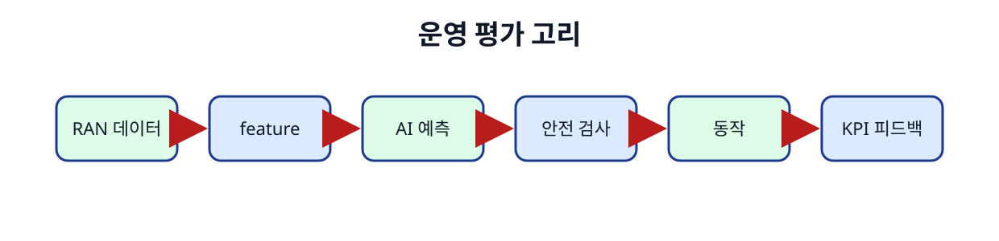
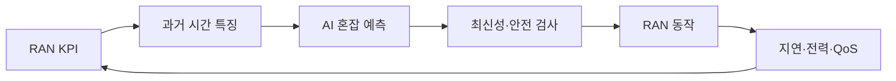

# 12. AI-RAN과 운영 평가

[← 이전](11-training-systems-and-numerical-precision.md) · [목차](README.md) · [다음 →](13-local-models.md)

AI-RAN 평가는 offline model metric과 현장 network 효과를 구분한다.

Data 시간 누수, inference 지연, 전력, QoS, 비교 기준을 함께 기록한다.

예측이 좋아도 안전하지 않은 action이면 운영 성공이 아니다.

## 이 장의 목표

1. 처음 나오는 단어와 기호를 설명한다.
2. 작은 입력의 모든 중간값을 계산한다.
3. 계산 결과와 실제 system 주장을 구분한다.

## 기본 단어와 기호

**AI-for-RAN**는 AI로 RAN 성능·운영을 개선이다.

**KPI**는 핵심 성능 지표이다.

**QoS**는 지연·손실·처리량 같은 서비스 품질이다.

**latency**는 입력부터 결과까지 걸린 시간이다.

**tail latency**는 p95·p99 같은 느린 구간이다.

**power**는 단위 시간 energy 사용률이다.

**energy**는 일을 수행하는 데 쓴 총 에너지이다.

**baseline cell**는 기존 정책을 유지한 비교 cell이다.

**time leakage**는 미래 정보가 과거 예측에 들어감이다.

**drift**는 운영 data 관계 변화이다.

**fallback**는 AI 실패 때 돌아갈 안전 동작이다.

**canary**는 일부 대상에 먼저 배포하는 방법이다.

## 왜 필요한가

- 같은 cell의 인접 시간 window는 독립 sample이 아닐 수 있다.
- Model inference 2 ms라도 data age 200 ms면 빠른 제어에 늦다.
- Power가 낮아도 QoS가 악화되면 성공이 아니다.
- AI action이 KPI를 바꾸므로 feedback data에 정책 효과가 섞인다.

## 입력에서 결과까지

1. Cell·UE·시간 단위로 data 경계를 정한다.
2. 과거 feature와 미래 label을 분리한다.
3. 시간과 cell 기준으로 train/test를 나눈다.
4. 규칙 baseline과 AI 후보를 offline 비교한다.
5. SIL과 HIL에서 timing·interface를 검증한다.
6. Shadow mode에서 action 없이 예측을 기록한다.
7. Canary cell에 guard와 fallback을 적용한다.
8. Latency, energy, QoS, drift를 함께 보고한다.

## 작은 숫자로 한 번 계산하기

Baseline cell throughput=100 Mbps다.

AI cell throughput=108 Mbps다.

증가는 (108-100)/100=8%다.

Baseline p99 latency=20 ms다.

AI p99 latency=28 ms다.

Throughput은 좋아졌지만 tail latency는 40% 악화됐다.

전력도 500 W에서 550 W로 10% 증가했다고 하자.

단일 throughput metric으로 성공이라 할 수 없다.

| 구분 | 값 또는 책임 |
|---|---|
| 정확도 | 예측이 label과 맞는가 |
| 지연 | 결정이 deadline 전에 오는가 |
| 전력·에너지 | 추가 비용은 얼마인가 |
| QoS | 사용자 품질이 유지되는가 |

## Shape·단위·시각 점검

입력 shape를 적는다.

각 축이 sample, channel, sequence 중 무엇인지 적는다.

숫자의 단위가 dB, ms, byte, 무차원 중 무엇인지 적는다.

Model이 값을 읽는 시각에 실제로 알 수 있었는지 확인한다.

평균의 분모가 sample인지 token인지 요청인지 적는다.

Parameter와 관측값을 구분한다.

## 구현에서 달라지는 것

Library는 여러 연산을 합쳐 실행할 수 있다.

Memory allocator와 queue가 추가 지연을 만든다.

Finite precision 때문에 손계산과 마지막 자리에서 다를 수 있다.

Version이 바뀌면 API 기본값이 달라질 수 있다.

따라서 식, code, 실행 환경을 함께 기록한다.

## 흔한 오해와 반례

- Offline accuracy를 현장 RAN 개선률로 부르지 않는다.
- 무작위 행 분할은 cell-time 누수를 만들 수 있다.
- 평균 latency가 낮아도 p99 deadline을 놓칠 수 있다.
- Canary 성공이 모든 지역 일반화를 보장하지 않는다.

## 확인 문제와 해설

### 문제 1

Feature 시각이 label 이후면?

**해설:** 미래 정보 누수이므로 운영 예측에서 사용할 수 없다.

### 문제 2

Throughput +8%, p99 latency +40%면 성공인가?

**해설:** 목표와 QoS guard에 따라 실패일 수 있어 다중 metric 판단이 필요하다.

### 문제 3

Fallback이 필요한 이유는?

**해설:** Drift, timeout, out-of-range 입력에서 안전한 기존 동작으로 복귀하기 위해서다.

## 학습 체크리스트

- 용어를 자신의 말로 설명할 수 있는가?
- 중간 숫자를 계산할 수 있는가?
- 누가 값을 바꾸는지 말할 수 있는가?
- 반례와 실패 조건을 말할 수 있는가?
- 독립 test와 운영 평가를 구분하는가?

## 공식 자료

- [ISLP 2023](https://www.statlearning.com/home)
- [Dive into Deep Learning](https://d2l.ai/)
- [AI-RAN Alliance](https://ai-ran.org/)
- [O-RAN Alliance specifications](https://www.o-ran.org/specifications)

공식 근거 확인일: **2026-10-11**.

[← 이전](11-training-systems-and-numerical-precision.md) · [목차](README.md) · [다음 →](13-local-models.md)
