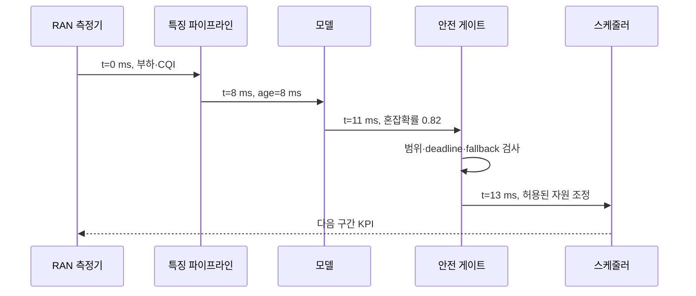
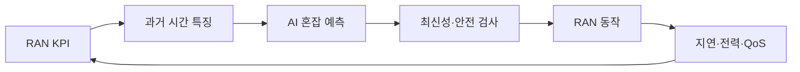

# 12. AI-RAN과 운영 평가

[← 이전](11-training-systems-and-numerical-precision.md) · [목차](README.md) · [다음 →](13-local-models.md)
## 먼저 실제 무선 객체를 정의한다

**RAN(Radio Access Network, 무선 접속망)**은 사용자 장치와 통신 사업자 핵심망 사이의 무선 구간이다. **UE(User Equipment, 사용자 장치)**는 휴대전화·모뎀 같은 단말이고, **기지국(base station)**은 안테나와 무선 처리 장비로 UE의 송수신을 예약한다. **채널(channel)**은 전파가 안테나 사이를 지나며 감쇠·반사·간섭을 겪는 물리 경로다. **신호(signal)**는 정보를 실어 보낸 전압·전파의 시간 변화다.

**SINR**은 Signal to Interference plus Noise Ratio, 즉 원하는 신호 전력과 간섭+잡음 전력의 비다. 원하는 신호 10 mW, 간섭 2 mW, 잡음 0.5 mW면 SINR은 10/2.5=4이고 dB로는 약 6.02 dB다. **CSI(Channel State Information)**는 송수신기가 추정한 채널 상태 숫자이며 측정 시각 이후 이동과 간섭 때문에 낡는다.

**추론(inference)**은 학습된 모델 weight를 고정하고 새 입력에서 예측을 계산하는 실행이다. **추론 마감시간(deadline)**은 그 결과가 제어에 유효하려면 끝나야 하는 시각이다. 10 ms 제어 주기에서 측정 1.5 ms, feature 1 ms, queue 2 ms, 추론 3 ms, 안전검사 1 ms, 명령 전달 1 ms면 합 9.5 ms로 0.5 ms 여유다. Queue가 3 ms가 되면 10.5 ms로 마감 실패이며 accuracy가 높아도 그 action은 늦다.

| 시각 | 주체 | 상태 |
|---:|---|---|
|0 ms|기지국|SINR·CSI 측정|
|1.5 ms|feature pipeline|입력 tensor 생성|
|2.5 ms|scheduler|GPU queue 진입|
|4.5 ms|model|추론 시작|
|7.5 ms|safety guard|출력 범위·변화율 검사|
|8.5 ms|RAN controller|명령 전송|
|9.5 ms|기지국|다음 주기 전 적용|

**폐루프(closed loop)**는 측정→예측→안전검사→동작→새 측정이 반복되는 실제 객체 흐름이다. Model output은 권고값이며 정책·장비 한계·fallback을 통과해야 action이 된다. Timeout이면 이전 안전 설정을 유지하도록 설계할 수 있다.

**Domain shift**는 학습 자료와 현장 입력 분포가 달라지는 현상이다. 한 도시·주파수·UE 속도에서 학습한 model이 다른 도시에서 실패할 수 있다. **Negative transfer**는 다른 domain의 학습이 새 domain 성능을 오히려 악화시키는 현상이다. Pretraining model보다 현장 baseline이 낫다면 전이는 성공이 아니다.

논문 simulation은 채널 model과 traffic 가정 안에서 인과를 통제하기 좋지만 hardware queue, clock, 장애를 완전히 재현하지 않는다. Lab emulation은 실제 software stack 일부를 검증하고, field measurement는 현장 효과를 보지만 외부 변수가 많다. 세 근거를 같은 것으로 합치지 않는다.

### 추가 완전 풀이

1. 10 ms 주기에 단계 합이 11 ms면? **해설:** 1 ms deadline miss다. 예측 정확도와 별도로 실패다.
2. 신호 8, 간섭 1, 잡음 1 mW의 SINR은? **해설:** 8/(1+1)=4, 약 6.02 dB다.
3. Simulation 20% 개선이 현장 보장인가? **해설:** 아니다. 채널·traffic·hardware 조건을 현장으로 검증해야 한다.
4. 새 cell에서 baseline보다 낮아지면? **해설:** domain shift와 negative transfer를 조사하고 fallback한다.

AI-RAN 평가는 offline model metric과 현장 network 효과를 구분한다.

Data 시간 누수, inference 지연, 전력, QoS, 비교 기준을 함께 기록한다.

예측이 좋아도 안전하지 않은 action이면 운영 성공이 아니다.

## 10 ms 제어 주기의 실패를 끝까지 추적한다

UE가 이동하며 실제 SINR이 8 dB에서 2 dB로 떨어졌다고 하자. t=0에 기지국이 이전 8 dB CSI를 읽고, t=1 ms에 feature를 만들고, t=3 ms에 accelerator queue에 들어간다. 정상이라면 t=6 ms 추론, t=7 ms 안전 검사, t=8 ms 명령 전송, t=9 ms 적용이다.

Queue가 5 ms 밀리면 추론 완료가 t=9, 안전 검사 t=10, 전송 t=11, 적용 t=12가 된다. 명령 내용이 8 dB 관측에 맞아도 실제 채널은 이미 2 dB이고 다음 주기까지 2 ms 늦었다. Controller는 늦은 action을 적용하지 않고 timestamp와 deadline을 검사해 fallback을 유지해야 한다.

환경 변화 반례도 있다. Training은 보행 UE 3 km/h, 현장은 차량 100 km/h라 CSI가 더 빨리 낡는다. Offline test를 같은 보행 분포로 나누면 높은 정확도가 유지되지만 현장에서는 prediction horizon 전에 채널이 변한다. 속도·주파수·기지국·계절을 domain 축으로 기록하고 새 domain holdout을 둔다.

학습 누출은 미래 CSI나 action 결과가 현재 feature에 들어갈 때 생긴다. t+10 ms ACK를 t 시점 예측 feature로 사용하면 offline metric은 좋아져도 실시간에는 값이 존재하지 않는다. Feature마다 생성 시각과 이용 가능 시각을 표로 남긴다.

Negative transfer는 다른 cell pretraining이 target cell보다 나쁜 초기값을 만드는 과정이다. Source-only, target-from-scratch, fine-tuning 세 기준을 같은 target test에서 비교한다. Fine-tuning이 scratch보다 나쁘면 source 규모가 크다는 이유로 성공이라 부르지 않는다.

Simulation에서는 channel model, UE 속도, traffic arrival을 통제한다. 현장 측정에서는 실제 scheduler·queue·RF 간섭이 포함되지만 반복 통제가 어렵다. 논문 표에는 simulation인지 testbed인지 field인지, hardware와 deadline 정의를 함께 쓴다.

## Offline quality에서 무선 동작까지 이어지는 경계

**offline quality(오프라인 품질)**는 저장된 feature와 label로 계산한 예측 품질이다. 예를 들어 다음 100 ms 동안 셀 부하가 임계값을 넘는지를 맞히는 모델의 precision, recall, 교차엔트로피가 여기에 속한다. 이 값은 모델 파일이 입력을 해석하는 능력을 보지만, 실제 무선 장비가 제때 안전한 동작을 했다는 뜻은 아니다.

**closed loop(폐루프)**는 측정→특징 생성→추론→안전 검사→동작→새 측정이 되먹임되는 과정이다. 모델이 내놓는 0.82는 바로 스케줄러 명령이 아니다. 정책 주체가 최신성, 허용 범위, deadline을 검사한 뒤 자원 비율 같은 제한된 action으로 바꾼다. RAN은 Radio Access Network, 즉 단말과 코어망 사이 무선 접속 구간이다.

**QoS(Quality of Service, 서비스 품질)**는 사용자에게 약속한 지연·손실·처리량 조건이다. 평균 throughput이 늘어도 음성 사용자의 p99 지연이 한도를 넘으면 운영 목표를 실패할 수 있다. **power(전력)**는 순간 에너지 사용률 W이고, **energy(에너지)**는 일정 시간 누적한 J다. 500 W로 2초 실행하면 1000 J다. 둘을 같은 단위처럼 보고하면 안 된다.

## 수치 추적 1: 정확하지만 늦은 예측

동작 deadline을 측정 뒤 20 ms로 정했다고 하자. 수집 6 ms, feature 생성 5 ms, queue 4 ms, inference 3 ms, 안전 검사와 전달 4 ms이면 합은 `6+5+4+3+4=22 ms`다. 모델 계산은 3 ms뿐이지만 전체 결정은 2 ms 늦다. 이 요청에는 기존 규칙을 쓰는 fallback이 맞다.

다음 최적화에서 queue를 1 ms로 줄이면 합은 19 ms다. 여유는 1 ms뿐이므로 평균이 아니라 p99를 확인해야 한다. p99가 25 ms이면 드문 혼잡 때 deadline을 계속 놓친다. “모델 latency 3 ms”는 폐루프 latency 19 ms와 다른 측정값이다.

## 수치 추적 2: 시간·셀 누수

셀 A의 10:00, 10:01, 10:02 기록과 셀 B의 같은 시각 기록이 있다고 하자. 각 행을 무작위로 나누면 A 10:01이 train에, A 10:02가 test에 갈 수 있다. 느리게 변하는 셀 용량이나 장애 상태가 양쪽에 거의 그대로 들어가므로 새 셀·미래 시간보다 쉬운 문제가 된다.

운영 질문이 “다음 주 새 셀에서 동작하는가?”라면 train은 과거 주의 A·B, validation은 더 최근 시간, test는 완전히 보류한 셀 C처럼 나눈다. 반대로 같은 셀의 다음 10초만 예측하는 문제라면 셀 보류가 지나치게 다른 질문일 수 있다. 분할은 관행이 아니라 배포 질문을 모사해야 한다.

## MTL과 negative transfer를 실험으로 분리한다

**MTL(Multi-Task Learning, 다중 과제 학습)**은 하나의 공유 표현을 여러 정답이 함께 사용하게 한다. 예를 들어 task 1은 throughput 예측, task 2는 latency 위반 예측이다. 공유층 gradient가 각각 `g₁=[2,-1]`, `g₂=[-3,1]`이면 단순 합은 `[-1,0]`이다. 첫 좌표에서 두 과제가 반대 방향을 요구한다.

**negative transfer(부정 전이)**는 함께 학습한 결과가 적어도 한 과제의 단독 모델보다 나빠지는 현상이다. 이를 보려면 동일 데이터 기간과 계산 예산에서 단독 throughput 모델, 단독 latency 모델, 공동 MTL 모델을 비교한다. MTL이 throughput MAE 4→3으로 좋아졌지만 latency 위반 recall 0.90→0.78로 떨어지면 “전체 향상”이라 부를 수 없다. 가중치 조정이나 공유층 분리는 후보일 뿐, 새 독립 평가로 다시 확인한다.

2024년 AI-RAN MTL preprint는 불확실성 가중과 연합 설정에서 부정 전이를 다루지만, 특정 데이터셋 결과를 모든 망에 일반화할 수 없다. 이 장에서 중요한 연결은 gradient 충돌이라는 기초 현상이 과제별 baseline과 guardrail을 요구한다는 점이다.

## 배포 단계와 담당 주체

SIL(Software-in-the-Loop)은 실제 무선 장비 대신 소프트웨어 환경에서 interface와 시나리오를 시험한다. HIL(Hardware-in-the-Loop)은 실제 또는 대표 하드웨어를 고리에 넣어 timing과 I/O를 본다. Shadow mode는 모델이 예측하지만 action을 적용하지 않는다. Canary는 일부 셀과 제한된 시간에 action을 허용한다. 각 단계는 앞 단계보다 현실 조건을 늘리지만 현장 전체를 자동 대표하지 않는다.

안전 게이트는 입력 age가 20 ms 초과, 확률이 비정상, 모델 timeout, QoS guard 위반이면 기존 정책으로 돌아간다. **drift(드리프트)**는 feature 분포 또는 feature-label 관계가 학습 시기와 달라지는 변화다. 입력 평균이 변하지 않아도 사용자 행동과 정답 관계가 바뀔 수 있으므로 예측 오차의 지연 label도 관측한다.

## 반례: 좋은 정확도가 나쁜 제어가 되는 경우

혼잡을 95% 맞히지만 false negative가 모두 긴급 통화 시간에 몰리면 평균 accuracy는 안전성을 숨긴다. 또 모델이 혼잡을 예측해 자원을 늘리면 실제 혼잡 label이 사라진다. 다음 학습 데이터는 모델 action의 영향을 받은 것이므로 단순 관측 상관을 원래 세계의 정답처럼 쓰면 feedback bias가 생긴다.

## 다섯 문제를 단계별로 푼다

**문제 1.** 수집 4 ms, 특징 3 ms, queue 5 ms, 추론 2 ms, 적용 3 ms의 총 지연은?

**해설.** 직렬 경로라면 합은 17 ms다. deadline 15 ms이면 추론만 2 ms여도 2 ms 늦으므로 fallback을 적용한다.

**문제 2.** 600 W로 0.5초 동작한 에너지는?

**해설.** `600 J/s×0.5 s=300 J`다. 전력 600 W와 에너지 300 J를 구분한다.

**문제 3.** 같은 셀의 인접 행을 무작위 분할한 accuracy가 높은 이유는?

**해설.** 고정된 셀 특성과 느린 시간 변화가 train과 test에 함께 들어가 유사한 행을 기억할 수 있기 때문이다. 새 셀 일반화 주장을 지지하지 않는다.

**문제 4.** MTL이 task A는 개선하고 B는 악화하면 성공인가?

**해설.** 사전에 정한 우선순위와 guardrail에 달렸다. B가 안전 지표라면 실패다. 두 단독 baseline과 과제별 불확실성을 함께 보고한다.

**문제 5.** Shadow mode에서 QoS가 유지되면 action도 안전하다고 할 수 있는가?

**해설.** Shadow mode는 action을 적용하지 않았으므로 action의 인과 효과를 측정하지 않았다. 제한된 canary와 즉시 fallback으로 다음 증거를 수집해야 한다.

## 입력에서 결과까지

1. Cell·UE·시간 단위로 data 경계를 정한다.
2. 과거 feature와 미래 label을 분리한다.
3. 시간과 cell 기준으로 train/test를 나눈다.
4. 규칙 baseline과 AI 후보를 offline 비교한다.
5. SIL과 HIL에서 timing·interface를 검증한다.
6. Shadow mode에서 action 없이 예측을 기록한다.
7. Canary cell에 guard와 fallback을 적용한다.
8. Latency, energy, QoS, drift를 함께 보고한다.

## 작은 숫자로 한 번 계산하기

Baseline cell throughput=100 Mbps다.

AI cell throughput=108 Mbps다.

증가는 (108-100)/100=8%다.

Baseline p99 latency=20 ms다.

AI p99 latency=28 ms다.

Throughput은 좋아졌지만 tail latency는 40% 악화됐다.

전력도 500 W에서 550 W로 10% 증가했다고 하자.

단일 throughput metric으로 성공이라 할 수 없다.

| 구분 | 값 또는 책임 |
|---|---|
| 정확도 | 예측이 label과 맞는가 |
| 지연 | 결정이 deadline 전에 오는가 |
| 전력·에너지 | 추가 비용은 얼마인가 |
| QoS | 사용자 품질이 유지되는가 |

## Shape·단위·시각 점검

입력 shape를 적는다.

각 축이 sample, channel, sequence 중 무엇인지 적는다.

숫자의 단위가 dB, ms, byte, 무차원 중 무엇인지 적는다.

Model이 값을 읽는 시각에 실제로 알 수 있었는지 확인한다.

평균의 분모가 sample인지 token인지 요청인지 적는다.

Parameter와 관측값을 구분한다.

## 구현에서 달라지는 것

Library는 여러 연산을 합쳐 실행할 수 있다.

Memory allocator와 queue가 추가 지연을 만든다.

Finite precision 때문에 손계산과 마지막 자리에서 다를 수 있다.

Version이 바뀌면 API 기본값이 달라질 수 있다.

따라서 식, code, 실행 환경을 함께 기록한다.

## 흔한 오해와 반례

- Offline accuracy를 현장 RAN 개선률로 부르지 않는다.
- 무작위 행 분할은 cell-time 누수를 만들 수 있다.
- 평균 latency가 낮아도 p99 deadline을 놓칠 수 있다.
- Canary 성공이 모든 지역 일반화를 보장하지 않는다.

## 확인 문제와 해설

### 문제 1

Feature 시각이 label 이후면?

**해설:** 미래 정보 누수이므로 운영 예측에서 사용할 수 없다.

### 문제 2

Throughput +8%, p99 latency +40%면 성공인가?

**해설:** 목표와 QoS guard에 따라 실패일 수 있어 다중 metric 판단이 필요하다.

### 문제 3

Fallback이 필요한 이유는?

**해설:** Drift, timeout, out-of-range 입력에서 안전한 기존 동작으로 복귀하기 위해서다.

## 공식 자료

- [ISLP 2023](https://www.statlearning.com/home)
- [Dive into Deep Learning](https://d2l.ai/)
- [AI-RAN Alliance](https://ai-ran.org/)
- [O-RAN Alliance specifications](https://www.o-ran.org/specifications)
- [Multi-task learning for AI-RAN 연구 preprint (2024)](https://arxiv.org/abs/2404.15197) — 부정 전이와 불확실성 가중의 연구 조건을 확인하며, 특정 망의 보편 성능으로 일반화하지 않는다.

공식 근거 확인일: **2026-10-11**.

[← 이전](11-training-systems-and-numerical-precision.md) · [목차](README.md) · [다음 →](13-local-models.md)
