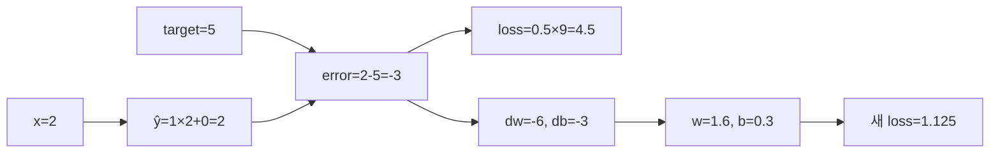

# 13. 로컬 계산 모델

[← 이전](12-ai-ran-and-operational-evaluation.md) · [목차](README.md) · [다음 →](14-experiments-and-research.md)
## 코드 객체와 assert의 수명

Python source의 숫자는 실행 전 파일에 있고, 실행하면 지역 변수로 memory에 생긴다. **Assert**는 조건이 거짓이면 즉시 실패시켜 예상 계산이 바뀐 것을 알리는 검사다. Assert 통과는 그 고정 입력의 산술을 증명할 뿐 실제 dataset, GPU, 일반화를 증명하지 않는다.

선형회귀 모형에서 입력 x=2, target=5, weight=1, bias=0은 모두 scalar다. Forward prediction=2, error=-3, loss=4.5다. 편미분은 dL/dprediction=-3, dL/dweight=-6, dL/dbias=-3이다. learning rate 0.1이면 새 weight=1.6, bias=0.3, 새 prediction=3.5다. Assert는 이 중간값과 update를 각각 확인해야 어느 식이 깨졌는지 안다.

분류 모형의 logit, sigmoid probability, threshold decision도 분리한다. Logit 0이면 probability 0.5다. Threshold 0.7이면 negative 결정이다. Probability assert와 class assert를 따로 두면 sigmoid 오류와 threshold 오류를 구분한다.

Attention 모형은 Q,K,V 행렬 shape, score, softmax 행 합 1, output 가중합을 확인한다. 반올림 값에 정확한 equality를 쓰면 floating-point 때문에 실패할 수 있어 tolerance를 사용한다. Tolerance 1e-6은 오차 허용이지 계산을 대충 해도 된다는 뜻이 아니다.

모형의 입력→중간→출력 표:

|모형|입력|중간 상태|출력|경계|
|---|---|---|---|---|
|선형회귀|x,target,w,b,lr|prediction,error,loss,grad|새 w,b|한 표본 한 step|
|분류|logit,label,threshold|sigmoid,loss|class|calibration 미검증|
|attention|Q,K,V,mask|score,scale,softmax|weighted V|실제 Transformer 아님|

### 추가 완전 풀이

1. prediction 2,target5의 0.5MSE? **해설:** 0.5×9=4.5다.
2. x=2,error=-3의 weight gradient? **해설:** -6이다.
3. assert가 모두 통과하면 현장 성능도 맞나? **해설:** 아니다. 고정 산술만 검증한다.
4. softmax 행 합 assert는 무엇을 잡나? **해설:** 축·mask·정규화 오류를 잡지만 의미 적합성은 못 잡는다.

이 장은 표준 Python 계산 모델 세 개로 손계산을 다시 확인한다.

고정 입력과 assert는 계산 결과의 퇴행을 잡는다.

이 실행은 학습 성능, GPU 성능, 현장망 검증이 아니다.

## 실제 세 Python 파일의 실행 순서

`linear_regression_step.py`는 반복문 없는 한 번의 SGD 갱신이다. `x,target,weight,bias,learning_rate` 다섯 입력에서 prediction 2, error -3, loss 4.5, grad_weight -6, grad_bias -3을 만든다. Update 뒤 new_weight 1.6, new_bias 0.3, new_prediction 3.5, new_loss 1.125다. 마지막 assert는 새 손실이 4.5보다 작은지 확인한다. Learning rate를 1로 바꾸면 weight 7,bias3,prediction17,loss72가 되어 “gradient 방향이 맞아도 step이 너무 크면 실패”라는 반례가 된다.

`softmax_attention_model.py`의 함수는 먼저 maximum을 구하고 모든 score에서 빼 overflow를 막는다. Query `[1,0]`과 두 key의 내적은 1과 0, scale sqrt(2)로 나눈 score는 약 0.707107과 0이다. Maximum을 빼면 `[0,-0.707107]`, 지수는 `[1,0.493069]`, 합 1.493069, weight는 약 `[0.669762,0.330238]`다. Value 가중합은 `[6.697615,6.604769]`다.

`zip(query,key)`는 같은 위치 원소 쌍을 만들고 generator가 q*k를 합한다. Output 바깥 반복은 axis 0,1 두 성분을 만들고, 안쪽 반복은 key/value index 0,1을 합한다. Maximum 빼기를 없애고 `[1000,1000]`에 exp를 직접 적용하면 overflow할 수 있다. `sum(weights)=1`, 첫 weight가 큼, output 두 숫자와 큰 동일 score가 `[0.5,0.5]`임을 assert한다.

`split_leakage_model.py`는 dictionary 세 후보를 순회한다. Validation error 최소는 medium 0.15이고 독립 test error는 0.19다. Test error를 선택에 사용하면 complex 0.14를 고른다. 이 0.14는 선택과 보고에 같은 test를 쓴 optimistic 값이다. `min(...,key=lambda...)`는 각 이름의 지정 metric을 비교한다.

### 여덟 완전 풀이

1. 선형회귀 새 loss는? **해설:** 새 예측3.5, error-1.5, `0.5×2.25=1.125`.
2. grad_weight가 -6인 이유는? **해설:** error -3에 x2를 곱한다.
3. lr=1의 반례는? **해설:** 새 loss72로 발산한다.
4. attention 두 score는? **해설:** `[1/√2,0]≈[0.707107,0]`.
5. 첫 softmax weight는? **해설:** `1/(1+exp(-0.707107))≈0.669762`.
6. 첫 output 성분은? **해설:** `0.669762×10+0.330238×0=6.69762`.
7. Validation 선택 후보는? **해설:** 0.15인 medium, test는0.19.
8. Test 선택 0.14가 낙관적인 이유는? **해설:** 같은 test를 선택과 보고에 재사용해 독립성을 잃었다.

## 모델 1: 선형회귀 한 step을 코드와 같은 순서로 읽기

`linear_regression_step.py`의 고정 입력은 `x=2`, `target=5`, `weight=1`, `bias=0`, `learning_rate=0.1`이다. **forward(순전파)**에서 prediction은 `weight*x+bias=1×2+0=2`다. error를 `prediction-target`으로 정하면 `2-5=-3`이고, loss는 `0.5×error²=0.5×9=4.5`다. 0.5는 미분할 때 제곱의 2와 상쇄하려는 배율이며 최솟값 위치를 바꾸지 않는다.

**gradient(기울기)**는 parameter가 조금 변할 때 loss가 얼마나 변하는지 나타낸다. `grad_weight=error*x=-3×2=-6`, `grad_bias=error=-3`이다. optimizer 역할의 코드가 `new_weight=1-0.1×(-6)=1.6`, `new_bias=0-0.1×(-3)=0.3`으로 갱신한다. 같은 입력의 새 prediction은 `1.6×2+0.3=3.5`, error는 -1.5, loss는 `0.5×2.25=1.125`다.

Assert는 이 중간값과 새 loss가 예상값에 가까운지 검사한다. 이 한 점에서 loss가 줄었다고 전체 데이터 평균이나 다음 step의 감소를 증명하지 않는다. 입력이 `x=-2`로 바뀌면 weight gradient의 부호도 달라진다.

## 모델 2: 안정화 softmax와 attention 전체 추적

`softmax_attention_model.py`의 query는 `[1,0]`, keys는 `[[1,0],[0,1]]`, values는 `[[10,0],[0,20]]`이다. 벡터 차원 `d=2`이므로 scale은 `√2≈1.414214`다. 첫 key와의 내적은 1, 둘째는 0이어서 scaled scores는 `[1/√2,0]=[0.707107,0]`이다.

안정화 softmax는 score 최댓값 0.707107을 둘 다에서 뺀다. 이동한 score는 `[0,-0.707107]`; 지수는 `[1, 약 0.493069]`; 합은 약 1.493069다. 따라서 weights는 약 `[0.669762,0.330238]`이고 합은 1이다. 출력 첫 좌표는 `0.669762×10+0.330238×0=6.697615`, 둘째는 `0.669762×0+0.330238×20=6.604769`다.

최댓값을 빼도 모든 지수에 같은 양의 상수를 곱하는 효과라 비율은 바뀌지 않는다. 작은 예제에서는 overflow가 없지만 큰 양의 score에서 `exp(score)`가 표현 범위를 넘는 것을 막는다. 안정화는 attention의 의미를 고치는 것이 아니라 같은 softmax를 수치적으로 계산하는 방법이다.

## 모델 3: validation 선택과 test 누수

`split_leakage_model.py`에는 후보 `simple`, `medium`, `complex`가 있다. validation error는 각각 0.20, 0.15, 0.17이므로 선택 주체는 최솟값 0.15인 medium을 고른다. 선택을 끝낸 뒤 medium의 독립 test error 0.19를 보고한다.

Test error만 보면 simple 0.22, medium 0.19, complex 0.14이므로 complex가 가장 좋아 보인다. 그러나 test를 보고 complex를 택하면 test가 후보 선택에 사용된다. 코드가 이를 `leaky_selected=complex`, `optimistic=0.14`로 드러내는 이유다. 0.14는 “독립 test 성능”이 아니라 test에 적응해 고른 낙관적 숫자다.

세 후보만 있어도 최솟값 선택은 우연한 흔들림을 이용한다. 후보를 수백 개 시험하면 이 효과는 더 커질 수 있다. 해결은 test를 숨긴 채 validation에서 선택을 끝내고, test 결과를 본 뒤에는 새 모델 선택을 하지 않는 것이다.

## 출력 줄을 어떻게 해석하는가

화면의 소수 여섯 자리는 내부 이진 부동소수점 값을 반올림한 표시다. 출력 `0.669762`를 다시 넣어 계산하면 내부값과 마지막 자리가 다를 수 있다. Assert가 쓰는 tolerance는 그 미세 차이를 허용하되, 0.66과 0.33의 위치가 바뀌는 논리 오류까지 허용해서는 안 된다.

세 파일은 네트워크·파일·GPU를 사용하지 않고 고정 숫자를 계산한다. 실행 시간이 짧다는 사실은 GPU kernel 속도나 실제 학습 처리량의 증거가 아니다. 외부 데이터 분포, 병렬 실행, 장애, label 지연이 모두 빠져 있다.

## 조건을 바꾼 반례

회귀 학습률을 1.0으로 바꾸면 `w=7`, `b=3`, 새 prediction 17, loss 72가 되어 시작 loss 4.5보다 커진다. Gradient 방향이 맞아도 step 크기가 지나치면 지나칠 수 있다. Attention에서 두 key가 모두 `[1,0]`이면 score가 같아 weights는 `[0.5,0.5]`가 되며 첫 value만 고르지 않는다. Split 예제에서 후보가 하나뿐이면 test 최솟값 선택 문제는 없지만, train에 test 정보를 넣는 다른 누수는 여전히 가능하다.

## 다섯 문제를 단계별로 푼다

**문제 1.** 회귀 예제에서 왜 `grad_weight=-6`인가?

**해설.** error가 -3이고 weight가 1만큼 변할 때 prediction은 x=2만큼 변한다. 연쇄법칙으로 `dL/dw=error×x=-3×2=-6`이다.

**문제 2.** 갱신 뒤 prediction 3.5를 다시 계산하라.

**해설.** 새 weight 1.6과 bias 0.3을 써서 `1.6×2+0.3=3.5`다. target 5와의 차이는 -1.5다.

**문제 3.** Attention weight의 합이 1인 이유는?

**해설.** 각 지수를 같은 양의 합으로 나누므로 `(e₁+e₂)/(e₁+e₂)=1`이다. 그래서 output은 value의 가중 평균이다.

**문제 4.** Medium의 test 0.19 대신 complex 0.14를 보고하면 무엇이 잘못되는가?

**해설.** Test 결과가 모델 선택에 들어가 독립성이 사라진다. Complex를 새 후보로 삼으려면 선택용 validation으로 돌아가고 새로운 test가 필요하다.

**문제 5.** 세 assert가 모두 통과하면 어떤 주장까지 가능한가?

**해설.** 고정 입력에서 구현된 산술과 불변조건이 기대값과 맞는다고 말할 수 있다. 일반화, 성능, 현장 안전은 별도 실험 없이는 주장할 수 없다.

## 입력에서 결과까지

1. README에서 각 파일의 목적을 읽는다.
2. 고정 입력과 식을 손으로 계산한다.
3. Code에서 같은 중간값을 찾는다.
4. Assert가 어떤 불변조건을 검사하는지 읽는다.
5. 출력의 반올림 자리와 내부 값을 구분한다.
6. 입력 하나만 바꿔 결과를 예측한다.
7. 실행 결과와 예측을 비교한다.
8. 현장 검증에 필요한 누락 요소를 적는다.

## 작은 숫자로 한 번 계산하기

회귀 예제 처음 prediction=2.00이다.

처음 loss=4.50이다.

Gradient는 w=-6, b=-3이다.

새 w=1.6, b=0.3이다.

새 loss=1.125로 줄었다.

Attention weight 합은 1이다.

Split 예제는 validation으로 medium을 선택한다.

Medium 독립 test error는 0.19다.

Test로 다시 고른 0.14는 낙관적 선택 결과다.

| 구분 | 값 또는 책임 |
|---|---|
| 회귀 파일 | loss와 update |
| attention 파일 | 안정화 softmax |
| split 파일 | test 누수 |
| 외부 I/O | 없음 |

## Shape·단위·시각 점검

입력 shape를 적는다.

각 축이 sample, channel, sequence 중 무엇인지 적는다.

숫자의 단위가 dB, ms, byte, 무차원 중 무엇인지 적는다.

Model이 값을 읽는 시각에 실제로 알 수 있었는지 확인한다.

평균의 분모가 sample인지 token인지 요청인지 적는다.

Parameter와 관측값을 구분한다.

## 구현에서 달라지는 것

Library는 여러 연산을 합쳐 실행할 수 있다.

Memory allocator와 queue가 추가 지연을 만든다.

Finite precision 때문에 손계산과 마지막 자리에서 다를 수 있다.

Version이 바뀌면 API 기본값이 달라질 수 있다.

따라서 식, code, 실행 환경을 함께 기록한다.

## 흔한 오해와 반례

- Assert 통과는 algorithm 전체 정확성 증명이 아니다.
- 고정 입력 성공은 일반화 성능이 아니다.
- Stdlib 예제는 accelerator benchmark가 아니다.
- Test 선택 예제의 0.14를 최종 성능으로 보고하지 않는다.

## 확인 문제와 해설

### 문제 1

Assert의 역할은?

**해설:** 예상 조건이 깨지면 즉시 실패시켜 계산 회귀를 드러낸다.

### 문제 2

Tolerance가 필요한 이유는?

**해설:** Floating point 반올림으로 수학적으로 같은 값도 bit 수준에서 다를 수 있기 때문이다.

### 문제 3

로컬 예제가 증명하지 못하는 것은?

**해설:** 실제 data 일반화, GPU 성능, 현장 RAN QoS다.

## 실행 파일

- [선형회귀 한 step](examples/linear_regression_step.py)
- [안정화 softmax와 attention](examples/softmax_attention_model.py)
- [분할과 test 누수](examples/split_leakage_model.py)

## 공식 자료

- [ISLP 2023](https://www.statlearning.com/home)
- [Dive into Deep Learning](https://d2l.ai/)

공식 근거 확인일: **2026-10-11**.

[← 이전](12-ai-ran-and-operational-evaluation.md) · [목차](README.md) · [다음 →](14-experiments-and-research.md)
