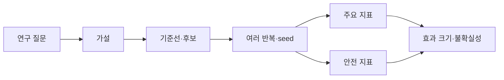

# 14. 실험과 연구 설계

[← 이전](13-local-models.md) · [목차](README.md) · [다음 →](15-exercises-glossary-and-sources.md)

실험은 한 조건을 바꾸고 결과 차이를 측정해 주장에 근거를 만든다.

연구 설계는 질문, 비교 기준, metric, 중단 조건을 실행 전에 고정한다.

좋은 결과만 고르는 사후 선택은 결론을 과장한다.

## 이 장의 목표

1. 처음 나오는 단어와 기호를 설명한다.
2. 작은 입력의 모든 중간값을 계산한다.
3. 계산 결과와 실제 system 주장을 구분한다.

## 기본 단어와 기호

**hypothesis**는 검증 가능한 예상이다.

**independent variable**는 연구자가 바꾸는 조건이다.

**dependent variable**는 결과로 측정하는 값이다.

**control**는 기존 조건을 유지한 비교군이다.

**confounder**는 원인 해석을 섞는 다른 요인이다.

**randomization**는 배정 편향을 줄이는 무작위화이다.

**replication**는 독립 반복이다.

**seed**는 난수 sequence 시작값이다.

**confidence interval**는 추정 불확실성 구간이다.

**effect size**는 차이의 실제 크기이다.

**ablation**는 구성요소를 제거해 기여를 보는 실험이다.

**pre-registration**는 실행 전 질문과 분석을 기록이다.

## 왜 필요한가

- Metric을 결과 뒤 고르면 우연히 좋은 수치를 선택할 수 있다.
- Seed 하나는 random variation을 대표하지 않는다.
- 통계적 차이와 운영상 중요한 차이는 다르다.
- 재현에는 code뿐 아니라 data version과 환경이 필요하다.

## 입력에서 결과까지

1. 질문을 비교 가능한 문장으로 쓴다.
2. Baseline과 후보를 고정한다.
3. 독립 변수 하나를 정한다.
4. Confounder와 통제 방법을 적는다.
5. Primary metric과 guardrail을 정한다.
6. 반복 수와 seed를 정한다.
7. 실패를 포함해 결과를 수집한다.
8. Effect size, uncertainty, 한계를 보고한다.

## 작은 숫자로 한 번 계산하기

Baseline latency 측정이 [10,12,11] ms다.

평균은 11 ms다.

후보는 [9,11,10] ms다.

평균은 10 ms다.

평균 차이는 -1 ms다.

상대 감소는 1/11≈9.1%다.

표본이 각각 3개뿐이라 불확실성이 크다.

Power나 accuracy guardrail이 없으면 전체 개선을 주장할 수 없다.

| 구분 | 값 또는 책임 |
|---|---|
| 독립 변수 | model A/B |
| 주요 metric | p99 latency |
| guardrail | accuracy·power |
| 반복 | 여러 seed와 시간대 |

## Shape·단위·시각 점검

입력 shape를 적는다.

각 축이 sample, channel, sequence 중 무엇인지 적는다.

숫자의 단위가 dB, ms, byte, 무차원 중 무엇인지 적는다.

Model이 값을 읽는 시각에 실제로 알 수 있었는지 확인한다.

평균의 분모가 sample인지 token인지 요청인지 적는다.

Parameter와 관측값을 구분한다.

## 구현에서 달라지는 것

Library는 여러 연산을 합쳐 실행할 수 있다.

Memory allocator와 queue가 추가 지연을 만든다.

Finite precision 때문에 손계산과 마지막 자리에서 다를 수 있다.

Version이 바뀌면 API 기본값이 달라질 수 있다.

따라서 식, code, 실행 환경을 함께 기록한다.

## 흔한 오해와 반례

- 한 번의 최고 결과를 평균 성능으로 보고하지 않는다.
- P-value만으로 effect의 크기와 가치를 설명하지 않는다.
- 재현 실패를 숨기지 않는다.
- Ablation은 다른 조건도 동시에 바꾸면 기여를 분리하지 못한다.

## 확인 문제와 해설

### 문제 1

Confounder의 예는?

**해설:** Model과 함께 hardware도 바꾸면 어느 변화가 원인인지 섞인다.

### 문제 2

Seed를 여러 개 쓰는 이유는?

**해설:** 초기화와 sample 순서의 우연한 영향을 확인하기 위해서다.

### 문제 3

Guardrail metric이 필요한 이유는?

**해설:** 주요 metric 개선이 accuracy, power, QoS 악화로 얻어진 것은 아닌지 확인하기 위해서다.

## 학습 체크리스트

- 용어를 자신의 말로 설명할 수 있는가?
- 중간 숫자를 계산할 수 있는가?
- 누가 값을 바꾸는지 말할 수 있는가?
- 반례와 실패 조건을 말할 수 있는가?
- 독립 test와 운영 평가를 구분하는가?

## 공식 자료

- [ISLP 2023](https://www.statlearning.com/home)
- [Dive into Deep Learning](https://d2l.ai/)

공식 근거 확인일: **2026-10-11**.

[← 이전](13-local-models.md) · [목차](README.md) · [다음 →](15-exercises-glossary-and-sources.md)
