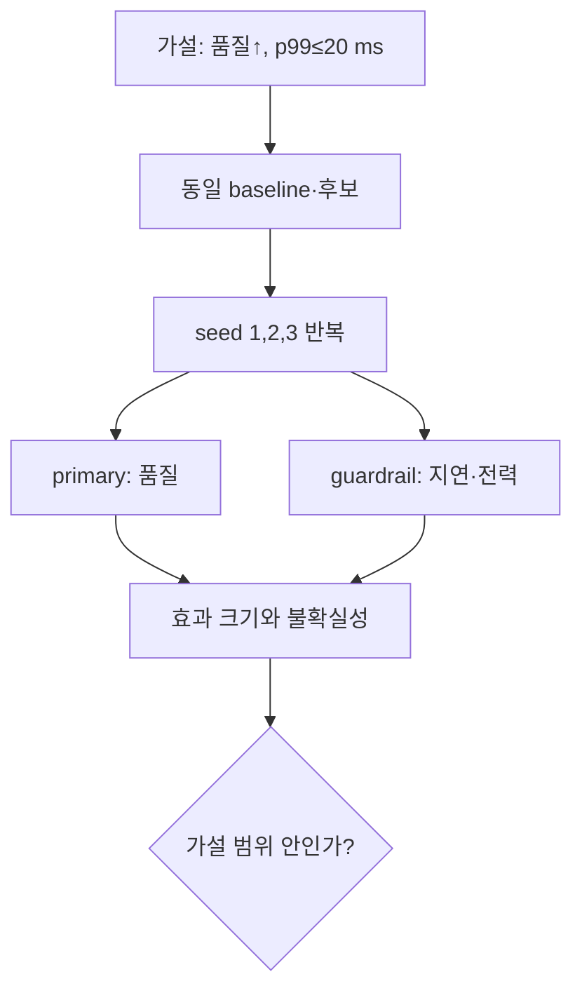
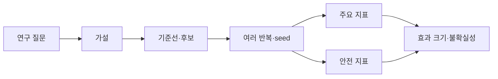

# 14. 실험과 연구 설계

[← 이전](13-local-models.md) · [목차](README.md) · [다음 →](15-exercises-glossary-and-sources.md)

실험은 한 조건을 바꾸고 결과 차이를 측정해 주장에 근거를 만든다.

연구 설계는 질문, 비교 기준, metric, 중단 조건을 실행 전에 고정한다.

좋은 결과만 고르는 사후 선택은 결론을 과장한다.

## 주장을 측정 문장으로 바꾸기

**hypothesis(가설)**는 반박 가능하게 쓴 예상이다. “새 모델이 좋다” 대신 “같은 test 요청과 계산 예산에서 후보 B는 baseline A보다 평균 정확도를 높이되 p99 latency 20 ms와 전력 550 W를 넘지 않는다”라고 쓴다. 정확도, 대상 요청, 예산, 안전 경계가 있어 결과가 가설을 지지하거나 반박할 수 있다.

**baseline(기준선)**은 후보가 추가 복잡성을 정당화하는지 보는 비교 대상이다. 가장 약한 임의 규칙만 두면 개선이 과장된다. 현재 운영 정책, 단순 통계 모델, 같은 자원에서의 강한 기존 방법을 목적에 맞게 둔다. Baseline도 같은 데이터 시각, preprocessing, timeout 처리, 측정 장비를 사용해야 한다.

**uncertainty(불확실성)**는 관측값이 다른 표본이나 seed에서 흔들릴 범위를 뜻한다. 평균 10 ms 하나는 세 측정 `[9,10,11]`과 `[1,10,19]`를 구분하지 못한다. 둘 다 평균은 10 ms지만 두 번째는 꼬리가 훨씬 넓다. 반복값, 표준편차, 분위수나 신뢰구간을 목적에 맞게 보고한다.

## 수치 추적 1: 평균과 반복 불확실성

Baseline의 세 seed 정확도가 `[0.78,0.80,0.82]`, 후보가 `[0.80,0.83,0.84]`라고 하자. 평균은 각각 0.80과 약 0.823이므로 절대 차이는 약 0.023, 즉 2.3 percentage point다. 상대 증가는 `0.023/0.80≈2.9%`지만 “2.3%p”와 “2.9%”를 섞으면 안 된다.

Seed별 짝 차이는 `[0.02,0.03,0.02]`다. 모두 양수라는 사실은 한 최고 seed만 비교한 것보다 강한 설명이지만, seed 3개만으로 모집단 전체를 확정하지 않는다. 데이터 재표집과 운영 시간대 변동은 seed 변경과 다른 불확실성 원천이다.

## 수치 추적 2: 품질과 지연을 함께 판정하기

동일한 1000개 요청에서 baseline은 정확도 0.80, p99 18 ms, 전력 500 W이고 후보는 정확도 0.83, p99 24 ms, 전력 510 W라고 하자. 후보는 품질을 3%p 높이고 전력은 2% 증가했지만 20 ms deadline을 위반한다. 가설의 guardrail을 어겼으므로 전체 성공이 아니다.

Timeout 30건을 지연 통계에서 삭제하면 남은 요청의 p99가 19 ms로 보일 수 있다. 하지만 실패가 가장 느린 요청일 가능성이 크다. Timeout을 실패율 3%로 별도 보고하고, 사전에 정한 상한값으로 지연에 포함하는 방식 등 분석 규칙을 실행 전에 고정해야 한다.

## Ablation과 공정한 계산 예산

**ablation(절제 실험)**은 구성요소 하나를 제거해 그 기여를 묻는다. 전체 모델 정확도 0.84, attention 제거 0.80, 데이터 증강 제거 0.82라면 각 제거가 해당 조건에서 악화와 연관됨을 본다. 두 요소를 동시에 제거하고 0.75가 나왔다고 각 요소가 0.09씩 기여한다고 나눌 수는 없다. 상호작용이 있기 때문이다.

**fair budget(공정 예산)**은 비교 대상이 비슷한 데이터·탐색·계산 기회를 갖게 하는 조건이다. 후보만 100개 설정을 탐색하고 baseline은 기본값 한 번이면 모델 구조와 탐색량 효과가 섞인다. 같은 trial 수, 총 accelerator 시간, 조기 종료 규칙을 쓰거나 차이를 공개한다. 같은 epoch 수조차 모델마다 처리한 token 수가 다르면 같은 계산량이 아닐 수 있다.

## Seed가 고정하는 것과 못 하는 것

**seed(난수 시작값)**는 초기 weight, shuffle처럼 의사난수 순서를 재현하는 단서다. Seed가 같아도 library version, 병렬 reduction 순서, hardware kernel이 달라 bit 단위 결과가 달라질 수 있다. 반대로 seed 하나를 고정해 같은 결과를 얻어도 우연한 초기화에 대한 견고성을 모른다. 재현용 seed 기록과 일반화용 여러 seed 반복은 목적이 다르다.

## 연구 결과를 읽는 판단 순서

먼저 비교 질문과 데이터 경계를 확인한다. 다음으로 표의 분모, 단위, 실패 포함 여부를 확인한다. 그 뒤 효과 크기와 불확실성을 보고, 마지막으로 hardware와 workload가 자신의 환경에 맞는지 본다. 최신 논문이라는 사실은 이 네 경계를 대신하지 않는다.

FlashAttention-3는 2024 preprint에서 Hopper의 비동기 TMA, Tensor Core, warp-specialized 실행을 활용한다. 따라서 그 결과를 다른 GPU나 짧은 sequence에 그대로 옮길 수 없다. 비교할 때 같은 attention 정확성 조건, shape, precision과 end-to-end 포함 범위를 맞춘다. FlashInfer의 MLSys 2025 연구는 동적 요청과 KV layout, JIT, CUDA Graph 조건을 다룬다. 고정 주소와 고정 schedule을 재생하는 graph 조건이 계속 바뀌는 요청에 어떻게 적용되는지가 실험 변수이며, 논문 수치 자체를 확인하지 않은 환경의 성능으로 쓰지 않는다.

## 반례: 통계적으로 보이지만 인과가 아닌 변화

후보를 새 GPU에서, baseline을 오래된 GPU에서 실행해 latency가 줄었다면 model 효과와 hardware 효과를 분리할 수 없다. 월요일 baseline과 주말 후보를 비교하면 traffic 구성도 confounder다. 표본 수가 매우 크면 0.01%p 차이도 통계적으로 뚜렷할 수 있지만 운영 비용을 정당화하지 못할 수 있다.

## 다섯 문제를 단계별로 푼다

**문제 1.** baseline `[10,12,11]`, 후보 `[9,11,10]` ms의 평균 차이는?

**해설.** 평균은 11과 10 ms다. 후보-baseline은 -1 ms이고 상대 감소는 `1/11≈9.1%`다. 세 번뿐이라는 불확실성을 함께 쓴다.

**문제 2.** 후보만 50개 설정을 시험하면 왜 불공정한가?

**해설.** 후보가 우연히 좋은 설정을 찾을 기회가 더 많다. 동일 trial 또는 계산 예산을 주거나 탐색 차이를 결과에 공개해야 한다.

**문제 3.** 정확도 +3%p지만 p99 deadline을 넘으면?

**해설.** 지연이 사전 guardrail이면 가설을 만족하지 못한다. 품질만 골라 성공이라 보고하면 안 된다.

**문제 4.** Seed 하나를 고정한 결과가 재현되면 충분한가?

**해설.** 실행 재현에는 도움되지만 다른 초기화의 변동을 모른다. 여러 seed와 데이터 반복이 필요하다.

**문제 5.** Ablation에서 두 요소를 함께 제거해 -9%p면 각 기여는?

**해설.** 개별 기여를 바로 절반씩 나눌 수 없다. 각각 제거한 조건과 상호작용 조건을 별도로 측정해야 한다.

## 이 장의 목표

1. 처음 나오는 단어와 기호를 설명한다.
2. 작은 입력의 모든 중간값을 계산한다.
3. 계산 결과와 실제 system 주장을 구분한다.

## 기본 단어와 기호

**hypothesis**는 검증 가능한 예상이다.

**independent variable**는 연구자가 바꾸는 조건이다.

**dependent variable**는 결과로 측정하는 값이다.

**control**는 기존 조건을 유지한 비교군이다.

**confounder**는 원인 해석을 섞는 다른 요인이다.

**randomization**는 배정 편향을 줄이는 무작위화이다.

**replication**는 독립 반복이다.

**seed**는 난수 sequence 시작값이다.

**confidence interval**는 추정 불확실성 구간이다.

**effect size**는 차이의 실제 크기이다.

**ablation**는 구성요소를 제거해 기여를 보는 실험이다.

**pre-registration**는 실행 전 질문과 분석을 기록이다.

## 왜 필요한가

- Metric을 결과 뒤 고르면 우연히 좋은 수치를 선택할 수 있다.
- Seed 하나는 random variation을 대표하지 않는다.
- 통계적 차이와 운영상 중요한 차이는 다르다.
- 재현에는 code뿐 아니라 data version과 환경이 필요하다.

## 입력에서 결과까지

1. 질문을 비교 가능한 문장으로 쓴다.
2. Baseline과 후보를 고정한다.
3. 독립 변수 하나를 정한다.
4. Confounder와 통제 방법을 적는다.
5. Primary metric과 guardrail을 정한다.
6. 반복 수와 seed를 정한다.
7. 실패를 포함해 결과를 수집한다.
8. Effect size, uncertainty, 한계를 보고한다.

## 작은 숫자로 한 번 계산하기

Baseline latency 측정이 [10,12,11] ms다.

평균은 11 ms다.

후보는 [9,11,10] ms다.

평균은 10 ms다.

평균 차이는 -1 ms다.

상대 감소는 1/11≈9.1%다.

표본이 각각 3개뿐이라 불확실성이 크다.

Power나 accuracy guardrail이 없으면 전체 개선을 주장할 수 없다.

| 구분 | 값 또는 책임 |
|---|---|
| 독립 변수 | model A/B |
| 주요 metric | p99 latency |
| guardrail | accuracy·power |
| 반복 | 여러 seed와 시간대 |

## Shape·단위·시각 점검

입력 shape를 적는다.

각 축이 sample, channel, sequence 중 무엇인지 적는다.

숫자의 단위가 dB, ms, byte, 무차원 중 무엇인지 적는다.

Model이 값을 읽는 시각에 실제로 알 수 있었는지 확인한다.

평균의 분모가 sample인지 token인지 요청인지 적는다.

Parameter와 관측값을 구분한다.

## 구현에서 달라지는 것

Library는 여러 연산을 합쳐 실행할 수 있다.

Memory allocator와 queue가 추가 지연을 만든다.

Finite precision 때문에 손계산과 마지막 자리에서 다를 수 있다.

Version이 바뀌면 API 기본값이 달라질 수 있다.

따라서 식, code, 실행 환경을 함께 기록한다.

## 흔한 오해와 반례

- 한 번의 최고 결과를 평균 성능으로 보고하지 않는다.
- P-value만으로 effect의 크기와 가치를 설명하지 않는다.
- 재현 실패를 숨기지 않는다.
- Ablation은 다른 조건도 동시에 바꾸면 기여를 분리하지 못한다.

## 확인 문제와 해설

### 문제 1

Confounder의 예는?

**해설:** Model과 함께 hardware도 바꾸면 어느 변화가 원인인지 섞인다.

### 문제 2

Seed를 여러 개 쓰는 이유는?

**해설:** 초기화와 sample 순서의 우연한 영향을 확인하기 위해서다.

### 문제 3

Guardrail metric이 필요한 이유는?

**해설:** 주요 metric 개선이 accuracy, power, QoS 악화로 얻어진 것은 아닌지 확인하기 위해서다.

## 학습 체크리스트

- 용어를 자신의 말로 설명할 수 있는가?
- 중간 숫자를 계산할 수 있는가?
- 누가 값을 바꾸는지 말할 수 있는가?
- 반례와 실패 조건을 말할 수 있는가?
- 독립 test와 운영 평가를 구분하는가?

## 공식 자료

- [ISLP 2023](https://www.statlearning.com/home)
- [Dive into Deep Learning](https://d2l.ai/)
- [FlashAttention-3 preprint (2024)](https://arxiv.org/abs/2407.08608) — Hopper·TMA·Tensor Core·warp specialization이라는 평가 조건을 함께 읽는다.
- [FlashInfer, MLSys 2025](https://proceedings.mlsys.org/paper_files/paper/2025/hash/dbf02b21d77409a2db30e56866a8ab3a-Abstract-Conference.html) — 동적 요청, KV layout, JIT와 CUDA Graph 조건을 비교한다.

공식 근거 확인일: **2026-10-11**.

[← 이전](13-local-models.md) · [목차](README.md) · [다음 →](15-exercises-glossary-and-sources.md)
