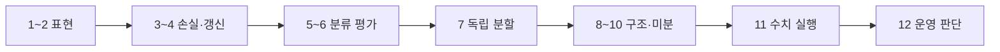

# 15. 종합 문제·용어사전·공식 자료

[← 이전](14-experiments-and-research.md) · [목차](README.md)
## 용어를 하나의 작동 경로로 연결한다

표본의 특징 vector가 model에 들어가 weight matrix와 곱해 logit을 만든다. Activation과 여러 layer를 거친 예측은 label과 loss로 비교된다. Autograd가 chain rule로 parameter gradient를 만들고 optimizer가 learning rate만큼 update한다. Batch를 모두 사용한 구간이 epoch다.

Classification에서는 sigmoid 또는 softmax가 logit을 확률 모양으로 바꾸고 threshold가 결정을 만든다. Confusion matrix의 TP,FP,FN,TN에서 precision과 recall을 계산한다. Training set은 parameter, validation은 hyperparameter와 threshold, test는 고정된 선택의 최종 평가에 쓴다.

Sequence에서는 token ID가 embedding vector가 되고 position을 더한다. QK 내적을 scale하고 mask 뒤 softmax해 V를 합친다. Autoregressive decode는 요청별 KV cache를 유지한다. Training system은 dtype, loss scale, microbatch accumulation, all-reduce와 optimizer state를 관리한다.

AI-RAN에서는 UE 측정 SINR·CSI가 feature가 되고 model inference가 deadline 안에 끝나야 한다. Safety guard와 fallback 뒤 action이 기지국에 적용된다. Offline metric은 이 closed loop 전체 성공과 같지 않다.

## 추가 종합 완전 풀이 13–15

13. Token 세 개 attention score 한 행이 [0,ln2,ln3]이면 확률은? **해설:** 지수 [1,2,3], 합6이므로 [1/6,2/6,3/6]이다.
14. Microbatch gradient 2,4,8을 평균하면? **해설:** 14/3≈4.667이며 합14를 그대로 쓰면 update scale이 세 배다.
15. 10 ms RAN loop에서 측정2,feature1,queue3,inference3,safety2 ms면? **해설:** 합11 ms로 1 ms deadline miss다. 정확도가 좋아도 운영 실패다.

이 장은 앞의 계산을 다시 풀고 용어를 한곳에서 찾게 한다.

## 자료에서 운영까지 끊기지 않는 기작

원시 자료의 행 하나는 특징과 정답을 가진 표본이다. 여러 표본을 행렬 X로 묶고 매개변수 벡터 w와 곱하면 예측 `ŷ=Xw+b`가 된다. 정답 y와 비교한 loss는 틀린 정도를 숫자 하나로 만든다.

미분은 매개변수를 조금 바꿀 때 loss가 변하는 비율이고, 기울기는 모든 매개변수 편미분의 묶음이다. 연쇄법칙은 `parameter→중간값→loss` 경로의 국소 변화율을 곱한다. Optimizer는 `w←w-ηgradient`로 실제 값을 갱신한다. Batch 전체를 한 번 사용하면 epoch 하나다.

학습 집합은 매개변수를, 검증 집합은 learning rate·threshold 같은 선택을, 시험 집합은 고정된 선택의 최종 성능을 평가한다. 이 경계를 섞으면 새 자료 일반화를 과장한다.

분류에서는 logit을 sigmoid나 softmax로 확률 모양으로 만들고 threshold로 action을 정한다. Attention에서는 token embedding이 Q/K/V가 되고 QK 내적, scaling, mask, softmax, V 가중합을 거친다. 운영에서는 dtype·batch·queue·deadline이 수학적 결과가 제시간에 도착하는지를 결정한다.

## 문제를 풀 때 조건 변화까지 확인하는 법

각 문제는 숫자 답 뒤에 가정을 붙인다. 행렬 곱은 shape가 맞아야 하고, gradient step은 learning rate가 바뀌면 결과가 바뀐다. Precision은 class prevalence와 threshold에 따라 달라진다. Attention mask를 softmax 뒤 적용하면 합이 1이 아닐 수 있다. RAN loop는 정확도가 좋아도 deadline을 넘으면 실패다.

예를 들어 문제의 learning rate 0.1을 1.0으로 바꾸면 같은 gradient도 열 배 update가 되어 loss가 증가할 수 있다. Batch gradient를 합으로 쓸지 평균으로 쓸지에 따라 effective learning rate가 달라진다. Test를 한 번 더 보고 model을 바꾸면 그 순간 test는 validation이 된다.

## 열두 문제를 하나의 학습 흐름으로 연결하기

문제 1과 2의 벡터·행렬은 데이터와 parameter를 담는 그릇이다. 문제 3의 MSE는 예측과 정답을 비교하고, 문제 4의 SGD가 그 손실의 기울기로 parameter를 바꾼다. 문제 5와 6은 분류 점수를 확률과 판단 지표로 바꾸는 단계다. 문제 7은 이 계산을 어떤 데이터에서 선택·평가해야 하는지 묻는다.

문제 8의 L2는 학습 목표에 parameter 크기 비용을 더한다. 문제 9는 계산 graph의 여러 경로가 같은 parameter gradient로 합쳐지는 이유를 확인한다. 문제 10은 Q·K·V가 score와 가중합으로 이어지는 attention의 작은 사례다. 문제 11은 수학적 gradient가 좁은 숫자 형식에서 사라지지 않게 다루는 조건을 묻고, 문제 12는 좋은 모델 수치가 실제 RAN 운영 성공과 같지 않음을 확인한다.

## 종합 추적: 한 주문 예측을 연구 주장까지 가져가기

입력 `x=[2 km,3개]`, weight `[4,1]`, bias 2라면 예측은 13분이다. 정답 14분과 잔차는 -1분, 제곱손실은 1분²다. 여러 주문 평균 gradient로 weight를 갱신하고 validation에서 학습률을 선택한다. 선택이 끝난 모델의 test MAE가 2.4분이라면 그 값은 같은 분할 모집단에 대한 추정이다.

운영에서는 feature 생성 5 ms, queue 4 ms, inference 3 ms, 적용 4 ms로 총 16 ms가 든다고 하자. Deadline이 15 ms면 예측 오차가 작아도 동작은 늦다. 이때 test MAE 2.4분과 폐루프 지연 16 ms는 다른 단위와 다른 질문의 답이다. 모델 품질, 시스템 성능, 서비스 효과를 한 숫자로 합치지 않는다.

## 용어를 문장 속 관계로 기억하기

Sample은 관측 한 건이고 feature는 그 sample에서 예측 시 사용할 값이며 label은 나중에 맞힐 목표다. Model은 feature를 prediction으로 바꾸고 parameter는 training 중 optimizer가 바꾼다. Loss는 prediction과 label의 차이를 학습 가능한 scalar로 요약하고 gradient는 각 parameter를 조금 바꿀 때 loss가 변하는 방향을 모은다.

Logit은 아직 확률이 아닌 점수다. Sigmoid는 독립적인 이진 확률에, softmax는 서로 배타적인 여러 class의 합 1 분포에 주로 쓴다. Cross-entropy는 정답에 준 확률이 작을수록 크게 벌한다. Threshold는 확률을 업무 결정으로 바꾸며, threshold가 바뀌면 precision과 recall도 함께 바뀐다.

Train 집합은 parameter를 갱신하고 validation 집합은 model·hyperparameter를 고른다. Test 집합은 선택이 끝난 한 후보를 독립 평가한다. Test를 반복해서 보고 선택하면 leakage가 생긴다. Generalization은 아직 보지 않은 같은 목표 모집단에서 유용한 성질이고, drift는 운영 중 그 모집단이나 관계가 달라지는 현상이다.

Attention에서 query는 찾는 기준, key는 비교 표지, value는 실제로 섞을 내용이다. Transformer는 attention 하나가 아니라 projection, multi-head attention, residual, normalization, MLP를 층으로 쌓은 구조다. FP16·BF16·FP32는 값을 저장하는 범위와 정밀도가 다르며 loss scaling은 주로 작은 FP16 gradient를 다루는 실행 기법이다.

## 추가 완전 해설 문제

**문제 13.** Binary, multiclass, multilabel의 출력 처리를 구분하라.

**해설.** 하나의 예/아니오는 logit 하나에 sigmoid를 쓸 수 있다. 셋 중 정확히 하나면 세 logit에 softmax를 써 합 1로 만든다. 여러 label이 동시에 참이면 각 logit에 sigmoid를 적용한다. Multilabel에 softmax를 쓰면 참 label들이 확률 질량을 서로 빼앗는다.

**문제 14.** Train loss는 0.1, validation loss는 0.8로 벌어졌다. 무엇을 의심하는가?

**해설.** 학습 자료에는 맞지만 새 자료에는 약한 과적합을 먼저 의심한다. 분할 누수·분포 차이·평가 mode도 확인한다. 단순히 epoch를 더 늘리면 간격이 더 커질 수 있다.

**문제 15.** Gradient 두 번을 누적했는데 optimizer step 전에 zeroing하지 않았다면?

**해설.** 기존 grad buffer에 새 gradient가 더해진다. 의도한 gradient accumulation이면 batch 합에 맞게 scale해야 하고, 의도가 아니면 이전 step 값이 섞인 오류다. Backward와 parameter update는 별도 단계다.

**문제 16.** 평균 latency 8 ms, p99 30 ms, deadline 20 ms다. 평균만으로 통과인가?

**해설.** 아니다. 적어도 1% 부근 요청이 20 ms 경계를 넘을 가능성이 있다. Deadline 대상 분포와 timeout을 포함한 tail을 평가해야 한다.

**문제 17.** 후보가 baseline보다 accuracy 1%p 높지만 전력을 30% 더 쓴다. 결론은?

**해설.** 사전 목표와 비용에 따라 판단한다. 정확도 개선만 사실로 보고하고 전체 우월성은 주장하지 않는다. 같은 hardware·요청·측정 창인지도 확인한다.

## 종합 문제 12개와 완전 해설

### 문제 1. 벡터 내적

x=[1,2,3], w=[2,0,-1]의 내적을 구하라.

**조건:** 주어진 숫자만 사용하고 단위와 분모를 적는다.

**풀이와 결론:** 1×2+2×0+3×(-1)=-1이다. 같은 위치를 곱하고 모두 더한다. 결과는 벡터가 아니라 스칼라 하나다.

### 문제 2. 행렬 형상

A가 (2,3), B가 (3,4)일 때 A@B의 형상은?

**조건:** 주어진 숫자만 사용하고 단위와 분모를 적는다.

**풀이와 결론:** 가운데 길이 3이 같아 곱할 수 있다. 결과는 바깥 길이인 (2,4)다.

### 문제 3. 회귀 MSE

정답 [2,4], 예측 [1,6]의 MSE는?

**조건:** 주어진 숫자만 사용하고 단위와 분모를 적는다.

**풀이와 결론:** 잔차는 [1,-2] 또는 예측-정답이면 [-1,2]다. 제곱은 [1,4], 평균은 (1+4)/2=2.5다.

### 문제 4. 한 번의 SGD

L=(w-3)^2, w=1, 학습률 0.25일 때 새 w는?

**조건:** 주어진 숫자만 사용하고 단위와 분모를 적는다.

**풀이와 결론:** 기울기는 2(w-3)=-4다. 새 w=1-0.25×(-4)=2다. 손실은 4에서 1로 줄어든다.

### 문제 5. 로짓과 확률

로짓 [2,1]은 확률 [2,1]인가?

**조건:** 주어진 숫자만 사용하고 단위와 분모를 적는다.

**풀이와 결론:** 아니다. 최댓값을 빼 [0,-1], 지수 [1,0.3679], 합으로 나누면 약 [0.7311,0.2689]다.

### 문제 6. 정밀도와 재현율

TP=30, FP=10, FN=20이면 precision과 recall은?

**조건:** 주어진 숫자만 사용하고 단위와 분모를 적는다.

**풀이와 결론:** Precision=30/(30+10)=0.75다. Recall=30/(30+20)=0.60이다. 서로 다른 질문에 답한다.

### 문제 7. 분할 누수

후보를 test 점수로 골라도 되는가?

**조건:** 주어진 숫자만 사용하고 단위와 분모를 적는다.

**풀이와 결론:** 안 된다. 선택에 test를 쓰는 순간 test는 검증 역할이 된다. 선택은 validation에서 끝내고 독립 test를 한 번 보고한다.

### 문제 8. L2 penalty

weight [3,4], λ=0.01의 L2 penalty는?

**조건:** 주어진 숫자만 사용하고 단위와 분모를 적는다.

**풀이와 결론:** 제곱합은 9+16=25다. λ를 곱해 0.25다. 구현이 평균하는지 합하는지도 확인한다.

### 문제 9. Autograd 경로 합

같은 w로 가는 gradient가 3과 4면 총 gradient는?

**조건:** 주어진 숫자만 사용하고 단위와 분모를 적는다.

**풀이와 결론:** 두 경로가 같은 leaf parameter에 기여하므로 3+4=7로 누적한다. Optimizer 전에는 w 값은 바뀌지 않는다.

### 문제 10. Attention

Q=[1,0], K1=[1,0], K2=[0,1]일 때 큰 weight는 어느 key인가?

**조건:** 주어진 숫자만 사용하고 단위와 분모를 적는다.

**풀이와 결론:** Dot score는 1과 0이고 같은 scale을 나눠도 순서는 같다. Softmax 뒤 K1의 weight가 더 크다.

### 문제 11. Mixed precision

FP16 loss scaling 1024로 gradient 0.00001을 처리하면?

**조건:** 주어진 숫자만 사용하고 단위와 분모를 적는다.

**풀이와 결론:** Backward 중 0.01024로 키우고 update 전에 1024로 나눠 원래 scale로 돌린다. Overflow면 step을 건너뛸 수 있다.

### 문제 12. AI-RAN 평가

Throughput +8%, p99 latency +40%, power +10%면 성공인가?

**조건:** 주어진 숫자만 사용하고 단위와 분모를 적는다.

**풀이와 결론:** 단일 metric으로 성공이라 할 수 없다. 사전에 정한 QoS와 power guardrail을 대조하고 위반이면 실패 또는 제한적 결과로 보고한다.

## 용어사전

**표본(sample)**: 데이터의 한 사례 또는 한 행.

**특징(feature)**: 예측할 때 입력으로 사용하는 측정값.

**정답(label)**: 모델이 맞히려는 목표 값.

**모델(model)**: 입력을 출력으로 바꾸는 수학 함수.

**매개변수(parameter)**: 학습 과정이 바꾸는 모델 내부 숫자.

**초매개변수(hyperparameter)**: 학습률처럼 사람이 선택하는 학습 설정.

**스칼라(scalar)**: 숫자 하나.

**벡터(vector)**: 순서를 가진 숫자 한 줄.

**행렬(matrix)**: 행과 열을 가진 숫자 표.

**형상(shape)**: 각 축의 길이.

**내적(dot product)**: 같은 위치를 곱한 뒤 더하는 계산.

**전치(transpose)**: 행과 열을 바꾸는 연산.

**평균(mean)**: 합을 개수로 나눈 값.

**분산(variance)**: 값이 평균에서 얼마나 퍼졌는지 나타내는 값.

**확률(probability)**: 불확실성을 0과 1 사이로 나타낸 값.

**조건부확률**: 어떤 조건이 주어졌을 때의 확률.

**회귀(regression)**: 연속적인 숫자를 예측하는 문제.

**분류(classification)**: 범주를 예측하는 문제.

**가중치(weight)**: 입력 특징의 영향 크기와 방향을 나타내는 매개변수.

**편향(bias)**: 가중합에 더하는 기준값.

**예측값(prediction)**: 모델이 계산한 출력.

**잔차(residual)**: 관측 정답에서 예측값을 뺀 차이.

**손실(loss)**: 예측 오차를 학습용 숫자로 요약한 값.

**평균제곱오차(MSE)**: 잔차 제곱의 평균.

**로그(logarithm)**: 지수의 역연산.

**로짓(logit)**: 확률 변환 전의 제한 없는 분류 점수.

**시그모이드(sigmoid)**: 한 점수를 0~1로 바꾸는 함수.

**소프트맥스(softmax)**: 여러 점수를 합 1인 값으로 바꾸는 함수.

**교차엔트로피**: 정답 class에 준 확률을 평가하는 손실.

**임계값(threshold)**: 점수나 확률을 class 결정으로 바꾸는 경계.

**미분(derivative)**: 입력이 조금 변할 때 출력의 순간 변화율.

**편미분**: 여러 변수 중 하나만 바꾼 변화율.

**기울기(gradient)**: 모든 매개변수 편미분을 모은 벡터.

**연쇄법칙(chain rule)**: 연결된 변화율을 곱하는 미분 규칙.

**학습률(learning rate)**: 기울기를 따라 이동하는 크기.

**최적화기(optimizer)**: 기울기로 매개변수를 갱신하는 규칙.

**SGD**: 작은 데이터 묶음의 기울기로 갱신하는 방법.

**자동미분(autograd)**: 기록된 연산을 따라 기울기를 계산하는 기능.

**순전파(forward)**: 입력에서 예측과 손실로 가는 계산.

**역전파(backward)**: 손실에서 각 매개변수 기울기를 구하는 계산.

**계산 graph**: 값과 연산의 의존 관계.

**신경망(neural network)**: 선형 변환과 비선형 함수를 여러 층 연결한 모델.

**활성 함수**: 선형 결합에 비선형성을 더하는 함수.

**ReLU**: 음수는 0, 양수는 그대로 두는 함수.

**층(layer)**: 여러 계산 단위를 묶은 단계.

**합성곱(convolution)**: 작은 filter를 이동하며 곱해 더하는 연산.

**순환신경망(RNN)**: 이전 상태를 다음 위치로 전달하는 sequence 모델.

**token**: 문장 같은 sequence를 나눈 이산 단위.

**embedding**: token을 나타내는 실수 벡터.

**query**: attention에서 현재 위치가 찾는 특징.

**key**: 비교 대상 위치의 특징 표지.

**value**: attention weight로 섞을 실제 내용.

**attention**: 위치 사이 중요도를 계산해 값을 섞는 방법.

**Transformer**: attention, MLP, residual, normalization을 쌓은 구조.

**batch**: 한 번에 처리하는 표본 묶음.

**epoch**: 학습 데이터를 한 번 모두 읽는 단위.

**FP32**: 32-bit 부동소수점 형식.

**FP16**: 좁은 지수 범위를 가진 16-bit 부동소수점.

**BF16**: FP32와 비슷한 지수 범위를 가진 16-bit 형식.

**손실 배율 조정(loss scaling)**: 작은 FP16 기울기를 확대했다 되돌리는 기법.

**학습 집합**: 매개변수를 바꾸는 데이터.

**검증 집합**: 모델과 설정을 고르는 데이터.

**시험 집합**: 선택 뒤 최종 평가에 쓰는 독립 데이터.

**과적합**: 학습 데이터에는 잘 맞고 새 데이터에는 약한 상태.

**일반화**: 보지 않은 데이터에서도 유용하게 동작하는 성질.

**누수(leakage)**: 예측 시 알 수 없는 정보가 학습·선택에 들어가는 문제.

**기준선(baseline)**: 복잡한 후보와 비교하는 단순 규칙이나 기존 방법.

**드리프트(drift)**: 운영 데이터 분포나 관계가 변하는 현상.

**QoS**: 지연, 손실, 처리량 같은 서비스 품질.

**fallback**: AI 실패 때 돌아갈 안전한 기존 동작.

## 공식 자료 지도

- [ISLP 2023](https://www.statlearning.com/home)
- [Dive into Deep Learning: Generalization](https://d2l.ai/chapter_linear-regression/generalization.html)
- [PyTorch Autograd](https://docs.pytorch.org/docs/main/autograd.html) — main 개발 문서이며 특정 출시 version으로 단정하지 않는다.
- [AI-RAN Alliance](https://ai-ran.org/)
- [O-RAN Alliance specifications](https://www.o-ran.org/specifications)

공식 근거 확인일: **2026-10-11**.

[← 이전](14-experiments-and-research.md) · [목차](README.md)
