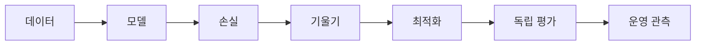

# 15. 종합 문제·용어사전·공식 자료

[← 이전](14-experiments-and-research.md) · [목차](README.md)

이 장은 앞의 계산을 다시 풀고 용어를 한곳에서 찾게 한다.

## 종합 문제 12개와 완전 해설

### 문제 1. 벡터 내적

x=[1,2,3], w=[2,0,-1]의 내적을 구하라.

**조건:** 주어진 숫자만 사용하고 단위와 분모를 적는다.

**풀이와 결론:** 1×2+2×0+3×(-1)=-1이다. 같은 위치를 곱하고 모두 더한다. 결과는 벡터가 아니라 스칼라 하나다.

### 문제 2. 행렬 형상

A가 (2,3), B가 (3,4)일 때 A@B의 형상은?

**조건:** 주어진 숫자만 사용하고 단위와 분모를 적는다.

**풀이와 결론:** 가운데 길이 3이 같아 곱할 수 있다. 결과는 바깥 길이인 (2,4)다.

### 문제 3. 회귀 MSE

정답 [2,4], 예측 [1,6]의 MSE는?

**조건:** 주어진 숫자만 사용하고 단위와 분모를 적는다.

**풀이와 결론:** 잔차는 [1,-2] 또는 예측-정답이면 [-1,2]다. 제곱은 [1,4], 평균은 (1+4)/2=2.5다.

### 문제 4. 한 번의 SGD

L=(w-3)^2, w=1, 학습률 0.25일 때 새 w는?

**조건:** 주어진 숫자만 사용하고 단위와 분모를 적는다.

**풀이와 결론:** 기울기는 2(w-3)=-4다. 새 w=1-0.25×(-4)=2다. 손실은 4에서 1로 줄어든다.

### 문제 5. 로짓과 확률

로짓 [2,1]은 확률 [2,1]인가?

**조건:** 주어진 숫자만 사용하고 단위와 분모를 적는다.

**풀이와 결론:** 아니다. 최댓값을 빼 [0,-1], 지수 [1,0.3679], 합으로 나누면 약 [0.7311,0.2689]다.

### 문제 6. 정밀도와 재현율

TP=30, FP=10, FN=20이면 precision과 recall은?

**조건:** 주어진 숫자만 사용하고 단위와 분모를 적는다.

**풀이와 결론:** Precision=30/(30+10)=0.75다. Recall=30/(30+20)=0.60이다. 서로 다른 질문에 답한다.

### 문제 7. 분할 누수

후보를 test 점수로 골라도 되는가?

**조건:** 주어진 숫자만 사용하고 단위와 분모를 적는다.

**풀이와 결론:** 안 된다. 선택에 test를 쓰는 순간 test는 검증 역할이 된다. 선택은 validation에서 끝내고 독립 test를 한 번 보고한다.

### 문제 8. L2 penalty

weight [3,4], λ=0.01의 L2 penalty는?

**조건:** 주어진 숫자만 사용하고 단위와 분모를 적는다.

**풀이와 결론:** 제곱합은 9+16=25다. λ를 곱해 0.25다. 구현이 평균하는지 합하는지도 확인한다.

### 문제 9. Autograd 경로 합

같은 w로 가는 gradient가 3과 4면 총 gradient는?

**조건:** 주어진 숫자만 사용하고 단위와 분모를 적는다.

**풀이와 결론:** 두 경로가 같은 leaf parameter에 기여하므로 3+4=7로 누적한다. Optimizer 전에는 w 값은 바뀌지 않는다.

### 문제 10. Attention

Q=[1,0], K1=[1,0], K2=[0,1]일 때 큰 weight는 어느 key인가?

**조건:** 주어진 숫자만 사용하고 단위와 분모를 적는다.

**풀이와 결론:** Dot score는 1과 0이고 같은 scale을 나눠도 순서는 같다. Softmax 뒤 K1의 weight가 더 크다.

### 문제 11. Mixed precision

FP16 loss scaling 1024로 gradient 0.00001을 처리하면?

**조건:** 주어진 숫자만 사용하고 단위와 분모를 적는다.

**풀이와 결론:** Backward 중 0.01024로 키우고 update 전에 1024로 나눠 원래 scale로 돌린다. Overflow면 step을 건너뛸 수 있다.

### 문제 12. AI-RAN 평가

Throughput +8%, p99 latency +40%, power +10%면 성공인가?

**조건:** 주어진 숫자만 사용하고 단위와 분모를 적는다.

**풀이와 결론:** 단일 metric으로 성공이라 할 수 없다. 사전에 정한 QoS와 power guardrail을 대조하고 위반이면 실패 또는 제한적 결과로 보고한다.

## 용어사전

**표본(sample)**: 데이터의 한 사례 또는 한 행.

**특징(feature)**: 예측할 때 입력으로 사용하는 측정값.

**정답(label)**: 모델이 맞히려는 목표 값.

**모델(model)**: 입력을 출력으로 바꾸는 수학 함수.

**매개변수(parameter)**: 학습 과정이 바꾸는 모델 내부 숫자.

**초매개변수(hyperparameter)**: 학습률처럼 사람이 선택하는 학습 설정.

**스칼라(scalar)**: 숫자 하나.

**벡터(vector)**: 순서를 가진 숫자 한 줄.

**행렬(matrix)**: 행과 열을 가진 숫자 표.

**형상(shape)**: 각 축의 길이.

**내적(dot product)**: 같은 위치를 곱한 뒤 더하는 계산.

**전치(transpose)**: 행과 열을 바꾸는 연산.

**평균(mean)**: 합을 개수로 나눈 값.

**분산(variance)**: 값이 평균에서 얼마나 퍼졌는지 나타내는 값.

**확률(probability)**: 불확실성을 0과 1 사이로 나타낸 값.

**조건부확률**: 어떤 조건이 주어졌을 때의 확률.

**회귀(regression)**: 연속적인 숫자를 예측하는 문제.

**분류(classification)**: 범주를 예측하는 문제.

**가중치(weight)**: 입력 특징의 영향 크기와 방향을 나타내는 매개변수.

**편향(bias)**: 가중합에 더하는 기준값.

**예측값(prediction)**: 모델이 계산한 출력.

**잔차(residual)**: 관측 정답에서 예측값을 뺀 차이.

**손실(loss)**: 예측 오차를 학습용 숫자로 요약한 값.

**평균제곱오차(MSE)**: 잔차 제곱의 평균.

**로그(logarithm)**: 지수의 역연산.

**로짓(logit)**: 확률 변환 전의 제한 없는 분류 점수.

**시그모이드(sigmoid)**: 한 점수를 0~1로 바꾸는 함수.

**소프트맥스(softmax)**: 여러 점수를 합 1인 값으로 바꾸는 함수.

**교차엔트로피**: 정답 class에 준 확률을 평가하는 손실.

**임계값(threshold)**: 점수나 확률을 class 결정으로 바꾸는 경계.

**미분(derivative)**: 입력이 조금 변할 때 출력의 순간 변화율.

**편미분**: 여러 변수 중 하나만 바꾼 변화율.

**기울기(gradient)**: 모든 매개변수 편미분을 모은 벡터.

**연쇄법칙(chain rule)**: 연결된 변화율을 곱하는 미분 규칙.

**학습률(learning rate)**: 기울기를 따라 이동하는 크기.

**최적화기(optimizer)**: 기울기로 매개변수를 갱신하는 규칙.

**SGD**: 작은 데이터 묶음의 기울기로 갱신하는 방법.

**자동미분(autograd)**: 기록된 연산을 따라 기울기를 계산하는 기능.

**순전파(forward)**: 입력에서 예측과 손실로 가는 계산.

**역전파(backward)**: 손실에서 각 매개변수 기울기를 구하는 계산.

**계산 graph**: 값과 연산의 의존 관계.

**신경망(neural network)**: 선형 변환과 비선형 함수를 여러 층 연결한 모델.

**활성 함수**: 선형 결합에 비선형성을 더하는 함수.

**ReLU**: 음수는 0, 양수는 그대로 두는 함수.

**층(layer)**: 여러 계산 단위를 묶은 단계.

**합성곱(convolution)**: 작은 filter를 이동하며 곱해 더하는 연산.

**순환신경망(RNN)**: 이전 상태를 다음 위치로 전달하는 sequence 모델.

**token**: 문장 같은 sequence를 나눈 이산 단위.

**embedding**: token을 나타내는 실수 벡터.

**query**: attention에서 현재 위치가 찾는 특징.

**key**: 비교 대상 위치의 특징 표지.

**value**: attention weight로 섞을 실제 내용.

**attention**: 위치 사이 중요도를 계산해 값을 섞는 방법.

**Transformer**: attention, MLP, residual, normalization을 쌓은 구조.

**batch**: 한 번에 처리하는 표본 묶음.

**epoch**: 학습 데이터를 한 번 모두 읽는 단위.

**FP32**: 32-bit 부동소수점 형식.

**FP16**: 좁은 지수 범위를 가진 16-bit 부동소수점.

**BF16**: FP32와 비슷한 지수 범위를 가진 16-bit 형식.

**손실 배율 조정(loss scaling)**: 작은 FP16 기울기를 확대했다 되돌리는 기법.

**학습 집합**: 매개변수를 바꾸는 데이터.

**검증 집합**: 모델과 설정을 고르는 데이터.

**시험 집합**: 선택 뒤 최종 평가에 쓰는 독립 데이터.

**과적합**: 학습 데이터에는 잘 맞고 새 데이터에는 약한 상태.

**일반화**: 보지 않은 데이터에서도 유용하게 동작하는 성질.

**누수(leakage)**: 예측 시 알 수 없는 정보가 학습·선택에 들어가는 문제.

**기준선(baseline)**: 복잡한 후보와 비교하는 단순 규칙이나 기존 방법.

**드리프트(drift)**: 운영 데이터 분포나 관계가 변하는 현상.

**QoS**: 지연, 손실, 처리량 같은 서비스 품질.

**fallback**: AI 실패 때 돌아갈 안전한 기존 동작.

## 공식 자료 지도

- [ISLP 2023](https://www.statlearning.com/home)
- [Dive into Deep Learning: Generalization](https://d2l.ai/chapter_linear-regression/generalization.html)
- [PyTorch Autograd](https://docs.pytorch.org/docs/main/autograd.html) — main 개발 문서이며 특정 출시 version으로 단정하지 않는다.
- [AI-RAN Alliance](https://ai-ran.org/)
- [O-RAN Alliance specifications](https://www.o-ran.org/specifications)

공식 근거 확인일: **2026-10-11**.

[← 이전](14-experiments-and-research.md) · [목차](README.md)
