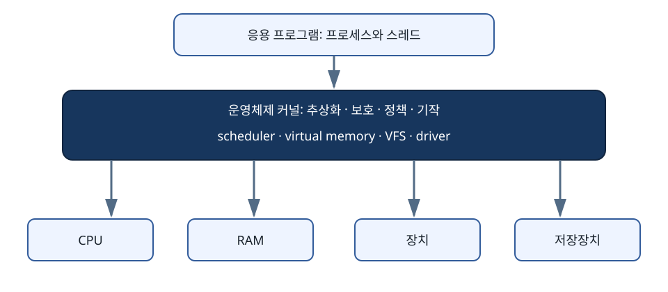

# 00. 운영체제가 하는 일

[이 책 목차](README.md) · [다음](01-processes-threads-syscalls.md)

컴퓨터를 처음 배울 때 운영체제를 “응용 프로그램과 하드웨어 사이의 소프트웨어”라고 한 줄로 정의하면 거의 아무것도 이해되지 않는다. 이 장에서는 CPU가 실제로 무엇을 하는지, 메모리는 무엇을 보관하는지, 프로그램이 어떻게 실행되는지부터 시작한다. 그런 다음 여러 프로그램이 제한된 하드웨어를 함께 쓸 때 생기는 문제를 운영체제가 어떤 객체와 규칙으로 해결하는지 추적한다.



## 1. 가장 아래에 있는 것: CPU, 메모리, 장치

CPU(central processing unit)는 기계 명령어를 읽고 실행하는 하드웨어다. 덧셈, 비교, 메모리 읽기·쓰기, 다음 명령으로 이동 같은 작은 동작을 매우 빠르게 반복한다. CPU core는 독립적으로 명령 흐름을 실행할 수 있는 처리 단위다. 코어가 네 개면 조건이 맞을 때 네 실행 흐름을 실제로 병렬 실행할 수 있지만, 프로그램이 여덟 개라고 코어가 여덟 개로 늘어나는 것은 아니다.

메모리(memory)는 실행 중인 명령어와 데이터를 보관한다. 흔히 RAM을 뜻하지만 시스템에는 CPU register, cache, RAM, SSD처럼 속도·크기·지속성이 다른 저장 계층이 있다. register는 CPU 내부의 매우 작은 저장소다. cache는 최근 사용한 명령과 데이터를 CPU 가까이에 보관한다. RAM은 실행 중인 많은 데이터를 담지만 전원이 끊기면 일반적으로 내용이 사라진다. SSD는 더 느리지만 전원이 꺼져도 파일을 보존하도록 설계된 저장장치다.

device는 CPU 밖에서 특정 기능을 수행하는 하드웨어다. NIC는 네트워크 packet을 송수신하고, NVMe SSD는 block 단위 저장 명령을 처리하며, GPU는 많은 연산을 병렬 수행한다. CPU가 장치의 모든 미세 동작을 대신하지 않는다. CPU가 장치에 요청을 제출하면 장치가 비동기로 작업하고 나중에 interrupt로 완료를 알릴 수 있다.

resource는 여러 주체가 사용하려 하지만 양이 제한되거나 동시에 사용하면 충돌하는 대상이다. CPU 시간, RAM byte, SSD queue 자리, network bandwidth, 파일의 내용, device register가 모두 자원이다. “자원”은 물건만 뜻하지 않는다. 특정 시각에 CPU를 2 ms 사용하는 권리처럼 시간도 자원이다.

## 2. 프로그램은 파일이고 실행은 상태의 변화다

program은 저장장치에 있는 명령어와 정적 데이터의 묶음이다. 실행 파일이 SSD에 가만히 있을 때 CPU는 그것을 자동으로 수행하지 않는다. 누군가 실행을 요청하면 운영체제가 필요한 code와 data를 메모리에 연결하고, 시작 명령어 위치를 CPU에 주며, 실행 상태를 관리한다.

CPU는 대략 다음 반복을 수행한다.

1. program counter가 가리키는 메모리에서 다음 instruction을 가져온다.
2. instruction을 해석한다.
3. register나 memory의 값을 읽어 연산한다.
4. 결과를 기록한다.
5. 다음 program counter를 정한다.

이 반복을 한 프로그램만 영원히 독점하면 다른 프로그램은 실행되지 못한다. 프로그램이 잘못된 주소를 써서 다른 프로그램의 데이터나 운영체제 코드를 바꾸도록 허용해도 안 된다. 저장장치 하나에 여러 요청이 섞일 때 어느 요청의 완료인지 구별하지 못하면 결과가 엉뚱한 프로그램에 전달된다.

운영체제(operating system, OS)는 이런 공유와 시간차를 관리하는 시스템 소프트웨어다. 이 책에서 kernel은 가장 높은 권한으로 실행되며 CPU, 메모리, 장치 접근을 통제하는 운영체제 핵심 부분을 뜻한다. 운영체제 전체와 kernel을 같은 말로 쓰지 않는다. Ubuntu 같은 배포판에는 Linux kernel뿐 아니라 C library, shell, service manager, 설치 도구와 많은 사용자 프로그램이 들어 있다.

## 3. 문제에서 시작하기

CPU core 하나, RAM 8 GiB, SSD 하나인 컴퓨터에서 프로그램 A와 B를 실행한다고 하자.

- A와 B는 둘 다 지금 CPU를 쓰고 싶다.
- 둘 다 자기에게 가상 주소 1000이 있다고 생각한다.
- 둘 다 SSD의 요청 queue에 읽기 작업을 넣고 싶다.
- A가 고장 나더라도 B와 kernel의 메모리는 보호되어야 한다.
- SSD 완료는 CPU 명령보다 훨씬 나중에 도착할 수 있다.

규칙이 없다면 빠른 프로그램이 CPU를 독점할 수 있다. 두 프로그램이 물리 RAM 위치를 직접 고르면 서로의 값을 덮어쓸 수 있다. 장치가 완료한 요청의 owner와 buffer를 잊으면 A의 데이터가 B에게 전달될 수 있다.

운영체제는 다음 일을 함께 수행한다.

1. 물리 자원을 다룰 이름과 interface를 제공한다.
2. 동시에 들어온 요청 가운데 누가 언제 얼마나 사용할지 선택한다.
3. 권한 없는 접근이 다른 보호 영역으로 번지지 않게 막는다.
4. 지금 제출한 요청과 나중의 완료를 정확히 연결한다.
5. 오류와 종료 뒤에도 자원 소유권과 수명을 정리한다.

interface는 한 계층이 다른 계층에 제공하는 호출 규칙이다. 응용 프로그램은 SSD controller register를 직접 두드리는 대신 `read` 같은 system call을 사용한다. interface는 “무엇을 요청할 수 있고 어떤 결과나 오류를 받는가”를 정한다. 내부 구현을 전부 공개하지 않아도 사용자가 안정된 방식으로 기능을 이용하게 한다.

## 4. 추상화는 자원을 이해하고 통제할 이름을 만든다

abstraction은 복잡한 구현 세부를 감추면서 사용자가 지켜야 할 의미와 연산을 제공하는 관점이다. file은 저장장치 block을 이름 있는 byte sequence로 보는 추상화다. process와 thread는 CPU에서 진행되는 실행 흐름을 관리하는 추상화다. virtual address space는 프로그램마다 독립적인 주소 세계가 있는 것처럼 보이게 한다.

| 실제 자원 또는 사건 | 대표 추상화 | 사용자가 얻는 관점 | kernel이 유지해야 할 것 |
|---|---|---|---|
| CPU core와 시간 | process, thread | 자기 명령 흐름이 계속 이어지는 것처럼 보임 | 실행 상태 저장·복원과 스케줄링 |
| RAM page | virtual address space, mapping | 같은 숫자 주소를 프로세스별로 독립 사용 | page table, 권한, 물리 page 수명 |
| SSD block | file, directory | block 번호 대신 이름과 byte offset 사용 | 이름 해석, cache, block 배치, 오류 |
| NIC packet | socket | 연결과 송수신 buffer로 통신 | protocol 상태와 packet queue |
| 장치 완료 interrupt | request, completion | 호출 결과나 event로 완료 관측 | 요청 identity, buffer, owner, 오류 |
| 장치와 파일 참조 | file descriptor | 작은 정수로 열린 자원을 가리킴 | 정수에서 커널 객체로 안전하게 연결 |

추상화는 물리 자원을 새로 만들지 않는다. 가상 CPU가 여러 개처럼 보여도 실제 CPU 시간의 합은 제한된다. 64-bit virtual address space가 매우 커도 모든 주소에 물리 RAM이 즉시 붙어 있는 것은 아니다. file 하나가 연속 byte sequence처럼 보여도 실제 block은 장치 여러 위치에 흩어질 수 있다.

좋은 추상화는 구현을 감출 뿐 아니라 실패 의미도 정의한다. `read`가 100 byte를 요청받아 40 byte만 반환할 수 있는지, 파일 끝을 어떻게 표시하는지, 여러 writer의 변경이 어떤 단위로 보이는지가 interface 계약에 포함된다. 이름만 예쁘게 바꾸는 것이 아니다.

## 5. protection은 실수와 공격의 범위를 제한한다

protection은 어떤 주체가 어떤 자원에 어떤 연산을 할 수 있는지 강제하는 규칙과 기작이다. isolation은 한 주체의 상태와 실패가 다른 주체에 함부로 번지지 않도록 분리하는 성질이다.

CPU는 보통 user mode와 kernel mode 같은 privilege level을 제공한다. 응용 프로그램은 제한된 user mode에서 실행된다. page table의 권한 bit는 어떤 virtual page를 읽고, 쓰고, 실행할 수 있는지 제한한다. 장치 설정이나 kernel memory 접근처럼 위험한 연산은 높은 권한에서만 허용된다.

application이 파일을 열 때 kernel은 단순히 경로 문자열만 보지 않는다. 현재 주체의 identity와 credential, 디렉터리 탐색 권한, 파일 mode, mount와 보안 정책 등을 검사할 수 있다. 허용된 뒤에도 얻은 file descriptor가 어떤 객체를 가리키는지, 객체가 사용 중 먼저 해제되지 않는지 관리해야 한다.

protection과 reliability는 같지 않다. A가 B 메모리를 못 읽게 했다고 A의 데이터가 전원 장애 뒤 보존되는 것은 아니다. access control이 정확해도 device firmware bug가 있을 수 있다. 각 계층이 어떤 실패를 막고 어떤 실패는 다루지 않는지 경계를 밝혀야 한다.

## 6. policy와 mechanism을 나누면 설계를 이해할 수 있다

policy는 여러 가능한 결과 가운데 **무엇을 선택할지** 정한다. mechanism은 선택한 결과를 **어떻게 실행할지** 제공한다.

```text
정책: 다음에는 B에게 CPU를 2 ms 준다.
기작: timer를 설정하고 A 상태를 저장한 뒤 B register를 복원한다.

정책: 이 page를 RAM에서 내보낸다.
기작: page 내용을 필요한 위치에 기록하고 page table을 갱신한다.

정책: A의 storage 요청을 B보다 먼저 처리한다.
기작: request queue에서 A 항목을 꺼내 controller에 제출한다.
```

scheduler policy가 달라도 [다음 장에서 배우는 context switch](01-processes-threads-syscalls.md) 기작을 재사용할 수 있다. 반대로 context switch 기작이 있어도 누구를 먼저 실행할지 정하는 기준이 없으면 원하는 latency나 fairness를 만들 수 없다.

mechanism과 policy가 현실에서 완전히 분리된 파일 두 개라는 뜻은 아니다. 구현에서는 성능과 자료구조 때문에 얽힐 수 있다. 이 구분은 “바꾸려는 선택 기준인가, 그 선택을 가능하게 하는 하드웨어·커널 동작인가”를 묻는 사고 도구다.

## 7. 작은 CPU 자원 계산

CPU 하나에서 A가 6 ms, B가 4 ms의 계산을 원하고 두 프로그램은 시각 0에 도착했다고 하자. context-switch 비용과 I/O는 없다고 단순화한다.

선점 없이 A부터 실행하면 시간선은 다음과 같다.

```text
시간  0             6         10
CPU   |------ A -----|--- B ----|
```

A는 0 ms에 처음 실행하고 6 ms에 끝난다. B는 6 ms에 처음 실행하고 10 ms에 끝난다. 총 CPU 작업은 10 ms다.

2 ms씩 번갈아 실행하면 다음처럼 만들 수 있다.

```text
시간  0  2  4  6  8  10
CPU   | A | B | A | B | A |
```

B는 2 ms에 첫 CPU를 얻어 첫 응답은 빨라졌다. 그러나 총 useful CPU work 10 ms는 사라지지 않는다. 실제로는 전환 비용과 cache 영향이 더해질 수 있다. policy는 물리 CPU를 늘리지 않으면서 response time, waiting time, fairness의 분포를 바꾼다.

## 8. 작은 메모리 자원 계산

RAM 8 GiB인 시스템에서 process 네 개가 각각 3 GiB의 resident data를 동시에 요구한다고 하자. 합은 `4 × 3 = 12 GiB`다. virtual address를 제공했다고 부족한 4 GiB RAM이 생기지 않는다.

kernel은 상황과 정책에 따라 다음 중 하나 이상을 수행할 수 있다.

- 사용하지 않는 file-backed page를 버리고 필요할 때 파일에서 다시 읽는다.
- 수정된 page를 저장장치에 기록한 뒤 RAM을 회수한다.
- swap 영역이 있다면 anonymous page를 내보낸다.
- cache를 줄인다.
- allocation을 기다리게 하거나 실패시킨다.
- 메모리 제한을 넘긴 작업을 종료할 수 있다.

“메모리 사용량 3 GiB”도 무엇을 센 값인지 구분해야 한다. virtual size, resident set, 공유 page의 계산 방식, cache 포함 여부가 다르다. 운영체제는 숫자 하나로 모든 실제 비용을 표현할 수 없다.

페이지를 storage로 내보내면 용량 문제를 늦출 수 있지만 RAM보다 느린 장치 접근이 추가된다. working set이 RAM보다 계속 크면 page를 내보내고 다시 들이는 일이 반복되는 thrashing이 생길 수 있다. abstraction은 부족한 자원을 완전히 제거하지 않고, 부족함을 다룰 규칙을 제공한다.

## 9. 응용 요청부터 하드웨어 완료까지

누가 어느 시점에 일하는지 완전한 흐름을 보자. A가 아직 cache에 없는 파일 데이터를 읽는다고 가정한다.

| 단계 | 실행 주체와 위치 | 하는 일 | 남겨야 할 상태 |
|---:|---|---|---|
| 1 | application A, user mode | `read(fd, buffer, 4096)` 요청 | fd, buffer 주소, 길이 |
| 2 | CPU trap 기작 | kernel 진입점으로 이동 | A의 복귀 PC와 register |
| 3 | kernel, A의 실행 문맥 | fd가 유효한지, 읽기 권한과 buffer mapping을 검사 | 검사 결과와 참조 |
| 4 | filesystem과 cache | 원하는 byte가 memory cache에 있는지 확인 | file offset과 page 위치 |
| 5 | block layer와 driver | 필요한 storage request를 구성하고 장치 queue에 제출 | request ID, block, buffer, owner |
| 6 | scheduler | A를 blocked로 두고 runnable B 선택 가능 | A의 wait 조건과 실행 상태 |
| 7 | SSD controller | CPU와 독립적으로 block 읽기 수행 | 장치 내부 command 상태 |
| 8 | DMA가 가능한 장치 | 지정한 memory buffer 쪽으로 데이터 전송 | DMA mapping과 길이 |
| 9 | device interrupt | 완료 사실을 CPU에 알림 | 완료 queue entry |
| 10 | kernel completion 경로 | 오류·길이를 확인하고 원래 request와 연결 | A가 받을 결과 |
| 11 | wakeup | A를 blocked에서 runnable로 바꿈 | runqueue 연결 |
| 12 | scheduler와 A | 나중에 A를 실행하고 syscall에서 복귀 | 반환 byte 수 또는 오류 |

DMA(direct memory access)는 장치가 CPU가 byte마다 복사 명령을 실행하지 않아도 memory와 데이터를 옮길 수 있게 하는 기작이다. 그렇다고 CPU와 kernel이 필요 없어지는 것은 아니다. buffer를 안전하게 준비하고, 장치가 접근할 주소를 정하고, 수명과 완료를 관리해야 한다.

interrupt는 장치가 CPU의 현재 instruction 흐름 밖에서 사건을 알리는 기작이다. interrupt가 왔다고 A가 즉시 실행된다는 뜻은 아니다. kernel이 completion을 처리해 A를 runnable로 만들고 scheduler가 CPU를 배정해야 한다.

## 10. SSD 요청 두 개를 끝까지 추적한다

SSD queue가 교육 모형상 한 번에 요청 하나만 처리한다. A의 read는 3 tick, B의 read는 1 tick 걸린다. A는 `t=0`, B는 `t=1`에 요청한다. 장치 정책은 먼저 들어온 요청을 먼저 처리하는 FIFO라고 가정한다.

| 시점 | A | B | SSD | kernel이 보존하는 연결 |
|---:|---|---|---|---|
| 0 | running→blocked | runnable | A 요청 시작 | A owner, buffer-A, offset-A, completion-A |
| 1 | blocked | running→blocked | A 처리 중, B 대기 | B owner, buffer-B, offset-B, completion-B |
| 2 | blocked | blocked | A 처리 중 | 두 요청의 수명과 queue 순서 |
| 3 | runnable | blocked | A 완료, B 시작 | A 결과 확정, B가 active임을 기록 |
| 4 | runnable/running 후보 | runnable | B 완료 | B 결과 확정, 각각의 waiter wakeup |

A와 B는 모두 `read`를 호출했지만 request 객체는 별개다. kernel은 “읽기 두 개”라는 개수만 저장해서는 안 된다. owner, destination buffer, file와 offset, 요청 길이, 실제 완료 길이, 오류, 취소 여부를 연결해야 한다.

장치가 여러 hardware queue와 channel을 가져 병렬 처리한다면 B가 나중에 제출되어도 먼저 끝날 수 있다. 그 경우에도 B completion을 A에게 전달하면 안 된다. “제출 순서 = 완료 순서”는 사용하는 interface가 보장할 때만 가정한다.

A가 timeout으로 기다리기를 포기한 순간과 장치 completion이 경합할 수도 있다. request 메모리를 먼저 해제했는데 늦은 completion이 그 주소를 사용하면 use-after-free가 된다. 운영체제 I/O 설계에서 identity와 lifetime이 중요한 이유다.

## 11. 완료라는 말에는 층이 있다

application이 `write`를 호출해 성공 반환을 받았다고 해서 byte가 반드시 전원 장애 뒤에도 남는다고 단정할 수 없다. 가능한 완료 지점을 나누어 보자.

1. 사용자 buffer에서 kernel이 byte를 받아들였다.
2. kernel page cache에 변경이 기록되었다.
3. driver가 장치에 command를 제출했다.
4. 장치가 자기 volatile cache에 받아들였다.
5. 장치가 persistent media에 기록했다.
6. filesystem metadata와 순서까지 crash-consistent 상태가 되었다.

어떤 단계에서 `write`가 반환하는지는 대상, flag, filesystem, mount, 장치와 오류에 따라 달라진다. durability는 전원 장애나 crash 뒤에도 데이터가 보존되는 성질이다. `fsync` 같은 interface는 더 강한 완료를 요청하지만 정확한 보장은 filesystem과 hardware 계약을 확인해야 한다.

network에서도 “send가 성공했다”가 상대 application이 처리 완료했다는 뜻은 아니다. local socket buffer에 들어간 것, NIC가 전송한 것, 상대 kernel이 받은 것, 상대 application이 읽은 것은 서로 다른 완료 지점이다. 계층마다 완료의 의미를 정의해야 한다.

## 12. kernel은 모든 일을 혼자 순서대로 하지 않는다

다중 코어에서는 여러 user task와 kernel 실행 흐름이 동시에 진행될 수 있다. device도 독립적으로 일하고 DMA를 수행한다. 따라서 kernel 내부에서도 shared data를 lock, atomic operation, per-CPU structure 같은 기작으로 보호해야 한다.

hardware가 제공하는 mechanism도 OS policy와 결합된다.

- privilege mode는 user code의 위험한 명령을 제한한다.
- page table은 주소 translation과 접근 권한을 강제한다.
- timer interrupt는 kernel이 CPU를 다시 제어할 기회를 만든다.
- atomic instruction은 동시에 갱신되는 작은 상태를 보호하는 기반을 준다.
- IOMMU는 device DMA가 접근할 수 있는 memory 범위를 제한하는 데 쓰일 수 있다.

hardware 기능 하나가 전체 protection을 자동 완성하지 않는다. page permission을 잘못 설정하면 하드웨어는 잘못된 정책을 충실히 실행한다. IOMMU mapping의 수명 관리가 틀리면 장치가 해제된 buffer를 건드릴 수 있다. mechanism을 올바른 policy와 불변조건으로 구성해야 한다.

## 13. 운영체제가 지켜야 할 불변조건

invariant는 실행 순서가 달라져도 항상 참이어야 하는 조건이다. 운영체제를 볼 때 다음 질문이 핵심이다.

### 자원 소유와 수명

사용 중인 memory page, file object, request는 참조가 남아 있는 동안 해제되면 안 된다. 종료와 취소가 동시에 일어나도 한 번만 정리되어야 한다.

### protection

user pointer가 현재 process에서 읽거나 쓸 수 있는 mapping인지 검사해야 한다. PID 숫자를 안다고 다른 process의 memory를 수정할 권한이 생겨서는 안 된다.

### 실행 상태

blocked task는 기다리는 조건 없이 running이 되어서는 안 된다. CPU에서 task를 재개할 때 register, stack, address space가 같은 task의 것이어야 한다.

### 요청과 완료

device completion은 원래 request와 정확히 연결되어야 한다. 취소·timeout·오류가 있어도 buffer와 callback의 수명이 맞아야 한다.

### 저장 의미

“성공”이라고 반환하는 계층은 무엇이 완료됐는지 계약해야 한다. memory cache 반영과 persistent media 반영을 혼동하면 장애 때 데이터가 사라진다.

## 14. 모든 시스템이 같은 모양은 아니다

작은 embedded 장치는 process 격리 없이 firmware 하나만 실행할 수 있다. 그래도 interrupt 우선순위, memory allocation, device timing과 오류 처리가 필요할 수 있다.

microkernel은 driver와 service의 더 많은 부분을 낮은 권한의 별도 process로 나누려 한다. monolithic kernel은 많은 service를 kernel address space 안에 둔다. 이름만으로 성능과 안전성을 단정할 수 없다. 경계 사이 message 비용, driver 품질, 검증 방법, workload가 결과를 바꾼다.

unikernel은 특정 application과 필요한 OS component를 하나의 image로 결합할 수 있다. 경계가 줄어도 CPU, RAM, storage의 물리 제약과 비동기 완료는 사라지지 않는다.

container는 보통 별도 kernel을 하나씩 실행하는 가상 머신과 다르다. host kernel을 공유하면서 namespace와 cgroup 같은 기작으로 이름 공간과 자원 사용을 격리·제어한다. 격리 강도와 공격 표면은 설정과 kernel 기능에 의존한다.

## 15. 연구 주제를 읽는 방법

최신 논문이나 새 kernel 기능을 볼 때 “기존 OS를 전부 대체했다”라고 읽기보다 다섯 질문을 던진다.

1. 해결하려는 자원 병목은 CPU, memory, storage, network 중 무엇인가?
2. 새로 제안한 abstraction, mechanism, policy는 무엇인가?
3. 어떤 hardware와 workload에서 평가했는가?
4. 비교 대상과 지표는 무엇이며 평균인가 tail인가?
5. 일반화되지 않는 조건과 새 비용은 무엇인가?

예를 들어 CXL은 CPU가 더 큰 memory 계층에 접근할 방법을 확장하지만 local DRAM과 같은 latency·bandwidth를 자동 보장하지 않는다. OSDI 2024의 Memstrata는 가상화 환경의 CXL memory tier와 tenant 간 간섭을 관리하는 방법을 연구했다. 특정 prototype과 workload의 결과는 모든 서버 보장값이 아니다. 운영체제의 오래된 질문인 “제한된 자원을 어떻게 이름 붙이고, 격리하고, 누구에게 배치할 것인가”가 새 hardware에서 다시 나타난 사례다.

## 16. 확인 문제와 자세한 해설

### 문제 1. 추상화가 자원을 늘리는가

CPU core 하나에서 runnable process가 네 개다. OS가 네 개의 process abstraction을 제공하면 네 process가 각각 물리 CPU 하나를 얻은 것인가?

**해설:** 아니다. 각 process는 독립 실행 흐름이 있는 것처럼 보지만 한 core의 시간은 나누어 쓴다. scheduler가 실행 시간을 multiplex하고 context switch가 상태를 이어 준다. 동시에 실제 실행되는 수와 runnable 객체 수를 구분해야 한다.

### 문제 2. policy와 mechanism

“B의 응답 지연이 길므로 다음 2 ms는 B를 실행한다”와 “A register를 저장하고 B register를 복원한다”를 분류하라.

**해설:** 첫 문장은 어떤 task를 얼마나 실행할지 고르는 scheduling policy다. 둘째는 결정을 실제 CPU 상태에 반영하는 context-switch mechanism이다. 정책을 round robin에서 priority로 바꿔도 저장·복원 기작의 핵심은 재사용할 수 있다.

### 문제 3. RAM 계산

RAM 8 GiB에 네 process가 각각 resident 3 GiB를 요구한다. virtual memory가 있으므로 12 GiB가 모두 같은 속도의 RAM에 상주한다고 말할 수 있는가?

**해설:** 말할 수 없다. virtual address space 크기와 resident physical memory는 다르다. kernel은 file-backed page 회수, swap, cache 축소, 실패나 종료 같은 선택을 할 수 있다. working set이 계속 12 GiB라면 장치 I/O와 thrashing이 성능을 크게 낮출 수 있다.

### 문제 4. 비동기 완료의 identity

A와 B가 같은 SSD에 read를 제출했고 B가 먼저 완료되었다. kernel이 요청 순서 숫자 하나만 기억했다면 어떤 문제가 생기는가?

**해설:** B 데이터와 오류를 A buffer나 A waiter에 전달할 수 있다. 각 request에는 owner, buffer, file와 offset, 길이, 상태, completion 대상이 연결되어야 한다. 병렬 장치는 완료 순서가 제출 순서와 다를 수 있으므로 identity가 필요하다.

### 문제 5. `write` 성공과 durability

`write`가 4096을 반환했다. 전원 장애 뒤 byte가 반드시 남는다고 결론 내릴 수 있는가?

**해설:** 일반적으로 그 숫자만으로 결론 내릴 수 없다. kernel이 byte를 받아들인 시점, filesystem이 metadata를 정리한 시점, 장치 volatile cache와 persistent media에 기록된 시점이 다르다. 사용하는 filesystem, open flag, `fsync` 의미, 장치 flush 보장을 확인해야 한다.

### 문제 6. protection과 correctness

A가 B의 memory를 읽지 못하도록 page permission을 설정했다. 이것만으로 A의 I/O request cancellation이 안전하다고 말할 수 있는가?

**해설:** 아니다. memory protection은 한 종류의 접근을 제한한다. cancellation과 completion이 동시에 진행될 때 request와 buffer lifetime을 맞추는 것은 별도 correctness 문제다. 보호 경계와 동시성 불변조건을 모두 지켜야 한다.

### 문제 7. CPU 시간선

A가 6 ms, B가 4 ms 필요하고 둘 다 0 ms에 도착한다. A를 끝낸 뒤 B를 실행할 때 B의 첫 실행 시점은 6 ms다. 2 ms씩 번갈아 실행하면 B의 첫 실행 시점은 얼마이며 총 useful work는 얼마인가?

**해설:** B는 2 ms에 처음 실행한다. useful work의 합은 여전히 `6 + 4 = 10 ms`다. 전환 비용을 무시한 계산이다. 실제 총 경과 시간은 context switch와 cache warm-up 때문에 10 ms보다 길 수 있다.

## 17. 이 책의 다음 질문

이 장에서는 운영체제를 “자원에 이름과 규칙을 주고, 보호하면서, 시간차가 있는 요청을 연결하는 시스템”으로 보았다. 다음 장에서는 process와 thread의 실행 상태가 어디에 있으며, CPU가 A에서 B로 바뀔 때 무엇을 저장하는지 추적한다. 그 뒤 CPU scheduling, synchronization, virtual memory, storage로 같은 질문을 확장한다.

## 근거와 더 읽을 자료

- [OSTEP 공식 공개 교재](https://pages.cs.wisc.edu/~remzi/OSTEP/)
- [MIT 6.S081와 xv6 교재](https://pdos.csail.mit.edu/6.S081/)
- [Linux kernel 문서: Core API](https://docs.kernel.org/core-api/)
- [Linux kernel 문서: Memory Management](https://docs.kernel.org/mm/)
- [Linux kernel 문서: Filesystems](https://docs.kernel.org/filesystems/)
- [Memstrata: Managing Memory Tiers with CXL in Virtualized Environments, OSDI 2024](https://www.usenix.org/conference/osdi24/presentation/zhong-yuhong)

---

[다음 장: 프로세스·스레드·시스템 호출과 컨텍스트 스위치](01-processes-threads-syscalls.md)
