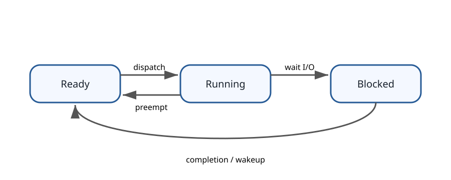
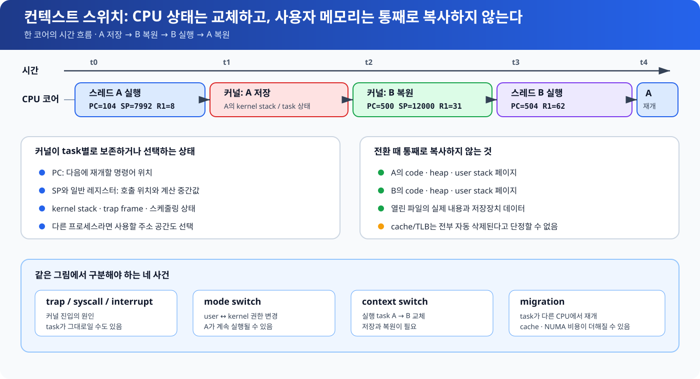

# 01. 프로세스·스레드·시스템 호출과 컨텍스트 스위치

[이 책 목차](README.md) · [이전](00-what-an-os-does.md) · [다음](02-cpu-scheduling.md)

이 장의 목표는 단순히 “컨텍스트 스위치는 문맥 교환이다”라고 외우는 것이 아니다. 프로그램을 실행할 때 어떤 객체가 생기고, CPU와 메모리의 어느 상태가 누구에게 속하며, 운영체제가 실행 흐름을 A에서 B로 바꿀 때 무엇을 저장하고 무엇을 그대로 두는지 추적한다. 마지막에는 Linux에서 관측한 숫자를 과장하지 않고 해석할 수 있어야 한다.



## 1. 먼저 객체와 위치를 구분한다

운영체제 용어가 어려운 가장 큰 이유는 서로 다른 종류의 것을 한 문장에 섞기 때문이다. 파일에 저장된 바이트, 메모리에 놓인 자료구조, CPU 레지스터 안의 값, 커널이 관리하는 식별자는 위치와 수명이 다르다.

| 용어 | 뜻 | 주로 어디에 있는가 | 언제 생기고 사라지는가 | 누가 관리하는가 |
|---|---|---|---|---|
| program | 실행 파일에 들어 있는 명령어와 정적 데이터의 묶음 | SSD 같은 저장장치의 파일 | 설치하거나 빌드할 때 생기며 파일을 지울 때 사라짐 | 파일시스템과 사용자 |
| process | 프로그램을 실행 중인 하나의 격리된 실행 환경 | 사용자 메모리와 커널 자료구조에 걸쳐 존재 | 실행을 시작할 때 생기고 종료 뒤 자원이 회수되면 사라짐 | 커널 |
| thread | 한 프로세스 안에서 독립적으로 명령어를 진행하는 실행 흐름 | 자기 레지스터·스택과 커널의 스케줄링 정보 | 스레드 생성부터 종료까지 | 커널과 스레드 라이브러리 |
| task | 스케줄러가 CPU에 올릴 수 있는 실행 단위를 가리키는 넓은 말 | 커널 스케줄러 자료구조 | 생성부터 종료·회수까지 | 커널 |
| PID | 프로세스를 구별하는 숫자 식별자 | 커널 자료구조에 기록되고 사용자에게 노출 | 프로세스 수명 동안 유효하며 나중에 재사용 가능 | 커널 |
| TID | 스레드를 구별하는 숫자 식별자 | 커널 자료구조에 기록되고 사용자에게 노출 | 스레드 수명 동안 유효하며 나중에 재사용 가능 | 커널 |

`program`과 `process`의 차이를 요리책과 실제 조리에 비유할 수 있다. 요리책 한 권으로 여러 사람이 동시에 요리할 수 있다. 레시피 글은 같아도 각 사람의 냄비, 현재 단계, 재료의 양은 다르다. 같은 실행 파일을 두 번 실행했을 때 코드 바이트는 같을 수 있지만 PID, 열린 파일, 메모리 내용, 다음에 실행할 명령어는 서로 다르다.

PCB(process control block)는 교재에서 “커널이 프로세스를 관리하기 위해 보관하는 기록”을 부르는 일반 모형이다. PID, 상태, 스케줄링 정보, 주소 공간과 열린 자원에 대한 참조 등이 들어간다고 설명한다. PCB라는 이름의 한 덩어리가 모든 운영체제에 그대로 존재한다고 생각하면 안 된다. 실제 커널은 정보를 여러 구조에 나눌 수 있다.

Linux에서 `task_struct`는 각 스케줄링 대상의 핵심 커널 자료구조다. 상태, 식별자, 스케줄링 정보, 자격 증명과 여러 자원에 대한 포인터를 가진다. “`task_struct` 안에 프로세스의 모든 메모리 바이트가 들어 있다”는 뜻은 아니다. 실제 사용자 메모리는 별도의 물리 페이지에 있고, `task_struct`는 주소 공간을 설명하는 다른 커널 객체 등을 가리킨다. 또한 `task_struct`는 Linux 구현 이름이다. 모든 운영체제가 같은 구조체나 같은 필드를 사용하는 것은 아니다. task가 만들어질 때 커널이 할당하고, 종료 뒤 다른 참조와 회수 절차가 끝날 때 해제한다.

## 2. 프로세스의 주소 공간은 무엇인가

주소 공간(address space)은 한 프로세스가 사용할 수 있다고 보는 가상 주소들의 세계다. 프로그램이 주소 `0x400000`을 읽는다고 해서 그 숫자가 RAM 칩의 실제 위치를 곧바로 뜻하지 않는다. CPU의 메모리 관리 장치와 운영체제가 만든 페이지 테이블이 가상 주소를 물리 메모리의 페이지로 변환한다.

일반적인 프로세스 주소 공간에는 다음 영역이 있다.

- code 또는 text: CPU가 실행할 기계 명령어
- read-only data: 수정하면 안 되는 상수
- global data: 전역 변수와 정적 변수
- heap: `malloc`이나 `new`처럼 실행 중 동적으로 할당한 메모리
- memory mapping: 실행 파일, 공유 라이브러리, 파일, 익명 메모리 등을 연결한 구간
- user stack: 함수 호출, 지역 변수, 복귀 주소 등을 담는 스레드별 구간

페이지 테이블(page table)은 이 변환 규칙과 읽기·쓰기·실행 권한을 기록하는 커널 관리 자료구조다. 페이지 테이블 자체는 보통 커널이 통제하는 메모리에 있으며 하드웨어가 일부 형식을 직접 읽는다. TLB(translation lookaside buffer)는 최근의 가상 주소 변환 결과를 CPU 가까이에 임시 저장하는 작은 캐시다. 페이지 테이블을 매번 메모리에서 따라가면 느리므로 TLB가 필요하다.

주소 공간은 프로세스가 종료될 때까지 반드시 모든 페이지를 계속 RAM에 붙잡고 있는 하나의 덩어리가 아니다. 페이지는 아직 할당되지 않았을 수도 있고, 파일과 연결되거나, 다른 프로세스와 공유되거나, 저장장치로 내보내질 수 있다. 중요한 점은 프로세스가 보는 가상 주소와 접근 권한의 규칙이 있다는 것이다.

## 3. 스레드는 무엇을 공유하고 무엇을 따로 가지는가

한 프로세스의 여러 스레드는 대체로 같은 주소 공간과 열린 파일 집합을 공유한다. 그래서 한 스레드가 heap의 객체를 바꾸면 다른 스레드도 같은 객체를 볼 수 있다. 이 공유는 빠른 통신을 가능하게 하지만 동기화가 없으면 레이스 컨디션을 만든다.

각 스레드는 독립적인 실행 흐름이므로 다음 상태는 따로 필요하다.

- PC(program counter): 다음에 실행할 명령어의 위치를 나타내는 CPU 상태
- 일반 레지스터: 덧셈의 피연산자, 포인터, 임시 결과 등을 매우 빠르게 보관하는 CPU 내부 저장소
- SP(stack pointer): 현재 스레드의 스택 맨 위를 가리키는 레지스터
- user stack: 사용자 함수 호출 기록이 쌓이는 스레드별 메모리 구간
- kernel stack: 그 스레드가 시스템 호출이나 예외로 커널 코드를 실행할 때 쓰는 커널 전용 스택
- 스케줄링 상태: 실행 가능 여부, 우선순위, 어느 CPU에서 실행 중인지 등의 커널 정보
- thread-local storage: 이름은 같아도 스레드마다 별도 값을 갖도록 만든 사용자 메모리

| 객체 | 같은 프로세스의 스레드가 보통 공유하는가 | 이유 또는 위험 |
|---|---:|---|
| code | 예 | 같은 프로그램 명령을 실행할 수 있음 |
| global data와 heap | 예 | 빠르게 협력하지만 락 없이 갱신하면 값이 손상될 수 있음 |
| 주소 공간의 페이지 테이블 | 예 | 같은 가상 주소가 같은 메모리를 가리키게 함 |
| 열린 파일 설명에 대한 참조 | 대체로 예 | 파일 위치(offset)까지 공유되는 경우 예상 밖 읽기 위치가 생길 수 있음 |
| PC와 일반 레지스터 | 아니오 | 각 스레드가 서로 다른 명령과 계산을 진행함 |
| user stack | 아니오 | 함수 호출 기록을 섞으면 복귀 위치와 지역 변수가 깨짐 |
| kernel stack | 아니오 | 각 스레드의 커널 진입과 복귀 상태를 안전하게 보존해야 함 |

`thread = address space`라고 외우면 안 된다. 여러 스레드가 주소 공간 하나를 공유한다. user stack을 스레드별로 따로 배정한다는 말은 소유와 사용 규칙이 다르다는 뜻이지, 하드웨어가 같은 프로세스의 다른 스레드 접근을 자동 차단한다는 뜻이 아니다. 주소를 알아내고 동기화 규칙을 어기면 T1이 T2의 stack 메모리를 읽거나 망가뜨릴 수도 있다. 반대로 프로세스가 달라도 공유 메모리를 명시적으로 매핑하면 일부 물리 페이지를 함께 볼 수 있다.

## 4. CPU 위의 한 순간을 확대해 본다

한 CPU 코어가 시각 `t0`에 스레드 A를 실행한다고 하자. 교육용으로 레지스터를 세 개만 그린다.

| 시각 | 실행 중 스레드 | PC | SP | R1 | 의미 |
|---:|---|---:|---:|---:|---|
| `t0` | A | 100 | 8000 | 7 | A의 100번 위치 명령을 실행할 차례 |
| `t1` | A | 104 | 7992 | 8 | A가 한 명령을 끝내고 호출 프레임을 사용함 |
| `t2` | 커널 | 커널 주소 | A의 kernel stack | - | 타이머 인터럽트 처리와 스케줄링 |
| `t3` | B | 500 | 12000 | 31 | 저장해 둔 B 상태를 복원하여 B를 재개 |
| `t4` | B | 504 | 12000 | 62 | B가 자기 계산을 진행 |
| `t5` | 커널 | 커널 주소 | B의 kernel stack | - | 나중에 다시 스케줄링 |
| `t6` | A | 104 | 7992 | 8 | A가 멈췄던 바로 그 논리적 지점에서 재개 |

`t2`에서 A의 PC·SP·필요한 레지스터 값을 잃어버리면 `t6`에서 A를 올바르게 이어서 실행할 수 없다. 따라서 커널은 A의 실행 상태를 보존하고 B의 저장 상태를 복원한다. 이 실행 주체 교체가 컨텍스트 스위치(context switch)다.



여기서 가장 중요한 사실은 **프로세스 메모리 전체를 복사하지 않는다는 것**이다. A의 heap 4 GiB를 어딘가에 복사하고 B의 heap 4 GiB를 다시 CPU로 옮기는 작업이 아니다. 사용자 메모리 페이지는 RAM이나 메모리 계층에 그대로 남는다. 커널은 CPU에서 즉시 이어 실행하는 데 필요한 레지스터 상태와 스케줄링 관련 상태를 바꾸고, 다른 프로세스로 전환한다면 CPU가 어느 주소 공간의 페이지 테이블을 사용할지도 바꾼다.

“레지스터를 저장한다”는 문장도 구현을 지나치게 단순화할 수 있다. 어떤 값은 trap 진입 코드가 스택 프레임에 저장하고, 어떤 값은 아키텍처별 전환 코드가 저장하며, 컴파일러 호출 규약 때문에 이미 보존된 값도 있다. FPU, SIMD, 벡터 레지스터처럼 큰 확장 상태는 하드웨어와 커널 정책에 따라 즉시 또는 필요할 때 관리될 수 있다. x86, Arm, RISC-V는 레지스터 집합과 trap 진입 규칙이 다르다. 위 표는 공통 원리를 보여 주는 교육 모형이지 Linux의 모든 아키텍처에서 같은 필드 배열을 복사한다는 뜻이 아니다.

## 5. mode switch와 context switch는 다른 사건이다

CPU에는 사용자 프로그램이 모든 명령과 장치에 마음대로 접근하지 못하게 하는 권한 단계가 있다. user mode는 제한된 권한으로 애플리케이션을 실행하는 상태이고, kernel mode는 운영체제 핵심 코드가 더 높은 권한으로 메모리 관리와 장치 제어를 수행하는 상태다. privilege level은 이 권한 수준을 뜻한다.

trap은 현재 실행 흐름을 커널의 미리 정한 진입점으로 옮기는 하드웨어 제어 이동을 넓게 부르는 말이다. 진입 이유에 따라 다음처럼 나눌 수 있다.

| 사건 | 발생 이유 | 현재 명령과의 관계 | task가 반드시 바뀌는가 |
|---|---|---|---:|
| system call | 프로그램이 `read`, `write` 같은 커널 서비스를 의도적으로 요청 | 동기적 | 아니오 |
| exception 또는 fault | 0으로 나누기, 유효하지 않은 명령, page fault 등 | 현재 명령 때문에 동기적으로 발생 | 아니오 |
| timer interrupt | 하드웨어 타이머가 CPU에 알림 | 현재 명령 밖의 비동기 사건 | 아니오 |
| device interrupt | NIC·NVMe 등의 작업 완료 알림 | 비동기 | 아니오 |
| context switch | 스케줄러가 실행 task를 A에서 B로 교체 | 위 사건 뒤나 자발적 양보 뒤에 가능 | 예 |

mode switch는 A가 user mode에서 kernel mode로 들어갔다가 같은 A로 돌아오는 경우에도 발생한다. context switch는 실행 task 자체가 바뀌는 경우다. 두 사건은 함께 일어날 수도, 따로 일어날 수도 있다.

예를 들어 `getpid()`에 해당하는 시스템 호출을 처리하고 같은 A로 바로 돌아온다면 user→kernel→user의 mode switch는 있지만 A→B context switch는 없다. 타이머 인터럽트를 처리한 뒤 스케줄러가 A를 계속 선택해도 마찬가지다. 반대로 A가 커널 안에서 잠들고 B를 고르면 task switch가 일어난다.

trap frame은 커널이 trap 이전 상태로 돌아가기 위해 필요한 PC, 상태 레지스터, 일부 일반 레지스터 등을 기록한 프레임이다. 보통 해당 스레드의 kernel stack 또는 아키텍처가 정한 안전한 저장 위치와 연관된다. kernel stack은 사용자가 임의로 읽고 쓸 수 없는 커널 메모리다. A의 kernel stack을 B의 것과 섞으면 A의 시스템 호출 복귀 위치나 커널 함수 호출 기록이 깨질 수 있으므로 task별로 분리한다.

## 6. blocked `read`부터 복귀까지 완전하게 추적하기

다음은 A가 page cache에 없는 파일을 `read`하여 NVMe 완료를 기다리고, 그동안 B가 별도의 계산을 하는 예다. NVMe controller가 읽기를 끝내면 device interrupt가 completion을 알리고 A가 깨어난다. 실제 filesystem, block layer와 driver의 세부 함수는 다를 수 있지만 상태 전이는 이렇게 읽을 수 있다. 파이프 예제라면 장치 interrupt가 아니라 다른 writer의 `write`가 대기 중인 reader를 깨울 수 있으므로 두 시나리오를 섞지 않는다.

상태 용어부터 정의한다.

- running: 지금 특정 CPU에서 명령을 실행 중
- runnable 또는 ready: 실행 조건은 갖췄지만 CPU를 배정받지 못한 상태
- blocked 또는 sleeping: I/O 완료, 락, 타이머 같은 조건을 기다려 지금은 실행할 수 없는 상태
- runqueue: 특정 CPU 또는 스케줄링 영역에서 실행 후보를 관리하는 커널 자료구조
- scheduler: runnable task 중 다음 실행 대상을 고르고 CPU를 배정하는 커널 부분

| 단계 | CPU mode와 실행 주체 | A 상태 | B 상태 | 커널이 하는 일 |
|---:|---|---|---|---|
| 1 | user, A | running | runnable | A가 일반 파일에 `read(fd, buf, n)` 호출 준비 |
| 2 | kernel, 여전히 A | running | runnable | syscall 번호와 인수를 읽고 fd, 사용자 버퍼 접근 가능성 등을 검사 |
| 3 | kernel, A | blocked로 전환 | runnable | page cache miss 뒤 NVMe 요청을 제출하고 A를 I/O 대기 큐에 연결 |
| 4 | kernel scheduler | blocked | runnable | A의 남은 실행 상태를 저장하고 다음 후보 B를 선택 |
| 5 | user 또는 kernel, B | blocked | running | B 상태와 B의 주소 공간이 필요하면 복원하고 B의 별도 계산 실행 |
| 6 | NVMe와 interrupt handler | blocked | 잠시 중단되었다가 이어짐 | NVMe 읽기 완료가 interrupt를 발생시키고 커널이 completion을 처리 |
| 7 | kernel wakeup 경로 | runnable | running | 기다리던 조건이 참이 되어 A를 runqueue에 넣음 |
| 8 | user, B | runnable | running | wakeup은 즉시 A 실행을 보장하지 않으므로 B가 계속할 수 있음 |
| 9 | kernel scheduler | runnable | runnable 또는 preempted | 우선순위·정책·CPU 상태를 보고 나중에 A 선택 |
| 10 | kernel, A | running | runnable | A의 주소 공간, kernel stack, 저장 레지스터를 복원 |
| 11 | kernel, A | running | runnable | 잠들었던 `read` 커널 경로가 조건을 다시 확인하고 데이터를 사용자 버퍼로 전달 |
| 12 | user, A | running | runnable | syscall 반환값을 레지스터에 두고 syscall 다음 사용자 명령으로 복귀 |

3→4에서 A는 I/O를 기다리므로 자발적으로 CPU를 놓는다. 이를 voluntary context switch로 분류해 관측할 수 있다. 6→7의 wakeup은 “A가 이제 실행될 자격을 얻었다”는 뜻이지 “바로 지금 A가 CPU를 빼앗는다”는 뜻이 아니다. 9에서 실제 선택이 일어나야 한다.

인터럽트 핸들러가 B 실행 중에 들어왔다고 해서 B의 user stack을 사용하지 않는다. CPU와 커널의 아키텍처별 진입 규칙에 따라 안전한 커널 실행 상태로 전환한다. 처리 후 B로 바로 돌아갈 수도 있고, 재스케줄이 필요하면 A 같은 다른 task로 넘어갈 수도 있다.

## 7. 왜 스위치가 일어나는가

context switch 원인은 크게 다음처럼 분류할 수 있다.

### 7.1 자발적 전환

현재 task가 당장 진행할 수 없거나 스스로 양보한다.

- 빈 소켓이나 파이프에서 데이터를 기다리는 blocking I/O
- mutex를 다른 스레드가 가지고 있어 잠듦
- timer나 condition variable을 기다림
- 명시적으로 yield를 호출함

현재 task가 커널에 “나는 지금 실행해도 진전할 수 없다”는 상태를 만들기 때문에 voluntary라고 부른다. 모든 시스템 호출이 자발적 전환을 만드는 것은 아니다. 즉시 완료되는 `read`나 단순 조회는 같은 task로 돌아올 수 있다.

### 7.2 비자발적 선점

preemption은 현재 task가 계속 실행할 수 있어도 운영체제가 CPU를 다른 task에 배정하는 것이다. 더 높은 우선순위 task가 runnable이 되거나, 공정성을 위해 다른 task에게 기회를 줘야 하거나, 정책이 정한 조건을 만족할 때 발생할 수 있다. Linux의 구체적인 정책과 설정에 따라 세부 판단은 달라진다. “타이머 틱마다 무조건 다른 프로세스로 바뀐다”는 설명은 틀리다. 타이머는 스케줄러가 판단할 계기를 줄 수 있지만 현재 task를 다시 고를 수도 있다.

### 7.3 프로세서 간 migration

migration은 task가 이전과 다른 CPU 코어에서 실행되는 일이다. CPU 0에서 A→B로 바뀌면 context switch지만 A의 migration은 아니다. A가 CPU 0에서 멈췄다가 CPU 3에서 재개하면 A에게 migration이 발생한다. migration에는 새 코어의 캐시와 TLB가 A의 작업 집합으로 따뜻해지는 비용이 더해질 수 있고, NUMA 시스템에서는 메모리가 붙어 있는 노드와 CPU 위치가 달라져 원격 메모리 접근이 늘 수 있다.

## 8. 같은 프로세스 스레드 전환과 다른 프로세스 전환

A와 B가 같은 주소 공간을 공유하는 스레드라면 PC, SP, 일반 레지스터와 kernel stack은 바꿔야 하지만 사용자 주소 공간의 페이지 테이블은 대체로 그대로 사용할 수 있다. 그래도 스택과 작업 데이터가 달라 CPU cache miss가 발생할 수 있고 스케줄러·보안 상태 등 다른 전환 작업도 필요하다.

A와 B가 서로 다른 프로세스라면 CPU가 B의 주소 공간을 보도록 페이지 테이블 기준도 전환해야 한다. 그렇다고 TLB를 언제나 전부 비우는 것은 아니다. 현대 아키텍처는 ASID(address-space identifier)나 PCID처럼 TLB 항목이 어느 주소 공간에 속하는지 표시하는 식별자를 사용할 수 있다. 지원 하드웨어, 커널 설정, 식별자 재사용, 보안 완화 방식에 따라 일부 또는 전체 무효화가 필요할 수 있다. 따라서 “프로세스 switch = TLB 전체 flush”는 낡고 지나친 일반화다.

CPU cache도 context switch 명령이 자동으로 전부 지우는 것이 아니다. 이전 task의 code와 data가 cache에 남을 수 있다. B가 다른 메모리를 많이 읽으면 A의 유용한 cache line이 밀려나고, A가 돌아왔을 때 다시 가져오느라 느려질 수 있다. 이것은 직접 저장·복원 비용과 구분되는 간접 비용이다. 보안상 특정 구조를 비우거나 격리하는 조치는 시스템과 취약점 완화 설정에 따라 추가될 수 있다.

## 9. 직접 비용과 간접 비용을 숫자로 계산하기

context switch 비용을 하나의 고정된 나노초 값으로 외우면 안 된다. 다음 요소가 합쳐진다.

- 직접 비용: 커널 진입, 스케줄러 판단, 레지스터와 주소 공간 관련 상태 전환, 회계 처리
- cache warm-up: 새 task가 필요한 명령과 데이터를 cache에 다시 채우는 시간
- TLB warm-up: 주소 변환 항목을 다시 채우는 시간
- branch predictor와 다른 마이크로아키텍처 상태의 변화
- migration 뒤 NUMA 원격 메모리 접근
- 가상 머신에서는 hypervisor 스케줄링과 vCPU 정지 시간
- 보안 완화, 추적, 성능 카운터 설정 같은 환경 차이

가정이 명시된 교육 계산을 해 보자.

- task 하나가 한 번 CPU를 받을 때 useful work를 2 ms 수행한다.
- 직접 switch 시간이 매번 4 µs라고 가정한다.
- switch 뒤 cache/TLB warm-up 때문에 평균 16 µs를 추가로 잃는다고 가정한다.
- 측정 구간에는 다른 비용이 없다고 단순화한다.

한 구간의 총 시간은 `2000 + 4 + 16 = 2020 µs`다. 유용 작업 효율은 `2000 / 2020 ≈ 99.01%`다.

같은 비용인데 useful work 구간이 50 µs뿐이면 `50 / (50 + 4 + 16) ≈ 71.43%`다. switch 시간이 똑같아도 너무 자주 바뀌면 간접 비용 비율이 커진다. 반대로 quantum을 무조건 크게 하면 대화형 작업이나 높은 우선순위 작업의 대기 시간이 길어질 수 있다. throughput과 latency 사이의 절충이 생긴다.

이 숫자는 실제 Linux의 보장값이 아니다. 측정하려는 시스템에서 task 수, CPU affinity, 전력 상태, SMT, 가상화, NUMA 배치, 작업 집합 크기를 통제하고 분포를 봐야 한다. 평균 하나만 보면 드물게 긴 지연인 tail latency를 놓칠 수 있다.

## 10. scheduler와 runqueue를 더 정확히 보기

scheduler는 “다음 프로세스 번호를 하나 고르는 함수”보다 넓다. task 상태를 갱신하고, runnable 후보를 관리하고, 우선순위와 정책을 적용하고, 여러 CPU 사이 부하를 배치한다. Linux는 CPU별 runqueue와 스케줄링 클래스, 다중 CPU 부하 균형 같은 구현을 사용한다. 구체 자료구조와 정책은 커널 버전에 따라 바뀔 수 있으므로 입문 모형과 현재 Linux 구현을 구분해야 한다.

단일 CPU 교육 모형에서는 runnable queue에서 A 다음 B를 뽑는다고 그려도 된다. 실제 다중 코어 시스템에서는 A와 B가 서로 다른 코어에서 동시에 running일 수 있다. 그때 한 코어의 switch만 보고 시스템 전체에서 “한 순간에 하나의 task만 실행된다”고 결론 내리면 틀린다.

상태 전이의 핵심 불변조건은 다음과 같다.

- running인 일반 task는 한 순간에 한 CPU에서만 실행되어야 한다.
- blocked task는 기다리던 조건이 성립하기 전에는 runnable 후보처럼 실행하면 안 된다.
- wakeup은 상태와 runqueue 연결을 일관되게 바꿔야 한다.
- A를 재개하기 전에 A의 PC, SP, 권한, 주소 공간이 서로 맞아야 한다.
- task가 사용하는 자원은 참조가 남아 있는 동안 먼저 해제되면 안 된다.

## 11. `fork`, `exec`, `wait`와 실행 상태의 관계

Unix 계열에서 새 프로그램을 실행하는 흐름은 흔히 `fork`와 `exec`를 조합한다.

`fork`는 호출한 프로세스를 바탕으로 자식 프로세스를 만든다. 부모와 자식은 서로 다른 PID를 받고 독립적으로 스케줄될 수 있다. 현대 구현은 모든 메모리 페이지를 즉시 깊은 복사하지 않고 copy-on-write를 사용할 수 있다. 처음에는 같은 물리 페이지를 읽기 전용처럼 공유하다가 한쪽이 쓰려 할 때 필요한 페이지를 분리한다. 그러므로 fork도 “주소 공간 전체를 그 자리에서 무조건 복사”라고 설명하면 부정확하다.

`exec`는 현재 프로세스가 실행할 프로그램 이미지와 주소 공간 내용을 새 프로그램으로 교체한다. 일반적인 성공 경로에서는 같은 PID가 유지될 수 있지만 code, stack, heap과 다음 PC는 새 프로그램에 맞게 바뀐다. exec는 “새 프로세스를 하나 더 만든다”와 같지 않다.

`wait` 계열은 부모가 자식의 종료 상태를 수집하도록 한다. 자식이 종료해도 부모가 상태를 수집하기 전에는 최소한의 종료 정보가 zombie 상태로 남을 수 있다. zombie는 CPU에서 계속 코드를 실행하는 유령 프로세스가 아니다. 실행은 끝났지만 부모가 읽어야 할 식별자와 종료 상태 같은 커널 정보가 남은 상태다.

부모와 자식, 또는 여러 스레드는 각각 스케줄링 대상이므로 fork 뒤 어느 쪽이 먼저 실행될지는 일반적으로 고정되지 않는다. 출력 순서에 의존하려면 `wait`나 적절한 동기화를 사용해야 한다.

## 12. 한 CPU에서도 race condition이 생긴다

동시성(concurrency)은 여러 실행 흐름의 진행 구간이 겹치는 구조이고, 병렬성(parallelism)은 실제 같은 시각에 여러 CPU가 명령을 실행하는 것이다. 한 CPU에서는 A와 B가 물리적으로 동시에 명령을 실행하지 않아도, context switch가 공유 상태 갱신 중간에 끼어들면 race condition이 생긴다.

초기 `counter = 0`이고 A와 B가 각각 `counter += 1`을 실행한다고 하자. 이 표현은 보통 읽기, 더하기, 쓰기의 여러 단계다.

| 순서 | 실행 task | 동작 | 레지스터의 임시 값 | 메모리 counter |
|---:|---|---|---:|---:|
| 1 | A | counter 읽기 | A.R = 0 | 0 |
| 2 | A | A.R에 1 더하기 | A.R = 1 | 0 |
| 3 | 커널 | A를 저장하고 B로 switch | A.R = 1이 A 상태에 보존 | 0 |
| 4 | B | counter 읽고 1 더하기 | B.R = 1 | 0 |
| 5 | B | counter 쓰기 | B.R = 1 | 1 |
| 6 | 커널 | B를 저장하고 A로 switch | A.R = 1 복원 | 1 |
| 7 | A | counter 쓰기 | A.R = 1 | 1 |

기대한 2가 아니라 1이다. context switch가 레지스터를 정확히 보존했기 때문에 오히려 A의 오래된 임시 값도 정확히 돌아왔다. 문제는 switch 구현이 아니라 공유 변수 갱신을 원자적으로 보호하지 않은 프로그램이다. [03장 동기화](03-synchronization.md)에서는 mutex, atomic 연산, 메모리 가시성과 실행 순서를 나눠 다룬다.

## 13. Linux에서 안전하게 관측하기

다음 명령은 상태를 바꾸기 위한 명령이 아니라 관측 예시다. 시스템과 컨테이너의 권한 정책에 따라 일부 값이나 이벤트를 읽지 못할 수 있다.

현재 shell 프로세스의 식별자를 확인한다.

```bash
printf 'PID=%s\n' "$$"
ps -o pid,ppid,lwp,psr,stat,comm -p "$$"
```

`lwp`는 표시되는 스레드 식별자, `psr`은 마지막으로 실행된 CPU 번호, `stat`은 상태 요약이다. 한 번 읽은 순간값이므로 명령 사이에 CPU나 상태가 바뀔 수 있다.

특정 PID의 자발적·비자발적 전환 누적값을 본다.

```bash
grep -E '^(Name|Pid|Threads|voluntary_ctxt_switches|nonvoluntary_ctxt_switches):' /proc/SELF_PID/status
```

`SELF_PID`는 실제 숫자로 바꿔야 한다. 이 카운터는 해당 task가 살아온 기간의 누적값이다. 두 번 읽어 차이를 계산하려면 그 사이 관측 구간과 workload를 명확히 해야 한다. 프로세스 전체와 개별 스레드를 혼동하지 않으려면 `/proc/PID/task/TID/status`도 구분한다.

명령 하나의 성능 이벤트를 수집하는 전형적 형태는 다음과 같다.

```bash
perf stat -e task-clock,context-switches,cpu-migrations,page-faults -- command arg1
```

`context-switches`와 `cpu-migrations`는 서로 다른 사건이다. page fault도 항상 저장장치 I/O를 뜻하지 않는다. 이미 메모리에 있는 페이지의 매핑만 만드는 minor fault일 수 있다. `perf`는 `perf_event_paranoid` 설정, capability, 컨테이너 정책, 하드웨어 카운터 지원 때문에 권한 오류가 날 수 있다. 권한을 우회하라고 단정하지 말고 운영 환경의 정책을 확인한다.

측정 해석에는 다음 제한이 있다.

- 가상 머신의 vCPU가 hypervisor에서 멈춘 시간은 guest 관측만으로 완전히 설명되지 않을 수 있다.
- 다른 tenant, interrupt, 주파수 변화, 전력 절약 상태가 결과에 잡음을 준다.
- tracing과 성능 카운터 자체도 비용을 추가한다.
- 누적 context-switch 수가 많다는 사실만으로 성능 문제가 증명되지는 않는다.
- CPU affinity를 고정하면 migration 변수는 줄지만 실제 운영 배치를 그대로 대표하지 않을 수 있다.
- 짧은 한 번의 실행보다 여러 반복의 중앙값과 tail을 함께 보는 편이 낫다.

## 14. 최신 연구와 연결하되 경계를 지킨다

context switch를 최적화하면 모든 시스템 지연이 해결된다고 생각하면 안 된다. 현대 시스템의 간접 비용은 CPU 상태뿐 아니라 네트워크 장치, 가상화, 메모리 계층, tenant 간 간섭에서 온다.

RDMA 같은 고속 네트워크에서는 CPU scheduler가 task를 잘 나누어도 RNIC 내부의 긴 작업이 다른 요청을 막아 tail latency가 커질 수 있다. ATC 2024의 PeRF 연구는 RNIC 멀티테넌트 환경에서 작업 선점과 격리를 다뤘다. 이것은 일반 CPU context switch 비용의 측정값이 아니며, 모든 네트워크 카드에 자동 적용되는 Linux 기능도 아니다. 배운 원리를 “어느 실행 자원을 누가 선점하고, 어떤 상태를 중단·재개하며, 그 비용은 무엇인가”라는 질문으로 확장하는 연구 사례다.

CXL 메모리 계층을 다룬 OSDI 2024 Memstrata는 가상 머신 사이 메모리 tier 간섭과 배치를 연구했다. task를 다른 CPU에 올리는 결정과 별개로, 그 task가 접근하는 페이지가 느린 tier에 있거나 다른 tenant와 하드웨어 자원을 다투면 warm-up 뒤 성능도 달라진다. 논문의 특정 prototype 결과를 모든 CXL 서버의 보장값으로 일반화하면 안 된다. 연구가 보여 주는 핵심 연결은 **실행 주체의 전환 비용과 데이터 배치 비용을 함께 관측해야 한다**는 것이다.

실시간 Linux의 PREEMPT_RT도 관련된 예다. 더 많은 커널 실행 구간을 선점 가능하게 만들면 높은 우선순위 task가 runnable이 된 뒤 실제 실행되기까지의 지연을 줄일 수 있다. 그러나 선점 지점과 동기화 방식이 바뀌므로 처리량, 락 경쟁, 장치 드라이버 조건까지 살펴야 한다. “switch가 많을수록 무조건 좋다” 또는 “적을수록 무조건 좋다”로 결론 내릴 수 없다.

## 15. 자주 생기는 오해를 반례로 고친다

**오해 1: context switch 때 RAM의 프로세스 전체를 복사한다.**

아니다. 실행 재개에 필요한 CPU·커널 상태와 주소 공간 선택을 바꾼다. 사용자 페이지 대부분은 제자리에 남는다.

**오해 2: system call 하나마다 다른 프로세스로 바뀐다.**

아니다. 같은 task가 kernel mode에서 호출을 처리하고 바로 user mode로 돌아갈 수 있다.

**오해 3: interrupt는 곧 context switch다.**

아니다. interrupt handler 뒤 현재 task를 계속 실행할 수 있다. 다른 task를 선택했을 때 context switch다.

**오해 4: wakeup은 즉시 실행이다.**

아니다. blocked에서 runnable로 바뀌고 runqueue 후보가 된 것이다. 실제 CPU 배정은 별도다.

**오해 5: cache와 TLB는 매번 전부 지워진다.**

아니다. cache line은 남을 수 있고, TLB는 ASID·PCID와 무효화 정책에 따라 유지 범위가 달라진다.

**오해 6: context switch 수만 낮추면 빨라진다.**

아니다. 너무 긴 실행 구간은 응답 시간을 악화할 수 있고, 실제 병목이 I/O·메모리 tier·락 경쟁일 수도 있다.

**오해 7: 코어가 하나면 race가 없다.**

아니다. 공유 상태의 여러 단계 사이에 switch가 끼면 실행 순서에 따라 결과가 달라진다.

## 16. 확인 문제와 자세한 해설

### 문제 1. 무엇이 저장되고 무엇이 남는가

A에서 B로 전환할 때 다음 항목을 “A의 실행 상태로 보존”, “주소 공간에 그대로 남음”, “B에 맞게 선택 또는 복원”으로 분류하라.

1. A의 PC와 SP
2. A heap의 2 GiB 배열
3. B의 page table 기준
4. A의 열린 파일 내용 자체
5. A의 kernel stack에서 복귀에 필요한 프레임

**해설:** 1과 5는 A를 나중에 이어 실행하기 위한 상태로 보존해야 한다. 2는 전체를 복사하지 않고 A의 주소 공간을 이루는 페이지로 남는다. 3은 다른 프로세스 B라면 B 주소 공간을 사용하도록 선택해야 한다. 4의 파일 내용은 파일시스템과 저장장치의 객체이며 CPU context에 복사되는 것이 아니다. 다만 열린 파일을 가리키는 커널 참조와 현재 offset 같은 상태는 프로세스 자원 관리에 포함된다.

### 문제 2. mode switch만 있는 경로

A가 `getpid` 성격의 짧은 syscall을 호출했고 커널이 즉시 같은 A로 복귀했다. mode switch와 context switch 횟수를 개념적으로 쓰라.

**해설:** user→kernel, kernel→user라는 권한 모드 전환은 있다. 다른 task를 고르지 않았으므로 A→B context switch는 0회다. 실제 계측 도구가 내부 사건을 어떤 이름과 단위로 세는지는 별도 확인해야 한다.

### 문제 3. wakeup 뒤 누가 실행되는가

A는 I/O를 기다리며 blocked이고 B가 CPU에서 실행 중이다. 장치 interrupt가 A의 조건을 만족시켰다. A가 다음 명령을 즉시 실행한다고 결론 내릴 수 있는가?

**해설:** 결론 낼 수 없다. 커널은 A를 runnable로 만들고 적절한 runqueue에 넣는다. 스케줄링 정책, 우선순위, 선점 가능 지점, CPU affinity와 현재 CPU 상태에 따라 B가 계속 실행할 수도 있고 A가 선점할 수도 있다. wakeup과 dispatch를 구분해야 한다.

### 문제 4. 같은 프로세스와 다른 프로세스

T1→T2는 같은 프로세스의 스레드 전환이고, P1→P2는 다른 프로세스 전환이다. 공통으로 바뀌는 것과 P1→P2에서 추가로 고려할 것을 쓰라.

**해설:** 두 경우 모두 PC, SP, 일반 레지스터, kernel stack 연결, 스케줄링 상태처럼 실행 흐름별 상태가 바뀐다. 다른 프로세스 전환에서는 어느 주소 공간과 페이지 테이블을 사용할지 바꿔야 한다. 하지만 ASID·PCID 등의 지원 때문에 TLB 전체 flush가 항상 필요한 것은 아니다. 같은 프로세스 스레드라도 작업 집합이 달라 cache miss가 날 수 있으므로 비용이 0은 아니다.

### 문제 5. 효율 계산

useful work가 250 µs, 직접 switch 비용이 5 µs, 평균 warm-up 비용이 20 µs라고 가정한다. 한 실행 구간의 유용 작업 효율을 계산하라. useful work가 25 µs로 줄면 어떻게 되는가?

**해설:** 첫 경우는 `250 / (250 + 5 + 20) = 250 / 275 ≈ 90.91%`다. 둘째는 `25 / (25 + 5 + 20) = 50%`다. 고정 비용이 짧은 작업 구간에서 훨씬 큰 비중을 차지한다. 이 계산은 스케줄링 응답성 이득과 다른 시스템 비용을 제외한 교육 모형이다.

### 문제 6. 한 코어의 lost update

`counter = 0`에서 A와 B가 각각 읽기→더하기→쓰기로 1을 더한다. A가 읽고 switch, B가 전체 갱신, 다시 A가 쓰는 순서를 표로 적고 최종값을 구하라.

**해설:** A read 0, A local add 1, B read 0, B local add 1, B write 1, A write 1이다. 최종값은 1이다. 두 스레드가 같은 시각에 물리적으로 실행되지 않아도 결과가 실행 순서에 의존한다. 해결은 단순히 switch를 없애는 것이 아니라 공유 갱신의 임계 구역을 올바르게 동기화하는 것이다.

### 문제 7. `perf` 숫자 해석

실행 X가 context-switches 10,000, migrations 2이고 실행 Y가 context-switches 2,000, migrations 300이다. 어느 쪽이 더 빠르다고 단정할 수 있는가?

**해설:** 단정할 수 없다. X는 switch가 많지만 같은 CPU의 따뜻한 cache를 잘 유지했을 수 있다. Y는 switch가 적어도 migration과 NUMA 원격 접근 비용이 클 수 있다. useful work 양, 경과 시간, CPU time, cache/TLB miss, page fault, I/O 대기, tail latency, 반복 분포를 함께 봐야 한다. 두 실행이 같은 입력과 환경인지도 확인해야 한다.

### 문제 8. `fork` 다음 출력 순서

부모가 `fork` 뒤 “P”를 출력하고 자식이 “C”를 출력한다. 동기화가 없다면 항상 “PC”인가?

**해설:** 아니다. 부모와 자식은 둘 다 runnable이 될 수 있고 scheduler 선택에 따라 “PC” 또는 “CP”가 가능하다. 버퍼링 때문에 실제 표시 순서는 더 복잡할 수 있다. 순서를 보장하려면 부모가 적절한 `wait`를 사용하거나 프로세스 간 동기화를 해야 한다. `exec`를 호출하면 그 프로세스의 프로그램 이미지가 바뀌지만 PID가 곧바로 새로 생긴다고 보아서는 안 된다.

### 문제 9. 측정 설계

context switch의 간접 cache 비용을 비교하려 한다. 최소한 통제하거나 기록할 조건 다섯 가지를 쓰라.

**해설:** 예를 들면 CPU affinity와 migration, 동시 실행 tenant와 background load, 작업 집합 크기, CPU 주파수·전력 상태, SMT 사용 여부, NUMA CPU·메모리 배치, 가상 머신 여부, 커널 버전과 보안 완화, 반복 횟수와 분포가 있다. 하나의 고정 비용을 얻는 것이 목표가 아니라 조건에 따라 직접·간접 비용이 어떻게 변하는지 분리하는 것이 목표다.

## 17. 이 장에서 가져갈 판단 기준

컨텍스트 스위치를 만났을 때 다음 질문을 순서대로 던진다.

1. 바뀌는 실행 주체는 프로세스인가, 같은 프로세스의 스레드인가?
2. 어떤 사건이 kernel 진입을 만들었고, 실제 task 교체도 있었는가?
3. 이전 task는 runnable인가, blocked인가?
4. PC·SP·레지스터와 kernel stack은 어디에 보존되는가?
5. 주소 공간이 바뀌며 TLB 식별자나 무효화가 필요한가?
6. migration도 함께 일어났는가?
7. 직접 switch 시간 외에 cache·TLB·NUMA·가상화 간접 비용이 있는가?
8. 관측값은 누적값인가, 특정 구간의 차이인가?
9. 평균뿐 아니라 tail latency와 workload 조건을 기록했는가?

이 질문에 답할 수 있으면 “문맥을 바꾼다”는 한 문장을 실제 시스템의 상태 전이로 풀어낼 수 있다.

## 근거와 더 읽을 자료

- [OSTEP: Processes, Process API, CPU Scheduling](https://pages.cs.wisc.edu/~remzi/OSTEP/)
- [MIT 6.S081: xv6 traps와 scheduling](https://pdos.csail.mit.edu/6.S081/)
- [Linux kernel 문서: `/proc/PID/status`의 process와 context-switch 필드](https://www.kernel.org/doc/html/latest/filesystems/proc.html)
- [Linux kernel 문서: scheduler domains와 다중 CPU load balancing](https://www.kernel.org/doc/html/latest/scheduler/sched-domains.html)
- [Linux kernel 문서: PREEMPT_RT 동작 원리](https://www.kernel.org/doc/html/latest/core-api/real-time/theory.html)
- [perf-stat(1): event와 출력 해석](https://man7.org/linux/man-pages/man1/perf-stat.1.html)
- [PeRF: Preemption-enabled RDMA Framework, USENIX ATC 2024](https://www.usenix.org/conference/atc24/presentation/lee)
- [Memstrata: Managing Memory Tiers with CXL in Virtualized Environments, OSDI 2024](https://www.usenix.org/conference/osdi24/presentation/zhong-yuhong)

---

[이전 장: 운영체제가 하는 일](00-what-an-os-does.md) · [다음 장: CPU 스케줄링](02-cpu-scheduling.md)
