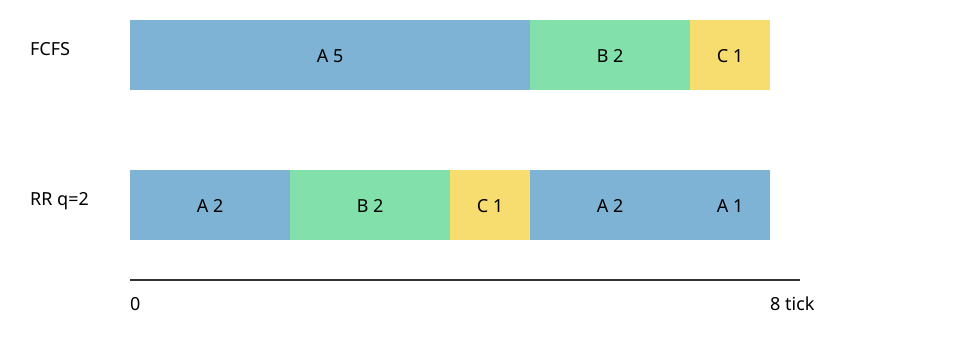

# 02. CPU 스케줄링

[이 책 목차](README.md) · [이전](01-processes-threads-syscalls.md) · [다음](03-synchronization.md)

CPU scheduler는 실행할 수 있는 task가 CPU core보다 많을 때 “누구를 언제 어느 core에서 실행할 것인가”를 정한다. 이 장에서는 알고리즘 이름을 외우기 전에 입력과 지표를 정확히 정의하고, 같은 workload를 FCFS, SJF, SRTF, Round Robin, MLFQ로 직접 계산한다. 마지막에는 고전 교재 모형과 현재 Linux의 EEVDF, 다중 코어·NUMA 현실을 분리해 읽는다.



## 1. scheduler가 받는 상태부터 정의한다

[앞 장](01-processes-threads-syscalls.md)에서 task는 CPU에 올라갈 수 있는 실행 흐름이라고 설명했다. task가 존재한다고 항상 CPU를 쓸 수 있는 것은 아니다.

- running: 지금 특정 CPU core에서 명령을 실행 중
- runnable 또는 ready: 실행 조건은 갖췄지만 CPU 배정을 기다리는 상태
- blocked 또는 sleeping: I/O 완료, lock, timer 같은 조건을 기다려 지금은 실행할 수 없는 상태
- runqueue: runnable task를 관리하는 커널 자료구조
- scheduler: runnable 후보와 정책을 보고 다음 실행 대상을 고르는 커널 부분
- dispatch: 선택된 task를 실제 CPU에서 실행하게 만드는 과정
- context switch: 이전 task의 실행 상태를 저장하고 다른 task의 상태를 복원하는 기작

scheduler는 blocked task를 고르면 안 된다. 아직 NVMe read가 끝나지 않은 task에게 CPU를 줘도 필요한 데이터가 없어서 진행할 수 없다. I/O completion이나 lock release가 task를 깨우면 blocked에서 runnable로 바뀌고 다시 후보가 된다.

교재에서는 하나의 ready queue를 그리지만 실제 다중 코어 Linux는 CPU별 실행 queue와 스케줄링 class, CPU topology를 고려한다. 먼저 한 CPU의 결정 원리를 이해한 뒤 현실 요소를 더한다.

## 2. workload를 숫자로 표현하는 용어

job은 분석할 작업 한 건을 뜻하는 교육 용어다. 실제 OS 객체인 process나 thread와 항상 일대일인 것은 아니다. 한 요청을 job으로 볼 수도 있고 한 process의 CPU burst를 job으로 볼 수도 있다.

arrival time은 job이 시스템에 도착해 runnable이 된 시각이다. service time은 job이 완료되기 위해 실제 CPU에서 실행해야 하는 시간의 합이다. 이 장의 CPU-only 예에서는 CPU burst와 service time을 같은 값으로 둔다.

CPU burst는 task가 blocked되거나 선점되기 전까지 CPU 연산을 수행하는 구간이다. I/O burst는 흔히 “I/O를 요청하고 기다리는 구간”을 가리키지만, 그동안 CPU가 그 task의 명령을 실행하는 것은 아니다. 한 task는 CPU burst→I/O wait→CPU burst를 반복할 수 있다.

finish time은 job이 완료된 시각이다. first-run time은 처음 CPU를 받은 시각이다. 이 값으로 다음 지표를 계산한다.

| 지표 | 정의 | 질문 |
|---|---|---|
| turnaround time | `finish - arrival` | 도착부터 완료까지 얼마나 걸렸는가 |
| response time | `first_run - arrival` | 도착 뒤 첫 CPU를 받기까지 얼마나 걸렸는가 |
| ready waiting time | runnable이지만 CPU를 못 받은 시간의 합 | 실행 가능한데 queue에서 얼마나 기다렸는가 |
| service time | 실제 CPU 실행 시간의 합 | 이 job이 CPU를 얼마나 사용했는가 |
| throughput | 관측 구간에 완료한 job 수 / 관측 시간 | 단위 시간당 몇 건을 끝냈는가 |
| utilization | CPU가 유용한 일을 한 시간 / 관측 시간 | CPU가 얼마나 놀지 않았는가 |
| fairness | 자격과 weight가 비슷한 task가 장기간 적절한 몫을 얻는 성질 | 누군가 계속 밀려나지 않는가 |
| deadline miss | finish가 요구 deadline을 넘긴 사건 | 시간 제한을 지켰는가 |

I/O가 없는 CPU-only job에서는 `waiting = turnaround - service`로 계산할 수 있다. I/O가 있으면 이 식은 blocked 시간까지 섞을 수 있다. 그때는 timeline에서 runnable이지만 실행되지 않은 구간만 따로 더해야 한다.

평균만으로 충분하지 않다. job 아홉 개가 1 ms에 끝나고 하나가 101 ms에 끝나면 평균은 11 ms지만 한 사용자는 101 ms를 경험한다. percentile과 최대값 같은 tail latency도 봐야 한다.

## 3. 공통 입력과 tie-breaking 규칙

다음 세 CPU-only job을 사용한다.

| Job | arrival | CPU service |
|---|---:|---:|
| A | 0 | 5 |
| B | 1 | 2 |
| C | 2 | 1 |

시간 단위는 tick이다. 구간 `[0,1)`에 A가 실행되면 A는 service 1을 사용한다. context-switch overhead는 우선 0으로 둔다. 여러 후보의 우선순위가 같으면 ready queue에 먼저 들어온 job을 고른다. 계산마다 선점 가능 여부를 명시한다.

정책 이름만 같아도 tie-breaking, arrival 처리 순서, quantum 끝과 wakeup이 같은 시각일 때의 규칙이 다르면 timeline이 달라질 수 있다. 따라서 답에는 알고리즘 이름과 함께 가정을 적는다.

## 4. FCFS: 먼저 도착한 job을 끝까지 실행

FCFS(first-come, first-served)는 ready queue에 먼저 들어온 job을 먼저 고른다. 여기서는 non-preemptive라고 가정한다. 한 번 CPU를 얻은 job은 완료하거나 I/O로 blocked될 때까지 계속 실행한다.

```text
시간  0 1 2 3 4 5 6 7 8
CPU   | A A A A A | B B | C |
```

단계별로 보면 다음과 같다.

1. `t=0`에 A만 있으므로 A를 선택한다.
2. `t=1`에 B가 도착하지만 A를 선점하지 않고 queue에서 기다린다.
3. `t=2`에 C가 도착해 B 뒤에서 기다린다.
4. `t=5`에 A가 끝나고 B를 실행한다.
5. `t=7`에 B가 끝나고 C를 실행한다.
6. `t=8`에 모든 job이 끝난다.

| Job | first run | finish | response | turnaround | waiting |
|---|---:|---:|---:|---:|---:|
| A | 0 | 5 | `0-0=0` | `5-0=5` | `5-5=0` |
| B | 5 | 7 | `5-1=4` | `7-1=6` | `6-2=4` |
| C | 7 | 8 | `7-2=5` | `8-2=6` | `6-1=5` |

평균 turnaround는 `(5+6+6)/3 = 17/3 ≈ 5.67` tick이다. 평균 response는 `(0+4+5)/3 = 3` tick이다. throughput은 `t=0`부터 `t=8`까지 3개 완료이므로 `3/8 = 0.375 job/tick`이다.

긴 A 때문에 짧은 B와 C가 함께 기다린 현상을 convoy effect라고 부른다. FCFS는 구현과 이해가 쉽고 먼저 온 순서를 보존하지만 짧은 대화형 작업의 response가 나빠질 수 있다.

## 5. SJF: 가장 짧은 다음 CPU 작업을 먼저

SJF(shortest job first)는 후보 가운데 CPU service 또는 다음 CPU burst가 가장 짧다고 예측되는 job을 고르는 non-preemptive 정책이다. 선택된 job은 그 burst를 끝낼 때까지 선점하지 않는다고 가정한다.

현재 공통 입력에서는 `t=0`에 A만 도착했다. non-preemptive SJF는 A를 선택한 뒤 B와 C가 와도 멈추지 않는다. 따라서 timeline은 FCFS와 같다. 이것은 “SJF면 항상 C부터”라는 암기가 틀리는 이유다. scheduler는 아직 도착하지 않은 미래 job을 선택할 수 없다.

SJF의 평균 이득을 보기 위해 **세 job이 모두 `t=0`에 도착하고 길이를 정확히 안다**는 별도 가정을 두면 순서는 C(1)→B(2)→A(5)다.

| Job | 실행 구간 | finish | turnaround | waiting |
|---|---|---:|---:|---:|
| C | `[0,1)` | 1 | 1 | 0 |
| B | `[1,3)` | 3 | 3 | 1 |
| A | `[3,8)` | 8 | 8 | 3 |

평균 turnaround는 `(1+3+8)/3 = 4` tick이다. 모든 job이 동시에 도착하고 길이를 정확히 알며 선점 비용이 없다는 가정에서는 짧은 작업을 앞에 두는 것이 평균 waiting과 turnaround를 줄인다.

현실에서는 미래 CPU burst를 정확히 모르는 경우가 많다. 이전 burst를 지수 이동 평균 같은 방법으로 추정할 수 있지만 예측 오차가 생긴다. 긴 job이 기다리는 동안 짧은 job이 계속 도착하면 starvation, 즉 실행 가능하지만 정책 때문에 매우 오래 CPU를 얻지 못하는 상태가 생길 수 있다.

## 6. SRTF: 남은 시간이 더 짧으면 선점

SRTF(shortest remaining time first)는 SJF의 선점형 변형이다. 새 job이 도착했을 때 현재 job보다 남은 CPU 시간이 짧으면 선점한다. 미래 길이를 정확히 안다는 강한 교육 가정을 사용한다.

tie일 때 현재 실행 중인 job을 계속한다는 규칙을 둔다.

```text
시간  0 1 2 3 4 5 6 7 8
CPU   |A| B B |C| A A A A |
```

1. `t=0`: A 실행, 남은 시간은 5에서 4가 된다.
2. `t=1`: B(2)가 도착한다. B의 2가 A의 남은 4보다 짧으므로 A를 선점한다.
3. `t=2`: C(1)가 도착한다. B의 남은 시간도 1이다. tie 규칙 때문에 B를 계속 실행한다.
4. `t=3`: B 완료. C(1)와 A(4) 중 C를 고른다.
5. `t=4`: C 완료. A를 `t=8`까지 실행한다.

| Job | first run | finish | response | turnaround | waiting |
|---|---:|---:|---:|---:|---:|
| A | 0 | 8 | 0 | 8 | `8-5=3` |
| B | 1 | 3 | 0 | `3-1=2` | `2-2=0` |
| C | 3 | 4 | `3-2=1` | `4-2=2` | `2-1=1` |

평균 turnaround는 `(8+2+2)/3 = 4` tick이다. 짧은 B와 C의 완료는 빨라졌지만 A는 중간에 밀려났다. 실제 scheduler가 정확한 remaining time을 알 수 없다는 문제와, 잦은 arrival이 만드는 선점 비용을 함께 봐야 한다.

## 7. Round Robin: quantum만큼씩 순환

Round Robin(RR)은 ready queue를 순환하며 각 task에 최대 quantum만큼 CPU를 준다. quantum은 한 번 배정받았을 때 선점되기 전 사용할 수 있는 최대 CPU 시간 조각이다. task가 그 전에 완료하거나 blocked되면 남은 quantum을 억지로 채우지 않는다.

quantum을 2 tick으로 두고, 같은 시각에 도착한 새 job을 quantum이 끝난 A보다 먼저 queue에 넣는다고 가정한다.

```text
시간  0 1 2 3 4 5 6 7 8
CPU   | A A | B B |C| A A |A|
queue  t=2: B,C,A   t=4: C,A
```

상세 단계는 다음과 같다.

1. `t=0~2`: A가 2 tick 사용하고 3 tick 남는다. 그동안 B와 C가 도착한다.
2. `t=2`: queue는 B, C, A 순서다.
3. `t=2~4`: B가 quantum 2를 사용하고 완료한다.
4. `t=4~5`: C는 1 tick만 필요하므로 quantum 전에 완료한다.
5. `t=5~7`: A가 2 tick 사용하고 1 tick 남는다.
6. `t=7~8`: 다른 후보가 없으므로 A를 계속 또는 다시 dispatch하여 완료한다.

| Job | first run | finish | response | turnaround | waiting |
|---|---:|---:|---:|---:|---:|
| A | 0 | 8 | 0 | 8 | 3 |
| B | 2 | 4 | `2-1=1` | `4-1=3` | `3-2=1` |
| C | 4 | 5 | `4-2=2` | `5-2=3` | `3-1=2` |

평균 turnaround는 `(8+3+3)/3 = 14/3 ≈ 4.67` tick이다. FCFS에서 C response가 5였지만 RR에서는 2다. 반면 A completion은 5에서 8로 늦어졌다.

```mermaid
gantt
    title RR quantum 2
    dateFormat X
    axisFormat %L
    section CPU
    A :0, 2
    B :2, 4
    C :4, 5
    A :5, 8
```



### quantum과 overhead

quantum이 작으면 runnable task가 첫 CPU를 빨리 받을 가능성이 커진다. 그러나 context switch 횟수와 cache·TLB 간접 비용이 늘 수 있다. quantum이 매우 크면 RR은 FCFS에 가까워진다.

교육 계산으로 quantum 2 ms마다 실제로 다른 task로 바뀌고 직접 switch가 0.1 ms라고 가정하자. 한 구간에서 overhead 비율은 `0.1 / (2 + 0.1) ≈ 4.76%`다. quantum 20 ms면 `0.1 / 20.1 ≈ 0.50%`다.

이 계산은 cache warm-up, task의 조기 block, 마지막 quantum, 같은 task 재선택을 무시한다. 실제 시스템에서는 고정 비율이 아니다. [앞 장의 context-switch 비용](01-processes-threads-syscalls.md#9-직접-비용과-간접-비용을-숫자로-계산하기)처럼 workload와 hardware 조건을 함께 측정해야 한다.

## 8. Priority, fairness, starvation, aging

priority scheduler는 더 높은 우선순위의 task를 먼저 고른다. preemptive라면 높은 우선순위 task가 runnable이 되는 순간 낮은 task를 밀어낼 수 있다. non-preemptive라면 현재 burst가 끝날 때까지 기다린다.

priority 숫자가 클수록 높은지 작을수록 높은지는 interface에 따라 다르다. “priority=1이 높다”를 보편 규칙으로 외우면 안 된다. 또한 우선순위가 같을 때 RR인지 FCFS인지, CPU 사용량에 따라 동적으로 변하는지도 정책 일부다.

높은 우선순위 task가 계속 도착하면 낮은 task가 starvation을 겪을 수 있다. aging은 오래 기다린 task의 우선순위를 점차 높이는 완화 기법이다. starvation을 줄이지만 상승 속도와 상한을 정해야 한다.

fairness도 “모두 정확히 같은 나노초를 받는다” 하나로 정의되지 않는다. 서로 다른 weight를 가진 task라면 weight 비율로 CPU share를 나누는 것이 공정할 수 있다. deadline task는 일반 task와 같은 share보다 제시간 완료가 중요할 수 있다. tenant별 fairness와 thread별 fairness도 결과가 다르다.

priority inversion은 높은 우선순위 H가 낮은 우선순위 L이 가진 lock을 기다리고, 중간 우선순위 M이 L을 계속 선점해 H의 진행까지 늦추는 문제다. CPU scheduler만 H를 먼저 고르는 것으로 해결되지 않는다. priority inheritance처럼 L이 임시로 높은 우선순위를 받아 lock을 빨리 놓게 하는 동기화 기작을 고려한다.

## 9. MLFQ: 관측한 행동으로 다음 burst를 추정

MLFQ(multi-level feedback queue)는 priority가 다른 여러 queue를 두고 task의 최근 행동에 따라 위치를 바꾸는 고전 정책 계열이다. 정확한 미래 burst를 모르면서 대화형·I/O 중심 task에는 빠른 response를 주고, CPU-bound task도 진행시키려는 아이디어다.

한 가지 교육 규칙을 명시하자.

1. 새 task는 가장 높은 Q0에 들어간다.
2. Q0 quantum은 1 tick, Q1은 2 tick, Q2는 4 tick이다.
3. 같은 queue에서는 RR로 실행한다.
4. 자기 단계의 CPU allotment를 모두 쓰면 한 단계 내려간다.
5. I/O로 일찍 block해도 사용한 CPU allotment는 정책이 정한 방식으로 누적한다.
6. 10 tick마다 모든 runnable task를 Q0로 boost한다.

| 시점 | CPU-bound A | interactive B | 선택 이유 |
|---:|---|---|---|
| 0 | Q0에서 시작 | 아직 없음 | A만 runnable |
| 1 | Q0 allotment 소진, Q1로 하강 | Q0에 도착 | 높은 Q0의 B 선택 |
| 2 | Q1에서 대기 | I/O를 요청해 blocked | runnable인 A 실행 |
| 3 | Q1에서 실행 중 | I/O 완료로 Q0 runnable | 선점 규칙이면 B가 A 선점 |
| 10 | 오래 기다렸다면 Q0 boost | Q0 또는 blocked | 정기 boost로 starvation 완화 |

초기 단순 규칙에서 “quantum이 끝나기 직전에 I/O를 요청하면 하강을 피한다”는 gaming이 가능할 수 있다. 그래서 실제 MLFQ 설계는 한 번 dispatch된 시간만이 아니라 단계별 누적 allotment를 셀 수 있다. priority boost 주기가 너무 짧으면 CPU-bound task가 자주 높은 queue로 올라오고, 너무 길면 낮은 queue starvation 완화가 늦어진다.

MLFQ는 단일한 표준 구현 이름이 아니라 정책 가족이다. queue 수, quantum, allotment, I/O 뒤 위치, boost 규칙을 쓰지 않고 “MLFQ 결과”라고만 하면 timeline을 유일하게 계산할 수 없다.

## 10. CPU burst와 I/O가 섞인 완전한 workload

A는 `CPU 2 tick → I/O wait 3 tick → CPU 1 tick`을 사용한다. B는 `t=0`부터 CPU 4 tick을 원한다. 한 CPU, non-preemptive FCFS ready queue, A가 queue에서 먼저라고 가정한다. I/O는 CPU와 독립적으로 진행되고 `t=5`에 완료된다.

```text
시간  0 1 2 3 4 5 6 7
CPU   | A A | B B B B | A |
A     running  blocked[2,5)  ready[5,6) running
B     ready[0,2) running[2,6) finished
```

| tick 시작 | A 상태 | B 상태 | CPU |
|---:|---|---|---|
| 0 | running | runnable | A 첫 burst |
| 1 | running | runnable | A 첫 burst |
| 2 | blocked, I/O 시작 | running | B |
| 3 | blocked | running | B |
| 4 | blocked | running | B |
| 5 | I/O 완료, runnable | running | B |
| 6 | running | finished | A 마지막 burst |
| 7 | finished | finished | idle |

A는 arrival 0, finish 7이므로 turnaround 7이다. CPU service 합은 `2+1=3`이다. blocked 시간은 `[2,5)`의 3 tick이고 ready waiting은 `[5,6)`의 1 tick이다. 단순히 `turnaround-service = 7-3=4`라고 하면 blocked 3과 ready waiting 1을 섞는다.

B는 arrival 0, first run 2, finish 6이다. response 2, turnaround 6, service 4, ready waiting 2다.

만약 정책이 preemptive priority이고 A가 B보다 우선순위가 높다면 `t=5` wakeup 직후 A가 B를 선점할 수 있다. 그러면 A는 `t=6`에 끝나고 B도 남은 1 tick을 `t=6~7`에 실행한다. 총 완료 시각은 같아도 개별 response와 finish가 바뀐다.

I/O가 있는 workload에서 scheduler는 CPU만 본다. A가 blocked인 동안 SSD나 NIC는 독립적으로 일할 수 있다. CPU utilization이 높다고 장치가 효율적인 것도 아니고, CPU가 idle이라고 시스템 전체가 아무 일도 안 하는 것도 아니다.

## 11. deadline과 실시간 scheduling

soft real-time은 deadline miss가 품질을 낮추지만 가끔의 miss가 시스템 실패를 뜻하지 않는 경우다. 영상 frame 처리나 음성 지연이 예다. hard real-time은 deadline 위반이 안전이나 제어 실패로 이어질 수 있어 최악 실행 시간과 자원 간섭을 엄격히 분석해야 한다.

EDF(earliest deadline first)는 준비된 job 중 절대 deadline이 가장 이른 것을 선택하는 고전 정책이다. 이 이름이 Linux 일반 task의 EEVDF와 같다는 뜻은 아니다. Linux `SCHED_DEADLINE`은 runtime, period, deadline 매개변수와 대역폭 제어를 사용하는 별도 스케줄링 class다.

평균 turnaround가 좋은 정책이 deadline을 잘 지킨다고 단정할 수 없다. 짧은 job 열 개를 빨리 끝내느라 마감이 임박한 긴 제어 job을 늦추면 평균은 좋아도 안전 요구를 위반할 수 있다. 지표와 workload 요구부터 정해야 한다.

## 12. 현재 Linux EEVDF와 고전 모형을 분리한다

FCFS, SJF, SRTF, RR, MLFQ는 정책 효과를 손으로 계산하기 좋은 고전 모형이다. 현재 Linux의 일반 task scheduler를 이 중 하나라고 부르면 안 된다.

Linux 공식 문서는 EEVDF(earliest eligible virtual deadline first)를 일반 task scheduling의 현재 설계로 설명한다. 같은 priority의 runnable task들에 CPU 시간을 공정하게 분배하려는 목적은 이전 CFS와 이어지지만 선택 방식은 다르다.

개념적으로 EEVDF는 다음 값을 사용한다.

- virtual runtime: 실제 실행 시간을 task weight를 고려한 가상 시간으로 누적
- lag: task가 공정한 몫보다 CPU를 덜 받았는지 더 받았는지를 나타내는 값
- eligible: 현재 공정성 기준에서 CPU를 받을 자격이 있는 상태
- virtual deadline: 요청한 slice와 가상 시간을 바탕으로 비교하는 마감값

공식 설명의 핵심은 lag가 0 이상인 eligible 후보 가운데 virtual deadline이 가장 이른 task를 선택한다는 것이다. latency-sensitive task가 더 짧은 slice를 요청할 수 있는 설계도 연결된다. 그러나 이 설명만으로 실제 runqueue 자료구조와 모든 preemption 결과를 손으로 재현할 수 있는 것은 아니다. kernel version, scheduling class, nice weight, cgroup, wakeup, CPU topology와 설정을 확인해야 한다.

고전 RR의 고정 quantum과 EEVDF의 slice·virtual deadline을 같은 것으로 취급하면 안 된다. 고전 MLFQ의 “quantum을 다 쓰면 아래 queue” 규칙도 EEVDF 설명이 아니다. Linux 공식 문서는 6.6 시기부터 EEVDF로 전환을 시작했다고 설명하지만, 실제 배포판 kernel의 backport와 설정은 해당 시스템에서 확인해야 한다.

## 13. 다중 코어에서는 선택 문제가 배치 문제로 커진다

CPU core가 N개이면 최대 N개의 단일-thread task를 실제 병렬 실행할 수 있다. 하지만 “가장 좋은 N개를 고른다”만으로 충분하지 않다. 어느 task를 어느 CPU에 둘지 결정해야 한다.

### CPU별 runqueue와 load balance

하나의 전역 queue는 모든 CPU가 같은 lock과 자료구조에 접근해 확장성 병목을 만들 수 있다. CPU별 runqueue는 local 선택을 빠르게 하지만 CPU 0에 runnable task가 몰리고 CPU 1이 idle인 불균형이 생길 수 있다. load balancing은 바쁜 CPU의 task를 한가한 CPU로 옮겨 utilization을 높인다.

### affinity와 locality

CPU affinity는 task가 실행할 수 있는 CPU 집합을 제한하거나 선호도를 주는 규칙이다. 같은 CPU에서 다시 실행하면 이전 cache data가 남아 있을 가능성이 있어 locality에 유리하다. 너무 엄격하게 고정하면 한 CPU가 바쁜데 다른 CPU는 놀 수 있다.

migration은 task가 이전과 다른 CPU에서 재개되는 일이다. load balance에는 도움이 되지만 새 CPU에서 cache와 TLB가 작업 집합을 다시 채우는 비용이 생길 수 있다. context switch와 migration은 다른 사건이다. 같은 CPU에서 A→B는 switch지만 A migration은 아니다.

### NUMA

NUMA(non-uniform memory access)는 CPU와 memory 위치 조합에 따라 access latency와 bandwidth가 달라지는 구조다. task를 다른 NUMA node로 옮겨도 그 task의 memory page가 자동으로 같은 순간 모두 따라가는 것은 아니다. CPU utilization은 균형이 좋아졌지만 remote memory access가 늘어 전체 성능이 나빠질 수 있다.

Linux의 scheduling domain은 SMT sibling, core, package, NUMA node 같은 topology 수준을 표현하고 어느 범위에서 load를 균형화할지 돕는다. 정확한 계층은 hardware와 kernel 설정에 따라 다르다.

## 14. 이기종 CPU와 에너지 목표

모든 core의 성능과 전력 특성이 같은 시스템만 있는 것은 아니다. 모바일·서버 일부에는 capacity가 다른 core가 있고, 같은 작업도 어느 CPU와 주파수에서 실행하느냐에 따라 걸리는 시간과 에너지가 달라진다.

고성능 core에 모든 task를 몰면 빨리 끝날 수 있지만 전력과 열 한계를 넘겨 주파수가 내려갈 수 있다. 저전력 core만 쓰면 deadline을 놓칠 수 있다. energy-aware scheduling은 utilization, CPU capacity, energy model과 topology를 함께 고려한다.

“CPU burst가 5 tick”이라는 교재 입력도 이기종 CPU에서는 절대 작업량이 아니다. 빠른 core의 5 ms와 느린 core의 5 ms에 완료되는 instruction 수가 다를 수 있다. workload의 계산량, CPU capacity와 frequency invariance를 구분해야 한다.

## 15. scheduler 연구와 운영 해석

현대 scheduler 연구는 평균 turnaround 하나만 줄이는 문제가 아니다. tail latency, multi-tenant isolation, energy, heterogeneous accelerator, network와 storage 간섭, programmable policy가 함께 등장한다.

Linux에는 sched_ext처럼 BPF를 이용해 scheduling policy를 확장·실험할 수 있는 interface도 문서화되어 있다. 이것은 아무 BPF 프로그램이나 production에 넣어도 안전하고 빠르다는 뜻이 아니다. fallback, watchdog, kernel version, policy 검증과 workload 평가가 필요하다.

PREEMPT_RT는 kernel의 더 많은 구간을 선점 가능하게 하고 interrupt 처리 일부를 schedulable thread로 다루어 높은 priority task의 wakeup-to-run latency를 줄이는 방향이다. throughput이 자동 증가한다는 의미가 아니며, lock과 driver 경로의 최악 지연을 함께 분석해야 한다.

연구나 benchmark를 읽을 때 다음 조건을 확인한다.

- CPU 수와 topology, SMT, NUMA
- task 수와 arrival 분포
- CPU-bound와 I/O-bound 비율
- 평균·p95·p99·최대 latency 중 무엇을 보고했는가
- context-switch와 migration 비용을 포함했는가
- baseline 정책과 parameter tuning이 공정한가
- trace 재생인지 실제 production workload인지
- deadline, energy, fairness 가운데 무엇을 최적화했는가

한 workload에서 p99가 줄었다고 모든 task의 평균 throughput도 좋아졌다고 일반화할 수 없다.

## 16. 모형 실행 파일의 범위

[`examples/scheduler.py`](examples/scheduler.py)는 이 장의 공통 입력을 계산하는 작은 교육 모형이다. 예상 FCFS timeline은 `A A A A A B B C`이고 예상 RR quantum 2 timeline은 `A A B B C A A A`다.

이 모형은 정책의 queue 순서와 손 계산을 확인하는 도구다. 실제 Linux EEVDF, multi-core load balance, cache/TLB, interrupt, cgroup weight를 모사하지 않는다. 제공 입력이 [로컬 모형 실습](12-local-model-labs.md)의 계산과 일치한다는 것과 모든 임의 입력·실제 kernel 성능을 검증했다는 것은 다른 주장이다.

## 17. 확인 문제와 자세한 해설

### 문제 1. FCFS 지표 전체 계산

공통 입력 A(도착 0, service 5), B(1, 2), C(2, 1)를 non-preemptive FCFS로 실행할 때 C의 response, turnaround, waiting을 계산하라.

**해설:** timeline은 A `[0,5)`, B `[5,7)`, C `[7,8)`다. C의 first run은 7이므로 response는 `7-2=5`다. finish는 8이므로 turnaround는 `8-2=6`이다. I/O가 없는 CPU-only job이므로 waiting은 `turnaround-service=6-1=5`다.

### 문제 2. SJF 결과가 FCFS와 같은 이유

공통 입력에서 non-preemptive SJF가 A를 먼저 실행한다. 왜 service가 가장 짧은 C가 먼저가 아닌가?

**해설:** `t=0`에는 A만 도착해 있다. scheduler는 미래 `t=2`에 올 C를 선택할 수 없다. A를 고른 뒤에는 non-preemptive 가정 때문에 끝까지 실행한다. 모든 job이 `t=0`에 도착했다는 별도 가정에서만 C→B→A가 된다.

### 문제 3. SRTF tie-breaking

SRTF에서 `t=2`에 C가 도착했을 때 B의 remaining도 1, C service도 1이다. 반드시 C가 B를 선점하는가?

**해설:** 반드시 그렇지 않다. tie 규칙이 필요하다. 이 장은 현재 실행 중인 B를 계속한다는 규칙을 사용해 B가 `t=3`에 끝난다. C를 먼저 고르는 규칙도 정의할 수 있지만 finish와 response가 달라진다. 알고리즘 이름만으로 tie 결과를 생략하면 재현할 수 없다.

### 문제 4. RR overhead

quantum 4 ms, 직접 switch 0.2 ms이며 매 quantum 뒤 반드시 다른 task로 바뀐다고 단순화한다. 한 구간의 직접 overhead 비율은 얼마인가?

**해설:** 총 구간을 `4+0.2=4.2 ms`로 보면 `0.2/4.2≈4.76%`다. 실제 task가 일찍 block하거나 같은 task를 계속 실행하면 switch 수가 달라진다. cache·TLB warm-up도 제외한 교육 계산이다.

### 문제 5. I/O 시간과 waiting time

A가 CPU 2→I/O 3→CPU 1을 사용하고 전체 turnaround가 7이다. `7-3=4`를 ready waiting이라고 해도 되는가?

**해설:** 안 된다. CPU service 3을 뺀 4에는 blocked I/O 3과 runnable queue waiting 1이 함께 들어 있다. 상태 timeline에서 `[2,5)` blocked, `[5,6)` ready waiting을 분리해야 한다.

### 문제 6. starvation 완화

priority가 높은 짧은 task가 계속 도착해 낮은 긴 task L이 실행되지 않는다. aging과 정기 boost는 어떻게 다르게 완화하는가?

**해설:** aging은 L이 기다린 시간에 따라 L의 priority를 점진적으로 올린다. 정기 boost는 특정 시점에 낮은 queue의 task들을 높은 단계로 올린다. 둘 다 parameter가 필요하며 완전한 deadline 보장을 자동 제공하지 않는다. 높은 task가 무한히 들어오는 admission 자체를 제한해야 할 수도 있다.

### 문제 7. 두 CPU 배치

CPU0 queue에 A와 B가 있고 CPU1은 idle이다. B를 CPU1로 옮기면 항상 이득인가?

**해설:** 병렬 실행으로 waiting을 줄일 가능성이 크지만 항상이라고 할 수 없다. B가 CPU0 cache에 큰 working set을 가지고 있거나 memory가 CPU0과 가까운 NUMA node에 있으면 migration 비용과 remote access가 생긴다. CPU affinity 제한이 있을 수도 있다. 예상 실행 시간과 locality 비용을 비교해야 한다.

### 문제 8. EEVDF와 EDF

EEVDF의 virtual deadline이 있으므로 Linux 일반 task가 모두 hard real-time EDF 보장을 받는가?

**해설:** 아니다. EEVDF의 virtual deadline은 공정성과 latency를 위한 가상 시간 기반 선택 값이다. real-time admission과 절대 deadline 보장을 그대로 뜻하지 않는다. Linux의 `SCHED_DEADLINE`은 runtime, period, deadline을 사용하는 별도 class이며 그 역시 올바른 admission과 시스템 분석이 필요하다.

## 18. 정책을 평가하는 순서

새 scheduling 정책을 볼 때 다음 순서로 판단한다.

1. job, arrival, burst, block과 wakeup을 무엇으로 정의했는가?
2. 선점 가능한가, tie는 어떻게 푸는가?
3. 목표가 평균, tail, fairness, deadline, energy 중 무엇인가?
4. context switch와 migration 비용을 포함했는가?
5. single-core 모형인가 multi-core·NUMA 결과인가?
6. 미래 burst를 안다는 가정을 했는가?
7. starvation과 priority inversion을 어떻게 다루는가?
8. benchmark 조건이 실제 workload를 대표하는가?

정확한 입력과 규칙을 먼저 적으면 “어느 알고리즘이 최고인가”라는 잘못된 질문 대신 “이 workload와 목표에서 어떤 비용을 감수하는가”를 물을 수 있다.

## 근거와 더 읽을 자료

- [OSTEP: Scheduling Introduction](https://pages.cs.wisc.edu/~remzi/OSTEP/cpu-sched.pdf)
- [OSTEP: Multi-Level Feedback Queue](https://pages.cs.wisc.edu/~remzi/OSTEP/cpu-sched-mlfq.pdf)
- [Linux kernel 문서: EEVDF Scheduler](https://docs.kernel.org/scheduler/sched-eevdf.html)
- [Linux kernel 문서: Scheduler Domains](https://docs.kernel.org/scheduler/sched-domains.html)
- [Linux kernel 문서: Deadline Task Scheduling](https://docs.kernel.org/scheduler/sched-deadline.html)
- [Linux kernel 문서: Capacity Aware Scheduling](https://docs.kernel.org/scheduler/sched-capacity.html)
- [Linux kernel 문서: PREEMPT_RT Theory of Operation](https://docs.kernel.org/core-api/real-time/theory.html)
- [Linux kernel 문서: Extensible Scheduler Class](https://docs.kernel.org/scheduler/sched-ext.html)

---

[이전 장: 프로세스·스레드·시스템 호출과 컨텍스트 스위치](01-processes-threads-syscalls.md) · [다음 장: 동기화](03-synchronization.md)
