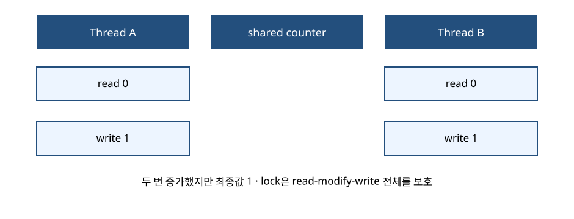
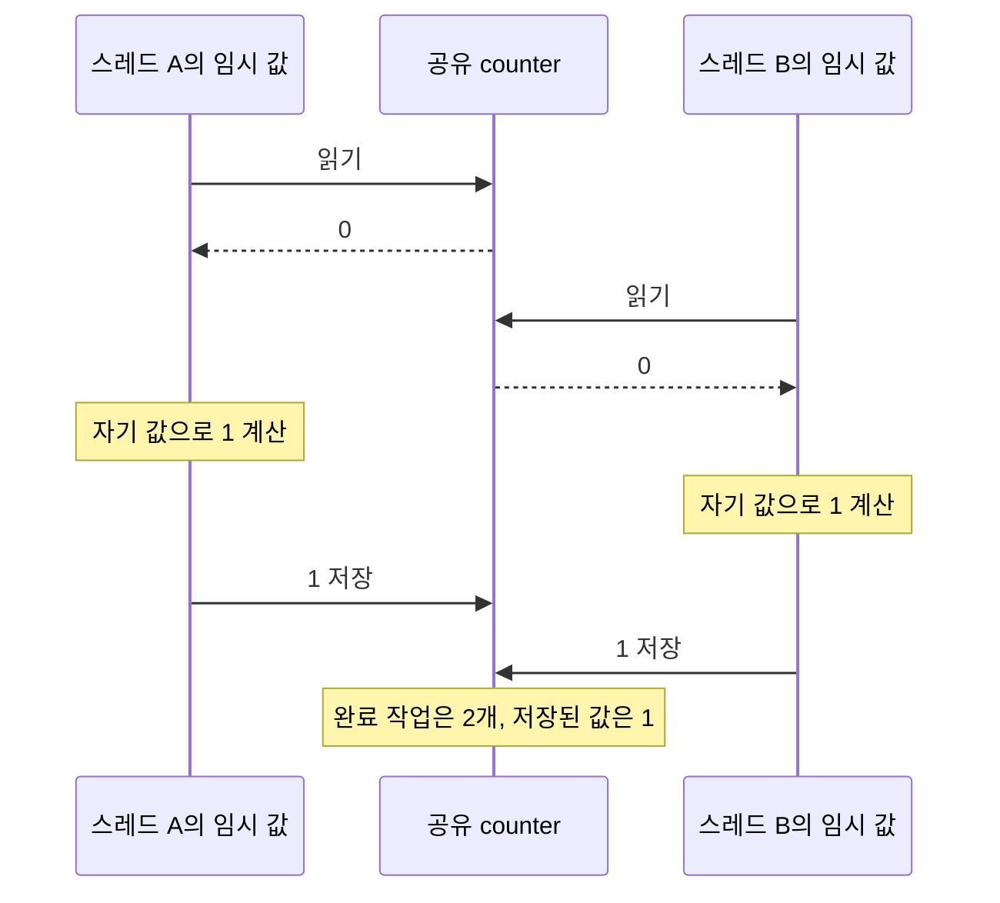
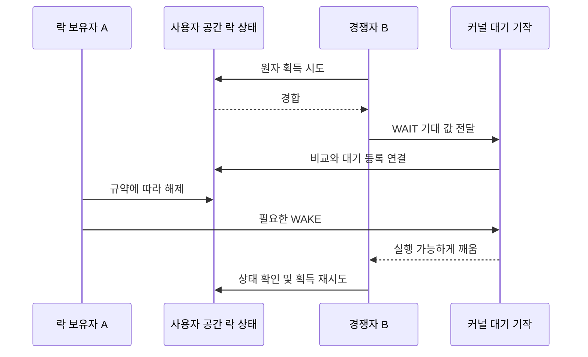

# 03. 동기화: 레이스 컨디션이 생기는 이유와 실행 순서를 제어하는 방법

[이 책 목차](README.md) · [이전](02-cpu-scheduling.md) · [다음](04-deadlocks.md)

## 1. 먼저 문제를 정한다: 두 번 증가했는데 왜 한 번만 증가했을까?

온라인 주문 서비스에서 주문 한 건을 처리할 때마다 처리 건수를 1씩 늘린다고 하자. 처음 처리 건수는 0이고, 작업자 A와 작업자 B가 주문 한 건씩 처리했다. 두 작업이 모두 끝났으면 처리 건수가 2여야 한다. 여기서 우리가 지키려는 규칙은 “완료된 주문 수와 처리 건수가 같다”이다. 이처럼 프로그램이 올바르게 동작하기 위해 유지해야 하는 관계를 **불변조건(invariant)**이라고 한다. 단순히 프로그램이 실행되었다는 사실보다 이 관계를 지켰는지가 중요하다.

두 작업자는 하나의 프로세스 안에서 실행되는 두 **스레드(thread)**라고 가정한다. 스레드는 명령을 실행하는 흐름이다. 같은 프로세스의 스레드들은 보통 같은 주소 공간에 있는 객체를 함께 접근할 수 있지만, 각각의 실행 위치와 레지스터 상태를 가진다. **주소 공간(address space)**은 그 프로세스에서 주소가 어떤 메모리를 가리키는지를 정하는 환경이다. **레지스터(register)**는 CPU가 계산 중인 값이나 주소를 보관하는 작은 저장 장소다. 스레드가 잠시 멈추면 운영체제가 실행을 이어갈 상태를 보존한다. 따라서 A가 읽어 둔 값은 B가 같은 공유 객체를 바꾸었다고 해서 자동으로 다시 계산되지 않는다.

**공유 상태(shared state)**는 여러 실행 흐름이 접근하는 같은 객체의 상태다. 예제에서는 메모리에 놓인 처리 건수 `counter`가 공유 상태다. 반면 A가 읽어 자신의 레지스터나 지역 변수에 보관한 임시 값은 A의 계산에 쓰이는 값이다. 두 종류를 구분하지 않으면 “B가 값을 바꾸었는데 A는 왜 옛 값을 저장했지?”라는 질문을 풀 수 없다.

고수준 코드 `counter += 1`은 한 줄이지만, 그 의미를 다음 세 단계로 나눌 수 있다. 여기서는 이 세 단계가 각각 끝난 뒤 다른 스레드가 실행될 수 있는 **교육용 실행 모형**을 사용한다. 실제 명령 선택은 컴파일러와 CPU에 따라 다르다.

~~~text
읽기:   temp = counter
계산:   temp = temp + 1
저장:   counter = temp
~~~

핵심은 읽은 시점과 저장한 시점 사이에 다른 작업이 끼어들 수 있다는 것이다. **끼어들기(interleaving)**란 각 스레드 내부의 순서는 유지하면서 여러 스레드의 단계가 섞이는 것을 뜻한다. A 내부에서는 읽기가 계산보다 먼저 일어나더라도, 그 사이에 B의 읽기가 들어갈 수 있다.

| 단계 | 실행한 스레드와 동작 | A의 임시 값 | B의 임시 값 | 공유 counter |
|---:|---|---:|---:|---:|
| 0 | 초기 상태 | 없음 | 없음 | 0 |
| 1 | A가 counter를 읽음 | 0 | 없음 | 0 |
| 2 | B가 counter를 읽음 | 0 | 0 | 0 |
| 3 | A가 자기 임시 값에 1을 더함 | 1 | 0 | 0 |
| 4 | B가 자기 임시 값에 1을 더함 | 1 | 1 | 0 |
| 5 | A가 자기 임시 값을 counter에 저장 | 1 | 1 | 1 |
| 6 | B가 자기 임시 값을 counter에 저장 | 1 | 1 | 1 |

B의 마지막 저장은 “현재 공유 값에 1을 더한다”가 아니다. 이미 계산해 둔 1을 저장한다. 그래서 A가 반영한 증가를 덮어쓰고, 두 작업이 끝났는데도 최종 값은 1이다. 이렇게 갱신 하나가 최종 상태에서 사라지는 현상을 **갱신 유실(lost update)**이라고 한다.

A의 읽기·계산·저장을 모두 끝낸 다음 B가 시작했다면 어떻게 될까? B는 1을 읽고 2를 저장한다. 같은 입력과 같은 두 작업인데 단계가 섞인 순서에 따라 불변조건을 지키기도 하고 깨뜨리기도 한다. 이처럼 실행 순서나 시점에 의존하여 올바름이 깨질 수 있는 문제를 **레이스 컨디션(race condition, 경쟁 조건)**이라고 부른다. 두 작업이 서로 경쟁하듯 실행된다는 이름이지만, 단순히 두 작업이 존재하는 것 자체가 오류는 아니다. 허용된 실행 순서 중 잘못된 결과를 만드는 순서가 있다는 점이 문제다.

## 2. CPU가 하나여도 레이스가 생긴다

**동시성(concurrency)**은 여러 작업의 진행이 시간 구간 안에서 겹치는 성질이다. **병렬성(parallelism)**은 여러 실행 자원이 같은 순간에 실제로 작업하는 성질이다. CPU 코어가 하나라면 두 스레드의 명령을 같은 순간에 실행할 수는 없지만, A를 잠시 실행하고 B로 바꾸고 다시 A를 실행할 수 있다. 따라서 동시성은 존재한다.

예를 들어 A가 counter를 0으로 읽은 직후 타이머 인터럽트가 발생했다고 하자. **인터럽트(interrupt)**는 타이머나 장치 같은 사건을 CPU에 알리는 기작이다. 운영체제는 A를 멈추고 B를 선택할 수 있다. 실행할 스레드를 바꾸는 **컨텍스트 스위치(context switch)**에서 A의 실행 상태는 보존된다. B가 1을 저장한 뒤 A가 돌아오면, A는 자기 임시 값 0에서 계산을 계속한다. A가 공유 메모리를 다시 읽도록 프로그램이 작성되어 있지 않다면 B가 저장한 1을 새 계산에 반영하지 않는다.

이 설명은 운영체제가 임시 값을 일부러 오래 유지해서 잘못된 결과를 만든다는 뜻이 아니다. 스레드가 멈추었다가 돌아오면 자기 실행을 이어갈 수 있어야 한다. 공유 상태의 변경을 어떤 연산으로 묶을지는 프로그램의 동기화 규약이 정한다. 스케줄러는 일반적인 변수의 업무 의미를 모르므로 “이 counter 증가 중에는 다른 스레드를 실행하면 안 된다”라고 자동으로 판단하지 않는다.

두 코어에서 실행하면 문제가 사라질까? 오히려 A와 B가 각 코어에서 같은 옛 값을 읽는 진행이 가능하다. 캐시가 일관성을 유지하더라도 읽기부터 저장까지의 세 단계를 하나의 증가 연산으로 묶어 주지는 않는다. **캐시 일관성(cache coherence)**은 같은 메모리 위치에 대한 복사본과 쓰기의 관측을 관리하는 하드웨어 규칙이고, 주문 두 건을 정확히 집계한다는 업무 불변조건은 그보다 큰 범위의 문제다.

이후 설명을 읽을 때 “한 코어인가 여러 코어인가?”와 “어떤 공유 상태를 어떤 규약으로 보호하는가?”를 별도로 묻자. 첫 질문은 가능한 실행과 비용을 바꾸고, 두 번째 질문은 올바름을 정한다.

## 3. 레이스 컨디션과 데이터 레이스는 같은 범위의 말이 아니다

**데이터 레이스(data race)**는 특히 C/C++ 메모리 모델에서 더 좁고 기술적인 뜻을 가진다. 메모리 모델은 스레드들이 메모리를 접근할 때 어떤 결과를 프로그램이 의지할 수 있는지 정하는 언어의 규칙이다. C++에서는 충돌하는 접근 중 적어도 하나가 비원자 접근이고, 두 접근을 정렬하는 적절한 happens-before 관계가 없으면 데이터 레이스가 될 수 있다. **충돌하는 접근**에는 같은 메모리 위치를 읽는 작업과 쓰는 작업, 또는 두 쓰기 등이 포함된다. 읽기 두 개만으로는 이 형태의 충돌이 생기지 않는다.

**Happens-before**는 “먼저 실제 시계를 보았더니 시간이 빨랐다”라는 뜻이 아니다. 한 스레드 안의 순서와 스레드 사이의 동기화 규칙이 연결되어, 앞 작업의 효과를 뒤 작업에서 의지할 수 있게 하는 관계다. C++의 데이터 레이스는 **정의되지 않은 동작(undefined behavior)**을 일으킨다. 즉 구현이 지켜야 할 정상 결과의 계약이 깨진다. 앞의 표는 잘못된 공유 갱신을 이해하는 모형이지, 데이터 레이스가 있는 모든 C++ 프로그램이 반드시 1 또는 2만 출력한다는 보장이 아니다. [C++ 작업 초안의 데이터 레이스 규칙](https://eel.is/c++draft/intro.races)

이 구분을 이해하려면 counter를 원자 변수로 바꾸되 증가를 둘로 쪼개 보자. **원자 연산(atomic operation)**은 지정된 연산이 동시 접근자에게 쪼개진 중간 갱신으로 보이지 않도록 제공하는 연산이다.

~~~cpp
std::atomic<int> counter{0};

// A와 B가 각각 실행하는 잘못된 "증가"
int old = counter.load(std::memory_order_relaxed);
counter.store(old + 1, std::memory_order_relaxed);
~~~

모든 공유 접근이 원자적이므로 이 counter 접근 자체에는 앞서 말한 비원자 데이터 레이스가 없다. 하지만 A와 B가 각각 0을 load하고 각각 1을 store할 수 있다. 최종 값은 여전히 1이다. **원자 load와 원자 store 두 개를 사용했다는 사실은 두 연산 전체가 하나의 원자 증가가 되었다는 뜻이 아니다.** 이것이 “데이터 레이스가 없는 프로그램에도 논리적 레이스 컨디션이 있을 수 있다”의 구체적인 예다.

두 연산을 하나로 연결하는 **원자 읽기-변경-쓰기(read-modify-write, RMW)**를 사용하면 상황이 달라진다.

~~~cpp
counter.fetch_add(1, std::memory_order_relaxed);
~~~

A와 B가 각각 이 연산을 한 번씩 완료하면 counter의 원자적 갱신 순서에서 첫 증가가 0을 1로 만들고 다음 증가가 1을 2로 만든다. 여기서는 두 스레드가 종료하고 호출자가 둘을 join한 뒤 최종 값을 읽는다고 가정한다. **Join**은 스레드의 종료를 기다리는 동작이며, 실행 도중 중간 값을 읽는 상황과 구분해야 한다.

`relaxed`는 이 counter 자체를 원자적으로 갱신하되 다른 객체까지 게시하는 동기화 순서를 요구하지 않는 선택이다. “숫자를 빠짐없이 세기”에 충분한 규칙이 “counter가 2면 두 스레드가 만든 모든 결과 객체도 안전하게 읽을 수 있다”까지 보장하지는 않는다. 집계와 결과 게시가 다른 문제라는 점은 뒤의 메모리 순서에서 다시 다룬다.

| 설계 | counter 접근의 데이터 레이스 | 두 증가 후 2를 보장하는가? | 이유 |
|---|---|---|---|
| 일반 정수의 읽기·계산·저장 | C++에서 발생할 수 있음 | 정상 결과 계약을 의지할 수 없음 | 비원자 충돌과 동기화 부재 |
| atomic load 후 atomic store | 해당 원자 접근 자체에는 없음 | 아니오 | 두 연산 사이에 다른 증가가 끼어듦 |
| atomic fetch_add | 없음 | 이 counter 모형에서는 예 | 증가 전체가 한 원자 RMW |
| 같은 mutex 아래에서 증가 | 규약을 모두 지키면 없음 | 이 counter 모형에서는 예 | 증가 구간이 서로 겹치지 않음 |

언어마다 동시성 규칙이 다르다. Python의 GIL, Java의 메모리 모델, Go의 race detector를 C++의 규칙과 이름만으로 동일시하지 않는다. 어떤 런타임이 특정 시점에 한 스레드의 실행을 제한하더라도 “조건 확인 후 여러 동작 수행” 같은 업무 규약까지 자동으로 원자화되는지는 별도의 문제다.

## 4. 락은 변수를 마법처럼 안전하게 만드는 표시가 아니라 공동 규약이다

**임계 구역(critical section)**은 공유 불변조건을 검사하거나 변경하는 동안 다른 참여자의 관련 접근과 조정해야 하는 코드 구간이다. **상호 배제(mutual exclusion)**는 이 구간에 지정된 참여자 중 하나만 들어가도록 하는 성질이다. **뮤텍스(mutex)**는 그 성질을 제공하는 대표적인 도구다.

Counter를 보호하려면 읽기 전에 락을 얻고 저장을 끝낸 후 락을 놓아야 한다. 락을 얻는 동작은 다른 보유자가 있으면 기다릴 수 있다. 락을 놓은 뒤 다른 스레드가 같은 락을 얻으면, 적절한 동기화 규칙에 따라 앞 임계 구역의 변경을 뒤 임계 구역에서 의지할 수 있다.

~~~text
A: lock(m)
A: temp = counter        # 0을 읽음
A: counter = temp + 1    # 1을 저장
A: unlock(m)
B: lock(m)
B: temp = counter        # 이제 1을 읽음
B: counter = temp + 1    # 2를 저장
B: unlock(m)
~~~

A가 lock(m)을 보유한 동안 B가 같은 lock(m)을 얻으려 하면 B는 그 임계 구역에 들어갈 수 없다. 이 조정은 “어느 스레드가 먼저일까?”를 반드시 정하지는 않는다. B가 먼저여도 최종 값은 2다. 중요한 것은 어떤 순서가 선택되어도 증가 전체가 겹치지 않아 불변조건을 유지한다는 것이다.

여기서 세 가지 잘못된 설계를 직접 추적해 보자. 첫째, A만 락을 사용하고 B는 그냥 저장한다면 B는 락의 출입 규약에 참여하지 않는다. A가 락을 잡고 있다는 이유만으로 CPU가 B의 메모리 저장을 막지는 않는다. 둘째, A는 m1, B는 m2를 사용하면 서로 다른 출입문을 지키는 셈이므로 같은 counter의 두 갱신이 여전히 겹칠 수 있다. 셋째, 읽기를 락 밖에서 하고 저장만 락 안에서 하면 두 작업자가 이미 같은 옛 값을 읽은 상태다. 저장 순서만 직렬화해도 갱신 유실은 남는다.

따라서 락을 추가할 때는 “이 변수에 락이 있나?”보다 “어떤 불변조건에 참여하는 모든 읽기와 쓰기가 어떤 동일한 규약을 따르나?”를 물어야 한다. 로그 출력, 통계 수집, 오류 처리 경로도 공유 상태를 읽는다면 그 규약의 일부다.

### 여러 필드를 보호해야 하는 이유

두 계좌 A와 B 사이에 10원을 이체한다. 처음 잔액은 A=100, B=100이고, 외부 입출금은 없다고 가정하자. 완료된 이체 사이에 유지할 불변조건은 총액 200이다.

~~~text
A에서 10 차감: A=90, B=100
B에 10 가산:   A=90, B=110
~~~

각 잔액을 atomic으로 선언해도 두 계좌 전체가 한 객체로 바뀌지는 않는다. 조회자가 차감 직후 두 값을 읽으면 190을 계산할 수 있다. 각 개별 읽기와 쓰기는 안전한 원자 접근이어도 조회자가 원하는 “동일한 논리 시점의 두 잔액”을 받지 못한다.

이체와 총액 조회가 하나의 공통 mutex 아래에서 두 값을 다루면, 조회는 이체 전 200 또는 이체 후 200을 본다. 다만 계좌마다 락을 따로 두는 실제 설계에서는 두 계좌 락을 정해진 순서로 얻어야 데드락을 피할 수 있다. “락을 여러 개 쓰면 더 빠르다”만으로 선택할 수 없는 이유다. 데이터 구조의 독립성, 불변조건의 범위, 획득 순서가 함께 맞아야 한다.

### 실제 Pthread 코드로 계좌 출금을 보호하기

앞의 counter를 계좌로 바꾸어 보자. 잔액은 1,000원이고 두 스레드가 각각 100원을 출금한다. 락이 없다면 A와 B가 모두 1,000원을 읽어 각각 900원을 저장하는 순서가 가능하다. 출금 두 번이 완료되었는데도 잔액이 900원이라면 승인된 출금액 200원과 잔액의 관계가 깨진 것이다. 이체나 출금은 숫자를 바꾸는 행위보다 승인 조건과 결과 상태의 관계가 중요하다.

다음은 POSIX 스레드 API를 사용하는 완전한 작은 C 예제다. **Pthread**는 POSIX가 정한 스레드 인터페이스이며 Linux의 일반적인 사용자 공간 프로그램에서 사용할 수 있다. 스레드 두 개를 만들고 모두 종료할 때까지 기다린 뒤 잔액을 출력한다.

~~~c
#include <pthread.h>
#include <stdio.h>
#include <stdlib.h>
#include <string.h>

static int balance = 1000;
static pthread_mutex_t account_lock = PTHREAD_MUTEX_INITIALIZER;

static void check_pthread(int error, const char *operation) {
    if (error != 0) {
        fprintf(stderr, "%s: %s\n", operation, strerror(error));
        exit(EXIT_FAILURE);
    }
}

static void *withdraw(void *unused) {
    (void)unused;
    check_pthread(pthread_mutex_lock(&account_lock), "lock");
    if (balance >= 100) {
        balance -= 100;
    }
    check_pthread(pthread_mutex_unlock(&account_lock), "unlock");
    return NULL;
}

int main(void) {
    pthread_t workers[2];
    for (int i = 0; i < 2; ++i) {
        check_pthread(pthread_create(&workers[i], NULL, withdraw, NULL),
                      "create");
    }
    for (int i = 0; i < 2; ++i) {
        check_pthread(pthread_join(workers[i], NULL), "join");
    }
    printf("balance=%d\n", balance);
    check_pthread(pthread_mutex_destroy(&account_lock), "destroy");
    return 0;
}
~~~

`PTHREAD_MUTEX_INITIALIZER`는 정적으로 선언한 mutex를 초기화한다. `pthread_create`는 지정한 시작 함수 withdraw를 실행하는 스레드를 만들고 식별자를 workers에 기록한다. 실제 실행 순서는 생성 순서와 같다고 보장하지 않는다. 각 스레드는 account_lock을 얻은 뒤 잔액이 충분한지 확인하고, 출금하고, 락을 놓는다. `pthread_join`은 지정한 스레드가 종료할 때까지 기다린다. 마지막 printf는 두 스레드가 종료한 뒤 실행되므로 아직 진행 중인 출금과 경쟁하지 않는다.

이 예에서는 A가 먼저면 A가 1,000→900을 만들고 B가 900→800을 만든다. B가 먼저여도 대칭적으로 800이 된다. 잔액이 충분한지 검사하는 부분도 락 안에 있다. 잔액이 100원뿐인데 두 스레드가 락 밖에서 “충분하다”라고 판단하면, 갱신만 보호해도 승인 조건이 잘못될 수 있기 때문이다.

오류 검사 함수는 이 작은 실습에서 오류가 나면 프로세스를 종료하는 단순 정책이다. Pthread 함수의 오류 값은 반환값으로 받으므로 여기서는 그 값을 검사한다. 이 오류 처리 정책이 실제 은행 서비스의 재시도·감사·복구 설계를 뜻하지는 않는다. 예제는 메모리 안의 잔액과 mutex 규약을 설명한다. 파일이나 데이터베이스에 잔액을 영구 저장하는 트랜잭션까지 구현한 것이 아니다.

뮤텍스가 없는 코드의 결과가 실험에서 우연히 매번 800이라고 해도 안전함을 증명하지 못한다. 두 출금 사이에 끼어들기가 적었을 뿐일 수 있다. 또한 printf를 임계 구역에 넣으면 I/O와 내부 락의 비용이 들어가 스케줄링 자체가 바뀔 수 있다. 실행 순서 표로 오류를 먼저 구성하는 이유가 여기에 있다.

## 5. 원자성, 가시성, 순서를 따로 이해해야 하는 이유

**원자성(atomicity)**은 선택한 연산을 다른 접근자가 쪼개진 갱신으로 관측하지 않도록 하는 성질이다. **가시성(visibility)**은 한 실행 흐름이 만든 변경을 다른 실행 흐름이 어떤 규칙 아래에서 의지할 수 있는지와 관련된다. **순서(ordering)**는 여러 접근 사이에 어떤 선후 관계를 보장하는지와 관련된다. 세 개는 연결되지만 하나를 얻었다고 나머지를 원하는 범위까지 모두 얻는 것은 아니다.

한 생산자가 결과 `data=42`를 만든 뒤 준비 표시 `ready=1`을 설정하고, 소비자는 ready를 보고 data를 읽는다고 하자. 여기서 게시해야 할 것은 ready 숫자 하나만이 아니다. “ready가 준비를 알리면, 그 준비에 속한 data도 읽을 수 있다”라는 관계를 만들어야 한다.

다음은 한 번만 게시하고 data를 다시 수정하지 않는 C++ 예다. ready는 atomic이고 data는 일반 정수다.

~~~cpp
int data = 0;
std::atomic<bool> ready{false};

// 생산자
data = 42;
ready.store(true, std::memory_order_release);

// 소비자
if (ready.load(std::memory_order_acquire)) {
    use(data);
}
~~~

**Release**는 생산자의 앞선 작업을 게시하는 쪽의 동기화 성격이고, **acquire**는 그 게시를 읽고 뒤 작업에 연결하는 쪽의 성격이다. 소비자의 acquire load가 실제로 생산자의 release store가 쓴 true를 읽으면, 앞선 data 쓰기와 뒤의 data 읽기를 happens-before로 연결할 수 있다. 따라서 이 규약과 수명 조건 아래에서 소비자는 data=42를 사용할 수 있다.

소비자가 false를 읽었다면 그 연결이 생겼다고 말할 수 없다. 위 코드가 false일 때 data를 읽지 않는 이유다. 또 생산자가 게시 후 data를 다시 고치면 최초 게시 하나가 그 이후의 모든 변경까지 자동으로 보호하지 않는다. 반복 생산이라면 각 메시지의 소유권, 세대, 재사용 시점을 가진 더 완전한 규약이 필요하다.

~~~text
생산자: data=42
    → 같은 스레드 안의 앞뒤 순서
생산자: ready=true [release]
    → 그 값을 읽는 동기화 관계
소비자: ready==true [acquire]
    → 같은 스레드 안의 앞뒤 순서
소비자: data 읽기
~~~

그럼 ready를 relaxed로 설정하면 어떨까? ready 자체의 원자성은 유지되지만 위의 스레드 간 게시 관계를 얻었다고 의지할 수 없다. 일반 data에 대한 안전한 동기화가 별도로 없으면 데이터 레이스 문제가 생길 수 있다. “내 컴퓨터에서 수천 번 42가 나왔다”는 것은 언어가 모든 허용 실행에 대해 그 관계를 보장한다는 증거가 아니다.

**메모리 장벽(memory barrier/fence)**은 접근 순서를 제어하는 도구지만, 장벽을 아무 곳에 하나 넣으면 모든 공유 데이터 문제가 해결되는 것은 아니다. 서로 대응하는 접근, 메모리 순서, 객체 수명까지 포함한 규약이 있어야 한다. 커널의 장벽 API와 C++의 atomic/fence API는 서로 다른 모델과 규칙에 속한다.

**Volatile**도 동기화 대신 사용하는 표시가 아니다. C/C++의 volatile은 해당 언어에서 특정 접근을 어떻게 취급할지에 관한 성질이며, 스레드 사이의 mutex나 원자 RMW를 대신하지 않는다. 장치 레지스터를 다루는 코드에서 volatile을 보았다는 사실로 일반 스레드 counter의 안전성을 결론 내릴 수 없다. 장치 I/O에는 별도의 플랫폼 접근 API와 순서 규칙도 관련된다.

실무에서 처음 선택할 규약은 검증된 mutex, 동기화 큐, 원자 API 등이다. 무엇을 보호해야 하는지 분명해진 뒤 비용을 측정하면서 더 세밀한 순서를 선택해야 한다. 너무 약한 순서는 오류를 만들고, 필요 이상의 강한 순서는 비용을 늘릴 수 있다. 올바른 범위부터 정해야 이 두 문제를 비교할 수 있다.

## 6. 기다리는 방법: 스핀락, 뮤텍스, 세마포어

**스핀락(spinlock)**을 얻지 못한 실행 흐름은 락 상태를 계속 검사하며 기다린다. 기다리는 동안 CPU를 사용하므로, 보유자가 곧 락을 놓고 실행 주체가 잠들 수 없는 짧은 커널 구간에서는 유용할 수 있다. 반대로 보유자가 오래 작업하거나 실행에서 밀려난 상태라면 기다리는 CPU는 유용한 작업을 못 하면서 시간을 쓴다.

뮤텍스 구현은 경합 상황에서 대기자를 잠들게 할 수 있다. **경합(contention)**은 여러 실행 흐름이 같은 자원에 접근하려고 경쟁하는 상태다. **블로킹(blocking)**은 지금 진행할 수 없어 대기 상태로 들어가는 동작을 말한다. 잠든 스레드는 락을 놓는 사건 등에 의해 실행 가능한 상태가 될 수 있지만, 깨어났다고 즉시 CPU를 얻거나 락의 새 소유자가 되는 것은 아니다.

Linux의 실행 문맥도 선택 조건이다. **Hard IRQ 문맥**은 하드웨어 인터럽트를 즉시 처리하는 실행 문맥으로, 일반 사용자 스레드처럼 임의로 잠들 수 있는 곳이 아니다. 어떤 구간이 잠들 수 있는지는 커널 API의 문맥 규칙을 따라야 한다. 또한 PREEMPT_RT 커널에서는 일반 spinlock_t의 내부 동작이 달라질 수 있고, raw_spinlock_t와 구분해야 한다. 따라서 위의 스핀 대기 모형을 모든 Linux 구성에 그대로 적용하지 않는다. [Linux 락 종류와 PREEMPT_RT 규칙](https://docs.kernel.org/locking/locktypes.html)

기다림이 0.5µs이고 잠들었다 깨어나는 경로가 그보다 더 비싸다는 측정이 있다면 잠깐 스핀하는 설계를 고려할 수 있다. 기다림이 수 ms인데 스핀한다면 큰 CPU 시간을 버릴 수 있다. 이 값들은 비교 원리를 보여 주는 가정이며 특정 시스템의 실제 측정값이 아니다. 실제 비용은 코어 수, 선점, 락 보유 시간, 캐시와 구현에 따라 달라진다. 그래서 어떤 뮤텍스는 짧은 적응형 스핀 후 잠들기도 한다. “spinlock은 빠르고 mutex는 느리다” 같은 고정 순위로 이해하면 판단 근거를 잃는다.

**세마포어(semaphore)**는 사용할 수 있는 허가 수를 관리한다. 예를 들어 GPU에서 동시에 수행할 작업을 3개로 제한하려면 초기 허가 수를 3으로 두고, 작업 시작 시 하나를 얻고 종료 시 반환하는 모형을 사용할 수 있다.

| 사건 | 남은 허가 수 | 실행 중 작업 | 새 작업의 상태 |
|---|---:|---|---|
| 초기 | 3 | 없음 | 시작 가능 |
| A가 허가 획득 | 2 | A | 시작 가능 |
| B가 허가 획득 | 1 | A, B | 시작 가능 |
| C가 허가 획득 | 0 | A, B, C | 다음 작업은 대기 |
| D가 요청 | 0 | A, B, C | D는 대기 |
| A가 허가 반환 | 반환과 D 획득 뒤 0 가능 | B, C, D | D가 진행 가능 |

뮤텍스는 일반적으로 소유자가 자기 락을 해제하는 규약이고, 세마포어는 허가 수를 주고받는 규약이다. 값이 0 또는 1인 세마포어를 **이진 세마포어(binary semaphore)**라고 하지만, 소유권·오류 검사·우선순위 상속까지 모든 뮤텍스 의미가 같아지는 것은 아니다. 자원 수 제한과 데이터 불변조건 보호도 구분하자. GPU 작업을 3개로 제한했다고 공유 큐 갱신이 자동으로 안전해지지는 않는다.

### 허가 3개가 같은 계좌의 안전성을 보장하지 않는 이유

세마포어를 3으로 초기화했다고 생각하자. 작업 A, B, C가 모두 허가를 얻으면 세 작업은 동시에 진행할 수 있다. 이때 세 작업이 같은 balance를 읽고 쓰면, 앞에서 본 갱신 유실을 여전히 만들 수 있다. **세마포어의 허가 수 제한**은 “최대 세 작업이 이 구간에 참여한다”는 조건이고, **계좌 임계 구역의 상호 배제**는 “관련 갱신 한 작업만 참여한다”는 조건이다.

예를 들어 GPU 작업을 3개까지만 진행시키면서 공유 작업 목록을 관리한다면 두 도구를 함께 쓸 수 있다. 작업은 GPU 세마포어의 허가를 얻고, 짧게 큐 mutex를 얻어 자기 항목을 기록하고, 큐 mutex를 놓고 긴 GPU 작업을 수행한 뒤 허가를 반환한다. 큐 mutex를 GPU 완료 때까지 보유할 필요가 없는 설계라면 잠금 구간을 짧게 만들 수 있다. 이때 모든 목록 접근이 같은 규약을 따르고 항목의 수명도 완료 처리까지 유지되어야 한다.

POSIX의 `sem_init(&slots, 0, 3)`에서 마지막 3은 초기 허가 수다. 가운데 0은 같은 프로세스의 스레드 사이에서 사용할 세마포어라는 뜻이다. 여러 프로세스가 쓰려면 공유 메모리 배치와 지원 조건 등을 함께 맞춰야 하며, 단순히 숫자만 바꾸면 서로 다른 머신에 공유되는 것이 아니다.

아래 C 코드는 이미 초기화된 세마포어로 한 작업을 감싸는 부분이다. `sem_wait`가 시그널 때문에 EINTR로 중단되면 다시 기다리고, 다른 오류라면 작업에 들어가지 않는다. `do_work`는 작업의 성공 여부를 반환한다고 가정한다.

~~~c
#include <errno.h>
#include <semaphore.h>

static sem_t slots;
int do_work(void);

int initialize_slots(void) {
    return sem_init(&slots, 0, 3);
}

int use_resource(void) {
    while (sem_wait(&slots) == -1) {
        if (errno != EINTR) {
            return -1;
        }
    }
    int work_result = do_work();
    if (sem_post(&slots) == -1) {
        return -1;
    }
    return work_result;
}
~~~

반환해야 할 허가를 잊으면 시간이 갈수록 진행 가능한 작업 수가 줄고, 결국 모든 작업이 기다릴 수 있다. 반대로 한 허가에 post를 두 번 하면 허가 수가 실제 용량보다 커져 네 작업이 들어갈 수도 있다. 이 허가 회계는 프로그램의 규약이다. 위 부분 코드는 정상 함수 복귀 경로를 다루지만 스레드 취소나 프로세스 종료까지 모든 정리를 구현하지는 않는다. 그런 실행 조건에서는 취소 정리와 자원 수명을 별도로 설계해야 한다. [POSIX sem_wait 설명](https://man7.org/linux/man-pages/man3/sem_wait.3.html)

### 데드락, 기아, 라이브락은 왜 따로 부를까?

**데드락(deadlock)**은 서로가 보유한 자원을 기다리는 등의 관계로 참여자가 더 이상 진행하지 못하는 상태다. A가 m1을 잡고 m2를 기다리고 B가 m2를 잡고 m1을 기다리는 예가 대표적이다. **기아(starvation)**는 다른 작업들이 진행하는 동안 특정 작업이 필요한 자원이나 실행 기회를 계속 얻지 못하는 상태다. **라이브락(livelock)**은 서로 양보하거나 재시도하는 등 실행 활동은 계속하지만 필요한 작업은 완료하지 못하는 상태다.

락이 공유 값의 훼손을 막아도 이 진행 문제들은 남을 수 있다. **공정성(fairness)**은 대기자에게 기회를 배분하는 성격이지만 모든 락이 엄격한 도착 순서를 보장하는 것은 아니다. **우선순위 역전(priority inversion)**은 높은 우선순위 작업이 낮은 우선순위 보유자의 락을 기다리고, 그 보유자의 실행이 중간 우선순위 작업 때문에 늦어지는 상황이다. **우선순위 상속(priority inheritance)**은 관련 락 구현에서 보유자의 우선순위를 높여 문제를 줄이는 방식이다. 일반 락을 사용했다고 자동으로 모든 상속 규칙이 활성화되는 것은 아니다. [Linux RT-mutex 설계](https://docs.kernel.org/locking/rt-mutex-design.html)

## 7. 큐가 비어 있을 때: 조건 변수는 알림보다 조건이 중요하다

생산자가 작업을 큐에 넣고 소비자가 꺼내는 **생산자-소비자(producer-consumer)** 구조를 생각하자. **큐(queue)**는 항목을 넣고 꺼내는 자료구조다. 이 예제에서는 먼저 넣은 항목을 먼저 꺼내는 FIFO 규칙을 사용한다. 소비자가 큐를 조사했는데 비어 있다면 잠시 기다렸다가 다시 확인하고 싶다.

**조건 변수(condition variable)**는 공유 상태에서 원하는 조건이 성립할 때까지 기다리는 일을 락과 연결하는 도구다. 여기서 조건은 `queue가 비어 있지 않다`이다. 이 조건을 판정하는 식을 **술어(predicate)**라고 부른다. condition variable 안에 작업 항목이 저장되거나 “진행 가능”이라는 영구 표식이 자동으로 쌓이는 것은 아니다. 큐의 실제 상태가 판단 근거다.

먼저 잘못된 방법을 보자.

~~~text
1. 소비자 C: 큐가 빈 것을 확인한다.
2. 소비자 C: 아직 잠들지는 않았다.
3. 생산자 P: 큐에 X를 넣고 기다리는 소비자에게 알린다.
4. 생산자 P: 현재 기다리는 소비자가 없어서 알릴 대상이 없다.
5. 소비자 C: 이제 잠든다.
~~~

큐에 X가 남아 있는데 소비자는 알림을 놓친 채 기다릴 수 있다. 이를 **깨우기 유실(lost wakeup)**이라고 한다. 문제가 생긴 틈은 “조건 확인”과 “대기 등록” 사이이다. 단순히 notify를 많이 부르거나 잠드는 시간을 줄여도 이 틈이 논리적으로 사라지지는 않는다.

올바른 규약은 큐 조사와 변경을 같은 mutex로 보호하고, wait가 그 mutex를 놓는 동작과 대기로 들어가는 동작을 알림에 대해 원자적으로 연결하도록 사용하는 것이다. 대기에서 돌아올 때는 락을 다시 얻은 상태에서 술어를 확인한다.

~~~text
소비자:
    lock(m)
    while queue가 비어 있고 종료 요청도 없음:
        wait(not_empty, m)   # 락을 놓고 대기; 복귀 전 락 재획득
    if queue가 비어 있고 종료 요청 있음:
        unlock(m)
        종료
    item = queue에서 하나 꺼내기
    unlock(m)
    item 처리하기

생산자:
    lock(m)
    queue에 item 넣기
    unlock(m)
    notify_one(not_empty)
~~~

이 의사코드에서 생산자의 알림은 락을 놓은 뒤에 수행한다. 공유 상태 변경은 반드시 같은 락 아래에서 일어난다. API와 설계에 따라 락을 보유한 채 알릴 수도 있다. 핵심은 “알림은 언제나 락 안에서 해야 한다”라는 암기 규칙이 아니라, 술어의 검사·수정과 wait의 등록이 같은 규약으로 연결된다는 점이다. [C++ 조건 변수의 wait 규칙](https://eel.is/c++draft/thread.condition)

`while`이 필요한 이유를 두 소비자로 추적하자. P가 X 하나를 넣고 둘을 깨웠다. C1이 먼저 락을 얻어 X를 꺼낸다. C2가 락을 얻었을 때 큐는 다시 비었다. C2가 “깨어났으니 반드시 항목이 있다”라고 생각하면 없는 항목을 꺼내려 한다. 그래서 다시 술어를 검사해야 한다. **허위 깨움(spurious wakeup)**처럼 조건 성립을 뜻하지 않는 복귀도 고려해야 한다.

용량이 2인 큐에서는 생산자도 큐가 꽉 차면 기다린다. 생산자는 `not_full`, 소비자는 `not_empty`라는 조건을 사용하고, enqueue/dequeue 뒤 상대 조건의 대기자에게 알릴 수 있다.

| 단계 | 큐 내용 | 실행과 이유 |
|---:|---|---|
| 0 | [] | C가 empty를 확인하고 not_empty에서 대기 |
| 1 | [X] | P가 X 삽입 후 C에게 알림; C는 아직 CPU를 못 얻을 수 있음 |
| 2 | [X,Y] | P가 Y 삽입; 이제 용량 2를 채움 |
| 3 | [X,Y] | P가 Z 삽입을 시도; full이므로 not_full에서 대기 |
| 4 | [Y] | C가 X를 꺼내고 P에게 알림 |
| 5 | [Y,Z] | P가 다시 락을 얻어 공간을 확인한 뒤 Z 삽입 |

대기는 락을 놓으므로 반대편이 큐를 바꿀 수 있다. 만약 C가 mutex를 쥔 채 일반 sleep으로 기다린다면 P는 큐에 항목을 넣기 위한 락을 못 얻는다. 조건 변수의 wait가 “띠용 하고 잠든다” 이상의 의미를 갖는 이유가 바로 락의 해제와 재획득을 규약에 포함하기 때문이다.

종료 요청도 같은 사고 방식으로 다룬다. 다른 작업이 `stopping=true`를 같은 락 아래에서 설정하고 대기자에게 알리면, 소비자는 빈 큐에서 영원히 기다리는 대신 종료 조건을 확인할 수 있다. 종료 신호만 보내고 술어를 바꾸지 않으면 깨어난 소비자가 다시 기다릴 수 있다.

## 8. Linux futex: 사용자 공간의 락 상태와 커널의 대기를 연결한다

**사용자 공간(user space)**은 애플리케이션 코드가 일반 권한으로 실행되는 영역이고, **커널 공간(kernel space)**은 운영체제 핵심 코드가 실행되는 영역이다. 매번 락을 얻을 때 커널에 들어가면 추가 비용이 생길 수 있다. 그래서 많은 사용자 공간 락 구현은 경쟁자가 없는 경우 원자 연산으로 사용자 공간에서 획득을 끝내고, 경쟁이 생겼을 때 커널의 대기 기작을 활용한다.

**Futex**는 fast user-space mutex라는 이름에서 왔지만 완성된 mutex 객체 그 자체보다는 사용자 공간 동기화에 사용할 수 있는 커널 대기·깨우기 기작으로 이해해야 한다. 기본 futex 기작은 메모리의 futex word와 커널의 대기 처리를 연결한다. 어떤 mutex의 실제 상태 비트와 빠른 경로는 라이브러리 구현에 따라 다르다.

대표적인 WAIT 동작은 기대 값과 현재 futex word를 비교하고, 조건이 맞을 때 대기로 들어가는 일을 해당 word의 동시 동작에 대해 원자적으로 처리한다. 그래서 “아직 잠기나?”를 확인한 직후 누군가 해제해서 알림을 보냈는데 그 뒤 늦게 잠드는 틈을 막는 데 사용할 수 있다. [Linux futex 설명](https://www.man7.org/linux/man-pages/man2/futex.2.html)

| 순서 | 보유자 A | 대기 시도 B | 의미 |
|---:|---|---|---|
| 1 | 락을 보유 | 획득 실패, 잠김 상태를 관측 | B는 대기를 준비 |
| 2 | 락 해제 및 필요한 깨우기 수행 | 아직 WAIT에 들어가지 않음 | 상태가 이미 바뀔 수 있음 |
| 3 | 다른 작업 진행 | WAIT에서 기대 값과 현재 값이 다름 | B는 그 옛 상태를 기다리며 잠들지 않음 |
| 4 | 구현 규약에 따라 경쟁 가능 | 획득을 다시 시도 | 성공 여부는 다시 판단 |

반대 순서로 B가 올바르게 대기열에 들어간 뒤 A가 해제·깨우기를 수행하면 B가 깨울 대상이 된다. 어느 경우에도 프로그램은 복귀 이유와 공유 상태를 확인해야 한다. 기본 WAKE는 대기자를 깨우는 동작이지 일반적으로 락 소유권을 넘겨주는 동작 자체는 아니다. 깨어난 B보다 다른 C가 먼저 락을 얻을 수도 있다.

여기서 **빠른 경로(fast path)**는 흔한 비경합 상황을 적은 작업으로 끝내는 경로이고, **느린 경로(slow path)**는 경합·대기·오류 같은 추가 처리를 하는 경로다. 이 구분을 알면 “락 호출 수가 많아도 왜 syscall이 별로 없지?”를 이해할 수 있다. 비경합 락은 사용자 공간에서 끝날 수 있기 때문이다. 반대로 여러 대기자를 매번 깨우면 스케줄링과 재경합 비용이 커질 수 있다.

Futex를 읽었다고 단순 CAS+WAIT 몇 줄로 생산용 mutex를 새로 만들지는 않는다. 취소, 시간 제한, 소유자 종료, 프로세스 간 공유, 우선순위 상속 같은 조건이 추가될 수 있다. 이 장의 시간표는 비교와 대기를 왜 연결해야 하는지를 설명하는 모형이며 특정 libc의 전체 알고리즘을 복제한 것이 아니다.

## 9. CAS는 확인과 변경을 묶지만 업무 전체를 알아서 판단하지 않는다

**CAS(compare-and-swap/compare-and-exchange)**는 현재 값이 내가 예상한 값과 같으면 새 값으로 바꾸는 원자 연산이다. 예상 값이 맞지 않으면 다른 작업이 상태를 바꿨다고 보고 새 상태에서 다시 계산할 수 있다. 원자적인 조건부 변경을 제공하지만 “이 출금이 승인되어야 하는가?”라는 업무 조건은 코드가 정의해야 한다.

잔액 100에서 A가 70을, B가 50을 출금하려 한다. 잔액이 부족하면 실패해야 하고, 승인된 출금의 합이 100을 넘으면 안 된다. 잔액 하나만 보호하며 다른 수수료·로그 객체는 없다고 가정한다.

~~~text
현재 잔액을 old로 읽는다.
반복:
    old < 출금액이면 실패한다.
    new = old - 출금액을 계산한다.
    CAS(balance, 예상 old, 새 값 new)를 시도한다.
    성공하면 승인한다.
    실패하면 갱신된 현재 잔액을 old로 삼아 반복한다.
~~~

A와 B가 처음에 모두 100을 읽을 수 있다. A의 CAS가 먼저 성공하면 잔액은 30이 된다. B가 예상 값 100으로 CAS를 시도하면 실패한다. B는 새 잔액 30을 보고 부족 조건을 다시 검사하므로 출금을 거절한다. 이렇게 재검사가 있어야 불변조건을 지킨다. CAS 실패 후 원하는 새 값 50을 그대로 다시 저장하면 그 규약을 깨뜨린다.

C++ compare_exchange API에서는 실패 시 expected 인수가 관측한 값으로 갱신되는 규칙을 사용한다. `weak` 변형은 값이 같아도 실패하는 허위 실패를 허용하므로 보통 재시도 루프에서 사용한다. 메모리 순서의 성공·실패 인수 제약과 대상 타입의 원자 구현도 API 계약에 포함된다. [C++ atomic 연산 규칙](https://eel.is/c++draft/atomics.types.operations)

**락 프리(lock-free)**는 동시 알고리즘의 진행 성질이다. 한 작업이 멈췄다고 전체가 그 작업의 락 해제를 기다리는 구조가 되지 않도록, 관련 정의 아래에서 시스템 전체의 진행을 보장하는 성격을 말한다. 특정 참여자 한 명이 계속 CAS에 실패할 수 있으므로 개별 작업의 기아까지 없애 주는 말은 아니다. **웨이트 프리(wait-free)**는 각 작업이 다른 작업의 속도와 무관하게 제한된 단계 안에서 완료할 수 있는 더 강한 진행 성질이다. 둘 다 “항상 더 빠르다”라는 성능 등급이 아니다.

원자 API를 썼다고 모든 타입이 하드웨어 한 명령으로 실행되거나 해당 구현이 언제나 락 프리인 것도 아니다. 타입·정렬·플랫폼에 따라 구현이 달라질 수 있고 `is_lock_free` 같은 API로 관련 성질을 확인한다. CAS 재시도가 많으면 캐시 라인 이동과 연산 낭비 때문에 단순 락보다 느릴 수 있다.

### ABA: 값이 같아도 중간 이력이 같지는 않다

A가 연결 리스트의 머리 포인터 P를 읽고 잠시 멈추었다고 하자. B가 P 노드를 제거하고 다른 변경을 수행한 뒤, 같은 주소 값 P가 다시 머리에 나타났다. A가 “머리가 여전히 P인가?”만 검사하면 중간에 아무 변화가 없었다고 오해할 수 있다. 값이 A→B→A처럼 돌아와 비교가 변화를 놓치는 문제를 **ABA 문제**라고 한다.

이 문제는 주소 비교와 객체 수명 사이의 틈을 보여 준다. 같은 주소가 다시 나타나도 이전과 같은 살아 있는 객체라고 보장되지 않는다. 포인터에 세대 번호를 붙이는 방식은 변화를 감지하는 데 도움이 되지만 번호가 순환할 조건과 원자 비교의 크기도 고려해야 한다. **Hazard pointer**는 읽는 쪽이 사용 중인 객체를 알리는 방식이고, **epoch 기반 회수**는 읽기 참여자의 세대 진행에 맞추어 메모리 회수를 늦추는 방식이다. 각각 등록·회수·멈춘 참여자를 처리하는 규약이 필요하다. CAS 한 번이 메모리 수명 문제까지 해결하지 않는 이유다.

## 10. Linux RCU와 시퀀스 카운터: 읽기가 많을 때 다른 비용을 선택한다

읽기가 아주 많고 쓰기가 드문 자료구조에서는 매번 모든 읽기자가 같은 락을 얻는 비용이 커질 수 있다. 더 적은 읽기 비용을 얻으려면 변경과 메모리 회수를 다른 방식으로 조정할 수 있다. 다만 각각 어떤 불변조건과 수명을 보호하는지부터 구분해야 한다.

**RCU(read-copy-update)**의 대표적인 사고 방식은 읽는 중인 옛 객체를 바로 파괴하지 않고, 새 객체를 준비해 게시한 뒤 옛 객체를 사용할 수 있었던 읽기자가 빠져나가는 시점을 기다리는 것이다. 이 대기 경계가 **유예 기간(grace period)**이다. 이름에 copy가 있지만 모든 RCU 갱신이 언제나 전체 객체 복사를 하는 것은 아니다. [Linux RCU 개념](https://docs.kernel.org/RCU/whatisRCU.html)

~~~text
1. 읽기자 R1이 옛 객체 V1을 참조하며 읽기 구간에 진입한다.
2. 쓰기자가 새 객체 V2를 준비한다.
3. 쓰기자가 규정된 방식으로 V2를 게시한다.
4. 이후 읽기자 R2는 V2를 참조할 수 있다.
5. V1을 사용하던 관련 읽기 구간들이 끝나는 유예 기간을 기다린다.
6. 그 뒤 V1을 회수한다.
~~~

게시 뒤 곧바로 V1을 free하면 R1이 해제된 메모리를 읽을 수 있다. 이를 **use-after-free**라고 한다. 그래서 게시와 회수는 별도 사건이다. RCU가 여러 쓰기자의 충돌을 항상 자동으로 해결해 주거나, 임의의 변경 중간 상태를 모두 숨겨 주는 것은 아니다. 쓰기자 사이의 조정과 사용하려는 RCU 변형의 읽기 구간 규칙은 추가로 맞춰야 한다.

**시퀀스 카운터(sequence counter)**는 여러 필드를 읽는 동안 쓰기가 끼어들었는지 검출하여 읽기 결과를 재시도하는 방식이다. 예를 들어 시계 정보의 초와 나노초를 함께 읽고 싶을 때, 쓰기 시작과 종료에 카운터를 변경한다. 읽기자는 시작 카운터를 읽고 데이터를 복사한 뒤 종료 카운터를 비교한다.

| 사건 | 카운터 | 의미 |
|---|---:|---|
| 안정된 옛 상태 | 8 | 짝수이므로 완성 상태 |
| 쓰기 시작 | 9 | 홀수이므로 변경 중 |
| 필드들을 변경 | 9 | 읽기자는 이 결과를 확정하면 안 됨 |
| 쓰기 종료 | 10 | 새 완성 상태 |
| 읽기자가 시작 8, 종료 10을 관측 | 다름 | 복사한 결과를 버리고 재시도 |
| 읽기자가 시작 10, 종료 10을 관측 | 같은 짝수 | 해당 규약 아래에서 일관된 복사본 사용 |

Linux의 raw seqcount는 여러 쓰기자를 스스로 직렬화하지 않으므로 별도의 쓰기자 조정이 필요하다. 쓰기자가 홀수 상태에서 읽기자에게 선점되는 문제도 막아야 한다. 포인터가 가리키는 객체를 쓰기자가 해제할 수 있는 자료구조에는 이 검사만으로 안전한 수명을 얻을 수 없다. [Linux 시퀀스 카운터와 seqlock](https://docs.kernel.org/locking/seqlock.html)

중요한 경계가 하나 더 있다. Linux 커널의 접근·장벽 규약을 일반 C++ 코드에 단순 복사해서, 비원자 필드를 충돌하게 읽고 나중에 카운터를 검사한다고 C++ 데이터 레이스가 자동으로 합법화되는 것은 아니다. 자신이 사용하는 언어와 플랫폼의 메모리 모델을 만족하는 구현이어야 한다. “나중에 버릴 값이니 잘못 읽어도 괜찮다”는 설명으로 데이터 레이스 규칙을 피할 수 없다.

## 11. 파일과 데이터베이스에서도 확인과 행동 사이의 틈이 생긴다

레이스 컨디션은 스레드가 같은 정수 변수를 건드리는 예제에만 있는 것이 아니다. 파일 이름이나 데이터베이스 행 같은 외부 상태에도 같은 구조가 나타난다.

프로그램 A가 `result.tmp`라는 이름이 없는지 확인한 뒤 그 이름으로 새 파일을 만든다고 하자. 확인과 생성 사이에 프로그램 B가 같은 이름의 파일을 만들 수 있다. A가 “내가 확인했으니 없다”라고 의지하면 원치 않는 기존 객체를 사용하거나 덮어쓸 수 있다. 이런 **확인 시점과 사용 시점의 간격**을 **TOCTOU(time-of-check to time-of-use)** 문제라고 부른다.

독점 생성이 목적이라면 POSIX의 `open`에서 `O_CREAT|O_EXCL` 같은 적절한 원자적 생성 규약을 사용할 수 있다. “없으면 생성”을 별도 existence 검사와 일반 생성 두 단계로 나누지 않는 것이다. 다만 이것이 모든 경로 보안이나 디스크 내구성까지 보장하지는 않는다. 신뢰할 수 없는 디렉터리의 심볼릭 링크 처리, 파일 객체 수명, 저장 후 장애 복구는 다른 조건이다. **원자적 이름 생성**과 **전원 손실 뒤 데이터 보존**은 보호하는 불변조건이 다르다. [POSIX open 규칙](https://pubs.opengroup.org/onlinepubs/9799919799/functions/open.html)

데이터베이스에서는 A와 B가 잔액 100을 SELECT한 뒤 각각 계산한 110을 UPDATE할 때 갱신 유실이 생길 수 있다. 데이터베이스 엔진이 각 SQL 문을 올바르게 실행했더라도 애플리케이션의 읽기와 쓰기가 원하는 한 동작으로 묶이지 않았기 때문이다. `UPDATE account SET balance = balance + 10` 같은 갱신, 적절한 행 잠금, 조건부 갱신, 격리 수준과 재시도 규약을 사용해 필요한 불변조건을 만들어야 한다. 각 방식의 충돌·대기·실패 의미는 엔진에 따라 확인해야 한다.

또 서로 다른 행을 수정한다고 전체 업무 레이스가 없는 것은 아니다. “당직 의사 두 명 중 적어도 한 명은 남는다”라는 조건에서 두 트랜잭션이 같은 옛 상태를 보고 각자 자기 행의 당직을 해제하면, 행 하나의 갱신 충돌은 없어도 둘 다 당직이 아닐 수 있다. 이를 이해하려면 특정 행의 데이터 레이스보다 트랜잭션 사이의 관측과 불변조건을 분석해야 한다. [DB 격리와 동시성 장](../databases-query-engines/08-isolation-and-concurrency.md)에서 이어서 다룬다.

Iceberg의 쓰기자들이 같은 옛 메타데이터를 읽고 새 상태를 게시하려는 상황도 연결된다. 각자가 새 파일을 제대로 만들었어도 최신 상태를 바꾸는 커밋 지점에서 충돌을 조정하고, 필요한 검증과 재시도를 해야 한다. 로컬 mutex 하나는 다른 머신의 모든 쓰기자를 막을 수 없다. 따라서 **어떤 공유 상태인지, 누가 참여하는지, 어느 지점에서 원자적 결정을 하는지**를 먼저 정해야 한다. [Iceberg 읽기·쓰기·커밋](../apache-iceberg/02-reads-writes-and-commits.md)

### Kubernetes의 두 Pod는 어떤 락을 공유할까?

**Pod**는 Kubernetes가 컨테이너를 함께 배치하고 실행하는 기본 단위다. Pod A와 Pod B의 프로그램이 같은 DB 계좌를 읽는다고 하자. 두 프로그램 안에 각각 account_lock이라는 이름의 mutex가 있어도 서로 다른 객체다. 특히 다른 노드에 있으면 커널과 사용자 메모리도 별개다. A는 자기 락을 얻고 잔액 1,000원을 읽고, B도 자기 락을 얻고 같은 1,000원을 읽을 수 있다. 각자의 로컬 규약은 지켰지만 DB의 같은 행을 함께 보호하지는 못했다.

**낙관적 동시성 제어(optimistic concurrency control, OCC)**는 일단 읽고 계산한 뒤, 변경을 확정할 때 기반 상태가 아직 유효한지 검증하는 방식이다. 예를 들어 행에 version=7이 있다고 하자. A와 B는 각각 잔액과 버전 7을 읽는다. A가 “version이 7인 경우에만 잔액을 900, version을 8로 갱신”하는 조건부 갱신에 성공한다. B가 같은 조건으로 시도하면 기반 버전이 바뀌었으므로 충돌을 확인한다. B는 현재 잔액 900에서 승인 조건을 다시 판단해야 한다.

~~~text
A: balance=1000, version=7 읽기
B: balance=1000, version=7 읽기
A: version=7 조건부 UPDATE → balance=900, version=8, 성공
B: version=7 조건부 UPDATE → 조건 불일치, 변경 없음
B: 새 상태를 읽어 다시 판단 → balance=800, version=9로 시도
~~~

이 예는 검증 지점이 DB에 있어야 두 Pod가 같은 판단에 참여할 수 있음을 보여 준다. 실제 DB의 UPDATE 조건과 격리·충돌 계약을 맞춰야 한다. “재시도”라는 단어만 추가해서는 충분하지 않다. 재시도한 요청이 외부 결제를 두 번 발생시키지 않도록 **멱등성(idempotency)**, 즉 같은 논리 요청을 반복해도 효과가 불필요하게 중복되지 않는 규약도 필요하다.

분산 락을 사용하더라도 락 보유자가 잠시 멈춘 사이 임대가 만료되고 새 보유자가 생기는 경우를 생각해야 한다. 옛 보유자가 돌아와 쓰지 못하게 검증할 저장소 규약이 필요한 경우가 있다. 이런 문제는 로컬 mutex의 소유권보다 더 넓은 장애 모형이다. [분산 시스템의 임대와 실패 감지](../distributed-systems/11-membership-failure-detection-and-leases.md)로 이어서 공부할 수 있다.

### eBPF/XDP의 패킷 카운터에도 같은 구조가 있다

**eBPF**는 커널이 검증하고 특정 실행 지점에서 실행하는 프로그램 기작이다. **XDP**는 네트워크 수신 경로의 이른 지점에서 패킷을 처리할 수 있는 실행 지점이다. **BPF Map**은 eBPF 프로그램과 사용자 공간 등이 데이터를 주고받을 수 있는 저장 구조다. 여러 CPU에서 실행되는 프로그램이 같은 map 값에 접근할 수 있다. [Linux BPF Map 개념](https://docs.kernel.org/bpf/maps.html)

CPU 0과 CPU 1이 같은 map counter를 찾아 각각 읽기·증가·저장을 수행하면 앞의 계좌와 같은 갱신 유실 모형이 생긴다. 지원되는 원자 RMW로 counter를 갱신하는 방식과, CPU마다 다른 값을 두는 per-CPU map 방식이 대표적인 선택이다. **Per-CPU**는 같은 논리 키에 CPU별 값 슬롯이 있는 구조를 뜻한다.

~~~text
공유 counter 방식:     CPU 0 ─┐
                              ├─ 하나의 counter
                         CPU 1 ─┘

per-CPU counter 방식: CPU 0 ─ counter[0]=10
                       CPU 1 ─ counter[1]=20
                       수집자 ─ 두 값을 합산하여 30
~~~

Per-CPU 배치는 여러 CPU가 하나의 값을 계속 갱신하는 경합을 줄인다. 대신 수집자가 여러 값을 합치는 동안에도 패킷이 들어오면, 합계는 각 값을 읽은 시각이 섞인 관측일 수 있다. “CPU별 값이 있다”와 “어떤 순간의 정확한 전역 스냅샷을 얻었다”는 같은 보장이 아니다. 특정 프로그램 유형, 같은 CPU의 실행 규칙, 사용자 공간 접근 방식에 필요한 동기화 조건도 구분한다.

Map의 요소를 교체하는 API가 원자적이라는 사실만으로, lookup 후 map 값 포인터를 읽고 여러 필드를 수정하는 코드 전체가 원자화되는 것은 아니다. 여러 관련 필드를 보호해야 한다면 지원되는 map과 실행 조건 아래에서 BPF spinlock 같은 기작을 검토한다. 사용자 공간 Pthread mutex를 XDP 프로그램 안에서 그대로 호출할 수는 없다. 커널 버전·프로그램 유형·검증기와 helper 제약을 만족해야 한다. [Linux BPF hash map의 동시성 설명](https://docs.kernel.org/bpf/map_hash.html)

이 응용들을 하나로 연결하는 질문은 동일하다. 공유 상태가 어디에 있으며, 누가 접근하고, 어떤 불변조건을 유지하고, 어느 연산까지 하나의 결정으로 묶어야 하는가? 계좌 mutex, 세마포어 허가, map 원자 증가, DB 조건부 갱신은 각기 다른 경계에 이 질문을 적용한 도구다.

## 12. 안전성과 성능은 다른 관측값으로 확인한다

동기화의 첫 목표는 불변조건과 객체 수명을 지키는 것이다. 그다음은 처리량과 지연이다. 안전한 락 설계에서도 같은 락에 너무 많은 요청이 몰리면 병목이 생긴다. **락 호송(lock convoy)**은 여러 작업이 락 보유자의 진행과 깨우기·재경합을 따라 줄지어 밀리는 상황을 말한다. 평균 처리량은 유지되어도 늦은 요청의 지연이 크게 늘 수 있다.

**False sharing(거짓 공유)**은 서로 다른 변수라도 같은 캐시 라인에 놓여, 다른 코어의 쓰기가 캐시 일관성 활동을 유발하는 현상이다. 두 작업자가 서로 독립적인 counter를 바꾼다면 논리적인 갱신 유실은 없지만, 같은 캐시 라인에 놓이면 성능이 나빠질 수 있다. 데이터가 훼손되는 레이스와 캐시 라인 이동으로 느려지는 문제를 구분해야 한다. [캐시 일관성과 false sharing](../computer-architecture/07-coherence-and-false-sharing.md)

최근 연구와 연결할 때도 같은 원칙을 적용한다. 예를 들어 OSDI 2024의 Memstrata는 CXL 메모리 계층을 사용하는 가상화 환경에서 여러 VM의 메모리 간섭과 성능 편차를 다룬다. 공유 하드웨어 자원의 경쟁은 특정 조건에서 실행 시간을 바꾸지만, 그 사실만으로 어떤 C++ 접근에 데이터 레이스가 있다고 증명되지는 않는다. 프로그램의 동기화 규약과 자원 배분의 성능 규약은 관측 대상이 다르다. [Memstrata 원 논문](https://www.usenix.org/conference/osdi24/presentation/zhong-yuhong)

자기 연구에서 락과 원자 갱신을 비교한다면 다음과 같이 실험을 설계할 수 있다. 하나의 공유 counter를 N개 스레드가 M번씩 증가시킨다. 첫 조건은 atomic RMW, 두 번째는 mutex, 세 번째는 스레드별 counter를 사용한 뒤 종료 후 합산이다. 세 번째는 공유 갱신 자체를 줄이는 방식이다. 결과는 모두 N×M이어야 한다. 실행 시간뿐 아니라 스레드 수, 코어 배치, 동일 소켓·다른 소켓, 요청 지연의 분포를 기록한다.

어떤 방식이 빨라 보이더라도 비교 전에 조건을 맞춰야 한다. 스레드별 합산은 실행 도중 즉시 정확한 총계를 읽는 요구와 동일하지 않을 수 있다. CAS 재시도는 실패 횟수도 비용이다. 락 버전에서 임계 구역 안에 로그 출력이나 메모리 할당이 들어가면 counter 연산 자체의 비용과 섞인다. 측정 결과가 “락 프리가 무조건 우월하다”라는 결론을 주지는 않는다.

**ThreadSanitizer** 같은 도구는 실행에서 관측한 데이터 레이스를 찾는 데 도움이 된다. 하지만 앞의 모든 원자 load/store로 만든 논리적 갱신 유실, 외부 DB의 업무 불변조건 위반, 실행되지 않은 경로를 모두 자동으로 증명하는 도구는 아니다. 도구 출력과 프로그램의 불변조건 분석을 함께 사용해야 한다.

## 13. 로컬 실행 모형: 실행 순서를 전부 만들어 비교하기

[실행 순서 모형](examples/race_interleavings.py)은 실제 공유 변수에 위험한 경쟁을 실행시키는 대신, 가능한 순서를 명시적으로 생성하고 정수 상태를 계산한다. 표준 라이브러리만 사용한다.

~~~bash
python3 learning/operating-systems/examples/race_interleavings.py
~~~

이 모형은 각 단계가 순서대로 실행되는 추상 모형이다. 실제 CPU의 모든 메모리 순서, 컴파일러 최적화, C++의 정의되지 않은 동작을 흉내 내지 않는다. 대신 하나의 연산을 어떤 크기의 단계로 묶었을 때 갱신 유실이 사라지는지 보여 준다.

두 스레드가 각각 세 단계인 read/add/write를 실행하면 각 스레드 내부 순서를 유지하는 순서가 20개다. 그중 한 스레드가 완전히 끝난 뒤 다른 스레드가 시작하는 두 순서만 최종 값 2를 만든다. 나머지 18개에서는 두 스레드가 저장 전에 같은 옛 값을 읽어 최종 값 1이 된다.

원자 load와 원자 store의 두 단계 모형에서는 순서가 6개이고, 그중 4개가 최종 값 1이다. 이는 데이터 레이스가 없는 개별 원자 접근도 증가 전체를 보호하지 않음을 보여 준다. 원자 RMW 한 단계씩인 모형과 mutex로 증가 전체를 묶은 모형에서는 두 직렬 순서 모두 2를 만든다.

이 순서의 비율을 실제 프로그램에서 오류가 날 확률로 해석하면 안 된다. 실제 스케줄러는 20개 순서를 균등하게 추첨하지 않는다. “가능한 잘못된 순서가 존재한다”와 “운영 환경에서 그 순서가 얼마나 자주 나타난다”는 다른 질문이다. 첫 질문을 먼저 해결해야 두 번째 질문의 측정이 의미가 있다.

## 14. 확인 문제와 전체 해설

### 문제 1. 잔액 증가의 잘못된 순서를 직접 구성하기

잔액은 100이고 A와 B가 각각 10을 더한다. 각 증가를 읽기·계산·저장으로 나눈다. 최종 값이 110이 되는 순서와 120이 되는 순서를 각각 쓰고, 어떤 값이 공유 메모리 값인지 구분하라.

**해설:** 110이 되는 예는 A 읽기 100 → B 읽기 100 → A 계산 110 → A 저장 110 → B 계산 110 → B 저장 110이다. A와 B의 임시 값은 각각 자기 계산에 쓰이고, 마지막 공유 저장은 B의 110이다. 120이 되는 예는 A 읽기 100 → A 계산 110 → A 저장 110 → B 읽기 110 → B 계산 120 → B 저장 120이다. 차이는 덧셈 공식이 아니라 B가 어떤 시점의 공유 값을 읽었는가이다. 일반 C++ 비원자 코드에 대해서는 이 두 결과만 허용된다고 단정하지 않는다.

### 문제 2. Atomic이면 왜 충분하지 않은가?

Atomic counter를 load하고 1을 더한 뒤 store한다. 두 스레드 종료 후 최종 값이 1이 될 수 있는가? 이 예에 비원자 데이터 레이스가 없다는 사실과 모순되는가?

**해설:** A load 0 → B load 0 → A store 1 → B store 1이면 1이 된다. 각 load/store는 원자 연산이지만 두 연산을 묶은 증가에는 틈이 있다. 데이터 레이스 부재는 개별 메모리 접근의 규칙을 만족한다는 뜻이며 업무 불변조건의 증명과 같지 않다. 한 counter의 증가라면 fetch_add가 읽기와 변경을 한 원자 RMW로 묶는다.

### 문제 3. 읽기는 밖에서 하고 쓰기만 락을 잡으면 어떨까?

A와 B가 락 밖에서 counter=0을 읽었다. 각각 mutex를 얻고 자기 임시 값+1을 저장했다. 마지막 값은 무엇이며 락 구간을 어떻게 고쳐야 하는가?

**해설:** 마지막 값은 1일 수 있다. 저장 두 개는 직렬화되지만 두 계산이 같은 옛 값을 사용한다. 읽기·조건 검사·계산·저장 중 해당 불변조건에 필요한 구간 전체를 같은 락 아래에 넣어야 한다. A 증가가 끝난 후 B가 락을 얻어 새 값을 읽도록 바뀐다.

### 문제 4. 두 소비자를 깨웠는데 항목은 하나다

소비자 C1과 C2가 비어 있는 큐에서 대기 중이다. 생산자가 X 하나를 넣고 둘에게 알린다. C1이 먼저 실행해 X를 꺼낸다. C2가 깨어났을 때 올바른 동작은 무엇인가?

**해설:** C2는 mutex를 재획득한 뒤 큐의 술어를 다시 확인한다. 큐가 비었으므로 종료 조건이 없다면 다시 wait해야 한다. 알림 수신은 항목 소유권 획득이 아니다. while을 사용하면 이 경쟁과 허위 깨움을 함께 처리할 수 있다. if 한 번만 검사하면 C2가 없는 항목을 꺼내려 할 수 있다.

### 문제 5. Release/acquire가 있어도 언제나 data를 읽을 수 있을까?

생산자는 data=42 후 ready에 release true를 저장한다. 소비자의 acquire load는 false를 반환했다. 소비자가 data를 읽어도 게시가 완료되었다고 의지할 수 있는가? 생산자가 이후 data=99를 저장하면 최초 ready의 동기화로 이 변경도 보호되는가?

**해설:** False를 읽었다면 그 release true를 읽어 형성되는 게시 관계가 없다. 이 규약에서는 false일 때 data를 사용하지 않아야 한다. True를 읽어 최초 data=42 게시를 안전하게 읽을 수 있었다고 하더라도, 그 뒤의 data=99 변경까지 최초 게시가 자동으로 보호하지 않는다. 반복 변경에는 새 동기화와 재사용 규약이 필요하다.

### 문제 6. CAS 실패 뒤 무엇을 다시 해야 하는가?

잔액 100에서 A가 70을 출금하는 CAS에 성공했다. B는 old=100, new=50을 계산해 두었고 출금액은 50이다. B의 CAS가 실패했다. 다음 시도에서 무엇을 확인해야 하는가?

**해설:** B는 현재 잔액 30을 기준으로 잔액 부족을 다시 검사한다. 30<50이므로 거절해야 한다. 첫 old에 기반한 new=50을 새 기대 값 30과 함께 넣으면 잔액을 오히려 50으로 늘리는 오류가 된다. 변경을 재시도한다는 것은 새 상태에 대해 업무 조건과 새 값을 다시 계산한다는 뜻이다.

### 문제 7. RCU 게시 직후 옛 객체를 지우면 왜 안 되는가?

R1은 옛 객체 V1을 읽는 중이고, 쓰기자가 최신 포인터를 V2로 바꾸었다. 이제 최신 포인터는 V1을 가리키지 않으니 V1을 즉시 회수해도 되는가?

**해설:** 안 된다. 최신 포인터에서 V1에 도달하지 못한다는 사실과 R1이 이미 보유한 참조가 사라졌다는 사실은 다르다. 관련 옛 읽기 구간이 종료하는 유예 기간을 거친 뒤 회수해야 한다. 이 문제는 새 값의 게시와 옛 객체의 수명을 구분해야 풀린다.

### 문제 8. 서로 다른 counter가 느리면 레이스인가?

A와 B는 서로 다른 atomic counter를 각자 갱신한다. 종료 뒤 합산은 정확하지만 두 counter가 같은 캐시 라인에 있을 때만 느리다. 어떤 가설을 세울 수 있는가?

**해설:** False sharing으로 캐시 라인 소유권 관련 활동이 늘어나는 가설을 세울 수 있다. 정확한 총계가 나왔다는 관측만으로 모든 안전성을 증명할 수는 없지만, 이 설명의 성능 저하는 같은 논리 변수의 갱신 유실과 다르다. 변수 배치와 코어 배치를 바꾸어 성능 차이를 측정하고, 각 조건의 메모리 사용과 다른 비용도 함께 기록해야 한다.

## 근거와 이어 읽기

이 장의 실행 표와 계좌·큐 예제는 원리를 설명하는 교육 모형이다. C++ 예제의 언어 계약, Linux 내부 기작, 외부 저장 시스템의 계약은 각각 아래 자료에서 구분해 확인할 수 있다.

- [OSTEP: 운영체제 교재와 concurrency 장](https://pages.cs.wisc.edu/~remzi/OSTEP/): 스레드, 락, 조건 변수, 세마포어와 동시성 문제.
- [MIT xv6 교재와 코드](https://pdos.csail.mit.edu/6.1810/2025/xv6.html): 교육용 커널에서 실행 문맥과 락 규약이 만나는 지점. 실제 Linux와 동일한 구현으로 취급하지 않는다.
- [C++ 데이터 레이스와 happens-before](https://eel.is/c++draft/intro.races), [atomic 연산](https://eel.is/c++draft/atomics.types.operations), [조건 변수](https://eel.is/c++draft/thread.condition): 살아 있는 작업 초안이므로 출판된 특정 C++ 판의 고정 사본과 구분한다.
- [Linux futex](https://www.man7.org/linux/man-pages/man2/futex.2.html), [RT-mutex](https://docs.kernel.org/locking/rt-mutex-design.html), [RCU](https://docs.kernel.org/RCU/whatisRCU.html), [seqlock](https://docs.kernel.org/locking/seqlock.html): 커널·라이브러리 규약과 진행·수명 조건.
- [POSIX open](https://pubs.opengroup.org/onlinepubs/9799919799/functions/open.html): 파일 생성과 이름에 대한 연산 계약.
- [Memstrata, OSDI 2024](https://www.usenix.org/conference/osdi24/presentation/zhong-yuhong): 메모리 계층과 VM 간 자원 간섭 연구. 언어 수준 데이터 레이스의 증명 자료는 아니다.

[다음 장: 데드락](04-deadlocks.md)에서는 여러 락과 자원 사이의 대기 관계를 그래프로 만들고, 예방·회피·검출·복구가 각각 어떤 조건을 바꾸는지 다룬다.
