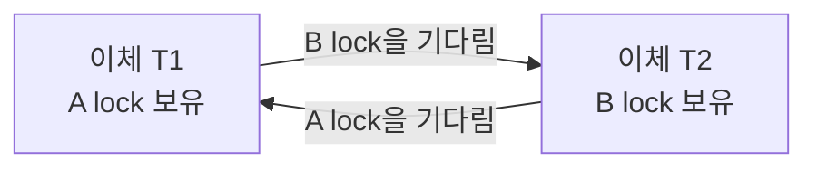
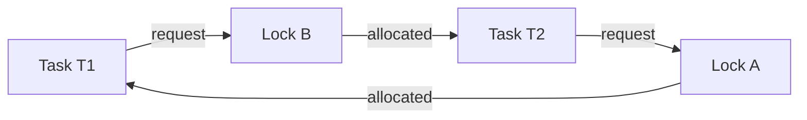
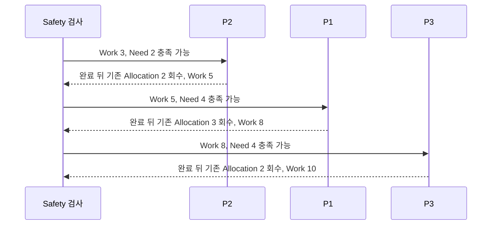

# 04. 교착상태

[이 책 목차](README.md) · [이전](03-synchronization.md) · [다음](05-address-spaces.md)

deadlock(교착상태)은 단순히 “락을 잘못 쓰면 멈춘다”는 말보다 넓다. 여러 실행 주체가 서로가 가진 자원이나 완료를 기다려, 외부 개입이나 실패 처리 없이는 아무도 다음 단계로 갈 수 없는 상태다. resource(자원)는 task가 진행하기 위해 얻어야 하는 대상이다. mutex 한 개, GPU memory 한 구역, queue의 빈자리 하나가 자원이 될 수 있다. resource instance는 같은 종류의 자원이 실제로 몇 개 있는지를 셀 때 쓰는 한 단위다. 같은 종류의 printer가 세 대라면 printer resource instance가 세 개다.

이 장에서는 두 은행 계좌 이체를 명령 단위로 추적하고, 누가 누구를 기다리는지 그린 wait-for graph, 교착상태가 가능해지는 네 조건, lock 순서의 증명, 실패 후 재시도할 때 생기는 livelock, Banker's algorithm의 안전성 계산을 연결한다.

## 1. 느림, block, deadlock을 먼저 구분한다

task가 mutex를 기다리며 blocked라고 해서 즉시 deadlock은 아니다. lock owner가 CPU를 받아 critical section을 끝내고 unlock하면 waiter는 진행할 수 있다. 장치 I/O가 2초 걸려도 completion이 올 예정이라면 긴 대기일 뿐이다.

deadlock에서는 기다림을 끝내야 할 주체도 다른 기다림에 묶여 있다. 시간을 더 주거나 CPU quantum을 늘려도 의존 관계가 바뀌지 않는다. 다음 세 상태를 구분한다.

| 상태 | 내부 상태가 움직이는가 | 유용한 진전이 가능한가 | 전형적 원인 |
|---|---:|---:|---|
| 긴 대기 | 지금은 아닐 수 있음 | owner나 장치 완료 뒤 가능 | I/O, 긴 critical section |
| livelock | 계속 바뀜 | 실질적으로 없음 | 서로 양보·재시도만 반복 |
| deadlock | 기다림 관계가 고정 | 외부 개입 없이는 없음 | 순환 의존 |
| starvation | 다른 task는 움직임 | 특정 task만 계속 못 함 | 불공정한 queue·우선순위 |

## 2. 두 계좌 이체가 멈추는 전체 과정

계좌 A의 잔액은 100, B는 200이다. T1은 A에서 B로 10을 보내고, T2는 B에서 A로 20을 보낸다. 각 이체가 두 잔액을 일관되게 바꾸도록 계좌별 mutex를 사용한다고 하자.

mutex는 한 순간에 한 실행 주체만 소유하게 하는 잠금 객체다. critical section은 잔액처럼 여러 task가 함께 보는 상태를 읽고 바꾸는 코드 구간이다. 이 구간을 실행하는 동안 같은 잔액을 다른 task가 중간에 바꾸지 못하게 mutex를 사용한다.

잘못된 코드는 출발 계좌를 먼저 잠근다.

```text
T1 transfer(A, B, 10): lock(A) → lock(B) → 잔액 변경 → unlock
T2 transfer(B, A, 20): lock(B) → lock(A) → 잔액 변경 → unlock
```

가능한 실행 순서는 다음과 같다.

| 단계 | T1 | T2 | lock A | lock B |
|---:|---|---|---|---|
| 0 | runnable | runnable | free | free |
| 1 | `lock(A)` 성공 | runnable | T1 소유 | free |
| 2 | 잠시 선점됨 | `lock(B)` 성공 | T1 소유 | T2 소유 |
| 3 | `lock(B)` 시도 후 blocked | running | T1 소유 | T2 소유 |
| 4 | blocked | `lock(A)` 시도 후 blocked | T1 소유 | T2 소유 |
| 5 | B를 기다림 | A를 기다림 | 해제할 T1은 blocked | 해제할 T2는 blocked |

잔액은 아직 A=100, B=200이라 데이터가 깨지지 않았을 수 있다. 그러나 두 transaction은 끝나지 않는다. T1에게 CPU 시간을 더 줘도 B를 얻기 전에는 진행하지 못하고, B를 놓을 T2도 A를 기다린다. timeout이 없다면 시간만으로 풀리지 않는다.

wait-for graph는 “누가 누구의 진전을 기다리는가”를 그린다.



resource-allocation graph로 더 자세히 그리면 task→resource edge는 요청, resource→task edge는 현재 할당이다.



A와 B mutex가 각각 한 instance뿐이므로 이 cycle은 두 task가 서로를 기다리는 실제 deadlock을 뜻한다.

## 3. 네 필요조건을 실행 상태에 대입한다

고전 Coffman 조건은 deadlock이 가능하려면 동시에 성립해야 하는 네 조건이다. 이름만 외우지 말고 계좌 예제에서 어떤 상태인지 본다.

### mutual exclusion

한 계좌 mutex는 한 번에 한 task만 소유할 수 있다. 동시에 T1과 T2에게 줄 수 없다. 읽기 전용 공유 자원처럼 안전하게 동시에 사용할 수 있다면 이 조건이 약해질 수 있다.

### hold and wait

T1은 A를 가진 채 B를 기다리고, T2는 B를 가진 채 A를 기다린다. 아무것도 보유하지 않은 채 하나만 기다리는 상태와 다르다.

### no preemption

kernel이나 다른 task가 T1에게서 A mutex를 임의로 빼앗아 T2에게 줄 수 없다고 가정한다. critical section 중간에 lock만 빼앗으면 보호하던 잔액 불변조건이 깨질 수 있다. transaction rollback처럼 상태를 복구할 수 있는 시스템은 작업 전체를 취소해 자원을 회수할 수 있지만, 일반 mutex 한 개를 무조건 강탈하는 것과는 다르다.

### circular wait

T1→B→T2→A→T1의 닫힌 기다림 고리가 있다. cycle의 각 task는 다음 task가 가진 자원을 기다린다.

네 조건은 이 모형에서 deadlock의 **필요조건**이다. 하나를 확실히 깨면 해당 형태를 예방할 수 있다. 그러나 “조건 네 개를 발견했다”만으로 실제 프로그램의 모든 종류의 멈춤을 설명하지는 못한다. message, future, queue capacity, device completion 사이에도 의존 cycle이 생길 수 있다.

## 4. 전역 lock 순서가 cycle을 막는 이유

계좌마다 변하지 않는 stable ID가 있다고 하자. 모든 이체는 출발·도착 방향과 관계없이 ID가 작은 계좌를 먼저 잠근다.

```text
first  = min(accountA.id, accountB.id)
second = max(accountA.id, accountB.id)
lock(first)
lock(second)
try:
    두 잔액을 검사하고 갱신
finally:
    unlock(second)
    unlock(first)
```

A.id=10, B.id=20이면 T1과 T2 모두 A 다음 B 순서로 요청한다. T1이 A를 잡았다면 T2는 A 앞에서 기다리므로 B를 먼저 소유하지 않는다. T1은 B를 얻어 끝내고, 그 뒤 T2가 실행된다.

성공한 잔액 변화도 끝까지 계산할 수 있다. T1이 A에서 10을 빼고 B에 더하면 A=90, B=210이다. T1이 두 lock을 놓은 뒤 T2가 같은 A→B lock 순서로 들어와 B에서 20을 빼고 A에 더하면 A=110, B=190이다. 전체 합은 처음과 같은 300이다. lock 순서는 이체 방향과 다르며, 두 잔액을 함께 바꾸는 critical section만 보호한다.

왜 임의의 여러 lock에서도 cycle이 불가능한지 증명할 수 있다. 모든 task가 이미 가진 lock보다 **엄격히 큰 rank**의 lock만 기다린다고 하자. cycle이 있다면 rank는 다음처럼 증가해야 한다.

```text
rank(L1) < rank(L2) < ... < rank(Ln) < rank(L1)
```

마지막 부등식은 어떤 수가 자기 자신보다 작다는 뜻이므로 모순이다. 따라서 이 규칙을 모든 경로가 지키면 circular wait가 생길 수 없다.

실무에서는 세부가 어렵다.

- ID가 객체 수명 동안 변하면 안 된다.
- 두 객체의 ID가 같을 때도 일관된 tie-breaker가 필요하다.
- pointer 주소를 순서로 쓰려면 객체 수명과 주소 재사용, 언어 비교 규칙을 확인해야 한다.
- callback 안에서 숨은 lock을 잡으면 전역 순서를 위반할 수 있다.
- error path와 cancellation path도 같은 역순 unlock을 지켜야 한다.
- 계층이 다른 subsystem의 lock 순서를 하나의 문서와 검사 체계로 관리해야 한다.

global lock 하나로 모든 계좌를 보호하면 cycle은 단순히 사라질 수 있지만 병렬성이 크게 줄고 긴 critical section이 전체 이체를 막는다. deadlock 예방과 throughput은 별도 목표다.

## 5. 필요한 자원을 한꺼번에 예약하는 방법

hold-and-wait를 깨려면 실행 전에 필요한 lock을 모두 얻거나, 하나라도 실패하면 아무것도 보유하지 않는 방법을 쓸 수 있다.

계좌 이체에서 A와 B를 원자적으로 함께 예약하는 상위 coordinator가 있다면 한쪽만 가진 채 다른 쪽을 기다리지 않는다. 하지만 다음 비용이 있다.

- 미래에 필요한 자원을 미리 정확히 알아야 한다.
- 아직 사용하지 않는 자원도 오래 묶어 utilization이 낮아진다.
- 많은 자원을 한꺼번에 얻는 요청이 작은 요청에게 밀릴 수 있다.
- 예약 coordinator 자체가 병목이나 새로운 의존점이 될 수 있다.

GPU memory, DMA buffer, command queue slot을 작업 시작 전에 모두 예약하는 설계에서도 같은 절충이 나타난다.

## 6. try-lock, rollback, backoff와 livelock

block하는 두 번째 lock 대신 `try_lock`을 사용하고 실패하면 첫 lock을 놓는 방법을 보자.

```text
lock(first)
if not try_lock(second):
    unlock(first)
    잠시 기다린 뒤 처음부터 재시도
```

이 방식은 첫 lock을 영원히 가진 채 기다리는 hold-and-wait를 피할 수 있다. 하지만 두 task가 완전히 같은 타이밍으로 행동하면 다음 livelock이 생긴다.

| round | T1 | T2 | 결과 |
|---:|---|---|---|
| 1 | A 성공, B try 실패, A 해제 | B 성공, A try 실패, B 해제 | 둘 다 실패 |
| 2 | A 성공, B try 실패, A 해제 | B 성공, A try 실패, B 해제 | 다시 실패 |
| 3 | 같은 행동 반복 | 같은 행동 반복 | 상태는 움직이나 이체 0건 |

randomized backoff는 각 task가 서로 다른 임의 시간 동안 기다려 대칭을 깨려 한다. exponential backoff는 연속 실패할수록 대기 범위를 늘린다. contention을 낮출 수 있지만 완료의 절대 보장을 자동 제공하지 않는다. 운이 나쁘거나 우선순위가 불공정하면 starvation이 남을 수 있다.

rollback은 이번 시도에서 바꾼 상태를 이전 상태로 되돌리는 절차다. backoff는 즉시 다시 경쟁하지 않고 잠시 기다리는 규칙이다. 둘 다 아무 상태에서나 안전한 것은 아니다. 첫 lock을 얻은 뒤 외부에 되돌릴 수 없는 I/O를 이미 보냈다면 lock만 놓고 재시도할 수 없다. 외부에서 관측되는 변경을 최종 확정 전까지 숨기거나, 이미 나간 변경을 상쇄하는 보상 작업을 정의해야 한다.

## 7. prevention, avoidance, detection, recovery

deadlock 처리 전략은 서로 다른 시점에 개입한다.

| 전략 | 질문 | 예 |
|---|---|---|
| prevention | 필요조건 하나를 구조적으로 깨는가 | 전역 lock order, 한꺼번에 예약 |
| avoidance | 이번 grant 뒤에도 안전 완료 순서가 남는가 | Banker's algorithm |
| detection | 허용해 둔 기다림에서 cycle이나 미진전 상태를 찾는가 | wait-for graph 검사 |
| recovery | 발견 뒤 어떤 작업을 희생해 진행을 복구하는가 | transaction abort와 rollback |

prevention은 규칙 때문에 가능한 병렬성을 제한할 수 있다. avoidance는 최대 요구량 같은 정보를 미리 알아야 한다. detection은 검사 비용과 발견 전 정지 시간을 감수한다. recovery는 버린 작업과 rollback 비용을 낸다.

## 8. safe, unsafe, deadlocked는 세 상태다

claim은 process가 앞으로 더 요구할 수 있다고 미리 선언한 자원량이다. maximum claim은 그 process가 보유할 수 있는 최대량이고, Need는 최대량에서 현재 Allocation을 뺀 남은 요구량이다.

safe state는 현재 할당 상태에서 모든 process가 claim한 최대 요구까지 받아 완료할 수 있는 **안전 순서가 적어도 하나 있는 상태**다. 안전 순서는 첫 process가 끝나 자원을 반환하고, 그 자원으로 다음 process가 끝나는 식으로 모두 완료되는 순서다.

unsafe state는 그런 순서를 증명할 수 없는 상태다. 지금 모두가 기다리는 deadlock이라고 단정하는 말이 아니다. 아직 아무 process도 추가 요청하지 않아 실행 중일 수 있지만, 허용된 최대 요구가 실제로 이어지면 막힐 수 있다.

deadlocked state는 현재 outstanding request와 allocation 때문에 아무 관련 process도 진행·해제할 수 없는 상태다.

```text
safe ⊂ not currently deadlocked
unsafe에는 "아직 실행 중"과 "이미 deadlocked"가 모두 들어갈 수 있다.
```

## 9. Banker's algorithm을 표 전체로 계산한다

resource type X는 총 10개다. process는 최대 요구를 미리 선언하고, 완료하면 가진 X를 모두 반환한다고 가정한다.

| Process | Allocation | Max | Need = Max - Allocation |
|---|---:|---:|---:|
| P1 | 3 | 7 | 4 |
| P2 | 2 | 4 | 2 |
| P3 | 2 | 6 | 4 |

할당 합은 `3+2+2=7`이므로 Available은 `10-7=3`이다.

safety algorithm은 Work를 현재 Available로 시작하고, `Need ≤ Work`인 미완료 process를 하나 골라 그 process가 끝난다고 가정한다. 끝나면 원래 갖고 있던 Allocation이 Work로 돌아온다.

| 반복 | Work 시작 | 선택 가능한 Need | 선택 | 완료 뒤 Work = Work + Allocation |
|---:|---:|---|---|---:|
| 0 | 3 | P2의 2 | P2 | `3+2=5` |
| 1 | 5 | P1의 4, P3의 4 | P1 | `5+3=8` |
| 2 | 8 | P3의 4 | P3 | `8+2=10` |

안전 순서 하나는 `P2 → P1 → P3`다. P2가 남은 2를 받는 순간 Work가 1로 줄었다가 완료하며 총 4를 반환하므로 결과적으로 이전 Work 3에 P2의 기존 Allocation 2를 더한 5가 된다. safety algorithm이 `Work += Allocation`으로 쓰이는 이유다.



이 계산은 process가 선언한 Max를 넘지 않고, 받은 자원으로 유한 시간 안에 완료하며, 완료 때 자원을 반환한다는 가정에 의존한다. lock처럼 최대 요구가 실행 경로에 따라 동적으로 달라지거나, 장치 오류로 반환이 불가능한 자원에는 그대로 적용하기 어렵다.

## 10. request를 가상 grant한 뒤 다시 검사한다

P3가 X를 3개 더 요청한다고 하자. 현재 Need 4 이하이고 Available 3 이하이므로 형식상 요청 범위 안이다. 실제 grant하기 전에 가상 상태를 만든다.

| Process | 새 Allocation | Max | 새 Need |
|---|---:|---:|---:|
| P1 | 3 | 7 | 4 |
| P2 | 2 | 4 | 2 |
| P3 | 5 | 6 | 1 |

새 Available은 0이다. safety 검사 Work=0에서 시작하면 Need가 0 이하인 process가 하나도 없다. 안전 순서를 찾지 못하므로 이 grant는 unsafe이며 Banker는 P3를 기다리게 한다.

이것이 “현재 deadlock”과 같은 말은 아니다. 가상 grant를 아직 실제 적용하지 않았다. 또한 현재 process들이 추가 자원 없이 중간 반환할 수 있다는 다른 protocol이라면 Banker 가정이 달라진다. Banker's algorithm은 Max와 반환 모델을 포함한 특정 수학 모형이다.

## 11. multiple instance에서는 cycle만으로 충분하지 않다

resource A는 instance가 두 개 A1, A2이고 B는 하나 B1이라고 하자.

- T1은 A1을 보유하고 B1을 요청한다.
- T2는 B1을 보유하고 A instance 하나를 요청한다.
- A2는 free다.

graph에는 T1→B→T2→A→T1 cycle이 보인다. 하지만 A2를 T2에게 주면 T2가 완료해 B1을 반환하고, T1도 B1을 받아 끝날 수 있다. cycle이 있지만 deadlock이 아니다.

A instance가 A1 하나뿐이었다면 available A가 0이고 두 task 모두 진행하지 못한다. 같은 모양의 type-level cycle이어도 instance 수와 remaining request가 판정을 바꾼다.

single-instance resource graph에서는 cycle이 deadlock의 필요충분 조건이 될 수 있다. multiple-instance에서는 available vector, allocation matrix, outstanding request를 함께 검사해야 한다.

## 12. database는 victim을 고르고 rollback할 수 있다

database transaction은 변경을 commit 전까지 undo하거나 MVCC version으로 숨길 수 있어, deadlock을 발견하면 한 transaction을 victim으로 골라 abort·rollback하고 lock을 해제할 수 있다.

victim 선택 기준에는 다음이 들어갈 수 있다.

- 지금까지 한 작업량
- 잡은 lock 수와 rollback 비용
- transaction age와 재시도 횟수
- 사용자 priority
- 다른 transaction을 얼마나 많이 막는가

항상 가장 어린 transaction을 희생하면 긴 transaction을 보호할 수 있지만, 같은 짧은 transaction이 반복해서 victim이 되어 starvation할 수 있다. 재시도 횟수나 age를 반영해야 한다.

wait-die와 wound-wait는 transaction timestamp를 이용해 기다림 방향을 제한하는 예방 기법이다. 어떤 쪽이 기다리고 어떤 쪽이 abort되는지 규칙이 다르므로 이름만 섞어 외우지 말고 사용하는 DB 문서를 확인한다.

distributed transaction에서는 network partition과 process failure까지 섞인다. timeout은 deadlock의 증거가 아니다. 느린 node나 packet loss일 수도 있다. 잘못된 중복 실행을 막으려면 transaction identity와 idempotency, fencing도 필요하다.

## 13. Linux lockdep가 해 주는 일과 경계

Linux lockdep는 runtime에 관측된 lock class 사용과 dependency를 기록해 역순 획득과 interrupt context 관련 잠재 deadlock을 검사하는 validator다. 실제로 복잡한 여러 CPU timing을 재현하지 않아도 각각의 단순 lock chain을 관측하면 dependency graph의 cycle 가능성을 찾을 수 있다.

그러나 “lockdep를 켰는데 경고가 없었다 = 모든 deadlock이 없음”이라고 말할 수 없다.

- 실행되지 않은 code path의 dependency는 관측되지 않았을 수 있다.
- lockdep가 모델링하지 않는 message, completion, device, 사용자 공간 lock 의존은 별도다.
- lock class annotation이 잘못되면 결과가 왜곡될 수 있다.
- runtime checking 비용과 추적 한계가 있다.
- validator 자체와 hash, nesting 등에 문서화된 가정이 있다.

lockdep는 강력한 dependency 검사 도구이지 전체 시스템 liveness의 완전 증명기는 아니다. 설계의 lock order 문서, code review, stress test, timeout dump와 함께 사용한다.

## 14. lock 밖에서도 생기는 실제 의존 cycle

### workqueue flush

kernel work item A가 lock L을 잡은 채 workqueue의 B 완료를 기다린다. 그런데 B가 실행되어 L을 얻어야 완료할 수 있다면 `A holds L → waits B → B waits L` cycle이다. queue에 item이 있다는 사실만으로 worker가 실행 가능한 것은 아니다.

### bounded queue

producer P가 lock L을 잡은 채 가득 찬 queue에 공간이 생기길 기다린다. consumer C가 item을 꺼내려면 L이 필요하다면 deadlock이다. capacity라는 resource와 mutex가 함께 cycle을 만든다.

### GPU command와 callback

CPU thread가 mutex M을 잡은 채 GPU fence를 기다리고, fence completion callback이 같은 M을 잡아 상태를 마무리해야 한다면 completion이 막힌다. GPU가 계산을 끝냈어도 host callback dependency 때문에 application은 진행하지 못할 수 있다.

### I/O memory allocation

writeback을 시작해야 memory가 회수되는데, I/O 제출 경로가 다시 같은 memory pool의 allocation을 기다리면 reclaim recursion과 의존 cycle이 생길 수 있다. kernel은 이런 경로를 위해 reserve와 allocation context 규칙을 둔다. “RAM이 부족하다”만으로는 원인을 설명할 수 없다.

### Kubernetes와 분산 제어

controller A가 resource X의 상태 변화만 기다리고 controller B가 Y를 기다리는데, 각 변화에 필요한 ownership이나 finalizer가 상대 조건에 묶일 수 있다. 중앙 mutex가 없어도 상태 machine 사이 순환 의존이 생긴다. timeout과 manual finalizer 제거는 데이터 손실 위험을 검토해야 한다.

## 15. 진단할 때 보는 증거

deadlock을 의심하면 “멈췄다”는 인상보다 의존 관계를 수집한다.

1. 어떤 task가 blocked이고 무엇을 기다리는가?
2. 기다리는 resource나 completion의 현재 owner는 누구인가?
3. owner는 running, runnable, blocked 중 무엇인가?
4. owner가 기다리는 다음 dependency는 무엇인가?
5. cycle이 닫히는가, 아니면 매우 느린 외부 장치로 끝나는가?
6. timeout, cancellation, rollback 경로가 실제로 자원을 해제하는가?
7. 같은 lock class의 instance 수와 shared/exclusive mode는 무엇인가?

thread dump, lock owner 정보, database lock table, wait event, workqueue 상태, GPU fence timeline을 같은 시각축에 맞춰야 한다. 각 도구의 snapshot 시점이 다르면 존재하지 않는 cycle을 조합할 수 있다.

## 16. 확인 문제와 자세한 해설

### 문제 1. 계좌 이체 cycle

T1이 A를 보유하고 B를 기다리며, T2가 B를 보유하고 A를 기다린다. 네 필요조건을 각각 대입하라.

**해설:** A와 B mutex는 동시 소유가 안 되어 mutual exclusion이다. 두 task가 하나를 가진 채 다른 것을 기다려 hold and wait다. mutex를 중간에 강제로 빼앗지 않아 no preemption이다. T1→B→T2→A→T1이 circular wait다. owner 둘이 모두 blocked라 시간만 더 줘도 풀리지 않는다.

### 문제 2. lock order 증명

모든 task가 rank가 작은 lock에서 큰 lock으로만 획득한다. 왜 cycle이 불가능한가?

**해설:** wait edge를 따라갈 때마다 rank가 엄격히 커져야 한다. cycle이 닫히면 `r1<r2<...<rn<r1`이 되어 모순이다. 단, 모든 path와 callback이 같은 stable rank 규칙을 지켜야 한다.

### 문제 3. try-lock과 livelock

T1과 T2가 두 번째 lock 실패 때 첫 lock을 즉시 놓고 동시에 재시도한다. deadlock이 없으면 성공인가?

**해설:** 보유한 채 기다리지 않아 고정 cycle은 피할 수 있다. 하지만 둘이 같은 박자로 성공·실패·해제를 반복하면 상태만 바뀌고 작업은 끝나지 않는 livelock이다. randomized 또는 exponential backoff, 공정한 queue가 대칭을 깨는 데 도움을 주지만 절대 완료 보장을 별도로 검토해야 한다.

### 문제 4. Banker 안전 순서

총 X=10, Allocation=(3,2,2), Max=(7,4,6)일 때 Work 변화와 안전 순서를 쓰라.

**해설:** Need=(4,2,4), Available=3이다. P2의 Need 2≤3이므로 완료를 가정하고 Work=3+Allocation2=5. P1 Need4≤5, 완료 뒤 Work=5+3=8. P3 Need4≤8, 완료 뒤 Work=10. 안전 순서는 P2→P1→P3다.

### 문제 5. unsafe와 deadlocked

P3에 X 3개를 가상 grant하면 Available=0, Need=(4,2,1)이다. 지금 deadlock이라고 단정할 수 있는가?

**해설:** safety algorithm에서 아무 process도 Need≤Work를 만족하지 않아 unsafe grant다. Banker는 실제 grant하지 않는다. unsafe는 보장 가능한 완료 순서가 없다는 뜻이며, 아직 process가 outstanding request를 하지 않았거나 protocol상 중간 반환이 가능하면 현재 deadlock과 다를 수 있다.

### 문제 6. multiple instance cycle

A 두 instance, B 한 instance다. T1은 A1 보유 후 B 요청, T2는 B 보유 후 A 요청, A2는 free다. 판정하라.

**해설:** type-level cycle은 있지만 A2를 T2에게 주면 T2가 완료해 A와 B를 반환한다. 그 뒤 T1도 끝난다. deadlock이 아니다. A가 한 instance뿐이고 둘 다 추가 자원 없이는 완료할 수 없다면 deadlock이 된다.

### 문제 7. lockdep 해석

stress test에서 lockdep 경고가 없었다. production의 모든 deadlock이 불가능하다고 증명했는가?

**해설:** 아니다. 실행되지 않은 dependency, 사용자 공간·device completion·message 의존, 잘못된 annotation은 범위 밖일 수 있다. lockdep가 관측한 lock class chain에 대해서는 강력한 검사를 하지만 전체 liveness 증명과 같지 않다.

### 문제 8. GPU fence 의존

CPU thread가 M을 잡고 fence를 기다린다. completion callback도 M을 얻어야 fence 완료 상태를 publish한다. 해결 방향을 설명하라.

**해설:** wait 전에 M을 놓아도 불변조건이 유지되도록 상태를 재설계하거나, callback이 M 없이 완료를 publish하도록 dependency를 분리해야 한다. 단순 timeout 뒤 M을 강제로 빼앗으면 중간 상태가 깨질 수 있다. fence, callback, mutex를 wait-for graph에 함께 넣어 cycle을 제거한다.

## 근거와 더 읽을 자료

- [OSTEP: Concurrency Bugs](https://pages.cs.wisc.edu/~remzi/OSTEP/threads-bugs.pdf)
- [Linux kernel 문서: Runtime Locking Correctness Validator](https://docs.kernel.org/locking/lockdep-design.html)
- [Linux kernel 문서: Wound/Wait Deadlock-Proof Mutex Design](https://docs.kernel.org/locking/ww-mutex-design.html)
- [PostgreSQL 문서: Explicit Locking과 Deadlocks](https://www.postgresql.org/docs/current/explicit-locking.html)

---

[이전 장: 동기화](03-synchronization.md) · [다음 장: 주소 공간](05-address-spaces.md)
