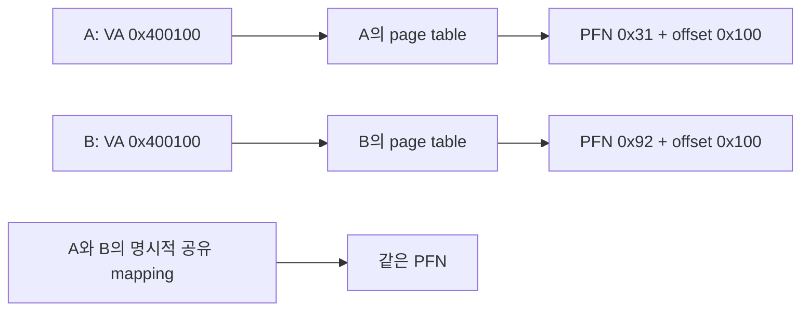

# 05. 주소 공간

[이 책 목차](README.md) · [이전](04-deadlocks.md) · [다음](06-paging-virtual-memory.md)

## 이 장에서 만들 정신 모형

메모리 주소를 “RAM 칩의 몇 번째 칸”이라고만 생각하면 프로세스, pointer bug, 공유 메모리를 설명할 수 없다. 프로그램의 pointer가 담는 수는 대개 **가상 주소(virtual address, VA)**다. VA는 현재 프로세스의 주소 공간이라는 문맥 안에서만 의미가 있다. CPU의 **MMU(Memory Management Unit, 메모리 관리 장치)**와 운영체제가 만든 mapping이 VA를 물리 메모리 위치로 번역하고, 읽기·쓰기·실행 권한을 검사한다.

이 장은 프로세스 A와 B가 모두 숫자 `0x400100`을 읽지만 A는 문자열 `"alpha"`, B는 정수 `42`를 얻는 상황을 끝까지 따라간다. 원인은 주소 숫자만으로 대상 byte가 결정되지 않기 때문이다. 기작은 각 프로세스가 서로 다른 page table을 사용하는 것이다. 결과는 같은 VA가 다른 physical frame에 연결될 수 있다는 것이다. 이 성질을 이용해 프로세스 격리, 공유 library, `fork()`의 copy-on-write, file mapping을 구현한다.



## 1. bit, byte, object, address

**bit**는 0 또는 1 한 자리다. **byte**는 일반적으로 8bit이고 메모리 주소가 고르는 기본 단위다. **object**는 프로그램이 의미를 부여한 byte 묶음이다. C의 32bit 정수는 4byte object이고 UTF-8 문자열은 문자마다 byte 수가 다를 수 있다. **address**는 byte 위치를 고르는 번호다.

4byte 정수 `0x12345678`이 VA `0x1000`부터 놓였다고 하자. little-endian 시스템에서는 낮은 주소부터 `78 56 34 12`가 놓일 수 있다. 주소 `0x1000`은 “정수 전체”가 아니라 첫 byte 위치다. CPU가 4byte load를 실행하면 `0x1000..0x1003`을 한 object로 해석한다. endian과 alignment는 architecture와 instruction 조건을 따른다.

**register(레지스터)**는 CPU 안의 빠르고 작은 저장 공간이다. program counter는 다음 instruction 위치를, stack pointer는 현재 stack 위치를, 일반 register는 계산값이나 주소를 담는다. register에 `0x1000`이 있어도 그 숫자는 data 자체가 아니다.

```text
register r1 = 0x1000
memory VA 0x1000..0x1003 = 78 56 34 12
load32 r2, [r1]
→ 현재 process의 mapping과 permission 검사
→ 성공하면 r2 = 0x12345678  (little-endian 예)
```

## 2. 주소 공간은 허용된 구간과 속성의 집합이다

**address space(주소 공간)**는 프로세스가 사용할 수 있는 VA 범위와 각 범위의 backing, permission, 공유 방식을 나타내는 논리적 공간이다. Linux에서는 연속 구간의 속성을 나타내는 VMA(Virtual Memory Area) 같은 kernel 자료구조와 page table이 함께 이 모형을 구현한다.

```text
높은 VA
┌─────────────────────────┐
│ thread stack            │ 지역 변수, return address, saved register
├──────── guard ──────────┤
│ mmap 영역               │ shared library, file, anonymous mapping
├─────────────────────────┤
│ 아직 매핑하지 않은 구멍 │ 주소 숫자가 가능해도 접근은 불법일 수 있음
├─────────────────────────┤
│ heap                    │ malloc 등이 요청하는 동적 object
├─────────────────────────┤
│ bss / data              │ 0 초기화 / 초기값 있는 전역 object
├─────────────────────────┤
│ read-only data / code   │ 상수와 instruction
└─────────────────────────┘
낮은 VA
```

이 배치는 ABI마다 다르다. stack이 항상 같은 숫자에서 시작하거나 heap과 stack이 서로를 향해 단순 성장한다고 가정하면 안 된다. thread가 여러 개면 각 thread가 자기 stack과 stack pointer를 갖지만 code, heap, mapping은 공유한다.

## 3. stack frame과 object lifetime

**stack**은 함수 호출의 임시 상태를 저장하는 영역이다. **stack frame**은 한 호출에 필요한 지역 변수, return address, saved register 등을 묶은 구간이다. compiler 최적화와 ABI에 따라 어떤 값은 register에만 있고 frame pointer가 없을 수 있으므로 다음은 원리 모형이다.

```text
main이 f(7)을 호출
1. argument 7을 ABI가 정한 register 또는 stack에 둔다.
2. call이 돌아올 instruction 위치를 보존한다.
3. f가 stack pointer를 조정해 32byte frame을 만든다.
4. 지역 배열 buf[16]과 saved register가 frame에 놓일 수 있다.
5. return하면 stack pointer를 복구하고 보존한 위치로 이동한다.
```

지역 변수의 pointer를 return한 뒤 사용하면 함수 return과 함께 frame의 **lifetime(유효 수명)**이 끝났기 때문에 위험하다. 같은 VA byte가 잠시 남아 보여도 다음 함수가 덮을 수 있다. pointer 숫자가 남아 있다는 사실은 object가 살아 있다는 보장이 아니다.

## 4. heap과 allocator를 끝까지 추적한다

**heap**은 실행 중 크기와 수명을 정하는 object를 위한 영역이다. `malloc(100)`은 allocator가 관리하는 block에서 최소 100byte를 돌려준다. allocator는 필요하면 `brk`나 `mmap`으로 더 큰 virtual range를 얻는다. 호출마다 kernel이 정확히 100byte RAM을 주는 구조가 아니다.

```text
application: 100byte 요청
allocator: 이미 가진 64KiB arena에서 112byte block 선택 가능
kernel: 이 호출에서는 관여하지 않을 수 있음
첫 write: page가 아직 backing되지 않았다면 demand-zero fault
free: allocator에 block 반환; 즉시 OS로 page를 반환하지 않을 수 있음
```

**memory leak**는 필요 없어진 object가 계속 reachable해 회수되지 않는 문제다. **use-after-free**는 lifetime이 끝난 object를 다시 쓰는 문제다. **double free**는 같은 allocation을 두 번 해제하는 문제다. MMU의 프로세스 격리가 같은 heap 안의 이런 언어 수준 오류를 모두 막지는 못한다.

## 5. 같은 VA가 다른 byte를 가리키는 계산

4KiB page에서 `0x400100`을 나누자. page size는 `0x1000`이다.

```text
VA       = 0x400100
VPN      = VA // 0x1000 = 0x400
offset   = VA % 0x1000  = 0x100

A: VPN 0x400 → PFN 0x31, read/write
A PA = 0x31 * 0x1000 + 0x100 = 0x31100

B: VPN 0x400 → PFN 0x92, read-only
B PA = 0x92 * 0x1000 + 0x100 = 0x92100
```

CPU가 A를 실행할 때 A의 page-table root가 활성화되어 `0x31100`을 읽는다. B로 context switch하면 B의 변환 문맥으로 같은 operand가 `0x92100`을 읽는다. 반대로 A의 VPN `0x500`과 B의 VPN `0x900`을 같은 PFN `0x77`에 연결하면 서로 다른 VA가 같은 physical page를 공유한다. 공유 여부는 주소 숫자가 아니라 mapping으로 결정된다.

## 6. base-and-bounds와 relocation

**relocation(재배치)**은 프로그램이 예상한 logical 위치를 실제 physical 위치에 맞추는 일이다. 간단한 base-and-bounds 모형은 logical address가 bounds 안인지 검사한 뒤 base를 더한다.

```text
base = 1000, bounds = 500
logical 120 → 0 <= 120 < 500 → physical 1120
logical 499 → physical 1499
logical 500 → 범위 밖 protection fault
```

프로그램은 0부터 시작하는 logical address를 쓰고 OS는 process를 RAM 다른 곳에 둘 수 있다. 그러나 process 하나가 연속 physical 구간을 요구하고 크기가 다른 빈 구멍이 흩어지는 **external fragmentation(외부 단편화)**이 생긴다.

**segmentation(세그멘테이션)**은 code, heap, stack마다 base, limit, permission을 둔다. code는 read+execute, data는 read+write처럼 보호하고 영역별 성장을 허용할 수 있다. 그러나 segment 크기가 가변이라 external fragmentation과 배치 문제가 남는다. paging은 고정 크기 page로 연속 physical 배치 요구를 줄인다.

## 7. protection은 다섯 조건을 본다

| 조건 | 질문 |
|---|---|
| 주소 형태 | architecture가 허용하는 VA인가? |
| 영역 존재 | process의 합법 VMA 안인가? |
| backing 상태 | page가 present한가, 정상적으로 준비할 수 있는가? |
| permission | 현재 privilege와 read/write/execute 종류가 허용되는가? |
| object lifetime | language 관점에서 object가 아직 유효한가? |

code page가 read+execute이고 write 금지면 instruction fetch는 성공해도 store는 protection fault다. stack page는 read+write이고 execute가 금지될 수 있다. user mode는 kernel 전용 mapping을 읽을 수 없어야 한다. kernel mode라고 모든 pointer가 안전한 것도 아니다. kernel은 user pointer를 별도 helper로 검증하고 복사한다.

## 8. null, guard page, segmentation fault

C pointer의 `NULL`은 “유효 object를 가리키지 않음”을 나타낸다. 많은 OS는 낮은 VA를 unmapped로 두어 null dereference가 빠르게 fault 나게 하지만 언어의 null과 특정 VA 0 mapping 정책은 같은 정의가 아니다.

**guard page**는 일부러 mapping을 두지 않은 보호 구간이다. stack 끝 옆에 두면 작은 overflow가 다음 영역을 조용히 덮기 전에 fault를 낼 수 있다. 한 번에 guard를 뛰어넘는 큰 pointer 이동이나 같은 mapped stack 안의 이웃 object 손상을 전부 막지는 않는다.

Linux의 **segmentation fault**는 허용되지 않은 memory access 때문에 `SIGSEGV`를 받은 결과다. 이름과 달리 현대 paging에서도 쓰인다. 같은 CPU page-fault exception이 demand allocation이면 복구되고, VMA가 없거나 permission을 어기면 signal로 이어질 수 있다.

## 9. ASLR과 position-independent code

**ASLR(Address Space Layout Randomization)**은 executable, library, heap, stack 위치를 실행마다 다르게 배치해 공격자의 주소 예측을 어렵게 한다. 다양한 base에서 실행할 수 있는 **position-independent code**와 loader relocation이 이를 돕는다.

ASLR은 memory corruption을 없애지 않는다. 정보 누출로 주소가 드러날 수 있고 entropy는 architecture와 mapping 크기에 제한된다. fork child가 layout 일부를 물려받는 등 조건에 따라 효과도 다르다. non-executable memory, control-flow 방어, memory-safe language와 함께 쓰는 방어층이다.

## 10. fork와 copy-on-write

parent의 VPN 5가 PFN 40을 가리킨다고 하자. `fork()` 뒤 전체 page를 즉시 복사하면 비싸다. **COW(Copy-On-Write)**는 parent와 child가 PFN 40을 공유하되 write-protected 상태로 관리한다.

```text
fork 직후: parent VPN 5 ─┐
                         ├─ PFN 40, COW/read
           child  VPN 5 ─┘

child가 offset 20에 write
1. CPU가 write permission fault
2. kernel이 합법 COW mapping인지 확인
3. PFN 83을 할당하고 PFN 40 내용을 복사
4. child VPN 5 → PFN 83, write 허용
5. 중단된 store 재시도
```

결과는 parent가 PFN 40, child가 PFN 83을 보는 것이다. COW fault는 정상 지연 복사다. VMA 밖 write는 COW로 복구할 근거가 없다. `MAP_SHARED` page는 write가 서로에게 보이게 설계할 수 있으므로 fork 뒤 모든 write가 private copy라는 말도 틀리다.

## 11. pointer lifetime과 mapping lifetime

세 상황을 나누자.

1. stack local 주소를 저장한 뒤 함수가 return했다. mapping은 남아도 object lifetime은 끝났다.
2. heap object를 `free`했다. allocator가 같은 VA를 새 object에 재사용할 수 있다.
3. `munmap`으로 mapping을 없앴다. 접근은 fault로 이어질 수 있다.

**dangling pointer**는 대상 lifetime이 끝났는데 남은 pointer다. MMU는 language의 object identity를 모른다. 같은 VA가 새 object에 재사용되면 hardware 접근은 성공해도 의미는 잘못된다. sanitizer, ownership type, allocator hardening이 필요한 이유다.

## 12. kernel과 user 경계

syscall이 user buffer VA를 받으면 kernel은 현재 process의 user mapping으로 해석한다. kernel privilege로 실행한다고 buffer가 resident하거나 writable한 것은 아니다. copy 중 page fault가 날 수 있고 다른 thread가 mapping을 바꿀 수 있어 Linux는 user-access helper와 lifetime 규칙을 쓴다.

RISC-V Linux의 Sv39 구성은 usable VA 아래쪽을 userspace, 위쪽을 kernel 영역으로 배치하고 큰 hole을 둘 수 있다. 이는 Sv39에서 64bit effective address의 상위 bit들이 bit 38을 sign-extension해야 한다는 architecture 조건과 연결된다. 다른 architecture에 이 bit 경계를 적용하면 안 된다.

## 13. 장애 상황을 원인→기작→결과→코드→응용으로 읽기

상황: server가 request 처리 중 `SIGSEGV`로 종료됐다.

- 원인 후보: null pointer, use-after-free, stack overflow, read-only mapping write, race로 손상된 pointer.
- 기작: CPU가 VA를 변환하다 mapping/permission을 만족하지 못해 exception을 내고 kernel이 복구할 합법 fault가 아니라고 판단한다.
- 결과: process에 signal이 전달되고 default action이면 종료와 core dump가 가능하다.
- 코드 조사: fault address, instruction pointer, stack trace, mapping 목록을 함께 본다.
- 응용: restart 횟수만 세지 않고 core dump를 같은 binary/symbol과 맞춰 object lifetime 원인을 고친다.

fault address가 `0x0` 근처면 null+offset 가설이 강하지만 확정은 아니다. ASLR 때문에 절대 주소는 실행마다 달라질 수 있다.

## 14. executable을 적재할 때 주소와 파일 offset이 만나는 과정

실행 파일은 code와 data를 어떤 VA 구간에 어떤 permission으로 배치할지 loader가 해석할 정보를 담는다. Linux에서 흔한 ELF를 예로 들면 **program header**가 load할 segment의 file offset, virtual address, file에 있는 byte 수, memory에서 필요한 byte 수와 permission을 표현한다. 이 ELF segment와 과거 hardware segmentation은 이름이 같아도 같은 장치가 아니다.

다음은 단순화한 적재 흐름이다.

```text
1. shell child가 execve("/app", argv, envp)를 요청한다.
2. kernel이 실행 파일 형식, permission과 header를 확인한다.
3. 기존 user address-space image를 교체할 준비를 한다.
4. executable의 code 구간을 read+execute file mapping으로 만든다.
5. 초기화된 data는 read+write file-backed mapping으로 만든다.
6. bss처럼 file보다 memory 크기가 큰 나머지는 zero-filled 영역으로 만든다.
7. stack에 argv, environment, process 시작 정보를 배치한다.
8. 새 entry-point VA와 stack pointer로 user mode 실행을 시작한다.
```

이 과정이 file byte를 전부 즉시 RAM에 읽는다는 뜻은 아니다. mapping만 만들고 instruction fetch나 load가 처음 닿을 때 file-backed page fault로 가져올 수 있다. 따라서 exec latency, 첫 요청 latency, page-cache 상태를 구분해야 한다. file이 page cache에 있으면 storage I/O 없이 fault를 처리할 수도 있다.

**relocation entry**는 loader가 최종 배치 주소를 기준으로 code/data 안의 참조를 조정하는 데 쓰인다. position-independent code는 program counter 상대 주소나 indirection을 이용해 고정 base 의존을 줄인다. ASLR은 이 유연성을 이용하지만, relocation 처리와 symbol resolution에는 비용과 보안 규칙이 있다.

## 15. 주소 예약, commit, resident를 구분한다

프로그램이 1TiB VA 범위를 예약했다고 1TiB RAM을 즉시 사용한 것은 아니다. 다음 상태를 구분한다.

| 상태 | 의미 | 관측 예 |
|---|---|---|
| reserved/mapped | VA 구간과 속성이 존재 | VMA/VSZ 증가 |
| committed라는 정책 판단 | 나중 allocation을 어느 범위까지 허용할지 OS 정책이 판단 | overcommit 설정과 workload 조건 영향 |
| present/resident | 현재 page table로 RAM frame에 접근 가능 | RSS에 반영될 수 있음 |
| dirty | memory 내용이 backing store보다 변경됨 | writeback/swap 필요 가능 |
| locked/pinned | 일반 reclaim/migration이 제한됨 | DMA나 mlock 조건 |

예를 들어 database가 256GiB file을 `mmap`해도 실제로 접근한 working set이 8GiB이면 RSS는 그에 가까울 수 있다. 반대로 page cache와 shared mapping 때문에 process RSS 합을 host physical use로 그대로 더하면 중복 계산된다.

**sparse address space**는 넓은 VA 중 일부만 mapping한 상태다. heap allocator가 큰 arena를 예약하고 필요할 때 page를 사용하거나, growable table이 일정 간격으로 영역을 둘 수 있다. paging은 물리 RAM을 연속으로 확보하지 않고도 이런 배치를 가능하게 한다.

## 16. 두 thread가 같은 주소 공간을 공유할 때 생기는 실제 위험

T1과 T2는 서로 다른 stack을 가지지만 같은 page table을 사용한다. T1의 pointer bug가 T2 stack의 mapped VA를 가리키면 hardware는 “같은 process의 writable page”로 보고 허용할 수 있다. process isolation은 thread 사이 memory safety를 제공하지 않는다.

공유 heap의 queue를 두 thread가 동시에 수정하는 경우도 주소 변환은 정상이다. 문제는 실행 순서와 원자성이다. mutex가 보호해야 하는 대상은 pointer 한 개가 아니라 `head`, `tail`, node 연결이라는 전체 invariant일 수 있다. address-space 장치는 접근 가능 여부를 판단하고, synchronization은 여러 접근의 순서를 정한다.

thread stack 수명도 살펴보자.

```text
T1이 helper thread T2를 생성
→ kernel/runtime이 T2 stack VA 범위와 guard를 준비
→ T2 종료
→ join과 runtime 정책 뒤 stack mapping을 회수하거나 cache할 수 있음
→ T2 stack을 가리키던 pointer는 더 이상 안전하지 않음
```

thread가 끝났다고 stack VA가 즉시 unmapped된다는 보편 규칙은 없다. runtime이 재사용할 수 있다. 그러므로 fault가 나느냐가 아니라 lifetime 규약을 지켜야 한다.

## 17. ASLR 수치를 확률처럼 단순 해석하지 않기

어떤 mapping base에 가능한 위치가 이론상 `2^n`개면 흔히 n bit의 entropy라고 말한다. 하지만 alignment, 이미 점유한 영역, loader 정책, 정보 누출, fork로 물려받은 layout 때문에 실제 공격 난이도는 단순 `2^n` 반복과 다를 수 있다. huge alignment가 필요하면 가능한 위치 수가 줄 수도 있다.

또 ASLR은 “주소를 비밀 key로 사용한다”는 보안 설계가 아니다. memory disclosure 취약점이 있으면 주소를 배울 수 있다. 연구나 취약점 보고서에서 ASLR 우회가 언급되면 어떤 mapping을 누출했고, process 재시작마다 layout이 바뀌는지, fork worker가 같은 layout을 공유하는지 조건을 읽어야 한다.

## 18. 반례로 경계를 고정한다

- 같은 VA는 같은 RAM을 뜻하지 않는다. page-table context가 다르다.
- 다른 VA도 같은 RAM을 공유할 수 있다.
- mapping이 present해도 permission 위반이면 fault다.
- page fault가 나도 오류가 아닐 수 있다. demand-zero와 COW는 정상 경로다.
- pointer가 mapped여도 object lifetime이 끝났을 수 있다.
- ASLR이 있어도 memory-safe가 되지 않는다.
- thread별 stack이 있어도 같은 address space라 잘못된 pointer가 다른 thread stack을 덮을 수 있다.
- kernel privilege는 모든 주소 접근을 의미상 안전하게 만들지 않는다.

## 19. 완전 해설 문제

1. A와 B의 VA `0x5000`이 각각 PFN 8과 12에 연결된다. 4KiB page에서 PA는?
   - offset 0이므로 A는 `0x8000`, B는 `0xc000`이다.

2. VA `0x5234`의 VPN과 offset은?
   - VPN `0x5`, offset `0x234`다. PFN 8이면 PA는 `0x8234`다.

3. 함수가 지역 배열 주소를 return했고 즉시 읽어 맞는 값이 나왔다. 안전한가?
   - 아니다. object lifetime은 끝났고 다음 호출이 덮을 수 있다.

4. code mapping이 present이고 read+execute다. fetch와 store 결과는?
   - fetch는 허용되고 store는 write permission fault다.

5. fork 직후 RSS 합이 실제 RAM보다 커 보일 수 있는 이유는?
   - COW/shared page를 각 process RSS가 포함할 수 있다. PSS는 공유분을 나눈다.

6. guard page가 있어도 overflow가 다른 지역 변수를 망가뜨릴 수 있는가?
   - 같은 mapped stack page 안을 덮으면 guard에 닿지 않아 가능하다.

7. `free(p)` 뒤 같은 VA에 새 object가 배치됐다. 예전 `p` 접근은 반드시 fault인가?
   - 아니다. mapping은 유효할 수 있지만 새 object를 손상시키는 use-after-free다.

8. A와 B의 서로 다른 VA가 같은 PFN을 공유한다. 동기화도 해결됐는가?
   - 아니다. 물리 공유와 atomicity/ordering은 별개라 lock 또는 atomic protocol이 필요하다.

9. 256GiB file을 mmap했지만 8GiB만 touch했다. mmap 크기만으로 RAM 256GiB가 필요하다고 결론 내릴 수 있는가?
   - 없다. VA mapping 크기와 resident working set을 구분한다. page cache 공유, fault와 RSS/PSS를 함께 본다.

10. T1이 T2의 stack VA를 알아냈다. process가 같으므로 안전하게 읽어도 되는가?
   - 아니다. hardware permission이 허용할 수 있다는 말과 data-race·object-lifetime 규약을 만족한다는 말은 다르다.

## 20. 근거와 다음 장

- [OSTEP: Memory Virtualization](https://pages.cs.wisc.edu/~remzi/OSTEP/)
- [Linux Kernel Documentation: Page Tables](https://docs.kernel.org/mm/page_tables.html)
- [Linux Kernel Documentation: RISC-V Virtual Memory Layout](https://docs.kernel.org/arch/riscv/vm-layout.html)
- [RISC-V Ratified Specifications Library](https://docs.riscv.org/reference/isa/index.html)

다음 장에서는 VA를 VPN과 offset으로 나누고 multi-level page table과 TLB가 번역 비용을 어떻게 줄이는지 bit 단위로 계산한다.
