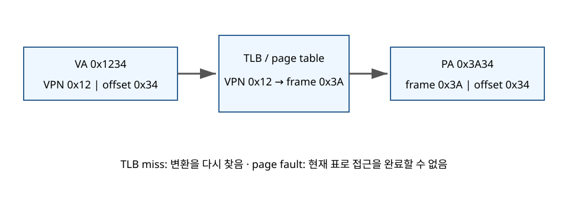

# 06. 페이징과 가상 메모리

[이 책 목차](README.md) · [이전](05-address-spaces.md) · [다음](07-allocation-and-reclaim.md)

## 이 장의 질문: 주소 숫자가 실제 byte에 닿기까지 무슨 일이 일어나는가

**paging(페이징)**은 가상 주소 공간을 고정 크기 **page(페이지)**로, 물리 메모리를 같은 크기 **page frame(페이지 프레임)**으로 나누어 연결하는 기법이다. page table은 virtual page number를 physical frame number에 연결하고 permission과 상태를 기록한다.



한 번의 load는 다음 질문을 통과한다.

1. VA에서 page 안 위치인 offset과 page 번호인 VPN을 어떻게 나누는가?
2. TLB에 최근 변환이 있는가?
3. 없으면 multi-level page table에서 어떤 entry를 순서대로 읽는가?
4. leaf PTE가 present/valid하고 현재 read/write/execute와 privilege를 허용하는가?
5. 성공하면 PFN과 offset으로 physical address를 만들고 cache/RAM을 읽는다.
6. 실패하면 kernel이 복구 가능한 fault인지 불법 접근인지 판단한다.

## 1. page, frame, VPN, PFN, PTE

- **page**: VA 공간을 page size만큼 자른 한 조각이다.
- **frame**: physical memory를 같은 크기로 자른 한 칸이다.
- **offset**: page 안에서 몇 번째 byte인지 나타낸다.
- **VPN(Virtual Page Number)**: VA의 어느 virtual page인지 나타낸다.
- **PFN(Physical Frame Number)**: RAM의 어느 frame인지 나타낸다.
- **PTE(Page Table Entry)**: VPN을 PFN에 연결하고 valid/present, read/write/execute, user/supervisor, accessed/dirty 같은 상태를 담는 항목이다.

page size가 `2^n` byte이면 아래 n bit가 offset이고 나머지가 VPN이다. translation 뒤에도 offset은 바뀌지 않는다. page 내부 byte 순서를 유지하면서 어느 frame에 놓일지만 바꾸기 때문이다.

## 2. 4KiB 주소를 binary와 hex로 완전히 나누기

4KiB는 4096byte이고 `2^12`다. 따라서 offset은 12bit, 즉 hex 세 자리다. 32bit VA `0x12345ABC`를 사용하자.

```text
VA hex     = 0x12345ABC
VA binary  = 0001 0010 0011 0100 0101 1010 1011 1100
             └────── VPN 20bit ──────┘ └ offset 12bit ┘

VPN binary = 0001 0010 0011 0100 0101 = 0x12345
offset     =                1010 1011 1100 = 0xABC
```

page table이 `VPN 0x12345 → PFN 0x5A3`이라고 하자.

```text
frame base = PFN << 12
           = 0x5A3 << 12
           = 0x5A3000

PA         = frame base | offset
           = 0x5A3000 | 0xABC
           = 0x5A3ABC
```

`|`를 쓸 수 있는 이유는 frame base의 아래 12bit가 0이고 offset은 아래 12bit 안에만 있기 때문이다. 덧셈 `PFN×4096+offset`과 같은 결과다.

VA가 page 경계를 넘는 8byte load라면 한 번의 translation으로 끝나지 않을 수 있다. 예를 들어 `0x...FFC`부터 8byte를 읽으면 앞 4byte와 다음 page 4byte가 서로 다른 mapping/permission을 거친다. 첫 page가 valid해도 다음 page가 unmapped이면 instruction이 fault할 수 있다.

## 3. 기존 16bit·256byte 모형을 손으로 계산한다

16bit VA 범위는 0부터 65535다. 256byte는 `2^8`이므로 offset 8bit, VPN 8bit다. VA `0x2B7C`는 다음처럼 나뉜다.

```text
0x2B7C = 0010 1011 | 0111 1100
         VPN 0x2B   offset 0x7C

PTE: VPN 0x2B → PFN 0x13
PA = 0x13 × 0x100 + 0x7C = 0x137C
```

physical memory가 64 frame이면 PFN에 6bit면 충분하다. offset 8bit와 합친 physical address는 이 교육 모형에서 14bit다. VA bit 수와 PA bit 수는 같아야 할 필요가 없다.

## 4. linear page table이 왜 커지는가

32bit VA, 4KiB page이면 VPN은 20bit이고 virtual page는 `2^20=1,048,576`개다. PTE가 4byte라면 process 하나의 단일 page table은 4MiB다. 64bit sparse space를 모든 possible VPN에 대해 평평한 배열로 만들면 대부분이 비어 있는데도 매우 커진다.

**multi-level page table**은 VPN bit를 여러 index로 나눠 tree처럼 탐색한다. 실제로 사용하는 VA 구간에 필요한 하위 table만 만든다. 대가는 translation 때 여러 PTE memory read가 필요하다는 것이다. TLB와 page-walk cache가 이 비용을 줄인다.

## 5. 두 단계 page table의 모든 index 계산

16bit VA와 256byte page 모형에서 VPN 8bit를 위 4bit와 아래 4bit로 나누자. 각 table에는 16 entry가 있다. VA `0x2B7C`를 다시 쓴다.

```text
VA          = 0010 1011 0111 1100
root index  = 0010 = 0x2
leaf index  = 1011 = 0xB
offset      = 0111 1100 = 0x7C
```

root page-table base가 physical `0x8000`, entry size가 4byte라고 가정한다.

```text
1. root PTE address = 0x8000 + 0x2×4 = 0x8008
2. root[2]가 leaf-table physical base 0x3000을 가리킴
3. leaf PTE address = 0x3000 + 0xB×4 = 0x302C
4. leaf[0xB]가 PFN 0x13, read permission, valid를 제공
5. frame base = 0x13×0x100 = 0x1300
6. PA = 0x1300 + 0x7C = 0x137C
```

root entry가 invalid이면 leaf table까지 가지 않고 fault다. root가 valid하지만 leaf entry가 invalid여도 fault다. table base와 entry 크기는 이 교육 모형의 값이며 실제 architecture에 그대로 적용하지 않는다.

## 6. TLB hit, TLB miss, page fault는 서로 다르다

**TLB(Translation Lookaside Buffer)**는 최근 VPN→PFN과 permission 변환을 CPU 가까이에 저장하는 cache다.

```text
TLB hit:
VA → TLB에서 PFN/permission → PA → data cache/RAM

TLB miss + valid PTE:
VA → hardware page-table walk → PTE 발견 → TLB 채움 → PA
kernel fault handler가 필요하지 않을 수 있음

TLB miss + invalid/permission failure:
VA → walk 실패 → page-fault exception → kernel 판단
```

TLB hit여도 data cache miss가 날 수 있다. TLB는 주소 변환을 cache하고 data cache는 실제 memory byte를 cache한다. 또한 instruction TLB와 data TLB가 분리된 CPU도 있고 상위 shared TLB가 있을 수 있다. 정확한 크기와 associativity는 CPU 구현마다 다르다.

## 7. RISC-V Sv39의 실제 bit 경계

RISC-V privileged architecture의 **Sv39**는 RV64에서 39bit virtual address space와 4KiB base page를 정의한다. 64bit effective address의 bit 63..39는 bit 38과 같아야 하며 그렇지 않으면 page-fault exception이 난다. 39bit는 다음처럼 나뉜다.

```text
bit 38..30 : VPN[2] 9bit
bit 29..21 : VPN[1] 9bit
bit 20..12 : VPN[0] 9bit
bit 11..0  : page offset 12bit
```

각 page table은 `2^9=512`개의 8byte PTE를 가져 정확히 4096byte, 즉 한 page다. supervisor의 `satp` register에는 translation mode, 주소 공간 식별자 ASID, root page table의 physical page number가 들어간다.

walk는 root에서 VPN[2] entry를 읽고 non-leaf면 다음 table로, VPN[1], VPN[0] 순서로 진행한다. leaf PTE의 R/W/X permission과 user 접근 조건을 확인한다. A(accessed), D(dirty) bit 처리 방식에는 architecture extension과 구현 조건이 있으므로 “모든 CPU가 hardware로 언제나 똑같이 갱신한다”고 일반화하지 않는다.

Sv39는 중간 level에서 leaf를 만나 superpage를 만들 수 있다. VPN[1] level leaf는 2MiB, VPN[2] level leaf는 1GiB mapping을 나타낼 수 있고 alignment 조건을 지켜야 한다. 이는 뒤에서 설명할 huge page의 architecture 예다.

## 8. Sv39 주소 하나의 세 단계 walk를 숫자로 끝내기

Sv39 VA를 field가 잘 보이도록 만들자. `VPN[2]=1`, `VPN[1]=2`, `VPN[0]=3`, offset `0x456`이면 VA는 다음과 같다.

```text
VA = (1 << 30) | (2 << 21) | (3 << 12) | 0x456
   = 0x40403456
```

root page table physical base를 `0x100000`, 각 PTE 크기를 8byte라고 하자.

```text
1. level 2:
   PTE address = 0x100000 + VPN[2](1) × 8
               = 0x100008
   이 non-leaf PTE가 다음 table base 0x200000을 가리킨다.

2. level 1:
   PTE address = 0x200000 + VPN[1](2) × 8
               = 0x200010
   이 non-leaf PTE가 다음 table base 0x300000을 가리킨다.

3. level 0:
   PTE address = 0x300000 + VPN[0](3) × 8
               = 0x300018
   leaf PTE가 PFN 0xABCDE와 read/write permission을 제공한다.

4. 최종 PA:
   frame base = 0xABCDE << 12 = 0xABCDE000
   PA = 0xABCDE000 + 0x456 = 0xABCDE456
```

각 PTE read 자체도 physical memory access다. table page가 CPU cache에 없으면 walk가 느려질 수 있다. 이 예시는 PTE encoding에서 PFN을 추출하고 permission을 검사하는 bit 연산을 생략했지만 index와 PTE 주소 계산은 Sv39의 9bit index, 8byte PTE 조건을 따른다.

level 1의 entry가 non-leaf가 아니라 정렬된 superpage leaf라면 level 0 table을 읽지 않고 번역이 끝날 수 있다. 이때 낮은 physical page-number 부분은 VA의 낮은 VPN field와 결합되는 architecture 규칙을 따른다. “항상 세 table을 읽는다”는 문장이 틀리는 조건이다.

## 9. page fault의 세 갈래: allocation, COW, file I/O

CPU가 page fault를 내면 kernel은 fault address, access 종류, 현재 VMA와 PTE 상태를 본다.

### demand-zero anonymous fault

```text
1. process가 mmap으로 16KiB anonymous range를 얻음
2. 첫 page에 처음 store
3. VMA는 writable이지만 PTE가 non-present
4. kernel이 zeroed frame을 확보하고 PTE를 연결
5. instruction 재시도, store 성공
```

storage read가 필요하지 않을 수 있어 보통 minor fault 계열로 관측될 수 있다.

### copy-on-write fault

```text
1. fork 뒤 parent/child가 같은 PFN을 COW 상태로 공유
2. child store가 write-protection fault
3. kernel이 새 frame을 할당하고 기존 page를 복사
4. child PTE를 writable 새 PFN으로 변경
5. store 재시도
```

mapping이 없어서 생긴 fault와 permission을 의도적으로 이용한 COW fault를 구분한다.

### file-backed fault

```text
1. mmap한 file page를 처음 load
2. page cache에 없으면 filesystem/storage read 제출
3. task가 I/O를 기다리며 blocked될 수 있음
4. data가 page cache에 도착하면 PTE 준비
5. task가 runnable→running이 된 뒤 instruction 재시도
```

file page가 이미 page cache에 있으면 storage I/O 없이 mapping만 만들어 끝날 수 있다. “major fault 수=모든 disk read 수”라고 단순 등치하면 안 된다.

## 10. valid, present, permission이라는 말의 범위

교재나 architecture마다 **valid**와 **present** bit 이름이 다르다. RISC-V PTE에는 V(valid)가 있고 Linux의 architecture-independent 설명은 present helper를 쓴다. 중요한 것은 이름 하나가 아니라 다음 상태를 구분하는 것이다.

| 상태 | 가능한 의미 | 결과 |
|---|---|---|
| 합법 VMA, 아직 frame 없음 | demand allocation 또는 file fault | kernel이 복구 가능 |
| 합법 COW, write 금지 | write 시 복사 필요 | kernel이 복구 가능 |
| present leaf, write 금지 | read-only 보호 | write는 오류 가능 |
| VMA 자체 없음 | 합법 backing 근거 없음 | SIGSEGV 같은 결과 가능 |
| kernel 전용, user 접근 | privilege 위반 | user access 거부 |

PTE가 present해도 execute 금지 page에서 instruction fetch하면 fault다. user/supervisor permission도 확인한다. kernel page-fault handler가 꺼진 특정 context나 atomic context에서는 평소 복구 가능한 user fault를 처리할 수 없을 수 있어 copy helper의 조건이 중요하다.

## 11. TLB ASID와 context switch

프로세스 A와 B가 같은 VPN을 다른 PFN에 연결한다. TLB entry를 VPN만으로 구분하면 context switch 뒤 A의 변환을 B가 잘못 사용할 수 있다. **ASID(Address Space Identifier)**는 TLB entry에 주소 공간 식별자를 붙여 여러 process의 변환을 함께 유지할 수 있게 한다. architecture와 OS가 ASID를 관리하며 식별자가 재사용될 때는 오래된 entry를 무효화해야 한다.

ASID가 없거나 사용할 수 없는 조건에서는 page-table root 변경 때 더 넓은 TLB flush가 필요할 수 있다. ASID가 있어도 permission 변경, unmap, physical page 재사용에는 해당 translation을 무효화하는 protocol이 필요하다.

## 12. TLB shootdown: 다른 CPU의 오래된 변환을 지운다

멀티코어에서 한 process의 thread가 CPU 0과 CPU 1에서 실행될 수 있다. CPU 0의 kernel이 PTE를 writable에서 unmapped로 바꿨는데 CPU 1 TLB에 오래된 writable entry가 남으면 보호가 깨진다. OS는 관련 CPU에 invalidation을 요청하고 필요한 완료를 기다리는 **TLB shootdown**을 수행한다.

```text
CPU 0: page-table lock과 규칙에 따라 PTE 변경
CPU 0: 자기 TLB의 해당 range invalidation
CPU 0: 같은 address space를 실행할 수 있는 CPU 1에 요청
CPU 1: interrupt/architecture protocol로 local TLB entry invalidation
CPU 1: 완료 응답
CPU 0: physical page를 안전하게 재사용할 수 있는 시점 진행
```

정확한 순서와 barrier는 architecture/kernel API가 정한다. RISC-V의 `SFENCE.VMA`는 local hart의 address-translation ordering과 invalidation에 쓰이며, 다른 hart에는 OS가 inter-processor mechanism으로 실행시키는 절차가 필요하다. page table memory에 store만 했다고 모든 CPU TLB가 자동 갱신된다고 가정하면 안 된다.

shootdown은 core 수와 mapping 변경 빈도가 높을 때 비용이 된다. allocator가 잦게 map/unmap하거나 garbage collector가 permission을 자주 바꾸는 workload에서 관측할 이유가 있다.

## 13. huge page와 TLB reach

**TLB reach**는 TLB가 동시에 덮을 수 있는 VA 범위다. 4KiB entry 512개면 단순 곱으로 2MiB를 덮는다. 2MiB huge page entry 512개면 1GiB를 덮을 수 있다. 실제 TLB 구조는 page size별 entry와 associativity가 달라 단순 곱이 성능 보장은 아니다.

큰 page의 장점은 TLB miss와 page-table memory를 줄일 수 있다는 것이다. 대가는 큰 연속 physical memory 확보, 내부 단편화, COW/migration/reclaim 단위 증가다. 2MiB page에서 4KiB만 실제 사용하면 최대 약 2044KiB가 그 mapping에서 유용하지 않을 수 있다.

Linux의 HugeTLB와 THP(Transparent Huge Pages)는 같은 말이 아니다. HugeTLB는 예약·전용 interface 성격이 있고 THP는 kernel이 조건에 따라 큰 page를 promotion하거나 split할 수 있는 정책이다. workload와 kernel 설정을 확인한다.

## 14. page-table walk 비용과 locality

4-level walk에서 각 PTE memory read가 모두 last-level cache miss 80ns이고 마지막 data read도 80ns라고 단순화하면 `5×80=400ns`다. 실제 CPU는 page-walk cache, parallelism, cache hierarchy를 사용하므로 예측값이 아니다. TLB가 필요한 이유를 보는 상한 모형이다.

**temporal locality**는 최근 사용한 page를 다시 쓸 가능성이고, **spatial locality**는 가까운 주소를 함께 쓸 가능성이다. sequential 배열은 한 page 안 여러 byte와 다음 page를 쓰므로 TLB/cache가 효과적이다. 매우 큰 배열을 random page 순서로 읽으면 TLB reach를 넘어 miss가 늘 수 있다.

## 15. 제공된 주소 변환 모형과 실제 MMU의 경계

[examples/address_translation.py](examples/address_translation.py)는 page size 256byte인 교육 모형에서 다음 입력을 사용한다.

- VA `0x1234`: VPN `0x12`, offset `0x34`, mapping 결과 PA `0x3A34`
- VA `0x7FFE`: VPN `0x7F`, offset `0xFE`, mapping 결과 PA `0x04FE`
- VA `0x2201`: VPN `0x22` mapping이 없어 page fault 모형

이 값은 [로컬 모형 실습](12-local-model-labs.md)과 일치한다. 코드는 정수 나눗셈과 나머지, dictionary lookup으로 원리를 재현한다. 실제 hardware TLB, multi-level page-table memory read, privilege bit, kernel fault handler, storage I/O를 실행한 결과는 아니다.

`0x7FFE → 0x04FE`는 PA가 VA보다 작을 수 있음을 보여 준다. VA와 PA의 크기 순서에는 의미가 없다. PFN mapping이 결정한다.

## 16. fault의 시간 비용을 숫자 하나로 부르면 안 되는 이유

page fault라는 이름 아래에는 전혀 다른 시간이 들어간다.

| fault 경로 | 필요한 일 | 긴 지연의 원인 |
|---|---|---|
| demand-zero | frame 확보, zeroing, PTE 갱신 | reclaim이나 zeroing 비용 |
| COW | 새 frame, 기존 4KiB 이상 복사, PTE 갱신 | memory bandwidth, allocation |
| file page-cache hit | cache page에 PTE 연결 | lock과 mapping 처리 |
| file cache miss | storage request, task sleep/wakeup | device와 filesystem queue |
| swap-in | swap storage에서 anonymous data 복귀 | storage I/O와 압박 |
| illegal access | signal 준비 또는 kernel 오류 경로 | 복구가 아니라 실패 처리 |

따라서 page-fault count가 같아도 latency는 크게 다를 수 있다. minor/major 통계는 유용하지만 application의 모든 I/O와 일대일 대응하지 않는다. fault가 난 VA, mapping 종류, page-cache/swap 상태, storage latency를 같은 시간축에서 본다.

## 17. 원인→기작→결과→코드→응용 사례

상황: database가 큰 index를 random scan할 때 CPU 사용률이 높고 처리량이 떨어졌다.

- 원인 가설: working set이 TLB reach를 넘고 random page 접근으로 TLB miss/page walk가 증가했다.
- 기작: 각 miss가 multi-level PTE read를 요구하고 page-table/data cache miss와 경쟁한다.
- 결과: 같은 application instruction 수라도 memory stall이 늘 수 있다.
- 코드/관측: page 크기, THP 상태, perf의 TLB 관련 event 지원 여부, access pattern을 확인한다.
- 응용: huge page 실험, layout 개선, batch 접근을 비교하되 NUMA placement와 memory 낭비를 함께 측정한다.

huge page를 켠 뒤 빨라지지 않았다면 가설이 틀렸거나 allocation/split/NUMA 비용이 상쇄했을 수 있다. benchmark 하나를 일반 보장으로 바꾸지 않는다.

## 18. 반례

- TLB hit여도 data cache miss는 가능하다.
- TLB miss 뒤 valid PTE를 찾으면 page fault 없이 계속할 수 있다.
- present PTE도 permission 위반이면 fault다.
- page fault가 storage I/O를 항상 요구하지 않는다.
- file fault도 page cache hit이면 disk를 기다리지 않을 수 있다.
- huge page에서는 offset과 index 경계가 달라진다.
- PTE를 바꿔도 다른 CPU TLB는 invalidation 전까지 오래된 값을 가질 수 있다.
- ASID는 flush 비용을 줄이지만 unmap과 식별자 재사용 규칙을 없애지 않는다.

## 19. 완전 해설 문제

1. 4KiB page에서 VA `0xABCDE123`의 offset과 VPN은?
   - offset은 아래 12bit인 `0x123`, VPN은 `0xABCDE`다.

2. VPN `0xABCDE`가 PFN `0x77`이면 PA는?
   - frame base `0x77000`에 offset `0x123`을 붙여 `0x77123`이다.

3. 16bit VA, 256byte page, 두 단계 4+4bit index에서 VA `0x2B7C`의 세 field는?
   - root index `0x2`, leaf index `0xB`, offset `0x7C`다.

4. TLB miss가 났지만 leaf PTE가 valid+read이고 PFN을 제공한다. page fault인가?
   - 아니다. page-table walk 뒤 TLB를 채우고 계속할 수 있다. TLB miss와 fault를 구분한다.

5. anonymous writable VMA의 첫 store가 non-present fault를 냈다. disk read가 필요한가?
   - 보통 demand-zero frame을 준비하면 되므로 필수는 아니다. reclaim 상황의 다른 I/O 가능성과 구분한다.

6. CPU 0이 PTE를 unmap했는데 CPU 1이 같은 process의 오래된 TLB entry를 갖는다. 위험은?
   - CPU 1이 stale mapping으로 접근할 수 있다. shootdown/invalidation 완료와 physical page 재사용 순서를 지켜야 한다.

7. Sv39의 base-page offset, VPN level 수, 각 index bit 수는?
   - offset 12bit, VPN은 9bit씩 세 level이다. 각 table은 512개의 8byte PTE로 4KiB다.

8. 512-entry TLB에서 4KiB와 2MiB page의 단순 reach는?
   - 각각 2MiB와 1GiB다. 실제 성능은 TLB 구조와 workload에 따라 다르다.

9. COW page에 child가 write할 때 permission fault가 났다. 불법 write인가?
   - VMA/PTE가 COW를 나타내면 kernel이 복사 후 재시도하는 정상 경로다. read-only code write와 다르다.

10. Sv39 예에서 VPN field가 1, 2, 3이고 root/L1/L0 table base가 각각 `0x100000`, `0x200000`, `0x300000`이다. 세 PTE 주소는?
   - entry가 8byte이므로 각각 `0x100008`, `0x200010`, `0x300018`이다.

## 20. 근거

- [OSTEP: Paging](https://pages.cs.wisc.edu/~remzi/OSTEP/vm-paging.pdf)
- [Linux Kernel Documentation: Page Tables](https://docs.kernel.org/mm/page_tables.html)
- [Linux Kernel Documentation: HugeTLB Pages](https://docs.kernel.org/admin-guide/mm/hugetlbpage.html)
- [RISC-V Privileged Architecture: Sv39](https://docs.riscv.org/reference/isa/priv/supervisor.html)
- [MIT xv6 page-table 자료](https://pdos.csail.mit.edu/6.S081/)
