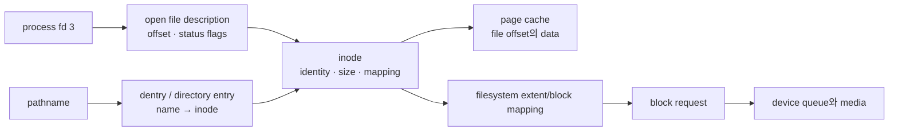

# 08. I/O·파일·VFS·파일시스템

[이 책 목차](README.md) · [이전](07-allocation-and-reclaim.md) · [다음](09-persistence-crash-recovery.md)

응용 프로그램에서 `read(fd, buf, 4096)` 한 줄을 호출해도 여러 객체를 거친다. fd는 열린 파일을 가리키는 process 안의 작은 번호이고, offset은 그 파일에서 다음에 읽거나 쓸 byte 위치다. kernel은 권한과 offset을 확인하고, RAM에 보관한 파일 내용인 page cache를 찾는다. 없다면 filesystem이 파일 위치를 storage block으로 바꾸고 장치 queue에 요청한다.

이 장에서는 이 객체가 어디에 있고 누가 소유하는지부터 시작해 buffered read/write, inode와 directory, 나중에 storage에 기록하는 writeback, crash 복구를 돕는 journal, 저장 완료를 요청하는 `fsync`까지 한 흐름으로 설명한다.

## 1. I/O는 CPU와 다른 시간축에서 움직인다

I/O(input/output)는 CPU와 memory 밖의 장치나 다른 endpoint와 데이터를 주고받는 일이다. storage read, network receive, terminal input이 모두 I/O다.

CPU instruction은 나노초 수준에서 진행될 수 있지만 storage와 network 요청은 훨씬 긴 시간 동안 queue와 장치를 거친다. CPU가 완료될 때까지 같은 상태 bit만 계속 읽으면 polling이다. polling은 completion을 빨리 발견할 수 있지만 기다리는 동안 CPU cycle을 소비한다.

interrupt는 장치가 사건을 CPU에 알리는 기작이다. task는 blocked되고 CPU는 다른 일을 하다가 completion interrupt를 처리할 수 있다. interrupt에도 진입·처리 비용이 있어 초당 수백만 completion이 오면 batching이나 polling을 섞을 수 있다. 어느 방식이 좋은지는 latency 목표, 요청률, CPU 예산과 장치 특성에 따라 다르다.

DMA(direct memory access)는 장치가 CPU의 byte별 copy instruction 없이 memory와 데이터를 전송하는 기작이다. kernel은 DMA buffer와 mapping을 준비하고 장치가 접근할 수명과 범위를 관리해야 한다. DMA가 있다고 filesystem, permission, request identity와 completion 처리가 사라지는 것은 아니다.

## 2. pathname에서 device block까지의 객체 지도

`/var/data/report.bin` 같은 pathname은 파일 자체가 아니라 namespace에서 객체를 찾기 위한 이름이다. 경로의 각 component를 directory에서 해석해 최종 파일 객체에 도달한다.

inode는 파일의 내용과 속성을 설명하는 filesystem의 identity 객체다. 이름 자체가 아니라 파일 종류, owner, permission, size, data block 위치 같은 정보를 연결한다. directory entry는 사람이 쓰는 이름을 inode identity에 연결한다. VFS(virtual filesystem)는 서로 다른 filesystem이 공통 `open`, `read`, `stat` 호출에 연결되게 하는 kernel 계층이다.

Linux와 POSIX 용어를 단순화한 지도는 다음과 같다.

| 객체 | 위치와 소유 | 담는 것 | 수명 |
|---|---|---|---|
| file descriptor(fd) | process의 fd table | 작은 정수→open file description 참조 | close 또는 exec 규칙까지 |
| open file description | kernel의 open file object | current offset, status flags, inode 참조 | 마지막 fd/reference가 사라질 때까지 |
| dentry | kernel VFS cache | 한 directory의 이름과 inode 연결 | cache와 reference 정책에 따라 |
| inode | filesystem/kernel metadata object | file identity, type, owner, mode, size, block mapping | link와 open reference, filesystem 규칙에 따라 |
| directory entry | filesystem namespace data | 이름→inode identity 연결 | create, link, unlink, rename으로 변경 |
| page cache | RAM의 file content cache | file offset 범위의 data folio/page | memory pressure와 dirty/writeback 상태에 따라 |
| superblock | mounted filesystem 설명 | filesystem 전체 속성과 operation | mount부터 unmount까지 |
| block request | block layer/driver | sector 범위, buffer, operation, completion | submission부터 완료·정리까지 |



VFS가 모든 filesystem을 같은 on-disk format으로 바꾸는 것은 아니다. ext4, XFS, tmpfs, NFS는 내부 저장과 실패 조건이 다르지만 공통 object와 operation 모형에 연결된다.

## 3. fd, open file description, inode는 서로 다르다

file descriptor는 process 안에서만 의미가 있는 작은 정수다. process P의 fd 3과 process Q의 fd 3이 같은 파일을 뜻한다는 보장은 없다.

`open`은 성공하면 새 open file description을 만들고 process fd table의 빈 번호가 그것을 가리키게 한다. open file description에는 current file offset과 `O_APPEND` 같은 file status flag가 있다. inode는 file identity와 metadata를 나타낸다. 여러 open file description이 같은 inode를 가리킬 수 있다.

`dup(3)`으로 fd 4를 만들면 fd 번호는 다르지만 같은 open file description을 가리킨다. current offset과 file status flag를 공유한다. 반면 pathname을 다시 `open`해 fd 5를 얻으면 같은 inode를 가리켜도 보통 별도 open file description과 offset을 가진다.

`fork` 뒤 자식이 물려받은 fd도 부모의 open file description을 공유할 수 있다. 두 process가 같은 offset을 움직일 수 있으므로 독립적이라고 가정하면 안 된다.

descriptor flag인 `FD_CLOEXEC`와 open file description의 status flag는 다른 층이다. `dup`으로 offset은 공유해도 close-on-exec flag의 동작은 별도다. 객체 위치를 구분해야 flag 전파를 정확히 이해할 수 있다.

## 4. 같은 inode와 offset을 숫자로 추적한다

file 내용이 `ABCDEFGH`이고 fd 3의 offset은 0이다. `dup(3)`으로 fd 4를 만들었다.

| 호출 | 읽은 byte | 공유 offset 변화 |
|---|---|---:|
| `read(3, ..., 2)` | AB | 0→2 |
| `read(4, ..., 2)` | CD | 2→4 |
| `read(3, ..., 1)` | E | 4→5 |

fd 4가 별도 offset 0에서 시작하지 않는다. fd 3과 fd 4가 같은 open file description을 공유하기 때문이다.

같은 pathname을 다시 `open`해 fd 5를 얻으면 새 offset 0을 가질 수 있다. `read(5, ..., 2)`는 AB를 읽는다.

`pread(fd, buf, 2, 6)`는 명시한 offset 6에서 GH를 읽고 shared current offset을 바꾸지 않는다. 여러 thread가 위치가 정해진 I/O를 수행할 때 유용하다. short read 가능성과 오류는 여전히 처리해야 한다.

동시 `read`의 shared offset update가 어느 범위에서 atomic한지는 OS와 API 버전의 계약을 확인해야 한다. “정수 하나니까 안전하다”거나 “항상 중복 byte를 읽는다”라고 추측하지 않는다.

## 5. pathname, directory, hard link, symbolic link

directory는 이름을 inode identity에 연결하는 namespace 자료구조다. inode 자체에 하나의 고정 pathname이 들어 있다고 생각하면 안 된다.

hard link는 같은 inode에 새 directory 이름을 하나 더 연결한다. `a`와 `b`가 같은 inode를 가리키면 `a`를 unlink해도 `b`가 남아 있는 동안 file data는 살아 있다.

symbolic link는 다른 경로 문자열을 내용으로 가진 별도 파일 객체다. 경로 해석 중 그 문자열을 따라간다. dangling symbolic link처럼 대상이 없어질 수 있다.

`unlink`는 이름 연결을 제거한다. 열린 fd가 inode를 계속 참조하면 pathname은 사라져도 그 fd로 data를 읽고 쓸 수 있다. 마지막 link와 마지막 open reference가 사라져야 filesystem이 data block을 회수할 수 있다. “파일 이름 삭제 = 즉시 모든 byte 삭제”가 아닌 이유다.

같은 pathname 문자열도 process의 current working directory, root, mount namespace, bind mount와 symbolic link 상태에 따라 다른 inode로 갈 수 있다. security-sensitive code는 path component가 검사 뒤 바뀌는 TOCTOU를 고려하고 `openat` 계열과 안전한 flag를 사용한다.

## 6. `read`의 cache hit 경로

`read(fd, user_buf, 4096)`가 page cache hit인 경우를 추적한다.

| 단계 | 주체 | 검사와 동작 |
|---:|---|---|
| 1 | user process | fd, buffer 주소, count를 syscall 인수로 전달 |
| 2 | syscall/VFS | fd table에서 open file description 참조 획득 |
| 3 | VFS/file operation | 접근 mode, current offset, file type 확인 |
| 4 | filesystem/page cache | inode와 file offset에 해당하는 cached page 탐색 |
| 5 | kernel copy 경로 | cached data를 검증된 user buffer로 복사 |
| 6 | open file description | 실제 읽은 byte만큼 current offset 갱신 |
| 7 | syscall return | byte 수, EOF의 0, 또는 오류 반환 |

page cache hit이면 block request와 device access가 없을 수 있다. 그래도 fd lookup, permission, lock, page lookup과 memory copy 비용은 있다. cached data가 RAM에 있다고 모든 CPU cache에 이미 있다는 뜻도 아니다.

EOF(end of file)에서 `read`가 0을 반환하는 것은 오류와 다르다. 요청 4096보다 적은 1000 byte를 성공적으로 읽는 short read도 가능하다. caller는 한 번의 호출이 요청 크기를 항상 채운다고 가정하면 안 된다.

## 7. cache miss read의 전체 경로

원하는 file range가 page cache에 없으면 다음 과정이 추가된다.

| 단계 | 계층 | 동작과 남는 상태 |
|---:|---|---|
| 1 | filesystem | file offset을 extent 또는 block mapping으로 변환 |
| 2 | page cache | 결과를 받을 page/folio를 준비하고 I/O 중 상태 기록 |
| 3 | block layer | read request를 만들고 merge·queue 조건을 적용 |
| 4 | driver | device command와 DMA mapping을 준비 |
| 5 | device | queue에서 command를 처리하고 storage에서 data 읽음 |
| 6 | DMA/completion | memory로 전송한 뒤 completion을 알림 |
| 7 | interrupt 또는 polling | driver가 상태와 오류를 확인 |
| 8 | page cache | page를 up-to-date로 표시하고 waiter wakeup |
| 9 | scheduler | blocked reader가 runnable, 나중에 CPU를 받음 |
| 10 | VFS | user buffer로 copy하고 offset과 반환값 갱신 |

read-ahead는 순차 접근을 예측해 아직 요청하지 않은 다음 page도 미리 읽는 정책이다. 정확히 맞으면 다음 read가 hit가 되지만 random workload에서는 쓸모없는 I/O와 cache 오염을 만들 수 있다.

mmap으로 file을 mapping하면 application은 `read` 대신 load instruction으로 접근할 수 있다. page가 없으면 page fault 경로에서 filesystem과 page cache가 data를 가져온다. syscall이 매 접근에 보이지 않아도 I/O와 fault가 사라진 것은 아니다.

## 8. buffered write와 dirty page의 수명

일반 buffered `write`는 user buffer의 byte를 page cache에 복사하고 page를 dirty로 표시한 뒤 storage 기록 전에 반환할 수 있다. dirty는 RAM의 내용이 storage 원본보다 새롭다는 상태다. writeback은 이 dirty 내용을 filesystem과 장치 경로를 통해 storage에 기록하는 과정이다.

```text
user buffer
→ page cache page 변경, Dirty
→ filesystem mapping과 metadata 갱신
→ background/direct writeback
→ block request
→ device volatile cache
→ persistent media
```

Linux VFS 문서의 일반 모형에서 dirty page/folio는 writeback 대상이 되면 dirty 상태를 정리하고 writeback 진행 상태를 표시한다. I/O가 안전하게 끝난 뒤 writeback 상태를 해제한다. 그 사이 application이 같은 page를 다시 수정하면 새 dirty 상태와 writeback 중 data를 일관되게 관리해야 한다.

4 KiB write를 초당 1,000번 받으면 application payload rate는 `4096×1000 = 4,096,000 byte/s`, 약 4.096 MB/s다. 실제 device write는 filesystem block 크기, metadata, journal, checksum, RAID, alignment와 device 내부 write amplification 때문에 더 클 수 있다.

dirty page가 너무 많이 쌓이면 writeback task만 일하는 것이 아니라 새 write를 하는 application이 throttle되거나 직접 writeback latency를 겪을 수 있다. write syscall latency가 평소 짧다가 memory pressure에서 길어지는 이유 중 하나다.

## 9. delayed allocation, extent, sparse file

filesystem은 file offset을 storage block에 mapping해야 한다.

extent는 연속 block 범위를 시작 위치와 길이로 표현한다. block 번호를 하나씩 저장하는 것보다 metadata를 줄이고 순차 I/O에 유리할 수 있다. file 성장과 free-space fragmentation 때문에 항상 큰 extent를 얻는 것은 아니다.

delayed allocation은 buffered write 시점에 실제 block을 즉시 고르지 않고 writeback에 가까운 시점까지 미룬다. 여러 write를 모아 더 좋은 extent를 선택할 수 있지만 ENOSPC 같은 공간 부족 오류가 write보다 늦은 `fsync`나 writeback에서 나타날 수 있다.

sparse file은 file size 안의 일부 구간에 실제 data block을 배정하지 않은 hole을 허용한다. hole을 읽으면 보통 zero가 보이지만 storage block을 소비하지 않을 수 있다. `stat`의 logical size와 실제 allocated blocks가 다른 이유다.

preallocation은 미래 write를 위한 block 범위를 미리 확보해 fragmentation과 늦은 ENOSPC를 줄일 수 있다. 예약이 실제 initialized data와 같은지, crash 뒤 size와 보장이 무엇인지는 API와 filesystem을 확인한다.

## 10. direct I/O는 보편적인 고속 버튼이 아니다

direct I/O는 page cache를 우회하거나 그 영향을 줄이는 경로를 제공한다. 그러나 다음 조건과 비용이 있다.

- buffer 주소, offset, length alignment 제약이 있을 수 있다.
- 작은 unaligned request는 실패하거나 별도 처리가 필요하다.
- application이 caching과 batching을 직접 설계해야 한다.
- 같은 file에 buffered I/O와 direct I/O를 섞으면 coherency 규칙을 확인해야 한다.
- storage queue와 DMA mapping 비용은 남는다.
- page cache hit가 유리한 반복 read에서는 오히려 느릴 수 있다.

“copy가 하나 줄었다”와 end-to-end latency가 항상 줄어든다는 말은 다르다. database처럼 자체 buffer cache와 I/O scheduling을 가진 application에는 유리할 수 있지만 workload로 측정해야 한다.

비동기 I/O나 io_uring은 여러 request를 제출하고 completion을 나중에 받게 해 syscall과 queue 처리 방식을 개선할 수 있다. 이것도 `fsync` 없이 durability를 자동 보장하거나, filesystem lock·device tail latency를 제거하지 않는다.

## 11. journal은 무엇을 보호하는가

metadata는 파일 내용 자체를 설명하는 이름, owner, permission, size, block 위치 같은 관리 정보다. filesystem metadata 여러 곳을 갱신하다 crash가 나면 inode는 새 block을 가리키는데 free-space bitmap은 그 block을 free라고 표시하는 식의 불일치가 생길 수 있다.

journal은 여러 metadata 변경을 하나의 작업으로 묶어 먼저 기록하는 filesystem 내부의 복구용 log 영역이다. journaling filesystem은 중요한 변경 의도를 journal에 기록하고 commit 규칙을 사용해 crash 뒤 어느 변경 묶음이 완료되었는지 판정한다.

단순화한 metadata transaction은 다음과 같다.

1. inode, directory entry, allocation bitmap 변경을 transaction으로 묶는다.
2. journal에 변경 record를 기록한다.
3. journal commit이 durable하다는 조건을 만족한다.
4. 변경을 home location에 checkpoint한다.
5. crash 뒤 committed transaction은 replay하고 미완료 record는 버린다.

journal이 모든 user data를 항상 두 번 기록한다는 뜻은 아니다. metadata만 journal하는 mode, data ordering을 보장하는 mode, data까지 journal하는 mode가 있을 수 있다. filesystem과 mount option에 따라 의미가 다르다.

journal consistency와 application transaction atomicity도 다르다. filesystem metadata가 mount 가능한 상태로 복구되어도 두 application file을 함께 갱신한 business invariant가 유지된다는 보장은 없다. database WAL이나 application-level protocol이 필요할 수 있다.

## 12. `write`, `fsync`, rename의 보장을 나눈다

세 가지 질문을 구분한다.

- visibility: 다른 reader가 새 이름이나 새 byte를 언제 보는가?
- atomicity: 중간 상태 없이 old 또는 new 중 하나로 보이는가?
- durability: crash와 reboot 뒤에도 결과가 남는가?

같은 filesystem 안에서 기존 `newpath`를 `rename`으로 교체하면 namespace 관점에서 이름이 사라진 중간 순간 없이 atomic replacement를 제공할 수 있다. open fd는 rename 전 inode를 계속 가리킬 수 있다. 그러나 atomic visibility가 곧 crash durability는 아니다.

`fsync`는 application이 “이 file의 변경을 crash 뒤에도 복구할 수 있는 저장 단계까지 보내고 결과를 알려 달라”고 요청하는 system call이다. Linux `fsync(file_fd)`는 file의 dirty data와 필요한 metadata를 backing storage로 flush하고 device completion을 기다리는 interface다. 하지만 file이 새로 만들어졌거나 이름이 바뀌었다면 그 directory entry의 persistence는 directory fd에 대한 별도 `fsync`가 필요할 수 있다고 man page가 설명한다.

안전한 파일 교체의 일반 패턴을 보자.

1. 대상과 같은 filesystem·directory에 temporary file을 만든다.
2. short write와 interrupt를 처리하며 전체 내용을 쓴다.
3. temporary file에 `fsync`하고 오류를 확인한다.
4. temporary file을 target 이름으로 `rename`한다.
5. parent directory fd에 `fsync`하고 오류를 확인한다.
6. 더 이상 필요 없는 fd를 닫고 모든 오류 경로에서 temp 수명을 정리한다.

```text
old target visible
→ temp에 new data 작성
→ fsync(temp)
→ rename(temp, target): namespace에서 new target 보임
→ fsync(parent directory): 이름 변경 durability 요청
```

이 패턴도 모든 storage stack의 거짓 flush, filesystem bug, remote filesystem 의미까지 이겨 내는 수학적 보장은 아니다. 같은 filesystem rename 조건, directory 권한, symlink 공격, device write cache와 filesystem 문서를 확인해야 한다. 두 directory 사이 rename이면 관련 directory durability를 더 검토한다.

## 13. open fd와 unlink·rename의 시간 관계

process P가 `config`를 열어 fd 3을 얻었다. process Q가 새 파일을 `config` 이름으로 rename 교체했다.

- 새로 `open("config")`한 process는 새 inode를 볼 수 있다.
- P의 기존 fd 3은 이전 open file description과 이전 inode를 계속 가리킬 수 있다.
- old inode의 link가 0이어도 P의 reference가 남아 있으면 data block을 즉시 회수하지 않는다.
- P가 close해 마지막 reference가 사라지면 회수 가능해진다.

이 성질은 log rotation과 atomic config update에 유용하지만, “path를 다시 읽은 값”과 “이미 열린 fd의 값”이 다를 수 있음을 뜻한다.

## 14. queueing과 latency를 분해한다

I/O 요청 latency를 교육적으로 분해하면 다음과 같다.

```text
application 관측 latency
= syscall 진입 전 user/runtime 대기
+ fd/VFS/filesystem 처리
+ memory allocation·lock 대기
+ block/device queue 대기
+ device service
+ completion 처리
+ wakeup 뒤 CPU scheduling 대기
+ user copy와 반환 처리
```

일부 단계는 겹치므로 단순 합은 분석 모형이다. 비동기 요청은 application이 다른 일을 해 wall-clock wait를 숨길 수 있지만 request 자체 queue time과 service time이 없어지는 것은 아니다.

Little's Law의 안정 상태 교육 모형에서 평균 outstanding request 수 `L`, 처리율 `λ`, 평균 체류 시간 `W`는 `L=λW` 관계를 가진다. 처리율 10,000 IOPS에서 평균 체류 2 ms면 평균 outstanding은 `10,000×0.002=20`이다. queue depth를 늘리면 device utilization과 throughput이 오를 수 있지만 대기와 tail latency도 커질 수 있다.

평균 device service 100 µs라고 application p99도 100 µs인 것은 아니다. queue, filesystem lock, writeback, scheduler delay와 rare error recovery가 tail을 만든다.

## 15. 오류는 제출 시점과 완료 시점이 다를 수 있다

short read/write는 요청보다 적은 byte를 성공적으로 처리한 결과일 수 있다. caller는 반환값만큼 pointer와 남은 count를 갱신해 반복해야 한다. signal interruption, nonblocking mode, EOF, 공간 부족과 quota 오류를 구분한다.

buffered write가 page cache 복사 뒤 성공했지만 나중 device writeback에서 EIO가 날 수 있다. Linux VFS는 writeback error를 open file description의 error cursor와 연관해 이후 `fsync` 등에 보고하는 infrastructure를 설명한다. 여러 writer가 같은 mapping을 사용하면 정확히 어느 write가 실패했는지 file descriptor 하나로 완벽히 귀속하지 못할 수 있다.

`close` 반환값만 무시하지 말아야 하지만, close 재시도를 단순히 반복하면 fd 번호 재사용 때문에 다른 file을 닫을 위험이 있는 API도 있다. durability가 필요하면 close 전에 명시적 `fsync` 결과를 확인하는 패턴을 사용한다.

device completion도 최종 application 성공과 같지 않다. 한 block request가 성공해도 journal commit이나 상위 transaction의 다른 request가 실패할 수 있다.

## 16. 관측 명령과 해석 경계

다음은 Linux에서 객체와 I/O 통계를 읽는 예다. 권한과 도구 설치는 환경에 따라 다르다.

```bash
ls -li -- /path/to/file
stat -- /path/to/file
cat /proc/SELF_PID/fdinfo/FD_NUMBER
cat /proc/diskstats
```

inode 번호가 같으면 같은 filesystem 안에서 hard link 관계를 추정하는 데 도움을 주지만 mount와 inode 재사용, snapshot을 고려해야 한다. `fdinfo`의 offset은 읽는 순간값이며 다른 thread가 즉시 바꿀 수 있다.

`iostat`, block trace, eBPF tracing과 filesystem tracepoint는 queue와 latency를 더 자세히 볼 수 있지만 관측 overhead와 kernel-version field 차이가 있다. application latency, page-cache hit/miss, filesystem wait, block queue, device latency를 같은 시각축으로 맞춰야 한다.

`drop_caches` 같은 쓰기 동작은 production 상태를 바꾸므로 단순 관측 명령이 아니다. benchmark를 “cold cache”로 만들기 위해 system 전체 cache를 버리면 다른 workload까지 교란한다. 별도 실험 환경을 사용한다.

## 17. 자주 틀리는 결론

- fd 3은 모든 process에서 같은 file이 아니다.
- inode는 filename 하나와 같은 객체가 아니다.
- `dup`으로 만든 fd는 번호가 달라도 offset을 공유할 수 있다.
- page-cache hit에는 storage I/O가 없을 수 있지만 비용이 0은 아니다.
- buffered `write` 성공은 곧 persistent media 기록 완료가 아니다.
- rename의 atomic visibility와 crash durability는 다르다.
- file `fsync`만으로 새 directory entry가 반드시 durable하다고 일반화할 수 없다.
- journal이 application의 여러 file transaction을 자동 보장하지 않는다.
- direct I/O가 모든 workload에서 빠른 것은 아니다.
- device completion 하나가 상위 request 전체 성공을 뜻하지 않는다.

## 18. 확인 문제와 자세한 해설

### 문제 1. fd와 inode

P와 Q가 각각 fd 3을 가지고 있다. 반드시 같은 inode인가?

**해설:** 아니다. fd는 process별 table index다. 각 fd table entry가 어느 open file description을 가리키고, 그것이 어느 inode를 참조하는지 따라가야 한다. 숫자 3만 같다는 사실에는 전역 identity 의미가 없다.

### 문제 2. `dup` offset

`ABCDEFGH` 파일에서 fd 3 offset=0이고 fd 4=`dup(3)`다. fd3으로 2 byte, fd4로 2 byte를 읽으면 결과는?

**해설:** 첫 read는 AB이고 shared offset은 2가 된다. 둘째는 CD이고 offset은 4가 된다. 별도 `open`으로 얻은 fd라면 offset 0에서 시작할 수 있다. `pread`는 명시 offset을 사용하고 current offset을 바꾸지 않는다.

### 문제 3. page-cache hit와 miss

두 번째 `read`가 같은 file range를 읽을 때 항상 device command를 제출하는가?

**해설:** 아니다. page cache에 유효한 data가 남아 있으면 memory에서 copy해 끝날 수 있다. memory pressure로 page가 evict되었거나 direct I/O, coherency 조건이 다르면 device 경로를 탈 수 있다. application 호출만 보고 miss를 확정하지 않는다.

### 문제 4. short write

4096 byte `write`가 1000을 반환했다. 성공했으니 나머지 3096도 기록되었다고 보아도 되는가?

**해설:** 안 된다. 반환값은 처리된 byte 수다. caller는 buffer pointer를 1000만큼 옮기고 남은 3096을 조건에 맞게 다시 써야 한다. 오류와 EINTR, nonblocking 동작도 처리해야 한다.

### 문제 5. unlink 뒤 열린 fd

file의 마지막 pathname을 unlink했지만 process가 fd를 열고 있다. data block은 즉시 재사용되는가?

**해설:** 일반적으로 마지막 open reference가 남아 있으면 inode와 data를 유지한다. pathname lookup으로 새로 열 수는 없어도 기존 fd는 계속 접근할 수 있다. 마지막 link와 reference가 사라진 뒤 회수 가능하다.

### 문제 6. safe replace

새 config를 temp에 쓰고 target으로 rename했다. crash durability를 강화하려면 어떤 순서가 필요한가?

**해설:** 같은 directory·filesystem의 temp에 전체 write를 완료하고 temp를 `fsync`한다. rename으로 target을 교체한 뒤 parent directory도 `fsync`한다. 각 호출 오류를 확인한다. filesystem·storage stack의 구체 보장은 문서로 검증해야 하며 atomic rename만으로 durability를 대신할 수 없다.

### 문제 7. journal과 business transaction

journaled filesystem에서 account-A 파일과 account-B 파일을 각각 write했다. 두 잔액 합계가 crash 뒤 반드시 보존되는가?

**해설:** 아니다. journal은 filesystem metadata와 설정에 따른 data ordering·recovery를 제공하지만 application의 두 file 변경을 하나의 business transaction으로 알지 못할 수 있다. WAL, database transaction 또는 명시적 commit protocol이 필요하다.

### 문제 8. queue depth 계산

처리율 20,000 IOPS, 평균 I/O 체류 1.5 ms인 안정 상태에서 Little's Law로 평균 outstanding을 계산하라.

**해설:** `L=λW=20,000×0.0015=30`이다. 평균 관계이며 p99 queue depth나 burst를 보장하지 않는다. concurrency를 30으로 맞추면 항상 최적이라는 뜻도 아니다.

### 문제 9. 늦은 writeback 오류

buffered write가 성공했는데 `fsync`가 EIO를 반환했다. 모순인가?

**해설:** 아니다. write는 page cache에 byte를 받아들인 뒤 반환했을 수 있고 실제 device write는 나중에 실패할 수 있다. durability가 필요한 application은 `fsync` 결과를 transaction 성공 조건에 포함하고 복구·재시도 정책을 가져야 한다.

## 19. 전체 경로를 진단하는 순서

I/O가 느리거나 데이터가 사라졌다고 보고되면 다음을 순서대로 묻는다.

1. pathname, fd, open file description, inode 중 어느 identity를 추적하는가?
2. buffered, mmap, direct, async 중 어떤 I/O 경로인가?
3. page-cache hit인가 miss인가?
4. filesystem lock, allocation, journal commit, writeback 중 어디서 기다리는가?
5. block queue time과 device service time은 각각 얼마인가?
6. completion 뒤 task가 CPU를 받기까지 scheduling delay가 있는가?
7. application이 요구한 것은 visibility, atomicity, durability 중 무엇인가?
8. `fsync` 대상에 file과 directory가 적절히 포함되었는가?
9. 오류가 최초 write가 아니라 늦은 sync에서 전달될 수 있는가?

이 객체와 시점을 분리하면 “디스크가 느리다”는 한 문장을 실제 확인 가능한 가설로 바꿀 수 있다.

## 근거와 더 읽을 자료

- [OSTEP: File Systems](https://pages.cs.wisc.edu/~remzi/OSTEP/)
- [MIT 6.S081: xv6 File System](https://pdos.csail.mit.edu/6.S081/)
- [Linux kernel 문서: Virtual File System](https://docs.kernel.org/filesystems/vfs.html)
- [Linux kernel 문서: Explicit Volatile Write Back Cache Control](https://docs.kernel.org/block/writeback_cache_control.html)
- [Linux man-pages: open(2)](https://man7.org/linux/man-pages/man2/open.2.html)
- [Linux man-pages: pread(2), pwrite(2)](https://man7.org/linux/man-pages/man2/pread.2.html)
- [Linux man-pages: fsync(2)](https://man7.org/linux/man-pages/man2/fsync.2.html)
- [Linux man-pages: rename(2)](https://man7.org/linux/man-pages/man2/rename.2.html)

---

[이전 장: 메모리 할당·회수·swap·OOM](07-allocation-and-reclaim.md) · [다음 장: 영속성과 crash recovery](09-persistence-crash-recovery.md)
