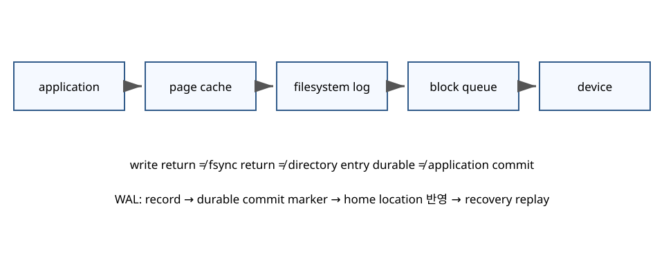
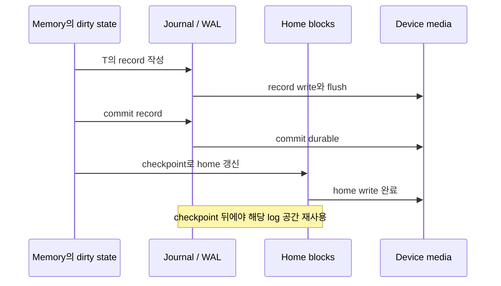

# 09. 지속성·크래시 복구·WAL

[이 책 목차](README.md) · [이전](08-io-files-filesystems.md) · [다음](10-protection-and-virtualization.md)

persistence(지속성)는 전원이 끊기거나 process와 kernel이 다시 시작된 뒤에도 필요한 상태를 복원할 수 있는 성질이다. `write`가 성공했다는 사실, 다른 process가 새 값을 보았다는 사실, storage media에 값이 남았다는 사실은 서로 다른 사건이다. 이 장에서는 한 byte가 user buffer에서 page cache, filesystem journal, device cache와 persistent media로 이동하는 순서를 추적하고, crash가 각 단계에서 나면 무엇을 복구할 수 있는지 계산한다.



## 1. 먼저 crash의 종류와 보호 범위를 정한다

crash는 정상적인 종료 절차를 끝내지 못하고 실행이 중단되는 사건을 넓게 부른다. 원인과 손실 범위가 다르다.

| 사건 | 잃을 수 있는 상태 | 계속 살아 있는 계층 | 필요한 복구 질문 |
|---|---|---|---|
| application process crash | register, heap의 volatile 상태 | kernel, page cache, storage | 열린 transaction을 어떻게 취소하는가 |
| kernel panic/reboot | 모든 process와 kernel RAM | device cache와 media 일부 | on-disk 구조가 일관적인가 |
| 갑작스러운 전원 상실 | CPU·RAM·volatile device cache | 비휘발성 media | flush 완료라고 믿은 data가 남았는가 |
| drive failure | 해당 장치의 일부 또는 전체 data | replica, backup 가능 | 다른 copy에서 복원 가능한가 |
| site failure | host와 local storage 전체 | 다른 장소의 replica/backup | failure domain이 분리됐는가 |

volatile은 전원 공급이 끊기면 보존을 기대할 수 없는 상태다. persistent media는 SSD NAND나 HDD platter처럼 전원 뒤에도 data를 보존하도록 설계된 저장 영역이다. 그러나 controller가 “완료”라고 보고한 의미와 실제 media 기록 여부는 cache mode, flush 명령, power-loss protection에 달려 있다.

crash consistency는 비정상 중단 뒤 저장 구조가 미리 정의한 허용 상태 중 하나로 복구되는 성질이다. 최신 값이 무조건 남는다는 뜻은 아니다. “transaction 전 상태 또는 transaction 후 상태 중 하나이며, 서로 모순된 중간 상태는 없다”처럼 허용 집합을 먼저 정의한다.

## 2. `write` 한 번의 완료 단계를 나눈다

application이 4 KiB를 buffered `write`한다고 하자. [앞 장](08-io-files-filesystems.md)에서 본 객체를 persistence 관점으로 다시 추적한다.

| 단계 | byte가 있는 곳 | application이 말할 수 있는 것 |
|---:|---|---|
| 0 | user buffer | 아직 kernel이 받지 않음 |
| 1 | kernel page cache, dirty | `write`가 받은 byte 수를 반환할 수 있음 |
| 2 | filesystem이 block과 metadata를 준비 | 어느 on-disk 위치에 쓸지 정해짐 |
| 3 | block request가 device queue에 제출 | 요청이 장치 경로에 들어감 |
| 4 | device volatile write cache | 장치가 command 완료를 보고할 수 있는 설정도 있음 |
| 5 | persistent media | 전원 뒤 복구 가능한 물리 기록에 도달 |
| 6 | 관련 metadata와 ordering까지 완료 | file을 다시 찾고 올바른 길이로 읽을 수 있음 |

page cache는 file 내용을 RAM에 보관하는 kernel cache다. dirty page는 RAM 내용이 storage 원본보다 새롭다는 뜻이다. writeback은 dirty page를 filesystem과 driver를 거쳐 storage로 보내는 과정이다.

`write` 반환은 보통 1단계까지의 성공일 수 있다. writeback completion은 장치가 해당 request를 완료했다고 보고한 사건이지만, volatile cache 설정과 flush 계약을 확인해야 한다. `fsync(file_fd)`는 file의 dirty data와 필요한 metadata를 안정된 저장장치로 보내고 완료를 기다리는 Linux interface다. 새 이름이나 rename된 이름이 directory에 남아야 한다면 directory fd도 별도로 `fsync`해야 할 수 있다.

“storage에 썼다”라는 문장에는 어느 단계인지 반드시 붙여야 한다.

## 3. 여러 block을 한 번에 바꿀 때 생기는 모순

filesystem이 file을 늘리려면 적어도 다음 상태가 함께 바뀔 수 있다.

- inode의 file size
- file offset에서 data block으로 가는 mapping
- free-space bitmap에서 새 block을 사용 중으로 표시
- 실제 data block 내용
- directory의 이름과 inode 연결

metadata는 file 내용을 설명하는 size, owner, block 위치와 free-space 상태 같은 관리 정보다. 이 값들이 서로 다른 storage block에 있다면 한 hardware write로 모두 바꿀 수 없다.

예를 들어 inode는 새 block 50을 가리키는데 bitmap은 50을 free라고 말하면 allocator가 같은 block을 다른 file에도 줄 수 있다. 반대로 bitmap은 used인데 어느 inode도 가리키지 않으면 공간이 누출된다. crash가 두 write 사이에 오면 이런 중간 상태가 생긴다.

atomicity는 여러 변경이 전부 적용되거나 전부 적용되지 않은 것처럼 보이는 성질이다. durability는 commit됐다고 응답한 결과가 crash 뒤에도 남는 성질이다. 둘은 함께 필요할 수 있지만 같은 단어가 아니다.

## 4. journal과 WAL을 등장 순서대로 이해한다

log는 원래 data가 있는 home location과 별도로, 변경 사실이나 복구 정보를 순서대로 덧붙이는 저장 영역이다. filesystem에서는 흔히 journal이라고 부르고 database에서는 WAL(write-ahead log)이라고 부른다.

write-ahead의 핵심은 “data page를 home location에 먼저 써 버린 뒤 log를 쓰는 것”을 금지하는 순서다. 복구에 필요한 log record가 durable해지기 전에 해당 변경이 home에 나타나면 crash 뒤 되돌리거나 완성할 증거가 없을 수 있다.

generic WAL 규칙을 두 가지로 나눌 수 있다.

1. 변경된 data page를 persistent home에 쓰기 전에 그 변경을 설명하는 WAL record를 먼저 durable하게 한다.
2. transaction commit 성공을 application에 알리기 전에 commit에 필요한 WAL record와 commit record를 durable하게 한다.

WAL record는 transaction ID, 어느 object의 어떤 부분이 어떻게 바뀌었는지, record 길이와 checksum, log 안의 순서 번호 같은 정보를 담을 수 있다. 정확한 필드는 시스템마다 다르다.

LSN(log sequence number)은 log record의 순서를 식별하는 증가 위치 또는 번호다. data page에도 “어느 LSN까지 반영했는가”를 기록하면 recovery가 같은 record를 다시 적용해야 하는지 판단하는 데 도움이 된다.

## 5. journal transaction의 전체 시간선

filesystem metadata transaction T가 inode, bitmap, directory entry를 바꾼다고 하자.



단계를 더 자세히 적으면 다음과 같다.

1. kernel이나 database가 memory 안에서 transaction T의 변경 집합을 만든다.
2. T를 복구할 journal/WAL record와 길이·checksum을 log buffer에 쓴다.
3. log buffer를 storage에 제출한다.
4. 필요한 ordering과 flush를 통해 record가 durable함을 확보한다.
5. commit record를 쓰고 durable하게 한다.
6. 이 시점 뒤 protocol이 허용하면 caller에게 commit 성공을 알린다.
7. dirty home page를 원래 data 위치에 쓴다.
8. checkpoint가 해당 범위의 home 반영을 확인한다.
9. recovery에 더 이상 필요 없는 옛 log 공간을 재사용한다.

commit record가 durable하기 전에는 recovery가 T를 미완료로 분류할 수 있다. commit 뒤 home page가 절반만 반영되어도 log로 나머지를 redo할 수 있다. checkpoint 전에 log를 덮어쓰면 home이 아직 옛값인데 복구 기록도 없어지는 위험이 있다.

## 6. crash 지점별로 상태를 판정한다

| crash 지점 | log 상태 | home 상태 | recovery 판단 |
|---|---|---|---|
| record 중간 | 길이·checksum 불완전 | old | incomplete tail을 무시 |
| record 완료, commit 전 | T record 있음 | old 또는 일부 정책상 미반영 | uncommitted T를 적용하지 않거나 undo |
| commit durable 직후 | T committed | old | redo로 new 상태 완성 |
| home 일부 반영 | T committed | old/new 혼합 | redo로 모든 home을 new로 맞춤 |
| checkpoint 완료 | T committed, home new | new | T 이전 log 재사용 가능 |
| checkpoint 표시는 썼지만 home이 durable하지 않음 | 필요한 log를 지울 위험 | old/new 혼합 | 잘못된 ordering이면 복구 불능 가능 |

마지막 행 때문에 checkpoint도 단순한 timestamp가 아니다. “어느 시점 이전 변경이 recovery 없이도 home에서 안전한가”를 나타내는 protocol 경계다. home write, device flush와 checkpoint record의 순서를 맞춰야 한다.

torn write는 sector나 page 전체를 한 번에 바꾼다고 기대했지만 일부 byte만 새값으로 남은 상태다. checksum, record length, duplicated metadata, full-page image 같은 기법이 손상을 탐지하거나 복구하는 데 쓰일 수 있다. 어느 크기의 write가 atomic한지는 device와 stack 계약 없이는 가정하지 않는다.

## 7. 은행 이체를 WAL로 복구한다

account A=100, B=20이고 T가 A에서 B로 10을 이체한다. 불변조건은 A+B=120이며 결과는 둘 다 old이거나 둘 다 new여야 한다.

home block을 바로 쓸 때 가능한 상태는 다음과 같다.

| crash 시점 | A | B | 합계 | 판정 |
|---|---:|---:|---:|---|
| 변경 전 | 100 | 20 | 120 | old 상태, 허용 |
| A만 write | 90 | 20 | 110 | 돈 10 소실, 금지 |
| B만 먼저 write | 100 | 30 | 130 | 돈 10 생성, 금지 |
| 둘 다 write | 90 | 30 | 120 | new 상태, 허용 |

WAL record에 transaction T, `A:100→90`, `B:20→30`을 하나의 commit 단위로 기록한다.

| 단계 | WAL | A home | B home | caller에게 commit 응답 |
|---:|---|---:|---:|---|
| 0 | 없음 | 100 | 20 | 아니오 |
| 1 | T record 작성 중 | 100 | 20 | 아니오 |
| 2 | T record durable, commit 없음 | 100 | 20 | 아니오 |
| 3 | commit record durable | 100 | 20 | 가능 |
| 4 | A home 반영 | 90 | 20 | 이미 응답했을 수 있음 |
| 5 | B home 반영 | 90 | 30 | 완료 |
| 6 | checkpoint가 T 반영 확인 | 90 | 30 | log 재사용 가능 |

2단계 crash면 T를 미완료로 보고 old 상태를 유지한다. 3단계 이후 crash면 recovery가 committed T를 redo해 A=90, B=30을 만든다.

redo가 단순히 “B에 10을 더한다”면 두 번 replay할 때 B=40이 될 수 있다. page LSN을 비교하거나 목표 after-image를 기록해 이미 반영된 record를 건너뛰는 등 idempotence가 필요하다. idempotent는 같은 복구 작업을 여러 번 수행해도 최종 결과가 한 번 수행한 것과 같은 성질이다.

filesystem journal은 inode와 block allocation의 일관성을 알지만 “A+B=120”이라는 business 의미를 자동으로 알지 못한다. 두 account가 서로 다른 file이면 application 또는 database transaction이 상위 WAL과 commit 규칙을 제공해야 한다.

## 8. redo, undo와 steal/no-steal의 관계

redo는 committed 변경이 home에 빠졌을 때 다시 적용하는 복구다. undo는 commit하지 않은 변경이 home에 나타났을 때 이전 값으로 되돌리는 복구다.

buffer manager가 commit 전 dirty page를 storage home에 내보낼 수 있으면 steal 정책이라고 부른다. memory 압박에서 유연하지만 uncommitted 변경이 home에 나타날 수 있어 undo 정보가 필요하다.

no-steal은 uncommitted page를 home에 쓰지 않도록 한다. undo 부담은 줄지만 긴 transaction의 dirty page를 memory에 유지해야 해 buffer 압박이 커질 수 있다.

commit 순간 모든 data page를 home에 쓰지 않아도 되는 정책을 no-force라고 부른다. commit은 WAL만 durable하게 하고 home은 나중에 쓸 수 있어 빠르지만 crash 뒤 redo가 필요하다. force는 commit 때 관련 data page를 home에 밀어 durability를 확보하려 하며 random write와 latency가 커질 수 있다.

이 용어는 database buffer 관리 모형이다. 특정 filesystem journal mode와 이름만으로 일대일 대응시키지 않는다.

## 9. checkpoint는 log를 없애는 작업이 아니다

checkpoint는 recovery가 처음부터 모든 log를 재생하지 않도록, 어느 범위까지 home state가 안전한지 경계를 만드는 과정이다.

단순 정지형 checkpoint는 새 변경을 멈추고 모든 dirty page를 write한 뒤 checkpoint를 기록할 수 있다. 이해는 쉽지만 큰 시스템에서 긴 pause를 만든다.

fuzzy checkpoint는 transaction과 write가 계속되는 동안 dirty page를 점진적으로 내보낸다. 시작·종료 record와 page LSN을 이용해 recovery 시작점을 정한다. checkpoint가 끝났다는 말이 그 순간 모든 buffer가 완전히 clean하다는 뜻은 시스템마다 다르다.

checkpoint 간격이 짧으면 recovery log 양은 줄지만 write burst와 I/O 간섭이 늘 수 있다. 길면 정상 처리량은 좋아질 수 있으나 crash recovery 시간이 길고 log 공간이 커진다. 목표 recovery time과 storage bandwidth를 함께 정한다.

## 10. `fsync`, file과 directory, rename protocol

기존 `config`를 새 내용으로 안전하게 교체하는 Linux local filesystem의 일반 패턴을 추적한다.

1. target과 같은 directory·filesystem에 임시 파일 `.config.tmp`를 만든다.
2. short write를 처리하며 전체 내용을 쓴다.
3. 임시 파일 fd에 `fsync`를 호출하고 오류를 확인한다.
4. `rename(".config.tmp", "config")`로 이름을 교체한다.
5. parent directory fd에 `fsync`하고 오류를 확인한다.
6. 성공 상태를 application log에 기록하고 fd를 닫는다.

```text
old config visible
→ temp inode와 data 생성
→ fsync(temp): temp data/필요 metadata durability
→ rename: namespace에서 config가 new inode를 가리킴
→ fsync(parent directory): 이름 변경 durability
```

temp `fsync` 없이 rename부터 하면 crash 뒤 새 이름은 있는데 data가 없거나 옛값일 위험을 filesystem 계약에 따라 만들 수 있다. directory `fsync`를 빼면 file data는 durable해도 이름 교체가 crash 뒤 남지 않을 수 있다.

rename의 atomicity는 다른 reader가 이름이 없는 중간 상태를 보지 않게 하는 namespace 가시성이고, durability는 reboot 뒤 새 연결이 남는 성질이다. 같은 filesystem인지, 원격 filesystem인지, 두 directory 사이 이동인지, mount option과 storage cache가 무엇인지에 따라 정확한 보장을 확인해야 한다.

이 sequence는 직접 실행한 검증 결과가 아니라 Linux man page와 일반적인 crash-safe update pattern을 설명하는 모형이다. 실제 application은 fault injection으로 대상 filesystem과 kernel version에서 시험해야 한다.

## 11. device cache, flush, FUA와 거짓 완료

SSD나 controller는 성능을 위해 write를 volatile cache에 받은 뒤 media 기록 전에 완료를 보고할 수 있다. filesystem이 ordering을 지키려면 “이전 write를 non-volatile 상태까지 밀어라”라는 flush나, 특정 write 자체가 stable storage에 도달해야 완료하도록 하는 FUA(force unit access) 성격의 명령을 사용할 수 있다.

power-loss protection이 있는 device cache는 capacitor 등으로 정전 뒤에도 pending data를 media에 기록할 수 있다. 그러나 제품·firmware와 설정이 보장하는 범위를 확인해야 한다.

virtual machine에서는 guest filesystem flush가 virtual device, host hypervisor, host filesystem, physical device까지 전달되어야 한다. 어느 층이 flush를 무시하거나 write ordering을 바꾸면 guest가 올바르게 동작해도 실제 durability가 깨질 수 있다.

RAID controller, network storage와 cloud volume의 ACK도 같은 의미가 아니다. local controller memory 도착, quorum replica memory 도착, 한 replica media 기록, 여러 failure domain의 durable 기록을 구분한다.

## 12. group commit의 처리량과 지연 계산

storage flush 한 번이 500 µs이고 transaction마다 직렬로 한 번씩 flush한다고 단순화하자. 초당 가능한 flush 상한은 `1 / 0.0005 = 2,000`회다. transaction 하나당 flush 하나면 단순 transaction 상한도 2,000/s다.

WAL record 10개를 한 flush에 묶으면 한 batch가 10 transaction을 commit할 수 있어 단순 상한은 `2,000×10=20,000 transaction/s`가 된다. 실제로는 log write bandwidth, CPU, lock과 queue가 추가된다.

첫 transaction은 batch가 채워지거나 timeout이 될 때까지 기다려 latency가 늘 수 있다. 요청률이 낮은데 항상 10개를 기다리면 지연이 크게 나빠진다. group size와 최대 대기 시간을 함께 둔다.

group commit은 transaction을 하나로 합쳐 atomicity를 공유한다는 뜻이 아니다. 각 transaction record와 commit outcome은 구분하되 durable flush를 함께 기다린다.

## 13. filesystem journal, database WAL, Iceberg commit

filesystem journal은 inode, directory, allocation metadata와 설정에 따른 data ordering을 보호한다. database WAL은 row/page 변경과 transaction commit 의미를 보호한다. application business invariant는 database transaction이나 별도 protocol이 책임진다.

Apache Iceberg table은 새 data·delete·manifest와 metadata file을 먼저 만들고, catalog가 가리키는 current table metadata pointer를 원자적으로 교체하는 optimistic commit을 사용한다. writer 두 개가 같은 base version에서 시작하면 한 writer의 compare-and-swap 성격 commit이 실패하고 최신 metadata를 다시 읽어 충돌 검증과 재시도를 해야 한다.

이것은 WAL과 똑같은 byte log가 아니다. immutable file을 준비하고 작은 metadata reference를 atomic publish한다. storage object가 durable한지, catalog update가 atomic한지, 실패한 writer의 orphan file을 언제 정리하는지가 별도 문제다.

Spark checkpoint도 이름만으로 database commit이 되지 않는다. state와 source offset, sink side effect가 어떤 protocol로 함께 publish되는지 봐야 한다.

## 14. replication과 backup은 journal을 대체하지 않는다

replication은 같은 또는 다른 위치에 data copy를 유지해 node·device failure를 견디는 방법이다. 그러나 손상된 write나 실수한 삭제를 모든 replica에 빠르게 복제할 수도 있다.

backup은 과거 시점의 별도 copy에서 복원하는 수단이다. retention과 failure domain, encryption key, restore 절차가 필요하다. backup file이 존재하는 것과 목표 시간 안에 application-consistent 상태로 복원 가능한 것은 다르다.

journal/WAL은 최근 crash 뒤 일관된 상태를 만드는 데 집중한다. replica는 availability와 failure tolerance, backup은 과거 복원에 집중한다. 세 가지를 조합하되 보호하는 실패가 무엇인지 문서화한다.

recovery point objective(RPO)는 허용 가능한 data 손실 시점 범위이고, recovery time objective(RTO)는 서비스를 복구하는 목표 시간이다. “백업이 매일 있다”면 최악 RPO가 24시간보다 클 수 있고, restore가 10시간 걸리면 짧은 RTO를 만족하지 못한다.

## 15. crash test와 fault injection

정상 종료 test만으로 crash consistency를 검증할 수 없다. protocol 단계 사이마다 중단해야 한다.

| 시험 | 강제 crash 위치 | 기대 상태 |
|---|---|---|
| A | WAL record 중간 | incomplete tail 무시, old 상태 |
| B | record durable, commit 전 | transaction 미적용 또는 undo |
| C | commit durable, home write 전 | redo로 new 상태 |
| D | home 일부 write | redo/undo 뒤 일관 상태 |
| E | checkpoint 중간 | 필요한 log를 유지하고 복구 |
| F | rename 뒤 directory fsync 전 | 문서화한 old/new 허용 상태 |
| G | directory fsync 성공 뒤 | 요구한 new 이름과 data 복원 |

실제 전원 차단, device fault injection, VM 강제 종료, process kill은 손실 범위가 다르다. process `kill -9` test만으로 power-loss durability를 증명하지 못한다.

복구기를 같은 image에 여러 번 실행해도 더 망가지지 않는지 확인한다. checksum mismatch와 truncated record에서 안전하게 멈추는지, sequence number wrap과 log 재사용에서 옛 record를 새것으로 오해하지 않는지도 시험한다.

이 장의 표와 숫자는 교육 모형이며 실제 장치에서 실행한 benchmark가 아니다. filesystem, database, kernel과 firmware version을 고정한 반복 fault-injection 결과가 있어야 제품 보장을 말할 수 있다.

## 16. 확인 문제와 자세한 해설

### 문제 1. `write` 반환

buffered `write`가 4096을 반환한 직후 전원이 꺼졌다. 4096 byte가 반드시 남는가?

**해설:** 아니다. byte가 page cache에만 있고 writeback되지 않았을 수 있다. `write` 반환, device completion, media durability는 다른 단계다. 필요한 file `fsync`와 directory entry 변경의 `fsync`, storage flush 계약을 확인해야 한다.

### 문제 2. WAL 순서

data page를 home에 먼저 쓰고 그 뒤 WAL record를 쓰는 순서가 위험한 이유는?

**해설:** home에 uncommitted 변경이 나타난 뒤 crash가 나면 이전 상태로 undo하거나 transaction을 판정할 log가 없을 수 있다. 복구 정보를 먼저 durable하게 만드는 write-ahead 순서가 필요하다.

### 문제 3. 은행 이체 crash

A=100, B=20에서 A만 90으로 home write한 뒤 crash했다. 합계와 문제는?

**해설:** 합계는 110으로 10이 사라졌다. WAL commit 전이면 A를 100으로 undo하거나 old page를 유지해야 한다. commit 뒤라면 B=30을 redo해 합계 120과 all-or-nothing을 복원한다.

### 문제 4. checkpoint

checkpoint record만 먼저 durable하게 하고 home dirty page는 아직 storage에 도달하지 않았다. 이전 WAL을 재사용해도 되는가?

**해설:** 안 된다. crash 뒤 home은 옛값인데 필요한 WAL이 덮어써질 수 있다. checkpoint가 주장하는 home 반영 범위와 실제 durable write ordering이 맞아야 한다.

### 문제 5. rename과 durability

temp를 target으로 rename하면 reader에게 atomic하게 보인다. directory `fsync` 없이 crash 뒤 새 이름이 반드시 남는가?

**해설:** atomic visibility와 crash durability는 다르다. Linux man page는 새 directory entry persistence에 directory fd 동기화가 필요할 수 있다고 설명한다. 대상 filesystem과 storage stack에서 실제 보장을 검증한다.

### 문제 6. group commit

flush 1회가 1 ms이고 8 transaction을 묶는다. 다른 병목이 없을 때 단순 처리량 상한은?

**해설:** 초당 flush는 1,000회이고 batch당 8 transaction이므로 8,000 transaction/s다. 첫 transaction이 batch를 기다리는 latency와 log write bandwidth는 제외한 계산이다.

### 문제 7. filesystem journal과 DB transaction

filesystem journal이 켜져 있으면 account A file과 B file의 합계가 자동 보존되는가?

**해설:** 아니다. filesystem은 자기 metadata와 설정된 data ordering을 복구한다. 두 file의 business 관계를 모를 수 있다. database WAL이나 application transaction이 A와 B를 하나의 commit unit으로 묶어야 한다.

### 문제 8. replica ACK

remote replica 두 곳에서 ACK가 왔다. power loss 뒤 반드시 복구 가능한가?

**해설:** ACK가 remote RAM 수신인지, device volatile cache인지, persistent media인지 확인해야 한다. 두 replica가 같은 power·region failure domain인지도 중요하다. quorum 숫자만으로 durability를 판단할 수 없다.

## 근거와 더 읽을 자료

- [OSTEP: Crash Consistency와 Journaling](https://pages.cs.wisc.edu/~remzi/OSTEP/file-journaling.pdf)
- [Linux man-pages: fsync(2)](https://man7.org/linux/man-pages/man2/fsync.2.html)
- [Linux man-pages: rename(2)](https://man7.org/linux/man-pages/man2/rename.2.html)
- [Linux kernel 문서: Volatile Write Back Cache Control](https://docs.kernel.org/block/writeback_cache_control.html)
- [PostgreSQL 문서: Reliability and the Write-Ahead Log](https://www.postgresql.org/docs/current/wal.html)
- [Apache Iceberg Specification: Optimistic Concurrency](https://iceberg.apache.org/spec/#optimistic-concurrency)

---

[이전 장: I/O·파일·VFS·파일시스템](08-io-files-filesystems.md) · [다음 장: 보호와 가상화](10-protection-and-virtualization.md)
