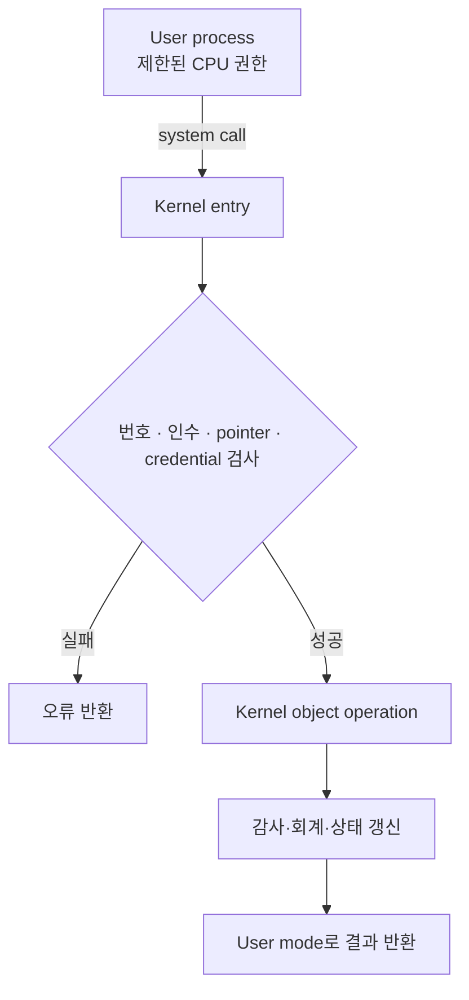
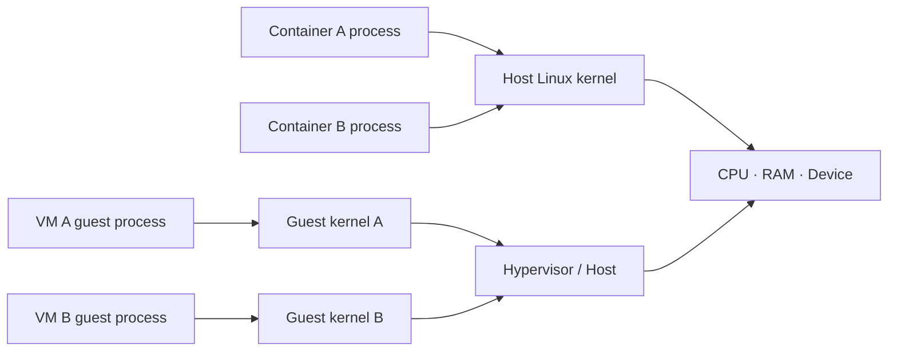

# 10. 보호·컨테이너·가상 머신

[이 책 목차](README.md) · [이전](09-persistence-crash-recovery.md) · [다음](11-platform-connections.md)

protection(보호)은 “누가 어떤 객체에 어떤 동작을 할 수 있는가”를 정하고 CPU와 kernel이 그 규칙을 강제하는 일이다. virtualization(가상화)은 실제 CPU, memory, device를 여러 실행 환경이 각각 자기 자원처럼 보도록 이름과 mapping을 제공하는 일이다. 이 장에서는 user process의 memory load 한 번이 MMU와 page table을 거치는 과정부터 container namespace와 cgroup, VM의 vCPU·guest physical memory·EPT/NPT, device DMA와 IOMMU까지 같은 객체 지도로 연결한다.

## 1. 보호 규칙의 네 요소

subject는 동작을 시도하는 주체다. process, thread, user identity, VM과 device가 주체가 될 수 있다. object는 접근 대상이다. memory page, file, socket, process, GPU queue가 객체다. operation은 read, write, execute, map, signal, configure처럼 하려는 행동이다. policy는 어떤 subject가 어떤 object에 어떤 operation을 허용받는지 정한다.

```text
Subject          Object             Operation
process PID 120  /data/report       read
process PID 120  memory page        write
GPU device       DMA-mapped buffer  read/write
guest VM A       virtual NIC        transmit
```

protection domain은 한 실행 주체가 현재 사용할 수 있는 object와 operation의 집합이다. login user가 같아도 process마다 열린 fd와 address space가 달라 domain이 다를 수 있다. capability를 추가하거나 fd를 전달하면 domain이 커질 수 있고, privilege를 drop하거나 fd를 닫으면 줄어든다.

authorization은 정책상 허용 여부를 결정하는 일이고, authentication은 주체가 주장한 identity가 맞는지 확인하는 일이다. access control은 authorization 규칙과 강제 기작을 함께 가리킨다.

confidentiality는 허가 없는 읽기를 막는 성질, integrity는 허가 없는 변경을 막는 성질, availability는 허가받은 주체가 필요한 서비스를 계속 쓸 수 있게 하는 성질이다. memory read를 막아도 CPU를 독점하는 denial of service까지 자동 해결되지는 않는다.

## 2. privilege level은 kernel 진입을 통제한다

CPU는 일반 application이 모든 instruction과 memory를 직접 조작하지 못하도록 권한 수준을 제공한다. user mode는 제한된 권한으로 process를 실행하고, kernel mode는 page table과 interrupt controller, device 설정 같은 민감한 자원을 다루는 높은 권한 실행 상태다.

root user는 kernel mode와 같은 말이 아니다. root process도 보통 user mode에서 실행하며 system call을 통해 kernel에 요청한다. kernel은 caller의 credential과 object permission을 검사한다.

system call은 user program이 kernel service를 요청하는 정해진 진입 방법이다. CPU는 syscall instruction에서 미리 정한 kernel entry로 이동하고 privilege를 바꾼다. argument가 user memory pointer라면 kernel은 범위, 읽기·쓰기 방향, mapping과 fault 가능성을 안전한 user-copy 기작으로 다룬다.



kernel mode로 들어왔다는 사실이 요청을 허용했다는 뜻은 아니다. syscall entry는 단지 검사를 받을 문을 통과한 것이다.

## 3. MMU와 page table이 memory 보호를 강제한다

MMU(memory management unit)는 CPU가 virtual address를 physical address로 변환하고 접근 권한을 검사하는 hardware 부분이다. page table은 kernel이 만든 변환 규칙 자료구조다. page table entry에는 physical frame 위치와 read/write/execute, user 접근 가능 여부 같은 bit가 들어갈 수 있다.

process P가 virtual address `0x4000`을 읽는 과정을 단순화하면 다음과 같다.

1. CPU가 현재 P의 page table 기준을 사용한다.
2. TLB에 `0x4000` page 변환이 있는지 찾는다.
3. 없으면 hardware 또는 kernel 도움으로 page table을 따라간다.
4. entry가 present이고 user read를 허용하는지 검사한다.
5. 허용되면 physical frame과 offset을 결합해 cache/RAM에서 byte를 읽는다.
6. mapping이 없거나 권한이 맞지 않으면 page fault가 발생한다.
7. kernel fault handler가 demand page를 붙일지, copy-on-write를 할지, signal로 process를 종료할지 결정한다.

TLB는 최근 주소 변환 결과를 CPU 가까이에 보관하는 cache다. permission이 바뀌면 옛 TLB entry를 적절히 무효화해야 한다. page table만 memory에서 바꾸고 CPU들이 옛 writable entry를 계속 쓰게 두면 protection이 깨질 수 있다.

W^X는 같은 memory가 쓰기 가능하고 실행 가능하도록 동시에 두지 않으려는 정책이다. code injection 위험을 줄일 수 있지만 JIT compiler는 write 단계와 execute 단계 사이 permission 전환 protocol이 필요하다.

process address space는 서로의 accidental pointer overwrite를 막는 중요한 경계지만 kernel bug, shared-memory race, CPU cache side channel과 memory bandwidth denial of service까지 모두 막지는 않는다.

## 4. identity, permission, ACL과 Linux capability

credential은 kernel이 process의 권한 판단에 사용하는 identity와 security 상태다. Linux에서는 user ID, group ID, supplementary group, capability set과 security module label 등이 연결될 수 있다.

전통적인 mode bit는 file owner, group, other에 read/write/execute 권한을 준다. ACL(access control list)은 한 object 쪽에 “user X는 read, group Y는 write”처럼 더 자세한 허용 목록을 붙이는 관점이다.

capability라는 말은 두 문맥에서 다르게 쓰인다.

일반 보안 이론의 capability는 특정 object와 operation 권한을 나타내며 위조할 수 없는 reference 또는 token이다. subject가 capability를 보유하면 그 object에 접근한다.

Linux capabilities는 root의 넓은 특권을 `CAP_NET_ADMIN`, `CAP_SYS_TIME` 같은 단위로 나눈 credential bit 집합이다. file descriptor 자체도 특정 열린 kernel object에 대한 capability 성격을 가진 handle로 볼 수 있지만 Linux capability bit와 같은 객체는 아니다.

least privilege는 필요한 operation에 필요한 권한만 필요한 시간 동안 주는 원칙이다. `CAP_SYS_ADMIN`처럼 매우 넓은 capability를 편의상 주면 침해 범위가 커진다. capability를 drop한 뒤 다시 얻을 경로, child process inheritance, user namespace 범위를 함께 확인한다.

## 5. namespace는 이름과 관점을 분리한다

Linux namespace는 process 집합이 특정 종류의 kernel resource를 별도 이름 공간에서 보게 하는 kernel 객체다. 새 kernel을 만드는 것이 아니다. process의 namespace membership은 kernel credential과 task 상태에 연결되고, namespace object는 참조가 남는 동안 존재한다.

| namespace 종류 | 분리해 보이는 관점 | 분리하지 않는 것 |
|---|---|---|
| PID | process ID 계층 | 실제 CPU와 host kernel |
| mount | filesystem mount tree | storage device 자체 |
| network | interface, route, port, socket namespace | NIC bandwidth와 hardware |
| UTS | hostname과 domain name | host kernel version |
| IPC | System V IPC, POSIX message queue 일부 | CPU·memory |
| user | UID/GID mapping과 namespace 안 capability 범위 | namespace 밖 자원의 host 권한 |
| cgroup | cgroup path 관점 | 실제 resource limit 자체 |
| time | 일부 clock offset | 물리 clock hardware 전체 |

container의 PID 1이 host에서도 PID 1이라는 뜻은 아니다. user namespace 안 UID 0도 host initial user namespace에서 root 권한을 가진다는 뜻이 아니다. 권한은 어떤 namespace가 object를 지배하는지와 capability가 어느 user namespace에서 유효한지에 따라 달라진다.

namespace는 이름 격리다. CPU time과 memory 사용량을 제한하려면 cgroup 같은 별도 기작이 필요하다.

## 6. cgroup은 사용량을 모아 세고 제어한다

cgroup(control group)은 process들을 계층적 group으로 묶고 CPU, memory, I/O, process 수 같은 자원을 회계하고 제어하는 kernel 기작이다. cgroup directory와 controller file은 kernel cgroup 객체의 사용자 interface다.

CPU controller는 weight로 장기간 share를 조절하거나 quota로 일정 기간 사용할 CPU 시간을 제한할 수 있다. quota에 도달한 task는 runnable이어도 다음 기간까지 throttle될 수 있다. 이것은 CPU affinity로 전용 core를 주는 것과 다르다.

memory controller는 page charge를 cgroup에 연결한다. `memory.high`를 넘으면 reclaim과 throttle pressure가 커질 수 있고 `memory.max`는 hard limit 역할을 한다. host에 free RAM이 남아도 cgroup OOM이 날 수 있다.

I/O controller는 block I/O weight와 bandwidth/IOPS 제한을 제공할 수 있다. page cache와 writeback charge, shared filesystem과 device queue 때문에 application이 보는 latency가 limit 숫자 하나와 정확히 일치하지 않을 수 있다.

namespace와 cgroup을 함께 써야 container가 “다른 process와 mount를 보는 관점”과 “얼마나 CPU·RAM을 쓸 수 있는가”를 모두 갖는다. 둘 중 하나가 다른 것을 대신하지 않는다.

## 7. seccomp와 LSM은 다른 보호 축이다

seccomp는 process가 호출할 수 있는 system call을 번호와 argument 조건으로 제한하는 Linux 기작이다. filesystem permission을 대신하지 않고, 허용된 syscall 안의 모든 object 접근을 자동 허용하지도 않는다.

LSM(Linux Security Modules)은 SELinux, AppArmor 같은 보안 정책이 kernel의 object access 지점에서 추가 결정을 내리도록 하는 framework다. mode bit가 허용해도 LSM policy가 거절할 수 있다.

container 보안은 namespace, cgroup, capability drop, seccomp, LSM, read-only mount, kernel patch 상태를 조합한다. “container니까 격리됨”이라는 한 단어로 threat model을 끝낼 수 없다.

## 8. VM과 hypervisor의 객체

virtual machine(VM)은 guest operating system이 자기 CPU, physical memory, interrupt와 device가 있다고 보도록 만든 실행 환경이다. guest는 VM 안에서 실행되는 OS이고, host는 실제 hardware를 소유한 환경이다.

hypervisor는 여러 VM의 CPU·memory·device 사용을 중재하는 privileged software다. KVM처럼 host kernel 기능과 user-space virtual machine monitor가 역할을 나눌 수 있고, 독립 hypervisor 형태도 있다.

vCPU는 guest가 CPU core처럼 보는 실행 객체다. 실제로는 host scheduler가 실행하는 host thread와 연결될 수 있다. vCPU 네 개를 VM에 보여도 항상 physical core 네 개를 독점하는 것은 아니다. host가 vCPU thread를 선점하면 guest 안에서는 이유를 모르는 긴 실행 공백처럼 보일 수 있다.

guest physical address(GPA)는 guest OS가 자기 RAM의 물리 주소라고 믿는 주소다. host physical address(HPA)는 실제 machine RAM frame 주소다. guest application은 그 전에 guest virtual address(GVA)를 사용한다.

```text
Guest application GVA
→ guest page table
→ GPA
→ hypervisor가 관리하는 second-level page table
→ HPA
```

x86에서는 second-level translation을 EPT 또는 NPT라고 부를 수 있고, 다른 architecture는 다른 이름을 쓴다. 공통 원리는 guest page table과 host-controlled mapping 두 단계가 있다는 것이다.

## 9. nested address translation을 숫자로 계산한다

page 크기를 4 KiB, 즉 offset 12 bit라고 가정한다.

- guest virtual page number: `0x12`
- page 안 offset: `0x044`
- guest page table: GVA page `0x12 → guest frame 0x30`
- second-level table: guest frame `0x30 → host frame 0xA0`

GVA는 교육 표기로 `0x12044`다. 첫 translation 뒤 GPA는 `0x30044`다. 두 번째 translation 뒤 HPA는 `0xA0044`다. page 안 offset `0x044`는 두 단계에서 유지된다.

권한도 두 단계 모두 통과해야 한다. guest page table이 writable이라도 second-level entry가 read-only면 write는 실패해 hypervisor가 처리할 fault 또는 VM exit가 발생할 수 있다.

nested TLB와 hardware page-walk cache가 translation 비용을 줄일 수 있다. TLB miss 때 두 page table 계층을 조합해 더 많은 memory access가 필요할 수 있어 huge page와 locality가 중요해진다. 그러나 huge page는 fragmentation과 migration, dirty tracking granularity 같은 비용이 있다.

## 10. guest instruction, trap과 VM exit

많은 일반 user instruction은 hardware virtualization 지원으로 실제 CPU에서 직접 실행할 수 있다. guest가 privileged register 변경이나 virtual device operation을 하면 CPU가 hypervisor 쪽으로 제어를 넘길 수 있다. 이를 VM exit라고 부른다.

hypervisor는 다음 중 하나를 수행한다.

- 안전한 guest operation이면 상태를 emulate한다.
- 실제 hardware operation으로 변환한다.
- virtual interrupt나 fault를 guest에 주입한다.
- 정책 위반이면 guest를 중단한다.

emulation은 hardware/device 동작을 software로 흉내 내는 방식이다. 호환성은 좋지만 매 access마다 exit와 해석 비용이 클 수 있다.

paravirtual device는 guest driver가 hypervisor와 효율적으로 통신하도록 설계된 interface를 사용한다. virtio queue가 예다. guest가 descriptor를 shared memory queue에 넣고 host backend가 실제 I/O를 수행한다.

passthrough는 physical device 또는 virtual function을 guest에 더 직접 연결한다. exit와 copy를 줄일 수 있지만 live migration, sharing, reset과 fault containment가 어려워질 수 있다.

## 11. vCPU 하나의 I/O 요청을 끝까지 추적한다

guest application이 virtual disk file을 읽는 경로를 보자.

| 단계 | 실행 주체 | 객체와 상태 |
|---:|---|---|
| 1 | guest app | GVA의 user buffer와 guest fd로 `read` 호출 |
| 2 | guest kernel | guest VFS가 cache miss를 보고 virtual block request 생성 |
| 3 | guest driver | GPA에 있는 virtqueue descriptor에 buffer와 command 기록 |
| 4 | hardware/MMU | GVA→GPA, 필요하면 GPA→HPA translation |
| 5 | hypervisor/backend | descriptor를 읽고 host file 또는 physical block request 생성 |
| 6 | host kernel/driver | host page cache·block layer·device queue 처리 |
| 7 | physical device | DMA와 media read 완료 |
| 8 | IOMMU/hypervisor | DMA가 허용된 host memory에 들어가도록 translation·검사 |
| 9 | backend | used descriptor와 virtual interrupt 준비 |
| 10 | host scheduler | vCPU thread가 실행될 때 guest에 interrupt 주입 |
| 11 | guest kernel | request 완료, guest task wakeup |
| 12 | guest scheduler | application을 다시 실행해 `read` 반환 |

guest application latency에는 guest queue, host queue, physical device, host vCPU scheduling 지연이 모두 들어간다. guest에서 device service time만 보고 host CPU steal이나 backend congestion을 놓칠 수 있다.

## 12. IOMMU는 device DMA를 보호한다

device는 DMA로 memory를 읽고 쓸 수 있어 CPU page table만으로는 악성·고장 난 device를 제한하기 어렵다. IOMMU(input-output memory management unit)는 device가 사용하는 I/O virtual address를 host physical address로 변환하고 접근 권한을 검사하는 hardware다.

kernel이나 hypervisor는 특정 device가 특정 DMA buffer에만 접근하도록 IOMMU table을 설정한다. mapping이 끝난 buffer를 unmap하기 전에 device command가 완전히 끝났는지 확인해야 한다. 늦은 DMA가 재사용된 page를 덮으면 다른 process data가 손상된다.

IOMMU는 application의 file permission을 판단하지 않는다. CPU memory 접근의 MMU와도 별도 translation domain이다. 둘 다 주소 변환과 보호를 하지만 주체가 CPU인지 device인지가 다르다.

SR-IOV는 한 physical PCIe function이 여러 virtual function을 노출해 VM이나 container에 나눠 줄 수 있게 하는 기작이다. virtual function 사이 격리, firmware와 reset 범위, IOMMU group을 확인해야 한다.

## 13. container와 VM의 경계를 비교한다



container는 보통 host kernel을 공유한다. image에 user-space library와 file tree가 달라도 syscall은 host kernel이 처리한다. kernel bug 공격면을 함께 공유할 수 있지만 시작과 resource 효율이 좋다.

VM은 guest kernel을 별도로 실행할 수 있다. guest kernel이 손상돼도 hypervisor 경계를 넘어야 host와 다른 VM에 영향을 준다. 그러나 hypervisor와 virtual device도 공격면이고 CPU cache, memory bandwidth, physical device를 공유한다.

“VM은 안전, container는 불안전” 같은 절대 결론은 threat model 없이 성립하지 않는다. 신뢰하지 않는 tenant, kernel extension 필요 여부, confidential data, 성능, 운영 patch 능력을 함께 평가한다.

## 14. snapshot, migration, overcommit의 함정

VM snapshot은 vCPU register, memory와 virtual disk 상태를 특정 방식으로 저장한다. application이 memory buffer와 storage transaction을 일관되게 정지하지 않으면 crash-consistent snapshot일 뿐 application-consistent backup이 아닐 수 있다.

live migration은 VM memory page를 destination으로 복사하는 동안 guest가 계속 수정한 dirty page를 반복 전송하고 마지막에 짧게 멈춰 남은 상태를 옮길 수 있다. network bandwidth보다 dirtying rate가 높으면 수렴하지 않거나 긴 stop-and-copy가 필요하다. passthrough device state가 이동 가능한지도 문제다.

memory overcommit은 guest에 약속한 합계 memory가 host physical RAM보다 클 수 있게 한다. 모든 guest working set이 동시에 커지면 host reclaim, swap, ballooning과 OOM이 발생해 latency가 급증할 수 있다. “VM에 16 GiB 표시”와 “항상 resident host RAM 16 GiB 보장”을 구분한다.

## 15. side channel과 confidential VM 연구

isolation은 직접 read/write permission을 막아도 공유 cache와 branch predictor, memory bandwidth의 timing 변화를 통해 정보를 추론하는 side channel까지 자동 제거하지 않는다. scheduler 배치, core sharing, cache partitioning, constant-time software와 microcode/kernel 완화를 threat model에 맞춰 사용한다.

confidential VM 기술은 guest memory를 암호화하고 host/hypervisor의 직접 관측을 줄이는 방향을 제공한다. 그러나 device I/O buffer, metadata, availability, side channel과 attestation 운영이 모두 해결된다는 뜻은 아니다. 어떤 state가 암호화·무결성 보호되는지, 누가 key를 통제하는지와 firmware 신뢰를 확인한다.

새 논문의 overhead 수치는 CPU generation, workload, page size, I/O 방식과 security setting에 묶여 있다. 특정 prototype의 평균 slowdown을 모든 VM에 적용하지 않는다.

## 16. 위협 모형으로 기작을 선택한다

threat model은 보호하려는 자산, 공격자 능력, 신뢰하는 계층과 허용 실패를 명시한다.

| 위협 | 필요한 기작과 질문 |
|---|---|
| 실수한 process | page permission과 separate address space가 있는가 |
| 악성 process | syscall, credential, LSM, capability를 우회할 수 있는가 |
| resource hog | cgroup CPU·memory·I/O control과 admission이 있는가 |
| 악성 container | host kernel 공격면과 privilege·device 노출은 무엇인가 |
| 악성 guest kernel | hypervisor, virtual device, nested mapping 경계가 안전한가 |
| 악성 device | IOMMU DMA domain과 reset 격리가 있는가 |
| 악성 host operator | confidential VM의 보호 범위와 attestation은 무엇인가 |

audit log는 누가 무엇을 시도했는지 설명하는 증거다. 접근을 막는 기작과 같지 않다. log 자체의 integrity와 time synchronization도 필요하다.

## 17. 확인 문제와 자세한 해설

### 문제 1. syscall과 privilege

root process가 `open` syscall을 호출하면 permission 검사를 건너뛰고 kernel memory에 직접 접근하는가?

**해설:** 아니다. root process도 user mode에서 syscall entry로 들어오고 kernel이 credential과 object policy를 평가한다. 일부 검사를 우회할 privilege가 있을 수 있지만 kernel mode 자체가 되지는 않는다. user pointer도 안전하게 처리해야 한다.

### 문제 2. MMU permission

page table entry가 user-readable이지만 read-only다. user process가 write하면 어떤 흐름인가?

**해설:** MMU permission check가 write를 거부해 page fault를 만든다. kernel은 copy-on-write 조건이면 새 page를 만들어 writable mapping을 줄 수 있고, 불법 접근이면 signal을 전달할 수 있다. 단순히 RAM byte를 덮어쓰지 않는다.

### 문제 3. namespace와 cgroup

PID namespace만 만든 container가 CPU를 100% 독점하지 못하도록 자동 제한되는가?

**해설:** 아니다. PID namespace는 process ID 관점을 분리한다. CPU share와 quota는 cgroup CPU controller나 affinity·scheduler 정책으로 정한다. 이름 격리와 자원 제어는 다른 기작이다.

### 문제 4. nested translation

GVA page `0x12`가 GPA frame `0x30`, 다시 HPA frame `0xA0`에 mapping되고 offset은 `0x044`다. 최종 HPA는?

**해설:** page offset 12 bit를 유지하므로 GPA는 `0x30044`, HPA는 `0xA0044`다. 두 page table 계층의 permission을 모두 통과해야 한다.

### 문제 5. vCPU와 physical CPU

VM에 vCPU 8개가 보이면 physical core 8개를 항상 독점하는가?

**해설:** 아니다. vCPU는 host scheduler가 실행하는 thread에 연결될 수 있고 다른 workload와 core를 공유한다. pinning·reservation을 별도로 구성하지 않으면 preemption과 migration이 생긴다. guest 안의 idle/steal 관측도 host 상태와 함께 본다.

### 문제 6. IOMMU

IOMMU가 켜져 있으면 container file permission과 GPU kernel의 정확성도 보장되는가?

**해설:** 아니다. IOMMU는 device DMA address의 translation과 접근 범위를 제한한다. file authorization, user-space API 검증, GPU firmware와 kernel correctness는 다른 계층 책임이다.

### 문제 7. VM snapshot

database가 transaction 중인 VM을 live snapshot했다. 이것이 application-consistent backup인가?

**해설:** 자동으로 그렇지 않다. memory와 virtual disk가 crash 순간 같은 상태일 수는 있어도 database buffer와 WAL flush protocol을 맞추지 않았다면 recovery가 필요하다. guest freeze, application quiesce 또는 database-aware snapshot protocol을 사용하고 restore 시험을 해야 한다.

### 문제 8. container 안 root

user namespace 안 UID 0 process가 host clock과 kernel module을 마음대로 바꿀 수 있는가?

**해설:** 아니다. user namespace capability는 그 namespace가 지배하는 resource 범위에 제한된다. host initial namespace의 `CAP_SYS_TIME`이나 `CAP_SYS_MODULE`이 필요한 operation은 허용되지 않을 수 있다. device와 mount를 과도하게 노출하면 경계가 약해질 수 있으므로 설정을 함께 본다.

## 근거와 더 읽을 자료

- [MIT 6.S081: Isolation, Page Tables, Traps](https://pdos.csail.mit.edu/6.S081/)
- [Linux man-pages: namespaces(7)](https://man7.org/linux/man-pages/man7/namespaces.7.html)
- [Linux man-pages: user_namespaces(7)](https://man7.org/linux/man-pages/man7/user_namespaces.7.html)
- [Linux man-pages: capabilities(7)](https://man7.org/linux/man-pages/man7/capabilities.7.html)
- [Linux kernel 문서: cgroup v2](https://docs.kernel.org/admin-guide/cgroup-v2.html)
- [Linux kernel 문서: KVM](https://docs.kernel.org/virt/kvm/)
- [Linux kernel 문서: IOMMU Userspace API](https://docs.kernel.org/userspace-api/iommu.html)
- [Linux kernel 문서: VFIO](https://docs.kernel.org/driver-api/vfio.html)

---

[이전 장: 지속성·크래시 복구·WAL](09-persistence-crash-recovery.md) · [다음 장: 플랫폼 연결](11-platform-connections.md)
