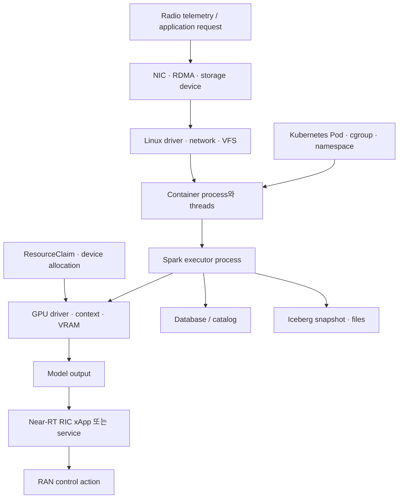

# 11. Kubernetes·Database·Iceberg·Spark·GPU·AI-RAN 연결

[이 책 목차](README.md) · [이전](10-protection-and-virtualization.md) · [다음](12-local-model-labs.md)

이 장은 플랫폼 이름을 나열하지 않는다. 하나의 데이터가 NIC에서 Linux memory로 들어오고, Kubernetes가 배치한 process가 처리하며, Spark가 여러 executor에 계산을 나누고, Iceberg snapshot으로 publish하고, GPU model이 추론한 결과가 RAN 제어에 사용되는 흐름을 객체와 수명으로 연결한다. 각 플랫폼의 “task”, “memory”, “commit”은 서로 다른 객체이므로 같은 단어를 그대로 겹치지 않는다.

중요한 경계가 있다. Spark batch job과 Iceberg table commit은 보통 수십 ms보다 훨씬 긴 분석·학습 경로에 적합하다. radio의 엄격한 실시간 signal processing 경로를 반드시 이 계층들에 통과시킨다는 뜻이 아니다. offline 학습 경로와 online inference·control 경로를 나누어 설계한다.

## 1. 같은 hardware를 보는 여러 제어 계층



아래 표는 “정책을 정하는 주체”와 “실제 byte·instruction을 움직이는 주체”를 나눈다.

| 층 | 주요 객체 | 객체가 존재하는 위치 | 수명을 관리하는 주체 |
|---|---|---|---|
| Kubernetes | Pod, ResourceClaim, Volume | API server의 desired state와 node 상태 | controller, scheduler, kubelet |
| container runtime | container, OCI bundle, namespace 설정 | node user space와 kernel object | kubelet, runtime |
| Linux | process, thread, cgroup, page, fd, socket | kernel 자료구조와 RAM | kernel |
| Spark | driver, executor, stage, task, partition | JVM/Python process와 cluster RPC 상태 | Spark driver와 executor |
| database | transaction, buffer page, WAL record | DB process memory와 storage | DB engine |
| Iceberg | snapshot, manifest, data/delete file | object storage/filesystem과 catalog | Iceberg writer와 catalog |
| GPU | device, context, stream, kernel, VRAM allocation | device driver, GPU memory와 hardware queue | driver, runtime, process |
| O-RAN | rApp, xApp, policy, indication, control message | SMO/RIC process와 network | RAN platform과 application |

상위 객체가 사라져도 하위 객체가 즉시 모두 사라진다는 보장은 없다. Pod가 삭제되어도 object storage의 Iceberg data file은 남을 수 있고, 실패한 Iceberg commit의 orphan file은 나중에 정리해야 한다. 반대로 Linux process가 OOM으로 죽으면 Kubernetes Pod API object는 남아 restart를 지시할 수 있다.

## 2. Kubernetes Pod가 Linux process가 되기까지

Pod는 하나 이상의 container를 함께 배치하기 위한 Kubernetes API 객체다. Pod 자체가 kernel process나 새로운 operating system은 아니다. API server에 원하는 image, resource request, volume, device claim과 restart 정책이 저장된다.

kube-scheduler는 아직 node가 정해지지 않은 Pod에 적합한 node를 고른다. CPU·memory request, node label, affinity, taint, volume과 device 접근 가능성을 사용한다. 이 결정은 실제 CPU instruction을 실행하지 않는다.

선택된 node의 kubelet은 container runtime에 container 생성을 요청한다. runtime은 image filesystem을 준비하고 Linux namespace, cgroup, mount와 process credential을 설정한다. 마지막에 kernel이 container entrypoint를 process와 thread로 실행한다.

```text
Pod manifest 생성
→ scheduler가 node 선택
→ kubelet이 desired state 관측
→ runtime이 namespace/cgroup/root filesystem 준비
→ kernel이 process 생성
→ scheduler가 thread에 CPU 배정
→ page fault가 physical memory를 붙임
```

namespace는 PID, mount, network 같은 이름과 관점을 나누는 kernel 객체다. cgroup은 process 집합의 CPU, memory와 I/O 사용을 회계·제한하는 kernel 객체다. container image는 process가 보는 file tree의 재료이지 별도 kernel이 아니다.

Pod CPU request는 scheduler가 node capacity를 계산하고 CPU share를 설정하는 입력이 될 수 있다. 전용 physical core 보장과 같지 않다. CPU limit은 quota throttling을 만들 수 있어 thread가 runnable인데도 quota 기간이 갱신될 때까지 실행되지 않을 수 있다.

Pod memory limit은 host RAM 예약량과 같은 뜻이 아니다. page가 cgroup에 charge되고 reclaim이 실패해 hard limit을 넘으면 host에 free memory가 있어도 cgroup OOM이 날 수 있다.

## 3. DRA가 GPU를 배치하는 객체 흐름

DRA(dynamic resource allocation)는 Kubernetes에서 GPU 같은 장치 요구를 API 객체로 표현하고 Pod scheduling과 device 준비를 연결하는 framework다.

처음 등장하는 객체를 구분한다.

- DeviceClass: 운영자가 “어떤 종류의 장치를 요청할 수 있는가”를 정의하는 cluster 범위 분류
- ResourceSlice: driver가 어느 node 또는 pool에 어떤 장치가 있는지 게시하는 상태
- ResourceClaim: workload가 필요로 하는 장치 조건과 실제 allocation 결과를 담는 요청 객체
- ResourceClaimTemplate: Pod별 ResourceClaim을 만들기 위한 틀
- CDI(container device interface): 선택한 device node, library와 환경을 container runtime에 전달하는 표준화된 명세 방식

일반 흐름은 다음과 같다.

| 단계 | 주체 | 객체 변화 | 아직 보장되지 않는 것 |
|---:|---|---|---|
| 1 | DRA driver | ResourceSlice에 GPU identity·attribute 게시 | 장치 health와 application 성능 |
| 2 | workload operator | ResourceClaim 또는 template 생성 | 특정 GPU 선택 |
| 3 | scheduler | claim 조건과 node를 함께 평가해 allocation 기록 | node-local 준비 완료 |
| 4 | kubelet·driver | device를 준비하고 container 접근 설정 | CUDA model load 성공 |
| 5 | runtime | CDI 등을 통해 device node와 library 노출 | IOMMU·firmware correctness |
| 6 | process | driver API로 GPU context 생성 | VRAM 충분함 |
| 7 | Pod 종료 | unprepare와 claim 수명 정책 적용 | application data 자동 보존 |

DRA base 기능의 안정 상태와 optional feature의 feature gate는 Kubernetes release별 문서를 확인해야 한다. scheduler가 ResourceClaim을 할당했다고 높은 priority Pod가 사용 중인 DRA device를 자동 선점하는 것도 아니다. 현재 공식 문서는 DRA resource preemption의 제한을 별도로 설명한다.

DRA는 cluster control-plane allocation이다. Linux driver, IOMMU DMA protection, GPU firmware, CUDA runtime과 application kernel 검증을 대체하지 않는다.

## 4. GPU Operator와 실제 GPU 실행 상태

GPU Operator는 Kubernetes operator pattern으로 node의 NVIDIA driver, container toolkit, device plugin 또는 DRA driver, feature discovery와 monitoring component를 설치·관리한다. Operator가 matrix multiplication을 실행하는 것은 아니다.

application process가 GPU를 쓰면 다음 객체가 추가된다.

- GPU context: process의 GPU address space, queue와 driver 상태를 연결하는 실행 문맥
- VRAM allocation: GPU가 직접 접근하는 device memory 영역
- stream: GPU operation의 순서와 비동기 실행을 표현하는 queue
- kernel: GPU에서 많은 thread가 실행할 계산 함수
- command buffer: host가 device에 제출할 operation 정보
- event/fence: 비동기 GPU 작업 완료를 알리는 객체

```text
Linux process의 tensor
→ host RAM buffer
→ driver가 DMA mapping 준비
→ PCIe/NVLink 등으로 VRAM copy
→ stream에 GPU kernel launch
→ GPU SM에서 연산
→ event/fence completion
→ 결과를 host 또는 다음 GPU kernel이 사용
```

GPU 하나를 Pod에 보였다고 VRAM, SM, memory bandwidth와 copy engine이 모두 전용이라는 뜻은 아니다. MIG, time slicing, MPS, vGPU 같은 sharing 방식마다 격리 단위와 accounting이 다르다. 사용하는 GPU와 driver 조합의 문서를 확인한다.

CPU와 GPU가 다른 NUMA node나 PCIe root에 있으면 host buffer copy와 NIC-GPU data path latency가 늘 수 있다. Kubernetes node 선택, CPU affinity, memory policy, DRA device topology를 함께 맞춰야 한다.

## 5. Spark 객체를 OS 객체와 섞지 않는다

Spark application은 driver program과 executor process들로 구성된다. driver는 job을 stage와 task로 나누고 executor에 보낸다. executor는 worker node에서 계산을 실행하고 data를 memory 또는 storage에 보관하는 process다.

Spark task는 한 partition에 적용할 계산 단위다. Linux `task_struct`와 같은 객체가 아니다. 한 executor가 여러 Spark task를 thread pool에서 실행할 수 있고, Python UDF는 별도 Python worker process와 IPC를 사용할 수 있다.

partition은 dataset을 나눠 병렬 처리하는 논리 단위다. OS memory page와 다르다. partition 하나가 여러 page와 file block에 걸치며, 한 page에 여러 record가 있을 수 있다.

stage는 shuffle boundary로 나뉜 task 집합이다. shuffle은 key에 따라 data를 다른 executor로 재분배하는 과정이다.

```text
input partition
→ executor thread가 record decode
→ in-memory aggregation
→ memory 부족 시 local disk spill
→ shuffle file과 index 생성
→ network socket으로 remote executor가 fetch
→ reduce-side merge와 다음 stage
```

shuffle은 CPU serialization, heap/off-heap memory, local filesystem, page cache, block device, network socket과 NIC queue를 모두 사용한다. “Spark shuffle wait가 길다”는 지표 하나로 network만 탓할 수 없다. producer가 CPU quota로 늦었거나 spill disk가 포화됐거나 consumer가 GC pause일 수 있다.

executor memory는 JVM heap만이 아니다. off-heap buffer, Python worker, page cache, native library와 GPU host buffer가 Pod cgroup memory에 함께 charge될 수 있다. Spark UI의 heap 지표가 limit보다 작아도 cgroup OOM이 가능하다.

## 6. Database transaction이 OS 위에서 하는 일

database server는 Linux process와 thread, virtual memory, file descriptor와 socket을 사용한다. client connection 하나가 반드시 OS thread 하나와 일대일인 것은 DB architecture에 따라 다르다.

buffer pool은 database page를 RAM에 보관하는 DB 내부 cache다. Linux page cache와 별개 계층일 수 있다. buffered I/O면 같은 data가 DB buffer와 page cache에 둘 다 있을 수 있고, direct I/O면 제약과 coherency를 application이 더 책임진다.

transaction은 여러 row 변경을 하나의 commit 의미로 묶는 DB 객체다. WAL record는 recovery에 필요한 변경 정보를 append하는 storage record다.

```text
SQL update
→ lock/MVCC visibility 검사
→ DB buffer page 변경, dirty
→ WAL buffer에 record
→ WAL write와 flush
→ commit 응답
→ data page는 나중 checkpoint/writeback
```

DB commit 성공과 Kubernetes readiness는 다른 사건이다. readiness probe가 TCP 연결 성공만 확인하면 replication lag, WAL storage 오류와 query latency를 놓칠 수 있다. probe가 너무 무거우면 DB에 부하를 준다.

DB file을 PersistentVolume에 둔다고 transaction durability가 자동 생기지 않는다. filesystem `fsync`, volume driver, network storage ACK와 replica protocol이 WAL 요구를 만족해야 한다.

## 7. Iceberg table은 file 집합과 metadata pointer다

Iceberg는 object storage나 filesystem에 놓인 여러 data file을 하나의 table snapshot으로 묶는 table format이다. database engine처럼 row를 제자리에서 항상 덮어쓰는 process가 아니다.

- data file: table row를 담은 Parquet, ORC, Avro 같은 file
- delete file 또는 deletion vector: snapshot 규칙에 따라 삭제할 row를 표현하는 별도 구조
- manifest: 어떤 data/delete file이 snapshot에 속하는지와 partition·통계를 기록한 immutable file
- manifest list: snapshot이 사용할 manifest들의 목록
- snapshot: 한 시점 table의 전체 file 집합을 가리키는 metadata state
- table metadata file: schema, partition spec, snapshot 목록과 current snapshot을 담는 JSON
- catalog: 현재 table metadata 위치를 원자적으로 바꾸는 service 또는 저장 계층

writer는 새 data file을 먼저 만들지만 그 file은 아직 reader의 current snapshot에 포함되지 않는다. manifest와 새 metadata file을 만든 뒤 catalog pointer를 base version에서 new version으로 원자적으로 바꾸어 publish한다.

writer W1과 W2가 snapshot S10에서 시작했다고 하자.

| 단계 | W1 | W2 | current metadata |
|---:|---|---|---|
| 1 | S10 읽음 | S10 읽음 | S10 |
| 2 | data-A와 metadata S11 준비 | data-B와 metadata S12 후보 준비 | S10 |
| 3 | compare-and-swap S10→S11 성공 | 아직 시도 전 | S11 |
| 4 | 완료 | S10→S12 시도 실패 | S11 |
| 5 | - | S11을 다시 읽고 충돌 검사·재구성 | S11 |
| 6 | - | 호환되면 S13으로 commit 재시도 | S13 가능 |

실패한 W2의 data-B file이 자동 삭제된다는 보장은 없다. retry가 재사용하거나 orphan cleanup이 나중에 회수한다. 너무 빨리 지우면 아직 commit 중인 writer file을 삭제할 수 있어 age와 ownership 조건이 필요하다.

Iceberg snapshot commit은 WAL byte log와 다른 immutable-file publish protocol이다. 공통 원리는 reader가 볼 상태를 작은 atomic reference로 전환하고, publish 전 data와 metadata의 durability를 확보한다는 점이다.

## 8. Offline 학습 파이프라인의 완전한 흐름

무선망 telemetry로 GPU model을 학습해 배포하는 offline 경로를 보자. strict real-time control loop가 아니다.

### 수집

1. radio system이나 collector가 metric/event를 network packet으로 보낸다.
2. NIC가 DMA로 host receive buffer에 넣고 Linux network stack이 socket queue로 전달한다.
3. collector container process가 `read`하고 memory buffer에서 record를 decode한다.
4. process는 object storage client로 file part를 업로드한다.
5. upload completion과 checksum을 확인한 뒤 metadata writer에 “이 file이 준비됨”을 알린다.

### Iceberg publish

6. writer는 data file 목록과 통계로 manifest를 만든다.
7. manifest list와 새 snapshot metadata를 만든다.
8. catalog의 current metadata가 예상 base와 같은지 비교해 atomic commit한다.
9. 충돌이면 최신 snapshot을 다시 읽고 append가 양립 가능한지 검증한 뒤 재시도한다.
10. commit되지 않은 old attempt file은 즉시 독단 삭제하지 않고 cleanup policy로 관리한다.

### Spark 학습 준비

11. Spark driver가 current Iceberg snapshot을 읽고 manifest 통계로 필요한 file을 planning한다.
12. partition별 Spark task를 executor process에 보낸다.
13. executor가 object storage에서 data를 읽고 decode·filter·shuffle한다.
14. memory가 부족하면 local disk로 spill하고, cgroup pressure가 심하면 reclaim 또는 OOM이 발생할 수 있다.

### GPU 학습

15. executor 또는 training process가 GPU context와 VRAM을 만든다.
16. batch를 pinned host buffer와 DMA로 GPU에 보낸다.
17. stream에서 GPU kernel을 실행하고 gradient·parameter를 갱신한다.
18. multi-GPU이면 collective communication이 NIC, PCIe/NVLink와 GPU memory bandwidth를 사용한다.
19. checkpoint file을 임시 이름으로 쓰고 durable 조건을 확인한 뒤 model registry metadata를 publish한다.

### 배포

20. validation service가 model metric과 version을 확인한다.
21. Kubernetes가 online inference Pod와 필요한 ResourceClaim을 생성한다.
22. scheduler가 GPU 접근 가능한 node를 고르고 driver가 device를 준비한다.
23. process가 model file을 읽어 VRAM에 load한 뒤 readiness 조건을 만족한다.
24. traffic은 새 model endpoint로 점진 전환된다.

각 단계의 “성공”은 다음 단계의 성공과 다르다. Iceberg commit 성공이 model quality를 보장하지 않고, GPU load 성공이 RAN control 안전성을 보장하지 않는다.

## 9. Online RAN inference 경로와 시간 제한

RAN(radio access network)은 단말과 core network 사이에서 무선 자원을 사용해 packet을 전달하는 network 부분이다. O-RAN은 RAN component와 interface를 개방·분리하려는 architecture를 정의한다.

- O-RU: antenna 가까이에서 radio 신호 송수신 일부를 처리하는 radio unit
- O-DU: 시간 민감한 lower-layer 처리를 담당하는 distributed unit
- O-CU: higher-layer 처리를 담당하는 centralized unit
- Non-RT RIC: 비교적 긴 시간 규모의 policy·model 관리와 rApp 실행 영역
- Near-RT RIC: 더 짧은 제어 주기의 xApp과 RAN element 제어를 지원하는 controller
- rApp/xApp: 각각 Non-RT/Near-RT RIC에서 policy, 분석, 최적화를 수행하는 application

AI-RAN은 AI를 RAN 운영·제어에 사용하거나 RAN compute와 AI workload를 함께 다루는 넓은 연구·산업 용어다. 단일 표준 알고리즘 이름이 아니다.

online inference 요청 흐름을 단순화한다.

1. O-DU/RAN element가 측정 indication을 E2 같은 interface로 Near-RT RIC에 보낸다.
2. xApp process의 socket이 message를 받고 schema와 freshness를 검사한다.
3. feature buffer를 만들고 model이 요구한 normalization을 적용한다.
4. GPU 또는 CPU inference queue에 request를 넣는다.
5. scheduler·driver가 kernel을 실행하고 completion event를 돌려준다.
6. xApp은 confidence, policy guardrail과 현재 network state를 검사한다.
7. 허용된 control action을 RAN element에 전송한다.
8. acknowledgement와 적용 결과를 관측하고 correlation ID로 원 요청과 연결한다.

이 tight loop에 Spark batch job과 Iceberg commit을 직렬로 넣으면 deadline을 넘길 수 있다. Iceberg는 학습 data와 audit history, Spark는 offline feature 계산과 학습에 쓰고, online 경로는 준비된 model과 bounded queue를 사용하는 식으로 분리할 수 있다.

AI output이 곧 안전한 control action은 아니다. stale telemetry, distribution shift, adversarial input, model uncertainty, 충돌하는 여러 xApp action을 처리하는 policy와 fallback이 필요하다. O-RAN 연구 보고서의 architecture 제안이나 simulation 결과를 모든 live network의 성능 보장으로 일반화하지 않는다.

## 10. 한 Pod의 memory 사건을 전 계층에서 추적한다

Pod memory limit은 1 GiB이고 현재 cgroup charge가 900 MiB다. Spark executor가 shuffle aggregation용 200 MiB를 요청한다. host에는 8 GiB available이 있다.

| 단계 | Spark/JVM | Linux/cgroup | Kubernetes |
|---:|---|---|---|
| 1 | 200 MiB 객체·buffer 예약 | virtual address만 늘 수 있음 | 변화 없음 |
| 2 | page를 실제 touch | physical page 할당과 cgroup charge 증가 | 변화 없음 |
| 3 | memory.high 또는 limit pressure | cgroup reclaim, file cache drop, throttle 가능 | metric에 pressure |
| 4 | Spark가 감지하면 spill | local file write와 page cache/I/O 증가 | Pod는 Running |
| 5 | reclaim 불가, max 초과 | cgroup OOM victim 선택 가능 | container 종료 관측 |
| 6 | executor process 사라짐 | fd·memory 회수, 늦은 I/O 정리 | restart policy 적용 가능 |
| 7 | 새 executor 시작 | 새 process와 cgroup usage | Spark task retry·shuffle 재계산 |

host의 8 GiB free는 이 Pod가 1 GiB limit을 넘을 권한을 주지 않는다. Spark가 spill에 성공하면 OOM 전에 진행할 수 있지만 disk가 느리면 stage tail latency가 늘어난다. GPU VRAM 부족은 host cgroup memory OOM과 다른 allocator·error path다.

Kubernetes restart는 원인을 고친 것이 아니다. 같은 input과 memory 설정이면 다시 OOM loop가 될 수 있다. Spark UI, cgroup `memory.events`, kernel OOM log, Pod status와 storage latency를 timestamp로 맞춘다.

## 11. 한 query가 느릴 때 위아래로 추적한다

“Spark SQL로 Iceberg table을 읽는 query가 느리다”를 계층별로 나눈다.

| 층 | 실제 기다릴 수 있는 객체 | 확인할 질문 |
|---|---|---|
| Iceberg planning | metadata, manifest list, manifest read | snapshot과 small file 수가 얼마나 되는가 |
| Spark driver | task planning, RPC, scheduler queue | driver CPU·GC와 task 수는 어떠한가 |
| executor | thread, heap, off-heap, shuffle buffer | CPU quota·GC·spill이 있는가 |
| Linux memory | page fault, reclaim, cgroup throttle | PSI와 memory event가 있는가 |
| filesystem/network | socket, page cache, block request | cache hit, queue time, retry가 있는가 |
| object storage | request throttling, range read | service p99와 error retry가 있는가 |
| GPU | stream queue, H2D copy, kernel | GPU utilization이 아닌 queue·copy가 병목인가 |
| Kubernetes | pending Pod, device claim, eviction | executor가 충분히 떴고 claim이 준비됐는가 |

하나의 “task duration”에서 Spark scheduler delay와 Linux CPU scheduler delay를 섞지 않는다. Spark task ID, executor PID/TID, Pod UID, node, cgroup, Iceberg snapshot ID와 storage request ID를 correlation해야 한다.

## 12. persistence와 lifecycle이 어긋나는 지점

### Pod와 volume

PersistentVolume이라는 이름은 application transaction durability를 보장하지 않는다. volume은 storage attachment와 lifecycle 추상화다. database WAL의 flush가 network storage의 durable ACK까지 전달되는지 확인해야 한다.

### Spark checkpoint

checkpoint는 lineage나 streaming state를 복구할 data다. source offset과 sink side effect가 같은 commit protocol에 묶이지 않으면 crash 뒤 duplicate나 loss가 생길 수 있다. “checkpoint file 존재”만으로 exactly-once를 말하지 않는다.

### Iceberg snapshot expiration

오래된 snapshot을 expire하면 더 이상 참조되지 않는 data file을 삭제할 수 있다. 장기 reader가 사용하는 snapshot과 branch/tag retention을 확인해야 한다. metadata에서 사라졌다고 즉시 모든 physical file을 지워도 되는 것은 아니다.

### GPU context

process crash 뒤 driver가 context와 VRAM을 회수해야 한다. GPU 작업이 device에서 아직 실행 중이면 reset과 cleanup 시간이 필요할 수 있다. Kubernetes가 새 Pod를 시작해도 device health와 old context cleanup이 끝나지 않으면 준비 실패가 난다.

### RAN policy

model version을 바꿀 때 old xApp process가 처리 중인 request와 new process가 받는 request를 구분해야 한다. model ID와 feature schema version을 action log에 남겨야 rollback과 audit가 가능하다.

## 13. 최신 연구를 OS 질문으로 읽는다

AI infrastructure와 AI-RAN 연구를 볼 때 다음 OS 질문으로 환원한다.

- CPU, memory, NIC, GPU 중 어떤 resource가 병목인가?
- resource instance를 누가 소유하고 어느 시점에 회수하는가?
- control plane의 allocation과 data plane의 실제 접근 사이에 어떤 driver·IOMMU 경계가 있는가?
- 평균 throughput과 deadline miss·p99 중 무엇을 개선했는가?
- simulation, trace replay, prototype cluster, production 중 어느 환경인가?
- baseline이 같은 topology와 software version을 사용했는가?
- fault와 retry, stale state를 평가했는가?

O-RAN의 native AI, dApp 연구는 더 짧은 시간 규모의 observability와 programmability를 탐구한다. 연구 architecture가 제안됐다는 사실과 상용 RAN에서 검증된 안전한 control loop라는 주장은 다르다.

GPU cluster scheduling 연구도 topology, fragmentation, preemption cost를 줄이는 정책을 제안한다. 논문 scheduler가 Kubernetes 기본 scheduler나 DRA에 자동 포함됐다고 보면 안 된다. 구현 위치와 비교 조건을 확인한다.

이 장의 end-to-end 흐름은 architecture 학습 모형이며 실제 cluster에서 실행한 benchmark가 아니다. product version과 feature gate, network topology, storage durability, radio deadline을 고정한 실험이 있어야 수치 보장을 할 수 있다.

## 14. 확인 문제와 자세한 해설

### 문제 1. Pod와 process

Pod 하나는 Linux process 하나인가?

**해설:** 아니다. Pod는 Kubernetes API와 배치 단위다. init container, application container와 sidecar가 각각 process 여러 개를 만들 수 있다. kubelet·runtime이 namespace와 cgroup을 준비하고 kernel이 실제 process/thread를 실행한다.

### 문제 2. ResourceClaim과 GPU 보호

DRA ResourceClaim allocation이 성공하면 그 Pod의 GPU DMA가 다른 process memory에 절대 접근하지 못하는가?

**해설:** claim은 cluster 수준 device 선택과 lifecycle을 연결한다. 실제 DMA 보호는 driver, IOMMU mapping, device firmware와 runtime 설정이 담당한다. 두 계층을 모두 검증해야 한다.

### 문제 3. Spark task와 OS task

Spark task 100개가 있으면 Linux thread도 정확히 100개인가?

**해설:** 아니다. executor의 thread pool이 task를 시간에 따라 실행하며 Python worker나 I/O thread가 추가될 수 있다. Spark task는 data partition 계산 단위이고 Linux task는 scheduler 실행 단위다. executor PID/TID와 Spark task ID를 따로 추적한다.

### 문제 4. cgroup OOM

host available 8 GiB, Pod limit 1 GiB, current 900 MiB에서 200 MiB를 실제 touch했다. host OOM인가?

**해설:** 먼저 해당 cgroup에서 reclaim과 limit enforcement가 일어날 수 있다. 회수하지 못하면 cgroup OOM일 수 있으며 host global OOM과 다르다. Spark가 file cache를 회수하거나 spill하면 일부 진행할 수도 있다.

### 문제 5. Iceberg 동시 commit

W1과 W2가 snapshot S10에서 시작해 W1이 S11 commit에 성공했다. W2가 준비한 file은 즉시 삭제해야 하는가?

**해설:** 아니다. W2는 최신 S11을 읽고 변경이 양립 가능한지 검증해 재시도하며 file을 재사용할 수 있다. 실제로 abandon된 뒤 orphan cleanup policy가 age와 ownership을 확인해 삭제한다. 너무 빠른 삭제는 진행 중인 commit을 깨뜨릴 수 있다.

### 문제 6. offline과 online RAN 경로

Near-RT inference request마다 Spark job을 시작하고 Iceberg snapshot commit을 기다리는 설계가 위험한 이유는?

**해설:** cluster scheduling, task startup, object storage와 metadata commit의 latency와 tail이 control deadline보다 클 수 있다. Spark/Iceberg는 offline 학습·audit에 사용하고 online 경로에는 미리 load한 model과 bounded queue, timeout·fallback을 두는 식으로 분리한다.

### 문제 7. GPU utilization

GPU utilization이 40%이므로 GPU가 병목이 아니라고 결론 내릴 수 있는가?

**해설:** 아니다. 짧은 kernel 사이 host-to-device copy, CPU preprocessing, stream serialization, collective communication이나 cgroup CPU throttle 때문에 GPU가 기다릴 수 있다. queue timeline, copy engine, VRAM pressure, CPU와 NIC를 함께 본다.

### 문제 8. PersistentVolume과 DB commit

DB가 PersistentVolume을 사용하면 WAL commit은 자동으로 durable한가?

**해설:** 아니다. DB `fsync`가 filesystem, CSI/volume backend, network replica와 physical media까지 어떤 flush 의미로 전달되는지 확인해야 한다. volume lifecycle과 database transaction durability는 다른 계약이다.

### 문제 9. model rollback

새 model이 품질 문제를 일으켜 old model로 되돌렸다. binary만 바꾸면 충분한가?

**해설:** feature schema, preprocessing code, model ID, policy threshold와 처리 중 request를 함께 버전 관리해야 한다. old model이 읽을 수 없는 새 feature를 받거나 두 version의 action이 섞일 수 있다. deployment와 RAN action log에 version과 correlation ID를 남긴다.

## 15. 시스템을 읽는 공통 질문

1. 지금 말하는 task는 Spark task인가 Linux task인가?
2. memory는 JVM heap, off-heap, page cache, VRAM 중 무엇인가?
3. allocation object는 Pod request, cgroup charge, ResourceClaim, GPU context 중 무엇인가?
4. commit은 DB WAL, Iceberg snapshot, filesystem rename 중 무엇인가?
5. 종료되는 상위 객체 뒤 하위 file·device·DMA 작업은 누가 정리하는가?
6. control plane 상태와 실제 data path 상태의 시간차는 얼마인가?
7. 평균 처리량뿐 아니라 deadline miss와 p99를 측정했는가?
8. failure와 retry가 duplicate·orphan·stale action을 만드는가?

이 질문을 각 계층에서 반복하면 플랫폼이 달라도 CPU, memory, I/O, 보호, 동시성, 지속성이라는 운영체제 원리로 원인을 연결할 수 있다.

## 근거와 더 읽을 자료

- [Kubernetes 문서: Dynamic Resource Allocation](https://kubernetes.io/docs/concepts/resource-management/dynamic-resource-allocation/)
- [Kubernetes 문서: DRA API Objects](https://kubernetes.io/docs/concepts/resource-management/dynamic-resource-allocation/dra-api/)
- [NVIDIA GPU Operator 공식 문서](https://docs.nvidia.com/datacenter/cloud-native/gpu-operator/latest/)
- [Apache Spark: Cluster Mode Overview](https://spark.apache.org/docs/latest/cluster-overview.html)
- [Apache Spark: RDD Programming Guide의 Shuffle 설명](https://spark.apache.org/docs/latest/rdd-programming-guide.html#shuffle-operations)
- [Apache Iceberg Specification](https://iceberg.apache.org/spec/)
- [O-RAN ALLIANCE: Technical Groups와 RIC 역할](https://www.o-ran.org/technical-groups)
- [O-RAN ALLIANCE: Native AI Architecture Description](https://www.o-ran.org/research-reports/o-ran-native-ai-architecture-description)

---

[이전 장: 보호·컨테이너·가상 머신](10-protection-and-virtualization.md) · [다음 장: 로컬 모형 실습](12-local-model-labs.md)
