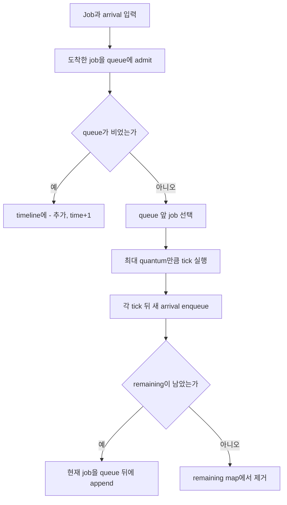
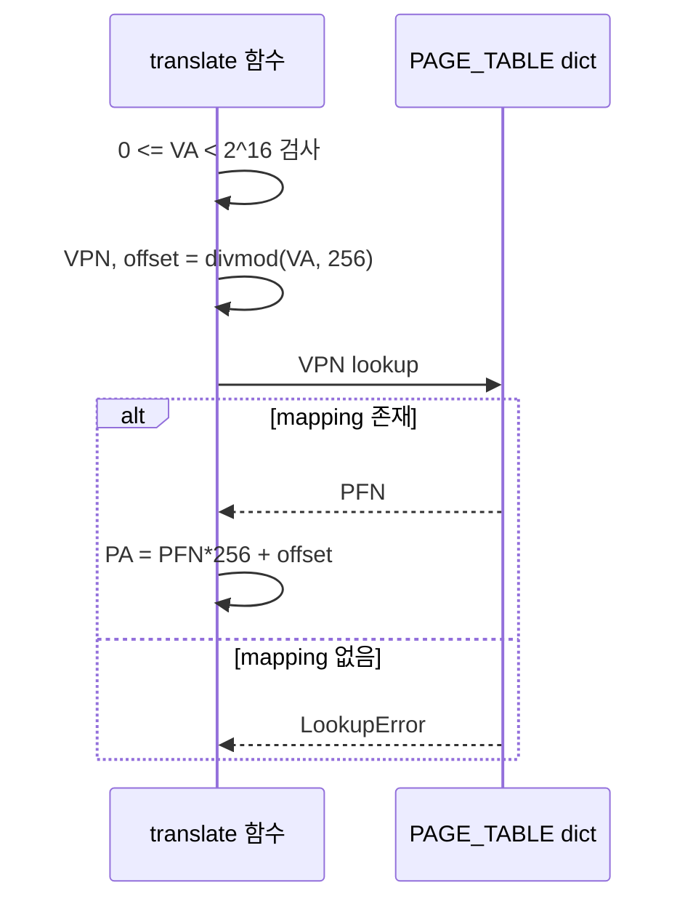

# 12. 로컬 모형 실습: 스케줄링·주소 변환·레이스

[이 책 목차](README.md) · [이전](11-platform-connections.md) · [다음](13-exercises-and-glossary.md)

이 장은 Python 표준 라이브러리만 사용하는 세 개의 작은 계산 모형을 읽는다. 실제 kernel 설정을 바꾸거나 thread race를 일부러 실행하지 않는다. 코드의 입력, 내부 상태, 한 단계의 전이, 출력 숫자가 어떻게 연결되는지 손으로 검산하는 것이 목적이다.

- [`examples/scheduler.py`](examples/scheduler.py): 한 CPU의 FCFS·SJF·Round Robin queue 모형
- [`examples/address_translation.py`](examples/address_translation.py): 16-bit virtual address 한 단계 변환 모형
- [`examples/race_interleavings.py`](examples/race_interleavings.py): 두 thread 단계의 가능한 순서를 모두 열거하는 결정적 모형

## 1. 실습과 실제 시스템의 경계

model은 현실에서 중요한 일부 관계만 남긴 단순화다. 모형이 숫자를 정확히 계산해도 현실 전체를 증명하지 않는다.

scheduler 모형의 한 tick은 코드가 만든 이산 시간 단위다. 1 ms나 CPU cycle이라고 정하지 않았다. context-switch 비용, cache, I/O, priority, multi-core, Linux EEVDF가 없다.

주소 변환 모형의 page table은 Python dictionary 하나다. 실제 CPU의 다단 page table, TLB, permission bit, page fault handler, swap과 NUMA가 없다.

레이스 모형은 실제 thread를 만들지 않는다. Python list와 dictionary로 가능한 단계 순서를 순서대로 계산한다. C++에서 data race가 만드는 undefined behavior를 실행하거나 CPU memory ordering을 모사하지 않는다. 출력의 18/20을 실제 실패 확률 90%라고 해석하면 안 된다.

이 경계를 먼저 적어야 “toy에서 일치했다”를 “Linux에서도 보장된다”로 확대하지 않는다.

## 2. 실행 명령의 의미

저장소 root에서 사용하는 명령은 다음과 같다.

```bash
python3 -B learning/operating-systems/examples/scheduler.py
python3 -B learning/operating-systems/examples/address_translation.py
python3 -B learning/operating-systems/examples/race_interleavings.py
```

`python3`는 Python 3 interpreter를 실행한다. `-B`는 `__pycache__` bytecode cache 파일을 만들지 않게 한다. 이 option이 계산 의미를 바꾸지는 않는다. 세 script는 외부 package를 import하지 않는다.

이 장은 코드와 이미 확인된 고정 출력에 맞춰 설명한다. 현재 작업에서 별도 OS 성능 실험이나 kernel 관측을 실행한 것은 아니다. 다른 Python version에서도 정수·collection 동작은 같아야 하지만, 수정한 코드나 다른 입력은 다시 확인해야 한다.

## 3. scheduler 모형의 객체

`scheduler.py`에서 `Job`은 이름, 도착 시각 `arrival`, 필요한 CPU tick `burst`를 가진 immutable data object다.

```python
JOBS = (Job("A", 0, 5), Job("B", 1, 2), Job("C", 2, 1))
```

arrival은 job이 ready 후보가 되는 tick이다. burst는 I/O 없이 완료하는 데 필요한 CPU tick 합이다. timeline은 각 tick에 실행한 job 이름을 차례로 저장한 list다. `-`는 실행 가능한 job이 없어 CPU가 idle인 tick이다.

| Job | arrival | burst |
|---|---:|---:|
| A | 0 | 5 |
| B | 1 | 2 |
| C | 2 | 1 |

`pending`은 아직 완료되지 않았고 non-preemptive 함수가 아직 선택하지 않은 job list다. `ready`는 현재 `arrival <= time`인 pending job들이다. 이 모형의 non-preemptive 정책은 한 job을 고르면 `burst` 전체를 timeline에 한꺼번에 넣는다. 실행 중 새 job이 와도 선점하지 않는다.

## 4. FCFS를 코드와 같은 순서로 계산한다

FCFS 호출은 key로 `(arrival, name)`을 사용한다. 먼저 arrival가 작은 job을 고르고 같으면 이름으로 tie를 푼다.

초기 `time=0`, pending은 A, B, C다.

| 선택 단계 | time | ready | 선택 | timeline에 추가 | 새 time |
|---:|---:|---|---|---|---:|
| 1 | 0 | A | A | A A A A A | 5 |
| 2 | 5 | B, C | B | B B | 7 |
| 3 | 7 | C | C | C | 8 |

따라서 출력 timeline은 정확히 다음이다.

```text
A A A A A B B C
```

`summarize`는 timeline index를 tick으로 본다. 처음 이름을 본 index를 `first`에 한 번만 저장하고, 볼 때마다 `finish=name의 마지막 index+1`로 갱신한다.

A는 index 0에서 처음 실행하고 index 4 뒤 시각 5에 끝난다.

- turnaround = finish 5 - arrival 0 = 5
- response = first 0 - arrival 0 = 0
- waiting = turnaround 5 - burst 5 = 0

B는 first 5, finish 7이다.

- turnaround = 7 - 1 = 6
- response = 5 - 1 = 4
- waiting = 6 - 2 = 4

C는 first 7, finish 8이다.

- turnaround = 8 - 2 = 6
- response = 7 - 2 = 5
- waiting = 6 - 1 = 5

실제 출력은 다음 형식이다.

```text
FCFS
timeline: A A A A A B B C
A turnaround 5 waiting 0 response 0
B turnaround 6 waiting 4 response 4
C turnaround 6 waiting 5 response 5
```

## 5. 이 코드의 SJF가 C부터 시작하지 않는 이유

SJF 호출은 `(burst, arrival, name)`이 작은 ready job을 고른다. 그러나 `t=0`에는 A만 도착해 있다. 미래 `t=2`에 올 C를 미리 선택하지 않는다. 또한 non-preemptive이므로 A 실행 중 B와 C가 도착해도 A를 멈추지 않는다.

| 선택 단계 | time | ready와 burst | 선택 | timeline | 새 time |
|---:|---:|---|---|---|---:|
| 1 | 0 | A:5 | A | A A A A A | 5 |
| 2 | 5 | B:2, C:1 | C | C | 6 |
| 3 | 6 | B:2 | B | B B | 8 |

정확한 timeline은 `A A A A A C B B`다.

지표도 끝까지 계산한다.

| Job | first | finish | turnaround | waiting | response |
|---|---:|---:|---:|---:|---:|
| A | 0 | 5 | 5 | 0 | 0 |
| B | 6 | 8 | `8-1=7` | `7-2=5` | `6-1=5` |
| C | 5 | 6 | `6-2=4` | `4-1=3` | `5-2=3` |

```text
SJF
timeline: A A A A A C B B
A turnaround 5 waiting 0 response 0
B turnaround 7 waiting 5 response 5
C turnaround 4 waiting 3 response 3
```

모든 job의 arrival를 0으로 바꾼다는 별도 가정에서는 C→B→A가 된다. 현재 코드의 입력은 그렇지 않다. “SJF는 무조건 가장 짧은 C부터”라는 결론은 arrival 조건을 지운 오류다.

## 6. Round Robin의 queue를 한 tick씩 추적한다

Round Robin은 `deque`를 ready queue로 쓴다. quantum 2는 한 번 queue 앞에서 뽑힌 job이 최대 2 tick 실행한다는 뜻이다.

`remaining`은 각 job에 남은 burst다. `admitted`는 이미 ready queue에 한 번 들어온 job 이름 set이다. 새 job을 중복으로 append하지 않게 한다.

중요한 순서는 다음과 같다.

1. 현재 time까지 도착한 새 job을 queue 뒤에 넣는다.
2. queue 앞 job을 꺼낸다.
3. `min(quantum, remaining)`만큼 한 tick씩 실행한다.
4. 매 tick time을 올린 뒤 새로 도착한 job을 queue에 넣는다.
5. quantum 뒤 남은 일이 있으면 현재 job을 queue 뒤에 다시 넣는다.

상태를 표로 적는다.

| 구간 | 실행 전 queue | 실행 | 구간 중 새 도착 | 실행 뒤 remaining | 다음 queue |
|---|---|---|---|---|---|
| `[0,2)` | A | A A | t1 B, t2 C | A=3 | B, C, A |
| `[2,4)` | B, C, A | B B | 없음 | B=0, 제거 | C, A |
| `[4,5)` | C, A | C | 없음 | C=0, 제거 | A |
| `[5,7)` | A | A A | 없음 | A=1 | A |
| `[7,8)` | A | A | 없음 | A=0, 제거 | empty |

timeline은 `A A B B C A A A`다.

| Job | first | finish | turnaround | waiting | response |
|---|---:|---:|---:|---:|---:|
| A | 0 | 8 | 8 | 3 | 0 |
| B | 2 | 4 | 3 | 1 | 1 |
| C | 4 | 5 | 3 | 2 | 2 |

```text
RR(q=2)
timeline: A A B B C A A A
A turnaround 8 waiting 3 response 0
B turnaround 3 waiting 1 response 1
C turnaround 3 waiting 2 response 2
```



quantum을 1로 바꾸면 queue가 `A→B→A→C→B→A→A→A`처럼 변할 수 있다. 이 값은 코드를 수정하지 않고 같은 admission 규칙을 손으로 적용한 변형 계산이다. 실제 context switch tick은 timeline에 넣지 않으므로 quantum만 바꾼 결과도 실제 wall-clock overhead를 보여 주지 않는다.

## 7. idle tick과 입력 검사의 의미

`nonpreemptive`에서 ready가 비면 timeline에 `-`를 넣고 time을 1 올린다. 예를 들어 A의 arrival를 2로 바꾼 hypothetical input이면 처음 두 칸은 `- -`가 된다. 이 모형의 CPU utilization은 job 이름 칸 수를 전체 timeline 길이로 나눠 계산할 수 있다.

`round_robin(0)`이나 음수를 호출하면 `ValueError`를 낸다. quantum 0이면 loop가 진전하지 않을 수 있기 때문에 입력 경계에서 거절한다. 현재 main은 quantum 2만 호출하므로 오류 경로는 출력되지 않는다.

이 검사는 실제 scheduler의 time slice 범위 검증과 같은 구현이 아니다. toy loop가 유한하게 진행하기 위한 contract다.

## 8. 주소 변환 모형의 비트와 객체

`address_translation.py`의 상수는 다음과 같다.

```text
ADDRESS_BITS = 16
PAGE_SIZE = 256 = 2^8
PAGE_TABLE = {0x12: 0x3A, 0x7F: 0x04}
```

virtual address(VA)는 program이 사용하는 주소다. virtual page number(VPN)은 VA가 어느 virtual page에 속하는지 나타내는 위쪽 부분이다. offset은 page 안에서 몇 번째 byte인지 나타내는 아래쪽 부분이다.

page size 256은 `2^8`이므로 offset은 8 bit다. 전체 16 bit에서 남은 VPN도 8 bit다.

page table dictionary의 key는 VPN, value는 physical frame number(PFN)다. 실제 page table entry의 present, writable, executable, user bit는 이 모형에 없다.

`divmod(logical, PAGE_SIZE)`는 몫 VPN과 나머지 offset을 동시에 만든다. mapping이 있으면 `PFN×PAGE_SIZE+offset`으로 physical address(PA)를 계산한다.

## 9. 세 주소를 손으로 검산한다

### VA `0x1234`

`0x100=256`이므로 위 두 hex digit이 VPN, 아래 두 digit이 offset이다.

- VPN = `0x12`
- offset = `0x34`
- PAGE_TABLE[`0x12`] = PFN `0x3A`
- PA = `0x3A×0x100+0x34 = 0x3A34`

출력은 Python hex format 때문에 소문자다.

```text
VA 0x1234 -> VPN 0x12, offset 0x34 -> PA 0x3a34
```

### VA `0x7FFE`

- VPN = `0x7F`
- offset = `0xFE`
- PFN = `0x04`
- PA = `0x04×0x100+0xFE = 0x04FE`

```text
VA 0x7ffe -> VPN 0x7f, offset 0xfe -> PA 0x04fe
```

### VA `0x2201`

- VPN = `0x22`
- offset = `0x01`
- dictionary에 VPN `0x22`가 없음
- `LookupError("VPN 0x22: page fault 모형")` 발생
- main의 `except`가 message를 출력

```text
VA 0x2201 -> VPN 0x22: page fault 모형
```

여기서 “page fault 모형”은 dictionary mapping 없음만 뜻한다. 실제 page fault handler가 zero page를 줄지, file I/O를 시작할지, swap-in할지, signal을 보낼지 계산하지 않는다.



## 10. 주소 범위와 page size 변형

`translate`는 `0 <= logical < 2^16`을 검사한다. `-1`이나 `0x10000`은 16-bit 범위를 벗어나 `ValueError`다. dictionary lookup 전에 잘못된 주소 폭을 거절한다.

page size를 512=`2^9`로 바꾸면 offset은 9 bit, VPN은 `16-9=7 bit`다. hex digit 경계가 4 bit이므로 이제 단순히 아래 두 hex digit만 떼면 안 된다. bit mask `0x1FF`와 right shift 9에 해당하는 계산이 필요하다.

현재 256-byte 설정에서 mapping `0x22→0x01`을 추가한다는 hypothetical 변형이면 VA `0x2201`의 PA는 `0x01×0x100+0x01=0x0101`이다. 코드는 수정하지 않았으며 손 계산 결과다.

## 11. race 모형이 열거하는 순서

`race_interleavings.py`는 두 actor A와 B가 각자 가진 단계 순서를 유지하면서 전체 순서에 섞이는 모든 경우를 만든다.

A가 3단계라면 전체 6칸 중 A가 들어갈 3칸을 고른다. 조합 수는 다음과 같다.

```text
C(6,3) = 6! / (3!×3!) = 20
```

A가 선택되지 않은 칸에는 B가 들어간다. A 내부 순서와 B 내부 순서는 바뀌지 않는다. 예를 들어 `A A B A B B`는 가능하지만 A의 write가 A의 read보다 앞서는 schedule은 만들지 않는다.

`simulate`의 shared `value`는 counter다. `local[A]`와 `local[B]`는 각 thread의 register-like 임시 값을 표현한다. `progress`는 actor가 자기 몇 번째 step을 실행할 차례인지 기록한다.

trace row는 `(actor, operation, before, after, local)`이다. before와 after는 그 step 전후 shared value이며 local은 actor의 임시 값이다.

## 12. split-three가 20개 중 18개에서 1이 되는 이유

`split_three`는 증가를 세 단계로 나눈다.

1. read: shared value를 local에 복사
2. add: local에 1을 더함
3. write: local을 shared value에 저장

A 세 단계가 모두 B보다 앞서는 `A A A B B B`와 B가 모두 앞서는 `B B B A A A`에서는 첫 증가가 완료된 뒤 두 번째 thread가 1을 읽으므로 최종 2다.

나머지 18개 ordering에서는 두 thread가 모두 첫 write 전에 0을 읽는 lost update 조건이 만들어진다. 코드의 assert는 `{1:18, 2:2}`와 정확히 같은지 검사한다.

처음 발견하는 losing trace는 다음 순서다.

| step | actor | operation | shared before | shared after | actor local |
|---:|---|---|---:|---:|---:|
| 1 | A | read | 0 | 0 | 0 |
| 2 | A | add | 0 | 0 | 1 |
| 3 | B | read | 0 | 0 | 0 |
| 4 | A | write | 0 | 1 | 1 |
| 5 | B | add | 1 | 1 | 1 |
| 6 | B | write | 1 | 1 | 1 |

B의 add 단계에서 shared는 이미 1이지만 B는 자기 local 0에 1을 더한다. local 값을 다시 shared에서 읽지 않는다. 그래서 마지막 write가 1을 덮어쓴다.

출력은 다음과 같다.

```text
split_three: schedules=20, outcomes={1: 18, 2: 2}
```

20 schedule을 실제 CPU가 같은 확률로 선택한다는 가정은 코드에 없다. 이 수는 가능한 order-preserving 조합의 개수다.

## 13. atomic load와 atomic store를 따로 써도 lost update가 남는다

`atomic_load_store`는 각 thread에 두 단계가 있다.

1. atomic_load로 shared를 local에 읽음
2. atomic_store로 `local+1`을 shared에 씀

전체 schedule 수는 `C(4,2)=6`이다. A load→A store→B load→B store와 그 반대 두 schedule만 최종 2다. A load→B load→A store→B store처럼 두 load가 모두 0을 보면 최종 1이다.

```text
atomic_load_store: schedules=6, outcomes={1: 4, 2: 2}
```

각 load와 store가 개별적으로 atomic이어도 “읽은 값에 1을 더해 다시 쓰는” 전체 read-modify-write는 하나의 원자 연산이 아니다. 언어 차원의 data race는 피할 수 있어도 논리적 race condition은 남을 수 있다.

이 toy는 C++ `std::atomic`의 memory order나 visibility를 구현하지 않는다. 단지 개별 load/store가 쪼개지지 않는다는 계산만 표현한다.

## 14. atomic RMW와 mutex 전체 증가

`atomic_rmw` 모형은 증가 전체를 하나의 indivisible step으로 만든다. A, B 두 step의 순서는 AB와 BA 두 개뿐이며 둘 다 shared를 두 번 증가시켜 최종 2다.

`mutex_whole_increment`도 lock acquisition과 release를 따로 모형화하지 않고 “mutex가 증가 전체를 한 번에 보호했다”는 결과를 한 step으로 표현한다.

```text
atomic_rmw: schedules=2, outcomes={2: 2}
mutex_whole_increment: schedules=2, outcomes={2: 2}
```

실제 mutex에는 경쟁, sleep/wakeup, fairness, lock owner crash, memory ordering과 context-switch 비용이 있다. 실제 atomic RMW도 cache coherence traffic과 hardware 지원 비용이 있다. 두 모형의 출력이 같다고 성능과 progress guarantee도 같다는 뜻은 아니다.

## 15. 세 모형을 결합한 page-fault 시간선

A가 VA `0x2201`을 읽는데 mapping이 없고, B는 CPU burst 2 tick이 ready라고 하자. page I/O가 tick 1부터 3까지 걸린다는 추가 가정을 둔다.

| tick 시작 | A 상태 | B 상태 | CPU와 memory 사건 |
|---:|---|---|---|
| 0 | running | ready | A load, VPN 0x22 mapping 없음, page fault |
| 1 | blocked | running | kernel이 I/O 요청, B 첫 CPU tick |
| 2 | blocked | running | I/O 진행, B 둘째 tick |
| 3 | runnable | finished | completion이 page와 PTE를 준비하고 A wakeup |
| 4 | running | finished | A가 faulting load instruction 재시도 |
| 5 | running 또는 완료 | finished | 이번에는 mapping lookup 성공 가능 |

주소 script 자체는 `LookupError`에서 끝난다. scheduler script 자체는 blocked/I/O 상태가 없다. 이 표는 두 모형 사이에 “fault→blocked→completion→runnable→retry”라는 새 상태를 손으로 추가한 결합 사례다.

page cache에 data가 이미 있거나 demand-zero fault라면 storage I/O 없이 더 빨리 해결될 수 있다. CPU가 여러 개면 B 실행과 fault handler 일부가 겹칠 수 있다. 따라서 tick 3 completion은 실제 Linux timing 예측이 아니다.

## 16. 관찰 문제와 자세한 해설

### 문제 1. SJF 출력

현재 입력에서 SJF timeline과 B의 response를 구하라.

**해설:** t0에는 A만 있어 A가 5 tick 끝까지 실행된다. t5에는 C burst1이 B burst2보다 짧아 C, 그 뒤 B다. timeline은 `A A A A A C B B`다. B first=6, arrival=1이므로 response=5다.

### 문제 2. RR queue

q=2에서 A가 첫 quantum 뒤 B와 C보다 앞에 다시 들어가는가?

**해설:** 아니다. B는 t1, C는 t2에 각 tick 처리 중 admit된다. quantum이 끝난 A는 그 뒤 queue에 append되므로 t2 queue는 B,C,A다. 그래서 B와 C가 A의 나머지보다 먼저 실행된다.

### 문제 3. 주소 계산

VA `0x7FFE`의 VPN, offset, PFN, PA를 쓰라.

**해설:** 256-byte page라 아래 8 bit가 offset이다. VPN=0x7F, offset=0xFE, dictionary PFN=0x04, PA=`0x04×0x100+0xFE=0x04FE`다.

### 문제 4. 512-byte page

16-bit VA에서 page size 512라면 offset과 VPN bit 수는?

**해설:** 512=`2^9`이므로 offset 9 bit, VPN 7 bit다. hex digit만 둘로 나누는 방식은 8-bit 경계에서만 편리했다.

### 문제 5. lost update trace

`A read, A add, B read, A write, B add, B write`의 최종값은?

**해설:** A local=1, B는 A write 전에 0을 읽어 local=1이다. A가 1을 쓰고 B도 1을 써 최종 1이다. B add 순간 shared가 1이어도 B는 local 0을 사용한다.

### 문제 6. atomic load/store

atomic load와 atomic store를 사용했는데 왜 6개 schedule 중 4개가 최종 1인가?

**해설:** 두 operation 각각은 indivisible이지만 둘 사이에 다른 thread load가 들어올 수 있다. 둘 다 0을 읽은 뒤 각각 1을 store하면 lost update다. 전체 증가를 atomic RMW나 mutex critical section으로 묶어야 한다.

### 문제 7. schedule count

thread 두 개가 각각 순서를 유지하는 3단계를 가질 때 왜 20개인가?

**해설:** 전체 6칸 중 A의 3칸을 고르면 나머지는 B다. `C(6,3)=20`이다. 가능한 CPU timing 확률이 아니라 모형이 열거한 조합 수다.

### 문제 8. 실제 C++ 경계

`split_three` 결과가 C++ non-atomic counter program도 반드시 18/20 확률로 1이라는 증거인가?

**해설:** 아니다. C++ data race는 undefined behavior일 수 있고 compiler 최적화와 CPU memory model이 toy interleaving보다 넓은 결과를 만들 수 있다. toy는 실제 thread를 실행하지 않으며 여섯 추상 step의 조합만 센다.

## 17. 보고서 양식

```text
질문:
모형의 객체:
입력과 단위:
초기 상태:
한 단계의 전이 규칙:
손 계산한 전체 상태:
예상 출력:
코드의 고정 출력:
차이가 있다면 원인:
생략된 실제 OS/언어 조건:
조건 하나를 바꾼 새 가설:
```

결과 숫자만 적지 않는다. scheduler는 queue 상태, 주소 변환은 VPN·offset·PFN, race는 shared와 thread-local 값을 함께 적는다. 그래야 출력 불일치가 계산 오류인지 가정 차이인지 찾을 수 있다.

---

[이전 장: 플랫폼 연결](11-platform-connections.md) · [다음 장: 종합 문제와 용어집](13-exercises-and-glossary.md)
