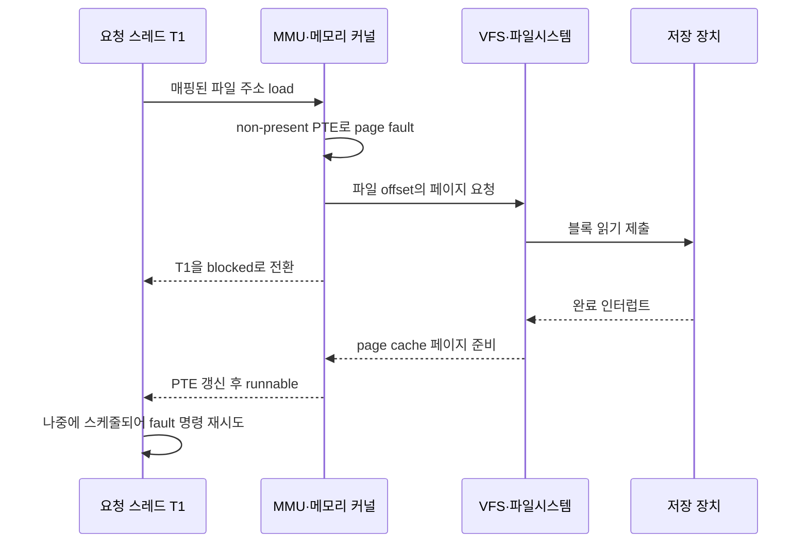
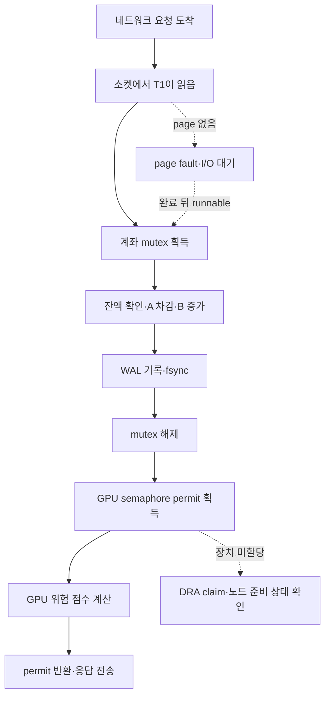
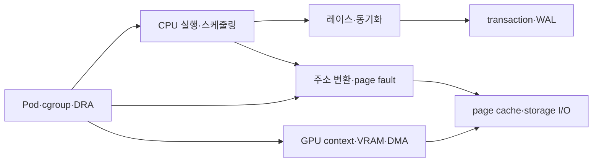

# 13. 종합 문제와 용어집

[이 책 목차](README.md) · [이전](12-local-model-labs.md)

이 장의 목적은 용어를 따로 외우는 것이 아니다. 하나의 은행 이체 요청이 CPU에서 실행되고, 공유 잔액을 바꾸고, 저장 장치에 기록되고, Kubernetes Pod와 GPU를 거쳐 끝날 때까지 **어떤 객체가 어디에 있으며 누가 그 객체를 바꾸는지** 추적하는 것이다. 아래 숫자는 원리를 드러내기 위한 교육용 모형이다. 실제 Linux 스케줄러, 데이터베이스, GPU 드라이버의 구현을 그대로 재현하거나 성능을 예측하지 않는다.

## 1. 하나의 요청을 끝까지 따라가기

### 1.1 등장인물과 실제 객체

고객이 계좌 A에서 B로 100원을 보내는 요청을 보냈다고 하자. **Pod**는 Kubernetes가 함께 배치하고 관리하는 하나 이상의 컨테이너 묶음이다. 이 Pod 안에서 은행 서버 **프로세스**가 실행된다. 프로세스는 단순한 실행 파일이 아니라, 실행 중인 코드와 가상 주소 공간, 열린 파일, 권한을 묶은 커널 관리 단위다. 프로세스 안에는 요청을 처리하는 스레드 T1과 T2가 있다. **스레드**는 프로그램 카운터, 레지스터, 스택을 따로 가지며 CPU 시간을 배정받는 실행 흐름이다.

커널은 실행 가능한 스레드 가운데 하나를 CPU 코어에 올린다. **컨텍스트 스위치**는 코어가 실행하던 스레드의 프로그램 카운터와 스택 포인터 같은 실행 상태를 저장하고 다른 스레드의 상태를 복원하는 일이다. 전체 프로세스 메모리를 복사하는 작업이 아니다. 같은 프로세스의 T1과 T2는 힙에 놓인 계좌 캐시를 공유하므로, T1이 멈춘 동안 T2가 같은 잔액을 바꿀 수 있다.

요청 처리에는 다음 객체가 참여한다.

| 객체 | 대표 위치 | 주된 소유·관리 주체 | 대략적인 수명 |
|---|---|---|---|
| T1, T2 실행 상태 | CPU 레지스터와 커널의 task 자료구조 | Linux 커널 스케줄러 | 스레드 생성부터 종료까지 |
| 계좌 캐시 `balance[A]` | 프로세스 가상 주소 공간의 힙 | 은행 서버 | 프로세스 또는 캐시 항목 수명 |
| mutex | 프로세스 메모리와 커널 대기 자료구조 | 애플리케이션과 커널 | 생성부터 파괴까지 |
| 소켓과 파일 디스크립터 | 프로세스의 fd 표 | 프로세스와 커널 VFS | open/socket부터 close까지 |
| WAL 레코드 | 메모리 버퍼, page cache, 저장 장치 | 데이터베이스와 커널·장치 | 보존 정책까지 |
| cgroup 계정 | 커널 cgroup 계층 | kubelet과 Linux 커널 | Pod/cgroup 수명 |
| GPU 할당 정보 | Kubernetes 객체와 노드 드라이버 상태 | 제어면, kubelet, DRA 드라이버 | claim 할당부터 해제까지 |
| GPU 메모리 버퍼 | GPU의 VRAM | GPU 드라이버와 프로세스 | 할당부터 free/프로세스 종료까지 |

**힙**은 실행 중 동적으로 만든 객체가 흔히 놓이는 가상 주소 영역이다. **가상 주소**는 프로그램이 사용하는 주소이고, CPU의 메모리 관리 장치인 MMU가 이를 물리 메모리 위치로 변환한다. 이 표가 중요한 이유는 “Pod가 메모리를 쓴다” 같은 문장을 더 정확한 질문으로 바꾸기 위해서다. 어느 프로세스의 어느 가상 페이지인지, cgroup에 얼마가 청구되는지, GPU VRAM인지 호스트 RAM인지에 따라 원인과 해결책이 달라진다.

### 1.2 네 단계 이체와 레이스

두 요청이 같은 계좌에서 동시에 출금한다고 하자. 초기 A 잔액은 1,000원이다.

- T1: A에서 100원 출금
- T2: A에서 200원 출금

프로그램의 `balance[A] -= amount` 한 줄도 실제로는 “읽기, 계산, 쓰기”로 나뉠 수 있다.

| 시점 | 실행 스레드 | 동작 | 공유 메모리 A | 스레드의 임시 값 |
|---:|---|---|---:|---:|
| 1 | T1 | A를 읽음 | 1,000 | T1=1,000 |
| 2 | T1 | 1,000-100 계산 | 1,000 | T1=900 |
| 3 | T2 | A를 읽음 | 1,000 | T2=1,000 |
| 4 | T2 | 1,000-200 계산 | 1,000 | T2=800 |
| 5 | T1 | 900을 씀 | 900 | T1=900 |
| 6 | T2 | 800을 씀 | 800 | T2=800 |

올바른 결과는 700원이지만 결과는 800원이다. T1의 갱신이 사라졌다. **레이스 컨디션**은 결과의 정당성이 실행 순서에 의존하는 상태다. 한 CPU에서도 시점 2와 3 사이에 타이머 선점이나 blocking 호출로 컨텍스트 스위치가 일어나면 이 순서가 가능하다. 여러 CPU는 동시에 진행할 수 있어 가능한 순서가 더 많아진다.

여기서 **임계 구역**은 공유 불변조건을 깨뜨릴 수 있어 한 번에 정해진 실행자만 들어가야 하는 코드 구간이다. **불변조건**은 올바른 모든 상태에서 유지되어야 할 식이다. 수수료가 없고 다른 거래가 없다면 이체 전후의 `A+B` 합계가 같아야 한다. 잔액 확인, A 차감, B 증가를 따로 보호하면 중간에 다른 스레드가 끼어 합계나 잔액 제한을 깨뜨릴 수 있다. 세 동작 전체가 하나의 임계 구역이어야 한다.

### 1.3 mutex는 무엇을 보장하는가

초기 B 잔액은 500원이다. **mutex**는 mutual exclusion, 즉 상호 배제를 위한 잠금 객체다. 보통 한 실행자가 소유하며, 다른 실행자는 소유자가 unlock할 때까지 들어가지 못한다.

```text
lock(transfer_mutex)
  A 잔액 확인
  A에서 100 차감
  B에 100 증가
unlock(transfer_mutex)
```

T1이 잠금을 획득하면 T2는 임계 구역 앞에서 기다린다. T1이 A=900, B=600으로 만든 뒤 잠금을 풀고, T2가 그 새 상태에서 시작한다. mutex가 보호하는 것은 “코드 줄” 자체라기보다 그 코드가 접근하는 공유 상태와 불변조건이다. 같은 잔액을 잠금 없이 바꾸는 다른 경로가 남아 있으면 보호는 완전하지 않다.

CPU가 바뀌는 것과 mutex는 다른 문제다. 잠금을 가진 T1도 실행 도중 선점될 수 있다. 이때 T2가 CPU를 받아도 같은 잠금을 얻지 못하므로 잔액 변경을 진행하지 못한다. 즉 mutex는 컨텍스트 스위치를 금지하지 않고, 특정 공유 상태에 대한 동시 진입을 제한한다.

### 1.4 semaphore는 mutex의 다른 이름이 아니다

GPU 위험 점수 계산을 동시에 최대 3건만 허용한다고 하자. **semaphore**는 사용할 수 있는 허가증, 즉 permit의 개수를 저장하는 동기화 객체다. 초기값 3에서 요청이 들어오면 하나를 얻어 값이 2, 1, 0으로 줄고, 작업을 마치면 반환해 다시 늘어난다. 값이 0이면 다음 요청은 기다린다.

| 사건 | 허가 수 | GPU 계산 중인 요청 |
|---|---:|---|
| 시작 | 3 | 없음 |
| R1 acquire | 2 | R1 |
| R2 acquire | 1 | R1, R2 |
| R3 acquire | 0 | R1, R2, R3 |
| R4 acquire 시도 | 0 | R4는 대기 |
| R2 release | 1 뒤 즉시 R4가 획득해 0 | R1, R3, R4 |

이 semaphore는 GPU 동시 사용량을 제한하지만 계좌 A의 갱신을 보호하지 않는다. permit이 3개이므로 세 요청이 같은 잔액을 동시에 바꿀 수 있기 때문이다. 초기값 1인 이진 semaphore가 상호 배제에 쓰일 수는 있지만, 소유권 규칙과 오류 검사 등 mutex의 계약과 항상 같지는 않다. 도구 이름보다 “보호할 불변조건이 무엇이고, 동시에 몇 명을 허용해야 하는가”를 먼저 써야 한다.

### 1.5 두 mutex와 교착상태

동시성을 높이려고 계좌마다 mutex를 둔다고 하자. T1은 A→B 이체라서 A 잠금 뒤 B 잠금을 잡고, T2는 B→A 이체라서 B 잠금 뒤 A 잠금을 잡는다.

```text
T1: lock(A) 성공 → lock(B) 대기
T2: lock(B) 성공 → lock(A) 대기
```

**교착상태**는 관련 작업들이 서로가 가진 자원을 기다려 외부 개입 없이는 더 진행하지 못하는 상태다. 기다림 그래프를 그리면 `T1 → B mutex → T2 → A mutex → T1`이라는 순환이 생긴다. CPU 시간을 더 주어도 두 스레드는 필요한 잠금을 얻지 못하므로 해결되지 않는다.

가장 단순한 예방은 모든 이체가 계좌의 안정적인 ID가 작은 mutex부터 잡게 하는 것이다. A의 ID가 B보다 작다면 양방향 이체 모두 A→B 순서를 사용한다. 순환이 있으려면 어떤 단계에서는 더 큰 ID를 잡은 채 더 작은 ID를 기다려야 하지만 규칙이 이를 금지하므로 순환이 성립하지 않는다. `trylock` 실패 시 이미 잡은 잠금을 풀고 재시도하는 방법도 있지만, 두 스레드가 똑같이 잡고 풀기를 반복하면 **라이브락**, 즉 상태는 움직여도 유용한 완료가 없는 현상이 생길 수 있다. 무작위 또는 제한된 backoff가 충돌을 줄일 뿐, 모든 환경에서의 공정성을 자동 보장하지는 않는다.

## 2. 요청이 메모리와 I/O를 지나는 과정

### 2.1 주소, 페이지, page fault

T1이 계좌 캐시 주소를 읽을 때 CPU는 가상 주소를 **페이지** 단위로 나눈다. 페이지는 가상 메모리를 관리하는 고정 크기 구간이고, 같은 크기의 물리 메모리 칸을 프레임이라 한다. **페이지 테이블**은 가상 페이지 번호를 물리 프레임 번호와 접근 권한에 연결하는 커널 관리 구조다. CPU 안의 **TLB**는 최근 주소 변환을 저장하는 작은 캐시다.

TLB에 변환이 없다는 TLB miss만으로 저장 장치 I/O가 필요하지는 않다. 페이지 테이블에 유효한 매핑이 있으면 변환을 채우고 명령을 계속할 수 있다. 반면 **page fault**는 현재 매핑이나 권한만으로 접근을 끝낼 수 없어 CPU가 커널의 fault 처리기로 들어가는 예외다. 파일 데이터가 page cache에도 없으면 커널은 저장 장치 읽기를 요청하고 T1을 blocked 상태로 둔다. **blocked**는 기다리는 사건이 끝나기 전에는 CPU에서 진행할 수 없는 상태다.



**page cache**는 파일 내용을 RAM 페이지에 보관하는 커널 캐시다. 이미 필요한 페이지가 있다면 장치 읽기 없이 fault를 해결할 수 있다. 장치 완료 인터럽트가 T1을 즉시 실행시키는 것도 아니다. 커널은 T1을 runnable, 즉 CPU만 받으면 실행 가능한 상태로 바꾸고, 스케줄러가 나중에 선택할 때 실행한다.

### 2.2 Pod 메모리 제한과 여러 종류의 메모리

**cgroup**은 Linux가 프로세스 집합의 CPU·메모리 같은 자원 사용량을 세고 제한하는 계층 구조다. Kubernetes의 kubelet은 Pod와 컨테이너를 해당 cgroup에 넣는다. 노드에 물리 RAM이 남아 있어도 그 Pod의 cgroup 사용량이 memory limit에 닿으면 그 범위 안에서 회수 압력이나 OOM 처리가 일어날 수 있다. **OOM**은 out of memory의 약자로, 필요한 메모리를 만족시키지 못해 커널이 실패를 처리하는 상황이다.

“이 Pod가 4 GiB를 쓴다”는 말도 세분해야 한다.

- 프로세스 힙과 스택의 익명 페이지
- 파일 내용을 담은 page cache
- GPU 전송을 위해 고정한 host RAM
- GPU 장치 자체의 VRAM
- 커널이 소켓과 I/O를 위해 쓰는 버퍼

계정 정책과 드라이버에 따라 어느 cgroup에 얼마나 청구되는지는 달라질 수 있다. VRAM은 일반적으로 호스트의 cgroup RAM limit과 같은 숫자가 아니다. 그래서 host free RAM, Pod memory usage, GPU memory usage를 서로 대체 가능한 하나의 지표처럼 읽으면 안 된다.

### 2.3 fd에서 저장 장치까지

은행 서버가 WAL 파일에 쓸 때 사용하는 **파일 디스크립터(fd)**는 프로세스의 열린 파일 표에서 항목을 가리키는 작은 정수다. 그 항목은 현재 파일 위치와 열기 플래그를 가진 **open file description**을 참조한다. 다시 이것이 파일의 정체성과 권한, 데이터 위치 매핑을 가진 **inode**로 이어진다. inode는 파일 이름 자체가 아니다. 디렉터리가 이름을 inode에 연결한다.

`write(fd, record)`가 성공했다고 해서 전원이 꺼져도 데이터가 남는다는 뜻은 아니다. 데이터베이스의 사용자 공간 버퍼에서 커널 page cache로 복사되었을 뿐일 수 있다. **WAL**은 write-ahead logging의 약자로, 실제 계좌 페이지를 덮어쓰기 전에 복구에 필요한 로그를 먼저 지속 저장하는 원칙이다. **fsync**는 해당 파일의 메모리 내 변경을 저장 장치 쪽과 동기화하도록 요청하는 시스템 호출이다. 성공의 정확한 범위는 파일시스템·장치의 보장과 오류 처리에 의존한다.

안전한 단순 흐름은 다음과 같다.

1. T1이 “A -100, B +100” 로그 레코드를 만든다.
2. 로그와 commit 표식을 WAL에 쓴다.
3. 필요한 WAL 범위를 fsync하여 durable, 즉 장애 뒤에도 복구 가능한 상태로 만든다.
4. 그 뒤 계좌의 home page를 갱신한다.
5. crash 뒤에는 durable commit이 있는 거래를 redo하고, 불완전한 거래는 정책에 따라 무시하거나 undo한다.

파일을 새 파일로 교체하는 방식은 새 파일 fsync, rename, 부모 디렉터리 fsync까지 고려한다. rename 결과인 “이 이름이 새 inode를 가리킨다”는 디렉터리 변경이기 때문이다. 모든 저장 장치와 파일시스템이 똑같은 순서를 보장한다고 가정해서는 안 된다.

## 3. GPU와 Kubernetes까지 연결하기

### 3.1 DRA가 만드는 제어 흐름

**DRA(Dynamic Resource Allocation)**는 Kubernetes가 GPU 같은 장치를 요청하고 할당하는 일반화된 방식이다. 워크로드가 원하는 장치 조건은 ResourceClaim 같은 API 객체로 표현되고, 드라이버가 노드에 있는 장치 정보를 게시하며, 스케줄러와 DRA 구성요소가 만족 가능한 할당을 정한다. 이 객체는 “GPU 계산을 대신 수행하는 것”이 아니라, 어느 Pod가 어느 장치를 쓸 수 있는지 정하는 제어면 상태다.

노드에서 kubelet과 장치 드라이버는 선택된 장치를 컨테이너가 사용할 수 있도록 준비한다. 프로세스가 드라이버 API를 호출하면 GPU 컨텍스트와 VRAM 버퍼가 만들어지고 커널 드라이버를 거쳐 명령이 제출된다. **DMA**는 장치가 CPU가 매 바이트를 복사하지 않고 메모리와 데이터를 전송하는 방식이다. **IOMMU**는 장치가 사용하는 DMA 주소를 변환하고 접근 가능한 메모리 범위를 제한하는 하드웨어다. IOMMU가 있다고 해서 애플리케이션의 계좌 레이스가 해결되지는 않는다. 그것은 장치의 메모리 접근 경계를 다루고, mutex는 스레드 사이 공유 상태의 순서를 다룬다.

### 3.2 한 요청의 전체 시간선



실제 설계에서는 mutex를 잡은 채 느린 fsync나 GPU 작업을 기다리면 다른 이체가 오래 막힌다. 그렇다고 잠금을 무조건 일찍 풀면 데이터베이스 commit과 메모리 상태 사이의 불변조건이 깨질 수 있다. 그래서 실제 시스템은 데이터베이스 transaction, 버전 검증, 작업 큐, idempotency key 같은 더 높은 수준의 기법을 조합한다. 여기서 **transaction**은 여러 상태 변경을 하나의 논리적 단위로 commit하거나 실패시키는 규칙이고, **idempotency key**는 같은 요청을 재시도해도 효과가 한 번만 반영되게 식별하는 값이다. 이 장의 단일 mutex 예제는 경계의 필요성을 보여 주는 모형이지, 고성능 은행 시스템 설계안이 아니다.

## 4. 종합 문제와 완전 풀이

### 문제 1 — syscall, mode switch, context switch

T1이 `getpid()`를 호출하는 경우와, page cache에 없는 파일에 `read()`를 호출하는 경우를 비교하라.

**풀이.** syscall은 사용자 프로그램이 보호된 커널 서비스를 요청하는 진입이다. CPU 권한이 user mode에서 kernel mode로 바뀌는 **mode switch**가 일어나지만, `getpid()`가 바로 끝나면 같은 T1이 돌아오므로 다른 실행 주체로의 context switch는 필요하지 않다. 반면 두 번째 `read()`는 장치 I/O를 제출한 뒤 T1을 blocked로 만들 수 있다. 커널은 T1의 실행 상태를 저장하고 runnable인 T2를 골라 복원한다. 장치 완료 인터럽트는 T1을 runnable로 바꾸지만 즉시 실행을 보장하지 않는다. 나중에 T1이 선택되면 원래 커널 호출 경로를 이어 완료값을 만들고 user mode로 돌아간다. 따라서 syscall, mode switch, context switch는 서로 관련될 수 있지만 같은 사건은 아니다.

### 문제 2 — SJF 계산

A, B, C가 모두 시각 0에 도착하고 CPU burst가 각각 6, 2, 1 tick이다. 비선점 SJF의 순서와 각 turnaround time, 평균을 구하라.

**풀이.** **CPU burst**는 작업이 이번에 CPU를 연속 사용하려는 시간의 교육용 표현이다. SJF는 도착해 있는 작업 중 예상 burst가 가장 짧은 것을 고른다. 모두 시각 0에 있으므로 C→B→A다. C는 시각 1, B는 `1+2=3`, A는 `3+6=9`에 끝난다. **turnaround time**은 `finish-arrival`이므로 각각 1, 3, 9다. 평균은 `(1+3+9)/3=13/3≈4.33` tick이다. 실제 burst를 미리 정확히 안다는 가정이 있으며 실제 Linux 정책을 그대로 나타내지 않는다.

### 문제 3 — RR과 전환 비용

총 유용한 CPU 작업이 20 ms이고 quantum마다 0.2 ms의 전환 비용이 든다고 하자. 작업이 정확히 다섯 quantum으로 나뉜다면 단순 효율은 얼마인가?

**풀이.** **quantum**은 RR 같은 정책이 한 번에 주는 CPU 시간 조각이다. 이 문제는 다섯 조각 각각 뒤에 비용이 한 번 있다고 단순 가정한다. 전환 비용은 `5×0.2=1 ms`, 전체 시간은 `20+1=21 ms`다. 유용 작업 비율은 `20/21≈95.24%`다. 마지막 종료 뒤 전환을 제외하는 모델이면 비용 횟수와 답이 바뀐다. 실제 비용에는 고정 저장·복원 시간뿐 아니라 cache/TLB가 식은 뒤의 간접 비용도 있어 이 계산으로 실측값을 예측할 수 없다.

### 문제 4 — lost update 완전 추적

초기 `x=0`에서 T1과 T2가 각각 `x+=1`을 한 번 수행한다. 결과가 1이 되는 순서를 쓰고 원인을 설명하라.

**풀이.**

| 단계 | 동작 | 공유 x | 지역 값 |
|---:|---|---:|---:|
| 1 | T1 read | 0 | T1=0 |
| 2 | T1 add | 0 | T1=1 |
| 3 | T2 read | 0 | T2=0 |
| 4 | T1 write | 1 | T1=1 |
| 5 | T2 add | 1 | T2=1 |
| 6 | T2 write | 1 | T2=1 |

두 스레드가 모두 이전 값 0을 바탕으로 1을 만들었고 마지막 쓰기가 같은 1을 덮어썼다. 산술 add 하나가 문제가 아니라 read-modify-write 전체가 하나의 원자적 동작이 아니었던 것이 원인이다. Python 모형에서 가능한 순서를 세는 결과는 실제 C/C++ 데이터 레이스의 의미나 CPU 메모리 모델을 증명하지 않는다.

### 문제 5 — atomic load/store가 충분한가

load와 store 각각만 원자적이라면 문제 4가 해결되는가?

**풀이.** 해결되지 않는다. T1 atomic-load 0, T2 atomic-load 0, T1 atomic-store 1, T2 atomic-store 1 순서가 여전히 가능하다. 각 접근이 찢어지지 않았어도 “읽은 값에 1을 더해 다시 쓰기” 전체 사이에 다른 스레드가 들어왔다. atomic fetch-add 같은 하나의 원자적 read-modify-write를 쓰거나, 전체 증가를 같은 mutex로 보호해야 한다. 어떤 memory ordering이 필요한지는 다른 데이터와의 관계까지 보고 정해야 하며 “atomic”이라는 단어만으로 모든 불변조건이 보호되지는 않는다.

### 문제 6 — 이체 임계 구역

A=1,000, B=500에서 100원을 이체한다. A 차감만 잠그고 B 증가는 잠금 밖에서 해도 되는가?

**풀이.** 요구 불변조건이 “완료된 이체마다 A+B 합계가 유지된다”라면 두 갱신을 같은 transaction 경계로 묶어야 한다. A를 900으로 만든 직후 잠금을 풀면 다른 스레드는 합계 1,400인 중간 상태를 볼 수 있다. 장애가 그 사이 발생하면 B 증가는 아예 실행되지 않을 수도 있다. mutex는 프로세스 메모리의 동시 관찰을 제한할 뿐 crash durability를 제공하지도 않는다. 메모리 임계 구역과 데이터베이스 transaction/WAL 경계를 함께 설계해야 한다.

### 문제 7 — semaphore 상태 추적

초기 permit이 2인 semaphore에 R1, R2, R3가 순서대로 acquire하고 R1이 release한다. 각 상태를 쓰고 이것이 잔액 보호 mutex를 대체하는지 답하라.

**풀이.** 시작 2, R1 뒤 1, R2 뒤 0, R3는 대기한다. R1 release로 permit이 반환되면 대기 중인 R3가 획득해 다시 0이 될 수 있다. 깨울 대기자의 정확한 순서는 구현의 공정성 정책에 의존한다. 두 permit은 R1과 R2가 동시에 임계 구역에 들어가게 하므로 단일 잔액의 상호 배제를 보장하지 않는다. 이 semaphore는 GPU 동시 작업 수 제한에는 맞지만 잔액 보호에는 별도 mutex가 필요하다.

### 문제 8 — 교착상태와 전역 순서

T1이 A를 보유하고 B를 기다리며, T2가 B를 보유하고 A를 기다린다. 왜 sleep을 오래 주는 것으로 해결할 수 없고, ID 오름차순 규칙은 왜 순환을 막는가?

**풀이.** 기다림 그래프는 `T1→B→T2→A→T1`이다. 두 스레드는 runnable한 계산을 미룬 것이 아니라 상대가 놓아야 할 mutex를 기다리므로 시간을 더 주어도 unlock 지점에 도달하지 못한다. 모든 스레드가 작은 ID에서 큰 ID 방향으로만 잠금을 추가한다면, 순환을 따라갈 때 ID가 계속 증가해야 한다. 유한한 순환이 시작점으로 돌아오려면 마지막에 큰 ID에서 작은 ID로 내려가야 하므로 규칙과 모순이다. 규칙은 모든 잠금 획득 경로에 빠짐없이 적용되어야 한다.

### 문제 9 — 주소 변환과 fault

16-bit 가상 주소, 256 B 페이지에서 `0xABCD`의 VPN과 offset을 구한다. TLB에 없다는 사실만으로 page fault라고 할 수 있는가?

**풀이.** 256은 `2^8`이므로 아래 8 bit, 즉 아래 두 16진 숫자 `0xCD`가 offset이다. 나머지 위 8 bit `0xAB`가 VPN이다. TLB miss 뒤 하드웨어나 커널이 페이지 테이블을 확인한다. 유효하고 권한이 맞는 PTE가 있으면 변환을 TLB에 넣고 끝날 수 있다. PTE가 non-present이거나 권한상 처리가 필요할 때 page fault 예외가 난다. fault도 zero-fill, copy-on-write, 파일 page-cache hit, 실제 storage I/O처럼 서로 다른 경로를 가질 수 있다.

### 문제 10 — reclaim 판단

메모리 압력 때 clean file page, dirty file page, anonymous page를 각각 어떻게 다루는가?

**풀이.** **reclaim**은 물리 프레임을 다른 용도로 다시 쓰게 회수하는 일이다. clean file page는 저장 장치의 파일과 같은 내용이 있으므로 참조를 정리하고 버린 뒤 필요하면 다시 읽을 수 있다. dirty file page는 RAM의 내용이 더 새로우므로 보통 writeback으로 파일에 반영한 다음 회수한다. anonymous page는 되읽을 파일 원본이 없으므로 swap 같은 backing이 있으면 내보낼 수 있고, 없거나 정책상 불가능하면 다른 페이지를 찾거나 OOM에 이를 수 있다. “파일 페이지는 항상 싸다”는 결론은 dirty 상태와 재읽기 비용을 빠뜨린다.

### 문제 11 — fd 공유와 파일 위치

`dup()`로 만든 fd 3과 fd 4가 같은 open file description을 가리키며 현재 offset은 100이다. fd 3으로 20 B를 읽은 뒤 fd 4로 읽기 시작할 위치는 어디인가?

**풀이.** 두 fd 번호는 서로 다른 표 항목일 수 있지만 같은 open file description을 참조한다. 그 객체의 현재 offset을 공유하므로 첫 read가 성공해 20 B를 소비하면 offset은 120이 되고 fd 4도 120에서 시작한다. 각각 별도 `open()`으로 얻은 객체라면 offset이 독립일 수 있다. inode는 파일 정체성과 데이터 매핑을 나타내며, “현재 어디까지 읽었는가”는 보통 open file description의 상태다.

### 문제 12 — WAL crash 지점

로그 레코드는 저장되었지만 commit 표식이 durable해지기 전에 crash한 경우와, commit 표식이 durable한 뒤 home page 반영 전에 crash한 경우를 비교하라.

**풀이.** 전자는 복구 정책이 해당 transaction을 미완료로 판단하여 redo하지 않거나 필요한 undo를 한다. 후자는 commit된 거래이므로 WAL의 정보를 사용해 home page 갱신을 redo하여 A와 B를 일치시킨다. 이 답은 “로그와 commit 표식이 정해진 순서로 durable하다”는 WAL 규약이 지켜졌을 때 성립한다. `write()` 반환만 보고 durable하다고 간주하거나 필요한 fsync 오류를 무시하면 전제가 무너진다.

### 문제 13 — Pod 메모리와 GPU 장애 진단

노드에는 20 GiB의 available RAM이 있지만 4 GiB limit의 은행 Pod가 OOM 종료되었고, GPU에는 8 GiB VRAM이 남아 있다. 모순인가?

**풀이.** 모순이 아니다. 노드 available은 전체 호스트 관점이고 cgroup limit은 그 Pod 프로세스 집합에 적용되는 경계다. Pod에 청구된 익명 메모리와 page cache 등이 4 GiB 경계에서 회수되지 못하면 호스트 전체 여유와 별개로 cgroup OOM이 날 수 있다. GPU VRAM은 다른 주소 공간과 할당자가 관리하는 장치 메모리이므로 호스트 RAM의 대체 여유분이 아니다. 진단은 Pod cgroup의 current/events, 프로세스 RSS와 page cache 성격, pinned host buffer, GPU VRAM 사용량을 구분해야 한다. 특정 명령의 값과 계정 포함 범위는 커널·Kubernetes·드라이버 버전 문서를 확인해야 한다.

### 문제 14 — 전체 요청에서 장애 위치 찾기

응답 지연이 길고 관측 결과 T1은 mutex 대기가 아니라 GPU permit 대기 중이며, GPU 세 작업은 모두 장치 완료를 기다린다. CPU를 더 할당하면 해결되는가?

**풀이.** 현재 병목은 runnable 스레드가 CPU를 못 받은 것이 아니라 semaphore permit을 가진 작업들이 GPU 완료를 기다리는 경로다. CPU quota를 늘려도 GPU 작업 완료율이 그대로라면 permit 반환은 빨라지지 않는다. 먼저 GPU 큐, 드라이버 오류, 장치 사용률, 데이터 전송과 IOMMU fault, DRA 할당 상태를 나눠 본다. 반대로 GPU 완료 처리를 맡은 CPU 스레드가 심하게 굶고 있다면 CPU가 간접 원인일 수 있다. “대기”라는 상태 이름 하나만 보지 말고 기다리는 사건, 그 사건을 완료할 주체, 그 주체가 필요로 하는 자원을 차례로 추적해야 한다.

## 5. 개념을 연결하는 용어집

용어집은 첫 설명을 대신하지 않는다. 앞 절의 구체적인 객체를 다시 찾기 위한 색인으로 사용한다.

### 실행과 스케줄링

- **process**: 실행 중 program의 주소 공간·열린 자원·보호 상태 묶음.
- **runnable**: CPU만 받으면 실행할 수 있는 상태.
- **blocked**: I/O나 잠금 같은 사건을 기다려 실행할 수 없는 상태.
- **context switch**: 한 실행 단위의 CPU 상태를 저장하고 다른 상태를 복원하는 일.
- **syscall**: 사용자 프로그램이 커널 서비스를 요청하는 보호된 진입.
- **turnaround time**: 도착부터 완료까지의 시간.

### 동시성과 진행

- **race condition**: 올바른 결과가 통제되지 않은 실행 순서에 의존하는 상태.
- **atomic operation**: 정의된 관찰 범위에서 중간 상태가 노출되지 않는 연산.
- **critical section**: 공유 불변조건을 바꾸므로 동시 진입을 제한해야 하는 구간.
- **mutex**: 보통 한 소유자만 임계 구역에 들어가게 하는 잠금.
- **semaphore**: 사용 가능한 permit 수를 세며 wait/acquire와 signal/release를 제공하는 객체.
- **deadlock**: 관련 실행자들이 서로 필요한 자원을 기다려 진행할 수 없는 상태.
- **livelock**: 상태 변경과 재시도는 계속되지만 유용한 완료가 없는 상태.

### 메모리

- **address space**: 한 프로세스가 볼 수 있는 가상 주소와 권한의 범위.
- **page / frame**: 가상 메모리 관리 단위와 대응하는 물리 메모리 칸.
- **VPN / PFN**: 가상 페이지 번호와 물리 프레임 번호.
- **page table**: VPN을 PFN·권한·상태에 연결하는 구조.
- **TLB**: 최근 주소 변환을 저장하는 CPU 캐시.
- **page fault**: 현재 매핑이나 권한으로 메모리 접근을 끝낼 수 없어 생기는 예외.
- **clean / dirty page**: backing store와 내용이 같거나, RAM 쪽에 아직 반영되지 않은 변경이 있는 페이지.
- **reclaim**: 물리 프레임을 다시 사용하도록 회수하는 작업.
- **cgroup**: Linux가 프로세스 집합의 자원을 계정·제한·제어하는 계층.

### 파일, I/O, 지속성

- **fd**: 프로세스 열린 파일 표의 항목을 가리키는 정수 핸들.
- **open file description**: 현재 offset과 open flag를 보관하는 커널 객체.
- **inode**: 파일의 정체성·메타데이터·데이터 블록 매핑을 나타내는 파일시스템 객체.
- **VFS**: 여러 파일시스템을 공통 file API에 연결하는 커널 계층.
- **page cache**: 파일 내용을 RAM 페이지에 보관하는 커널 캐시.
- **fsync**: 파일의 메모리 내 변경을 저장 장치 쪽과 동기화하도록 요청하는 API.
- **WAL**: home data보다 복구 로그를 먼저 durable하게 만드는 원칙.
- **DMA**: 장치가 CPU의 바이트별 복사 없이 메모리와 데이터를 전송하는 기작.
- **IOMMU**: 장치 DMA 주소를 변환하고 접근 범위를 제한하는 하드웨어.

### 격리와 플랫폼

- **namespace**: 프로세스 집합이 보는 PID·mount·network 같은 이름의 관점을 분리하는 Linux 기작.
- **Pod**: Kubernetes가 함께 배치하고 수명주기를 관리하는 컨테이너 묶음.
- **DRA**: Kubernetes가 조건에 맞는 장치를 요청·할당·준비하는 API와 구성요소 체계.
- **GPU context**: GPU 명령과 메모리 자원을 한 실행 주체에 연결하는 드라이버·장치 상태.
- **VRAM**: GPU 장치에 붙어 GPU가 주로 사용하는 메모리.



## 6. 스스로 답할 때의 점검 순서

사건을 설명할 때 먼저 주체를 적는다. “시스템이 처리한다” 대신 CPU 코어, 커널 스케줄러, T1, 파일시스템, 장치, kubelet, DRA 드라이버 중 누가 행동하는지 쓴다. 다음으로 객체의 위치와 수명을 적고, 상태가 바뀐 정확한 조건을 적는다. 마지막으로 교육용 모형의 가정과 실제 구현에서 달라질 수 있는 부분을 분리한다.

관측 명령 하나만으로 원인을 단정하지 않는다. context-switch 횟수는 migration 횟수와 같지 않고, TLB miss는 page fault와 같지 않으며, `write()` 성공은 crash durability와 같지 않고, host free RAM은 Pod가 더 쓸 수 있는 양과 같지 않다. 이 구분을 유지하면 처음 보는 시스템에서도 “무엇을 기다리는가, 누가 깨우는가, 어느 상태가 지속되는가”라는 공통 질문으로 문제를 좁힐 수 있다.

## 근거와 더 읽을 자료

- [OSTEP 공식 자료](https://pages.cs.wisc.edu/~remzi/OSTEP/)
- [MIT xv6 공개 교재와 소스](https://pdos.csail.mit.edu/6.S081/)
- [Linux kernel documentation](https://docs.kernel.org/)
- [Kubernetes Dynamic Resource Allocation 공식 문서](https://kubernetes.io/docs/concepts/scheduling-eviction/dynamic-resource-allocation/)
- [Kubernetes의 Pod와 컨테이너 공식 설명](https://kubernetes.io/docs/concepts/workloads/pods/)
