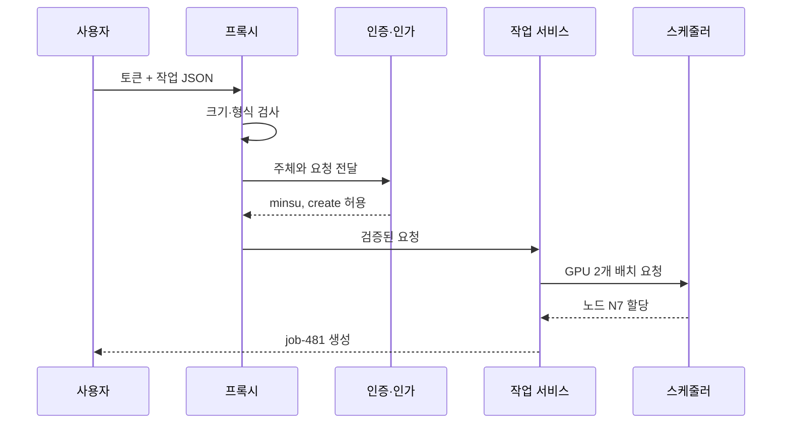

# 00. 보안과 신뢰 지도

보안(security)은 보호할 대상과 허용할 행동을 정하고, 공격이나 실수 속에서도 그 규칙이 유지되게 만드는 일이다.

## 1. 먼저 다섯 낱말을 분리한다

자산(asset)은 가치가 있어 보호해야 하는 것이다. 고객 데이터, GPU 시간, API 키, 서비스 가동 시간이 모두 자산이다.

주체(subject)는 행동을 요청하는 사람이나 프로그램이다. 사용자 `alice`, Pod의 ServiceAccount, 배포 봇이 예다.

객체(object)는 행동의 대상이다. 파일, Secret, 데이터베이스 행, Kubernetes Deployment가 예다.

정책(policy)은 어떤 주체가 어떤 객체에 어떤 행동을 할 수 있는지 적은 규칙이다.

통제(control)는 정책을 실제로 집행하는 장치다. 비밀번호 검사, RBAC 판정, 방화벽 규칙이 통제다.

신뢰(trust)는 “아무 의심 없이 믿음”이 아니다. 특정 조건이 참이라고 가정하고 다음 결정을 내리는 것이다.

신뢰 경계(trust boundary)는 그 가정이 바뀌어 입력을 다시 검사해야 하는 지점이다.

## 2. 한 요청을 끝까지 따라가기

상황은 연구자 민수가 `POST /jobs`로 GPU 작업을 제출하는 경우다.

입력은 JSON 본문, TLS 연결, 로그인 토큰이다.

1단계에서 프록시는 본문이 1 MiB보다 작은지 검사한다.

2단계에서 인증기는 토큰 서명, 발급자, 대상 서비스, 만료 시간을 검사한다.

3단계에서 인가기는 `minsu`가 `jobs/create` 권한을 가졌는지 확인한다.

4단계에서 업무 코드는 GPU 수가 1~8인지, 이미지 저장소가 허용 목록에 있는지 확인한다.

5단계에서 스케줄러는 실제 여유 GPU와 격리 정책을 확인한다.

6단계에서 감사기는 요청 ID, 주체, 결정, 결과를 기록한다.

앞 단계 통과가 뒷 단계의 생략 근거는 아니다.

토큰이 유효해도 요청 GPU 수가 정책을 위반할 수 있다.

RBAC가 허용해도 컨테이너 이미지가 금지된 권한을 요구할 수 있다.

## 3. 다섯 보안 목표

기밀성(confidentiality)은 허용되지 않은 주체가 내용을 읽지 못하게 하는 성질이다.

무결성(integrity)은 허용되지 않은 변경을 막거나 탐지하는 성질이다.

가용성(availability)은 필요할 때 허용된 사용자가 서비스를 이용할 수 있는 성질이다.

인증(authentication)은 주장한 신원을 근거로 확인하는 과정이다.

인가(authorization)는 확인된 주체의 특정 행동을 허용할지 판단하는 과정이다.

한 통제가 모든 목표를 충족하지 않는다.

암호화는 내용을 숨길 수 있지만 디스크를 지운 공격 뒤 가용성을 복원하지 않는다.

백업은 복구를 돕지만 백업 파일의 열람 권한이 넓으면 기밀성이 깨진다.

## 4. 위협과 취약점과 위험

위협(threat)은 손해를 일으킬 수 있는 행위자나 사건이다.

취약점(vulnerability)은 위협이 이용할 수 있는 약점이다.

영향(impact)은 실제로 발생할 손실이다.

가능성(likelihood)은 정한 기간에 사건이 일어날 개연성이다.

위험(risk)은 흔히 가능성과 영향의 조합으로 평가한다.

예를 들어 공개된 관리 포트는 취약점이다.

공격자가 포트를 찾아 약한 비밀번호를 대입하는 것은 위협 시나리오다.

연구 데이터 유출과 클러스터 중단은 영향이다.

숫자 점수 `가능성 4 × 영향 5 = 20`은 우선순위 보조 도구이지 정확한 사고 확률이 아니다.

## 5. 방어 깊이와 최소 권한

방어 깊이(defense in depth)는 독립적인 통제를 여러 경계에 둔다.

최소 권한(least privilege)은 업무에 필요한 가장 좁은 행동만, 필요한 기간만 허용한다.

서비스 계정에 `cluster-admin`을 주는 것은 설정은 쉽지만 침해 범위를 클러스터 전체로 넓힌다.

`research` 네임스페이스의 `jobs/create`만 주면 같은 키가 유출돼도 영향이 줄어든다.

실패 안전 기본값(fail-safe default)은 규칙이 없거나 판정에 실패하면 거부하는 원칙이다.

그러나 가용성이 매우 중요한 응급 시스템에서는 실패 시 동작을 별도로 설계하고 감사해야 한다.

## 6. 흔한 오해와 반례

오해: 내부망 트래픽은 믿어도 된다.

반례: 침해된 개발자 노트북이나 Pod도 내부 주소를 가진다.

오해: 암호화를 켰으니 안전하다.

반례: 키를 암호문 옆 공개 파일에 두면 공격자가 둘 다 읽는다.

오해: 규정 준수 점검을 통과했으니 취약점이 없다.

반례: 점검은 정한 시점과 범위의 증거다. 새 배포와 새 공격 경로는 별개다.

## 7. 문제와 해설

### 문제 1

연구 결과 파일을 암호화했지만 누구나 삭제할 수 있다. 충족한 목표와 실패한 목표는 무엇인가?

**해설:** 키 접근이 제한됐다는 조건 아래 내용의 기밀성은 높아졌다. 삭제 권한이 넓으므로 가용성은 실패한다. 삭제를 탐지할 로그나 무결성 보호 백업이 없다면 무결성도 충분하지 않다.

### 문제 2

API Gateway가 토큰을 확인했다. 업무 서비스가 입력 범위 검사를 생략해도 되는가?

**해설:** 안 된다. Gateway는 주체와 일부 형식을 확인했을 뿐 GPU 수, 파일 경로, 객체 상태 같은 업무 불변조건을 모른다. 업무 서비스가 자기 경계에서 다시 검사한다.

### 문제 3

정책 `모든 연구자는 모든 실험을 읽을 수 있다`를 최소 권한으로 바꿔라.

**해설:** 주체를 프로젝트 그룹, 객체를 프로젝트별 실험, 행동을 `read`로 나눈다. `project=A` 소속 연구자에게 A의 실험 읽기만 주고, 소속 종료 시간에 권한을 회수하며, 예외 접근은 만료 시간과 감사 사유를 요구한다.

## 공식 자료

- [NIST Cybersecurity Framework 2.0](https://www.nist.gov/cyberframework)
- [OWASP Threat Modeling Cheat Sheet](https://cheatsheetseries.owasp.org/cheatsheets/Threat_Modeling_Cheat_Sheet.html)

---

[목차](README.md) · [다음: 위협 모델과 보안 목표](01-threat-models-and-security-goals.md)
