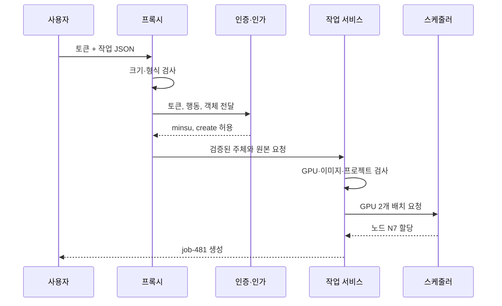

# 00. 보안과 신뢰 지도

[이 책 목차](README.md) · [다음](01-threat-models-and-security-goals.md)

보안(security)은 막연히 “해킹을 못 하게 하는 것”이 아니다. 보호할 대상을 정하고, 누가 어떤 행동을 해도 되는지 규칙을 세우며, 공격·실수·장애가 생긴 뒤에도 그 규칙이 얼마나 유지됐는지 확인하고 복구하는 전체 과정이다. 이 정의에는 기술뿐 아니라 사람, 운영 절차, 물리 장비, 외부 공급자까지 들어간다. 방화벽 하나를 설치했다고 보안이 완성되지 않는 이유도 여기에 있다.

이 장은 처음 등장하는 단어를 그 단어가 실제로 가리키는 객체, 저장 위치, 수명과 함께 설명한다. 예시는 한 연구자가 GPU 학습 작업을 제출하는 시스템으로 고정한다. 같은 요청을 처음부터 끝까지 따라가면 보안 용어가 서로 어떤 관계인지 볼 수 있다.

## 1. 먼저 현실의 장면을 하나 고정한다

연구자 민수가 노트북의 웹 화면에서 `POST /jobs` 요청을 보낸다고 하자. `POST`는 HTTP라는 통신 규약에서 “새 작업을 만들어 달라”는 뜻으로 흔히 쓰는 요청 방식이고, `/jobs`는 서버 안의 작업 생성 기능을 가리키는 경로다. 요청에는 다음 정보가 들어 있다.

- 로그인 뒤 받은 토큰: “이 요청을 보낸 주체가 민수라고 판단할 근거”가 들어 있는 짧은 문자열
- 작업 본문: 컨테이너 이미지 이름, GPU 수, 데이터셋 위치를 적은 JSON 바이트
- 연결 정보: 어느 IP 주소와 포트에서 왔는지, TLS로 보호되는지 같은 전송 상태

여기서 **바이트(byte)**는 컴퓨터가 저장하고 전송하는 데이터의 기본 단위다. 보통 1바이트는 8개의 비트(bit)로 이뤄진다. 비트는 0 또는 1 하나다. 글자 `A`도 디스크나 네트워크에서는 약속된 숫자 바이트로 표현된다. JSON은 그 바이트를 `{`, `}`, 이름, 값 같은 문법으로 해석하는 형식이다. 토큰이 “문자열처럼 보인다”는 사실은 그것이 안전하거나 진짜라는 뜻이 아니다. 공격자는 얼마든지 같은 모양의 바이트를 만들어 보낼 수 있다.

요청은 노트북 메모리에서 출발해 네트워크 장비, 프록시, 인증 서비스, 작업 서비스, 스케줄러, 데이터베이스를 거친다. 각 구성 요소는 서로 다른 프로세스의 메모리나 별도 저장소에 값을 보관한다. 한 구성 요소가 확인한 사실이 다음 구성 요소에 자동으로 이어지지 않는다. 보안 설계는 이 끊어진 판단들을 명시적으로 연결하는 일이다.

## 2. 자산: 무엇을 잃으면 손해인가

**자산(asset)**은 조직이나 사용자에게 가치가 있어 보호해야 하는 대상이다. “데이터”만 자산이 아니다. 이 시스템에서는 다음이 서로 다른 자산이다.

| 자산 | 실제 객체와 위치 | 수명 | 손실의 예 |
|---|---|---|---|
| 학습 데이터 | 객체 저장소의 버전이 붙은 파일 | 수개월~수년 | 외부 유출, 변조, 삭제 |
| 모델 가중치 | 체크포인트 파일과 모델 레지스트리 행 | 실험 중~제품 수명 | 경쟁사 유출, 악성 값 삽입 |
| API 키 | Secret 저장소의 바이트와 실행 프로세스 메모리 | 발급부터 폐기까지 | 공격자가 서비스로 가장함 |
| GPU 시간 | 실제 GPU 장치의 실행 시간과 할당 기록 | 작업 실행 동안 | 무단 채굴, 연구 작업 지연 |
| 서비스 가동 시간 | 요청을 처리할 수 있는 시스템 상태 | 계속 | 장애로 실험과 배포 중단 |
| 감사 기록 | 로그 저장소의 사건 레코드 | 정책상 보존 기간 | 사고 원인과 행위자를 확인하지 못함 |

자산 목록은 “중요한 것”이라는 한 줄로 끝내면 쓸모가 없다. 원본과 복사본의 위치, 누가 소유하는지, 언제 생성되고 언제 삭제되는지까지 적어야 한다. 예를 들어 모델 파일은 객체 저장소에 있지만 그 일부는 GPU 메모리, 노드의 페이지 캐시, 백업, 개발자의 다운로드 폴더에도 존재할 수 있다. 보호 대상은 파일 이름 하나가 아니라 이 복사본들의 전체 수명이다.

## 3. 주체·객체·행동: 보안 결정을 문장으로 만들기

**주체(subject)**는 행동을 요청하는 사람이나 프로그램이다. 민수라는 사람, 민수의 브라우저 세션, `trainer` Pod의 ServiceAccount, 배포 봇이 모두 주체가 될 수 있다. 시스템은 사람의 마음을 직접 알 수 없으므로 실제 판정에서는 사용자 ID, 프로세스 자격 증명, 토큰의 확인된 속성처럼 컴퓨터가 다룰 수 있는 표현을 사용한다.

**객체(object)**는 행동의 대상이다. 파일, 데이터베이스 행, Kubernetes Deployment, GPU 작업 `job-481`이 예다. 객체에는 종류와 식별자가 모두 필요하다. `secret`이라는 종류만으로는 부족하고, `research` 네임스페이스의 `secret-X`처럼 어느 객체인지 고정해야 한다.

**행동(action)**은 주체가 객체에 하려는 연산이다. `read`, `create`, `update`, `delete`, `execute`처럼 동사로 표현한다. 읽기와 목록 보기는 다를 수 있다. 파일 이름 목록만 볼 권한과 파일 내용을 읽을 권한은 같은 권한이 아니다.

따라서 보안 결정을 다음처럼 완전한 문장으로 적을 수 있다.

> 확인된 주체 `minsu`가 프로젝트 `radio-ai`의 객체 `job-481`에 행동 `delete`를 수행해도 되는가?

이 문장에서 하나라도 빠지면 권한이 의도보다 넓어진다. “민수는 작업 권한이 있다”는 문장은 어떤 작업, 어떤 행동, 어떤 시간대인지 알 수 없으므로 집행 가능한 정책이 아니다.

## 4. 정책과 통제: 규칙과 규칙을 실행하는 장치

**정책(policy)**은 허용과 거부의 기준이다. 예를 들어 “`radio-ai` 프로젝트 구성원은 그 프로젝트의 작업을 만들 수 있고, 한 요청에서 GPU는 최대 8개까지 사용할 수 있다”가 정책이다. 정책은 문서, 코드, Kubernetes RBAC 객체, 데이터베이스 제약 조건 등 여러 곳에 표현될 수 있다.

**통제(control)**는 정책을 실제로 집행하거나 위반을 발견하고 복구하는 장치다. 토큰 검증 코드, RBAC 판정기, GPU 수 범위 검사, 네트워크 정책, 백업 복구 절차가 모두 통제다. 정책이 “잠금”이라는 요구사항이라면 통제는 실제 문에 붙은 자물쇠와 출입 기록 장치에 해당한다.

통제는 역할에 따라 세 종류로 나눌 수 있다.

1. **예방 통제**는 위반이 성공하기 전에 막는다. 권한 검사, 입력 크기 제한, 다중 요소 인증이 예다.
2. **탐지 통제**는 이미 일어났거나 시도 중인 이상을 찾는다. 감사 로그, 무결성 검사, 반복 실패 경보가 예다.
3. **복구 통제**는 피해 뒤 정상 상태로 돌아가게 한다. 백업 복원, 키 폐기, 장애 조치가 예다.

한 통제에 모든 역할을 기대하면 빈틈이 생긴다. 백업은 삭제된 데이터를 복구할 수 있지만 무단 열람을 예방하지 않는다. 방화벽은 일부 접속을 막지만 이미 허용된 계정이 잘못된 데이터베이스 행을 읽는 것을 판단하지 못한다.

## 5. 신뢰와 신뢰 경계: 무엇을 근거로 다음 결정을 내리는가

**신뢰(trust)**는 “좋은 사람이라고 믿는다”는 감정이 아니다. 특정 구성 요소나 값이 정한 조건을 만족한다고 가정하고 다음 판단을 내리는 관계다. 작업 서비스가 인증 서비스의 서명된 결과를 받아 `subject=minsu`라고 사용한다면, 작업 서비스는 인증 서비스의 키 관리와 검증 로직을 신뢰하는 것이다.

**신뢰 경계(trust boundary)**는 그 신뢰 가정이 바뀌어 입력을 다시 확인해야 하는 지점이다. 경계는 반드시 물리적인 선이나 인터넷과 내부망 사이만을 뜻하지 않는다. 다음도 경계다.

- 사용자 브라우저에서 프록시로 들어오는 요청
- 프록시가 붙인 헤더를 작업 서비스가 읽는 지점
- Pod 프로세스가 커널 시스템 호출을 하는 지점
- 애플리케이션이 데이터베이스 결과를 사용하는 지점
- 한 클라우드 계정이 다른 계정의 객체 저장소에 접근하는 지점

경계에서는 세 질문을 한다. 입력을 누가 만들 수 있는가, 그 입력이 이동 중이나 저장 중 바뀔 수 있는가, 실패했을 때 기본 동작은 허용인가 거부인가. 내부 IP에서 왔다는 이유만으로 신뢰하면 침해된 Pod가 내부 주소를 가진 채 공격할 수 있다.

## 6. 인증과 인가: 신원을 확인하는 일과 행동을 허용하는 일

**신원(identity)**은 시스템이 주체를 구별하기 위해 사용하는 식별자와 확인된 속성의 묶음이다. `minsu@example.org`라는 이름, 소속 프로젝트, 계정 상태가 포함될 수 있다.

**인증(authentication)**은 “나는 민수다”라는 신원 주장을 비밀번호, 보안 키, 개인키 서명, 토큰 같은 증거로 확인하는 과정이다. 인증의 결과는 “이 증거를 정한 방식으로 확인했을 때 이 주체로 판단했다”이지, 그 주체가 선하거나 모든 행동을 해도 된다는 뜻이 아니다.

**인가(authorization)**는 인증된 주체가 특정 객체에 특정 행동을 할 수 있는지 정책으로 판단하는 과정이다. 민수로 인증됐어도 다른 프로젝트의 모델을 삭제할 권한은 없을 수 있다.

두 단계를 숫자 예로 구분해 보자.

1. 토큰의 서명을 검증해 주체가 `minsu`임을 확인한다. 이 단계가 인증이다.
2. 정책 저장소에서 `minsu → project=radio-ai → jobs/create` 관계를 확인한다.
3. 요청 객체의 프로젝트가 `radio-ai`인지 검사한다.
4. 둘이 맞으면 `allow`, 다르면 `deny`를 반환한다. 2~4단계가 인가다.

웹 화면에서 삭제 버튼을 숨기는 것은 인가가 아니다. 공격자는 화면을 거치지 않고 HTTP 요청 바이트를 직접 보낼 수 있다. 실제 객체를 변경하는 서버가 행동 직전에 인가를 집행해야 한다.

## 7. 기밀성·무결성·가용성: 보호 결과를 세 방향으로 나누기

**기밀성(confidentiality)**은 허용되지 않은 주체가 내용을 알아내지 못하게 하는 성질이다. 파일 암호화, 접근 제어, 화면 마스킹은 서로 다른 방식으로 기밀성을 돕는다.

**무결성(integrity)**은 데이터나 코드가 허용되지 않은 방식으로 바뀌지 않았음을 보장하거나 변경을 탐지하는 성질이다. 여기에는 값의 정확성뿐 아니라 누가 어떤 절차로 바꿨는지도 포함된다. 해시만 계산해 파일 옆에 함께 두면 공격자가 파일과 해시를 동시에 바꿀 수 있으므로 신뢰할 수 있는 무결성 증거가 되지 않는다.

**가용성(availability)**은 허용된 사용자가 필요한 시점에 서비스를 사용할 수 있는 성질이다. 서버가 켜져 있다는 것만으로 충분하지 않다. 요청 지연 시간, 처리 용량, 데이터 복구 시간도 포함한다.

세 목표는 서로 자동으로 따라오지 않는다. `dataset.bin`을 강한 암호로 암호화했어도 공격자가 암호문을 삭제하면 가용성이 깨진다. 세 곳에 백업했어도 모든 복사본에 공개 읽기 권한이 있으면 기밀성이 깨진다. 서명으로 변경을 탐지해도 손상된 데이터를 원래대로 복구할 백업이 없으면 복구 목표는 달성하지 못한다.

## 8. 한 요청을 끝까지 추적한다

민수가 GPU 2개짜리 작업을 제출한다고 하자. 각 단계에서 처리하는 실제 객체와 실패 조건을 함께 본다.

| 단계 | 구성 요소가 보는 객체 | 하는 검사 | 실패하면 |
|---|---|---|---|
| 1 | TCP/TLS 연결과 HTTP 바이트 | 연결 보호, 본문 최대 1 MiB, JSON 문법 | 요청 거부, 제한된 오류 기록 |
| 2 | 토큰 바이트 | 서명, 발급자, 대상 API, 만료 시각 | 주체를 만들지 않고 401 |
| 3 | 확인된 주체·행동·객체 | `minsu`의 `jobs/create` 권한 | 403과 판정 근거 기록 |
| 4 | GPU 수·이미지·데이터셋 ID | GPU 1~8, 허용 이미지, 프로젝트 일치 | 업무 규칙 오류 |
| 5 | 노드·GPU·격리 상태 | 실제 여유 자원, 장치 격리, 할당 충돌 | 대기 또는 명시적 실패 |
| 6 | 요청 ID와 결과 | 주체, 정책 버전, 결정, 생성된 job ID 기록 | 로그 실패 정책에 따라 요청 중단 또는 별도 경보 |

프록시가 토큰을 확인했어도 작업 서비스의 업무 검사는 생략할 수 없다. 토큰은 신원을 설명하지만 GPU가 실제로 남아 있는지, 데이터셋이 삭제 상태인지, 이미지가 허용 정책을 만족하는지는 설명하지 않기 때문이다. 반대로 업무 값이 정상이어도 토큰 대상이 다른 API라면 인증에 실패해야 한다.

## 9. 위협·취약점·공격·영향·위험을 섞지 않는다

**위협(threat)**은 자산에 손해를 일으킬 가능성이 있는 행위자나 사건이다. 외부 공격자, 악성 내부자, 화재, 잘못된 자동화가 될 수 있다.

**취약점(vulnerability)**은 위협이 이용할 수 있는 약점이다. 기본 비밀번호, 누락된 객체별 권한 검사, 패치되지 않은 라이브러리가 예다.

**공격(attack)**은 위협 행위자가 취약점을 실제로 이용하려는 구체적인 행동이다. 공개된 관리 포트에 유출된 비밀번호를 반복 제출하는 것이 예다.

**영향(impact)**은 성공했을 때 생기는 손실이다. 모델 유출, 12시간 서비스 중단, 복구 비용, 법적 책임처럼 측정 가능한 결과로 쓴다.

**가능성(likelihood)**은 정한 기간과 환경에서 시나리오가 발생할 개연성이다. 숫자는 관찰 자료와 가정을 붙여야 의미가 있다.

**위험(risk)**은 가능성과 영향을 함께 고려한 의사결정 대상이다. `가능성 4 × 영향 5 = 20` 같은 점수는 우선순위를 맞추는 도구다. 이것을 “사고 확률 20%”라고 읽으면 안 된다. 척도 1~5는 대개 순서형 등급이고 실제 확률 측정값이 아니기 때문이다.

구체적인 위험 문장은 다음처럼 쓴다.

> 인터넷의 공격자가 비밀번호 재사용으로 관리 계정을 탈취해 모델 저장소를 삭제할 수 있으며, 복구 검증이 안 된 백업 때문에 최대 48시간 연구가 중단될 수 있다.

이 문장에는 공격자, 진입점, 취약점, 행동, 자산, 영향이 들어 있어 통제를 설계할 수 있다.

## 10. 방어 깊이·최소 권한·실패 안전 기본값

**방어 깊이(defense in depth)**는 서로 독립적인 통제를 여러 경계에 둬 하나가 실패해도 다음 통제가 피해를 제한하게 하는 설계다. “장비를 많이 둔다”가 핵심이 아니라 실패 원인이 같은 통제만 겹치지 않는 것이 중요하다. 같은 잘못된 사용자 데이터베이스를 믿는 프록시 두 대는 독립적인 인증 방어가 아니다.

**최소 권한(least privilege)**은 주체에게 업무에 필요한 행동만, 필요한 객체 범위에서, 필요한 시간 동안 허용하는 원칙이다. 배포 봇에 영구 `cluster-admin`을 주면 키 하나의 유출이 전체 클러스터 변경으로 번진다. `research` 네임스페이스의 특정 Deployment 갱신만 30분 허용하면 같은 침해의 범위를 줄일 수 있다.

**실패 안전 기본값(fail-safe default)**은 규칙이 없거나 판정에 실패했을 때 기본적으로 거부하는 원칙이다. 정책 서버가 응답하지 않는다고 모든 요청을 허용하면 장애가 곧 권한 우회가 된다. 다만 응급 의료 장비처럼 가용성이 생명과 직접 연결되면 무조건 중단도 위험하다. 이때는 제한된 비상 권한, 강한 감사, 사후 검토처럼 별도 실패 모드를 설계해야 한다.

## 11. 암호 기술은 어떤 문제를 풀고 어떤 문제를 못 푸는가

**암호화(encryption)**는 키를 사용해 평문을 허가 없는 사람이 이해하기 어려운 암호문으로 바꾸는 기술이다. 키는 알고리즘의 동작을 결정하는 비밀 또는 공개 매개변수다. 암호화는 저장 바이트나 전송 바이트의 기밀성을 돕지만, 복호화 권한을 가진 애플리케이션이 SQL 인가를 빠뜨린 문제를 해결하지 않는다.

**해시(hash)**는 임의 길이 입력을 고정 길이 값으로 압축하는 결정적 함수다. 같은 입력은 같은 해시를 만든다. 해시는 암호화와 달리 복호화 키로 원문을 되돌리는 기능이 없다. 하지만 단순 해시는 비밀 키를 쓰지 않으므로 공격자가 데이터와 해시를 함께 바꿀 수 있는 환경에서 출처를 인증하지 못한다.

**MAC(message authentication code)**은 두 당사자가 공유한 비밀 키로 메시지의 무결성과 키 보유 사실을 확인하는 태그다. **전자서명(digital signature)**은 개인키로 서명하고 대응하는 공개키로 검증해, 검증자에게 개인키를 나눠 주지 않고도 출처와 무결성을 확인하게 한다. 어떤 기술도 가용성, 권한 정책, 안전한 키 보관을 자동으로 해결하지 않는다.

암호 알고리즘을 직접 조합해 운영용 프로토콜을 만드는 것은 위험하다. 안전성은 알고리즘 이름뿐 아니라 키 생성, 난수, nonce 재사용 방지, 메시지 형식, 오류 처리, 구현의 부채널까지 포함한다. 운영 시스템은 검토된 표준과 유지보수되는 라이브러리의 계약을 따라야 한다. 교육용 숫자 예는 원리를 보여 주는 모형이지 운영 암호 구현이 아니다.

## 12. 표준과 배포 상태를 구분한다

보안 문서에서 “표준이 나왔다”, “라이브러리가 지원한다”, “우리 서비스가 사용한다”는 서로 다른 상태다. TLS 1.3은 IETF의 [RFC 8446](https://www.rfc-editor.org/rfc/rfc8446)에 규격이 정의돼 있다. 규격이 존재해도 클라이언트와 서버가 해당 버전을 협상하고 인증서를 올바르게 검증해야 실제 연결이 그 보호를 얻는다.

양자내성암호도 같은 구분이 필요하다. NIST의 [FIPS 203](https://csrc.nist.gov/pubs/fips/203/final)은 ML-KEM이라는 키 캡슐화 메커니즘의 표준을 정의한다. **키 캡슐화 메커니즘(KEM)**은 한쪽이 공유 비밀을 캡슐화해 암호문을 만들고, 개인키 보유자가 이를 복원하도록 하는 구성이다. 표준화는 알고리즘과 입력·출력 규칙이 정해졌다는 뜻이다. 기존 TLS 배포가 자동으로 ML-KEM을 사용한다는 뜻은 아니다. 프로토콜 결합 방식, 구현, 상호 운용성, 인증서·키 수명, 하드웨어 비용을 따로 검증해야 한다.

또한 양자 공격 가정과 현재의 고전 공격 가정을 섞지 않는다. 충분히 큰 오류 보정 양자컴퓨터가 공개키 알고리즘 일부를 위협할 가능성과, 오늘 비밀번호 탈취·접근 제어 누락·취약한 난수 때문에 일어나는 침해는 다른 시나리오다. 장기간 비밀을 유지해야 하는 데이터는 “지금 수집하고 나중에 복호화”하는 공격까지 수명 모델에 넣을 수 있지만, 이것이 기본 권한 검사를 미룰 이유는 아니다.

## 13. 흔한 오해를 조건을 바꿔 반박한다

**“내부망은 안전하다.”** 내부 주소는 위치 정보일 뿐 신원 증거가 아니다. 침해된 개발자 노트북과 Pod도 내부 주소를 가진다.

**“암호화했으니 안전하다.”** 키가 암호문 옆 공개 파일에 있으면 기밀성이 없다. 애플리케이션이 복호화한 뒤 권한 없이 응답하면 전송 전 암호화도 그 누출을 막지 못한다.

**“인증된 사용자는 신뢰할 수 있다.”** 인증은 누군지에 대한 근거다. 정상 사용자도 실수하고 계정은 탈취될 수 있으므로 객체별 인가와 입력 검사는 계속 필요하다.

**“감사 로그가 있으니 사고를 막았다.”** 로그는 주로 탐지와 조사 통제다. 공격자가 로그 저장소까지 삭제할 수 있으면 증거도 남지 않는다. 별도 권한, 전송, 보존 정책이 필요하다.

**“규정 준수 점검을 통과했으니 취약점이 없다.”** 점검은 특정 시점·범위·증거에 대한 판단이다. 다음 배포, 새 API, 새 공급망 구성 요소가 경계를 바꿀 수 있다.

## 14. 연습 문제와 자세한 풀이

### 문제 1. 암호화된 연구 파일

파일 내용은 강한 키로 암호화했지만 모든 사용자가 파일을 삭제할 수 있다. 어떤 목표를 달성했고 무엇이 남았는가?

**풀이:** 키 접근이 제한되고 암호화가 올바르게 구현됐다는 조건에서 저장 내용의 기밀성은 높아졌다. 그러나 삭제 권한이 넓으므로 가용성은 깨진다. 공격자가 암호문을 다른 바이트로 바꿀 수 있고 인증 태그나 서명이 없다면 무결성도 확인할 수 없다. 복구 가능한 버전 백업, 삭제 인가, 변경 탐지, 키 관리가 별도 통제로 필요하다.

### 문제 2. 프록시가 확인한 토큰

API Gateway가 토큰을 검증했다. 작업 서비스가 GPU 수와 데이터셋 프로젝트 검사를 생략해도 되는가?

**풀이:** 안 된다. Gateway의 인증 결과는 요청 주체와 일부 토큰 조건을 설명한다. GPU 수 100이 정책상 허용되는지, 데이터셋이 주체 프로젝트 소유인지, 객체가 폐기 상태인지 같은 업무 불변조건은 작업 서비스가 알고 있다. Gateway에서 서비스로 전달되는 주체 헤더 자체도 신뢰 경계이므로 외부 사용자가 같은 헤더를 주입하지 못하게 해야 한다.

### 문제 3. 최소 권한 정책 만들기

“모든 연구자는 모든 실험을 읽을 수 있다”를 최소 권한 정책으로 바꿔라.

**풀이:** 주체 속성을 프로젝트 소속으로, 객체 속성을 실험 프로젝트로, 행동을 `read`로 분리한다. `subject.project == object.project`일 때만 허용하고, 소속에는 시작·종료 시각을 둔다. 예외 접근은 특정 실험 ID, 만료 시각, 승인자, 사유를 가진 별도 권한으로 발급한다. 목록 API가 다른 프로젝트 이름을 노출하지 않는지도 확인한다.

### 문제 4. 위험 점수 해석

가능성 4, 영향 5라서 점수 20이다. 사고 확률이 20%라고 보고해도 되는가?

**풀이:** 안 된다. 1~5가 확률 백분율로 정의되고 관찰 데이터로 보정되지 않았다면 순위를 위한 등급이다. 점수와 함께 기간, 공격 경로, 과거 사건, 노출 객체 수, 탐지·복구 시간을 기록한다. 같은 20이라도 가능성 4·영향 5와 가능성 5·영향 4는 대응 우선순위가 달라질 수 있다.

### 문제 5. 해시 파일의 무결성

`model.bin`과 `model.sha256`을 같은 공개 쓰기 버킷에 두었다. 해시가 있으니 변조를 신뢰성 있게 탐지할 수 있는가?

**풀이:** 공격자가 두 객체를 모두 바꿀 수 있으므로 아니다. 해시는 우발적 손상 확인에는 유용하지만 공격자에 대한 출처 인증이 없다. 신뢰한 별도 위치에 해시를 보관하거나 MAC·전자서명으로 보호하고, 검증 키와 정책 자체의 배포 경로도 보호해야 한다.

### 문제 6. 장애 때 정책 서버가 응답하지 않는다

가용성을 위해 모든 요청을 허용하는 것이 좋은가?

**풀이:** 일반적으로 권한 우회가 되므로 위험하다. 읽기 전용 캐시 정책, 짧은 유예 시간, 제한된 비상 계정처럼 허용 범위를 미리 정한다. 고위험 변경은 거부하고, 비상 허용은 강한 감사와 사후 검토를 요구할 수 있다. 어떤 선택이 맞는지는 자산과 장애 영향에 따라 달라지지만 “오류면 전부 허용”을 암묵적 기본값으로 두면 안 된다.

### 문제 7. 양자내성 표준이 발표됐다

FIPS 203이 있으므로 현재 모든 TLS 연결이 양자내성이라고 말해도 되는가?

**풀이:** 아니다. 표준은 ML-KEM의 규칙을 정의한다. 실제 연결이 어떤 TLS 버전과 키 교환 조합을 협상했는지, 양쪽 구현이 지원하는지, 인증과 인증서 체계가 무엇인지 확인해야 한다. 표준화 상태와 제품 지원, 설정, 실제 협상 결과는 각각 다른 증거다.

## 공식 근거

- [NIST Cybersecurity Framework 2.0](https://www.nist.gov/cyberframework)
- [NIST SP 800-30 Rev. 1: Guide for Conducting Risk Assessments](https://csrc.nist.gov/pubs/sp/800/30/r1/final)
- [OWASP Threat Modeling Cheat Sheet](https://cheatsheetseries.owasp.org/cheatsheets/Threat_Modeling_Cheat_Sheet.html)
- [RFC 8446: TLS 1.3](https://www.rfc-editor.org/rfc/rfc8446)
- [NIST FIPS 203: ML-KEM](https://csrc.nist.gov/pubs/fips/203/final)

---

[목차](README.md) · [다음: 위협 모델과 보안 목표](01-threat-models-and-security-goals.md)
