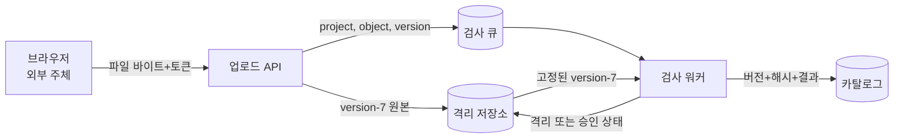
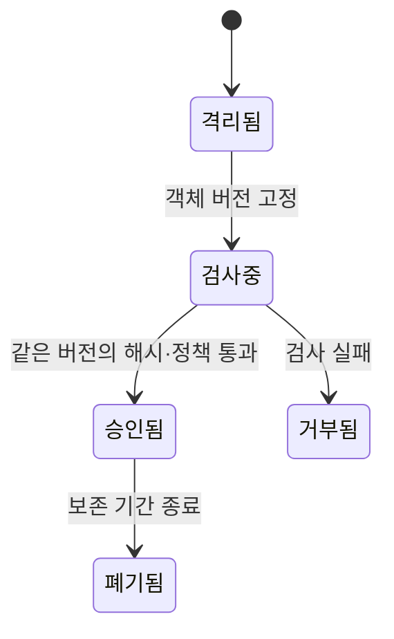

# 01. 위협 모델과 보안 목표

[이 책 목차](README.md) · [이전](00-security-and-trust-map.md) · [다음](02-identities-authentication-and-authorization.md)

위협 모델(threat model)은 “무엇을, 누구에게서, 어떤 조건에서 보호할 것인가”를 다른 사람이 검토할 수 있게 적은 분석 문서다. 취약점 목록이나 보안 제품 목록과는 다르다. 위협 모델은 현실 시스템의 구성 요소와 데이터 이동을 그린 뒤, 공격자가 어떤 능력으로 어느 경계를 통과해 어떤 자산에 영향을 주는지 연결한다. 이 연결이 있어야 구체적인 예방·탐지·복구 통제를 정할 수 있다.

이 장에서는 학습 데이터 업로드 기능 하나를 처음부터 끝까지 모델링한다. 브라우저가 500 MiB 파일을 업로드하면 API가 격리 저장소에 쓰고, 검사 워커가 형식과 악성 내용을 검사한 뒤, 승인된 파일만 학습 작업이 읽는 시스템이다.

## 1. 모델은 현실의 축소판이다

**모델(model)**은 현실에서 질문에 필요한 요소만 남긴 표현이다. 건물 모형이 실제 건물의 모든 원자를 포함하지 않듯 위협 모델도 모든 공격을 한 문서에 담지 않는다. 대신 포함 범위와 제외 범위, 가정을 명시한다. 그래야 빠진 항목이 실수인지 의도된 범위 밖인지 구별할 수 있다.

**시스템 경계(system boundary)**는 이번 분석에 포함하는 구성 요소의 바깥선이다. 예를 들어 브라우저부터 객체 저장소까지는 포함하되 데이터센터의 물리 출입은 별도 모델로 둘 수 있다. 범위 밖(out of scope)은 안전하다는 뜻이 아니다. 다른 통제나 다른 분석이 책임진다는 표시다. 책임 주체가 없다면 단순 누락이다.

**가정(assumption)**은 분석을 진행하기 위해 참이라고 놓는 조건이다. “클라우드 공급자의 하드웨어 격리가 정상 동작한다” 같은 가정을 둘 수 있다. 가정에는 소유자와 깨졌을 때의 영향을 적는다. 가정이 바뀌면 모델도 다시 검토한다.

## 2. 여섯 입력을 실제 객체로 적는다

### 2.1 자산

자산(asset)은 손실되거나 노출되거나 변경되면 피해가 생기는 대상이다. `학습 데이터`처럼 추상적으로만 적지 말고 다음을 구분한다.

- 업로드 중인 원본 바이트: API 프로세스의 수신 버퍼와 임시 파일에 잠시 존재한다.
- 격리 객체: 객체 저장소의 `quarantine/project-a/object-42/version-7`에 저장된다.
- 승인 상태: 카탈로그 데이터베이스의 행에 객체 버전, 해시, 검사 결과가 기록된다.
- 접근 자격 증명: API와 워커가 객체 저장소에 접근할 때 사용하는 토큰이다.
- 서비스 용량: 워커 CPU·메모리·큐 길이·저장 공간이다.

같은 “파일”도 위치와 상태가 다르면 공격 경로와 통제가 달라진다.

### 2.2 행위자와 주체

**행위자(actor)**는 시스템에 영향을 주는 사람이나 조직, 프로그램이다. 정상 연구자, 외부 공격자, 내부 운영자, 침해된 CI 서비스, 클라우드 공급자가 예다. **주체(subject)**는 시스템이 권한 판정에서 행위자를 표현하는 식별자다. 실제 사람 민수는 브라우저 세션에서는 사용자 ID, Kubernetes에서는 ServiceAccount, 객체 저장소에서는 임시 역할 자격 증명으로 표현될 수 있다.

행위자는 의도와 능력이 다르다. 실수하는 정상 사용자는 악성 페이로드를 의도하지 않지만 잘못된 50 GiB 파일로 자원을 고갈시킬 수 있다. 침해된 워커는 내부 네트워크와 유효한 서비스 자격 증명을 가질 수 있다.

### 2.3 진입점

**진입점(entry point)**은 외부나 다른 신뢰 영역이 시스템에 입력을 넣는 구체적인 인터페이스다. HTTP 업로드 API, 메시지 큐, 관리자 셸, 객체 저장소 이벤트, 설정 파일, 의존성 업데이트가 될 수 있다. 포트 번호만 적지 말고 메서드, 경로, 메시지 형식, 최대 크기, 인증 방식을 기록한다.

### 2.4 신뢰 경계

신뢰 경계는 입력의 출처와 검증 책임이 바뀌는 지점이다. 인터넷과 프록시 사이뿐 아니라 API와 큐, 큐와 워커, 워커와 저장소 사이에도 있다. 큐에서 메시지를 받았다는 이유만으로 메시지의 객체 ID를 신뢰하면, 큐에 쓸 수 있는 침해된 서비스가 다른 프로젝트 파일을 검사·승인하게 만들 수 있다.

### 2.5 공격자 능력

**공격자 능력(attacker capability)**은 공격자가 무엇을 관찰·변경·반복할 수 있는지에 대한 상한이다. “강한 공격자”처럼 쓰지 말고 구체화한다.

- 익명 인터넷 사용자가 초당 100개 연결을 만들 수 있다.
- 인증된 연구자가 자기 프로젝트 토큰을 갖고 객체 ID를 임의로 바꿀 수 있다.
- 침해된 워커는 격리 버킷을 읽지만 카탈로그 서명 키는 읽지 못한다.
- 내부 운영자는 배포 권한이 있지만 감사 로그 보존 버킷 삭제 권한은 없다.

능력을 지나치게 약하게 잡으면 중요한 공격을 놓치고, 모든 관리자·커널·하드웨어가 이미 완전히 장악됐다고 잡으면 실용적인 방어 결정을 내리기 어렵다. 분석 목적에 맞는 경계를 명시한다.

### 2.6 보안 목표와 범위 밖 조건

보안 목표는 “안전해야 한다”보다 검증 가능해야 한다. 예를 들어 “다른 프로젝트 사용자는 승인된 파일의 존재 여부와 내용을 알 수 없어야 한다”, “검사한 바이트와 학습에 사용한 바이트가 같아야 한다”, “압축 해제 하나가 워커 풀 전체를 10분 이상 막지 않아야 한다”처럼 쓴다.

범위 밖 조건에도 이유와 다음 책임자를 붙인다. `서버 물리 탈취: 시설 보안 모델에서 담당, 소유자=인프라 팀, 다음 검토=2027-01`처럼 기록한다.

## 3. 데이터 흐름도는 그림이 아니라 검증 목록이다

**데이터 흐름도(Data Flow Diagram, DFD)**는 외부 주체, 처리 과정, 저장소, 흐름을 표시한다. 처리 과정은 입력을 변환하는 실행 코드이고, 저장소는 요청이 끝난 뒤에도 데이터가 남을 수 있는 위치다. 화살표는 단순 연결이 아니라 어떤 데이터가 어느 방향으로 어떤 보호를 받으며 이동하는지 뜻한다.

각 화살표에서 다음을 묻는다.

1. 출발 주체를 어떻게 확인하는가?
2. 전송 중 내용을 누가 읽을 수 있는가?
3. 도착 전에 바이트가 바뀌었음을 어떻게 탐지하는가?
4. 크기, 형식, 빈도 제한은 어디서 집행하는가?
5. 재전송되거나 순서가 바뀌어도 안전한가?
6. 로그에는 민감한 원문 대신 어떤 식별자와 결과를 남기는가?

예를 들어 큐 메시지가 `object-42`라는 경로만 담으면 부족하다. 검사 전에 같은 경로의 내용이 교체될 수 있다. `object-42, version-7, expected_hash`를 담고 워커가 정확히 그 버전을 읽어야 검사 대상과 사용 대상을 묶을 수 있다.

## 4. 한 공격 시나리오를 시간 순서로 적는다

**공격 시나리오(attack scenario)**는 공격 전제부터 영향까지 이어지는 사건 순서다. “파일 변조 가능”처럼 결과만 쓰면 통제 위치를 정하기 어렵다. 다음은 검사 시점과 사용 시점이 분리된 경우다.

1. 시각 `10:00:00`, 사용자가 경로 `project-a/input.bin`에 정상 바이트 `A`를 업로드한다.
2. API가 큐에 경로만 넣는다.
3. 시각 `10:00:02`, 워커가 경로를 열어 `A`의 해시를 계산하고 승인한다.
4. 시각 `10:00:03`, 공격자가 같은 경로를 악성 바이트 `B`로 덮어쓴다.
5. 시각 `10:00:04`, 학습 서비스가 “그 경로는 승인됨”이라는 상태를 보고 현재 바이트 `B`를 읽는다.

검사와 사용 사이에 대상이 바뀌는 경쟁을 **TOCTOU(time-of-check to time-of-use)**라고 한다. 여기서 취약점은 파일 검사가 약한 것이 아니라 “검사한 객체의 정체성을 경로 문자열로만 기억한 것”이다.

수정 설계는 상태를 다음처럼 바꾼다.

1. 저장소가 쓰기마다 불변 버전 ID `version-7`을 만든다.
2. 워커는 `version-7`을 읽어 해시 `H7`을 계산한다.
3. 카탈로그는 `(object-42, version-7, H7, approved)`를 하나의 승인 레코드로 저장한다.
4. 학습 서비스는 경로의 최신값이 아니라 승인 레코드의 `version-7`을 읽고 해시를 확인한다.

불변 버전은 내용 교체를 막지만 저장소 자격 증명이 탈취되거나 카탈로그 자체가 변조되는 공격까지 자동으로 막지는 않는다. 통제의 적용 범위를 구분해야 한다.

## 5. STRIDE는 답안이 아니라 질문 생성기다

STRIDE는 흔한 위협 범주 여섯 개의 머리글자다. 목록을 한 번 채우는 것이 목적이 아니라 각 자산·경계·흐름에 질문을 빠뜨리지 않게 돕는 도구다.

| 범주 | 쉬운 뜻 | 업로드 시스템 질문 |
|---|---|---|
| Spoofing | 다른 주체인 척함 | 공격자가 민수의 토큰으로 가장할 수 있는가? |
| Tampering | 허가 없이 바꿈 | 큐의 버전 ID나 저장 객체를 바꿀 수 있는가? |
| Repudiation | 행동 사실을 부인함 | 누가 어떤 정책 버전으로 승인했는지 증거가 남는가? |
| Information Disclosure | 허가 없는 정보 노출 | 오류 메시지나 객체 이름이 타 프로젝트 정보를 드러내는가? |
| Denial of Service | 자원을 고갈시켜 이용 방해 | 압축 폭탄이 디스크·CPU·메모리를 소진하는가? |
| Elevation of Privilege | 가진 권한보다 높은 권한 획득 | 업로드 권한이 승인 권한으로 바뀌는 경로가 있는가? |

`DDoS 가능`은 너무 추상적이다. `익명 공격자가 10초 동안 초당 1,000개의 500 MiB 업로드를 시작해 연결 슬롯과 임시 디스크를 소진한다`처럼 속도, 크기, 자원, 영향을 적으면 본문 크기 제한, 사용자별 동시 업로드 제한, 임시 저장 할당량, 과부하 응답을 설계할 수 있다.

## 6. 공격 트리로 여러 경로를 분리한다

**공격 트리(attack tree)**는 공격 목표를 하위 방법으로 나눈 논리 구조다. OR 노드는 하위 경로 하나만 성공해도 목표가 달성되고, AND 노드는 여러 조건이 모두 필요하다.

목표가 “타 프로젝트의 학습 데이터 획득”이라면 다음 경로가 있다.

- OR 경로 A: 객체별 인가가 빠진 다운로드 API 호출
- OR 경로 B: 저장소 접근 키 탈취
- OR 경로 C: 백업 버킷 공개 설정
- OR 경로 D: 운영자 계정 탈취 AND 감사·승인 우회

이 구조는 방어 깊이를 평가하게 한다. API 인가만 고쳐도 경로 B와 C는 남는다. 반대로 저장소를 비공개로 해도 정상 권한을 가진 API가 객체 ID를 잘못 검사하면 경로 A가 남는다.

## 7. 위협을 요구사항·시험·증거로 바꾼다

좋은 위협 모델은 문서로 끝나지 않고 검증 가능한 계약으로 내려간다.

**위협:** 인증된 사용자가 다른 프로젝트의 객체 ID를 추측한다.

**보안 요구사항:** 다운로드 API는 토큰에서 검증한 주체 프로젝트와 카탈로그의 객체 프로젝트가 같을 때만 내용을 반환한다. 클라이언트가 보낸 프로젝트 이름은 판정 근거로 신뢰하지 않는다.

**시험:** 프로젝트 A 토큰으로 프로젝트 B의 존재하는 객체 ID 20개와 존재하지 않는 ID 20개를 요청한다. 모두 권한 정책에 맞는 제한된 응답을 내고, 어떤 응답도 파일 바이트를 포함하지 않아야 한다.

**증거:** 감사 레코드에 요청 ID, 확인된 주체 ID, 객체 ID, 객체 프로젝트, 정책 버전, 결정, 시각을 남긴다. 토큰 원문과 파일 원문은 로그에 남기지 않는다.

**복구:** 토큰 폐기, 관련 세션 종료, 접근된 객체 목록 조사, 필요하면 키 회전과 사용자 통지가 가능해야 한다.

예방 통제 하나만 적으면 통제가 실패했을 때 아무것도 할 수 없다. 탐지 시간과 복구 경로도 모델에 포함한다.

## 8. 위험을 숫자로 다룰 때의 한계

팀이 가능성과 영향을 1~5로 평가한다고 하자.

| 시나리오 | 가능성 | 영향 | 단순 점수 |
|---|---:|---:|---:|
| 장기 토큰 탈취 | 3 | 5 | 15 |
| 오류 메시지에 내부 경로 노출 | 4 | 2 | 8 |
| 검사 워커 전체 중단 | 2 | 5 | 10 |

곱셈 결과는 우선순위 대화의 시작점이다. 3이 정확히 30%라는 뜻은 아니다. 가능성 근거에는 인터넷 노출 여부, 공격 복잡도, 필요한 권한, 과거 사건, 통제 강도를 적는다. 영향 근거에는 노출 데이터 양, 중단 시간, 복구 비용, 안전·법적 영향을 적는다.

또한 희귀하지만 파괴적인 사건을 단순 평균으로 숨기지 않는다. 점수가 같은 두 위험도 최대 손실, 탐지 난이도, 연쇄 피해가 다르면 대응이 달라진다.

**위험 수용(risk acceptance)**은 아무것도 하지 않는다는 뜻이 아니다. 위험 소유자, 근거, 만료일, 모니터링 신호, 재검토 조건을 승인한 결정이다. 만료 뒤 자동 재검토되지 않는 “영구 예외”는 시간이 지나며 가정이 낡는다.

## 9. 모델은 버전과 수명을 가져야 한다

위협 모델은 출시 전 한 번 작성하고 보관하는 문서가 아니다. 새 API, 새 외부 공급자, 저장 위치 변경, 권한 변경은 데이터 흐름과 신뢰 경계를 바꾼다. 모델에는 시스템 버전, 작성일, 소유자, 가정, 마지막 검증 증거를 기록한다.

변경 검토의 최소 질문은 다음과 같다.

- 새 데이터 흐름이나 저장소가 생겼는가?
- 기존 주체가 새로운 행동을 할 수 있게 됐는가?
- 자격 증명의 위치나 수명이 바뀌었는가?
- 공격자가 관찰하거나 반복할 수 있는 인터페이스가 늘었는가?
- 장애 시 기본 동작과 복구 시간이 바뀌었는가?
- 오래된 통제가 새 프로토콜과 데이터 형식에도 적용되는가?

## 10. 최신 연구와 표준을 연결하는 방법

최신 논문이나 새 표준 이름을 붙이는 것만으로 모델이 깊어지지 않는다. 새 기법은 어떤 공격자 능력과 시스템 가정을 바꾸는지 분석해야 한다.

예를 들어 NIST의 FIPS 203이 ML-KEM을 표준화했다는 사실은 장기간 보관할 비밀에 대한 양자 공격 가정을 검토하게 한다. 그러나 업로드 API의 객체별 인가 누락, 압축 폭탄, 탈취된 관리자 세션을 해결하지 않는다. 양자 공격에 대비한 키 교환 전환과 현재의 애플리케이션 권한 통제는 서로 다른 위협 시나리오다.

TLS 1.3 규격도 네트워크에서 수동 관찰자와 일부 능동 공격자에 대한 연결 보호를 제공하도록 설계됐지만, TLS가 끝나는 프록시 뒤에서 잘못 신뢰한 헤더, 정상 인증 사용자의 악성 업로드, 서버 자체의 키 유출은 별도 경계다. 표준의 보안 목표, 실제 배포 설정, 애플리케이션 통제를 분리해 기록한다.

## 11. 재전송·중복·순서 변경도 위협 모델에 넣는다

네트워크 요청은 한 번 보냈다고 정확히 한 번만 실행된다고 보장되지 않는다. 클라이언트가 응답을 받기 전에 연결이 끊기면 같은 요청을 다시 보낼 수 있고, 메시지 큐도 처리 완료 확인 전에 워커가 죽으면 같은 메시지를 다시 전달할 수 있다. 공격자는 정상 요청을 복사해 의도적으로 다시 보낼 수도 있다.

**재전송 공격(replay attack)**은 과거에 유효했던 메시지나 인증 증거를 다시 보내 같은 효과를 얻으려는 공격이다. 서명이 맞는 메시지도 재전송될 수 있다. 서명은 바이트가 바뀌지 않았음을 보여 줄 뿐 “이번이 첫 사용”임을 자동으로 증명하지 않는다.

**nonce**는 정해진 사용 범위에서 반복되지 않게 만든 값이다. 이름은 “number used once”에서 왔지만 반드시 단순 숫자만 뜻하지 않는다. 요청 ID, 충분히 큰 무작위 값, 단조 증가 카운터를 쓸 수 있다. 서버는 nonce의 유효 기간과 이미 사용됐는지 확인해야 재전송 방지에 쓸 수 있다. 값을 받기만 하고 사용 기록을 남기지 않으면 같은 nonce가 다시 왔는지 알 수 없다.

**멱등성(idempotency)**은 같은 연산을 여러 번 적용해도 한 번 적용한 것과 최종 효과가 같은 성질이다. 객체 상태를 `approved=true`로 설정하는 연산은 조건에 따라 멱등일 수 있지만, 사용료를 1,000원씩 차감하는 연산은 그대로 두면 두 번 실행될 때 2,000원이 차감된다. 업로드 API는 클라이언트가 만든 idempotency key를 주체와 함께 저장해 같은 키의 재시도에는 기존 결과를 반환할 수 있다.

구체적인 중복 처리 순서를 보자.

1. 민수가 요청 키 `req-901`로 업로드를 시작한다.
2. 서버가 객체 `version-7`을 만들고 `(u-1842, req-901) → version-7`을 원자적으로 저장한다.
3. 응답 직전 연결이 끊긴다.
4. 민수가 같은 키로 재시도한다.
5. 서버는 이미 저장된 매핑을 찾아 새 객체를 만들지 않고 `version-7` 결과를 반환한다.

키만 같고 요청 본문이 다르면 거부해야 한다. 그렇지 않으면 우연히 재사용된 키가 다른 작업 결과로 연결된다. 매핑 보존 기간이 끝난 뒤의 재시도 의미도 정한다.

큐에서는 메시지 처리와 승인 상태 기록 사이의 원자성도 본다. 워커가 승인 레코드를 쓴 뒤 큐 완료 표시 전에 죽으면 메시지가 다시 온다. 두 번째 처리가 같은 버전·정책에 대한 같은 결과를 만들도록 설계하거나, 상태 전이에 버전 조건을 둔다. “큐가 한 번만 전달한다”는 가정은 실제 서비스 계약과 장애 실험으로 확인해야 한다.

## 12. 자원 고갈을 수치로 추적한다

가용성 위협은 “트래픽이 많다”보다 자원이 어떻게 소진되는지 숫자로 적어야 한다. 업로드 본문 최대 크기가 500 MiB이고 동시 업로드를 200개 허용한다고 하자. 서버가 각 본문을 메모리에 전부 모은다면 이론상 본문만 약 100,000 MiB, 즉 약 97.7 GiB가 필요하다. 헤더, 복사 버퍼, 런타임 메모리는 별도다. 메모리 32 GiB 서버에서는 정상 범위의 요청만으로도 고갈될 수 있다.

스트리밍으로 한 연결당 1 MiB 버퍼만 두면 본문 버퍼는 약 200 MiB로 줄지만 문제가 끝나지 않는다. 공격자가 전송 속도를 초당 1 KiB로 늦추면 연결 슬롯을 오래 점유한다. 객체 저장소 쓰기 비용, 검사 큐 길이, 압축 해제 CPU와 디스크도 각각 병목이 된다.

따라서 모델에는 다음 제한을 서로 다른 통제로 적는다.

- 인증 전 연결 수와 헤더 읽기 시간 제한
- 사용자·프로젝트별 동시 업로드와 시간당 바이트 제한
- 전체 본문 크기와 스트림 유휴 시간 제한
- 압축 해제 뒤 총 바이트, 파일 수, 중첩 깊이 제한
- 격리 저장소 할당량과 보존 시간
- 검사 워커의 CPU·메모리·실행 시간과 큐 최대 길이

제한이 발동했을 때 이미 쓴 임시 객체를 누가 언제 정리하는지도 수명 모델에 포함한다. 정리 작업이 공격 요청보다 느리면 거부한 요청이 계속 저장 공간을 소진할 수 있다.

## 13. 개인정보와 보안 로그 사이의 긴장

감사 로그는 사건을 재구성할 증거지만 그 자체가 민감한 저장소다. 토큰 원문, 업로드 파일 이름, 사용자 IP, 오류 스택에는 개인정보와 자격 증명이 들어갈 수 있다. “가능한 한 많이 기록”하면 공격자가 로그 하나로 여러 자산을 얻는다.

로그 요구사항은 질문에서 거꾸로 설계한다. “누가 어떤 객체에 어떤 행동을 요청했고 어떤 정책 버전이 어떤 결정을 내렸는가”를 답하려면 요청 ID, 안정적인 주체 ID, 객체 ID, 행동, 정책 버전, 결과, 시각이 필요하다. 비밀번호나 전체 토큰 원문은 필요하지 않다. 토큰 식별자가 필요하면 원문 대신 제한된 식별자나 안전한 상관 값을 사용한다.

로그의 무결성도 위협 모델에 넣는다. 애플리케이션이 자기 행동 로그를 마음대로 삭제할 수 있으면 침해 뒤 증거를 지울 수 있다. 별도 쓰기 경로, 제한된 삭제 권한, 보존 잠금, 시간 동기화, 접근 감사를 설계한다. 동시에 보존 기간이 끝난 개인정보는 정책에 따라 삭제할 수 있어야 한다. “변경 불가”와 “법적 삭제 의무”의 충돌은 저장 계층과 키 수명으로 명시적으로 해결한다.

## 14. 흔한 실패 패턴

**외부 공격자만 그린다.** 침해된 CI 계정, 악성 내부자, 오동작 자동화는 유효한 자격 증명으로 행동할 수 있다.

**제품 이름을 통제로 적는다.** “WAF 사용”만으로는 어떤 입력, 속도, 우회 조건을 막는지 알 수 없다. 집행 규칙과 실패 모드를 적어야 한다.

**모든 위험을 최고 등급으로 둔다.** 우선순위와 자원 배분이 불가능해진다. 근거와 불확실성을 기록한다.

**검사 결과와 검사 대상을 묶지 않는다.** 경로, 태그, 최신 버전은 바뀔 수 있다. 불변 버전과 내용 해시를 사용한다.

**로그 원문을 많이 남길수록 좋다고 본다.** 토큰과 개인정보를 로그에 남기면 로그 저장소가 새로운 고가치 자산이 된다.

## 15. 연습 문제와 자세한 풀이

### 문제 1. 모델 다운로드 API

자산, 주체, 객체, 신뢰 경계를 각각 구체적으로 적어라.

**풀이:** 자산은 비공개 모델 가중치와 서비스 용량이다. 주체는 검증된 연구자 ID 또는 모델 제공 서비스 계정이다. 객체는 버전이 고정된 모델 파일과 카탈로그 행이다. 경계는 사용자 네트워크와 API, API와 카탈로그, API와 객체 저장소 사이에 있다. 각 경계마다 신원, 버전, 전송 보호, 오류 기본값을 검사한다.

### 문제 2. `SQL injection을 막는다` 개선

검증 가능한 요구사항으로 바꿔라.

**풀이:** “사용자 입력은 SQL 문자열에 결합하지 않고 드라이버의 매개변수로 전달한다. 권한이 다른 두 테스트 계정으로 따옴표·주석·UNION 입력을 실행해도 쿼리 구조와 접근 행 집합이 바뀌지 않아야 한다. 정적 검사에서 입력 결합 SQL이 0건이어야 한다”처럼 구현 규칙, 공격 입력, 관찰 결과를 적는다. 데이터베이스 계정의 최소 권한도 별도 통제로 둔다.

### 문제 3. 경로만 저장한 승인

왜 경쟁 조건인가?

**풀이:** 검사 시각에 경로가 가리킨 바이트와 사용 시각에 같은 경로가 가리킨 바이트가 다를 수 있다. 공격자는 두 시점 사이에 교체한다. 불변 객체 버전 ID와 해시를 승인 레코드에 저장하고, 소비자는 그 버전을 직접 읽어 같은 해시인지 확인한다.

### 문제 4. 압축 파일 업로드

업로드 크기를 500 MiB로 제한하면 압축 폭탄이 해결되는가?

**풀이:** 아니다. 압축된 10 MiB가 해제 뒤 수백 GiB가 될 수 있다. 압축 해제 바이트 수, 파일 수, 중첩 깊이, CPU 시간, 임시 디스크, 동시 작업 수를 각각 제한해야 한다. 격리된 프로세스와 시간 제한, 실패 후 정리도 필요하다.

### 문제 5. 내부 큐 메시지

큐는 내부망에 있으므로 메시지의 `project` 값을 신뢰해도 되는가?

**풀이:** 내부 위치만으로는 충분하지 않다. 큐에 쓸 수 있는 주체, 메시지 출처 인증, 재전송·변조 가능성을 모델링한다. 워커는 객체 카탈로그의 권위 있는 프로젝트 속성과 메시지의 객체 버전을 다시 결합해 검사한다. 메시지의 사용자 입력 값을 단독 인가 근거로 쓰지 않는다.

### 문제 6. 위험 15와 위험 10

항상 15를 먼저 고쳐야 하는가?

**풀이:** 단순 점수만으로 결정하지 않는다. 위험 10이 안전 사고나 복구 불가능한 손실을 포함하고 현재 탐지할 수 없다면 먼저 다룰 수 있다. 점수 근거, 최대 영향, 통제 비용, 의존성, 규제 기한, 불확실성을 함께 검토한다.

### 문제 7. 새 공급자 도입

객체 저장소를 외부 SaaS로 옮겼다. 기존 위협 모델에서 무엇이 바뀌는가?

**풀이:** 데이터 흐름에 조직 밖 경계가 추가된다. 공급자의 관리자, 자격 증명 발급, 리전·백업 위치, 삭제·복구 의미, 로그 접근, 장애와 계약 조건을 새로 모델링한다. “SaaS가 암호화한다”는 설명만으로 키 소유자와 복호화 경로가 드러나지 않으므로 실제 책임과 증거를 확인한다.

## 공식 근거

- [NIST SP 800-30 Rev. 1](https://csrc.nist.gov/pubs/sp/800/30/r1/final)
- [NIST Cybersecurity Framework 2.0](https://www.nist.gov/cyberframework)
- [OWASP Threat Modeling Cheat Sheet](https://cheatsheetseries.owasp.org/cheatsheets/Threat_Modeling_Cheat_Sheet.html)
- [RFC 8446: TLS 1.3](https://www.rfc-editor.org/rfc/rfc8446)
- [NIST FIPS 203: ML-KEM](https://csrc.nist.gov/pubs/fips/203/final)

---

[이전: 보안과 신뢰 지도](00-security-and-trust-map.md) · [목차](README.md) · [다음: 신원·인증·인가](02-identities-authentication-and-authorization.md)
