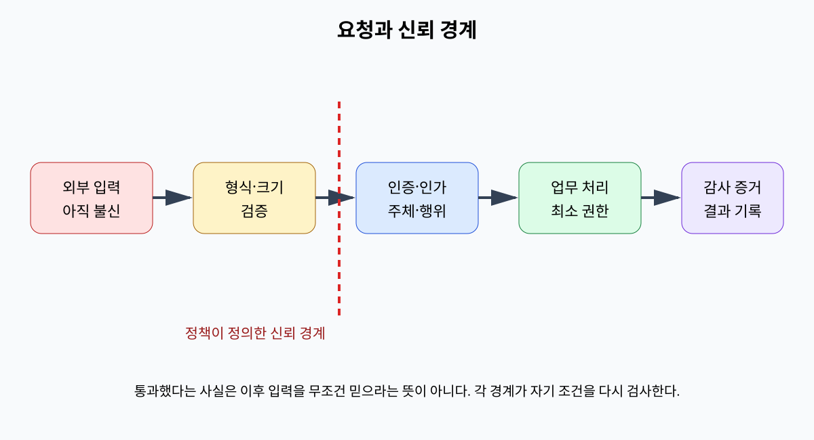
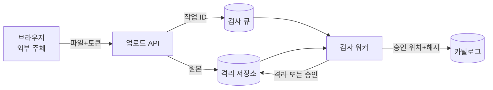
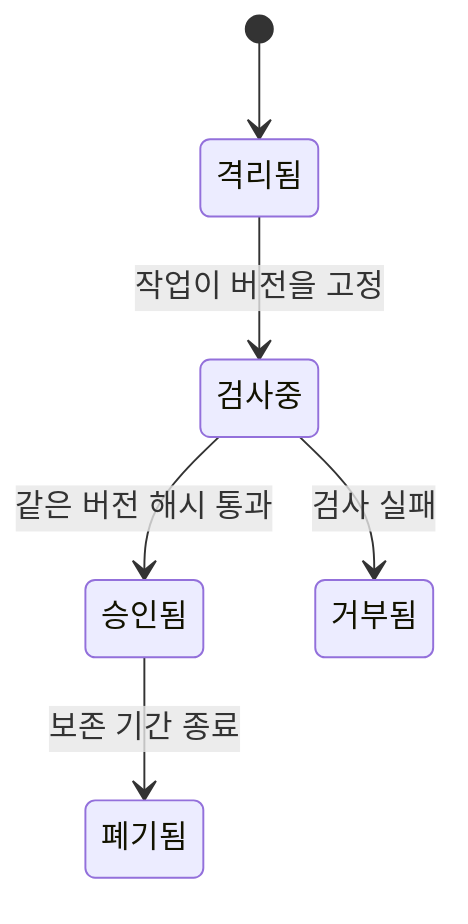

# 01. 위협 모델과 보안 목표

위협 모델(threat model)은 “무엇을, 누구에게서, 어떤 조건으로 보호할지”를 검토 가능한 형태로 적은 문서다.

## 1. 모델의 여섯 입력

첫째는 자산이다. 원본 데이터, 모델 가중치, API 키, 서비스 가동 시간을 따로 적는다.

둘째는 행위자다. 정상 사용자, 운영자, 외부 공격자, 침해된 서비스, 공급업체를 나눈다.

셋째는 진입점(entry point)이다. HTTP API, 업로드 파일, 메시지 큐, 관리 셸이 예다.

넷째는 신뢰 경계다. 인터넷과 프록시, Pod와 노드 커널, 애플리케이션과 데이터베이스 사이가 예다.

다섯째는 공격자 능력이다. 패킷 관찰, 요청 반복, 계정 탈취, 내부자 권한처럼 구체적으로 쓴다.

여섯째는 범위 밖 조건이다. 예를 들어 “물리적 서버 탈취는 이번 모델 밖이며 별도 시설 통제로 다룬다”고 적는다.

범위 밖은 안전하다는 뜻이 아니다. 누락을 숨기지 않고 다음 분석으로 넘긴다는 뜻이다.

## 2. 데이터 흐름으로 찾기

문장만 읽으면 경계가 빠지기 쉽다.

데이터 흐름도(DFD)는 외부 주체, 처리 과정, 저장소, 데이터 흐름을 그린다.

예시는 학습 데이터 업로드다.

브라우저는 500 MiB 파일과 메타데이터를 업로드 API로 보낸다.

API는 객체 저장소에 원본을 쓰고 큐에 검사 작업 ID를 보낸다.

검사 워커는 파일을 읽어 형식과 악성 내용을 검사한다.

카탈로그는 승인된 객체 위치와 해시를 저장한다.

각 화살표에서 기밀성, 무결성, 가용성 질문을 던진다.

파일이 전송 중 노출되는가?

작업 ID를 바꿔 다른 사용자의 파일을 승인할 수 있는가?

압축 폭탄 하나가 워커 메모리를 고갈시키는가?

## 3. STRIDE를 질문 목록으로 쓰기

STRIDE는 여섯 위협 범주를 기억하는 도구다.

Spoofing은 다른 주체인 척하는 신원 위조다.

Tampering은 데이터나 코드의 무단 변경이다.

Repudiation은 행동 사실을 부인하는 상황이다.

Information Disclosure는 허용되지 않은 정보 노출이다.

Denial of Service는 자원을 고갈시켜 이용을 막는 행위다.

Elevation of Privilege는 가진 권한보다 높은 권한을 얻는 행위다.

목록을 채웠다는 사실이 분석 완료를 뜻하지 않는다.

실제 자산과 경계에 연결되지 않은 `DDoS 가능` 같은 문장은 통제를 설계하기 어렵다.

`공격자가 10초에 10,000개 500 MiB 업로드를 시작해 검사 큐와 저장소를 소진한다`처럼 쓴다.

## 4. 보안 요구사항으로 변환하기

위협: 사용자가 다른 프로젝트의 객체 ID를 추측한다.

요구사항: API는 인증된 주체의 프로젝트와 객체의 프로젝트가 같은지 서버에서 검사한다.

검증: A 사용자 토큰으로 B 프로젝트의 알려진 객체 ID 20개를 요청하면 모두 `403`이어야 한다.

증거: 요청 ID, 주체, 객체 프로젝트, 정책 버전, 거부 결과가 감사 로그에 남아야 한다.

위협 하나에 예방, 탐지, 복구 통제를 함께 둘 수 있다.

예방은 객체별 인가 검사다.

탐지는 반복된 `403` 경보다.

복구는 탈취 토큰 폐기와 영향 객체 조사다.

## 5. 위험 우선순위의 숫자 예

팀이 가능성과 영향을 1~5로 평가한다고 하자.

토큰 탈취는 가능성 3, 영향 5로 점수 15다.

비공개 오류 메시지 노출은 가능성 4, 영향 2로 점수 8이다.

점수는 토큰 탈취를 먼저 다룰 근거를 제공한다.

그러나 3과 5는 측정된 확률이 아니다.

평가 근거로 과거 사고, 접근 경로 수, 탐지 시간, 노출 데이터 양을 함께 기록해야 한다.

위험 수용(risk acceptance)은 아무것도 하지 않는 무책임과 다르다.

소유자, 근거, 만료일, 재검토 조건을 기록한 의사결정이다.

## 6. 시간과 상태를 넣는다

많은 위협은 한 요청이 아니라 순서에서 생긴다.

검사 시점과 사용 시점 사이 변경을 TOCTOU(time-of-check to time-of-use)라고 한다.

워커가 파일 해시를 검사한 뒤 같은 경로의 파일이 교체되면 승인 결과와 실제 바이트가 달라진다.

해결책은 내용 주소, 불변 객체 버전, 원자적 상태 전이처럼 검사한 객체와 사용하는 객체를 묶는 것이다.

## 7. 오해와 반례

오해: 외부 공격자만 모델링하면 된다.

반례: 침해된 CI 계정은 유효한 서명 권한으로 악성 아티팩트를 만들 수 있다.

오해: 가장 강한 공격자를 가정해야 좋은 모델이다.

반례: 모든 관리자와 하드웨어가 완전히 침해됐다고 놓으면 실용적인 통제가 사라진다. 의사결정에 필요한 능력을 명확히 경계 짓는다.

오해: 위협 모델은 출시 전 한 번 만든다.

반례: 새 외부 API, 새 저장소, 권한 변경은 데이터 흐름과 경계를 바꾼다.

## 8. 문제와 해설

### 문제 1

모델 다운로드 API의 자산, 주체, 객체, 경계를 하나씩 적어라.

**해설:** 자산은 비공개 모델 가중치, 주체는 인증된 연구자, 객체는 버전이 고정된 모델 파일이다. 경계는 사용자 네트워크와 API 사이 및 API와 객체 저장소 사이로 나눌 수 있다.

### 문제 2

`SQL injection을 막는다`를 검증 가능한 요구사항으로 바꿔라.

**해설:** “사용자 입력은 SQL 문자열에 결합하지 않고 매개변수로 전달한다. 따옴표, 주석, UNION 조합의 고정 공격 입력이 데이터 행이나 스키마를 바꾸지 않으며, 정적 검사에서 문자열 결합 SQL이 0건이어야 한다”처럼 구현 규칙과 관찰 결과를 적는다.

### 문제 3

검사한 파일의 경로만 카탈로그에 저장하는 설계의 경쟁 조건을 설명하라.

**해설:** 검사 종료 뒤 사용 전 같은 경로의 바이트가 바뀔 수 있다. 객체 버전 ID와 해시를 함께 저장하고 읽을 때 같은 버전과 해시를 확인해야 검사 대상과 사용 대상을 묶을 수 있다.

## 공식 자료

- [OWASP Threat Modeling Cheat Sheet](https://cheatsheetseries.owasp.org/cheatsheets/Threat_Modeling_Cheat_Sheet.html)
- [NIST SP 800-30 Rev. 1](https://csrc.nist.gov/pubs/sp/800/30/r1/final)

---

[이전: 보안과 신뢰 지도](00-security-and-trust-map.md) · [목차](README.md) · [다음: 신원·인증·인가](02-identities-authentication-and-authorization.md)
