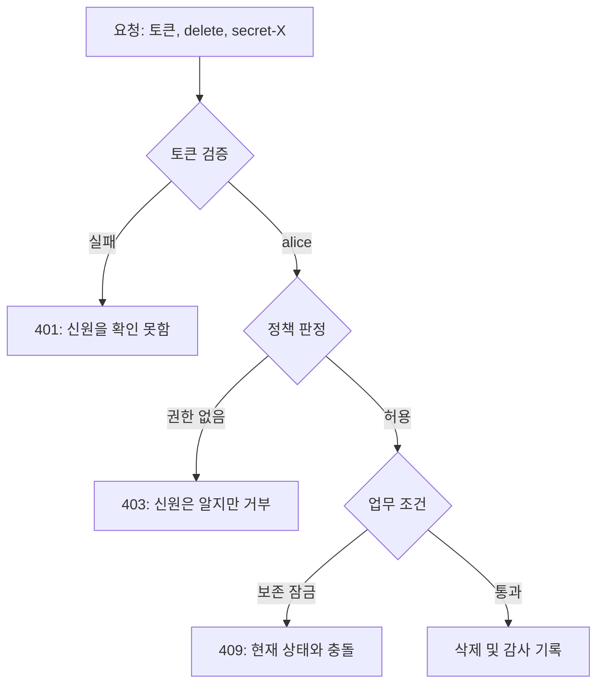

# 02. 신원·인증·인가

신원(identity)은 시스템이 주체를 구별하기 위해 붙인 식별자와 속성의 묶음이다.

인증(authentication)은 신원 주장을 증거로 확인한다.

인가(authorization)는 확인된 주체가 특정 행동을 할 수 있는지 판단한다.

## 1. 인증 입력을 분해한다

식별자(identifier)는 `alice@example.org`나 ServiceAccount 이름처럼 주체를 가리킨다.

자격 증명(credential)은 주장을 뒷받침한다. 비밀번호, 개인키, 토큰이 예다.

인증 요소(factor)는 증명의 종류다.

아는 것은 비밀번호, 가진 것은 보안 키, 본인은 생체 특성이다.

다중 요소 인증(MFA)은 서로 독립적인 종류를 둘 이상 요구한다.

비밀번호 두 개는 모두 “아는 것”이라 두 요소가 아니다.

세션(session)은 인증 결과를 여러 요청에 연결하는 서버 상태나 토큰이다.

세션은 생성 시간, 만료 시간, 대상 서비스, 폐기 방법이 필요하다.

## 2. 토큰 검증의 실제 순서

API가 JWT 형식 토큰을 받았다고 하자.

JWT라는 모양만 보고 신뢰하면 안 된다.

1. 허용한 서명 알고리즘인지 확인한다.

2. 신뢰한 발급자(issuer)의 키로 서명을 검증한다.

3. `iss`가 예상 발급자인지 확인한다.

4. `aud`가 현재 API인지 확인한다.

5. `exp`, `nbf`와 허용한 시계 오차를 확인한다.

6. 폐기 상태나 세션 버전을 확인한다.

7. 검증된 claim만 주체 속성으로 전달한다.

서명 검증 전 payload를 디코딩해 로그 표시용으로 읽을 수는 있지만 신뢰해 판정에 쓰면 안 된다.

## 3. 인가 판정의 네 축

주체(subject)는 누가 요청했는지다.

행동(action)은 `get`, `create`, `delete`처럼 무엇을 하려는지다.

자원(resource)은 어떤 종류와 식별자의 객체인지다.

환경(context)은 시간, 네트워크, 프로젝트, 승인 상태 같은 추가 조건이다.

예: `alice`가 `research` 네임스페이스의 `pods`를 `get`한다.

정책은 네 축을 입력으로 받고 `allow` 또는 `deny`와 근거를 낸다.

401과 403의 차이는 상태 설명이다.

401은 사용할 인증 정보가 없거나 유효하지 않음을 나타낸다.

403은 주체를 알지만 해당 행동을 허용하지 않는 상황에 쓴다.

제품은 정보 노출 위험에 따라 외부 응답을 더 일반화할 수 있지만 내부 판정 이유는 기록한다.

## 4. RBAC와 ABAC

RBAC(role-based access control)는 권한을 역할에 묶고 주체에게 역할을 부여한다.

`reader = {models/get, models/list}`처럼 정의한다.

ABAC(attribute-based access control)는 주체, 자원, 환경 속성을 식으로 평가한다.

`subject.project == resource.project && time < grant.expiry`가 예다.

RBAC는 검토가 단순하지만 역할이 지나치게 늘어날 수 있다.

ABAC는 세밀하지만 속성 출처와 정책 평가를 이해하기 어려울 수 있다.

두 방식을 함께 쓸 수도 있다.

역할로 기본 행위를 정하고 프로젝트 일치와 만료 시간을 속성 조건으로 제한한다.

## 5. 혼동된 대리인 문제

혼동된 대리인(confused deputy)은 높은 권한의 서비스가 낮은 권한 사용자의 의도를 제대로 묶지 않아 권한을 대신 남용하는 문제다.

백업 서비스는 모든 프로젝트 저장소를 읽을 수 있다.

사용자가 임의 경로를 입력하고 서비스가 자기 권한으로 읽으면 다른 프로젝트 데이터가 노출된다.

서비스는 요청 주체, 허용 프로젝트, 대상 객체를 함께 검증해야 한다.

위임 토큰은 대상 서비스(audience), 가능한 행동(scope), 만료 시간을 좁혀야 한다.

## 6. 수명 주기

권한은 발급만큼 회수가 중요하다.

입사 시 계정 생성, 역할 변경 시 권한 수정, 퇴사 시 세션과 키 폐기가 이어져야 한다.

짧은 토큰 수명은 유출 후 노출 시간을 줄인다.

그러나 5분 토큰도 자동 갱신 자격 증명이 탈취되면 계속 재발급될 수 있다.

장기 자격 증명의 위치와 폐기 경로를 따로 추적한다.

## 7. 오해와 반례

오해: 인증되면 신뢰할 수 있다.

반례: 정상 계정도 실수하거나 탈취될 수 있다. 인증은 신원 근거이지 모든 행위의 허용이 아니다.

오해: UI에서 버튼을 숨기면 인가된다.

반례: 공격자는 HTTP 요청을 직접 보낸다. 서버가 객체별로 검사해야 한다.

오해: 관리자 역할 하나면 운영이 쉽다.

반례: 단일 키 노출이 모든 자원 변경으로 이어지고 감사에서 의도를 구분하기 어렵다.

## 8. 문제와 해설

### 문제 1

서명이 맞고 만료되지 않은 토큰인데 다른 API용 `aud`를 가졌다. 받아도 되는가?

**해설:** 거부한다. 발급자가 같은 조직이어도 대상 서비스가 다르면 그 API에 제시할 권한 증거가 아니다. 서명, 발급자, 대상, 시간 조건을 모두 검사해야 한다.

### 문제 2

`viewer` 역할에 `secrets/list`만 있고 `get`은 없다. 목록 응답에 Secret 내용이 포함돼도 되는가?

**해설:** 안 된다. 이름 목록 권한이 내용 열람으로 확대된다. API 응답 필드도 권한 의미에 맞춰 설계하고 민감 필드는 별도 `get` 판정을 거쳐야 한다.

### 문제 3

배포 봇에 만료 없는 클러스터 관리자 토큰이 있다. 개선하라.

**해설:** 배포 대상 네임스페이스와 필요한 동사로 권한을 줄인다. 작업마다 짧은 수명의 대상 제한 토큰을 발급하고, 장기 발급 권한은 보호된 워크로드 신원에 둔다. 발급·사용·실패를 기록하고 회수 절차를 시험한다.

## 공식 자료

- [NIST SP 800-63 Digital Identity Guidelines](https://pages.nist.gov/800-63-3/)
- [Kubernetes Authentication](https://kubernetes.io/docs/reference/access-authn-authz/authentication/)
- [Kubernetes Authorization](https://kubernetes.io/docs/reference/access-authn-authz/authorization/)

---

[이전: 위협 모델](01-threat-models-and-security-goals.md) · [목차](README.md) · [다음: 난수·키·인코딩](03-randomness-keys-and-encoding.md)
