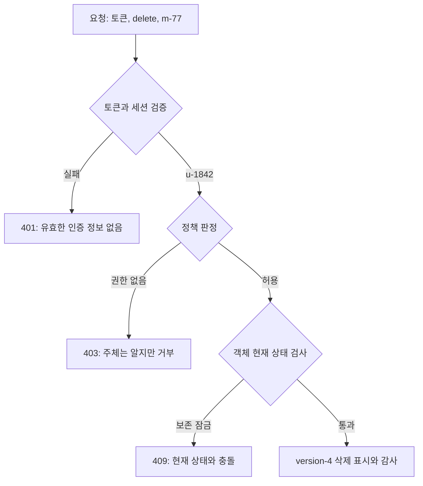

# 02. 신원·인증·인가

[이 책 목차](README.md) · [이전](01-threat-models-and-security-goals.md) · [다음](03-randomness-keys-and-encoding.md)


신원·인증·인가는 서로 이어지지만 같은 일이 아니다. **신원(identity)**은 시스템이 사람이나 프로그램을 구별하기 위해 쓰는 식별자와 속성의 묶음이다. **인증(authentication)**은 “나는 이 신원이다”라는 주장을 증거로 확인하는 과정이다. **인가(authorization)**는 확인된 주체가 지금 요청한 객체에 지금 요청한 행동을 해도 되는지 결정하는 과정이다.

가장 짧은 흐름은 다음과 같다.

> 신원 주장 → 자격 증명 검증 → 인증된 주체 생성 → 객체와 행동 식별 → 정책 평가 → 허용 또는 거부 → 결과 감사

각 화살표에는 데이터 형식, 저장 위치, 수명, 실패 조건이 있다. 이 장은 사용자가 모델 삭제 API를 호출하는 한 요청을 따라가며 그 조건을 모두 펼친다.

## 1. 사람과 계정과 세션은 같은 것이 아니다

실제 사람 민수가 있다고 하자. 시스템은 사람 자체를 메모리에 넣을 수 없으므로 계정 레코드로 표현한다.

```text
user_id       = u-1842
login_name    = minsu@example.org
status        = active
project       = radio-ai
created_at    = 2026-03-01T09:00:00Z
```

**식별자(identifier)**는 대상을 다른 대상과 구별하는 값이다. `u-1842`는 바뀌지 않는 내부 식별자이고, 이메일 주소는 로그인 이름이면서 바뀔 수 있는 속성일 수 있다. 이메일을 영구 식별자로 쓰면 퇴사자 주소를 새 직원에게 재사용했을 때 과거 소유권이 섞일 수 있다. 표시 이름과 내부 식별자를 분리하는 이유다.

**속성(attribute)**은 주체에 관해 정책이 사용할 수 있는 사실이다. 소속 프로젝트, 고용 상태, 인증 강도, 계정 만료 시각이 예다. 속성은 어디서 왔고 누가 갱신하며 언제까지 유효한지 알아야 한다. 클라이언트가 요청 본문에 `project=radio-ai`라고 썼다는 사실만으로 권위 있는 속성이 되지 않는다.

**계정(account)**은 식별자와 상태, 자격 증명 연결, 권한 관계를 보관하는 관리 단위다. 계정은 데이터베이스 행이나 외부 신원 공급자의 객체로 존재하며 생성부터 정지·삭제까지 수명이 있다.

**세션(session)**은 한 번의 인증 결과를 여러 요청에 이어 쓰게 하는 상태다. 서버 데이터베이스에 세션 ID와 상태를 둘 수도 있고, 서명된 토큰에 일부 상태를 담을 수도 있다. 세션은 사람이나 계정 그 자체가 아니다. 한 계정은 노트북과 휴대전화에 여러 세션을 가질 수 있고, 계정이 비활성화되면 남은 세션도 폐기해야 한다.

## 2. 신원 주장과 자격 증명

사용자가 로그인 이름을 보냈다는 것은 **신원 주장(identity claim)**이다. 주장은 아직 사실로 확인되지 않았다.

**자격 증명(credential)**은 그 주장을 뒷받침하는 데이터나 장치다. 비밀번호, 개인키, 보안 키, 일회용 코드, 세션 토큰이 예다. 자격 증명은 비밀 값일 수도 있고, 개인키처럼 장치 밖으로 나오지 않은 채 서명 연산만 제공할 수도 있다.

**인증 요소(authentication factor)**는 증거의 종류다.

- 지식 요소: 사용자가 아는 것, 예를 들면 비밀번호나 PIN
- 소유 요소: 사용자가 가진 것, 예를 들면 보안 키나 등록된 휴대전화
- 생체 요소: 사용자의 신체 특성, 예를 들면 지문

**다중 요소 인증(MFA)**은 독립적인 종류의 요소를 둘 이상 요구한다. 비밀번호 두 개는 모두 지식 요소이므로 두 요소가 아니다. 휴대전화에 비밀번호 관리자와 일회용 코드가 모두 있고 휴대전화 하나가 탈취되면 독립성이 생각보다 약할 수 있다. 요소 수뿐 아니라 같은 실패 원인을 공유하는지도 본다.

비밀번호는 서버가 원문을 그대로 보관해 비교하면 안 된다. 비밀번호 전용 키 유도 함수로 salt와 함께 느리게 계산한 검증값을 저장한다. **salt**는 계정마다 새로 생성해 비밀번호 계산에 섞는 공개 난수 값이다. 같은 비밀번호를 쓴 두 계정의 저장값이 달라지고 미리 계산한 대규모 표의 효율을 낮춘다. salt는 비밀키가 아니며, 비밀번호의 낮은 엔트로피를 강한 비밀로 바꾸는 마법도 아니다.

## 3. 인증은 검증 절차와 결과를 함께 가진다

로그인 요청을 숫자 순서로 보자.

1. 브라우저가 `minsu@example.org`와 비밀번호를 TLS 연결로 보낸다.
2. 서버는 로그인 이름으로 계정 `u-1842`를 찾는다.
3. 계정의 salt와 저장된 비밀번호 검증값을 읽는다.
4. 입력 비밀번호에 같은 함수와 매개변수를 적용한다.
5. 계산 결과를 시간 차이가 정보를 덜 새도록 설계된 비교 함수로 확인한다.
6. 정책이 요구하면 보안 키 서명 같은 두 번째 요소를 검증한다.
7. 성공하면 인증 시각, 사용한 요소, 계정 상태를 담은 인증 결과를 만든다.
8. 서버는 짧은 수명의 세션 또는 토큰을 발급하고, 실패 횟수와 성공 기록을 감사한다.

TLS는 전송 중 비밀번호를 보호하지만 서버가 받은 뒤 메모리와 로그에서 어떻게 다루는지는 별도 문제다. 요청 본문 전체를 오류 로그에 남기면 TLS가 있어도 서버 로그로 비밀번호가 유출된다.

인증 결과에는 **인증 강도**가 있을 수 있다. 비밀번호만 쓴 세션과 피싱 저항성이 있는 보안 키까지 쓴 세션을 같은 민수 계정이라도 다르게 취급해, 고위험 작업에서 재인증을 요구할 수 있다.

## 4. 토큰이 무엇인지부터 분해한다

**토큰(token)**은 권한이나 인증 결과를 전달하기 위해 발급자가 만든 데이터다. 토큰이라는 단어는 형식이 아니라 역할을 말한다. 무작위 세션 ID일 수도 있고, 서명된 구조화 문서일 수도 있다.

서버 저장형 세션 토큰은 예측하기 어려운 무작위 ID만 브라우저에 주고 실제 세션 상태는 서버 저장소에 둔다. 요청 때마다 ID로 상태를 조회하므로 즉시 폐기가 쉽지만 저장소 가용성과 조회 비용이 필요하다.

자기 포함형 토큰은 주체, 발급 시각, 만료 시각 같은 주장을 토큰 안에 넣고 서명한다. 검증자는 발급자에게 매 요청을 묻지 않고 서명을 확인할 수 있다. 대신 이미 발급된 토큰의 즉시 폐기가 어렵고, 토큰에 든 오래된 속성이 만료까지 남을 수 있다.

**JWT(JSON Web Token)**는 점으로 나뉜 세 부분을 흔히 쓰는 토큰 표현이다. 각 부분은 Base64url로 인코딩된 바이트다. **인코딩(encoding)**은 바이트 표현을 다른 문자 집합으로 바꾸는 규칙이지 암호화가 아니다. Base64url 문자열은 누구나 다시 디코딩할 수 있으므로 payload에 비밀번호나 감추어야 할 개인정보를 넣지 않는다.

JWT의 서명은 “발급자가 서명 뒤 내용이 바뀌지 않았다”는 것을 검증하는 데 쓰인다. 서명이 맞는다는 사실만으로 이 토큰이 현재 API에 적합하거나 아직 유효하거나 충분한 권한을 가졌다는 뜻은 아니다.

## 5. JWT 검증을 실제 순서로 따라간다

API가 토큰을 받으면 최소한 다음 계약을 확인한다.

1. **구문과 크기**: 세 부분 형식과 최대 크기를 검사해 비정상 입력을 일찍 거부한다.
2. **허용 알고리즘**: 서버 설정이 허용한 서명 알고리즘인지 확인한다. 토큰이 스스로 제시한 알고리즘을 무조건 따르지 않는다.
3. **키 선택**: 신뢰한 발급자의 키 집합에서 키 ID에 맞는 검증 키를 고른다. 알 수 없는 키를 임의 URL에서 내려받지 않는다.
4. **서명 검증**: 헤더와 payload 바이트에 대한 서명이 맞는지 검증한다.
5. **발급자 `iss`**: 예상한 신원 서비스가 발급했는지 확인한다.
6. **대상 `aud`**: 토큰이 현재 API를 대상으로 발급됐는지 확인한다.
7. **시간 `exp`, `nbf`, `iat`**: 만료, 사용 시작, 발급 시각을 서버 시계와 제한된 오차 범위로 검사한다.
8. **세션 상태**: 계정 정지, 강제 로그아웃, 토큰 버전, 폐기 목록처럼 로컬 정책을 적용한다.
9. **검증된 속성만 전달**: 서명 전 디코딩한 값이나 요청 헤더의 사용자 이름을 정책 입력으로 섞지 않는다.

예를 들어 현재 시각이 12:00이고 `exp=12:05`, `aud=storage-api`인 서명된 토큰을 `model-api`가 받았다. 만료되지 않았어도 대상이 다르므로 거부한다. 발급자가 같은 조직이라는 이유로 다른 API용 토큰을 받으면 토큰의 권한 범위가 예상보다 넓어진다.

키 회전 때는 이전 검증 키를 즉시 없애면 아직 유효한 토큰이 모두 실패할 수 있다. 새 키로 발급을 시작하고, 기존 토큰의 최대 수명과 폐기 정책에 맞춰 이전 공개 검증 키를 제한된 기간 제공한 뒤 제거한다. 개인 서명 키는 발급 서비스에서 보호하고 API 검증자에게 배포하지 않는다.

## 6. 인가 판정은 네 입력과 상태를 사용한다

인가는 다음 네 축을 완전하게 식별한다.

- **주체(subject)**: 검증된 `u-1842`, 서비스 계정, 그룹과 같은 요청자
- **행동(action)**: `get`, `list`, `create`, `delete` 같은 연산
- **자원(resource)**: 종류, 네임스페이스, 식별자, 소유 프로젝트가 있는 실제 객체
- **환경(context)**: 시각, 네트워크, 인증 강도, 승인 상태, 비상 모드 같은 조건

예시는 `u-1842`가 프로젝트 `radio-ai`의 모델 `m-77/version-4`를 `delete`하려는 요청이다. 정책은 주체가 프로젝트 관리자 역할을 갖는지, 객체 프로젝트가 같은지, 모델에 보존 잠금이 없는지, 고위험 작업용 재인증이 유효한지 평가한다.




HTTP의 `401`은 일반적으로 유효한 인증 정보가 없거나 인증이 실패했음을 나타내고, `403`은 서버가 요청을 이해했지만 권한 때문에 거부했음을 나타낸다. 실제 제품은 객체 존재 여부 노출을 줄이기 위해 외부 오류를 일반화할 수 있다. 그래도 내부 감사에는 인증 실패, 인가 거부, 객체 상태 충돌을 구분해 남겨야 운영자가 원인을 찾을 수 있다.

인가 검사는 라우트 입구에서 한 번만 하지 않는다. 객체를 데이터베이스에서 읽은 뒤 그 객체의 실제 소유 프로젝트를 사용해 판정하고, 변경 직전 현재 상태 제약도 확인한다. 클라이언트가 보낸 `project` 값만 믿으면 다른 객체 ID와 자기 프로젝트 이름을 조합하는 우회가 가능하다.

## 7. RBAC·ABAC·관계 기반 판정

**RBAC(role-based access control)**는 권한을 역할(role)에 묶고 주체에게 역할을 부여한다. 역할은 직함이 아니라 허용 행동 집합이다.

```text
model-reader = {models/list, models/get}
model-editor = {models/list, models/get, models/create, models/update}
```

사용자 1,000명에게 권한을 하나씩 주는 대신 역할을 검토할 수 있어 단순하다. 그러나 프로젝트·지역·만료 조합마다 역할을 만들면 역할 폭증이 생긴다.

**ABAC(attribute-based access control)**는 주체, 자원, 환경의 속성을 조건식으로 평가한다.

```text
allow if
  subject.project == resource.project
  and subject.status == "active"
  and request.time < subject.grant_expiry
```

세밀하지만 속성의 권위 있는 출처와 갱신 시점을 추적해야 한다. 토큰에 8시간 전 프로젝트 정보가 남아 있다면 사용자가 프로젝트에서 제거된 뒤에도 권한이 지속될 수 있다.

**관계 기반 접근 제어(ReBAC)**는 “민수는 프로젝트 A의 구성원이고, 프로젝트 A는 모델 M의 소유자다” 같은 객체 관계 그래프를 따라 판정한다. 공유 폴더, 조직 계층, 문서 소유권에 잘 맞지만 관계 변경과 캐시 무효화가 정책 결과에 미치는 영향을 다뤄야 한다.

실제 시스템은 방식을 조합할 수 있다. 역할로 기본 행동을 정하고, 프로젝트 일치와 만료를 속성으로 제한하며, 객체 소유 관계를 그래프로 확인한다. 이름보다 정책 입력과 실패 모드를 명확히 하는 것이 중요하다.

## 8. 소유권과 범위: `list`와 `get`도 다르다

권한은 API 이름만으로 판단하지 않고 반환되는 정보까지 포함한다. `secrets/list`가 Secret 이름만 반환하도록 설계됐는데 응답에 값까지 넣으면 `get` 권한을 우회한다. 목록의 존재 자체가 민감할 수도 있다.

범위(scope)는 토큰이나 권한이 적용되는 행동과 자원의 제한이다. `models:read`보다 `project=radio-ai, model=m-77, action=get, expiry=12:10`이 좁다. 범위를 좁히면 토큰 유출 때 피해 반경이 줄어든다.

**테넌트(tenant)**는 한 서비스 인프라를 공유하지만 데이터와 관리 경계를 분리해야 하는 고객이나 조직 단위다. 모든 데이터베이스 쿼리에 테넌트 조건을 넣어야 하는 시스템에서 한 경로가 조건을 빠뜨리면 교차 테넌트 유출이 생긴다. 테스트는 자기 객체 성공뿐 아니라 다른 테넌트의 존재하는 객체, 존재하지 않는 객체, 목록·검색·내보내기 경로를 모두 다룬다.

## 9. 혼동된 대리인: 높은 권한 서비스가 사용자의 의도를 잃는 문제

**혼동된 대리인(confused deputy)**은 높은 권한을 가진 서비스가 요청자의 권한과 대상 관계를 제대로 묶지 않아 자기 권한을 대신 사용해 주는 문제다.

백업 서비스가 모든 프로젝트 저장소를 읽을 수 있다고 하자.

1. 사용자는 자기 프로젝트 백업 권한만 있다.
2. API에 `path=project-b/secret-model`을 보낸다.
3. 백업 서비스가 경로를 검증하지 않고 자기 저장소 자격 증명으로 읽는다.
4. 사용자는 직접 권한이 없던 프로젝트 B 데이터를 백업 결과로 받는다.

서비스는 요청 주체, 허용 프로젝트, 대상 객체의 실제 소유자를 함께 확인해야 한다. 사용자가 준 경로 문자열을 권한 근거로 삼지 않는다.

**위임(delegation)**은 한 주체가 다른 서비스에 제한된 행동을 맡기는 것이다. 위임 토큰에는 대상 서비스(audience), 행동 범위(scope), 자원 범위, 만료 시각을 좁게 넣는다. “사용자 토큰을 모든 내부 서비스에 그대로 전달”하면 한 서비스 침해가 다른 서비스 권한으로 확장될 수 있다.

## 10. 세션 수명과 폐기

세션은 생성, 사용, 갱신, 폐기의 수명 주기를 가진다.

- 생성: 인증 방식과 시각, 장치 관련 정보, 만료를 기록한다.
- 사용: 절대 만료와 비활성 만료, 계정 상태를 확인한다.
- 갱신: 장기 갱신 자격 증명과 짧은 접근 토큰을 구분한다.
- 폐기: 로그아웃, 비밀번호 변경, 계정 정지, 사고 대응 때 관련 세션을 끊는다.

5분짜리 접근 토큰은 유출된 토큰 하나의 사용 시간을 줄인다. 그러나 공격자가 만료 없는 갱신 토큰을 함께 훔쳤다면 계속 새 토큰을 받을 수 있다. 따라서 접근 토큰 수명만 짧게 하는 것으로 충분하지 않다. 갱신 토큰의 저장 위치, 장치 바인딩, 회전, 재사용 탐지, 폐기 경로를 설계한다.

서버가 계정을 정지했는데 자기 포함형 토큰을 24시간 오프라인 검증만 한다면 정지 효과가 늦어진다. 고위험 API는 짧은 수명, 세션 버전 조회, 폐기 목록 같은 비용과 즉시성의 절충을 선택한다.

## 11. 기계 신원과 Kubernetes

사람뿐 아니라 프로그램도 신원이 필요하다. **워크로드 신원(workload identity)**은 실행 중인 서비스나 작업을 구별하는 신원이다. Kubernetes의 ServiceAccount는 Pod가 API 서버에 자신을 나타낼 때 사용하는 주체가 될 수 있다. 네임스페이스와 ServiceAccount 이름은 정책 범위의 일부다.

Pod 안에 만료 없는 공용 클라우드 키를 넣으면 어느 복사본이 사용됐는지 구별하기 어렵고 유출 뒤 영향이 길다. 워크로드 속성과 대상 서비스를 묶은 짧은 수명 토큰을 발급하면 노출 시간을 줄일 수 있다. 그러나 노드나 Pod가 침해되면 실행 중 토큰을 사용할 수 있으므로 최소 권한과 네트워크·런타임 격리가 계속 필요하다.

Kubernetes RBAC에서 Role은 허용 규칙의 집합이고 RoleBinding은 그 역할을 사용자·그룹·ServiceAccount에 연결한다. RBAC 허용이 애플리케이션 데이터베이스 행까지 자동으로 보호하지는 않는다. API 서버 객체 권한과 애플리케이션 내부 객체 권한은 서로 다른 집행 지점이다.

## 12. 연합 신원과 신뢰 사슬

**신원 공급자(identity provider, IdP)**는 사용자를 인증하고 다른 서비스가 검증할 수 있는 결과를 발급하는 시스템이다. **연합(federation)**은 서비스가 모든 비밀번호를 직접 관리하지 않고 신뢰한 IdP의 결과를 받아들이는 관계다.

서비스가 IdP를 신뢰한다는 것은 모든 문자열을 믿는다는 뜻이 아니다. 정확한 발급자 주소, 대상, 서명 키, 클라이언트 ID, redirect URI, nonce와 상태 값을 검증한다. **redirect URI**는 로그인 뒤 결과를 돌려보낼 허용된 서비스 주소다. 넓은 와일드카드로 두면 토큰이나 코드를 공격자 주소로 보낼 수 있다.

IdP 계정이 정지돼도 이미 발급된 서비스 세션이 남을 수 있다. 연합 로그인 성공과 로컬 세션 수명을 연결하고, 긴급 폐기·프로비저닝 해제 이벤트를 처리한다.

## 13. 표준과 암호 알고리즘의 역할 경계

TLS 1.3은 네트워크 연결에서 서버 인증과 키 합의, 암호화된 레코드 전송을 정의한다. 이것은 API가 `u-1842`에게 모델 삭제를 허용해야 하는지 결정하지 않는다. TLS의 서버 인증서와 애플리케이션 사용자 인증을 구분한다.

NIST FIPS 203의 ML-KEM은 양자 공격을 고려한 키 캡슐화 표준이다. KEM은 통신 당사자가 공유 비밀을 만들도록 돕지만 사용자 계정, 역할, 객체별 인가를 제공하지 않는다. 알고리즘 표준화, 프로토콜 채택, 라이브러리 지원, 실제 서비스 설정은 각각 다른 배포 단계다.

운영 인증 프로토콜과 토큰 서명 알고리즘은 검토된 라이브러리로 구현한다. 교육용으로 토큰 문자열을 분해하는 코드는 형식을 이해시키는 모형일 뿐 서명·시간·발급자·대상 검증을 빠뜨린 채 운영 검증기로 사용하면 안 된다.

## 14. 인증 프로토콜의 상태 값과 재전송 방지

로그인 화면이 신원 공급자로 이동했다가 서비스로 돌아오는 흐름에서는 여러 브라우저 탭과 공격자의 요청이 섞일 수 있다. 이때 **state 값**은 서비스가 로그인 시작 때 만든 예측하기 어려운 값으로, 돌아온 응답이 자신이 시작한 로그인 흐름과 연결되는지 확인한다. 서비스는 state를 브라우저 세션과 함께 저장하고, 콜백에서 정확히 일치하는지 확인한 뒤 한 번 사용하고 폐기한다. state를 단지 응답에 넣었다가 검증하지 않으면 보호가 없다.

**nonce**는 인증 결과가 특정 로그인 시도에 발급됐는지 연결하는 일회성 값이다. 과거의 유효한 인증 응답을 다시 제출하는 재전송을 줄이는 데 쓰인다. nonce의 생성, 저장, 만료, 사용 완료 처리가 모두 있어야 한다. 무작위 값의 길이가 충분해도 서버가 재사용 여부를 확인하지 않으면 “한 번만 사용”이라는 계약이 성립하지 않는다.

공개 클라이언트가 권한 부여 코드를 사용할 때는 **PKCE(Proof Key for Code Exchange)** 같은 기법으로 로그인 시작 주체와 코드 교환 주체를 묶을 수 있다. 클라이언트는 먼저 예측하기 어려운 `code_verifier`를 만들고 그 변환값인 `code_challenge`를 인증 요청에 보낸다. 나중에 코드를 토큰으로 바꿀 때 원래 verifier를 제시한다. 중간에서 코드만 가로챈 공격자는 verifier가 없어 교환하기 어렵다. 이것도 잘못 등록된 redirect URI, 악성 브라우저 환경, 탈취된 최종 토큰을 모두 해결하지는 않는다.

인증 프로토콜의 보안은 “HTTPS 사용” 한 줄로 끝나지 않는다. TLS는 이동 중 채널을 보호하지만 요청과 응답이 어느 브라우저 세션에 속하는지, 코드가 재사용됐는지, 토큰 대상이 맞는지는 애플리케이션과 프로토콜 검증이 담당한다.

## 15. 권한 변경과 캐시의 시간차

인가 결과를 매번 계산하면 비용이 들기 때문에 서비스는 역할, 그룹, 정책 결과를 캐시할 수 있다. **캐시(cache)**는 원본보다 가까운 위치에 값의 복사본을 잠시 저장해 조회 시간을 줄이는 구조다. 복사본에는 유효 기간과 원본 변경을 반영하는 방법이 필요하다.

민수를 프로젝트 관리자에서 12:00에 제거했지만 API 캐시가 10분 동안 이전 결과를 쓴다면 12:10까지 삭제 권한이 남을 수 있다. 이것은 구현 버그일 수도 있고 명시된 일관성 계약일 수도 있다. 중요한 것은 최대 지연을 알고 위험에 맞추는 것이다.

고위험 행동은 짧은 캐시, 즉시 무효화 이벤트, 현재 정책 버전 비교, 재인증을 사용할 수 있다. 읽기 전용 저위험 요청은 더 긴 캐시를 허용할 수 있다. 무효화 이벤트 자체가 유실되면 어떻게 회복하는지, 정책 저장소 장애 때 오래된 캐시를 얼마나 사용할지도 정한다.

권한 변경은 실행 중 요청과도 경쟁한다. 요청 시작 때 허용됐지만 객체 삭제 직전에 권한이 회수될 수 있다. 모든 단계에서 무조건 다시 검사하면 비용과 복잡성이 커지고, 한 번만 검사하면 긴 작업 동안 오래된 권한을 사용할 수 있다. 작업의 위험과 수명에 따라 승인 시점을 계약으로 정한다. 예를 들어 6시간 학습 작업은 제출 권한과 실행 지속 권한, 결과 읽기 권한을 분리할 수 있다.

## 16. 흔한 오해와 조건이 바뀌는 반례

**“인증됐으니 신뢰할 수 있다.”** 인증은 신원 주장에 대한 근거다. 정상 계정도 다른 프로젝트 객체를 요청할 수 있고 계정도 탈취될 수 있다.

**“UI에서 버튼을 숨겼으니 권한이 없다.”** 공격자는 HTTP 요청을 직접 만든다. 객체를 변경하는 서버가 인가해야 한다.

**“서명이 맞는 JWT는 유효하다.”** 발급자, 대상, 시간, 세션 상태가 틀릴 수 있다. 서명은 여러 검사 중 하나다.

**“짧은 접근 토큰이면 폐기 문제가 없다.”** 장기 갱신 토큰이 탈취되면 재발급이 계속될 수 있다.

**“Binary Semaphore처럼 역할 하나를 공유하면 운영이 쉽다.”** 많은 서비스가 같은 관리자 자격 증명을 공유하면 행위자를 구별할 수 없고 하나의 유출이 전체 권한으로 번진다. 서비스별 신원과 좁은 권한이 필요하다.

## 17. 연습 문제와 자세한 풀이

### 문제 1. 대상이 다른 토큰

서명이 맞고 만료되지 않았지만 `aud=storage-api`인 토큰을 `model-api`가 받아도 되는가?

**풀이:** 거부한다. 서명은 발급 뒤 내용이 바뀌지 않았음을 확인하지만 이 토큰의 사용 대상은 storage API다. model API가 받으면 발급자가 의도한 권한 경계가 넓어진다. 허용 알고리즘, 키, 발급자, 대상, 시간, 세션 상태를 모두 확인한다.

### 문제 2. 목록 권한과 내용 권한

`secrets/list`는 있고 `secrets/get`은 없다. 목록 응답에 Secret 값이 포함돼도 되는가?

**풀이:** 안 된다. 행동 이름이 아니라 실제 공개 정보가 권한의 의미다. 목록은 이름과 허용된 메타데이터만 반환하고 값은 별도 `get` 판정을 거쳐야 한다. 이름 자체가 민감하면 목록도 객체 범위로 필터링한다.

### 문제 3. 배포 봇의 영구 관리자 토큰

어떻게 개선하는가?

**풀이:** 봇마다 고유한 워크로드 신원을 주고, 배포 대상 네임스페이스와 필요한 동사만 허용한다. 작업 시작 때 대상 서비스와 짧은 만료를 가진 토큰을 발급한다. 장기 발급 권한은 보호된 신원 시스템에 두고 발급·사용·실패를 감사한다. 토큰 폐기와 롤백 절차를 실제로 시험한다.

### 문제 4. 이메일 재사용

퇴사자의 이메일 주소를 새 직원에게 재사용했다. 이메일을 모든 객체 소유자의 영구 ID로 썼다면 어떤 문제가 생기는가?

**풀이:** 새 직원이 과거 직원의 객체 관계와 감사 기록을 상속한 것처럼 보일 수 있다. 재사용하지 않는 내부 ID를 소유권과 감사의 기준으로 쓰고 이메일은 바뀔 수 있는 속성으로 둔다. 계정 연결 변경도 별도 사건으로 기록한다.

### 문제 5. 계정 정지와 24시간 토큰

10시에 계정을 정지했지만 9시에 발급된 토큰이 24시간 오프라인 검증된다. 언제까지 접근할 수 있는가?

**풀이:** 추가 폐기 장치가 없다면 토큰 만료까지 접근할 수 있다. 위험에 맞게 토큰 수명을 줄이거나 세션 버전·폐기 상태를 조회하고, 고위험 작업은 재인증을 요구한다. 즉시성, 저장소 가용성, 조회 비용의 절충을 명시한다.

### 문제 6. 백업 서비스의 경로 입력

사용자가 경로를 주고 전권 백업 서비스가 자기 자격 증명으로 읽는다. 최소 수정은 무엇인가?

**풀이:** 서비스는 요청 주체의 허용 프로젝트를 권위 있는 정책 저장소에서 확인하고, 대상 객체의 실제 소유 프로젝트와 비교한다. 사용자 경로를 직접 저장소 키로 쓰지 않고 객체 ID를 카탈로그에서 해석한다. 위임 토큰에는 대상 서비스, 행동, 객체 범위, 만료를 넣는다.

### 문제 7. MFA 두 개

비밀번호와 보안 질문을 요구하면 다중 요소 인증인가?

**풀이:** 둘 다 사용자가 아는 지식 요소이므로 일반적으로 서로 다른 두 요소가 아니다. 비밀번호와 물리 보안 키처럼 실패 원인이 더 독립적인 요소를 조합한다. 계정 복구 경로가 보안 질문 하나로 두 요소를 우회하지 않는지도 검사한다.

### 문제 8. Base64로 감춘 토큰

payload를 Base64url로 바꾸면 기밀성이 생기는가?

**풀이:** 아니다. 인코딩은 바이트를 전송 가능한 문자로 표현하는 규칙이라 누구나 되돌릴 수 있다. 민감한 원문을 넣지 말고, 필요한 경우 검토된 암호화 토큰 형식과 키 관리를 사용한다. 서명된 JWT도 보통 payload를 숨기지 않는다.

## 공식 근거

- [NIST Digital Identity Guidelines](https://pages.nist.gov/800-63-4/)
- [Kubernetes Authentication](https://kubernetes.io/docs/reference/access-authn-authz/authentication/)
- [Kubernetes Authorization](https://kubernetes.io/docs/reference/access-authn-authz/authorization/)
- [RFC 7519: JSON Web Token](https://www.rfc-editor.org/rfc/rfc7519)
- [RFC 8446: TLS 1.3](https://www.rfc-editor.org/rfc/rfc8446)
- [NIST FIPS 203: ML-KEM](https://csrc.nist.gov/pubs/fips/203/final)

---

[이전: 위협 모델](01-threat-models-and-security-goals.md) · [목차](README.md) · [다음: 난수·키·인코딩](03-randomness-keys-and-encoding.md)
