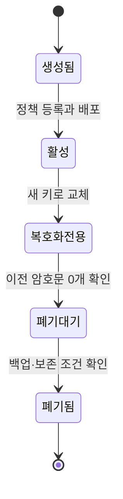

# 03. 난수·키·인코딩

로그인 확인 코드, 데이터 보호에 쓰는 비밀 값, 그 값을 화면에 표시한 문자열은 겉모양이 비슷해도 목적이 다르다. 이 장에서는 0과 1로 정보를 나타내는 방식부터 시작해 “예측하기 어려운 값은 어떻게 만들고, 누가 보관하며, 같은 값을 다시 써도 되는가”를 따라간다. 긴 문자열이라는 모양만 보고 안전하다고 판단하지 않는다.

이 장은 비트와 바이트부터 시작해 난수 생성, 엔트로피, 키 수명, 인코딩, salt·nonce·IV, 충돌 확률, 키 파생까지 한 흐름으로 설명한다.

## 1. 비트와 바이트: 암호 함수가 실제로 받는 것

**비트(bit)**는 0 또는 1 두 상태 중 하나를 표현하는 정보 단위다. **바이트(byte)**는 보통 8비트를 묶은 단위라 `00000000`부터 `11111111`까지 256가지 값을 표현한다. 1바이트를 0~255의 정수로 볼 수도 있고, 문자 인코딩 규칙에 따라 글자의 일부로 볼 수도 있다.

사람이 보는 문자열과 함수가 받는 바이트를 구분해야 한다. **문자 인코딩**은 글자와 바이트 사이의 대응 규칙이다. **유니코드**는 각 문자에 번호를 부여한 체계이고, **UTF-8**은 그 번호를 1~4바이트로 저장하는 인코딩이다. 글자 `A`는 UTF-8에서 16진수 `41` 한 바이트다. 한글 `가`는 UTF-8에서 `EA B0 80` 세 바이트다. 같은 글자처럼 보이는 문자열도 글자를 하나로 합쳤는지 조합해서 적었는지에 따라 바이트가 다를 수 있다. 이 차이를 정해진 표현으로 맞추는 과정이 **문자 정규화**다. 암호 함수는 사람이 읽는 “뜻”이 아니라 정확한 바이트 배열을 처리하므로 입력 표현까지 합의해야 한다.

**16진수(hexadecimal)**는 바이트를 사람이 읽기 쉽게 0~9와 a~f로 적는 표현이다. 한 자리로 4비트를 표현하므로 1바이트는 두 글자가 된다. 16바이트는 32개의 16진수 글자로 보인다. 이것은 인코딩이며 암호화가 아니다.

## 2. 무작위라는 말의 세 가지 의미

**무작위 값(random value)**은 관찰자가 다음 결과를 쉽게 예측하지 못하도록 생성한 값이다. 그러나 “무작위처럼 보인다”, “통계적으로 고르게 나온다”, “암호 공격자가 예측하기 어렵다”는 서로 다른 주장이다.

시뮬레이션용 의사 난수 생성기는 같은 seed로 같은 수열을 재현하는 것이 장점이다. **seed**는 생성기의 초기 내부 상태를 정하는 입력이다. 실험 재현에는 유용하지만 seed가 현재 시각처럼 추측 가능하면 비밀키 생성에는 부적합하다.

**암호학적 의사 난수 생성기(CSPRNG)**는 내부 상태 일부나 과거 출력이 알려져도 다음 출력을 예측하기 어렵도록 설계된 생성기다. 운영체제는 하드웨어 사건과 장치 타이밍 등 여러 입력을 모아 내부 난수 상태를 관리하고 안전한 API로 바이트를 제공한다. **API(Application Programming Interface)**는 프로그램이 다른 구성 요소의 기능을 호출할 때 지켜야 하는 입력·출력과 오류 규칙이다. 난수 API에서는 요청한 길이의 안전한 바이트를 얻었는지와 실패 처리가 중요하다. 애플리케이션은 운영체제 보안 난수 API나 검토된 라이브러리를 사용해야 한다. 현재 시각, 프로세스 ID, 사용자 이름을 섞어 직접 난수 생성기를 만드는 것은 입력의 경우의 수가 작고 구조가 알려져 예측될 수 있다.

Python에서는 비밀 토큰에 `random`보다 `secrets` 모듈을 사용한다. 이 문장은 Python 구현 하나를 모든 환경의 보증으로 확대하는 뜻이 아니다. 각 언어와 운영체제가 제공하는 보안 난수 계약을 확인해야 한다.

## 3. 엔트로피: 공격자가 모르는 경우의 수

**엔트로피(entropy)**는 결과에 대한 불확실성을 수치로 표현하는 개념이다. 균등하게 선택되는 8비트 값은 256가지이고 `log2(256)=8`이라 최대 8비트의 엔트로피를 가진다.

네 자리 숫자 PIN은 0000부터 9999까지 10,000가지다. 모든 값이 같은 확률이면 `log2(10000)≈13.3`비트다. 여섯 자리 코드는 1,000,000가지라 약 19.9비트다. 숫자가 길어졌지만 오프라인에서 백만 개를 전부 시험할 수 있는 공격자에게는 강한 장기 비밀이 아니다. 짧은 만료, 제한된 시도 횟수, 특정 세션과의 결합이 함께 필요하다.

사용자가 고른 비밀번호는 가능한 문자 조합 수만으로 엔트로피를 계산하면 안 된다. 사용자는 단어, 반복, 키보드 패턴을 편향되게 고른다. 12글자라는 길이만으로 균등한 `94^12` 공간에서 뽑았다고 가정할 수 없다.

엔트로피를 실제 보안 강도와 같은 숫자로 단정하지 않는다. 생성 과정의 편향, 내부 상태 유출, 구현 결함, 키 사용 알고리즘, 공격자의 질의 능력이 함께 작용한다.

## 4. CSPRNG의 객체와 수명

CSPRNG에는 눈에 보이는 출력 바이트뿐 아니라 메모리에 있는 내부 상태가 있다. 일반 흐름은 다음과 같다.

1. 운영체제가 여러 잡음 원천에서 예측하기 어려운 입력을 모은다.
2. 그 입력으로 난수 생성기의 내부 상태를 초기화하거나 갱신한다.
3. 애플리케이션이 32바이트를 요청한다.
4. 생성기는 내부 상태로 출력 바이트를 만들고 상태를 앞으로 진행시킨다.
5. 필요할 때 새 엔트로피 입력으로 상태를 다시 갱신한다.

**가상 머신(VM)**은 실제 컴퓨터 자원을 나누어 별도의 컴퓨터처럼 실행하는 환경이다. **스냅샷**은 특정 시점의 메모리와 실행 상태 등을 저장한 복원 지점이다. **프로세스**는 실행 중인 프로그램이고, **fork**는 그 실행 상태를 바탕으로 자식 프로세스를 만드는 동작이다. 이처럼 상태가 복제되는 사건은 난수 생성기의 수명을 복잡하게 한다. 같은 내부 상태가 복제된 두 실행 환경이 독립적으로 같은 출력을 만들 수 있기 때문이다. 현대 운영체제와 런타임은 이런 상황을 고려한 장치를 제공할 수 있지만, 애플리케이션이 직접 만든 생성기는 복제 사실을 모를 수 있다. VM 이미지에 미리 생성한 장기 키를 넣지 않고 인스턴스 생성 뒤 안전한 키 발급 절차를 거치는 이유다.

난수 API 실패를 0바이트나 현재 시각으로 대체하면 안전 쪽으로 실패하지 않는다. 키·nonce 생성에 필요한 보안 난수를 얻지 못했다면 암호 연산을 중단하고 오류를 관찰해야 한다.

## 5. 키: 알고리즘의 동작을 결정하는 값

**키(key)**는 암호 알고리즘의 동작을 결정하는 매개변수다. 키의 종류에 따라 비밀성과 배포 규칙이 다르다.

**대칭키(symmetric key)**는 암호화와 복호화, 또는 메시지와 키로 변조 검사용 값을 만드는 **MAC(Message Authentication Code)**의 생성과 검증에서 같은 비밀 값을 공유한다. 두 시스템이 같은 키를 가지므로 빠르고 대용량 처리에 적합하지만 누가 키를 가질지와 어떻게 전달할지가 어렵다.

**비대칭키 쌍(asymmetric key pair)**은 개인키와 공개키로 나뉜다. **개인키(private key)**는 서명 생성이나 키 설정 과정에 쓰며 소유자가 보호한다. **공개키(public key)**는 서명 검증 등에 배포할 수 있다. 공개키가 공개돼도 괜찮다는 말은 그 공개키가 누구의 것인지 아무렇게나 정해도 된다는 뜻이 아니다. 공격자의 공개키를 공식 키로 등록하면 공격자 서명도 정상으로 검증된다.

**키 재료(key material)**는 실제 암호 연산에 쓰이는 비트다. **키 식별자(key ID)**는 키를 찾는 이름이다. `kms/key/17`이라는 문자열을 안다고 키 재료를 아는 것은 아니다. **KMS(Key Management Service)**는 키 생성·버전·사용 권한을 관리하고 허용된 암호 연산을 제공하는 서비스다. 그러나 식별자 권한이 잘못 설정돼 누구나 KMS에 복호화 요청을 보낼 수 있다면 결과적으로 키 사용 권한이 노출된다.

키 길이는 중요한 조건이지만 전체 안전성을 단독으로 결정하지 않는다. 강한 길이의 키도 예측 가능한 생성, 모든 서비스의 공유, nonce 재사용, 로그 출력, 무제한 수명 때문에 무너질 수 있다.

## 6. 키 수명 주기를 상태로 관리한다

키는 파일 하나가 아니라 상태가 변하는 관리 객체다.

각 상태를 실제 동작으로 풀면 다음과 같다.

1. **생성:** 승인된 난수원이나 HSM·KMS가 키 재료를 만든다. **HSM(Hardware Security Module)**은 키를 보호된 장치 내부에 보관하고 암호 연산을 수행하는 하드웨어 모듈이다. 키를 밖으로 꺼내지 않는 설정도 있지만 서비스 권한과 장치 보안은 계속 관리해야 한다. 키 ID와 용도, 소유자, 생성 시각을 등록한다.
2. **활성:** 새 암호화나 서명에 사용할 수 있다. 어떤 서비스가 어떤 연산을 호출할 수 있는지 인가한다.
3. **교체:** 새 키 버전 8로 새 쓰기를 전환한다. 버전 7은 기존 데이터 복호화에만 허용할 수 있다.
4. **재암호화:** 저장된 `key_version=7` 암호문을 읽고 검증한 뒤 8로 다시 암호화한다.
5. **폐기 대기:** 온라인 저장소, 큐, 백업, 장기 보관 파일에 7이 필요한지 조사한다.
6. **폐기:** 키 재료와 사용 권한을 제거하고 사건을 감사한다. 폐기 뒤 복원이 필요한 데이터가 남았다면 가용성을 잃는다.

키 교체(rotation)는 단순히 KMS에서 “새 버전” 버튼을 누르는 일이 아니다. 실행 중 프로세스의 캐시, 열린 연결, 오프라인 백업, 재처리 큐가 옛 키를 계속 사용할 수 있다. 새 쓰기 비율과 옛 키 사용량을 관측하고 완료 조건을 정의한다.

## 7. 인코딩: 의미를 숨기지 않고 표현만 바꾼다

**인코딩(encoding)**은 같은 정보를 다른 기호 체계로 표현해 저장·전송하기 쉽게 만드는 변환이다. 비밀키 없이 누구나 되돌릴 수 있는 것이 보통이다.

Base64는 3바이트, 즉 24비트를 6비트씩 네 조각으로 나눠 64개의 문자표에서 네 글자를 고른다. ASCII 문자열 `Man`의 세 바이트는 Base64에서 `TWFu`가 된다. ASCII는 영문자·숫자 등을 작은 정수로 나타내는 문자 체계다. padding을 포함한 길이는 `4 × ceil(바이트 수 / 3)`이다. `ceil`은 소수를 올려 다음 정수로 만드는 연산이다. 16바이트는 `4 × ceil(16/3) = 24`문자가 되며, 마지막 3바이트 묶음에 없는 바이트를 표시하는 padding `=` 두 개가 붙는다. Base64url은 웹주소에서 특별한 의미가 있는 문자를 피하도록 문자표 일부를 바꾼 표현이다.

Base64 문자열이 길고 무작위처럼 보여도 기밀성은 없다. Kubernetes Secret 매니페스트의 `data` 필드가 Base64인 이유는 임의 바이트를 YAML/JSON 텍스트에 넣기 위해서지 저장 내용을 암호화하기 위해서가 아니다.

URL 인코딩은 공백이나 예약 문자를 `%20` 같은 형태로 나타낸다. 압축은 반복되는 표현을 줄여 크기를 낮춘다. 암호화는 비밀키 없이는 평문을 알기 어렵게 하는 보안 연산이다. 인코딩·압축·암호화는 서로 조합할 수 있지만 목적이 바뀌지 않는다.

처리 순서도 보안에 영향을 준다. 보통 압축은 암호화 전에 해야 효과가 있다. 비밀과 공격자 입력을 함께 압축하고 암호문 길이를 공격자가 관찰할 수 있으면 길이 차이로 비밀을 추측하는 별도 공격이 생길 수 있으므로 프로토콜 맥락을 검토한다.

## 8. salt·nonce·IV를 수명으로 구분한다

세 값은 공개 저장될 수 있고 난수처럼 보이지만 계약이 다르다.

**salt**는 같은 비밀번호가 같은 저장 결과를 만들지 않도록 비밀번호 해시에 넣는 사용자별 값이다. 보통 해시 레코드 옆에 저장하며 비밀일 필요가 없다. 핵심은 충분한 길이와 고유성이다. salt는 약한 비밀번호를 강한 비밀번호로 바꾸지 않으며 작업 비용을 대신하지 않는다.

**nonce**는 특정 프로토콜이나 알고리즘의 사용 범위에서 반복되지 않도록 관리하는 값이다. “한 번 쓰는 값”이라는 이름이지만 유일성 범위는 보통 “같은 키 아래”처럼 조건이 붙는다. nonce는 공개돼도 될 수 있다. 어떤 알고리즘은 무작위성을, 어떤 알고리즘은 유일성을 요구하므로 해당 규격을 따른다.

**IV(initialization vector)**는 블록 암호 모드의 초기 상태를 정하는 값이다. 모드에 따라 예측 불가능성과 유일성 요구가 다르다. `IV는 랜덤 문자열`이라고 외워 한 모드의 규칙을 다른 모드에 적용하면 위험하다.

예를 들어 GCM에서 같은 실제 키를 여러 프로세스가 쓴다면 nonce 유일성 범위는 프로세스 하나가 아니다. 모든 노드, 스레드, 재시작, VM 복원을 합친 전체 키 수명이다. 프로세스 A와 B가 각자 `0,1,2`를 시작하면 첫 호출부터 `(key, nonce=0)`이 겹친다.

## 9. 충돌 확률과 생일 경계

**충돌(collision)**은 서로 다른 두 번의 생성에서 같은 값이 나온 경우다. 균등한 `n`비트 공간에서 `q`개를 독립적으로 뽑으면 충돌 가능성은 작은 확률 구간에서 대략 `q² / 2^(n+1)`로 자란다. 뽑은 수가 두 배가 되면 쌍의 수가 약 네 배가 되기 때문이다.

32비트 공간에서 65,536개, 즉 `2^16`개를 뽑으면 근사식은 `2^32 / 2^33 = 1/2`다. 정확한 확률과 차이는 있지만 “공간의 절반을 채워야 충돌한다”는 직관이 틀렸음을 보여 준다.

96비트 공간은 훨씬 크지만 “영원히 안전”하다는 뜻은 아니다. 키 하나당 호출량, 키 개수, 생성 편향, 규격의 실패 한도를 합쳐 수명을 정한다. 충돌을 허용할 수 없고 장애 후에도 할당 기록을 안전하게 유지할 수 있다면 중앙 카운터나 겹치지 않는 범위 할당으로 구조적 유일성을 만들 수 있다.

카운터도 장애 조건이 있다. 두 노드가 같은 범위를 할당받거나 스냅샷 복원으로 카운터가 되돌아가면 중복된다. 범위 예약을 원자적으로 기록하고, 사용하지 않은 값은 버려도 이미 쓴 값으로 돌아가지 않게 한다.

## 10. 키 파생 함수: 한 비밀에서 목적별 키 만들기

**키 파생 함수(KDF)**는 입력 키 재료에서 정해진 길이와 목적의 새 키를 만드는 함수다. 같은 마스터 키를 암호화와 MAC에 그대로 쓰면 두 알고리즘의 수명과 권한이 결합된다. 목적별 키로 분리하면 한 용도의 노출이 다른 용도로 바로 번지는 범위를 줄일 수 있다.

HKDF는 고엔트로피 입력 키 재료를 다루는 표준화된 KDF다. 개념 흐름은 두 단계다.

1. Extract 단계는 입력 키 재료와 salt를 받아 균일한 의사 난수 키를 만든다.
2. Expand 단계는 그 키와 `info`라는 맥락 문자열로 필요한 길이의 출력 키를 만든다.

예를 들어 `info="service-A/encryption/v1"`과 `info="service-A/mac/v1"`을 사용하면 같은 입력에서 서로 다른 목적 키가 나온다. 서비스 이름, 프로토콜 버전, 방향처럼 충돌하지 않는 맥락을 넣는다. `info`는 비밀일 필요가 없지만 양쪽이 같은 바이트를 사용해야 한다.

HKDF는 사람이 고른 약한 비밀번호를 강한 비밀로 만드는 비밀번호 해시가 아니다. 비밀번호에는 salt와 의도적인 시간·메모리 비용을 가진 Argon2id 같은 전용 함수가 필요하다. 입력의 성질이 다르므로 이름에 KDF가 들어간다는 이유로 서로 대체하지 않는다.

## 11. 난수와 키를 실제 시스템에서 추적한다

**봉투 암호화(envelope encryption)**는 데이터를 보호하는 키를 다른 키로 한 번 더 보호하는 구조다. **DEK(Data Encryption Key)**는 데이터 암호화에 쓰는 키이고, **KEK(Key Encryption Key)**는 DEK를 암호화해 보관하는 키다. 암호화된 DEK를 wrapped DEK라고 한다. 이 계층을 따라가면 값의 위치가 선명해진다.

1. 애플리케이션이 운영체제 보안 난수로 데이터 키 DEK를 만든다.
2. 같은 난수원과 규격에 맞는 방식으로 nonce를 만든다.
3. DEK는 애플리케이션 메모리에서 데이터 암호화에 잠시 사용된다.
4. KMS의 키 암호화 키 KEK가 DEK를 감싸 `wrapped_DEK`를 만든다.
5. 저장소에는 암호문, nonce, 공개 메타데이터, wrapped_DEK, KEK 버전이 남는다.
6. 평문 DEK는 더 이상 필요하지 않으면 메모리 수명을 줄인다.

nonce와 wrapped_DEK가 공개 저장된다고 해서 같은 성질은 아니다. nonce는 알고리즘 입력이며 유일성 계약이 핵심이다. wrapped_DEK는 KEK 없이는 평문 DEK를 얻기 어렵게 만든 암호문이다. 키 ID는 KEK를 찾는 이름이다.

## 12. 오해와 반례

**“긴 Base64 문자열은 암호문이다.”** API 키 JSON을 Base64로 바꿔도 디코딩하면 원문이 나온다.

**“현재 시간을 seed로 쓰면 겹치지 않는다.”** 같은 시각의 여러 프로세스, 낮은 시계 해상도, 시계 되돌림, 공격자의 시간 추측 때문에 예측과 충돌이 가능하다.

**“UUID는 항상 비밀 토큰이다.”** UUID 버전과 생성 방식에 따라 목적이 다르다. 유일 식별자 요구와 추측 불가능한 비밀 요구를 분리한다.

**“키를 교체하면 옛 키를 즉시 삭제한다.”** 아직 옛 키로 암호화된 온라인 데이터와 백업을 읽지 못해 가용성을 잃을 수 있다.

**“nonce는 공개되면 안 된다.”** 많은 AEAD에서 nonce는 암호문과 함께 저장한다. 비밀성보다 같은 키 아래 재사용 방지가 핵심이다.

## 13. 연습 문제와 자세한 풀이

### 문제 1. 여섯 자리 코드

가능한 값 수와 방어 조건을 설명하라.

**풀이:** `000000`부터 `999999`까지 1,000,000개로 균등하면 약 19.9비트다. 장기 비밀로는 작다. 특정 로그인 세션과 결합하고 수명을 짧게 하며, 계정별 시도 횟수를 제한하고 성공·만료 뒤 재사용을 거부해야 한다.

### 문제 2. 두 프로세스의 카운터

같은 키를 쓰는 A와 B가 nonce를 각각 0부터 시작한다.

**풀이:** 첫 암호화부터 둘 다 nonce 0을 사용한다. 중앙 원자 카운터, 겹치지 않는 영속 prefix와 범위, 또는 프로세스별 독립 키가 필요하다. 재시작과 스냅샷 복원 뒤에도 겹치지 않아야 한다.

### 문제 3. 16바이트의 표현

16진수와 Base64에서 보이는 길이가 왜 다른가?

**풀이:** 16진수는 4비트당 한 글자라 16바이트=128비트가 32글자다. Base64는 6비트당 한 글자라 올림과 padding을 포함해 보통 24글자다. 표현 길이가 달라도 원래 정보는 같은 16바이트이며 어느 쪽도 기밀성을 제공하지 않는다.

### 문제 4. 키 버전 7 폐기

폐기 전에 무엇을 확인하는가?

**풀이:** 새 쓰기가 8만 쓰는지, 온라인 저장소·큐·캐시에 7 암호문이 없는지, 백업과 법적 보존 데이터에 7이 필요한지, 실행 중 프로세스가 7을 캐시하는지, 복구 시험이 끝났는지 확인한다. 폐기는 감사 가능한 승인으로 수행한다.

### 문제 5. VM 스냅샷 복원

nonce 카운터가 50,000일 때 찍은 스냅샷을 70,000 사용 뒤 복원했다.

**풀이:** 복원된 VM이 50,001부터 다시 사용하면 이미 쓴 nonce와 겹친다. 복원 세대마다 새 키를 발급하거나, 스냅샷 밖의 원자적 영속 할당기로 겹치지 않는 범위를 받아야 한다.

### 문제 6. salt와 pepper

둘 다 비밀번호에 섞는데 왜 다른가?

**풀이:** salt는 사용자별 고유 공개 값으로 해시 레코드 옆에 저장해 같은 비밀번호의 결과를 다르게 한다. pepper는 DB 밖에서 보호하는 별도 비밀로 DB만 유출됐을 때 장벽을 추가한다. pepper도 salt와 작업 비용을 대신하지 못한다.

### 문제 7. HKDF에 비밀번호 입력

사용자 비밀번호를 HKDF 한 번에 넣어 저장해도 되는가?

**풀이:** 안 된다. HKDF는 고엔트로피 키 재료의 추출·확장에 적합하며 공격자의 대량 비밀번호 추측에 의도적인 메모리·시간 비용을 주는 함수가 아니다. 비밀번호 전용 해시와 사용자별 salt, 측정된 비용을 사용한다.

## 공식 근거

- [NIST SP 800-90A Rev. 1: Deterministic Random Bit Generators](https://csrc.nist.gov/pubs/sp/800/90/a/r1/final)
- [NIST SP 800-57 Part 1 Rev. 5: Key Management](https://csrc.nist.gov/pubs/sp/800/57/pt1/r5/final)
- [RFC 4648: Base-N Encodings](https://www.rfc-editor.org/rfc/rfc4648)
- [RFC 5869: HKDF](https://www.rfc-editor.org/rfc/rfc5869.html)
- [Python secrets module](https://docs.python.org/3/library/secrets.html)

---

[이전: 신원·인증·인가](02-identities-authentication-and-authorization.md) · [목차](README.md) · [다음: 해시·MAC·전자서명](04-hashes-macs-and-signatures.md)
