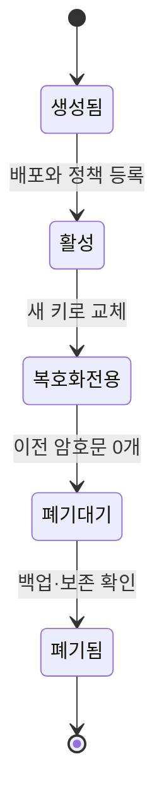

# 03. 난수·키·인코딩

난수, 키, 인코딩은 모양이 비슷한 바이트를 다루지만 목적이 다르다.

## 1. 엔트로피와 난수

엔트로피(entropy)는 결과를 모르는 관찰자의 불확실성을 수치화한 개념이다.

균등한 8비트 값은 256가지라 최대 8비트의 엔트로피를 가진다.

네 자리 숫자 PIN은 10,000가지뿐이라 최대 `log2(10000) ≈ 13.3`비트다.

암호학적 난수 생성기(CSPRNG)는 내부 상태를 이용해 예측하기 어려운 바이트를 만든다.

일반 시뮬레이션용 의사 난수는 재현성이 목적이라 키 생성에 부적합할 수 있다.

운영체제의 보안 난수 API를 사용하고 직접 시간값을 seed로 만들지 않는다.

UUID가 항상 비밀 난수는 아니다. 버전과 생성 방법을 확인해야 한다.

## 2. 키의 역할

키(key)는 암호 연산의 동작을 결정하는 비밀 또는 공개 매개변수다.

대칭키는 암호화와 복호화에 같은 비밀을 쓴다.

비대칭키 쌍은 개인키와 공개키로 나뉜다.

개인키는 서명이나 키 합의에 쓰며 보호한다.

공개키는 검증이나 암호화에 배포할 수 있다.

키 길이만으로 전체 안전성이 정해지지 않는다.

알고리즘, 운영 모드, 난수, 수명, 보관, 접근 통제가 함께 맞아야 한다.

## 3. 키 수명 주기

키는 생성, 등록, 배포, 사용, 교체, 폐기 단계를 거친다.

키 식별자(key ID)는 어떤 키로 처리했는지 찾는 이름이지 비밀키 자체가 아니다.

키 버전은 교체 전후 데이터를 구별한다.

예를 들어 데이터 행에 `key_version=7`을 저장한다.

읽을 때 키 서비스에서 버전 7을 가져와 복호화한다.

새 쓰기는 버전 8만 사용한다.

백그라운드 작업이 오래된 암호문을 8로 다시 암호화한다.

7로 암호화된 데이터가 0개이고 백업 보존 조건을 확인한 뒤 7을 폐기한다.

## 4. 인코딩은 암호화가 아니다

인코딩(encoding)은 데이터를 다른 표현으로 바꿔 전달하거나 저장하기 쉽게 한다.

Base64는 임의 바이트를 ASCII 문자로 표현한다.

누구나 되돌릴 수 있으므로 기밀성을 제공하지 않는다.

16바이트는 Base64에서 보통 24문자가 된다.

16진수는 한 바이트를 두 문자로 표시하므로 16바이트가 32문자다.

URL encoding은 예약 문자를 전송 가능한 형태로 바꾼다.

압축은 중복을 줄이는 표현 변환이며 비밀 보호가 아니다.

암호화는 키 없이는 내용을 알기 어렵게 만드는 보안 연산이다.

## 5. salt, nonce, IV를 구분한다

salt는 같은 비밀번호가 같은 저장값을 만들지 않도록 비밀번호 해시에 넣는 공개 난수다.

사용자마다 고유하게 만들며 해시 결과 옆에 저장해도 된다.

nonce는 특정 키 아래 한 번만 쓰도록 요구되는 값이다.

nonce가 반드시 비밀이거나 무작위일 필요는 없지만 알고리즘이 요구하는 유일성을 만족해야 한다.

IV(initialization vector)는 암호 모드를 시작하는 값이다.

모드마다 IV의 무작위성·예측 불가능성·유일성 요구가 다르므로 해당 규격을 따른다.

세 용어를 모두 “랜덤 문자열”로 뭉개면 수명 규칙을 잃는다.

## 6. 충돌 확률과 생일 경계

무작위 n비트 공간에서 q개 값을 뽑을 때 충돌 가능성은 대략 `q² / 2^(n+1)`로 자란다.

32비트 공간에서 65,536개를 뽑으면 충돌 가능성이 무시하기 어렵다.

`q² / 2^33 = 2^32 / 2^33 = 1/2`라는 근사다.

96비트 무작위 nonce 공간은 훨씬 크지만 호출량과 허용 실패 확률을 규격에 맞춰 제한해야 한다.

충돌 없는 카운터를 안전하게 영속화할 수 있다면 확률 대신 구조로 유일성을 보장할 수 있다.

다중 프로세스와 재시작이 같은 키를 공유하면 중앙 할당이나 겹치지 않는 범위 분할이 필요하다.

## 7. 키 파생

KDF(key derivation function)는 입력 키 재료에서 목적별 키를 만든다.

한 마스터 키를 암호화와 MAC에 그대로 재사용하지 않는다.

맥락 문자열에 `service-A/encryption/v1`과 `service-A/mac/v1`을 넣으면 목적을 분리할 수 있다.

비밀번호 KDF는 낮은 엔트로피 입력의 무차별 대입 비용을 높이는 별도 문제다.

HKDF처럼 고엔트로피 키 재료를 확장하는 함수와 Argon2id 같은 비밀번호 해시를 같은 것으로 보지 않는다.

## 8. 오해와 반례

오해: 긴 Base64 문자열은 암호문이다.

반례: API 키 JSON을 Base64로 바꿔 저장해도 디코딩만 하면 원문이 나온다.

오해: 현재 시간을 난수로 쓰면 겹치지 않는다.

반례: 같은 밀리초의 두 프로세스와 시계 되돌림에서 충돌한다.

오해: 키를 교체하면 옛 키를 즉시 삭제하면 된다.

반례: 아직 옛 키로 암호화된 데이터와 백업을 읽지 못해 가용성을 잃는다.

## 9. 문제와 해설

### 문제 1

6자리 숫자 일회용 코드 공간의 크기와 온라인 공격 방어를 설명하라.

**해설:** 공간은 1,000,000개로 약 19.9비트다. 이것만으로 강한 비밀은 아니다. 짧은 만료, 시도 횟수 제한, 계정·세션 결합, 재사용 금지가 온라인 추측을 제한한다.

### 문제 2

두 프로세스가 같은 키와 `0,1,2...` 카운터를 각각 시작하면 무엇이 잘못되는가?

**해설:** 둘 다 nonce 0부터 생성해 같은 키 아래 중복된다. 중앙 원자 카운터, 프로세스별 겹치지 않는 prefix, 또는 각 프로세스별 독립 키가 필요하며 재시작 뒤 상태도 보존해야 한다.

### 문제 3

키 버전 4를 폐기하기 전에 확인할 목록을 작성하라.

**해설:** 새 쓰기가 5만 쓰는지, 온라인 저장소와 큐에 4 암호문이 없는지, 백업·보존 정책에서 4가 필요한지, 캐시된 키가 만료됐는지, 폐기 감사 기록과 복구 승인이 있는지 확인한다.

## 공식 자료

- [Python secrets 모듈](https://docs.python.org/3/library/secrets.html)
- [NIST SP 800-90A Rev. 1](https://csrc.nist.gov/pubs/sp/800/90/a/r1/final)
- [RFC 5869: HKDF](https://www.rfc-editor.org/rfc/rfc5869.html)

---

[이전: 신원·인증·인가](02-identities-authentication-and-authorization.md) · [목차](README.md) · [다음: 해시·MAC·전자서명](04-hashes-macs-and-signatures.md)
