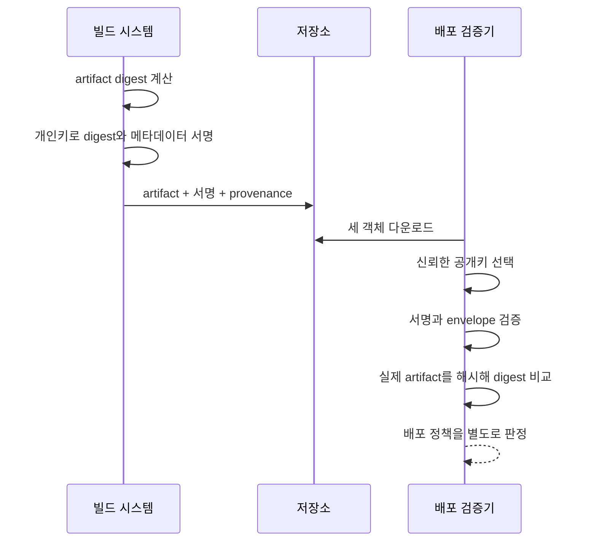

# 04. 해시·MAC·전자서명

**해시**는 입력 데이터를 고정 길이 요약값으로 바꾸는 함수다. **MAC(Message Authentication Code, 메시지 인증 코드)**는 공유 비밀키로 메시지의 변조를 검사하는 값을 만든다. **전자서명**은 개인키로 만든 서명을 대응 공개키로 검증하는 기술이다. 세 도구는 입력보다 짧은 결과를 만들 수 있지만 입력이 짧으면 결과가 더 길 수도 있다. 길이가 아니라 제공하는 보장을 비교해야 한다. 그러나 누가 결과를 만들 수 있고, 누가 검증할 수 있으며, 무엇을 증명하는지가 다르다. 파일 옆에 SHA-256 문자열을 둔 것, 두 서버가 공유키로 HMAC을 계산한 것, 빌드 시스템이 개인키로 서명한 것은 같은 “무결성 체크”가 아니다.

이 장에서는 먼저 메시지와 digest가 실제로 무엇인지 설명한 뒤, 공격자가 어떤 값을 바꿀 수 있는지에 따라 세 도구의 보장이 어떻게 달라지는지 전체 과정을 추적한다.


## 1. 메시지와 바이트 경계

**메시지(message)**는 암호 함수에 입력하는 정확한 바이트 배열이다. 사람이 읽는 문장, JSON 문서, 실행 파일, 컨테이너 이미지의 manifest가 될 수 있다. **JSON**은 이름과 값의 쌍, 배열 등을 텍스트로 표현하는 데이터 형식이다. **컨테이너 이미지**는 프로그램 실행에 필요한 파일과 설정의 묶음이고, **manifest(매니페스트)**는 그 구성과 식별자를 기술하는 목록이다. 함수는 의미를 이해하지 않고 바이트만 처리한다.

예를 들어 다음 두 JSON은 사람이 같은 객체로 볼 수 있다.

```json
{"amount":100,"to":"bob"}
```

```json
{ "to": "bob", "amount": 100 }
```

키 순서와 공백이 달라 바이트가 다르므로 해시와 서명 결과도 다르다. 반대로 서로 다른 파서가 같은 바이트를 다른 의미로 해석할 수도 있다. 따라서 “무엇을 서명했는가”를 말할 때 직렬화 규칙, 문자 인코딩, 필드 의미, 프로토콜 버전을 고정해야 한다.

**digest(다이제스트, 요약값)**는 해시 함수가 만든 고정 길이 출력이다. SHA-256은 입력이 1바이트든 10 GiB든 256비트, 즉 32바이트 digest를 만든다. 16진수로 표시하면 64글자다. 64글자라고 64바이트 결과인 것은 아니다. 표현과 원래 바이트를 구분한다.

## 2. 암호학적 해시의 네 성질

**암호학적 해시 함수(hash function)**는 임의 길이 메시지를 고정 길이 digest로 변환하는 키 없는 함수다. 같은 바이트 입력은 항상 같은 결과를 내므로 **결정적(deterministic)**이다.

안전한 용도에서 주로 보는 성질은 다음과 같다.

1. **역상 저항성(preimage resistance):** digest `h`만 보고 `H(m)=h`인 메시지 `m`을 찾기 어렵다.
2. **제2 역상 저항성(second-preimage resistance):** 주어진 메시지 `m1`과 같은 digest를 갖는 다른 `m2`를 찾기 어렵다.
3. **충돌 저항성(collision resistance):** 공격자가 자유롭게 고른 서로 다른 두 메시지 `m1`, `m2`로 같은 digest를 찾기 어렵다.
4. **작은 입력 변화의 확산:** 입력 비트 하나가 바뀌어도 출력이 크게 달라지는 것이 기대된다. 그러나 출력이 달라 보인다는 시각적 특성만으로 위 세 공격 저항성을 증명하지는 않는다.

출력 공간이 유한하고 입력 공간은 사실상 무한하므로 충돌 자체는 반드시 존재한다. 안전성 주장은 “충돌이 없다”가 아니라 현실적인 자원으로 공격자가 유용한 충돌을 찾기 어렵다는 계산적 주장이다.

`model.bin`을 다운로드한 뒤 신뢰한 장소에서 미리 받은 SHA-256과 비교하면 우발적 손상과 임의 변경을 찾는 데 유용하다. 하지만 공격자가 파일과 웹페이지의 예상 digest를 둘 다 바꿀 수 있으면 새 악성 파일의 digest도 함께 게시할 수 있다. 해시는 키가 없으므로 digest를 계산할 권한이 제한되지 않는다.

## 3. 해시는 암호화가 아니다

암호화는 키를 가진 사람이 평문을 복구할 수 있도록 암호문으로 바꾸는 가역적 보안 연산이다. 해시는 원문 복구 인터페이스가 없는 단방향 요약 함수다. 그러나 “단방향”이라는 말만으로 작은 입력 공간이 보호되지는 않는다.

여섯 자리 PIN은 백만 가지뿐이다. 공격자는 후보마다 해시를 계산해 저장값과 비교할 수 있다. 해시에서 수학적으로 역연산하지 않아도 전체 후보를 순방향 계산하면 원문을 찾는다. 비밀번호에는 사용자별 salt와 의도적인 시간·메모리 비용을 가진 전용 비밀번호 해시가 필요한 이유다.

해시는 인코딩도 아니다. Base64는 누구나 정확히 되돌릴 수 있는 표현 변환이고, 해시는 고정 길이로 정보를 압축해 일반적으로 원문 복구를 제공하지 않는다.

## 4. MAC: 공유 비밀키를 가진 참여자 사이의 인증

**MAC(message authentication code)**은 비밀키와 메시지를 입력으로 받아 짧은 **태그(tag)**를 만드는 알고리즘이다. 수신자는 같은 키로 태그를 검증한다. 키를 모르는 공격자가 메시지를 바꾸고도 유효한 새 태그를 만들기 어렵게 하는 것이 목적이다.

**HMAC**은 암호학적 해시를 정해진 내부·외부 구조로 사용하는 MAC이다. 단순히 `hash(key || message)`를 직접 조립하는 것과 같지 않다. 해시 구조에 따라 길이 확장 같은 문제가 생길 수 있어 검토된 HMAC 구성을 사용한다.

서비스 A와 B가 비밀키 `K1`을 공유하고 다음 메시지를 처리한다고 하자.

```text
request_id=42&from=alice&to=bob&amount=100&currency=KRW
```

전체 과정은 다음과 같다.

1. A는 필드 순서와 인코딩을 고정해 메시지 바이트를 만든다.
2. A는 `tag = HMAC(K1, message)`를 계산한다.
3. A는 메시지, 태그, 키 식별자, 프로토콜 버전을 B에 보낸다. 키 자체는 보내지 않는다.
4. B는 키 식별자로 허용된 `K1`을 찾는다.
5. B는 받은 메시지 바이트로 기대 태그를 다시 계산한다.
6. B는 라이브러리의 안전한 비교 함수로 받은 태그와 기대 태그를 비교한다.
7. 일치하면 메시지가 공유키를 모르는 주체에 의해 바뀌지 않았다는 근거를 얻는다.
8. B는 `request_id=42`가 이미 처리됐는지 별도로 확인하고 업무 규칙을 적용한다.

공격자가 `amount=100`을 `amount=900`으로 바꾸면 기존 태그와 맞지 않는다. 그러나 원래 메시지와 태그를 그대로 다시 보내면 MAC 검증은 성공한다. 최신성·순서·재전송 방지는 MAC 밖의 상태다.

## 5. MAC의 신뢰 경계와 한계

A와 B가 같은 `K1`을 가지므로 둘 다 유효한 태그를 만들 수 있다. 외부 감사자는 MAC만 보고 A가 만들었는지 B가 만들었는지 증명할 수 없다. 세 서비스가 같은 키를 공유하면 세 서비스 모두 서로의 이름으로 태그를 만들 수 있다.

키를 서비스별·방향별로 분리하면 피해 범위를 줄일 수 있다. `A→B`와 `B→A`에 다른 파생 키를 사용하면 한 방향의 메시지가 반대 방향에서 재사용되는 혼동을 줄인다. 메시지에는 서비스 이름, 프로토콜 버전, 메시지 종류를 포함해 다른 맥락의 유효 태그가 재사용되지 않게 한다.

MAC은 내용을 숨기지 않는다. 메시지와 태그를 평문으로 보내면 네트워크 관찰자는 메시지를 읽을 수 있다. 기밀성이 필요하면 검토된 AEAD처럼 암호화와 인증을 함께 제공하는 구성을 사용한다.

## 6. 전자서명: 개인키 생성, 공개키 검증

**전자서명(digital signature)**은 개인키로 메시지에 대한 서명을 만들고 대응하는 공개키로 검증하는 비대칭 암호 기술이다. 서명자는 개인키를 보호하고, 검증자는 공개키를 배포받는다.

빌드 아티팩트 배포를 전체 흐름으로 보자.

1. 빌드 시스템이 소스 커밋과 빌드 환경으로 `app.tar`를 만든다.
2. 파일 전체를 해시해 artifact digest를 계산한다.
3. 아티팩트 이름, 버전, digest, 빌드 주체, 소스 커밋, 생성 시각을 명확한 envelope 바이트로 직렬화한다.
4. 빌드 시스템은 보호된 개인키로 그 envelope에 서명한다.
5. 저장소에는 아티팩트, envelope, 서명이 저장된다.
6. 배포 검증기는 미리 신뢰하도록 등록된 공개키를 선택한다.
7. 공개키로 envelope 서명을 검증한다.
8. 내려받은 아티팩트를 직접 해시해 envelope의 digest와 비교한다.
9. 서명 주체, 소스 저장소, 빌드 방식, 배포 환경 같은 정책 조건을 별도로 판정한다.



서명 검증 성공은 대응 개인키가 그 정확한 바이트에 유효한 서명을 만들었다는 근거다. 코드가 취약하지 않다거나, 빌드 계정이 침해되지 않았다거나, 실행 권한을 허용해야 한다는 결론을 자동으로 주지 않는다.

## 7. 공개키를 신뢰하는 방법이 별도인 이유

전자서명은 공개키가 누구의 것인지 스스로 증명하지 않는다. 공격자가 자기 키 쌍으로 악성 파일에 완벽한 서명을 만들고 자기 공개키를 함께 보내도 수학적 검증은 성공한다.

검증자는 공개키를 신뢰하는 별도 근거가 필요하다. 미리 고정한 공개키 fingerprint, 인증기관이 서명한 인증서, 조직의 투명한 키 등록 절차가 예다. **fingerprint**는 공개키 바이트의 해시로 만든 짧은 식별값이다. 이것도 신뢰한 채널에서 확인해야 한다.

키 회전 중에는 새 공개키가 어떤 기존 권한으로 등록됐는지 감사한다. 침해된 옛 개인키가 새 키를 무제한 승인할 수 있다면 회전이 공격자의 통제를 연장할 수 있다. 비상 폐기, 다중 승인, 만료와 투명성 로그 같은 운영 절차가 암호 수학과 함께 필요하다.

## 8. 무엇에 서명했는가: canonicalization과 맥락

**직렬화(serialization)**는 구조화된 데이터를 전송 가능한 바이트로 바꾸는 규칙이다. **canonicalization**은 의미가 같은 구조가 하나의 표준 바이트 표현을 갖도록 정규화하는 규칙이다. 무작정 JSON 문자열을 서명하면 키 순서, 공백, 숫자 표기가 달라 검증이 실패하거나 파서 차이를 악용할 수 있다.

서명 envelope에는 다음을 명시적으로 포함할 수 있다.

- 객체 종류: `artifact-manifest`
- 프로토콜 버전: `v2`
- artifact digest 알고리즘과 값
- 아티팩트 이름과 버전
- 빌드 주체와 소스 커밋
- 대상 환경 또는 허용된 사용 목적
- 생성·만료 시각과 고유 ID

이런 **도메인 분리(domain separation)**는 한 맥락의 서명을 다른 맥락에서 해석하지 못하게 한다. 예를 들어 “로그인 challenge 서명” 바이트가 “송금 승인 서명”과 같은 형식을 쓰면 한 기능의 유효 서명을 다른 기능에 재사용할 위험이 있다.

서명 대상에 digest만 넣고 알고리즘 이름을 빼면 검증자가 서로 다른 해시 알고리즘으로 해석할 수 있다. 이름과 버전도 서명된 바이트 안에 포함한다.

## 9. 재전송과 최신성은 상태 문제다

유효한 MAC이나 서명을 그대로 다시 보내는 **재전송 공격(replay attack)**이 가능하다. `transfer=100`과 태그가 유효해도 열 번 처리하면 1,000이 이체된다.

메시지에 `request_id`, 순번, 발급 시각, 만료, 대상 서비스를 넣고 이 필드까지 MAC 또는 서명한다. 수신자는 이미 처리한 요청 ID를 원자적으로 기록한다. 원자적이라는 말은 “확인”과 “처리됨 표시” 사이에 다른 요청이 끼어 둘 다 성공하지 않도록 하나의 상태 전이로 만든다는 뜻이다.

단순 흐름은 다음과 같다.

1. 트랜잭션 안에서 `(sender, request_id=42)` 존재 여부를 확인한다.
2. 없으면 업무 변경과 처리 기록을 함께 커밋한다.
3. 이미 있으면 이전 결과를 반환하거나 중복 오류를 낸다.

서명 검증만 하고 기록을 나중에 쓰면 동시에 도착한 두 요청이 둘 다 “없음”을 보고 처리될 수 있다. 암호 검증과 상태 동시성 제어가 함께 필요하다.

## 10. 태그와 서명의 비교와 실패 처리

일반 문자열 비교는 첫 불일치에서 빨리 끝날 수 있다. 반복 측정이 가능한 환경에서는 실행 시간 차이가 맞는 접두사에 관한 정보를 줄 수 있다. MAC 태그처럼 비밀에 기반한 값은 라이브러리의 상수 시간 비교 함수를 사용한다. Python 표준 라이브러리의 예는 `hmac.compare_digest`다.

서명 검증과 MAC 검증은 성공 또는 실패로 다루고 실패한 메시지의 일부를 사용하지 않는다. 오류 응답에 기대 태그, 내부 키 ID 전체, 파싱한 비밀 값을 노출하지 않는다. 내부 로그에는 요청 ID, 공개 키 버전, 오류 분류처럼 조사에 필요한 비밀 아닌 정보를 남긴다.

[무결성 교육 모형](examples/integrity_model.py)은 원본과 변조 입력을 고정해 공개 해시와 HMAC의 차이를 보여 준다. 이 모형은 키 보관, 실제 네트워크 프로토콜, 공개키 신뢰 체인, 부채널 저항성을 구현한 운영용 암호 시스템이 아니다.

## 11. 알고리즘과 표준 상태

SHA-256 같은 해시 알고리즘은 NIST Secure Hash Standard에 정의돼 있다. 어떤 알고리즘이 규격에 있다는 사실과 특정 용도에서 권장되는지, 실제 라이브러리가 안전하게 구현했는지는 별도 확인 사항이다. 오래된 알고리즘과 호환해야 할 때 새 서명 생성 허용과 과거 검증 허용을 구분할 수 있다.

HMAC은 FIPS 198-1과 RFC 2104에 구조가 정의돼 있다. HMAC이라는 이름만 붙이고 태그를 너무 짧게 자르거나 하나의 키를 무관한 프로토콜에서 공유하면 별도 위험이 생긴다. 태그 길이와 키 수명은 사용하는 프로토콜 규격을 따른다.

양자내성 전자서명에서는 NIST FIPS 204가 ML-DSA를, FIPS 205가 SLH-DSA를 표준화했다. 이는 알고리즘과 형식이 표준화됐다는 뜻이다. 기존 소프트웨어 공급망이 자동으로 그 서명을 생성·검증하거나 키를 안전하게 운영한다는 뜻은 아니다. 공개키·서명 크기, 처리 비용, 프로토콜 식별자, 하드웨어와 라이브러리 지원, 마이그레이션 중 이중 검증 정책을 시험해야 한다.

양자 위협에 대한 전환이 현재의 개인키 탈취, 잘못된 공개키 등록, 빌드 시스템 침해를 해결하지는 않는다. 공격자 가정별 통제를 분리한다.

## 12. 세 도구를 한 표에서 비교한다

| 도구 | 비밀키 필요 | 검증 가능한 사람 | 주된 보장 | 자동 제공하지 않는 것 |
|---|---|---|---|---|
| 공개 해시 | 없음 | 누구나 | 주어진 예상 digest와 바이트 일치 | 예상 digest의 출처, 인증, 기밀성 |
| MAC/HMAC | 공유 비밀키 | 같은 키 보유자 | 키 없는 공격자의 변조 탐지와 키 보유 근거 | 참여자 간 부인 방지, 기밀성, 재전송 방지 |
| 전자서명 | 서명자는 개인키 | 공개키 보유자 | 대응 개인키가 바이트에 서명했다는 근거 | 공개키 소유자 신뢰, 코드 안전성, 최신성 |

## 13. 오해와 반례

**“SHA-256으로 비밀번호를 저장하면 된다.”** 빠른 해시는 공격자의 후보 계산도 빠르게 한다. salt와 비용을 가진 비밀번호 전용 함수가 필요하다.

**“서명된 코드는 안전하다.”** 권한 있는 빌드 키가 취약하거나 악성 코드를 서명할 수 있다. 서명은 출처·무결성 근거이며 코드 검토와 실행 격리를 대신하지 않는다.

**“MAC 검증 성공은 새 메시지라는 뜻이다.”** 과거 유효한 메시지와 태그를 그대로 재전송할 수 있다.

**“공개키가 파일 옆에 있으니 서명을 검증했다.”** 공격자가 파일, 서명, 공개키를 함께 바꾸면 공격자 키로 검증된다. 공개키의 신뢰 근거가 별도여야 한다.

## 14. 연습 문제와 자세한 풀이

### 문제 1. 같은 사이트의 파일과 digest

공격자가 다운로드 파일과 웹페이지를 모두 바꿀 수 있다. 페이지의 SHA-256 비교가 충분한가?

**풀이:** 아니다. 공격자는 악성 파일의 digest도 계산해 함께 바꾼다. 독립된 신뢰 채널에서 미리 고정한 digest나 신뢰한 키로 서명된 메타데이터가 필요하다. 공개키 등록 경로도 보호해야 한다.

### 문제 2. 세 서비스의 공유 HMAC 키

어느 서비스가 메시지를 만들었는지 MAC만으로 특정할 수 있는가?

**풀이:** 셋 모두 같은 태그를 만들 수 있어 불가능하다. 서비스별·방향별 키로 범위를 줄이거나 발신자별 개인키 서명을 사용한다. 키 발급·등록과 사용 로그를 감사한다.

### 문제 3. 서명된 digest와 실제 파일

서명 envelope 검증은 성공했지만 실제 artifact digest가 envelope 값과 다르다.

**풀이:** 배포를 거부한다. 서명된 메타데이터는 유효하지만 내려받은 파일이 그 메타데이터가 가리키는 바이트가 아니다. 검증기는 실제 파일을 직접 해시해 비교해야 한다.

### 문제 4. JSON 필드 순서

서명자는 `{"a":1,"b":2}`, 검증자는 `{"b":2,"a":1}`을 만들었다.

**풀이:** 의미가 같아도 바이트가 달라 서명 검증이 실패한다. 합의한 canonical serialization을 사용하거나 원본 서명 바이트를 보존한다. 정규화 규칙과 버전도 프로토콜 계약에 넣는다.

### 문제 5. 유효한 송금 메시지 두 개

동일한 MAC 메시지가 동시에 두 워커에 도착했다.

**풀이:** 두 워커 모두 MAC 검증은 성공한다. 데이터베이스에서 요청 ID의 유일 제약과 업무 변경을 한 트랜잭션에 묶어 한 요청만 커밋되게 한다. 검증 성공은 중복 처리 방지가 아니다.

### 문제 6. 공개키 회전

새 공개키를 서버 응답에서 받아 즉시 신뢰하면 되는가?

**풀이:** 그 응답을 공격자가 바꿀 수 있다면 안 된다. 기존 신뢰 키의 승인, 인증서 체인, 다중 관리자 승인, 투명성 로그 등 신뢰한 갱신 경로가 필요하다. 옛 키 폐기 시각과 과거 서명 검증 정책도 정한다.

### 문제 7. ML-DSA 표준 발표

표준이 발표됐으니 기존 배포가 양자내성 서명을 사용한다고 말할 수 있는가?

**풀이:** 아니다. 표준화는 알고리즘과 형식을 정한 단계다. 라이브러리 지원, 키 생성·보관, 프로토콜 식별, 서명 크기, 검증 정책, 상호 운용, 실제 설정을 확인해야 한다. 기존 개인키 보호와 빌드 권한 통제도 계속 필요하다.

## 공식 근거

- [FIPS 180-4: Secure Hash Standard](https://csrc.nist.gov/pubs/fips/180-4/upd1/final)
- [FIPS 198-1: HMAC](https://csrc.nist.gov/pubs/fips/198-1/final)
- [RFC 2104: HMAC](https://www.rfc-editor.org/rfc/rfc2104)
- [NIST Digital Signature Project](https://csrc.nist.gov/projects/digital-signatures)
- [FIPS 204: ML-DSA](https://csrc.nist.gov/pubs/fips/204/final)
- [FIPS 205: SLH-DSA](https://csrc.nist.gov/pubs/fips/205/final)

---

[이전: 난수·키·인코딩](03-randomness-keys-and-encoding.md) · [목차](README.md) · [다음: 암호화·AEAD·nonce](05-encryption-aead-and-nonce-lifetimes.md)
