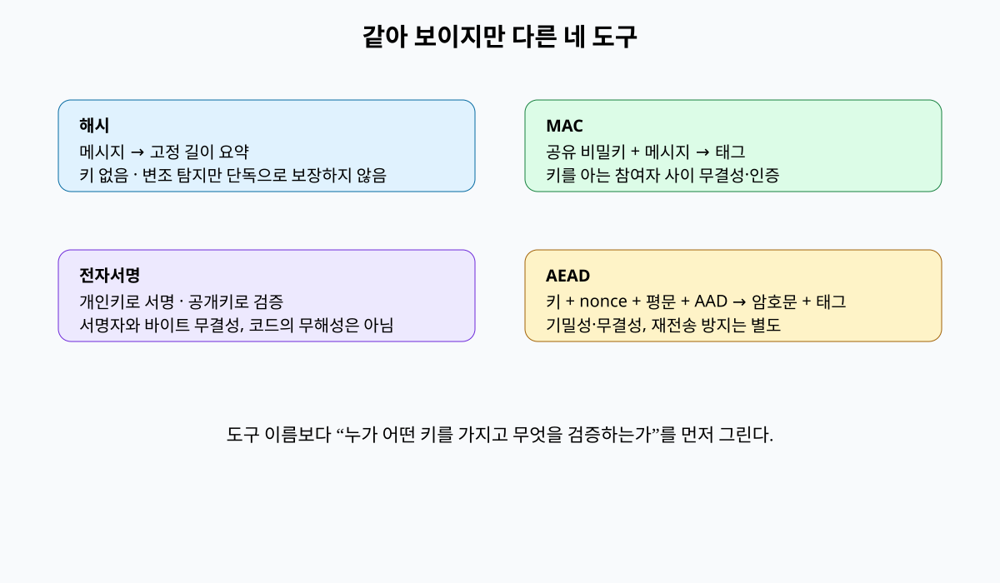
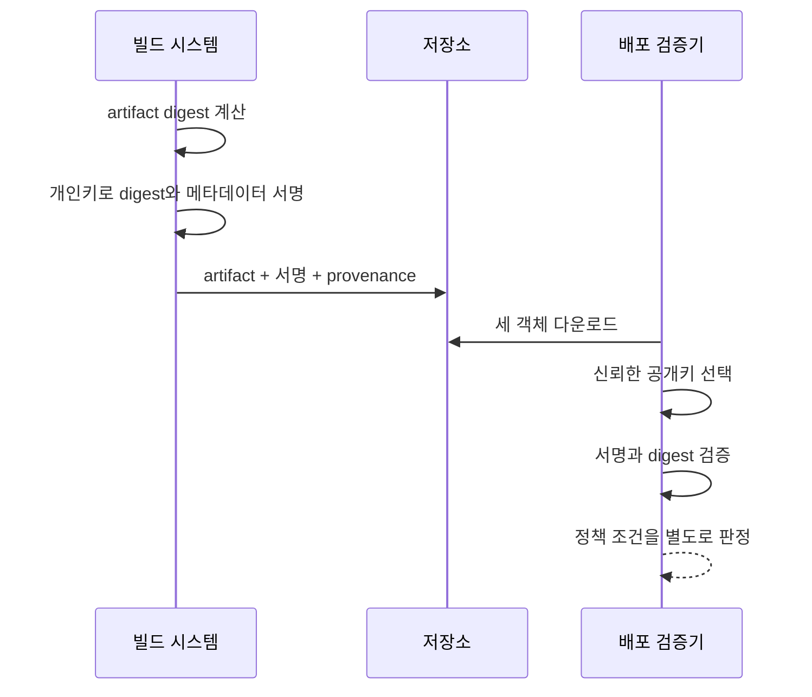

# 04. 해시·MAC·전자서명

세 도구 모두 짧은 바이트 결과를 만들 수 있지만, 키를 누가 가지며 누가 검증할 수 있는지가 다르다.

## 1. 암호학적 해시

해시 함수(hash function)는 길이가 임의인 메시지를 고정 길이 요약값(digest)으로 바꾼다.

SHA-256은 256비트, 즉 32바이트 결과를 낸다.

결정적이라는 말은 같은 바이트 입력이 항상 같은 결과를 낸다는 뜻이다.

역상 저항성은 digest만 보고 원래 입력을 찾기 어렵다는 성질이다.

충돌 저항성은 같은 digest를 만드는 서로 다른 두 입력을 찾기 어렵다는 성질이다.

`model.bin`과 다운로드한 파일의 SHA-256이 같으면 우연한 전송 오류나 비공격적 변경을 찾는 데 유용하다.

하지만 공격자가 파일과 웹페이지의 digest를 모두 바꿀 수 있다면 공개 해시 비교만으로 악의적 변조를 막지 못한다.

신뢰한 채널에서 얻은 예상 digest가 필요하다.

## 2. MAC

MAC(message authentication code)은 비밀키와 메시지로 짧은 태그를 만든다.

HMAC은 암호학적 해시를 정해진 구조로 이용하는 MAC이다.

송신자와 수신자가 키 K를 공유한다고 하자.

송신자는 `tag = HMAC(K, message)`를 보낸다.

수신자는 받은 message로 tag를 다시 계산하고 상수 시간 비교를 한다.

일치하면 K를 모르는 공격자가 메시지를 바꾸지 못했다는 근거를 얻는다.

두 참여자가 같은 키를 가지므로 제3자에게 “둘 중 누가 만들었는가”를 증명하지는 못한다.

수신자도 유효한 tag를 만들 수 있기 때문이다.

## 3. 전자서명

전자서명(digital signature)은 개인키로 메시지에 서명하고 대응하는 공개키로 검증한다.

서명자는 개인키를 보호한다.

검증자는 공개키와 서명, 정확한 메시지 바이트를 입력한다.

검증 성공은 대응 개인키가 이 바이트에 유효한 서명을 만들었다는 근거다.

공개키가 누구의 것인지 확인하는 신뢰 체인은 별도다.

공격자 공개키를 “공식 빌드 키”라고 잘못 등록하면 공격자 서명도 정상 검증된다.

## 4. 무엇에 서명했는가

서명은 바이트에 적용된다.

사람이 보는 의미와 서명 바이트가 같도록 canonicalization 규칙이 필요할 수 있다.

JSON 객체는 키 순서와 공백이 달라도 의미가 같지만 바이트는 다르다.

반대로 모호한 파서 두 개가 같은 바이트를 다르게 해석할 수도 있다.

아티팩트 digest, 이름, 버전, 빌드 주체, 빌드 입력을 하나의 명확한 서명 envelope에 묶는다.

서명만 따로 복사해 다른 이름이나 환경에서 재사용하지 못하도록 맥락을 포함한다.

## 5. 재전송과 최신성

유효한 MAC이나 서명을 그대로 다시 보내는 replay 공격이 가능하다.

`transfer=100` 메시지와 tag가 유효해도 10번 재전송하면 1,000을 이체할 수 있다.

메시지에 고유 요청 ID, 순번, 만료 시간, 수신 대상 맥락을 넣는다.

수신자는 이미 처리한 ID를 원자적으로 기록해 두 번째 요청을 거부한다.

서명 검증 자체가 이 상태를 자동으로 관리하지 않는다.

## 6. 비교는 어떻게 하는가

일반 문자열 비교는 첫 불일치 위치에서 빨리 끝날 수 있다.

실행 시간 차이가 공격자에게 올바른 prefix 정보를 줄 수 있다.

검증 라이브러리가 제공하는 상수 시간 비교 함수를 사용한다.

Python 표준 라이브러리 예시는 `hmac.compare_digest`다.

[무결성 교육 모형](examples/integrity_model.py)은 원본과 변조 입력을 고정해 차이를 보인다.

이 모형은 실제 키 보관이나 전자서명 체인을 검증하지 않는다.

## 7. 숫자 예시

서비스 A와 B가 HMAC 키 `K1`을 공유한다.

메시지는 `request_id=42&amount=100`이다.

A가 메시지와 tag를 보낸다.

공격자가 amount만 900으로 바꾸면 B가 계산한 tag는 달라져 거부된다.

공격자가 원본 쌍을 재전송하면 tag는 여전히 맞는다.

B가 `request_id=42` 처리 기록을 갖고 있어야 재전송을 거부한다.

키 K1이 A와 B 양쪽에 있으므로 외부 감사자는 어느 쪽이 tag를 만들었는지 MAC만으로 결정할 수 없다.

## 8. 오해와 반례

오해: SHA-256으로 비밀번호를 저장하면 안전하다.

반례: 빠른 해시는 공격자의 대량 추측도 빠르게 한다. salt와 작업 비용이 있는 비밀번호 해시가 필요하다.

오해: 서명된 코드는 안전하다.

반례: 권한 있는 빌드 키가 취약하거나 악성인 코드를 서명할 수 있다. 서명은 코드 검토나 샌드박스를 대신하지 않는다.

오해: MAC 검증 성공은 메시지가 새것임을 뜻한다.

반례: 과거의 유효한 메시지와 tag를 그대로 재전송할 수 있다.

## 9. 문제와 해설

### 문제 1

웹사이트와 다운로드 파일을 같은 공격자가 바꿀 수 있다. 사이트에 표시된 SHA-256 비교가 충분한가?

**해설:** 충분하지 않다. 공격자가 파일과 예상 digest를 함께 교체한다. 독립된 신뢰 채널의 서명된 메타데이터나 이미 고정한 digest가 필요하다.

### 문제 2

세 서비스가 하나의 HMAC 키를 공유한다. 한 서비스가 만든 메시지를 특정할 수 있는가?

**해설:** MAC만으로는 불가능하다. 셋 모두 유효한 tag를 만들 수 있다. 서비스별 키를 분리하거나 발신자별 개인키 서명을 사용하고 공개키 등록을 감사한다.

### 문제 3

서명 검증은 성공했지만 artifact digest가 서명 envelope의 값과 다르다. 배포해도 되는가?

**해설:** 거부한다. 서명된 메타데이터는 유효하지만 실제 내려받은 바이트가 그 메타데이터가 지칭한 객체가 아니다. artifact를 해시해 서명된 digest와 비교해야 한다.

## 공식 자료

- [FIPS 180-4 Secure Hash Standard](https://csrc.nist.gov/pubs/fips/180-4/upd1/final)
- [FIPS 198-1 HMAC](https://csrc.nist.gov/pubs/fips/198-1/final)
- [NIST Digital Signature Standards](https://csrc.nist.gov/projects/digital-signatures)

---

[이전: 난수·키·인코딩](03-randomness-keys-and-encoding.md) · [목차](README.md) · [다음: 암호화·AEAD·nonce](05-encryption-aead-and-nonce-lifetimes.md)
