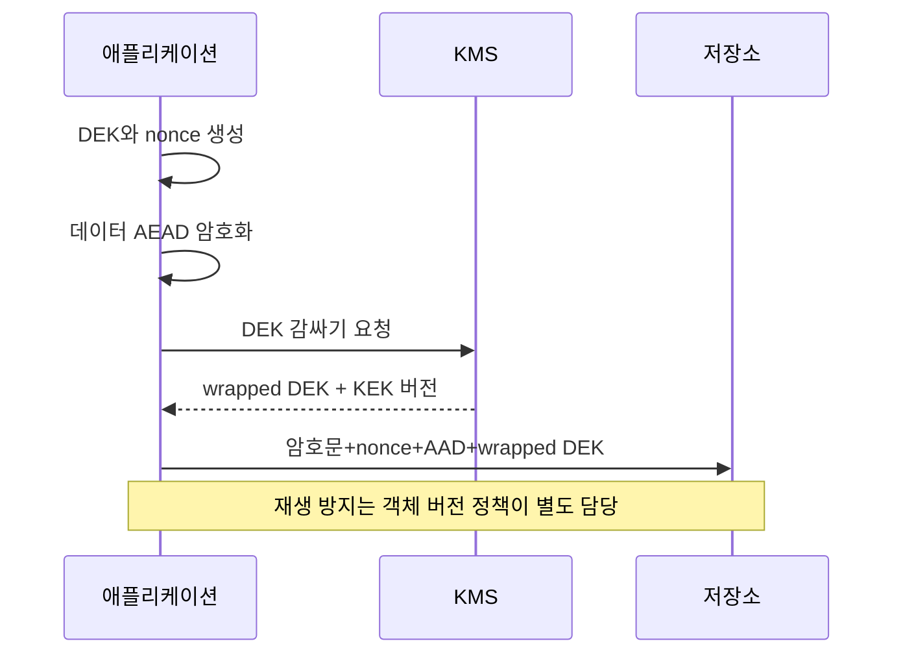

# 05. 암호화·AEAD·nonce 수명

암호화(encryption)는 평문을 키 없이 이해하기 어려운 암호문으로 바꾸지만, 올바른 운영 모드를 쓰지 않으면 변조를 놓칠 수 있다.

## 1. 기본 객체

평문(plaintext)은 보호하려는 원래 바이트다.

암호문(ciphertext)은 암호화 결과다.

대칭키(key)는 송신자와 수신자가 공유하는 비밀이다.

nonce는 같은 키 아래 연산마다 규격에 맞게 유일해야 하는 값이다.

AAD(additional authenticated data)는 숨기지는 않지만 변조 여부를 함께 확인할 메타데이터다.

인증 태그(authentication tag)는 암호문과 AAD가 바뀌지 않았는지 검증하는 값이다.

## 2. AEAD의 입출력

AEAD(authenticated encryption with associated data)는 기밀성과 무결성을 함께 제공하는 암호화 인터페이스다.

암호화 입력은 `key, nonce, plaintext, AAD`다.

출력은 `ciphertext, tag`다.

복호화 입력은 같은 key와 nonce, ciphertext, AAD, tag다.

태그가 맞지 않으면 평문을 사용하지 않고 실패해야 한다.

부분 평문을 오류 메시지나 로그로 내보내면 안 된다.

예를 들어 AAD에 `tenant=7, object=42, version=3`을 넣는다.

암호문을 tenant 8 레코드로 옮기면 AAD 검증이 실패한다.

AAD 자체는 암호화되지 않으므로 민감한 내용을 넣지 않는다.

## 3. GCM nonce 유일성

GCM은 널리 쓰이는 AEAD 모드다.

NIST SP 800-38D는 같은 키에서 IV 요구를 지키도록 매우 강하게 요구한다.

같은 key와 nonce 조합을 재사용하면 암호문의 관계가 드러나고 인증 안전성도 심각하게 손상될 수 있다.

유일성 범위는 함수 한 번이나 프로세스 하나가 아니다.

같은 실제 키를 사용하는 모든 장비, 프로세스, 스레드, 재시작을 포함한다.

프로세스 A가 nonce 0,1,2를 쓰고 프로세스 B도 0,1,2를 쓰면 각자 로컬 목록은 유일하지만 전체는 중복이다.

키 별칭 `prod-key`와 `kms/keys/17`이 같은 키 재료를 가리켜도 같은 범위다.

## 4. 카운터 설계

96비트 nonce를 32비트 노드 prefix와 64비트 카운터로 나눈다고 하자.

노드 prefix는 같은 키를 쓰는 노드 사이에서 겹치지 않아야 한다.

카운터 증가는 암호화 전에 원자적으로 예약하고 영속 저장한다.

장애가 나면 값을 건너뛰는 것은 괜찮지만 이미 쓴 값으로 되돌아가면 안 된다.

스냅샷 복원으로 카운터가 되돌아가면 새 키를 발급하거나 복원 세대를 nonce에 넣어 충돌을 막는다.

64비트 카운터가 소진되기 전에 키를 교체한다.

할당 서비스가 1,000개씩 범위를 나누면 노드 N1은 0~999, N2는 1000~1999를 쓸 수 있다.

N1이 500까지 쓰고 죽어도 501~999를 재사용하지 않고 버리면 안전 쪽으로 실패한다.

## 5. 무작위 nonce 설계

충분히 큰 공간에서 CSPRNG로 nonce를 뽑는 설계도 있다.

이 경우 유일성이 확정이 아니라 충돌 확률로 관리된다.

총 호출 수, 키 수명, 허용 실패 확률을 계산하고 규격 한도를 따른다.

운영자는 암호화 호출량을 측정하고 키 교체 시점을 정해야 한다.

“96비트라 크다”는 문장만으로 수명 전체의 호출량을 생략하지 않는다.

## 6. AEAD가 제공하지 않는 것

AEAD는 재전송 방지를 자동 제공하지 않는다.

유효한 암호문과 tag를 그대로 다시 보내면 검증은 성공할 수 있다.

프로토콜이 순번, 요청 ID, 창(window), 세션 상태를 관리해야 한다.

AEAD는 키가 누구에게 속했는지 인증서를 통해 증명하지 않는다.

키 배포와 상대 인증은 프로토콜 또는 키 관리 계층의 일이다.

AEAD는 트래픽 길이와 시점 같은 메타데이터를 모두 숨기지 않는다.

암호문을 지우는 공격에서 가용성을 복구하지 않는다.

## 7. Envelope encryption

대용량 데이터를 KMS가 매번 직접 암호화하는 대신 데이터 키를 쓸 수 있다.

1. 애플리케이션이 임의 데이터 암호화 키(DEK)를 생성한다.

2. DEK로 데이터를 AEAD 암호화한다.

3. KMS의 키 암호화 키(KEK)로 DEK를 감싼다.

4. 암호문, nonce, AAD 정보, 감싼 DEK, 키 버전을 저장한다.

5. 읽을 때 KMS가 권한과 감사를 거쳐 DEK를 풀어 준다.

DEK 평문은 필요한 메모리 범위와 시간만 존재하게 한다.

## 8. 실패 처리

태그 검증 실패는 데이터 손상, 잘못된 키·nonce·AAD, 공격 가능성을 뜻한다.

외부 응답에는 평문이나 키 정보를 넣지 않는다.

내부 로그에는 비밀값 대신 객체 ID, 키 버전, 오류 분류, 요청 ID를 남긴다.

자동으로 “태그가 맞을 때까지” 여러 키와 입력 조합을 무제한 시험하면 오라클과 운영 혼란을 만들 수 있다.

정해진 버전 매핑만 사용하고 실패를 관찰한다.

## 9. 오해와 반례

오해: nonce는 비밀이어야 한다.

반례: GCM nonce는 보통 암호문과 함께 저장한다. 핵심 요구는 같은 키에서 재사용하지 않는 것이다.

오해: 각 프로세스에서 UUID를 중복 검사했으니 충분하다.

반례: 다른 프로세스, 재시작, 키 별칭을 합친 전체 범위가 빠졌다.

오해: 암호문을 다시 보냈는데 태그가 맞으므로 새 요청이다.

반례: AEAD는 같은 유효한 패킷의 재전송을 구분하지 않는다.

## 10. 문제와 해설

### 문제 1

같은 키로 두 프로세스가 독립 64비트 카운터를 0부터 시작한다. 첫 요청에서 어떤 일이 생기는가?

**해설:** 둘 다 nonce 0을 사용해 즉시 재사용한다. 중앙 원자 할당, 겹치지 않는 영속 prefix, 또는 프로세스별 독립 키가 필요하다.

### 문제 2

암호문과 함께 nonce를 저장하면 nonce가 노출되어 위험한가?

**해설:** GCM에서 nonce는 비밀일 필요가 없다. 같은 키 아래 유일성을 지키는 것이 핵심이다. 키, 평문, DEK는 별도 보호한다.

### 문제 3

AEAD 검증 성공한 결제 요청을 두 번 처리했다. 암호 실패인가?

**해설:** 암호의 보장 범위를 넘는 재전송 문제다. 서명하거나 암호화한 요청 ID와 순번을 포함하고, 서버가 처리 기록을 원자적으로 저장해 중복을 거부해야 한다.

## 공식 자료

- [NIST SP 800-38D: GCM과 GMAC](https://nvlpubs.nist.gov/nistpubs/Legacy/SP/nistspecialpublication800-38d.pdf)
- [RFC 5116: AEAD Interface](https://www.rfc-editor.org/rfc/rfc5116.html)

---

[이전: 해시·MAC·전자서명](04-hashes-macs-and-signatures.md) · [목차](README.md) · [다음: 비밀번호와 비밀 관리](06-password-storage-and-secret-management.md)
