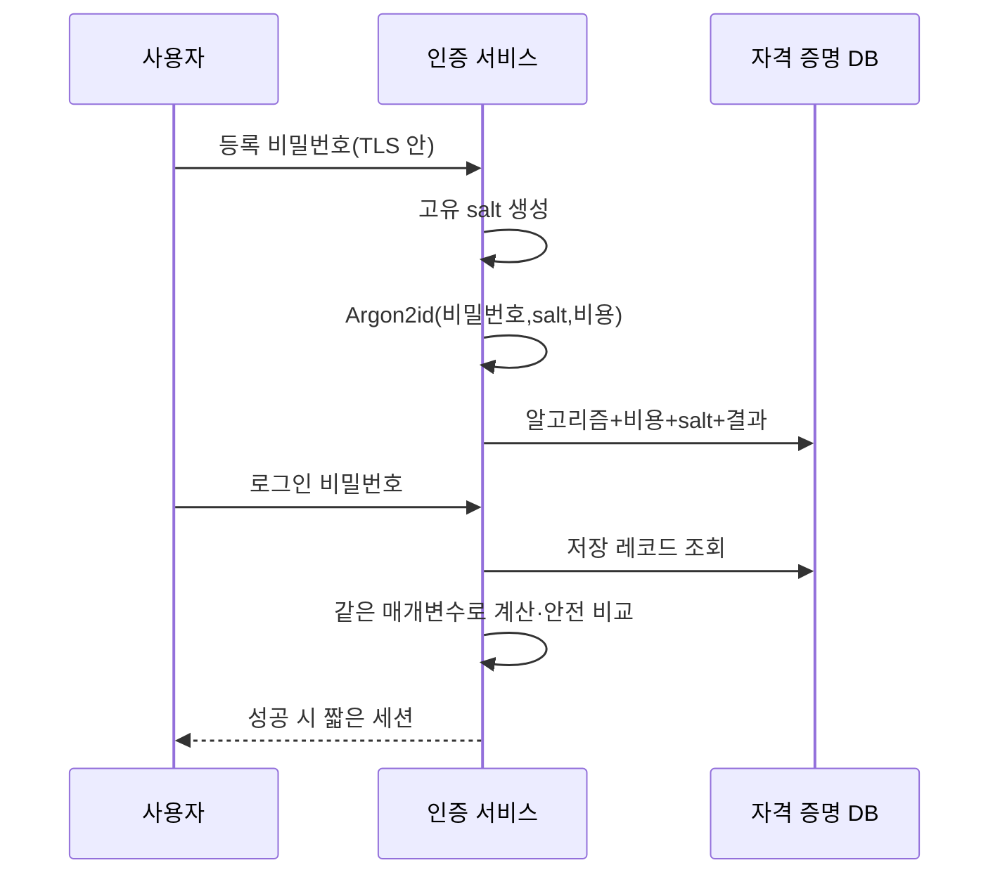

# 06. 비밀번호 저장과 비밀 관리

비밀번호는 로그인 때 “맞는지 비교”하면 되므로 원문 복구가 필요 없다. API 키나 데이터 암호화 키처럼 다시 사용해야 하는 비밀과 저장 방식이 다르다.

## 1. 비밀번호 저장의 목적

서버는 사용자가 입력한 비밀번호가 등록 값과 같은지 확인해야 한다.

데이터베이스가 유출돼도 공격자의 추측 비용을 높여야 한다.

원문 비밀번호나 복호화 가능한 암호문을 저장하면 저장소와 키가 함께 유출될 때 즉시 드러난다.

빠른 SHA-256 한 번도 부적합하다.

GPU와 병렬 장비는 초당 매우 많은 후보를 계산할 수 있다.

비밀번호 해시(password hashing)는 의도적으로 시간과 메모리 비용을 부과한다.

OWASP는 일반적으로 Argon2id 같은 적응형 비밀번호 해시를 우선 권고한다.

## 2. salt와 작업 비용

salt는 사용자마다 생성하는 고유한 공개 값이다.

같은 `correct horse`를 쓴 두 사용자도 서로 다른 저장 결과를 갖게 한다.

미리 계산한 공통 표를 재사용하기 어렵게 하지만 약한 비밀번호 자체를 강하게 만들지는 않는다.

작업 비용(work factor)은 한 번의 검증에 필요한 시간, 메모리, 병렬성 매개변수다.

서버가 감당할 수 있는 로그인 지연과 공격 비용을 함께 보고 측정한다.

예를 들어 목표 검증 시간이 150ms라면 운영 장비에서 부하 시험한다.

초당 정상 로그인 100건이면 단순 계산으로 15 CPU-second/s 수요가 생길 수 있으므로 큐와 rate limit도 설계한다.

매개변수는 알고리즘 이름, salt, 결과와 함께 저장해 이후 상향할 수 있게 한다.

## 3. 등록과 로그인 흐름

로그에는 비밀번호, 해시 입력, 전체 자격 증명을 남기지 않는다.

비밀번호 재설정은 기존 비밀번호를 보여 주지 않고, 짧은 수명의 일회용 절차로 새 값을 등록한다.

계정 존재 여부가 대량 수집되지 않도록 응답과 시간 차이를 검토한다.

## 4. pepper

pepper는 데이터베이스 밖의 별도 비밀을 비밀번호 처리에 더하는 설계다.

DB만 유출된 경우 추가 장벽이 되지만 키 관리 시스템 의존성과 교체 복잡성이 생긴다.

pepper를 salt처럼 행에 공개 저장하면 목적을 잃는다.

pepper 유출 시 전체 사용자 재설정이나 단계적 교체 전략이 필요하다.

pepper가 salt와 작업 비용을 대신하지 않는다.

## 5. 복구 가능한 비밀

외부 API 키는 애플리케이션이 다시 외부 서비스에 제시해야 하므로 원문 복구가 필요할 수 있다.

이 경우 비밀번호 해시가 아니라 접근 통제된 비밀 저장소나 envelope encryption을 쓴다.

가능하면 저장한 원문 대신 공급자가 검증할 수 있는 해시 토큰 구조를 사용한다.

비밀 저장소는 인증, 인가, 감사, 버전, 교체, 폐기 기능을 제공해야 한다.

애플리케이션 메모리에 전달된 비밀도 로그, crash dump, debug endpoint로 새지 않게 한다.

환경 변수는 전달 방법일 뿐 자동으로 안전한 금고가 아니다.

프로세스 정보, 진단 출력, 자식 프로세스로 노출될 수 있는지 확인한다.

## 6. 교체와 캐시

Secret을 버전 7에서 8로 바꿔도 실행 중 프로세스가 7을 캐시할 수 있다.

생산자는 겹치는 전환 기간에 7과 8을 받아들일 수 있다.

소비자는 8을 새로 읽고 연결을 재수립한다.

관측에서 7 사용이 0이 된 뒤 폐기한다.

유출 사고라면 겹치는 기간을 최소화하고 세션도 함께 폐기한다.

교체 완료 정의에 저장소 값뿐 아니라 Pod, 프록시, CI, 백업의 잔여 복사본을 포함한다.

## 7. 온라인 공격과 오프라인 공격

온라인 공격은 로그인 API에 후보를 보낸다.

rate limit, 지연, MFA, 위험 기반 탐지가 적용된다.

오프라인 공격은 유출된 해시를 공격자 장비에서 시험한다.

서버 rate limit은 적용되지 않는다.

비밀번호 해시의 비용과 사용자 비밀번호 강도가 핵심이다.

계정 잠금은 공격자가 피해자 계정을 반복 잠글 가용성 공격도 만들 수 있다.

IP 하나만 기준으로 막으면 분산 공격을 놓치고 공유 NAT 사용자를 함께 차단할 수 있다.

계정, 네트워크, 장치, 시간 신호를 조합하고 복구 경로를 둔다.

## 8. 오해와 반례

오해: salt는 비밀이어야 한다.

반례: salt는 해시 레코드와 함께 저장해도 된다. 고유성이 핵심이며 별도 비밀은 pepper다.

오해: AES로 비밀번호를 암호화하면 로그인 비교가 된다.

반례: 복호화 키 유출 시 모든 비밀번호가 원문으로 드러난다. 복구가 필요 없는 비밀번호는 적응형 해시를 쓴다.

오해: Secret을 Git에서 Base64로 저장하면 보호된다.

반례: Base64는 인코딩이라 누구나 되돌릴 수 있다.

## 9. 문제와 해설

### 문제 1

사용자마다 salt가 다른데 SHA-256을 한 번만 썼다. 무엇이 남는가?

**해설:** 미리 계산한 공통 표 재사용은 줄지만 각 후보 계산이 매우 빠르다. Argon2id 같은 적응형 함수와 측정된 작업 비용이 필요하다.

### 문제 2

외부 결제 API 키를 Argon2id로만 저장하면 어떤 문제가 있는가?

**해설:** 애플리케이션이 외부 API에 원문 키를 제시해야 하므로 단방향 결과에서 복구할 수 없다. 비밀 저장소와 접근 통제된 암호화를 쓰거나 공급자의 짧은 수명 자격 증명 방식을 이용한다.

### 문제 3

Secret Manager에서 값을 바꿨는데 오래된 키 사용이 계속된다. 조사 순서는?

**해설:** 발급 버전과 접근 로그, 애플리케이션 캐시 TTL, 열린 연결, Pod 재시작 여부, CI 복사본을 확인한다. 새 버전 사용률을 관찰한 뒤 옛 버전을 폐기한다.

## 공식 자료

- [OWASP Password Storage Cheat Sheet](https://cheatsheetseries.owasp.org/cheatsheets/Password_Storage_Cheat_Sheet.html)
- [OWASP Secrets Management Cheat Sheet](https://cheatsheetseries.owasp.org/cheatsheets/Secrets_Management_Cheat_Sheet.html)

---

[이전: 암호화·AEAD·nonce](05-encryption-aead-and-nonce-lifetimes.md) · [목차](README.md) · [다음: TLS 키 교환과 인증서](07-tls-key-exchange-and-certificates.md)
