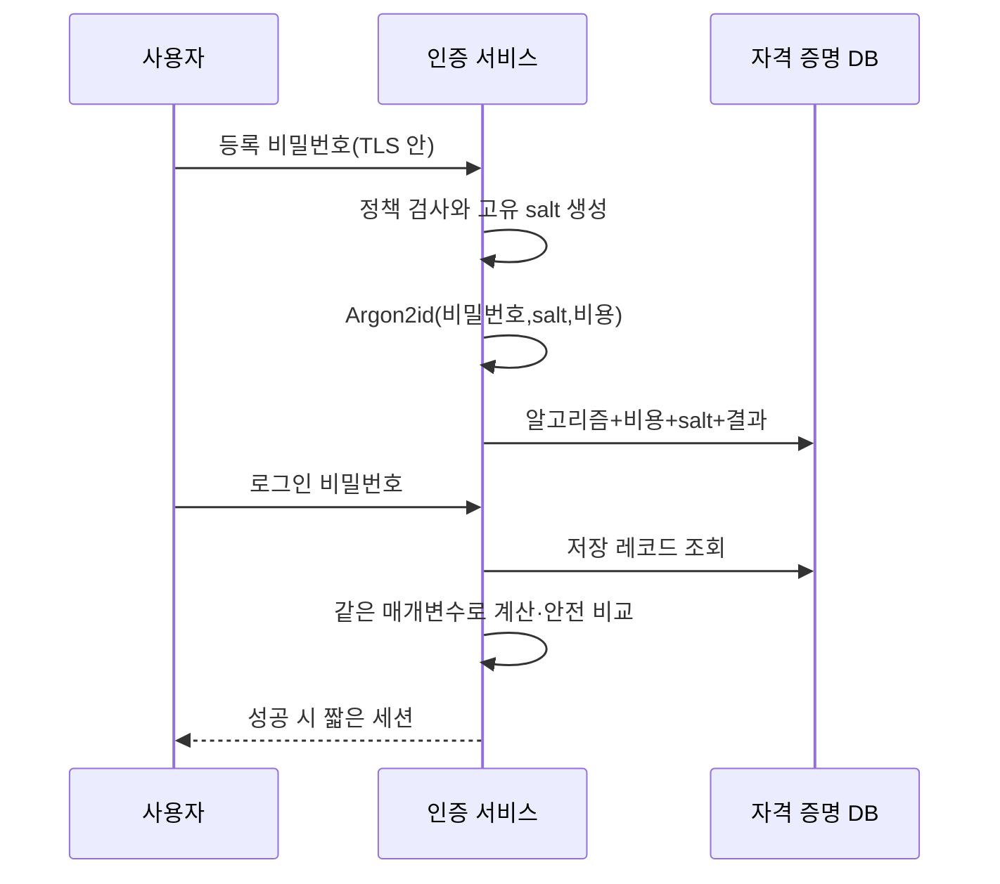

# 06. 비밀번호 저장과 비밀 관리

비밀번호와 API 키는 둘 다 숨겨야 하는 문자열처럼 보이지만 서버가 나중에 무엇을 해야 하는지가 다르다. 비밀번호는 로그인 때 “사용자 입력이 등록한 값과 같은가”만 확인하면 되므로 원문을 되찾을 필요가 없다. 외부 결제 API 키나 데이터 암호화 키는 서버가 다시 제시하거나 암호 연산에 사용해야 하므로 복구 가능한 보호가 필요할 수 있다.

이 차이를 놓치면 비밀번호를 복호화 가능한 형태로 저장하거나, 반대로 다시 써야 하는 API 키를 단방향 해시해 서비스를 호출하지 못하는 설계가 된다. 이 장은 비밀번호 등록·검증·변경·복구와 일반 비밀의 생성·전달·캐시·교체·폐기를 각각 전체 수명으로 설명한다.

## 1. 먼저 네 객체를 구분한다

**비밀번호(password)**는 사람이 기억하거나 비밀번호 관리자가 보관하고 로그인 때 제시하는 인증 비밀이다. 사용자가 고르므로 선택이 편향되고 공격자가 흔한 후보를 예측할 수 있다.

**API 키(API key)**는 프로그램이 외부 서비스에 자신을 인증할 때 제시하는 비밀 값이다. 서비스가 발급한 긴 무작위 값일 수 있다. 사용하는 애플리케이션은 원문을 다시 읽을 수 있어야 하는 경우가 많다.

**암호키(cryptographic key)**는 암호화, MAC, 서명 같은 암호 연산의 동작을 결정하는 바이트다. 알고리즘과 용도, 버전, nonce 규칙이 붙는다.

**토큰(token)**은 세션이나 제한된 권한을 전달하는 데이터다. 토큰을 가진 것만으로 권한을 행사하는 **bearer 방식**이면 그 값을 획득한 사람이 사용할 수 있으므로 로그와 저장소에서 보호한다. 토큰은 구조와 검증 방식에 따라 서버 저장형 ID, 서명된 JWT, 불투명한 무작위 문자열 등으로 다르다. **JWT(JSON Web Token)**는 JSON으로 만든 권한·발급자·만료 같은 정보를 정해진 형식으로 전달하는 토큰이다. 서명된 JWT의 본문은 읽을 수 있으며 서명 검증과 각 정보의 정책 검사까지 해야 한다.

“Secret”이라는 이름은 위 값들을 담는 저장 객체를 가리키기도 한다. Kubernetes Secret은 바이트를 배포하는 API 객체이며 값의 의미와 암호 수명은 애플리케이션이 정한다.

## 2. 비밀번호 저장의 목표

서버에는 두 요구가 있다.

1. 로그인 입력이 등록 비밀번호와 같은지 검증한다.
2. 자격 증명 데이터베이스가 유출돼도 공격자의 후보 시험 비용을 높인다.

원문 비밀번호를 저장하면 DB를 읽은 공격자가 즉시 모든 값을 얻는다. 비밀번호를 AES로 암호화하고 복호화 키를 인증 서비스에 두면 서비스는 원문을 복구할 수 있지만, DB와 키가 함께 유출되거나 애플리케이션이 침해되면 모든 비밀번호가 한 번에 드러난다. 로그인 비교에는 원문 복구가 필요 없으므로 이 권한을 만들 이유가 없다.

SHA-256을 한 번 계산하는 것도 부족하다. SHA-256은 큰 데이터를 빠르게 처리하도록 설계돼 공격자도 GPU와 병렬 장비로 많은 후보를 빠르게 시험할 수 있다. 필요한 것은 **비밀번호 해시(password hashing)**, 즉 각 후보 계산에 의도적인 시간과 메모리 비용을 주는 적응형 함수다.

## 3. 온라인 공격과 오프라인 공격

**온라인 공격**은 공격자가 실제 로그인 API에 후보 비밀번호를 보낸다. 서버는 요청을 관찰할 수 있어 계정별·네트워크별 시도 제한, 지연, **MFA(Multi-Factor Authentication, 다중 요소 인증)**, 위험 탐지를 적용할 수 있다. MFA는 비밀번호 같은 지식과 보안키 같은 소유 요소 등 서로 다른 종류의 증거를 함께 확인하는 인증이다.

**오프라인 공격**은 공격자가 DB에서 해시 레코드를 훔친 뒤 자기 장비에서 후보를 계산한다. 서버가 단위 시간의 시도 횟수를 제한하는 **rate limit**과 계정 잠금은 적용되지 않는다. 비밀번호 선택의 강도, 사용자별 salt, 비밀번호 해시의 시간·메모리 비용이 방어의 핵심이다.

계정 잠금을 무조건 강하게 하면 공격자가 피해자 이름으로 실패를 반복해 정상 사용자를 잠그는 가용성 공격을 만들 수 있다. IP 하나만 막으면 분산 공격을 놓치고 회사 NAT 뒤 정상 사용자 전체를 차단할 수 있다. 계정, 네트워크, 장치, 시간, 알려진 유출 신호를 조합하고 복구 경로를 둔다.

## 4. salt: 사용자별 공개 고유값

**salt**는 사용자마다 새로 생성해 비밀번호 해시에 함께 넣는 값이다. 비밀일 필요가 없고 해시 결과 옆에 저장한다. 핵심은 충분한 길이와 고유성이다.

두 사용자가 같은 `correct horse`를 쓰더라도 salt가 다르면 저장 결과가 다르다. 공격자가 한 후보의 해시를 모든 사용자에게 그대로 재사용하기 어렵고, 미리 계산한 공통 표의 효율이 줄어든다.

salt가 약한 비밀번호를 강하게 바꾸지는 않는다. 공격자는 각 사용자의 salt로 `password1`, 계절 이름, 유출 비밀번호 목록을 다시 계산할 수 있다. 그래서 작업 비용과 사용자 비밀번호 품질이 계속 중요하다.

salt를 사용자 이름으로 만들면 계정 재생성이나 다른 서비스와 겹칠 수 있고 공격자가 미리 알 수 있다. 보안 난수로 생성한 값을 저장하는 것이 단순하다.

## 5. 작업 비용과 Argon2id

**작업 비용(work factor)**은 비밀번호 후보 하나를 검증할 때 쓰는 계산 자원이다. Argon2id 같은 메모리 기반 비밀번호 해시는 주로 다음 매개변수를 갖는다.

- 메모리 비용: 한 계산에 사용할 메모리 양
- 시간 비용: 내부 반복 횟수
- 병렬성: 계산에 사용하는 병렬 lane 수
- 출력 길이: 저장할 검증 결과의 바이트 수

값을 크게 할수록 공격 비용이 증가하지만 정상 로그인 서버 비용과 지연도 증가한다. 운영 장비에서 동시 로그인 부하와 메모리 압박을 측정해 선택한다. 예를 들어 한 검증에 CPU 코어 하나를 실제로 150ms 사용하는 조건이라면 초당 100건에 0.150 × 100 = 15 CPU-second/s의 수요가 생긴다. 이는 평균 약 15개 코어의 계산 시간과 맞먹는다. 다만 관찰한 응답 지연이 150ms라는 사실만으로 CPU 사용량을 이렇게 계산할 수는 없다. 메모리 대기나 큐 대기가 포함될 수 있고 내부 병렬 작업이 여러 코어를 쓸 수도 있다. 응답 지연과 실제 CPU 사용 시간을 따로 측정해야 한다.

알고리즘 이름과 매개변수, salt, 결과를 한 레코드에 저장한다.

```text
algorithm   = argon2id
version     = <library format version>
memory_cost = <measured setting>
time_cost   = <measured setting>
parallelism = <measured setting>
salt        = <unique public bytes>
digest      = <password hash result>
```

이 문서는 특정 숫자를 모든 서버의 안전한 기본값이라고 만들지 않는다. 공식 지침과 사용 라이브러리의 현재 권고를 시작점으로 실제 하드웨어와 공격 모델에서 측정한다.

## 6. 등록과 로그인 전체 흐름



등록 단계를 세분하면 다음과 같다.

1. 브라우저가 TLS 연결로 비밀번호를 보낸다. TLS는 전송 구간을 보호하지만 서버 로그를 보호하지는 않는다.
2. 서버는 길이와 금지된 유출 비밀번호 같은 정책을 검사한다. 임의의 복잡성 규칙이 사용자를 예측 가능한 변형으로 몰 수 있으므로 정책 근거를 둔다.
3. 운영체제 보안 난수로 salt를 생성한다.
4. 현재 승인한 알고리즘과 비용으로 해시를 계산한다.
5. 알고리즘, 매개변수, salt, 결과를 원자적으로 저장한다. 원문은 저장하지 않는다.
6. 비밀번호 변수, 요청 본문, 오류 객체가 일반 로그·분산 trace·crash dump로 가지 않게 한다.

로그인에서는 계정 레코드의 저장 매개변수로 입력을 계산한다. 결과는 검증 라이브러리가 제공하는 안전한 비교로 확인한다. 성공 뒤 계정 상태, MFA, 위험 정책을 적용해 세션을 발급한다.

존재하지 않는 계정과 틀린 비밀번호가 응답 문구나 시간으로 지나치게 쉽게 구별되면 계정 목록 수집에 쓰일 수 있다. 그렇다고 모든 내부 원인을 지우면 운영이 어려우므로 외부 응답은 제한하고 내부 감사에는 분류를 남긴다.

## 7. 비용 상향과 로그인 시 재해시

하드웨어가 빨라지거나 지침이 바뀌면 비용을 높여야 한다. 기존 사용자의 원문 비밀번호는 서버에 없으므로 즉시 일괄 재해시할 수 없다.

성공 로그인 때 다음 순서로 갱신할 수 있다.

1. 저장된 옛 매개변수로 입력 비밀번호를 검증한다.
2. 성공하면 현재 정책보다 약한지 확인한다.
3. 새 salt와 새 비용으로 같은 입력을 재해시한다.
4. 계정 레코드를 새 형식으로 원자적으로 교체한다.
5. 다음 로그인부터 새 비용을 사용한다.

오랫동안 로그인하지 않는 계정은 그대로 남는다. 위험에 따라 강제 비밀번호 변경, 계정 비활성화, 별도 마이그레이션 정책을 둔다. 실패한 로그인 입력으로 재해시하지 않는다.

## 8. pepper: DB 밖의 추가 비밀

**pepper**는 데이터베이스 밖에서 보호하는 별도 비밀을 비밀번호 처리에 더하는 설계다. DB 덤프만 유출된 경우 공격자가 후보를 검증하는 데 pepper도 필요하게 할 수 있다.

pepper를 같은 DB 행에 salt처럼 저장하면 목적을 잃는다. KMS/HSM이나 별도 비밀 관리 시스템에 두고 인증 서비스만 제한적으로 사용한다.

pepper는 운영 복잡성을 만든다. 유출되거나 교체해야 할 때 사용자의 원문 비밀번호 없이 기존 결과를 새 pepper로 단순 변환할 수 없는 설계가 많다. 다중 버전 검증, 성공 로그인 시 이전, 전체 비밀번호 재설정 같은 전략이 필요하다. pepper 장애가 모든 로그인을 막을 수도 있다.

pepper는 사용자별 salt와 작업 비용을 대신하지 않는다. 세 통제의 공격 조건이 다르다.

## 9. 비밀번호 재설정은 별도의 인증 프로토콜이다

비밀번호를 잊은 사용자에게 기존 원문을 보여 주면 서버가 복구 가능한 형태로 저장했다는 뜻이므로 설계가 잘못됐다. 재설정은 새 비밀번호를 등록하는 별도 절차다.

1. 사용자가 계정 식별자를 제출한다.
2. 서버는 계정 존재 여부를 과도하게 노출하지 않는 응답을 보낸다.
3. 보안 난수로 충분히 예측하기 어려운 일회용 재설정 토큰을 만든다.
4. 서버는 토큰 원문 대신 해시를 저장할 수 있고, 계정·목적·만료·미사용 상태와 묶는다.
5. 신뢰한 통지 채널로 원문 토큰이 포함된 링크를 전달한다.
6. 사용 시 서버는 해시 비교, 만료, 계정, 목적, 미사용 상태를 확인한다.
7. 한 트랜잭션에서 토큰을 사용 완료로 바꾸고 새 비밀번호 해시를 저장한다.
8. 위험 정책에 따라 기존 세션과 갱신 토큰을 폐기하고 사건을 알린다.

재설정 링크가 브라우저 기록, Referer 헤더, 분석 도구 로그로 새지 않도록 페이지 구조를 설계한다. 이메일 계정 탈취가 곧 서비스 계정 탈취가 될 수 있으므로 고위험 서비스는 추가 확인과 복구 지연을 둘 수 있다.

## 10. 복구 가능한 비밀은 왜 다르게 저장하는가

외부 결제 API 키를 애플리케이션이 공급자에게 제시해야 한다면 단방향 비밀번호 해시만 저장해서는 원문을 복구할 수 없다. 선택지는 상황에 따라 다르다.

- 공급자가 키의 해시를 검증하는 구조라면 우리 서비스도 원문을 저장하지 않을 수 있다.
- 짧은 수명의 동적 자격 증명을 매 작업 발급받을 수 있다.
- 원문이 꼭 필요하면 접근 통제된 비밀 저장소와 envelope encryption을 사용한다.

비밀 저장소는 단순 암호문 데이터베이스가 아니다. 누가 어떤 비밀 버전을 읽고 바꿀 수 있는지 인증·인가하고, 접근을 감사하며, 교체·폐기·복구를 지원해야 한다. KMS 키를 가진 애플리케이션이 모든 비밀을 자유롭게 복호화할 수 있다면 애플리케이션 침해 시 영향 범위가 크다. 서비스와 환경별로 권한을 나눈다.

## 11. 비밀 전달과 메모리 수명

저장소에서 안전했던 비밀도 실행 프로세스에 전달되면 여러 복사본을 만든다. 환경 변수, 명령줄 인자, 임시 파일, 볼륨, IPC, SDK 응답이 전달 방식이다.

환경 변수는 암호 금고가 아니라 프로세스에 값을 전달하는 수단이다. 진단 출력, crash report, 자식 프로세스 상속, 잘못된 `/proc` 권한, 지원 번들에 노출될 수 있는지 검토한다. 명령줄 인자는 프로세스 목록에 나타날 수 있다. 파일은 권한, 삭제, 백업, 컨테이너 이미지 포함 여부를 확인한다.

애플리케이션 메모리의 비밀은 사용 기간을 줄이고 불필요하게 문자열 복사하지 않는다. 관리형 언어에서는 메모리 즉시 지우기를 완전히 보장하기 어려울 수 있으므로 “zeroize 호출 하나”를 절대 보장으로 과장하지 않는다. 디버그 endpoint, heap dump, 코어 덤프 접근을 제한하는 것이 함께 중요하다.

Kubernetes Secret의 `data` 필드는 Base64로 인코딩될 뿐 그 자체로 기밀성을 제공하지 않는다. API 서버 저장 암호화, etcd 접근 통제, RBAC, Pod 마운트 범위, 노드와 백업 보호를 함께 설계한다. Secret을 읽을 수 있는 Pod 안에서 실행되는 악성 코드는 값도 사용할 수 있다.

## 12. 교체, 겹치는 기간, 폐기

비밀 버전 7을 8로 교체하는 전체 흐름을 보자.

1. 공급자나 비밀 저장소에서 버전 8을 생성한다.
2. 대상 서비스가 8을 읽을 권한을 얻는다.
3. 생산자는 가능하면 제한된 기간 7과 8을 모두 받아들인다.
4. 소비자는 8을 새로 가져와 연결과 세션을 재수립한다.
5. 접근 로그와 지표에서 7 사용량을 관찰한다.
6. 7 사용이 0이고 오프라인 작업·CI·백업의 필요가 없음을 확인한다.
7. 7을 비활성화한 뒤 오류가 없는지 관찰하고 폐기한다.

Secret Manager 값만 바꿔도 실행 중 Pod가 7을 캐시할 수 있다. 캐시 TTL, 파일 갱신 방식, 프로세스 reload, connection pool, 라이브러리 동작을 확인한다.

유출 사고에서는 긴 겹침 기간이 공격자에게 계속 접근을 준다. 새 키 발급과 함께 옛 키, 세션, 파생 토큰을 빠르게 폐기하고 영향 범위를 조사한다. 정기 교체와 사고 교체는 시간 목표가 다르다.

## 13. 비밀 탐지와 사고 대응

Git 저장소, 로그, 컨테이너 이미지에 비밀이 커밋됐다고 하자. 파일을 지우는 것만으로 대응이 끝나지 않는다. Git 기록, fork, 캐시, CI 로그, 빌드 아티팩트에 복사본이 남을 수 있다.

대응 순서는 다음과 같다.

1. 노출된 값의 종류, 권한, 환경, 발급자, 수명을 식별한다.
2. 가능한 즉시 새 자격 증명을 발급하고 소비자를 전환한다.
3. 옛 자격 증명을 폐기한다. 단순 삭제 커밋보다 폐기가 우선이다.
4. 발급 시각부터 폐기까지 접근 로그를 조사한다.
5. 파생 세션·토큰과 변경된 데이터의 영향을 확인한다.
6. 저장소 기록과 캐시의 노출 복사본을 정책에 따라 정리한다.
7. 왜 검출·차단되지 않았는지 배포 경로와 권한을 고친다.

비밀 스캐너는 알려진 패턴과 높은 엔트로피 문자열을 찾지만 모든 비밀을 정확히 구별하지 못한다. 오탐과 누락이 있으므로 예방 hook, CI 검사, 런타임 탐지, 짧은 수명 자격 증명, 최소 권한을 함께 사용한다.

## 14. 표준과 현재 지침을 읽는 방법

NIST SP 800-63B의 최신 디지털 신원 지침은 비밀번호 길이, 차단 목록, rate limit, 저장 방식 같은 인증자 계약을 설명한다. 특정 서비스의 위험과 기존 규정에 맞춰 현재 버전과 전환 계획을 확인한다. 예전 관행을 “NIST가 요구한다”고 반복하지 않는다.

Argon2는 RFC 9106에 알고리즘과 권고 프로파일이 설명돼 있다. 라이브러리가 Argon2id라는 이름을 제공한다는 사실만으로 매개변수와 버전, 오류 처리가 자동으로 적절해지지 않는다. 사용 중인 구현의 형식과 운영 장비 측정을 기록한다.

OWASP Password Storage와 Secrets Management 자료는 실무 출발점을 제공하지만 제품 문서, 규제 조건, 실제 공격 모델을 함께 본다. 직접 암호 함수를 만들거나 교육용 해시 코드를 운영 인증에 사용하지 않는다.

## 15. 오해와 반례

**“salt는 비밀이어야 한다.”** salt는 해시 레코드와 함께 저장해도 된다. 고유성이 핵심이며 DB 밖 비밀은 pepper다.

**“AES로 비밀번호를 암호화하면 로그인 비교가 된다.”** 비교는 되지만 복호화 키 유출 시 모든 원문이 드러난다. 복구가 필요 없는 비밀번호에는 단방향 적응형 해시를 쓴다.

**“Secret을 Git에서 Base64로 저장하면 보호된다.”** Base64는 인코딩이라 누구나 되돌릴 수 있다.

**“비밀을 교체했으니 옛 값은 사라졌다.”** Pod 메모리, 연결 풀, CI 변수, 로그, 백업에 복사본이 남을 수 있다.

## 16. 연습 문제와 자세한 풀이

### 문제 1. salt와 SHA-256 한 번

사용자별 salt가 있지만 SHA-256을 한 번만 썼다.

**풀이:** 같은 비밀번호의 결과 공유와 공통 사전 재사용은 줄지만 후보 하나의 계산이 매우 빠르다. Argon2id 같은 적응형 비밀번호 해시와 측정한 시간·메모리 비용이 필요하다.

### 문제 2. 외부 결제 API 키

API 키를 Argon2id로만 저장하면 무엇이 문제인가?

**풀이:** 애플리케이션이 외부 공급자에게 원문 키를 제시해야 한다면 단방향 결과에서 복구할 수 없다. 짧은 수명 동적 자격 증명이나 접근 통제된 비밀 저장소와 암호화를 사용한다.

### 문제 3. Secret Manager 교체 뒤 옛 사용

조사 순서를 적어라.

**풀이:** 발급 버전과 접근 로그, 애플리케이션 캐시 TTL, 파일 갱신, 열린 연결, Pod reload·재시작, CI·배치 작업 복사본을 확인한다. 새 버전 사용률과 옛 버전 호출을 관찰한 뒤 폐기한다.

### 문제 4. pepper 유출

DB는 유출되지 않았으니 아무 조치가 필요 없는가?

**풀이:** pepper가 다른 경로에서 유출되면 미래 DB 유출과 결합될 수 있고 현재 인증 서비스 침해 신호일 수 있다. 사용 기록과 접근 주체를 조사하고 새 버전 전환 계획을 실행한다. 설계에 따라 성공 로그인 시 이전이나 사용자 재설정이 필요하다.

### 문제 5. 비밀번호 재설정 토큰

토큰이 만료 전 두 요청에 동시에 사용됐다.

**풀이:** 두 요청이 각각 “미사용”을 읽으면 둘 다 성공할 수 있다. 토큰 사용 완료 표시와 비밀번호 변경을 한 원자적 트랜잭션으로 처리하고 토큰 ID에 유일 상태 전이를 둔다.

### 문제 6. 150ms 검증

한 로그인 검증이 150ms이므로 항상 안전하고 운영 가능하다고 할 수 있는가?

**풀이:** 아니다. 공격자의 하드웨어, 메모리 비용, 사용자 비밀번호, 서버 동시성, 초당 로그인 수를 함께 본다. 검증당 실제 CPU 사용이 한 코어에서 150ms라면 초당 100건에 15 CPU-second/s 수요다. 150ms가 응답 지연만 나타낸다면 이 계산은 성립하지 않는다. 부하 시험과 rate limit, 확장·장애 계획이 필요하다.

### 문제 7. Git에서 비밀 삭제

새 커밋에서 키 문자열을 지웠다. 끝났는가?

**풀이:** 아니다. 우선 키를 폐기하고 새 키로 소비자를 전환한다. 과거 Git 기록, fork, CI 로그, 이미지와 캐시를 조사하며 노출 기간의 사용 로그를 확인한다. 기록 정리는 폐기를 대신하지 않는다.

### 문제 8. Kubernetes Secret

`data`가 Base64라서 etcd를 읽어도 안전한가?

**풀이:** 아니다. Base64는 표현 변환이다. API 서버 저장 암호화, etcd·백업 접근 통제, RBAC, Pod 마운트 범위, 노드 보호가 필요하다. Secret을 읽을 권한이 있는 워크로드 침해도 별도 위험이다.

## 공식 근거

- [NIST SP 800-63B-4: Authentication and Authenticator Management](https://pages.nist.gov/800-63-4/sp800-63b.html)
- [RFC 9106: Argon2 Memory-Hard Function](https://www.rfc-editor.org/rfc/rfc9106)
- [OWASP Password Storage Cheat Sheet](https://cheatsheetseries.owasp.org/cheatsheets/Password_Storage_Cheat_Sheet.html)
- [OWASP Secrets Management Cheat Sheet](https://cheatsheetseries.owasp.org/cheatsheets/Secrets_Management_Cheat_Sheet.html)
- [Kubernetes Secrets](https://kubernetes.io/docs/concepts/configuration/secret/)

---

[이전: 암호화·AEAD·nonce](05-encryption-aead-and-nonce-lifetimes.md) · [목차](README.md) · [다음: TLS 키 교환과 인증서](07-tls-key-exchange-and-certificates.md)
