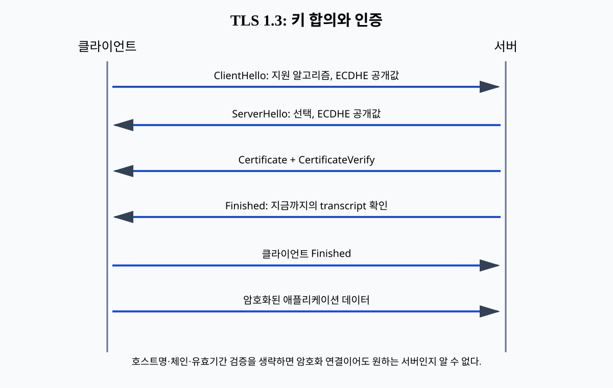
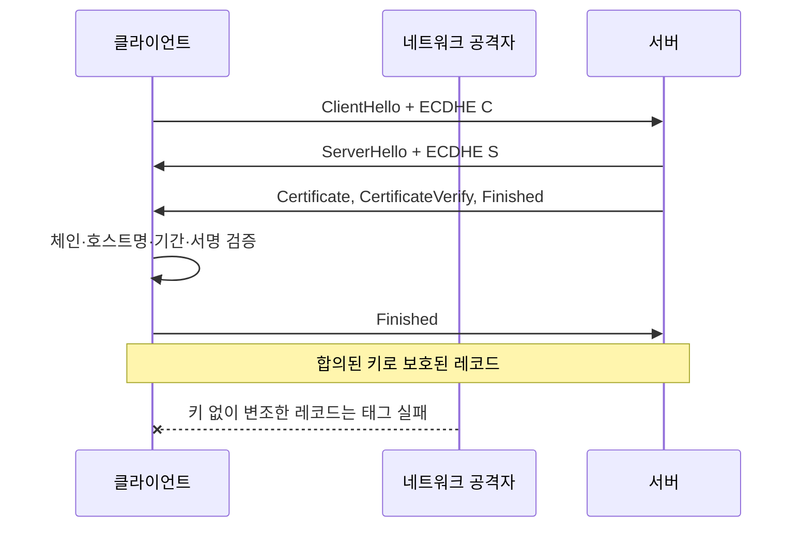

# 07. TLS 키 교환과 인증서

TLS는 네트워크 위 두 끝점이 암호화된 연결을 만드는 프로토콜이다. “HTTPS니까 안전하다”보다 어떤 상대를 어떻게 인증하고 어떤 키를 합의했는지 이해해야 한다.

## 1. 서로 다른 세 역할

키 교환(key exchange)은 두 끝점이 도청자에게 직접 비밀을 보내지 않고 공유 비밀을 만드는 과정이다.

인증(authentication)은 연결 상대가 주장한 신원인지 확인하는 과정이다.

레코드 보호(record protection)는 합의한 키로 애플리케이션 데이터를 암호화하고 무결성을 검증한다.

셋은 연결되지만 같은 일이 아니다.

서버 인증서를 검증하지 않고도 암호화된 연결을 만들 수 있지만 공격자와 암호화했을 수 있다.

## 2. TLS 1.3의 단순화 흐름

클라이언트는 ClientHello에 지원 알고리즘과 ECDHE 공개값을 보낸다.

서버는 ServerHello에서 선택과 자기 ECDHE 공개값을 보낸다.

양쪽은 공유 비밀과 지금까지의 transcript에서 핸드셰이크 키를 파생한다.

서버는 Certificate로 인증서 체인을 제시한다.

CertificateVerify는 서버가 인증서 공개키에 대응하는 개인키를 가졌음을 transcript 서명으로 보인다.

Finished는 지금까지 메시지 전체가 같은지 키 기반으로 확인한다.

클라이언트 Finished 뒤 애플리케이션 데이터를 교환한다.

## 3. 인증서 검증

인증서(certificate)는 주체 이름과 공개키 등을 발급자의 서명으로 묶은 구조다.

클라이언트는 신뢰 저장소의 root까지 서명 체인을 검증한다.

현재 시간이 인증서 유효 기간 안인지 확인한다.

접속한 호스트명이 SAN(subject alternative name)에 맞는지 확인한다.

키 사용 목적과 알고리즘 제약을 확인한다.

중간 인증서가 빠지면 체인을 만들지 못할 수 있다.

서명 체인이 유효해도 `api.example.com` 인증서를 `evil.example.net` 연결에 받아서는 안 된다.

폐기 확인은 환경과 클라이언트 정책에 따라 OCSP, CRL, 짧은 인증서 수명 등을 조합한다.

## 4. 전방향 안전성

전방향 안전성(forward secrecy)은 장기 인증키가 나중에 유출돼도 과거 세션 키가 자동으로 복원되지 않는 성질이다.

TLS 1.3에서 fresh (EC)DHE를 사용하면 이 성질을 제공할 수 있다.

각 세션의 임시 개인값을 폐기했기 때문이다.

그러나 PSK-only `psk_ke` 모드는 (EC)DHE를 사용하지 않으므로 같은 전방향 안전성을 제공하지 않는다.

TLS 1.3이라는 버전 이름만으로 모든 연결의 키 교환 속성을 단정하지 않는다.

협상된 모드와 실제 키 재료를 확인한다.

## 5. 세션 재개와 0-RTT

세션 재개는 이전 연결에서 만든 PSK로 다음 핸드셰이크 비용을 줄인다.

0-RTT early data는 핸드셰이크 완료 전 애플리케이션 데이터를 보낼 수 있다.

early data는 재전송 위험을 별도로 고려해야 한다.

서버 또는 여러 서버 인스턴스가 replay 상태를 일관되게 다루기 어렵다.

결제, 상태 변경처럼 재실행 위험이 큰 요청은 0-RTT에서 받지 않거나 애플리케이션 멱등성을 둔다.

## 6. mTLS

일반 웹 TLS는 보통 서버가 인증서를 제시하고 클라이언트가 검증한다.

mTLS(mutual TLS)는 서버도 클라이언트 인증서를 요청하고 검증한다.

클라이언트 인증서는 워크로드 신원의 강한 입력이 될 수 있다.

그러나 인증서 주체를 애플리케이션 계정과 잘못 매핑하면 인가가 깨진다.

인증 성공 뒤에도 메서드와 객체별 인가가 필요하다.

프록시가 TLS를 종료하면 백엔드는 프록시가 전달한 신원 헤더를 임의 클라이언트가 직접 주입하지 못하게 네트워크 경계를 닫아야 한다.

## 7. 관찰과 오류

TLS 실패를 `SSL error` 한 종류로만 기록하면 원인을 찾기 어렵다.

협상 버전, 검증 단계, 호스트명 불일치, 만료, 미신뢰 발급자, Finished 실패를 비밀 없이 분류한다.

개인키, 세션 키, 원문 자격 증명은 로그에 남기지 않는다.

서버 시간을 잘못 맞추면 아직 유효하지 않거나 만료된 인증서로 판정할 수 있다.

인증서 자동 갱신은 새 인증서 발급뿐 아니라 실제 listener가 새 체인을 제공하는지 끝점에서 확인한다.

## 8. 오해와 반례

오해: 자물쇠 표시가 사이트의 사업 내용을 보증한다.

반례: TLS는 도메인과 연결을 인증할 수 있지만 그 사업이 정직한지는 판단하지 않는다.

오해: 인증서 검증 오류를 끄면 개발 환경만 편해진다.

반례: 설정이 생산에 남으면 중간자 공격자를 정상 서버로 받아들인다.

오해: TLS가 있으니 메시지 재전송을 걱정할 필요 없다.

반례: 연결 위 정상 클라이언트가 같은 상태 변경 요청을 반복할 수 있고 0-RTT는 별도 replay 고려가 필요하다.

## 9. 문제와 해설

### 문제 1

체인 서명과 기간은 맞지만 호스트명이 다르다. 왜 실패인가?

**해설:** 인증서는 해당 공개키를 특정 이름에 묶는다. 접속한 이름과 SAN이 다르면 원하는 서버라는 증거가 아니다. 연결을 거부한다.

### 문제 2

서버 장기 인증키가 유출됐다. 과거 TLS 세션이 항상 복호화되는가?

**해설:** 항상은 아니다. fresh (EC)DHE 세션은 임시 개인값이 폐기됐다면 전방향 안전성을 갖는다. PSK-only나 키 기록, 구현 침해 등 실제 모드와 운영 증거를 확인해야 한다.

### 문제 3

mTLS 인증에 성공한 빌드 봇이 운영 Secret을 읽어도 되는가?

**해설:** mTLS는 빌드 봇 신원을 확인한 근거다. Secret 읽기 권한은 별도 인가 정책이 결정한다. 대상 네임스페이스, 자원, 동사를 최소화한다.

## 공식 자료

- [RFC 8446: TLS 1.3](https://www.rfc-editor.org/rfc/rfc8446.html)
- [RFC 6125: 서비스 신원 확인](https://www.rfc-editor.org/rfc/rfc6125.html)

---

[이전: 비밀번호와 비밀 관리](06-password-storage-and-secret-management.md) · [목차](README.md) · [다음: Linux 격리와 Kubernetes RBAC](08-linux-isolation-and-kubernetes-rbac.md)
