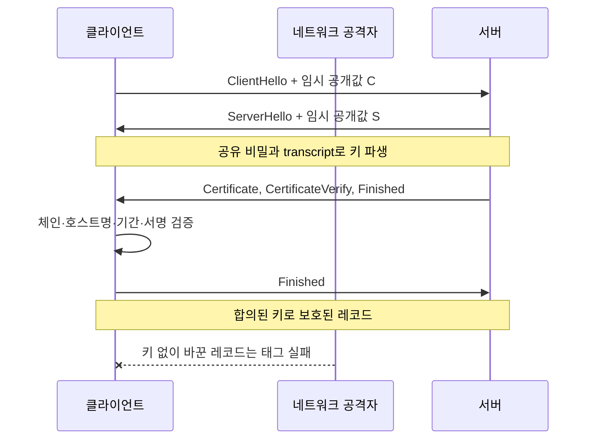

# 07. TLS 키 교환과 인증서

브라우저가 서버에 데이터를 보낼 때 중간 네트워크 장비는 패킷을 전달한다. 아무 보호가 없으면 그 장비나 같은 네트워크의 공격자가 내용을 읽거나 바꿀 수 있다. **TLS(Transport Layer Security)**는 두 통신 끝점이 상대와 암호 방식에 합의하고, 이후 바이트를 암호화하고 변조를 검출하도록 만드는 네트워크 프로토콜이다. 프로토콜은 참여자가 어떤 메시지를 어떤 순서와 형식으로 주고받을지 정한 규칙이다.

웹 주소의 `https`는 웹 요청을 뜻하는 HTTP를 TLS 연결 위에서 보낸다는 뜻이다. 자물쇠 표시는 연결 보호에 관한 신호이지 웹사이트 사업자나 콘텐츠가 정직하다는 보증은 아니다. 이 장은 TLS 1.3 연결 한 건이 만들어지는 과정을 따라가며 키 교환, 서버 인증, 인증서, 레코드 보호, 재개와 0-RTT를 처음부터 설명한다.

## 1. 연결의 두 끝점과 네트워크 공격자

**클라이언트(client)**는 연결을 시작하는 프로그램이다. 브라우저, 모바일 앱, 다른 API 서비스가 될 수 있다. **서버(server)**는 주소와 포트에서 연결을 기다리고 요청에 응답하는 프로그램이다. 둘은 프로세스 메모리에 연결 상태와 세션 키를 잠시 보관한다.

**끝점(endpoint)**은 암호화가 시작되거나 끝나는 지점이다. 브라우저와 최종 애플리케이션이 항상 직접 끝점인 것은 아니다. 앞단 프록시가 TLS를 종료하면 브라우저와 프록시가 한 보호 구간이고, 프록시와 백엔드는 별도 구간이다.

네트워크 공격자가 패킷을 읽고, 버리고, 순서를 바꾸고, 새 패킷을 넣을 수 있다고 가정하자. TLS는 이런 공격자에게 내용의 기밀성과 레코드 무결성을 제공하도록 설계된다. 그러나 끝점 프로세스가 침해됐거나 개인키가 로그에 남았거나 애플리케이션이 권한 검사를 빠뜨린 경우까지 자동으로 해결하지 않는다.

## 2. TLS가 연결하는 세 가지 역할

**키 교환(key exchange)**은 두 끝점이 도청자에게 세션 비밀을 그대로 보내지 않고 같은 공유 비밀을 계산하는 과정이다. 세션 비밀에서 실제 암호화·검증 키를 파생한다.

**인증(authentication)**은 연결 상대가 주장한 신원인지 증거를 확인하는 과정이다. 일반 웹 연결에서는 서버가 `api.example.com`이라는 이름의 서버임을 인증서와 개인키 증명으로 보인다.

**레코드 보호(record protection)**는 합의한 키로 애플리케이션 데이터를 작은 레코드 단위로 암호화하고 인증 태그를 검증하는 과정이다. HTTP 요청과 응답 바이트는 핸드셰이크가 끝난 뒤 이 보호를 받는다.

세 역할은 이어지지만 같다 아니다. 인증서 검증을 끄고도 공격자와 암호화된 연결을 만들 수 있다. 이 경우 도청자는 바깥에 있지만 중간자 공격자가 TLS의 실제 상대가 돼 평문을 볼 수 있다.

## 3. 핸드셰이크에서 실제로 존재하는 객체

**핸드셰이크(handshake)**는 애플리케이션 데이터를 보내기 전에 버전, 암호 알고리즘, 임시 키 재료, 상대 신원을 합의하는 메시지 교환이다.

**암호 스위트(cipher suite)**는 레코드 보호에 사용할 AEAD와 해시 조합을 식별한다. TLS 1.3에서는 과거 버전보다 스위트 이름이 담당하는 범위가 단순화됐다.

**transcript**는 지금까지 주고받은 핸드셰이크 메시지의 정확한 바이트 기록이다. 양쪽은 이 기록의 해시를 키 파생과 검증에 넣는다. 공격자가 중간 메시지를 바꾸면 최종 검증 값이 맞지 않게 연결한다.

**세션 키(session key)**는 이 연결의 레코드를 보호하는 짧은 수명의 대칭키다. 서버 인증서의 장기 개인키와 다르다. 클라이언트와 서버 방향에 서로 다른 키를 파생하고, 연결이 끝나면 메모리에서 수명을 끝낸다.

## 4. TLS 1.3 전체 흐름

클라이언트가 `api.example.com:443`에 처음 연결한다고 하자.

1. 클라이언트는 DNS 등으로 주소를 찾고 TCP 같은 전송 연결을 만든다.
2. `ClientHello` 메시지에 지원하는 TLS 버전, 암호 스위트, 난수, 서버 이름, 임시 키 교환 공개값을 보낸다.
3. 서버는 지원 조합을 고르고 `ServerHello`에 선택 결과와 자기 임시 공개값을 보낸다.
4. 양쪽은 각자의 임시 개인값과 상대 공개값으로 같은 공유 비밀을 계산한다. 개인값 자체는 네트워크에 보내지 않는다.
5. 양쪽은 공유 비밀과 transcript 해시를 표준 키 파생 절차에 넣어 핸드셰이크 보호 키를 만든다.
6. 서버는 `Certificate` 메시지로 서버 공개키가 담긴 인증서 체인을 제시한다.
7. 서버는 `CertificateVerify`에서 인증서 공개키에 대응하는 개인키로 현재 transcript에 서명한다. 인증서 파일만 복사한 공격자가 개인키 없이 서버인 척하는 것을 막는다.
8. 서버 `Finished`는 지금까지의 핸드셰이크가 같은 키와 transcript에 묶였음을 확인하는 값이다.
9. 클라이언트는 인증서 체인, 접속 이름, 유효 기간, 키 용도, 서명과 Finished를 검증한다.
10. 클라이언트도 Finished를 보내고, 양쪽은 애플리케이션 트래픽 키로 전환한다.
11. 이후 HTTP 바이트는 TLS 레코드로 나뉘어 암호화되고 태그가 붙는다.

TLS 구현은 이 절차를 검증된 라이브러리에서 수행한다. 애플리케이션이 임시 키 계산이나 transcript 형식을 새로 만들지 않는다.

## 5. 임시 키 교환과 공유 비밀

TLS 1.3에서 흔히 쓰는 `(EC)DHE`는 유한한 수학 구조에서 양쪽이 임시 개인값을 만들고 공개값을 교환해 공유 비밀을 계산하는 계열이다. 괄호의 EC는 타원곡선 방식을 포함한다는 표기다.

핵심 계약은 다음과 같다.

- 개인값은 각 끝점 메모리에만 두고 네트워크에 보내지 않는다.
- 공개값은 공격자가 보아도 개인값 없이 공유 비밀 계산이 어렵도록 한다.
- 공개값과 핸드셰이크 전체를 서버 인증에 묶어 중간자가 자기 공개값으로 바꾸지 못하게 한다.
- 공유 비밀을 직접 레코드 키로 쓰지 않고 표준 키 스케줄로 방향·단계별 키를 파생한다.

키 교환만 수행하고 인증하지 않으면 클라이언트는 공격자와도 별도의 공유 비밀을 만들 수 있다. 공격자가 클라이언트와 서버 사이에 두 TLS 연결을 만들면 양쪽은 각각 암호화됐다고 보지만 공격자가 중간에서 복호화하고 다시 암호화한다. 인증서와 transcript 서명이 이 공격을 막는 역할을 한다.

## 6. 인증서와 공개키 기반 신뢰 구조

**인증서(certificate)**는 주체 이름, 공개키, 유효 기간, 키 용도 같은 필드를 발급자의 전자서명으로 묶은 구조다. 웹에서 널리 쓰는 X.509는 이 인증서의 표준 형식 이름이다.

**인증기관(Certificate Authority, CA)**은 조건을 확인하고 인증서에 서명하는 주체다. **공개키 기반 구조(Public Key Infrastructure, PKI)**는 인증기관, 인증서 형식, 신뢰 저장소, 발급·갱신·폐기 절차를 합친 운영 체계다.

클라이언트 운영체제나 브라우저에는 신뢰하는 **루트 인증서(root certificate)** 모음이 있다. 루트 개인키는 인증기관이 보호하고 클라이언트에는 공개키가 든 인증서가 배포된다. 서버 인증서는 중간 인증기관 인증서에 의해 서명되고, 중간 인증서는 루트 또는 다른 중간에 의해 서명될 수 있다. 이 연결이 **인증서 체인(chain)**이다.

서버는 보통 서버 인증서와 필요한 중간 인증서를 보낸다. 루트는 클라이언트 신뢰 저장소에서 찾는다. 중간 인증서가 빠지면 클라이언트가 체인을 만들지 못할 수 있다.

## 7. 인증서 검증을 단계별로 본다

클라이언트가 `api.example.com`에 접속했다면 최소한 다음을 검사한다.

1. 각 인증서의 발급자 서명을 검증해 신뢰한 루트까지 체인을 만든다.
2. 현재 시간이 각 인증서의 `notBefore`와 `notAfter` 범위 안인지 확인한다.
3. 접속한 DNS 이름 `api.example.com`이 서버 인증서의 Subject Alternative Name, 줄여서 SAN에 맞는지 확인한다.
4. 인증서가 서버 인증 용도로 허용됐는지와 기본 제약을 확인한다.
5. 알고리즘과 키가 현재 정책에서 허용되는지 확인한다.
6. 서버가 CertificateVerify로 대응 개인키를 실제 소유함을 확인한다.
7. 환경 정책에 따라 폐기 상태나 짧은 수명 정책을 적용한다.

체인 서명과 기간이 맞아도 `payments.example.com` 인증서를 `api.example.com`에 받아들이면 원하는 서버라는 증거가 아니다. 와일드카드 이름도 규칙에 맞는 범위만 일치한다. 문자열 `example.com.attacker.net`이 `example.com`을 포함한다는 이유로 허용하면 안 된다.

서버 시계가 틀리면 아직 유효하지 않거나 이미 만료된 인증서로 오판할 수 있다. 시각 동기화도 인증서 운영의 의존성이다.

## 8. 폐기와 짧은 수명의 의미

개인키가 유출되거나 인증서가 잘못 발급되면 만료 전이라도 신뢰를 중단해야 할 수 있다. 인증서 폐기 목록, 온라인 상태 확인, 짧은 인증서 수명 같은 방법이 있다. 실제 클라이언트가 어떤 방식과 실패 정책을 사용하는지는 구현과 환경에 따라 다르다.

“폐기 서버가 응답하지 않으면 연결을 허용할 것인가”는 가용성과 보안의 절충이다. 모든 클라이언트가 같은 방식으로 강제 확인한다고 가정하지 않는다. 짧은 수명 인증서는 노출 시간을 줄이지만 자동 갱신과 배포가 실패하면 서비스 가용성을 해칠 수 있다.

자동 갱신 완료는 새 파일 발급으로 끝나지 않는다. 실제 listener가 새 인증서와 올바른 중간 체인을 제공하는지 외부 끝점에서 확인한다. 로드밸런서 여러 대 중 하나만 옛 인증서를 제공할 수도 있다.

## 9. 전방향 안전성

**전방향 안전성(forward secrecy)**은 서버의 장기 인증 개인키가 미래에 유출돼도, 과거 네트워크 기록만으로 과거 세션 키가 자동 복원되지 않는 성질이다.

매 연결에서 새로운 임시 `(EC)DHE` 개인값을 만들고 연결 뒤 폐기했다면 공격자는 나중에 인증 개인키를 얻어도 과거 임시 개인값을 갖지 못한다. 장기 개인키는 당시 서버 인증에 사용됐지 세션 공유 비밀 자체가 아니기 때문이다.

그러나 다음 조건은 별도다.

- 끝점 침해 당시 세션 키나 평문이 기록됐다.
- 디버깅용 키 로그가 남았다.
- 임시 값이 안전하게 생성·폐기되지 않았다.
- 세션 재개가 임시 키 교환 없는 PSK-only 모드를 사용했다.

TLS 1.3이라는 버전 이름만으로 모든 실제 연결의 키 교환 속성을 단정하지 않고 협상 모드와 운영 증거를 확인한다.

## 10. 세션 재개와 0-RTT

**세션 재개(session resumption)**는 이전 연결에서 만든 재개 비밀을 이용해 다음 연결의 비용을 줄이는 기능이다. 서버는 클라이언트에 재개 티켓을 줄 수 있고, 다음 연결에서 양쪽이 그 상태로부터 PSK, 즉 사전 공유키를 사용한다.

**0-RTT early data**는 새 핸드셰이크가 완전히 끝나기 전에 애플리케이션 데이터를 보내 지연 왕복을 줄이는 기능이다. 대신 과거 early data가 여러 서버 인스턴스에 재전송될 수 있어 일반 1-RTT 데이터와 다른 replay 위험을 가진다.

예를 들어 `GET /catalog`처럼 상태를 바꾸지 않는 요청은 조건에 따라 중복 실행의 영향이 작다. `POST /transfer`가 같은 송금을 만들면 두 번 처리될 수 있다. 상태 변경 요청을 0-RTT에서 거부하거나, 인증된 멱등키와 데이터베이스의 원자적 중복 방지를 사용한다.

서버 인스턴스 10대가 replay 상태를 공유하지 않으면 같은 early data가 서로 다른 인스턴스에서 처음 본 요청처럼 처리될 수 있다. TLS 라이브러리 옵션과 애플리케이션 의미를 함께 설계한다.

## 11. 상호 TLS와 워크로드 신원

일반 웹 TLS는 서버가 인증서를 제시하고 클라이언트가 검증한다. **상호 TLS(mutual TLS, mTLS)**에서는 서버도 클라이언트 인증서를 요청하고 검증한다.

클라이언트 인증서의 공개키와 이름은 워크로드 신원의 강한 입력이 될 수 있다. 그러나 인증서 주체 문자열을 애플리케이션 계정에 매핑하는 규칙이 잘못되면 인가가 깨진다. `build-bot` 인증 성공은 빌드 봇임을 확인한 근거일 뿐 운영 Secret 읽기 권한을 뜻하지 않는다.

인증서의 발급자, SAN, 용도, 신뢰 도메인을 확인하고 그 결과를 내부 주체 ID에 명시적으로 매핑한다. 이후 메서드·객체별 인가를 수행한다.

프록시가 mTLS를 종료하고 백엔드에 `X-Client-Identity` 헤더를 붙인다면, 외부 클라이언트가 백엔드에 직접 접속하거나 같은 헤더를 주입하지 못하게 한다. 프록시가 외부의 같은 이름 헤더를 제거하고, 백엔드 연결을 별도 인증하며, 네트워크 경계를 닫는다.

## 12. 관찰과 숫자 예제

인증서가 4월 1일 00:00부터 6월 30일 23:59까지 유효하다고 하자. 6월 20일에 갱신 작업이 새 인증서를 발급했지만 네 대의 프록시 중 세 대만 reload했다. 무작위 분산이면 대략 네 번 중 한 번은 옛 인증서를 계속 볼 수 있다. 파일 존재 검사만으로는 이 문제를 찾지 못한다. 각 실제 IP와 서버 이름으로 핸드셰이크해 제공 체인과 만료를 확인해야 한다.

TLS 오류를 `SSL error` 하나로 기록하면 원인을 찾기 어렵다. 협상 버전, 호스트명 불일치, 기간 오류, 미신뢰 발급자, 중간 체인 누락, Finished 실패를 비밀 없이 분류한다. 개인키, 세션 키, 원문 토큰은 로그에 남기지 않는다.

## 13. 레코드 순번, 키 갱신과 보이는 메타데이터

핸드셰이크 뒤 애플리케이션 바이트는 TLS 레코드로 나뉜다. 송신자는 현재 방향의 트래픽 키와 레코드 순번에서 nonce를 만들고 AEAD로 암호화한다. 수신자는 같은 연결 상태와 순번으로 태그를 검증한다. 공격자가 레코드 비트를 바꾸면 검증이 실패하고, 단순히 과거 레코드를 현재 위치에 끼워 넣어도 순번과 상태가 맞지 않는다.

이 레코드 순번은 애플리케이션의 주문 번호나 요청 ID와 다르다. TLS 연결이 새로 만들어지면 애플리케이션은 동일한 상태 변경 요청을 새 레코드에 담아 다시 보낼 수 있다. 그래서 업무 중복 방지는 데이터베이스의 멱등키와 상태 전이가 맡는다.

연결에서 많은 데이터를 보내면 TLS 1.3의 KeyUpdate로 한 방향 트래픽 키를 갱신할 수 있다. 갱신 메시지는 현재 보호된 연결 안에서 전달되고 새 키는 기존 키 스케줄에서 파생된다. 장기 인증서 개인키를 회전하는 일과는 다르다. 인증서 키는 서버 신원과 새 핸드셰이크에, 트래픽 키는 한 연결의 레코드에 쓰인다.

TLS는 레코드 내용을 숨기지만 IP 주소, 연결 시각, 대략적인 전송량과 패킷 크기는 네트워크에서 관찰될 수 있다. ClientHello에 담긴 서버 이름도 배포 방식에 따라 보일 수 있다. 암호화된 ClientHello 같은 기능은 이 메타데이터 일부를 줄이려는 별도 규격과 배포 기능이며, TLS 1.3이라는 이유만으로 모든 서버 이름이 자동으로 숨는다고 가정하지 않는다.

## 14. TLS 종료 지점이 바뀌는 실제 배포

클라이언트에서 외부 로드밸런서, 서비스 mesh 프록시, 애플리케이션으로 이어지는 경로를 보자. 외부 TLS가 로드밸런서에서 끝나면 그 장비 메모리에는 복호화된 HTTP가 존재한다. 로드밸런서에서 mesh 프록시까지 새 TLS를 사용해도 두 연결은 서로 다른 세션 키와 인증 정책을 가진다.

운영자는 각 구간마다 어느 프로세스가 TLS 개인키와 평문을 보는지, 다음 구간의 상대 이름을 어떻게 검증하는지, 사용자 신원을 어떤 내부 증거로 전달하는지, 외부 헤더와 프록시 헤더를 어디서 구분하는지, 인증서와 신뢰 bundle을 누가 갱신하는지 적는다.

내부 구간도 암호화했다는 사실만으로 외부 사용자의 신원이 이어지지 않는다. 로드밸런서가 확인한 사용자와 백엔드가 확인한 로드밸런서 신원은 서로 다른 인증 결과다. 두 결과를 안전한 내부 자격 증명에 묶거나 백엔드가 원본 사용자 토큰을 다시 검증한다.

## 15. 인증서 발급부터 폐기까지의 수명

서버 인증서는 개인키 생성, 이름 소유 확인, 발급, 배포, 갱신, 폐기의 수명을 가진다. 개인키를 서버에서 만들면 인증기관에는 공개키와 이름을 담은 서명 요청만 보낸다. 중앙 시스템이 키를 만들었다면 서버로 전달되는 경로와 복사본을 별도로 보호한다.

인증기관이 이름 제어를 확인했다는 사실은 신청자가 모든 서버 운영 권한을 가져야 한다는 뜻이 아니다. DNS 변경 권한이나 웹 경로 쓰기 권한이 탈취되면 잘못된 인증서 발급으로 이어질 수 있어 도메인 검증 권한도 중요한 자산이다.

갱신할 때 새 인증서와 개인키를 모든 listener에 배포하고 실제 핸드셰이크를 시험한다. 옛 개인키 파일, 백업, 비밀 저장소 버전과 메모리 캐시의 폐기 시점을 기록한다. 개인키 유출 사고에서는 인증서 교체뿐 아니라 유출 기간의 접속과 발급 권한을 조사한다.

## 16. 버전 협상과 하향 공격을 오해하지 않는다

클라이언트와 서버는 서로 지원하는 버전과 알고리즘에서 공통 조합을 선택한다. 오래된 클라이언트 호환을 위해 약한 버전까지 허용하면 공격 표면이 남는다. TLS 1.3 연결을 선호한다는 설정과 오래된 연결을 실제로 거부한다는 정책은 다르다.

네트워크 공격자가 협상 메시지를 바꿔 더 약한 조합을 선택하게 만드는 시도를 하향 공격이라고 한다. TLS는 transcript와 버전별 보호 장치로 협상을 묶지만, 운영자가 애초에 취약한 버전과 알고리즘을 허용하면 정상 협상으로 선택될 수 있다.

서버와 클라이언트의 실제 협상 결과를 관측하고, 호환 예외에는 대상과 만료를 둔다. 라이브러리 기본값이 업데이트되면 우리 서비스의 허용 범위가 어떻게 달라지는지도 배포 시험으로 확인한다.

## 17. 오해와 반례

**“HTTPS 자물쇠는 사업자를 보증한다.”** 인증서는 보통 접속한 이름과 공개키를 연결한다. 사업 내용이나 코드 안전성을 판단하지 않는다.

**“개발 환경에서 검증을 끄는 것은 괜찮다.”** 설정이 생산에 남거나 개발 트래픽에 실제 비밀을 쓰면 중간자를 정상 서버로 받아들인다. 개발용 신뢰 루트를 명시적으로 관리한다.

**“TLS가 있으니 요청 재전송은 없다.”** 정상 클라이언트가 상태 변경을 반복할 수 있고 0-RTT에는 별도 replay 특성이 있다.

**“mTLS면 인가가 필요 없다.”** mTLS는 클라이언트 신원 증거다. 어떤 객체에 어떤 행동을 허용할지는 정책이 별도로 결정한다.

## 18. 연습 문제와 자세한 풀이

### 문제 1. 호스트명 불일치

체인과 기간은 맞지만 SAN에 접속 이름이 없다.

**풀이:** 인증서는 공개키를 특정 이름에 묶는다. 원하는 이름과 일치하지 않으면 다른 서버 또는 중간자일 수 있다. 연결을 거부한다.

### 문제 2. 장기 개인키 유출

과거 TLS 세션이 항상 복호화되는가?

**풀이:** 아니다. fresh `(EC)DHE` 임시 개인값이 안전하게 폐기됐다면 전방향 안전성으로 과거 세션 비밀은 장기 인증키만으로 복원되지 않는다. PSK-only, 키 로그, 당시 끝점 침해 여부는 별도 확인한다.

### 문제 3. mTLS 빌드 봇

인증 성공한 봇이 운영 Secret을 읽어도 되는가?

**풀이:** 인증은 봇 신원 근거일 뿐이다. Secret의 네임스페이스·이름·행동에 대한 인가를 별도로 수행한다. 인증서와 내부 계정의 매핑도 검증한다.

### 문제 4. 0-RTT 결제

같은 early data가 두 서버에 도착했다.

**풀이:** 두 서버가 각각 처음 본 요청으로 처리할 수 있다. 상태 변경을 0-RTT에서 거부하거나, 요청 ID와 업무 변경을 공유 데이터베이스의 원자적 유일 제약으로 묶는다.

### 문제 5. 인증서 자동 갱신

새 파일이 발급됐는데 일부 사용자만 만료 오류를 본다.

**풀이:** 여러 listener 중 일부가 reload되지 않았거나 중간 체인이 다를 수 있다. 각 실제 끝점이 서버 이름에 대해 제공하는 체인과 기간을 확인한다. 파일 시스템 상태만 보지 않는다.

### 문제 6. 프록시 신원 헤더

백엔드가 `X-User`를 그대로 믿는다.

**풀이:** 외부가 백엔드에 직접 닿거나 헤더를 주입하면 가장할 수 있다. 프록시만 백엔드에 인증된 연결을 만들게 하고 외부 헤더를 제거한 뒤 검증 결과로 다시 쓴다. 백엔드는 프록시 출처를 확인한다.

### 문제 7. 공개키만 받은 키 교환

임시 공개값을 교환해 암호화됐는데 인증서 검증은 하지 않았다.

**풀이:** 중간자와 각각 별도 공유 비밀을 만들었을 수 있다. 키 교환은 도청자에게 비밀을 직접 보내지 않는 기능이고, 상대 신원 인증은 transcript 서명과 인증서 검증이 담당한다.

## 공식 근거

- [RFC 8446: TLS 1.3](https://www.rfc-editor.org/rfc/rfc8446.html)
- [RFC 9525: Service Identity in TLS](https://www.rfc-editor.org/rfc/rfc9525.html)
- [NIST SP 800-52 Rev. 2: TLS Guidelines](https://csrc.nist.gov/pubs/sp/800/52/r2/final)

---

[이전: 비밀번호와 비밀 관리](06-password-storage-and-secret-management.md) · [목차](README.md) · [다음: Linux 격리와 Kubernetes RBAC](08-linux-isolation-and-kubernetes-rbac.md)
