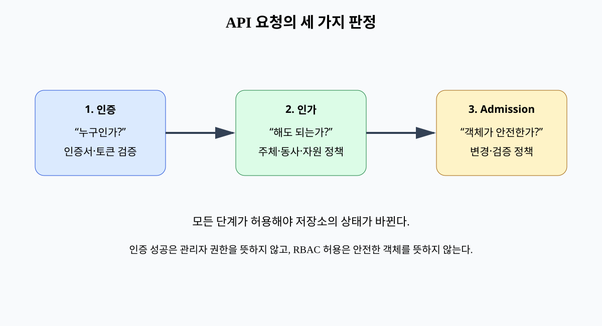
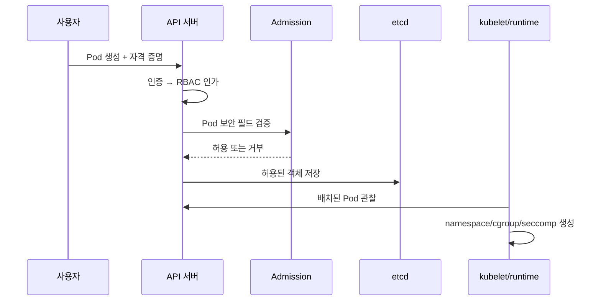

# 08. Linux 격리와 Kubernetes RBAC

컨테이너는 프로그램을 별도 컴퓨터처럼 보이게 하지만 보통 호스트와 같은 Linux 커널을 사용한다. **커널(kernel)**은 프로세스, 메모리, 파일, 네트워크 장치를 관리하고 프로그램의 요청을 중재하는 운영체제 핵심 코드다. 컨테이너 격리는 이 커널이 제공하는 여러 기능을 조합한 결과이며 단일한 “컨테이너 벽”이 아니다.

Kubernetes는 여러 노드에서 컨테이너 작업을 배치하는 시스템이다. Kubernetes API의 권한 판정과 Linux 커널의 실행 제한은 서로 다른 시점과 객체를 다룬다. 이 장은 사용자가 Pod를 제출한 순간부터 실제 프로세스가 실행될 때까지 따라가며 어느 층이 무엇을 막는지 설명한다.

## 1. 프로세스와 시스템 호출

**프로세스(process)**는 실행 중인 프로그램의 주소 공간, 열린 파일, 자격 증명, 스레드 같은 상태 묶음이다. 컨테이너 안 애플리케이션도 결국 호스트 커널이 관리하는 Linux 프로세스다.

프로세스가 파일을 열거나 네트워크 소켓을 만들려면 커널에 **시스템 호출(system call)**을 요청한다. `open`, `read`, `write`, `socket` 같은 호출이 예다. 커널은 호출한 프로세스의 사용자 ID, 권한, namespace, 보안 정책을 보고 허용 여부를 결정한다.

사용자 공간 라이브러리가 “허용”이라고 해도 최종 파일·네트워크 접근은 커널이 집행한다. 반대로 커널이 허용한 동작이 애플리케이션 업무 정책상 올바르다는 뜻은 아니다. 데이터베이스의 다른 고객 행을 읽는 권한은 애플리케이션이 따로 검사해야 한다.

## 2. namespace: 보이는 이름 공간을 나눈다

Linux **namespace**는 프로세스가 보는 시스템 자원의 이름 공간을 분리하는 기능이다. 같은 호스트에 실제로 존재하는 전체 객체 중 일부를 다른 번호와 경로로 보이게 한다.

- PID namespace는 프로세스 ID와 부모·자식 관계의 보이는 범위를 나눈다. 컨테이너 안 PID 1은 호스트의 다른 PID일 수 있다.
- mount namespace는 파일 시스템 마운트 표를 나눈다. 한 컨테이너의 `/`가 다른 컨테이너와 다르게 보인다.
- network namespace는 네트워크 인터페이스, 주소, 라우팅 표, 포트 공간을 나눈다.
- user namespace는 namespace 안 사용자·그룹 ID를 호스트의 다른 ID 범위에 매핑할 수 있다.
- IPC namespace는 공유 메모리와 메시지 큐 같은 프로세스 간 통신 객체를 나눈다.
- UTS namespace는 호스트 이름 같은 시스템 식별 정보를 나눈다.

namespace는 자원을 복제하는 것이 아니라 “무엇을 어떤 이름으로 볼 수 있는가”를 바꾼다. 컨테이너 프로세스가 호스트 경로를 mount로 받으면 mount namespace가 있어도 그 경로의 파일을 볼 수 있다. 호스트 network namespace를 공유하도록 설정하면 네트워크 격리도 줄어든다.

## 3. cgroup: 자원 사용을 묶고 제한한다

**cgroup(control group)**은 프로세스를 계층적인 그룹에 넣어 CPU, 메모리, 입출력, 프로세스 수 같은 자원 사용을 회계하고 제한하는 커널 기능이다.

메모리 최대값 2 GiB를 설정하면 그룹이 그 범위를 넘을 때 회수와 실패 정책이 작동할 수 있다. CPU quota는 일정 기간에 사용할 CPU 시간을 제한한다. `pids.max`는 프로세스 생성 폭주를 제한한다.

cgroup은 데이터 접근 권한이 아니다. CPU를 1코어로 제한해도 프로세스가 읽을 수 있는 Secret의 범위는 줄지 않는다. 반대로 파일 권한이 엄격해도 메모리 제한이 없으면 한 컨테이너가 노드 자원을 고갈시킬 수 있다. 기밀성·무결성과 가용성 통제가 겹쳐야 한다.

제한값에는 단위와 관찰 방법이 필요하다. Kubernetes의 메모리 limit와 실제 커널 OOM 동작, 페이지 캐시, 노드 전체 압박을 함께 봐야 한다. 숫자 하나가 절대 격리를 뜻하지 않는다.

## 4. UID, 파일 mode와 capability

Linux 파일에는 소유 사용자 ID, 그룹 ID와 읽기·쓰기·실행 권한 비트가 있다. **UID**는 사용자 식별 번호이고 **GID**는 그룹 식별 번호다. 프로세스 자격 증명과 파일의 mode를 비교해 기본 접근을 판단한다.

전통적인 UID 0인 root는 매우 넓은 권한을 가진다. Linux **capability**는 root 권한을 여러 능력 단위로 나눠 필요한 일부만 프로세스에 줄 수 있게 한다. 예를 들어 `CAP_NET_ADMIN`은 인터페이스와 라우팅 같은 네트워크 관리 동작에 관련된 강한 권한이다.

capability 이름이 좁아 보여도 실제 공격면은 넓을 수 있다. 프로세스가 커널 네트워크 설정을 바꾸면 트래픽 관찰과 우회에 영향을 줄 수 있다. 컨테이너에서는 기본 capability를 모두 내리고 반드시 필요한 것만 추가하는 방식이 안전한 출발점이다.

`runAsNonRoot`는 컨테이너 프로세스를 비root로 실행하도록 돕지만 이것 하나로 안전을 보증하지 않는다. 쓰기 가능한 host mount, 노출된 ServiceAccount 토큰, 커널 취약점, 애플리케이션 원격 코드 실행은 남는다.

## 5. seccomp와 LSM

**seccomp**는 프로세스가 호출할 수 있는 시스템 호출을 필터링하는 Linux 기능이다. 컨테이너 runtime의 기본 프로파일은 일반 애플리케이션에 불필요하고 위험한 일부 호출을 막는다. `RuntimeDefault`는 해당 runtime이 제공하는 기본 프로파일을 사용하겠다는 Kubernetes 설정이다.

seccomp는 호출 번호와 일부 인자를 기준으로 허용·거부할 수 있지만 파일 경로 기반 정책 전체를 대신하지 않는다. 필요한 호출을 막으면 애플리케이션이 실패하므로 실제 workload를 시험한다. 모든 syscall을 허용한 뒤 애플리케이션 코드만 믿는 것보다 공격자가 커널에 도달하는 표면을 줄이는 역할이다.

**Linux Security Module(LSM)**은 커널의 보안 판단 지점에 추가 정책을 연결하는 틀이다. SELinux와 AppArmor 같은 시스템이 파일, 프로세스, capability 등에 강제 접근 통제를 적용한다. 파일 mode가 허용해도 LSM 정책이 거부할 수 있다.

seccomp와 LSM은 서로 다른 질문을 한다. seccomp는 “이 프로세스가 이 종류의 시스템 호출을 할 수 있는가”, LSM은 “이 보안 주체가 이 객체에 이 행동을 할 수 있는가”를 더 풍부한 정책으로 판단할 수 있다.

## 6. 컨테이너와 가상 머신의 경계

컨테이너는 보통 호스트 커널을 공유한다. 커널 취약점이나 과도한 capability, host namespace·mount 공유가 있으면 경계를 가로지를 수 있다.

**가상 머신(VM)**은 hypervisor가 가상 하드웨어를 제공하고 각 guest가 별도 커널을 실행하는 구조가 일반적이다. 따라서 실패면과 격리 비용이 다르다. VM도 hypervisor 취약점, 관리 plane 권한, 공유 장치 위험이 있어 절대 경계는 아니다.

민감도가 높은 다중 tenant workload는 sandbox runtime, microVM, 전용 노드 같은 더 강한 격리를 선택할 수 있다. 선택은 “컨테이너 또는 VM 중 하나가 항상 안전하다”가 아니라 공격자 능력, 성능 비용, 운영 복잡성을 비교한다.

## 7. Pod 제출부터 프로세스 생성까지

**Pod**는 Kubernetes가 함께 배치하고 생명 주기를 관리하는 하나 이상의 컨테이너 묶음이다. 사용자가 Pod 객체를 API 서버에 제출하면 다음 단계가 일어난다.

1. API 서버의 인증 단계가 자격 증명을 검증해 요청 주체를 정한다.
2. 인가 단계가 그 주체에게 `pods/create` 행동이 허용되는지 판단한다.
3. Admission 단계가 생성될 객체의 실제 필드를 검사하거나 기본값을 넣고, 정책 위반이면 거부한다.
4. 허용된 Pod 객체가 Kubernetes 상태 저장소인 etcd에 기록된다.
5. scheduler가 자원과 제약을 보고 노드를 선택한다.
6. 노드의 kubelet이 Pod 할당을 관찰한다.
7. container runtime이 이미지와 설정을 받아 namespace, cgroup, mount, capability, seccomp 상태를 만들고 프로세스를 시작한다.

RBAC가 Pod 생성을 허용해도 privileged, hostPath, hostNetwork 같은 필드가 안전하다는 뜻은 아니다. Admission이 객체 내용 정책을 검사하고 runtime이 실제 커널 설정을 적용한다.

## 8. Kubernetes RBAC의 객체와 결합

**RBAC(role-based access control)**는 권한 규칙을 역할로 묶고 주체에 연결하는 방식이다.

**Role**은 한 namespace 안에서 사용할 규칙 모음이다. **ClusterRole**은 cluster 범위 자원 규칙을 담거나 여러 namespace에서 재사용할 수 있는 역할이다. 역할 객체만 만들면 누구에게도 권한이 생기지 않는다.

**RoleBinding**은 특정 namespace 안에서 Role 또는 ClusterRole을 사용자, 그룹, ServiceAccount에 연결한다. **ClusterRoleBinding**은 ClusterRole을 cluster 범위로 연결한다. ClusterRole을 RoleBinding으로 연결하면 그 binding의 namespace 범위에서만 권한을 줄 수 있다.

규칙에는 API group, resource, verb가 들어간다. verb는 `get`, `list`, `watch`, `create`, `update`, `patch`, `delete` 같은 API 행동이다. `pods/log` 같은 subresource는 `pods`와 별도일 수 있다.

Kubernetes RBAC는 허용 규칙이 합쳐지는 구조이며 일반적인 명시적 deny 규칙이 없다. 여러 binding 중 하나가 허용하면 최종 권한에 더해진다. 특정 Role에서 권한을 빼도 다른 binding이 같은 권한을 주면 계속 허용된다.

와일드카드 `*`는 현재 자원뿐 아니라 미래에 추가되는 자원과 verb까지 포함할 수 있어 권한이 조용히 넓어질 수 있다.

## 9. 간접 권한 상승을 추적한다

권한은 직접 API 동작만 보면 부족하다. `secrets/get`이 없어도 `pods/create`가 다음과 결합되면 Secret을 얻을 수 있다.

1. 공격자가 Pod 생성 권한을 가진다.
2. namespace의 권한 높은 ServiceAccount를 새 Pod에 지정할 수 있다.
3. 또는 읽고 싶은 Secret을 volume으로 mount하도록 Pod를 만든다.
4. 또는 노드 hostPath를 mount하거나 privileged 컨테이너를 요청한다.
5. 생성된 Pod 안 프로세스가 토큰·파일·노드 자원에 접근한다.

따라서 자원 생성 권한과 생성 가능한 필드를 함께 분석한다. Admission에서 허용 ServiceAccount, volume 종류, privilege, host namespace, capability를 제한한다. namespace 운영자에게 workload 생성 권한을 줄 때 그 namespace의 Secret과 ServiceAccount 권한이 실질적으로 위임될 수 있음을 고려한다.

## 10. Pod 보안 설정을 기작과 함께 본다

`runAsNonRoot: true`는 이미지가 root가 아닌 사용자로 실행될 수 있는지 확인한다. 이미지가 숫자 UID를 명확히 지정하지 않으면 runtime 판단이 실패할 수 있어 실제 이미지를 시험한다.

`allowPrivilegeEscalation: false`는 실행 중인 프로세스가 setuid 실행 파일 등으로 부모보다 높은 권한을 얻는 일부 경로를 제한한다. 이미 privileged이거나 강한 capability·host mount가 있으면 전체 위험이 사라지지 않는다.

`capabilities.drop: ["ALL"]`은 기본 capability를 제거하고 필요한 것만 명시하게 한다. 추가 전에는 애플리케이션이 어떤 syscall과 장치 작업에 정말 필요한지 측정한다.

`seccompProfile.type: RuntimeDefault`는 runtime 기본 syscall 필터를 적용한다. 읽기 전용 root filesystem은 이미지 계층 변경을 줄이고 쓰기가 필요한 경로만 별도 volume으로 제한하게 한다.

host PID, host network, host IPC, 임의 hostPath, privileged를 기본 거부한다. 이미지 tag는 가리키는 바이트가 바뀔 수 있으므로 digest를 고정하면 배포 대상 결합이 강해진다. 이 설정도 커널과 runtime에 취약점이 없다는 증명은 아니다.

## 11. ServiceAccount 토큰의 위치와 수명

**ServiceAccount**는 Kubernetes 안 workload가 API 서버에 자신을 나타내는 주체다. Pod는 연결된 ServiceAccount의 짧은 수명 투영 토큰을 파일로 mount받을 수 있다.

토큰에는 대상 API를 뜻하는 audience와 만료가 있다. API 서버는 토큰 서명, 대상, 시간을 검증하고 `system:serviceaccount:<namespace>:<name>` 형태의 주체로 인식할 수 있다.

필요 없는 Pod는 자동 토큰 mount를 끈다. 여러 workload가 같은 ServiceAccount를 공유하면 한 Pod 침해가 다른 workload 권한까지 사용하게 한다. 기능별 ServiceAccount와 최소 RBAC를 둔다.

토큰 파일을 읽은 침해 프로세스는 만료 전까지 허용된 API를 호출할 수 있다. 짧은 수명은 노출 시간을 줄이지만 실행 중 Pod 침해를 막지 않는다. 특히 Secret 읽기와 Pod 생성 권한은 다른 자격 증명과 실행 경로를 얻는 확대 효과가 있다.

## 12. namespace는 보안 tenant 경계인가

Kubernetes namespace는 API 객체 이름 범위와 권한·quota 정책 적용 단위다. namespace가 다르다고 Pod 네트워크가 자동 차단되지 않고, 노드 커널이 분리되지도 않는다.

별도의 NetworkPolicy로 허용 흐름을 정의하고, RoleBinding을 namespace 범위로 제한하며, ResourceQuota와 LimitRange로 자원 사용을 통제한다. 강한 적대적 tenant 사이에는 노드 분리, sandbox runtime, VM 경계를 추가할 수 있다.

## 13. 숫자 예제로 권한 합집합을 계산한다

민수에게 namespace A의 RoleBinding으로 `pods={get,list}`가 있고, 그룹 `developers`에 ClusterRoleBinding으로 `pods={create,delete}`가 있다고 하자. 민수가 developers 구성원이면 최종 권한은 네 동사의 합집합이다. RoleBinding에서 delete를 제거해도 ClusterRoleBinding 경로가 남아 삭제할 수 있다.

서비스 계정 `trainer`에 `secrets/get`은 없지만 `pods/create`와 임의 ServiceAccount 지정이 허용되고, 같은 namespace에 `admin-runner`가 있다면 간접 경로가 생길 수 있다. 정책 검토는 `kubectl auth can-i` 같은 직접 결과뿐 아니라 생성 가능한 객체의 효과까지 본다.

## 14. 설정값과 실제 커널 상태를 함께 검증한다

Kubernetes 객체에 안전한 필드가 적혔다고 노드의 실제 프로세스 상태가 항상 같다고 가정하지 않는다. 오래된 runtime, 정책 예외, webhook 장애, 수동으로 만든 static Pod가 다른 경로를 만들 수 있다.

검증은 API 객체와 노드 상태를 연결한다. Pod의 securityContext, Admission 결정, runtime이 적용한 namespace·capability·seccomp, 실행 프로세스 UID를 함께 본다. 정책을 배포한 뒤 의도적으로 위반 Pod를 만들어 실제로 거부되는지도 시험한다.

capabilities.drop ALL이 있지만 privileged가 동시에 켜져 있으면 기대한 제한과 다를 수 있다. 개별 필드 한 줄보다 최종 조합과 커널 상태가 판단 대상이다.

## 15. 장치와 hostPath는 커널 객체를 직접 노출한다

GPU, 네트워크 장치, 블록 장치를 컨테이너에 넘기면 일반 파일처럼 보이는 device node와 드라이버 인터페이스를 통해 커널과 하드웨어에 접근한다. 장치 접근은 성능에 필요할 수 있지만 드라이버 공격면과 다른 workload의 격리 조건을 바꾼다.

hostPath는 노드 파일 시스템의 실제 경로를 Pod에 mount한다. 읽기 전용 설정도 민감한 호스트 파일 노출을 만들 수 있고, 소켓 파일을 통해 강한 데몬 API를 호출할 수 있다. 쓰기 가능 hostPath는 호스트 설정과 다른 컨테이너 데이터를 바꿀 수 있다.

Admission에서 허용 경로와 장치, workload 신원, 전용 노드 조건을 제한하고 실제 runtime mount를 감사한다. 파일 경로 이름만 보고 안전하다고 판단하지 않고 그 경로가 소켓·심볼릭 링크·장치로 무엇을 가리키는지 확인한다.

## 16. 오해와 반례

**“namespace가 다르면 자동 격리된다.”** API 이름 범위일 뿐 네트워크·커널 경계가 자동 생성되지 않는다.

**“root가 아닌 컨테이너는 안전하다.”** 커널 취약점, host mount, 토큰, 애플리케이션 취약점은 남는다.

**“RBAC에서 create만 주고 get을 빼면 정보가 보호된다.”** 생성한 Pod가 Secret, ServiceAccount, hostPath를 통해 정보를 얻을 수 있다.

**“seccomp가 있으면 애플리케이션 인가가 필요 없다.”** syscall 표면을 줄이는 기능이며 다른 고객의 DB 행 접근 의미를 모른다.

## 17. 연습 문제와 자세한 풀이

### 문제 1. ClusterRoleBinding 영향

개발자가 namespace A용으로 생각한 권한을 ClusterRoleBinding으로 받았다.

**풀이:** ClusterRoleBinding은 cluster 범위로 연결한다. namespace A에 제한하려면 A의 RoleBinding으로 Role 또는 ClusterRole을 연결한다. 다른 binding이 같은 권한을 주는지도 확인한다.

### 문제 2. privileged Pod 차단

RBAC는 Pod create를 허용하지만 privileged는 막고 싶다.

**풀이:** Admission에서 Pod Security Admission 또는 검증 정책으로 securityContext, host namespace, volume, capability를 검사한다. runtime에서 실제 커널 설정이 적용되는지도 검증한다.

### 문제 3. 컨테이너와 VM

컨테이너를 VM과 같은 경계로 보면 왜 위험한가?

**풀이:** 컨테이너 프로세스는 호스트 커널을 공유한다. 커널 공격면과 host mount·capability 설정이 경계를 가로지를 수 있다. 공격자 수준에 따라 sandbox runtime, VM, 전용 노드를 선택한다.

### 문제 4. Secret 권한 없는 Pod 작성자

`secrets/get`이 없으니 안전한가?

**풀이:** Pod가 Secret volume을 mount하거나 높은 ServiceAccount를 선택할 수 있으면 간접 읽기가 가능하다. Admission과 ServiceAccount 사용 제한을 함께 검토한다.

### 문제 5. 메모리 limit만 설정

다른 tenant 파일을 읽지 못하게 되는가?

**풀이:** 아니다. cgroup limit은 자원 회계와 제한이다. 파일·Secret 접근은 UID/GID, LSM, mount, Kubernetes RBAC와 애플리케이션 인가가 담당한다.

### 문제 6. ServiceAccount 토큰 만료

1시간 토큰이면 침해 Pod가 안전한가?

**풀이:** 노출 시간을 제한하지만 공격자는 만료 전 권한을 사용할 수 있고 실행 중이면 새 토큰을 읽을 수도 있다. 최소 RBAC, mount 제한, Pod 격리, 탐지와 폐기가 필요하다.

### 문제 7. RBAC 역할에서 권한 삭제

권한을 뺐는데 사용자가 여전히 호출한다.

**풀이:** RBAC 허용은 binding들의 합집합이다. 사용자 직접 binding, 그룹, ClusterRoleBinding, ServiceAccount 위임 경로를 모두 추적한다. 명시적 deny가 일반 규칙에 없음을 고려한다.

## 공식 근거

- [Linux namespaces](https://man7.org/linux/man-pages/man7/namespaces.7.html)
- [Linux cgroup v2](https://docs.kernel.org/admin-guide/cgroup-v2.html)
- [Linux seccomp](https://docs.kernel.org/userspace-api/seccomp_filter.html)
- [Kubernetes RBAC](https://kubernetes.io/docs/reference/access-authn-authz/rbac/)
- [Kubernetes Pod Security Standards](https://kubernetes.io/docs/concepts/security/pod-security-standards/)
- [Kubernetes Service Accounts](https://kubernetes.io/docs/concepts/security/service-accounts/)

---

[이전: TLS](07-tls-key-exchange-and-certificates.md) · [목차](README.md) · [다음: 네트워크와 애플리케이션 보안](09-network-boundaries-and-application-security.md)
