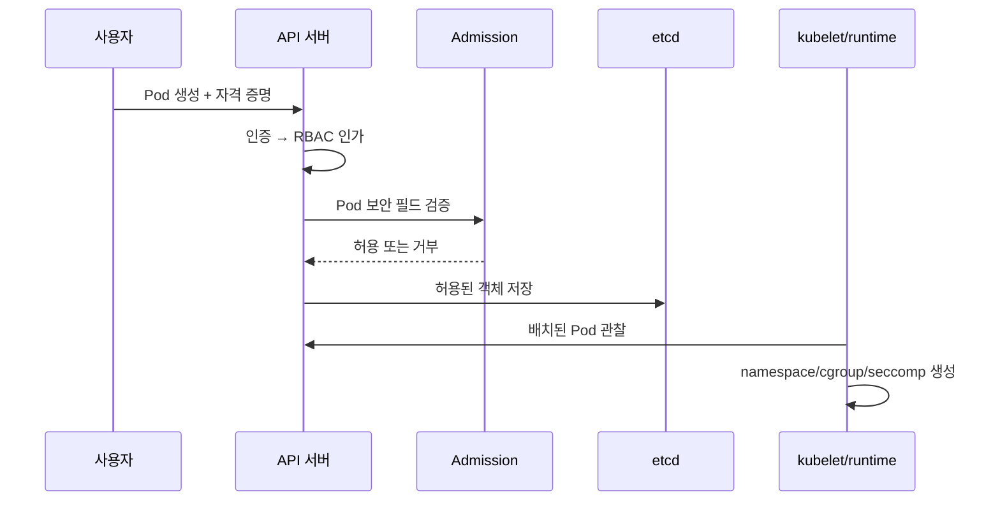

# 08. Linux 격리와 Kubernetes RBAC

컨테이너 보안은 Linux 커널의 격리·제한 기능과 Kubernetes API 정책이 겹쳐 만들어진다. 컨테이너를 VM과 같은 경계라고 가정하면 안 된다.

## 1. Linux 경계의 재료

namespace는 프로세스가 보는 PID, mount, network, user 등의 이름 공간을 분리한다.

cgroup은 CPU, 메모리, I/O 같은 자원 사용을 계층적으로 제한·회계한다.

capability는 root 권한을 여러 능력으로 나눈다. `CAP_NET_ADMIN`은 네트워크 설정 권한의 한 예다.

seccomp는 프로세스가 호출할 수 있는 system call을 필터링한다.

LSM은 SELinux나 AppArmor 같은 강제 접근 통제 훅을 제공한다.

파일 mode와 UID/GID는 기본 파일 접근을 통제한다.

이 기능들은 같은 호스트 커널을 공유한다.

커널 취약점이나 과도한 capability가 있으면 경계가 약해질 수 있다.

VM은 보통 별도 guest kernel과 가상 하드웨어 경계를 제공하므로 실패면이 다르다.

## 2. Pod가 실행될 때

사용자가 Pod 객체를 API 서버에 보낸다.

인증 단계가 사용자 신원을 확인한다.

인가 단계가 `pods/create`를 허용하는지 본다.

Admission 단계가 privileged, hostPath, 실행 사용자 같은 객체 내용을 변경하거나 거부한다.

etcd에 저장된 뒤 scheduler가 노드를 고른다.

kubelet과 container runtime이 namespace, cgroup, mount, capability, seccomp 설정으로 프로세스를 만든다.

## 3. Kubernetes RBAC 객체

Role은 한 namespace 안 권한 규칙 모음이다.

ClusterRole은 cluster 범위 객체 또는 여러 namespace에서 재사용할 규칙이다.

RoleBinding은 Role이나 ClusterRole을 특정 namespace의 주체에 연결한다.

ClusterRoleBinding은 ClusterRole을 cluster 범위로 연결한다.

주체는 User, Group, ServiceAccount가 될 수 있다.

규칙은 API group, resource, verb와 선택적 resourceName을 가진다.

RBAC는 기본적으로 허용 규칙을 더하는 방식이며 명시적 deny 규칙이 없다.

여러 binding의 권한은 합쳐진다.

`pods/get`과 `pods/list`는 다르며 `pods/log`는 subresource로 별도일 수 있다.

wildcard `*`는 미래 추가 자원까지 권한을 넓힐 수 있어 주의한다.

## 4. 인증·인가·Admission의 차이

RBAC는 요청 주체가 Pod를 만들 수 있는지 판단한다.

Pod가 privileged인지, host network를 쓰는지는 Admission 정책이 검사한다.

실행 중 syscall 제한은 seccomp가 집행한다.

NetworkPolicy는 지원하는 CNI가 Pod 네트워크 흐름을 집행한다.

한 층 통과가 다른 층의 안전을 뜻하지 않는다.

`pods/create` 권한은 때로 Pod에 연결된 ServiceAccount나 hostPath를 통해 간접 권한 상승으로 이어질 수 있다.

그래서 자원 생성 권한과 생성 가능한 필드를 함께 분석한다.

## 5. 안전한 Pod의 구체 조건

`runAsNonRoot: true`는 이미지가 비root 사용자로 실행될 수 있는지 확인하게 돕는다.

`allowPrivilegeEscalation: false`는 실행 파일을 통한 권한 상승 경로를 제한한다.

`capabilities.drop: ["ALL"]` 뒤 필요한 capability만 추가한다.

`seccompProfile.type: RuntimeDefault`로 runtime 기본 필터를 적용한다.

읽기 전용 root filesystem과 제한된 쓰기 volume을 고려한다.

호스트 PID, network, IPC, 임의 hostPath, privileged를 기본 거부한다.

image tag보다 digest를 고정하면 같은 이름의 바이트 교체를 막는 데 도움이 된다.

이 설정도 커널과 runtime의 취약점이 없음을 증명하지 않는다.

## 6. ServiceAccount 토큰

Pod의 ServiceAccount는 Kubernetes API에 대한 워크로드 신원이다.

필요 없는 Pod는 자동 토큰 mount를 끈다.

토큰 audience와 만료를 제한한다.

노드의 모든 Pod가 같은 ServiceAccount를 공유하게 하지 않는다.

토큰 파일을 읽은 침해 프로세스가 어떤 API를 호출할 수 있는지 RBAC로 영향 범위를 정한다.

Secret 읽기 권한은 다른 자격 증명 탈취로 이어질 수 있으므로 특히 좁힌다.

## 7. 오해와 반례

오해: namespace가 다르면 네트워크와 권한이 자동 격리된다.

반례: namespace는 API 이름 범위다. NetworkPolicy와 RBAC binding을 따로 구성해야 한다.

오해: root가 아닌 컨테이너는 안전하다.

반례: 커널 취약점, 과도한 mount, 노출된 토큰, 애플리케이션 취약점은 남는다.

오해: RBAC에서 create만 주고 get을 빼면 정보가 보호된다.

반례: 생성한 Pod가 권한 높은 ServiceAccount나 volume을 사용하면 간접적으로 정보를 읽을 수 있다.

## 8. 문제와 해설

### 문제 1

개발자가 namespace A의 Role을 ClusterRoleBinding으로 받았다. 영향은?

**해설:** ClusterRoleBinding은 cluster 범위로 권한을 부여한다. namespace에 제한하려면 해당 namespace의 RoleBinding으로 Role 또는 ClusterRole을 연결한다.

### 문제 2

RBAC가 Pod create를 허용했지만 privileged Pod를 막고 싶다. 어디서 검사하는가?

**해설:** 인증과 RBAC 뒤 Admission에서 Pod Security Admission이나 검증 정책으로 securityContext를 검사한다. runtime에서도 실제 capability와 seccomp를 적용한다.

### 문제 3

컨테이너를 VM과 같은 신뢰 경계로 취급하면 왜 위험한가?

**해설:** 컨테이너는 호스트 커널을 공유한다. 커널 공격면과 host mount/capability 설정이 경계를 가로지를 수 있다. 위협 수준에 따라 VM, sandbox runtime, 전용 노드 같은 더 강한 경계를 선택한다.

## 공식 자료

- [Kubernetes RBAC](https://kubernetes.io/docs/reference/access-authn-authz/rbac/)
- [Kubernetes Pod Security Standards](https://kubernetes.io/docs/concepts/security/pod-security-standards/)
- [Linux namespaces](https://man7.org/linux/man-pages/man7/namespaces.7.html)

---

[이전: TLS](07-tls-key-exchange-and-certificates.md) · [목차](README.md) · [다음: 네트워크와 애플리케이션 보안](09-network-boundaries-and-application-security.md)
