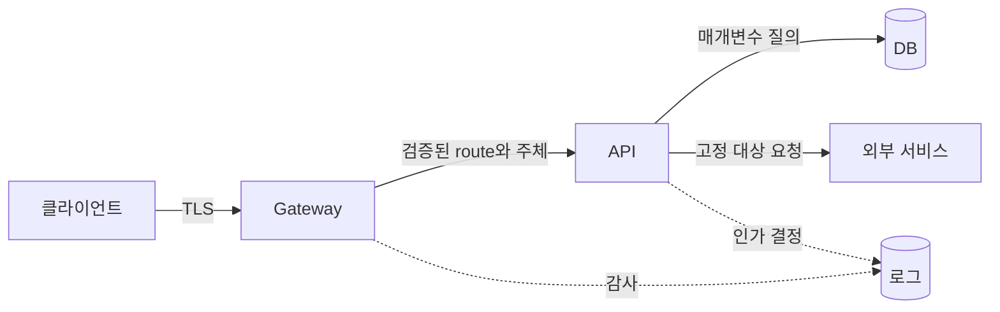

# 09. 네트워크 경계와 애플리케이션 보안

서버가 “내부 네트워크에서 온 요청”을 받았다는 사실은 요청자가 누구인지 증명하지 않는다. 침해된 Pod, 개발자 노트북, 잘못 연결된 프록시도 내부 주소를 가질 수 있다. 네트워크 통제는 요청이 이동할 수 있는 길을 줄이고, 애플리케이션 인증·인가는 그 길로 도착한 주체의 행동을 판단한다.

이 장은 클라이언트 요청이 이름 조회, 네트워크 연결, TLS, Gateway, API, 데이터베이스를 거치는 전체 경로를 따라간다. 각 계층이 보는 객체와 막을 수 있는 공격을 분리한 뒤 입력 검증, 출력 인코딩, 서버 측 요청 위조, 브라우저 보안을 설명한다.

## 1. 주소·포트·이름은 무엇을 가리키는가

**IP 주소**는 네트워크 인터페이스와 라우팅 위치를 식별하는 숫자 주소다. 패킷에는 출발지와 목적지 주소가 있지만 NAT, 프록시, 터널을 거치며 보이는 주소가 바뀔 수 있다. 출발지 IP 하나를 사람의 영구 신원으로 사용하면 공유 네트워크와 공격자 우회를 다루기 어렵다.

**포트(port)**는 한 호스트 안에서 통신 끝점을 구분하는 번호다. `443`은 암호화된 웹 연결에 흔히 쓰이지만 포트 번호만으로 실제 프로토콜이나 서비스 신원을 증명하지 않는다.

**DNS(Domain Name System)**는 `api.example.com` 같은 이름을 IP 주소 등으로 찾는 분산 이름 시스템이다. 이름 조회 결과는 시간에 따라 바뀌고 여러 주소를 줄 수 있다. DNS 결과만으로 서버 공개키 소유를 증명하지 않으므로 TLS 인증서 검증이 별도다.

**TCP**는 두 끝점 사이에 순서 있는 바이트 흐름을 제공하는 전송 프로토콜이다. 연결이 성립했다는 사실은 상대 애플리케이션 권한을 뜻하지 않는다.

**HTTP**는 메서드, 경로, 헤더, 본문으로 웹 요청과 응답을 표현하는 프로토콜이다. `GET /models/42`의 `GET`은 읽기 의도를, `/models/42`는 라우팅과 객체 식별 입력을 나타낸다. 실제 권한과 상태 변경 의미는 서버가 검증해야 한다.

## 2. 계층별 통제 객체

| 계층 | 보는 실제 객체 | 주된 판단 | 알지 못하는 것 |
|---|---|---|---|
| 라우터·방화벽 | IP, 포트, 연결 상태 | 흐름 허용·차단 | 사용자와 DB 행 권한 |
| DNS | 이름과 주소 레코드 | 이름 조회 | 해당 서버 코드의 안전성 |
| TLS | 인증서 이름, 공개키, 레코드 | 연결 상대와 전송 보호 | 사용자의 업무 권한 |
| Gateway | HTTP host, path, header, 크기 | 라우팅·일부 인증·제한 | 모든 업무 객체 상태 |
| API | 검증된 주체, 메서드, 객체 | 객체별 인가·입력·업무 규칙 | 커널 전체 격리 상태 |
| 데이터베이스 | 쿼리와 DB 계정 | 행 읽기·변경·제약 | 브라우저 출력 문맥 |

한 층을 통과했다고 다음 층 검사를 생략하지 않는다. 방화벽이 API Pod만 DB 포트에 연결하게 해도 침해된 API Pod와 잘못된 SQL은 남는다. DB 인증과 최소 권한 계정, 매개변수 질의가 계속 필요하다.

## 3. 요청 경로 전체 추적



민수가 `https://api.example.com/models/42`를 요청한다고 하자.

1. 클라이언트가 DNS로 서버 주소를 찾는다.
2. 주소의 443 포트에 연결하고 TLS 인증서의 `api.example.com` 이름과 체인을 검증한다.
3. Gateway가 TLS를 종료하고 HTTP host와 path로 백엔드를 고른다.
4. Gateway가 토큰을 검증해 내부 주체 `u-1842`를 만든다.
5. 외부 요청에 있던 신뢰 헤더를 제거하고 검증된 값으로 새 헤더나 인증된 내부 토큰을 만든다.
6. Gateway와 API 사이 연결을 별도로 인증한다.
7. API는 모델 42를 DB에서 읽어 실제 소유 프로젝트를 확인한다.
8. 주체 프로젝트와 객체 프로젝트, `models/get` 행동을 정책으로 평가한다.
9. DB 쿼리는 사용자 입력을 SQL 구조와 분리한 매개변수로 실행한다.
10. 응답 필드는 권한에 맞게 선택하고 브라우저가 해석할 문맥에 맞춰 출력한다.

Gateway 인증만 믿고 API가 `X-User: admin` 헤더를 그대로 사용하면 외부 클라이언트가 백엔드에 직접 접근해 가장할 수 있다. 백엔드 노출을 닫고, 프록시 출처를 인증하고, 프록시가 신뢰 헤더를 덮어써야 한다.

## 4. 방화벽과 NetworkPolicy의 보장 범위

**방화벽(firewall)**은 주소, 포트, 프로토콜, 연결 상태 같은 네트워크 정보를 기준으로 흐름을 허용하거나 차단한다. 공격 표면을 줄이지만 허용된 연결의 HTTP 객체 권한을 판단하지 않는다.

Kubernetes **NetworkPolicy**는 이를 지원하는 네트워크 구현에서 Pod의 ingress와 egress 흐름을 선택자와 포트로 제한한다. 정책 객체가 있어도 사용하는 CNI가 해당 기능을 집행하는지 확인한다.

기본 허용 환경에서 규칙 하나를 추가했다고 모든 다른 흐름이 자동 거부되는 것은 아니다. namespace와 방향별 기본 거부 정책, DNS 같은 필수 egress, 실제 연결 시험이 필요하다.

네트워크 정책은 이름이 아닌 현재 label과 주소 선택 결과에 의존할 수 있다. 잘못된 label이나 넓은 namespace selector가 범위를 넓힌다. 정책 변경과 workload label 변경을 함께 검토한다.

## 5. 입력 검증: 문법, 범위, 상태

**입력 검증(input validation)**은 외부에서 온 값을 애플리케이션이 사용할 수 있는 형태와 범위인지 확인하는 과정이다. 세 층을 구분한다.

1. 문법 검증: 정수인지, JSON 구조가 맞는지, UTF-8인지 확인한다.
2. 의미 검증: GPU 수가 1~8인지, 날짜 시작이 종료보다 빠른지 확인한다.
3. 상태 검증: 객체가 현재 수정 가능 상태인지, 요청 주체 프로젝트와 같은지 확인한다.

길이 제한도 먼저 한다. 정규 표현식이나 JSON 파서에 거대한 입력을 넘긴 뒤 크기를 확인하면 이미 CPU와 메모리를 썼다.

허용 가능한 정상 값이 좁을 때는 **허용 목록(allowlist)**이 유용하다. 이미지 형식이 `png`, `jpeg`뿐이면 알려진 위험 확장자를 끝없이 금지하기보다 두 값만 허용한다. 그러나 파일 확장자만 보고 실제 바이트 형식을 신뢰하지 않는다.

“정제된 문자열” 하나를 모든 곳에서 안전하게 쓰는 함수는 없다. SQL, HTML, JavaScript, URL, 운영체제 명령은 해석 문법이 다르다.

## 6. 주입 공격과 구조·데이터 분리

**주입(injection)**은 공격자 입력이 데이터가 아니라 명령이나 문법 구조로 해석되는 문제다.

SQL 질의를 문자열 결합으로 만들면 입력의 따옴표와 연산자가 쿼리 구조가 될 수 있다. **매개변수 질의(parameterized query)**는 SQL 구조를 먼저 정하고 사용자 값을 별도 매개변수로 전달한다.

```text
나쁜 개념: "SELECT ... WHERE id = " + user_input
좋은 개념: "SELECT ... WHERE id = ?", [validated_id]
```

매개변수는 값 위치를 보호하지만 테이블 이름, 정렬 방향처럼 SQL 문법 위치를 임의 문자열로 넣을 수는 없다. 이런 구조는 허용 목록에서 코드가 선택한다. DB 계정도 필요한 테이블과 동작만 허용해 주입 성공 시 피해를 줄인다.

운영체제 명령도 문자열 shell을 만들지 말고 가능한 라이브러리 API와 인자 배열을 사용한다. 사용자 입력으로 실행 파일 자체를 선택하게 하지 않는다.

## 7. 출력 인코딩과 XSS

**출력 인코딩(output encoding)**은 데이터를 목적 문맥에서 명령이 아닌 문자로 해석되도록 표현하는 일이다. HTML 본문, HTML 속성, JavaScript 문자열, CSS, URL은 문법이 달라 같은 escape를 재사용할 수 없다.

**XSS(Cross-Site Scripting)**는 공격자 입력이 다른 사용자의 브라우저에서 스크립트로 실행되는 문제다. 댓글 `<script>...</script>`를 HTML로 그대로 합치면 브라우저가 데이터가 아니라 코드로 해석할 수 있다.

안전한 템플릿의 자동 문맥 인코딩을 사용하고 위험한 HTML 삽입 API를 피한다. 사용자가 일부 HTML을 입력해야 한다면 허용된 요소와 속성을 이해하는 검토된 sanitizer가 필요하다. **CSP(Content Security Policy)**는 브라우저가 어떤 스크립트 출처와 실행 방식을 허용할지 제한해 추가 방어층을 제공하지만 올바른 출력 처리를 대신하지 않는다.

SQL 매개변수를 썼어도 DB에 저장된 공격자 문자열을 HTML에 그대로 출력하면 저장형 XSS가 남는다. 입력과 출력 계층의 공격이 다르다.

## 8. 경로와 파일 업로드

파일 이름을 저장 root에 단순 연결하면 `../` 같은 요소로 상위 디렉터리를 가리키는 **경로 순회(path traversal)**가 생길 수 있다. 경로를 정규화하고 최종 해석된 경로가 허용 root 아래인지 확인한다. 가능하면 사용자 파일명을 실제 저장 경로로 쓰지 않고 서버가 생성한 객체 ID를 사용한다.

심볼릭 링크와 검사·사용 사이 교체 때문에 문자열 정규화만으로 충분하지 않을 수 있다. 안전한 디렉터리 핸들과 원자적 파일 열기 API를 사용하고 권한이 낮은 별도 저장 영역에 둔다.

업로드는 본문 크기, 파일 수, 실제 형식, 저장 quota, 검사 시간, 사용 전 격리 상태를 제한한다. 압축 파일은 압축된 크기뿐 아니라 해제 뒤 총 바이트, 항목 수, 중첩 깊이, 경로를 확인한다.

## 9. 서버 측 요청 위조

**SSRF(Server-Side Request Forgery)**는 공격자가 서버가 보낼 네트워크 요청의 대상을 조종하는 취약점이다. 이미지 가져오기 API가 사용자 URL을 그대로 요청하면 서버의 네트워크 권한을 대리 사용할 수 있다.

서버는 공격자가 직접 닿지 못하는 내부 관리 API, Kubernetes 서비스, cloud metadata endpoint에 접근할 수 있다. 응답을 사용자에게 그대로 주지 않아도 요청 자체가 상태를 바꾸거나 시간·오류 차이로 내부 주소를 탐색할 수 있다.

문자열에서 `localhost`만 막는 것은 부족하다.

- `127.0.0.1`, IPv6 loopback, 정수형·혼합형 주소 표현이 있다.
- DNS 이름이 처음에는 공개 주소였다가 연결 시 내부 주소로 바뀔 수 있다.
- 허용 URL이 redirect로 내부 주소를 가리킬 수 있다.
- 사용자 정보, 대소문자, trailing dot 같은 URL 파싱 차이가 있다.

필요한 외부 대상이 정해져 있다면 scheme, hostname, port를 허용 목록으로 고정한다. 신뢰한 URL 파서로 정규화하고 DNS 해석 결과와 실제 연결 주소가 loopback, link-local, 사설 관리망이 아닌지 검사한다. redirect마다 다시 검증하거나 금지한다.

전용 egress proxy가 실제 목적지를 집행하고 서버 자격 증명을 대상별로 제한한다. 응답 크기, 콘텐츠 형식, 연결·읽기 시간, redirect 수를 제한한다. 방어는 애플리케이션 문자열 검사 하나보다 실제 연결 지점에 가깝게 둔다.

## 10. 브라우저의 쿠키와 CSRF

브라우저는 사이트의 쿠키를 저장하고 조건이 맞는 요청에 자동으로 첨부한다. **CSRF(Cross-Site Request Forgery)**는 공격자 사이트가 사용자의 브라우저를 이용해 쿠키 인증된 다른 사이트에 사용자가 의도하지 않은 요청을 보내게 하는 공격이다.

서버가 `POST /transfer`를 쿠키만 보고 처리하면 공격자 페이지의 form이 요청을 만들 수 있다. 방어에는 다음을 조합한다.

- 상태 변경은 안전한 메서드와 명시적 본문을 사용한다.
- SameSite 쿠키 속성으로 교차 사이트 첨부를 제한한다.
- 세션에 연결된 예측 어려운 CSRF token을 요청에 요구한다.
- Origin 또는 Referer를 정책에 맞게 검증한다.
- 고위험 작업은 재인증과 업무 멱등성을 적용한다.

CSRF token은 XSS가 있는 페이지에서 스크립트가 읽을 수 있을 수 있으므로 XSS 방어를 대신하지 않는다.

## 11. CORS는 서버 인가가 아니다

**origin**은 대체로 scheme, host, port의 조합이다. `https://app.example.com:443`과 `https://api.example.com:443`은 host가 달라 다른 origin이다.

**CORS(Cross-Origin Resource Sharing)**는 브라우저가 한 origin의 스크립트에 다른 origin 응답을 공개할지 서버 헤더를 보고 결정하는 정책이다. 서버가 허용하지 않으면 브라우저가 응답 사용을 막을 수 있다.

curl, 모바일 앱, 공격자 서버는 브라우저 CORS 정책을 적용하지 않는다. 따라서 CORS를 닫아도 API 인증과 인가가 필요하다. 반대로 CORS를 열었다고 누구나 서버 권한을 얻는 것은 아니지만, 자격 증명과 넓은 origin 허용을 잘못 조합하면 악성 사이트가 사용자의 응답을 읽을 수 있다.

## 12. rate limit과 가용성

**rate limit**은 정한 시간 동안 허용할 요청 수나 비용을 제한한다. 초당 요청 수만 보면 느린 연결, 큰 본문, 비싼 DB query, 압축 해제 공격을 놓친다.

다음 자원을 따로 측정한다.

- IP·계정·토큰별 요청률
- 동시 연결과 유휴 시간
- 요청·응답 바이트
- CPU·메모리·DB query 비용
- 외부 API 호출과 GPU 작업 quota

계정당 분당 5회 로그인 제한은 온라인 추측을 줄이지만 공격자가 피해자 계정을 반복 잠그는 수단이 될 수 있다. 점진 지연, 장치와 네트워크 신호, MFA, 복구 절차를 조합한다.

제한 초과에 HTTP 429와 `Retry-After`를 사용하면 정상 클라이언트가 재시도 폭주를 피할 수 있다. 모든 인스턴스가 독립 카운터를 쓰면 10대에서 실제 한도가 열 배가 될 수 있으므로 분산 상태와 오차 허용을 정한다.

## 13. 관찰과 오류 설계

네트워크 오류, TLS 인증 실패, 애플리케이션 401·403, 입력 400, rate limit 429, 내부 500을 구분한다. 외부 응답은 민감한 내부 경로와 쿼리를 숨기되 내부 로그에는 요청 ID, 검증 단계, 정책 버전, 제한 bucket을 남긴다.

프록시의 원본 IP 헤더는 신뢰 프록시 목록과 hop 규칙이 필요하다. 외부가 임의 `X-Forwarded-For`를 넣을 수 있으면 rate limit과 감사 출처가 조작된다. 가장 가까운 신뢰 프록시가 외부 헤더를 정규화한다.

## 14. 프록시 사이 해석 차이와 요청 경계

여러 프록시와 서버가 HTTP 메시지 길이와 경계를 다르게 해석하면 한쪽에서는 요청 하나인 바이트가 다른 쪽에서는 두 요청으로 보일 수 있다. 이를 요청 스머글링 계열 문제라고 한다. 외부 프록시가 첫 요청만 검사했는데 백엔드가 남은 바이트를 다음 사용자 요청 앞에 붙여 해석하면 인증과 캐시 경계를 우회할 수 있다.

프록시와 백엔드가 지원하는 HTTP 버전과 길이 규칙을 일치시키고, 모호하거나 서로 충돌하는 길이 표시는 경계에서 거부한다. hop-by-hop 헤더를 정규화하고 백엔드 연결 재사용 동작을 시험한다. 웹 방화벽 규칙만 추가해도 두 파서의 의미가 다르면 우회가 남을 수 있다.

캐시 키(cache key)는 프록시 캐시가 응답을 구분하는 요청 속성의 조합이다. 응답은 Host, path, query, 일부 header에 따라 달라질 수 있다. 애플리케이션은 사용자별 응답을 만들지만 캐시가 path만 키로 쓰면 한 사용자의 민감한 응답을 다른 사용자에게 줄 수 있다. 인증된 개인 응답에는 적절한 Cache-Control을 설정하고, 실제로 응답을 바꾸는 속성이 캐시 키와 변형 규칙에 포함되는지 확인한다.

Forwarded 계열 헤더도 hop마다 누가 쓸 수 있는지 정해야 한다. 애플리케이션이 가장 왼쪽 IP를 무조건 원본으로 믿으면 공격자가 앞에 임의 주소를 넣어 감사와 rate limit을 우회할 수 있다. 신뢰 프록시가 추가한 구간만 뒤에서부터 해석하는 등 명시적 규칙을 둔다.

## 15. 객체 식별자와 객체별 인가

URL의 숫자 ID를 바꾸면 다른 사용자의 객체가 나오는 문제는 입력 문법 오류가 아니라 인가 실패다. ID가 UUID처럼 추측하기 어려워도 로그, 링크, 브라우저 기록에서 알려질 수 있다. 예측 불가능성은 권한 검사를 대신하지 않는다.

API는 토큰에서 확인한 주체와 DB에서 읽은 객체의 실제 소유자·프로젝트를 비교한다. 클라이언트가 보낸 project 필드를 권한 근거로 쓰지 않는다. 목록, 상세 조회, 수정, 삭제, export, 검색 등 모든 경로가 같은 객체 경계를 적용해야 한다.

존재하는 타인 객체와 존재하지 않는 객체의 오류가 크게 다르면 객체 존재 여부가 노출될 수 있다. 외부 오류를 제한하되 내부 감사에는 대상 ID, 정책 결과, 거부 이유를 남긴다. 권한 검사는 응답 필드에도 적용해 목록 권한이 민감한 본문까지 반환하지 않게 한다.

## 16. 연결 업그레이드와 장시간 세션

WebSocket처럼 처음 HTTP 요청 뒤 장시간 양방향 연결로 바뀌는 기능은 연결 시 인증만 보고 끝내기 쉽다. 세션이 몇 시간 지속되는 동안 계정이 정지되거나 권한이 회수될 수 있다. 메시지마다 객체 권한을 확인할지, 정책 버전 변경 때 연결을 끊을지, 최대 연결 수명과 재인증 시점을 정한다. 연결 하나가 많은 메시지를 보내므로 HTTP 요청 수 rate limit만 적용해서도 부족하다.

## 17. 오해와 반례

**“방화벽 안 API는 인증이 필요 없다.”** 침해된 내부 Pod와 계정이 호출할 수 있다.

**“CORS가 API 접근 통제다.”** 비브라우저 클라이언트에는 적용되지 않는다.

**“입력을 escape 한 번 하면 안전하다.”** SQL, HTML, JavaScript, URL의 문법이 다르다.

**“NetworkPolicy가 DB 비밀번호를 대신한다.”** 허용된 Pod 침해와 정책 오류에 대비해 DB 인증·최소 권한이 필요하다.

## 18. 연습 문제와 자세한 풀이

### 문제 1. 이미지 URL 가져오기

최소 SSRF 통제를 설계하라.

**풀이:** HTTPS와 필요한 도메인·포트를 허용 목록으로 고정한다. 연결 시 DNS 결과가 내부·loopback·link-local이 아닌지 확인하고 redirect마다 재검증한다. egress proxy, 응답 크기·시간·형식 제한을 둔다.

### 문제 2. DB NetworkPolicy

API Pod만 DB 포트에 접근한다. 비밀번호가 없어도 되는가?

**풀이:** 아니다. API Pod 침해와 정책 오설정이 곧 DB 접근이 된다. TLS 신원, DB 인증, 서비스별 최소 권한 계정, 쿼리 제약을 함께 사용한다.

### 문제 3. SQL은 안전하고 HTML은 그대로

남은 위험은 무엇인가?

**풀이:** SQL injection은 줄었지만 저장·반사 XSS가 남는다. 출력되는 HTML 문맥에 맞게 인코딩하고 위험한 DOM API를 피하며 CSP를 추가 방어로 사용한다.

### 문제 4. 프록시 헤더

외부가 `X-User: admin`을 보냈다.

**풀이:** 신뢰 프록시는 외부의 신뢰 헤더를 제거하고 검증된 신원으로 새 값을 쓴다. 백엔드는 프록시만 접근 가능한 인증된 경로에서 그 값을 받아야 한다.

### 문제 5. 압축 10 MiB 제한

업로드가 10 MiB 이하이면 안전한가?

**풀이:** 해제 뒤 수백 GiB가 될 수 있다. 총 해제 크기, 항목 수, 중첩 깊이, 경로, CPU 시간, 임시 디스크를 제한하고 격리된 워커에서 처리한다.

### 문제 6. 분산 rate limit

인스턴스 10대가 각각 계정당 분당 5회를 허용한다.

**풀이:** 요청 분산에 따라 전체 50회가 가능할 수 있다. 공유 카운터, 일관된 라우팅, 근사 분산 알고리즘 중 요구 정확도와 장애 모드에 맞는 방식을 선택한다.

### 문제 7. CORS 차단

CORS가 허용하지 않으니 curl 공격도 막히는가?

**풀이:** 아니다. CORS는 브라우저가 응답을 스크립트에 공개하는 정책이다. curl과 서버는 무시한다. 서버 인증, 인가, 입력 검증이 필요하다.

## 공식 근거

- [OWASP Input Validation Cheat Sheet](https://cheatsheetseries.owasp.org/cheatsheets/Input_Validation_Cheat_Sheet.html)
- [OWASP SSRF Prevention Cheat Sheet](https://cheatsheetseries.owasp.org/cheatsheets/Server_Side_Request_Forgery_Prevention_Cheat_Sheet.html)
- [OWASP Cross Site Scripting Prevention Cheat Sheet](https://cheatsheetseries.owasp.org/cheatsheets/Cross_Site_Scripting_Prevention_Cheat_Sheet.html)
- [MDN CORS](https://developer.mozilla.org/en-US/docs/Web/HTTP/Guides/CORS)
- [Kubernetes Network Policies](https://kubernetes.io/docs/concepts/services-networking/network-policies/)

---

[이전: Linux와 Kubernetes](08-linux-isolation-and-kubernetes-rbac.md) · [목차](README.md) · [다음: 공급망과 아티팩트](10-supply-chain-and-artifact-integrity.md)
