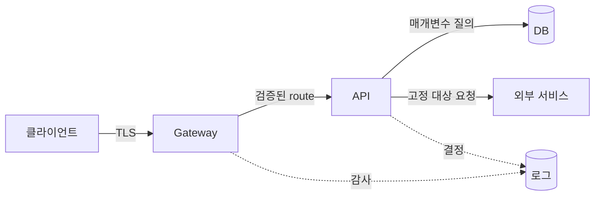

# 09. 네트워크 경계와 애플리케이션 보안

네트워크 위치는 하나의 신호일 뿐 신원이 아니다. 애플리케이션은 연결 출처와 별개로 요청의 주체, 내용, 상태를 검증한다.

## 1. 계층별 객체

IP 주소는 네트워크 인터페이스의 위치 식별자다.

포트는 호스트 안 전송 끝점을 구분한다.

DNS 이름은 이름을 주소에 매핑하지만 그 자체가 애플리케이션 신원을 증명하지 않는다.

TLS 인증서는 이름과 공개키를 묶는다.

HTTP Host, path, header, body는 프록시와 애플리케이션의 라우팅 입력이다.

방화벽은 주소와 포트 흐름을 제한한다.

NetworkPolicy는 지원 CNI 환경에서 Pod 간 흐름을 제한한다.

API 인가는 인증된 주체의 메서드와 객체 접근을 판단한다.

## 2. 요청 경로

Gateway는 TLS를 종료하고 호스트와 경로를 고른다.

API는 Gateway가 전달한 신원 정보의 출처를 신뢰할 수 있어야 한다.

외부 클라이언트가 백엔드에 직접 접속해 `X-User: admin`을 넣지 못하게 경계를 닫는다.

백엔드가 토큰을 직접 재검증하거나 Gateway와 mTLS로 통신하고 신뢰 헤더를 덮어쓰는 방법이 있다.

## 3. 입력 검증과 출력 인코딩

입력 검증은 길이, 형식, 범위, 허용 값, 객체 상태를 확인한다.

허용 목록은 가능한 정상 형태가 좁을 때 효과적이다.

SQL은 문자열 결합 대신 매개변수 질의를 쓴다.

HTML 출력은 HTML 문맥에 맞게 인코딩한다.

JavaScript, URL, CSS는 각각 문맥 규칙이 다르다.

입력을 한 번 “정제”해 모든 출력 문맥에 안전하다고 간주하지 않는다.

파일 이름을 경로에 붙일 때 정규화 후 허용 root 아래인지 확인한다.

압축 해제는 항목 수, 전체 크기, 중첩 깊이를 제한한다.

## 4. SSRF

SSRF(server-side request forgery)는 공격자가 서버가 보낼 네트워크 요청의 대상을 조종하는 문제다.

서버는 내부 관리 API나 cloud metadata에 접근할 수 있어 공격자보다 높은 네트워크 권한을 가진다.

URL 문자열에서 `localhost`만 막는 것으로 부족하다.

DNS가 내부 주소로 바뀌거나 IPv6, 숫자형 주소, redirect를 이용할 수 있다.

필요하면 목적지 scheme, hostname, port를 허용 목록으로 고정하고 DNS 해석 결과와 redirect도 검사한다.

전용 egress proxy가 실제 연결 대상을 집행하고 자격 증명을 대상별로 제한한다.

## 5. CSRF, CORS, XSS

CSRF는 브라우저가 자동 첨부하는 쿠키 자격 증명을 이용해 사용자가 의도하지 않은 상태 변경을 보내게 한다.

SameSite cookie, CSRF token, Origin 검증, 안전한 메서드 설계가 대응 요소다.

CORS는 브라우저가 다른 origin의 응답을 스크립트에 공개할지 정하는 정책이다.

CORS를 넓게 열어도 서버 측 인증과 인가가 사라지는 것은 아니며, CORS가 비브라우저 클라이언트를 막지도 않는다.

XSS는 공격자 입력이 브라우저에서 코드로 해석되는 문제다.

문맥별 출력 인코딩, 안전한 템플릿, CSP를 조합한다.

## 6. rate limit과 가용성

초당 요청 수만 제한하면 느린 연결이나 큰 본문 공격을 놓칠 수 있다.

동시 연결, body 크기, CPU 비용, DB query 비용, 사용자별 quota를 함께 본다.

로그인 API가 계정당 분당 5회만 허용하면 온라인 추측을 줄이지만 공격자가 계정을 잠그는 수단이 될 수 있다.

점진 지연, 위험 신호, MFA, 복구 경로를 조합한다.

429 응답과 Retry-After는 정상 클라이언트가 재시도 폭주를 피하게 돕는다.

## 7. 오해와 반례

오해: 방화벽 안 API는 인증하지 않아도 된다.

반례: 침해된 내부 Pod가 API를 호출할 수 있다.

오해: CORS가 API 접근 통제다.

반례: curl과 서버 프로그램은 브라우저 CORS 정책을 적용하지 않는다.

오해: 입력을 escape 한 번 하면 모든 곳에 안전하다.

반례: HTML 본문과 JavaScript 문자열은 해석 규칙이 다르다.

## 8. 문제와 해설

### 문제 1

이미지 가져오기 API가 사용자 URL을 받는다. 최소 통제를 설계하라.

**해설:** HTTPS와 허용 도메인을 제한하고, DNS 해석 결과가 내부·link-local 주소가 아닌지 연결 시점에 확인한다. redirect마다 재검사하고 egress proxy, 응답 크기·시간·콘텐츠 형식 제한을 둔다.

### 문제 2

NetworkPolicy로 DB 포트를 API Pod만 열었다. DB 비밀번호가 없어도 되는가?

**해설:** 안 된다. 네트워크 정책 오류나 API Pod 침해가 곧 DB 접근이 된다. TLS 신원과 DB 인증·최소 권한 계정을 함께 사용한다.

### 문제 3

검색어를 SQL 매개변수로 전달했지만 결과를 HTML에 그대로 넣는다. 남은 위험은?

**해설:** SQL injection은 줄었지만 저장되거나 반사된 XSS가 남는다. HTML 출력 문맥에 맞게 인코딩하고 필요하면 CSP를 적용한다.

## 공식 자료

- [OWASP Input Validation Cheat Sheet](https://cheatsheetseries.owasp.org/cheatsheets/Input_Validation_Cheat_Sheet.html)
- [OWASP SSRF Prevention Cheat Sheet](https://cheatsheetseries.owasp.org/cheatsheets/Server_Side_Request_Forgery_Prevention_Cheat_Sheet.html)

---

[이전: Linux와 Kubernetes](08-linux-isolation-and-kubernetes-rbac.md) · [목차](README.md) · [다음: 공급망과 아티팩트](10-supply-chain-and-artifact-integrity.md)
