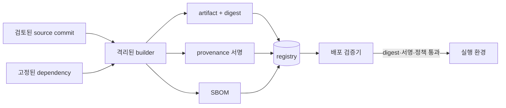

# 10. 공급망과 아티팩트 무결성

프로그램은 개발자가 작성한 소스 코드만으로 만들어지지 않는다. 외부 라이브러리, 컴파일러, 빌드 스크립트, 자동화 계정, 패키지 저장소, 컨테이너 registry, 배포 정책이 차례로 결과에 영향을 준다. 이 변환 경로 전체를 **소프트웨어 공급망(software supply chain)**이라고 한다.

최종 컨테이너 이미지 하나를 스캔해도 누가 어떤 소스로 만들었는지, 빌드 중 파일이 바뀌었는지, 배포 직전 tag가 다른 이미지를 가리켰는지 알 수 없다. 이 장은 한 소스 commit이 실행 중 workload가 되기까지 각 객체와 신뢰 경계를 추적한다.

## 1. 소스에서 실행까지의 기본 객체

**소스 코드(source code)**는 사람이 읽고 수정하는 프로그램과 빌드 정의다. Git 같은 버전 관리 저장소에 파일과 변경 이력이 보관된다.

**commit**은 특정 시점의 파일 트리와 부모 이력, 작성 정보를 식별하는 버전 관리 객체다. branch 이름 `main`은 새 commit을 가리키도록 움직일 수 있지만 commit ID는 특정 객체를 가리킨다. commit ID가 있다고 작성자 신원이 자동 보증되지는 않는다.

**의존성(dependency)**은 프로그램이 직접 포함하거나 실행 때 사용하는 외부 패키지·라이브러리다. 직접 선언한 패키지가 다시 가져오는 패키지는 **전이 의존성(transitive dependency)**이다.

**빌드(builder)**는 소스와 의존성을 읽어 바이너리나 이미지로 변환하는 실행 환경이다. compiler, package manager, shell script, container tool과 이들을 실행하는 자동화가 포함된다.

**CI(continuous integration)**는 코드 변경마다 시험과 빌드를 자동 수행하는 시스템이다. CI 계정은 소스 읽기, artifact 쓰기, 때로는 배포 권한을 가지므로 고가치 주체다.

**아티팩트(artifact)**는 빌드 결과로 생성된 배포 가능한 바이트다. 실행 파일, 패키지, 모델 번들, 컨테이너 이미지가 예다.

**registry**는 패키지나 컨테이너 이미지를 이름과 버전으로 저장·배포하는 서비스다. tag는 사람이 읽는 움직일 수 있는 이름일 수 있고, digest는 정확한 바이트 또는 manifest를 해시로 식별한다.

## 2. digest, 서명, provenance는 다른 질문에 답한다

**digest**는 아티팩트 바이트를 해시한 고정 길이 값이다. 같은 digest를 신뢰한 경로에서 이미 알고 있다면 내려받은 바이트가 그 대상과 같은지 확인할 수 있다. 공격자가 아티팩트와 예상 digest를 모두 바꿀 수 있으면 공개 해시만으로는 출처를 인증하지 못한다.

**전자서명(signature)**은 개인키로 특정 바이트에 서명하고 공개키로 검증하는 값이다. 검증 성공은 등록된 공개키에 대응하는 개인키가 그 바이트에 유효한 서명을 만들었다는 근거다. 코드가 안전하거나 진술이 참이라는 자동 증명은 아니다.

**provenance**는 누가 어떤 입력과 절차로 결과를 만들었는지 기록한 출처 메타데이터다. 소스 commit, builder 신원, 의존성, 빌드 명령, 출력 digest가 포함될 수 있다.

**attestation**은 어떤 주체가 특정 사실을 구조화된 문서로 진술하고 서명한 것이다. provenance는 attestation의 한 종류로 표현될 수 있다. “scanner X가 digest D에서 취약점 목록 V를 관찰했다” 같은 진술도 attestation이 될 수 있다.

서명은 진술 바이트를 키에 묶지만 진술의 사실성을 자동 확인하지 않는다. 침해된 builder가 거짓 provenance를 자기 정식 키로 서명할 수 있다. 그래서 builder 격리, 입력 고정, 권한과 감사가 필요하다.

## 3. SBOM은 구성 목록이다

**SBOM(Software Bill of Materials)**은 소프트웨어에 포함된 구성 요소, 버전, 관계 등을 기록한 목록이다. 제품의 재료 명세서와 비슷하다. SPDX와 CycloneDX 같은 표현 형식이 있다.

SBOM은 다음 질문을 돕는다.

- 취약점이 발표된 라이브러리 버전이 어느 artifact에 포함됐는가?
- 직접 의존성 뒤에 어떤 전이 의존성이 들어왔는가?
- 라이선스와 공급자 정보가 무엇인가?

SBOM이 있다고 취약점이 없다는 뜻은 아니다. 목록이 불완전하거나 버전이 틀릴 수 있고, 알려지지 않은 악성 코드와 설정 취약점은 구성 목록만으로 찾지 못한다. SBOM 자체도 어느 artifact digest에서 어떤 도구로 생성됐는지 묶어야 한다.

## 4. 전체 빌드·배포 흐름

commit `abc123`을 이미지로 배포하는 순서를 세분하면 다음과 같다.

1. 개발자가 변경을 제출하고 검토 정책이 승인된 commit `abc123`을 만든다.
2. CI가 commit ID로 정확한 소스를 가져온다. 움직이는 branch의 최신 상태를 암묵적으로 다시 읽지 않는다.
3. lockfile과 registry 정책으로 의존성 버전과 가능한 경우 digest를 고정한다.
4. builder가 선언된 compiler와 도구 버전, 제한된 네트워크·권한에서 빌드한다.
5. 결과 이미지 manifest의 digest `sha256:D1`을 계산한다.
6. builder는 소스 `abc123`, 입력 의존성, builder 신원, 출력 `D1`을 provenance에 기록한다.
7. 신뢰한 workload 신원으로 provenance attestation에 서명한다.
8. 이미지와 provenance, SBOM을 registry에 저장한다.
9. 배포 요청은 `app:latest` 같은 tag만이 아니라 최종 digest `D1`을 고정한다.
10. Admission 검증기가 signature, provenance의 subject digest, builder, source repository, commit·branch 정책을 확인한다.
11. 허용된 digest만 노드가 내려받아 실행한다.

중간 단계 하나가 digest 결합을 잃으면 다른 객체가 섞일 수 있다. 서명된 provenance의 출력이 `D1`인데 실제 배포가 tag가 현재 가리키는 `D2`라면 서명 검증 자체가 성공해도 대상이 다르다.

## 5. 움직이는 이름과 고정된 내용

Git branch, package version range, container tag는 운영자가 새 대상을 가리키도록 바꿀 수 있는 이름이다.

- `main`은 오늘 `abc123`, 내일 `def456`을 가리킬 수 있다.
- `library >=1.2,<2`는 resolver 시점에 새 버전을 선택할 수 있다.
- `app:latest`는 push 뒤 다른 manifest를 가리킬 수 있다.

움직이는 이름은 사람의 배포 의도를 표현하는 데 유용하지만 실행 대상 증거에는 최종 digest가 필요하다. 배포 controller가 tag를 digest로 해석한 뒤 그 digest를 정책 평가와 실행 객체 전체에 고정한다.

digest 고정은 그 바이트가 안전하다는 뜻이 아니다. 악성 바이트도 정확히 고정할 수 있다. 변경 가능성 문제를 해결하고, 출처·검토·취약점 정책은 별도로 적용한다.

## 6. 의존성 선택 과정의 공격

**이름 혼동(dependency confusion)**은 내부 패키지와 같은 이름의 공개 패키지를 resolver가 잘못 선택하게 하는 공격이다. 내부 이름을 공개 registry에 공격자가 더 높은 버전으로 게시하면 설정에 따라 외부 패키지가 선택될 수 있다.

**typosquatting**은 인기 패키지와 비슷한 철자의 악성 패키지를 만들어 개발자의 오타를 노린다.

**maintainer 계정 탈취**는 정상 패키지의 정식 배포 권한으로 악성 버전을 게시하게 한다. 이름과 서명 경로가 정상처럼 보여도 계정 침해가 입력을 바꾼다.

대응은 resolver의 출처를 명시하고 내부 namespace를 예약하며 lockfile과 digest를 검토하는 것이다. 새 maintainer, install script, registry 변경, lockfile의 대규모 전이 변경을 중요한 사건으로 다룬다.

패키지 설치 중 실행되는 script는 빌드 환경의 자격 증명과 네트워크에 접근할 수 있다. builder 권한과 egress를 제한하고 비밀을 최소 시간에만 주입한다.

## 7. builder 격리와 자격 증명 수명

builder는 소스 코드를 실행하거나 compiler·package script를 실행하므로 입력을 신뢰하지 않는다. pull request의 악성 스크립트가 CI의 배포 토큰을 읽지 못하게 신뢰되지 않은 시험과 신뢰된 release 빌드를 분리한다.

장기 registry 관리자 키를 모든 빌드에 넣으면 한 작업 침해가 미래 배포까지 이어진다. 작업 identity로 짧은 수명 토큰을 발급하고 특정 repository의 특정 행동만 허용한다.

빌드 작업이 끝난 뒤 깨끗한 환경을 폐기하면 한 빌드의 파일과 프로세스가 다음 빌드에 영향을 주는 것을 줄인다. 캐시는 성능을 높이지만 오염된 캐시와 키가 빌드 사이를 연결할 수 있어 digest 검증과 namespace 분리가 필요하다.

**hermetic build**는 선언된 입력 외의 네트워크, 호스트 파일, 현재 시각 같은 숨은 입력을 제한하는 빌드다. 완전한 hermetic 보장은 도구와 정책에 따라 다르므로 실제 허용 입력을 기록한다.

## 8. 재현 가능한 빌드

**재현 가능한 빌드(reproducible build)**는 같은 소스와 명시된 환경으로 독립적으로 빌드했을 때 비트 단위로 같은 결과를 얻도록 하는 성질이다.

결과를 달라지게 하는 흔한 숨은 입력은 다음과 같다.

- 현재 시각과 timezone
- 파일 순회 순서
- 임시·절대 경로
- locale과 문자 정렬
- 난수와 병렬 실행 순서
- 네트워크에서 받은 최신 파일
- compiler와 linker 버전

두 독립 builder가 같은 digest를 만들면 출처 검증의 강한 신호가 된다. 그러나 둘 다 같은 악성 소스나 동일하게 오염된 compiler를 쓰면 같은 악성 결과를 만들 수 있다. 재현성은 코드 안전성과 builder 다양성을 자동 보증하지 않는다.

재현 실패도 곧 공격 증거는 아니다. 먼저 선언되지 않은 입력을 찾아 고정한다. 차이를 설명할 수 없다는 사실은 provenance의 완전성과 조사 가능성이 약하다는 신호다.

## 9. 서명 키와 keyless 서명의 경계

전통적 서명은 CI에 장기 개인키를 저장할 수 있다. 키가 유출되면 공격자가 정상 서명처럼 보이는 artifact를 만들 수 있다.

일부 현대 시스템은 CI workload가 신원 공급자에게 받은 짧은 수명 증거로 일회성 또는 짧은 인증서를 발급받아 서명하고 투명성 로그에 사건을 기록한다. 흔히 keyless signing이라고 부르지만 암호키가 전혀 없다는 뜻은 아니다. 짧은 수명 키가 생성되고 신원과 연결되는 방식이다.

검증자는 단지 서명 수학만 보지 않고 인증서 발급자, workload 신원, repository, workflow, commit, 시간, 투명성 로그 포함을 정책으로 확인한다. 신원 공급자나 CI 설정이 침해되면 정식 신원으로 악성 서명이 나올 수 있다.

## 10. 취약점 스캔의 의미

취약점 scanner는 SBOM이나 이미지 파일에서 패키지 이름·버전을 찾고 알려진 취약점 데이터베이스와 비교한다. 결과는 특정 시각의 지식과 탐지 규칙에 의존한다.

발견된 패키지가 실제 실행 경로에 있는지, 취약 기능이 켜졌는지, 네트워크에서 도달 가능한지에 따라 위험이 달라진다. 반대로 “도달하지 않는다”는 주장도 배포 설정과 코드 흐름의 증거가 필요하다.

스캔 결과 0건은 안전 증명이 아니다. 아직 공개되지 않은 취약점, 악성 코드, 잘못된 권한, 비밀 유출이 남는다. 데이터베이스가 갱신되면 어제 깨끗했던 동일 digest에 오늘 경보가 생길 수 있으므로 저장 artifact를 재평가한다.

## 11. 배포 Admission 정책

Kubernetes에서 Admission은 API 객체가 저장되기 전 내용을 검사하거나 변경하는 단계다. 공급망 정책은 다음을 확인할 수 있다.

1. 허용 registry에서 온 이미지인가?
2. tag를 최종 digest로 고정했는가?
3. 그 digest가 신뢰한 주체의 서명을 가졌는가?
4. provenance의 subject digest가 실제 이미지와 같은가?
5. builder 신원과 source repository·commit이 허용 정책에 맞는가?
6. SBOM과 취약점 예외가 현재 정책·만료에 맞는가?
7. 검증 결과와 정책 버전을 감사했는가?

정책 서버 장애 때 모든 이미지를 허용하면 장애가 공급망 우회가 된다. 가용성 요구에 따라 마지막으로 검증된 digest 캐시, 제한된 비상 절차, 고위험 환경 기본 거부를 설계한다.

긴급 우회는 승인 주체, 대상 digest, 이유, 만료, 후속 검토를 요구한다. `latest` 전체를 영구 허용하는 예외는 범위와 수명이 없다.

## 12. 공격 시나리오를 전체 경로에서 본다

공격자가 maintainer 계정을 탈취해 의존성 `lib-x 1.4.2`를 악성으로 게시했다고 하자.

1. 애플리케이션 manifest가 `lib-x >=1.4,<2` 범위를 사용한다.
2. 새 빌드가 lock 갱신 중 1.4.2를 선택한다.
3. install script가 CI 환경의 registry 토큰을 읽는다.
4. 악성 코드가 포함된 이미지가 정상 builder에서 생성된다.
5. 정식 CI 신원으로 provenance와 signature가 만들어진다.
6. 취약점 DB에는 아직 항목이 없어 scanner가 통과한다.
7. 배포 정책도 신뢰한 builder와 repository 조건만 보고 허용한다.

서명은 변조되지 않은 정식 빌드라는 사실을 보여도 입력 선택이 악성이었다는 문제를 해결하지 않는다. lockfile 검토, package 출처 고정, install script 제한, 짧은 CI 자격 증명, 행동 탐지, 독립 검토가 필요하다.

## 13. 숫자 예제로 대상 결합 확인

registry tag `app:latest`가 오전에는 digest `D1`, 오후에는 `D2`를 가리킨다고 하자. 오전에 provenance `P1`이 `subject=D1`로 서명됐다. 오후 배포기가 tag를 다시 해석해 D2를 받으면서 P1의 서명만 성공했다고 허용하면 잘못된 결합이다.

검증기는 실제 배포 digest `D2`와 attestation subject를 비교해야 한다. 다르면 거부한다. D2에는 D2를 명시한 별도 신뢰 provenance가 필요하다. 숫자 tag 버전도 움직일 수 있으므로 최종 digest 확인을 생략하지 않는다.

## 14. 신뢰의 시작점과 정책 변경 보호

검증기는 어떤 공개키, 인증기관, builder 신원, repository를 신뢰할지 미리 가진다. 이 최초 목록을 신뢰 루트(root of trust)라고 부를 수 있다. 공격자가 artifact 대신 검증 정책 파일이나 신뢰 키 목록을 바꾸면 자기 서명을 정상으로 만들 수 있다.

따라서 공급망 정책 저장소와 Admission 설정도 코드 검토, 다중 승인, 서명, 감사 대상이다. 신뢰 키 추가, 허용 builder 확대, 취약점 예외 생성은 일반 애플리케이션 변경보다 강한 검토를 요구할 수 있다. 예외에는 대상 digest, 환경, 사유, 소유자, 만료를 넣는다.

투명성 로그(transparency log)는 서명이나 인증서 사건을 추가 전용에 가까운 공개·감사 가능한 구조로 기록해 숨은 발급을 발견하게 돕는다. 로그 포함은 서명 내용이 안전하다는 증명은 아니지만, 나중에 어떤 신원으로 어떤 digest가 서명됐는지 비교할 증거를 준다.

검증 결과도 수명을 갖는다. 어제 정책에서 허용된 digest가 오늘 새 취약점이나 키 폐기로 거부될 수 있다. 배포 시점 검증과 실행 중 inventory를 연결해 현재 실행 digest를 새 정책과 다시 평가한다.

## 15. 공급망 사고의 폐기와 재평가

builder 신원이나 서명 키가 침해됐다고 발견하면 새 키 발급만으로 끝나지 않는다. 침해 가능 기간에 그 신원으로 만든 모든 attestation과 artifact digest를 inventory에서 찾는다. 실행 중 workload, registry 보관본, 고객에게 배포한 패키지를 같은 digest로 연결한다.

의심 artifact의 배포를 중단하고 안전한 입력과 builder에서 다시 빌드한다. 새 결과가 같은 source에서 나왔다는 사실만 보지 않고 의존성, compiler, 빌드 권한을 조사한다. 필요하면 옛 서명 키를 폐기하고 정책이 옛 서명을 어떻게 처리할지 명시한다.

투명성 로그와 CI 감사 기록은 사건 범위를 좁히는 증거지만 로그 누락이 안전 증거는 아니다. 로그 보존 권한과 시간 동기화가 올바른지 확인하고, 검증 정책 변경 자체도 조사한다.

## 16. artifact 보존과 삭제의 의미

registry에서 tag를 지웠다고 manifest와 layer 바이트가 즉시 사라지는 것은 아니다. 다른 tag와 digest 참조, 복제 registry, node image cache, 백업이 남을 수 있다. 민감한 파일이 이미지 layer에 한 번 들어갔다면 다음 layer에서 삭제해도 과거 layer에 존재할 수 있다. 비밀을 폐기하고 영향 digest를 조사한 뒤 registry garbage collection과 노드 cache, 백업 보존 정책을 함께 다룬다.

## 17. 오해와 반례

**“SBOM이 있으면 취약점이 없다.”** SBOM은 구성 목록이다. 정확성과 취약점 지식, 실행 설정이 별도다.

**“공식 registry 이미지는 항상 안전하다.”** maintainer와 builder, registry 계정이 침해될 수 있고 정상 코드에도 취약점이 있다.

**“서명 성공은 실행해도 무해하다는 뜻이다.”** 서명자는 악성·취약한 코드를 정식으로 서명할 수 있다.

**“digest 고정이면 출처가 안전하다.”** 악성 바이트도 정확히 고정할 수 있다. digest는 대상 식별이고 출처 정책은 별도다.

## 18. 연습 문제와 자세한 풀이

### 문제 1. 서명된 `app:latest`

무엇이 약한가?

**풀이:** tag는 다른 digest를 가리킬 수 있다. 실제 배포 digest와 그 digest를 subject로 포함한 서명 provenance를 비교한다. tag 서명만으로 실행 바이트를 고정하지 않는다.

### 문제 2. SBOM의 취약 라이브러리

실행 경로에 없어 보이니 즉시 무시해도 되는가?

**풀이:** 포함 버전, 도달 가능성, 기능 설정, 배포 환경과 완화책을 증거로 평가한다. 예외에 소유자·근거·만료를 두고 코드나 취약점 정보가 바뀌면 재평가한다.

### 문제 3. 재현 실패

어떤 입력을 조사하는가?

**풀이:** compiler·의존성 digest, 환경 변수, 시간, timezone, locale, 파일 순서, 경로, 난수, 네트워크 입력을 비교한다. 실패는 악성 증거는 아니지만 숨은 입력이 있다는 신호다.

### 문제 4. 서명 키 유출

키를 새로 만들면 끝나는가?

**풀이:** 옛 키를 폐기하고 노출 기간의 서명과 배포 로그를 조사한다. 새 공개키 등록 경로를 보호하고, 옛 서명 허용 정책과 이미 실행 중인 artifact를 재평가한다.

### 문제 5. 취약점 0건

배포가 안전하다는 증거인가?

**풀이:** 아니다. scanner가 아는 DB와 탐지 범위에서 일치 항목이 없다는 결과다. 미공개 취약점, 악성 동작, 권한·비밀·구성 문제는 남는다.

### 문제 6. pull request 빌드의 배포 토큰

왜 위험한가?

**풀이:** 공격자 기여 코드와 install script가 CI에서 실행돼 토큰을 읽을 수 있다. 신뢰되지 않은 시험과 release 작업을 분리하고, 짧은 수명·최소 범위 자격 증명을 승인된 단계에만 발급한다.

### 문제 7. provenance 서명 성공, digest 불일치

배포해도 되는가?

**풀이:** 거부한다. 진술은 유효하게 서명됐지만 실제 artifact가 진술 대상이 아니다. 실제 bytes를 해시하고 provenance subject와 정확히 비교한다.

### 문제 8. hermetic과 reproducible

둘은 같은가?

**풀이:** hermetic은 선언되지 않은 외부 입력을 제한하는 빌드 성질이고, reproducible은 같은 명시 입력에서 같은 출력을 재현하는 결과 성질이다. 서로 돕지만 하나가 다른 하나를 자동 증명하지 않는다.

## 공식 근거

- [SLSA Specification](https://slsa.dev/spec/)
- [NIST Secure Software Development Framework](https://csrc.nist.gov/projects/ssdf)
- [SPDX Specification](https://spdx.github.io/spdx-spec/)
- [in-toto Attestation Framework](https://github.com/in-toto/attestation)
- [Kubernetes Admission Control](https://kubernetes.io/docs/reference/access-authn-authz/admission-controllers/)

---

[이전: 네트워크와 애플리케이션](09-network-boundaries-and-application-security.md) · [목차](README.md) · [다음: 데이터 보호와 키 교체](11-data-protection-and-key-rotation.md)
