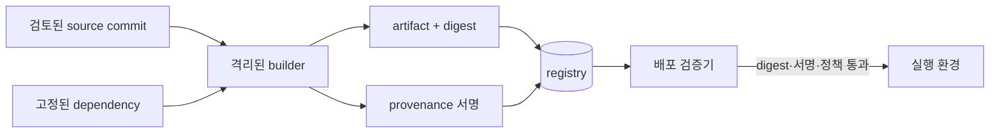

# 10. 공급망과 아티팩트 무결성

소프트웨어 공급망은 소스, 의존성, 빌드 도구, CI, 저장소, 배포기로 이어지는 변환 경로다. 최종 이미지 하나만 스캔해서 전체 신뢰를 설명할 수 없다.

## 1. 핵심 객체

아티팩트(artifact)는 빌드 결과인 바이너리, 패키지, 컨테이너 이미지다.

digest는 정확한 바이트를 가리키는 해시다.

provenance는 누가 어떤 입력과 절차로 결과를 만들었는지 기록한 출처 메타데이터다.

SBOM은 소프트웨어 구성 요소 목록이다.

attestation은 주체가 특정 사실을 서명해 진술한 문서다.

서명은 진술 바이트와 키 소유자를 연결하지만 진술 내용이 참인지 자동 판단하지 않는다.

## 2. 소스에서 실행까지

branch 이름은 움직일 수 있지만 commit digest는 특정 상태를 가리킨다.

package version range는 시간이 지나 다른 의존성을 선택할 수 있으므로 lock과 digest를 검토한다.

빌드기는 깨끗한 입력과 최소 권한의 짧은 자격 증명을 사용한다.

출력 digest와 provenance를 함께 저장한다.

배포기는 신뢰한 builder ID, source repository, branch 정책, artifact digest를 검증한다.

## 3. 서명의 정확한 의미

서명 검증 성공은 등록한 공개키에 대응하는 개인키로 해당 바이트가 서명됐다는 근거다.

서명 키가 침해됐는지, 빌더가 악성 입력을 받았는지, 코드에 취약점이 있는지는 별도 질문이다.

`latest` tag에 서명했다고 해도 tag가 다른 digest를 가리킬 수 있으면 대상 결합이 약하다.

서명 envelope에 artifact digest와 빌드 메타데이터를 넣는다.

키 수명과 폐기 상태, 서명 시간, 투명성 로그를 확인한다.

## 4. 의존성 위험

이름 혼동은 내부 패키지와 같은 이름의 공개 패키지를 잘못 가져오는 문제다.

typosquatting은 유명 패키지와 비슷한 이름을 이용한다.

maintainer 계정 탈취는 정상 배포 경로로 악성 버전을 낼 수 있다.

transitive dependency는 직접 선언하지 않았지만 의존성이 다시 가져오는 패키지다.

registry source를 고정하고 내부 namespace를 예약한다.

lockfile 변경과 새 maintainer·install script를 검토한다.

취약점 DB 검색은 알려진 항목을 찾지만 알려지지 않은 악성 동작을 증명하지 않는다.

## 5. 재현 가능한 빌드

재현 가능한 빌드는 같은 source와 명시한 환경으로 독립 빌드했을 때 같은 결과를 얻도록 한다.

시간, 파일 순서, 경로, locale, 무작위 값이 결과에 섞이면 digest가 달라질 수 있다.

재현성은 서로 다른 빌드 인프라 결과를 비교하는 강한 신호다.

하지만 두 빌드가 같은 악성 source나 compiler를 사용하면 같은 악성 결과가 나올 수 있다.

## 6. 배포 정책

배포 Admission은 image tag를 digest로 해석하고 허용 registry인지 본다.

서명과 provenance를 검증한다.

신뢰한 CI identity와 source 조건을 확인한다.

심각한 알려진 취약점 정책과 예외 만료를 적용한다.

검증 결과와 정책 버전을 감사 로그에 남긴다.

긴급 우회는 제한된 주체, 사유, 만료, 후속 검토를 요구한다.

## 7. 오해와 반례

오해: SBOM이 있으면 취약점이 없다.

반례: SBOM은 구성 목록이며 탐지 품질과 런타임 설정은 별도다.

오해: 공식 registry 이미지는 항상 안전하다.

반례: 계정이나 빌드 경로가 침해되거나 취약한 정상 코드가 배포될 수 있다.

오해: 서명 검증 성공은 실행해도 무해하다는 뜻이다.

반례: 서명자가 악성 또는 취약 코드를 의도적으로 서명할 수 있다.

## 8. 문제와 해설

### 문제 1

서명된 `app:latest`만 검증하는 설계의 약점은?

**해설:** 움직이는 tag와 서명 대상을 정확히 묶지 않으면 다른 digest가 선택될 수 있다. artifact digest 자체와 그 digest를 포함한 provenance 서명을 검증한다.

### 문제 2

SBOM에 취약한 라이브러리가 보이지만 실행 경로에 없는 것 같다. 즉시 무시해도 되는가?

**해설:** 포함 버전, 도달 가능성, 배포 환경, 완화책을 증거로 평가한다. 예외에는 소유자와 만료를 두고 새 정보가 생기면 재평가한다.

### 문제 3

빌드 결과가 재현되지 않는다. 조사할 입력은?

**해설:** compiler와 dependency digest, 환경 변수, 시간, locale, 파일 순서, 네트워크 입력, 생성 경로를 고정해 차이를 좁힌다. 재현 실패 자체가 악성 증거는 아니지만 출처 검증을 약화한다.

## 공식 자료

- [SLSA 사양](https://slsa.dev/spec/)
- [NIST Secure Software Development Framework](https://csrc.nist.gov/projects/ssdf)

---

[이전: 네트워크와 애플리케이션](09-network-boundaries-and-application-security.md) · [목차](README.md) · [다음: 데이터 보호와 키 교체](11-data-protection-and-key-rotation.md)
