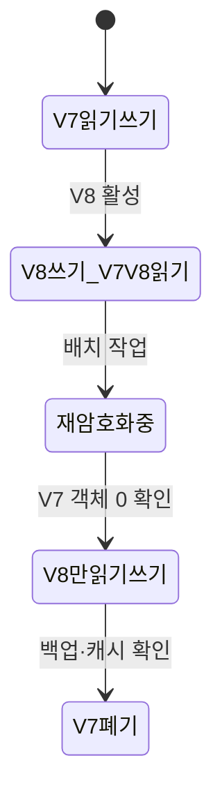

# 11. 데이터 보호와 키 교체

데이터 보호는 저장소의 암호화 옵션 하나를 켜는 일이 아니다. 데이터가 수집되고, 복사되고, 계산에 사용되고, 백업되고, 공유되고, 삭제되는 전체 수명에서 누가 어떤 형태를 볼 수 있는지 관리하는 일이다. 암호화는 이 과정의 한 통제이며 키와 메타데이터, 복구 절차가 맞지 않으면 오히려 데이터를 영구히 읽지 못하게 만들 수 있다.

이 장은 연구 데이터 객체 하나가 생성돼 키 버전 7로 암호화되고, 버전 8로 교체되고, 백업 보존 기간을 지나 삭제되는 흐름을 따라간다.

## 1. 레코드·데이터셋·복사본을 구분한다

**데이터(data)**는 시스템이 저장하거나 전송하고 계산에 사용하는 바이트와 그 의미다. 이름, 센서 값, 모델 가중치, 접근 로그가 모두 데이터다.

**레코드(record)**는 함께 읽고 갱신하는 필드 묶음이다. 데이터베이스 행이나 객체 저장소의 메타데이터 문서가 될 수 있다. **데이터셋(dataset)**은 같은 목적과 구조로 관리하는 레코드나 파일의 집합이다.

원본 객체 하나를 업로드해도 다음 복사본이 생길 수 있다.

- API 프로세스의 수신 버퍼와 임시 파일
- 객체 저장소의 현재 버전과 이전 버전
- 데이터베이스 색인과 변경 로그
- 읽기 replica와 검색 시스템
- 노드의 페이지 캐시와 애플리케이션 메모리
- snapshot, backup, 재해 복구 지역의 복제본
- 분석가가 내려받은 export와 실험 결과

삭제와 키 교체에서 빠지는 복사본은 대개 존재를 모르는 복사본이다. 데이터 지도에는 위치, 소유자, 스키마, 복제 방식, 보존 기간, 암호화 키 버전, 삭제 책임자를 기록한다.

## 2. 분류와 역할

**데이터 분류(classification)**는 노출·변조·삭제됐을 때의 영향을 기준으로 보호 등급을 정하는 과정이다. 공개, 내부, 기밀, 매우 민감 같은 이름을 쓸 수 있지만 각 등급의 실제 통제를 정의해야 한다.

예를 들어 공개 데이터는 인증 없이 읽을 수 있어도 무단 변경 방지를 위해 서명된 배포가 필요할 수 있다. 기밀 데이터는 읽기 권한, 암호화, 감사, 짧은 export 수명을 요구할 수 있다.

**데이터 소유자(owner)**는 업무 목적, 허용 사용자, 보존과 삭제 정책을 승인한다. **관리자(custodian)**는 저장소, 백업, 키 접근 같은 기술 통제를 운영한다. **처리자(processor)**는 승인된 목적에 따라 데이터를 읽거나 변환하는 서비스나 사람이다.

역할을 나누는 이유는 한 사람이 데이터, 키 정책, 감사 기록을 모두 마음대로 바꿀 수 있는 위험을 줄이기 위해서다. 역할 분리는 협업과 비상 절차도 필요하므로 이름만 다른 같은 관리자 계정 세 개를 만드는 것으로 끝나지 않는다.

## 3. 데이터 수명과 목적 제한

수명 단계는 보통 수집, 저장, 사용, 공유, 보관, 삭제로 나눌 수 있다.

1. 수집 전에 왜 필요한지와 최소 필드를 정한다.
2. 저장 위치와 복사본을 등록한다.
3. 사용 시 주체와 목적, 질의 범위를 인가한다.
4. 다른 시스템과 공유할 때 새 신뢰 경계와 보존 책임을 기록한다.
5. 활성 사용이 끝나면 더 좁은 접근의 보관 상태로 옮길 수 있다.
6. 보존 기간과 법적 조건이 끝나면 삭제 절차를 실행한다.

**데이터 최소화(data minimization)**는 목적에 필요한 필드, 정밀도, 기간만 수집하는 원칙이다. 수집하지 않은 값은 유출되지 않고 삭제 대상에도 들어가지 않는다.

사용자 생년월일 전체 대신 연령대만 필요하다면 더 낮은 정밀도를 저장할 수 있다. 하지만 조합 정보가 개인을 다시 식별할 수 있다. 이름을 무작위 ID로 바꾸는 **가명화(pseudonymization)**는 직접 식별자를 줄이지만 매핑표와 다른 속성으로 다시 연결 가능하다. **익명화(anonymization)**는 합리적인 외부 정보와 공격을 고려해 개인을 식별하기 어렵게 만드는 더 강한 주장이다. 단순히 이름 열을 지웠다고 익명화됐다고 단정하지 않는다.

## 4. 저장·전송·사용 중 보호

**전송 중 데이터(data in transit)**는 네트워크 구간을 이동하는 바이트다. TLS 같은 채널 보호가 상대 신원, 기밀성, 무결성을 제공하도록 설정한다. TLS가 프록시에서 끝나면 다음 내부 구간은 새 경계다.

**저장 중 데이터(data at rest)**는 디스크, 객체 저장소, database, snapshot, backup에 남은 바이트다. 디스크 전체 암호화는 분리된 디스크나 snapshot 탈취를 줄이지만 실행 중 database가 정상적으로 복호화한 결과를 권한 높은 사용자가 질의하는 것은 막지 못할 수 있다.

애플리케이션 열 암호화는 database에 암호문만 저장해 DB 운영자 노출 범위를 줄일 수 있다. 대신 애플리케이션과 키 서비스가 평문을 보고, 검색·정렬·색인 기능이 제한되며, 키 서비스 장애가 읽기 가용성에 영향을 준다.

**사용 중 데이터(data in use)**는 CPU·GPU·프로세스 메모리에서 계산되는 값이다. 암호문도 연산 전에 평문이 될 수 있다. debug dump, core dump, swap, GPU 메모리, 로그와 화면 출력의 수명을 관리한다.

세 상태 중 한 곳의 암호화가 다른 상태를 자동 보호하지 않는다.

## 5. KMS, DEK, KEK와 envelope encryption

**키 관리 서비스(Key Management Service, KMS)**는 암호키를 생성·보관하거나 제한된 암호 연산을 제공하고, 어떤 주체가 어떤 키를 사용할 수 있는지 인가·감사하는 시스템이다. 제품 이름이 아니라 역할을 뜻한다.

**데이터 암호화 키(Data Encryption Key, DEK)**는 실제 데이터 바이트를 AEAD로 암호화하는 대칭키다. **키 암호화 키(Key Encryption Key, KEK)**는 DEK를 암호화해 감싸는 상위 키다.

DEK로 대용량 데이터를 로컬에서 처리하고 KMS의 KEK로 작은 DEK만 감싸는 구조를 **envelope encryption**이라고 한다.

연구 객체 `tenant=7, object=42, version=3`을 저장하는 흐름은 다음과 같다.

1. 애플리케이션이 KMS 권한으로 새 DEK를 생성하거나 데이터 키 생성 응답을 받는다.
2. 같은 DEK에서 다시 쓰이지 않도록 nonce를 만든다.
3. tenant, object ID, schema version을 모호하지 않은 AAD 바이트로 만든다.
4. DEK, nonce, 평문, AAD를 검토된 AEAD 라이브러리에 넣어 ciphertext와 tag를 만든다.
5. KMS의 KEK 버전 7로 DEK를 감싸 wrapped DEK를 만든다.
6. 저장소에 key ID·버전, nonce, AAD 필드, ciphertext, tag, wrapped DEK를 저장한다.
7. 평문 DEK는 필요한 메모리 범위와 시간만 유지한다.

읽을 때 애플리케이션은 저장된 KEK 버전으로 wrapped DEK를 풀고, 저장 레코드의 권위 있는 필드로 AAD를 다시 구성해 태그를 검증한다. 모든 키 버전을 성공할 때까지 시험하지 않는다. 정확한 버전 매핑을 사용한다.

## 6. 키 계층의 장점과 한계

고객별 또는 객체 집합별 DEK를 두면 KEK 하나로 수많은 데이터 키를 관리하면서도 피해 범위를 나눌 수 있다. 고객 A의 DEK만 폐기하면 고객 B의 데이터 키는 유지할 수 있다.

KEK를 교체할 때 데이터 전체를 다시 암호화하지 않고 wrapped DEK만 새 KEK로 다시 감쌀 수 있다. 이를 rewrap이라고 부를 수 있다. 그러나 DEK가 유출됐거나 데이터 암호 알고리즘과 nonce 정책을 바꾸려면 실제 데이터를 새 DEK로 재암호화해야 한다.

KMS가 키 재료를 밖으로 내보내지 않고 decrypt·unwrap 연산만 제공해도 애플리케이션은 결과 DEK나 평문을 메모리에서 볼 수 있다. KMS 사용 권한은 키 파일 열람 권한과 같은 수준으로 중요하다.

한 DEK를 모든 고객에게 쓰면 키 관리 수는 적지만 유출·폐기 범위가 전체로 커진다. 반대로 레코드마다 DEK를 만들면 격리는 세밀하지만 KMS 호출, 메타데이터, 회전 작업이 늘어난다. 요구되는 삭제 단위와 성능을 비교한다.

## 7. 온라인 키 교체 상태 전이

서비스를 중단하지 않고 KEK 또는 DEK 버전 7에서 8로 옮긴다고 하자.

1. 먼저 모든 reader가 V7과 V8을 읽을 수 있게 배포한다.
2. V8을 활성 쓰기 버전으로 바꿔 새 객체는 V8만 사용한다.
3. 지표에서 새 V7 쓰기가 0인지 확인한다. 오래된 worker와 재시도 queue를 찾는다.
4. background 작업이 기존 V7 객체를 V8로 변환한다.
5. V7 잔여 객체 수, 성공·실패, 처리 속도, 마지막 위치를 기록한다.
6. 온라인 V7 객체가 0이어도 cache, 장기 작업, export, backup 필요를 확인한다.
7. 제한된 비활성화 기간을 거쳐 V7을 폐기한다.

읽기 전에 버전 필드를 보고 정확한 키를 선택한다. 여러 키를 차례로 시험하면 잘못된 메타데이터와 손상을 숨기고 KMS 비용과 오류 오라클을 만든다.

## 8. 재암호화와 동시 쓰기 경쟁

배치 작업이 객체 42의 V7 값을 읽은 뒤 사용자가 같은 객체를 수정할 수 있다.

1. 배치가 객체 버전 10을 읽는다.
2. 사용자 쓰기가 새 업무 값으로 버전 11을 V8에 저장한다.
3. 배치가 옛 버전 10의 값을 V8로 써서 버전 11을 덮으면 최신 변경이 사라진다.

재암호화는 읽은 객체 버전이 여전히 같은지 조건부 갱신한다. `WHERE id=42 AND version=10`처럼 비교하고 영향 행이 0이면 새 버전을 다시 읽거나 이미 V8인지 확인한다. 객체 저장소에서는 ETag나 generation 조건을 쓸 수 있다.

재시도는 멱등적이어야 한다. 작업 ID와 원본 버전, 목표 키 버전을 기록해 같은 객체를 두 번 변환해도 잘못된 상태가 되지 않게 한다. 실패 queue와 poison object를 숨기지 않고 완료 기준에 포함한다.

## 9. backup과 restore는 현재 상태와 다른 시간축이다

**backup**은 장애와 삭제 뒤 복구하기 위해 별도 보관한 데이터 복사본이다. **snapshot**은 특정 시점의 저장 상태를 빠르게 참조하는 복사 방식이다. **replica**는 가용성과 읽기 확장을 위해 변경을 따라가는 복제본이다.

replica는 원본의 실수 삭제와 ransomware 변경도 따라갈 수 있어 독립 backup을 대신하지 않는다. backup은 생산 자격 증명과 다른 삭제 권한, 보존 잠금, 별도 계정이 필요할 수 있다.

restore에는 데이터뿐 아니라 그 시점의 schema, key metadata, 필요한 옛 KEK가 있어야 한다. V7 데이터를 가진 backup을 보존하면서 V7 키를 폐기하면 복원 뒤 읽지 못한다. 반대로 V7 키를 영구 보존하면 삭제와 노출 기간이 길어진다. backup 만료, 재암호화 또는 키 보존을 명시적으로 조정한다.

nonce counter와 키 상태를 과거 snapshot으로 되돌리는 것도 위험하다. 같은 키에서 이미 사용한 nonce 범위를 다시 사용할 수 있다. restore 뒤 새 쓰기에 새 키를 발급하거나 snapshot 밖의 영속 할당 상태를 사용한다.

## 10. RPO와 RTO를 수치로 확인한다

**복구 시점 목표(Recovery Point Objective, RPO)**는 사고 때 허용할 수 있는 데이터 손실의 시간 범위다. RPO 15분이면 최대 약 15분의 최신 변경을 잃을 수 있다는 목표다.

**복구 시간 목표(Recovery Time Objective, RTO)**는 서비스를 목표 상태로 복구하는 데 허용하는 시간이다. RTO 2시간이면 탐지 시점부터 2시간 안에 필요한 서비스가 돌아와야 한다는 목표다.

15분마다 backup을 시작해도 완료에 40분이 걸리고 일부 실패가 탐지되지 않으면 15분 RPO를 보증하지 못한다. 20 TiB 복원 속도가 시간당 2 TiB라면 데이터 전송만 최소 10시간이라 RTO 2시간과 맞지 않는다. 증분 복구, 병렬화, 우선순위 데이터, 따뜻한 대기 시스템을 설계하고 실제 복원 시험으로 측정한다.

## 11. 보존과 삭제의 실제 의미

**보존 기간(retention period)**은 데이터나 backup을 유지하기로 한 기간이다. 법적 의무, 사고 조사, 업무 복구, 사용자 삭제 요구가 충돌할 수 있어 데이터 종류와 근거별 정책이 필요하다.

애플리케이션 행 삭제 응답은 여러 의미 중 하나일 수 있다.

- 논리 삭제: 행에 삭제 표시를 하고 일반 조회에서 숨긴다.
- 물리 삭제: 저장 엔진에서 레코드 바이트를 제거한다. WAL, compaction, vacuum 일정에 따라 지연될 수 있다.
- backup 만료: 보존 기간이 지나 backup 복사본이 제거된다.
- 암호학적 삭제: 전용 DEK를 폐기해 남은 암호문 복구를 어렵게 한다.

암호학적 삭제는 모든 키 복사본이 폐기되고 그 키가 삭제 대상에만 사용됐을 때 의미가 있다. 하나의 DEK가 모든 고객을 보호하면 한 고객만 삭제할 수 없다. 평문 export와 로그 복사본은 키 폐기로 사라지지 않는다.

삭제 완료 응답은 즉시 숨김, 복구 가능 기간, backup 최종 만료처럼 단계를 사용자와 운영 정책에 정확히 표현해야 한다.

## 12. 평상시 교체와 유출 사고 교체

정기 교체는 계획된 호환 기간과 canary를 둘 수 있다. 키 유출 사고는 공격자가 옛 키를 계속 쓰는 시간을 줄이는 것이 우선이다.

유출 대응은 다음을 포함한다.

1. 노출된 키 ID, 버전, 사용 권한, 데이터 범위를 식별한다.
2. 새 쓰기를 새 키로 전환하고 옛 키의 encrypt·sign 권한을 중단한다.
3. 필요한 경우 decrypt를 제한된 복구 작업에만 잠시 허용한다.
4. 접근 로그에서 유출 가능 시점부터 사용 내역을 조사한다.
5. 영향 데이터와 파생 자격 증명, backup, cache를 찾는다.
6. 재암호화와 소비자 전환 뒤 옛 키를 폐기한다.

KMS alias만 바꾸면 이미 메모리에 cache된 DEK, 옛 worker, queue, backup이 남는다. 완료 기준은 객체와 사용량 증거로 정의한다.

## 13. 분류 결정과 보호 비용을 수치로 연결한다

데이터 등급 이름만 정하고 통제가 같으면 분류가 실제 결정을 만들지 못한다. 예를 들어 공개 데이터는 익명 읽기를 허용하되 변경은 서명된 배포만 허용하고, 내부 데이터는 회사 workload 신원과 30일 감사 로그를 요구하며, 매우 민감 데이터는 객체별 인가·열 암호화·모든 읽기 감사·7일 export 만료·별도 복구 승인을 요구할 수 있다.

한 데이터셋에 고객 식별자 1,000만 건이 있고 하루 export가 20개라고 하자. 각 export를 30일 보존하면 최대 600개의 추가 복사본이 생길 수 있다. 원본 한 곳만 key rotation과 삭제 대상으로 세면 실제 수명과 맞지 않는다. export job은 원본 객체 ID, 생성 시각, 소유자, 만료, 암호화 키 버전을 등록하고 만료 삭제 실패를 지표로 낸다.

분류가 올라가면 암호화뿐 아니라 접근 승인, query 제한, 화면 마스킹, 사고 우선순위, backup 위치와 RTO가 달라질 수 있다. 반대로 중요하지 않은 데이터에 과도한 통제를 강제하면 운영자가 우회 복사본을 만들 수 있다. 영향과 사용 목적을 근거로 통제를 선택한다.

## 14. KMS 권한과 호출 실패를 설계한다

KMS는 키 파일을 숨겨도 decrypt 권한을 가진 주체에게 평문 DEK를 제공할 수 있다. 따라서 권한은 키 ID, 연산 종류, workload 신원, 환경으로 좁힌다. API 서비스는 특정 고객 키의 unwrap만 허용하고 새 KEK 생성과 정책 변경 권한은 별도 관리자에게 둘 수 있다.

호출에는 지연과 quota가 있다. 요청마다 같은 wrapped DEK를 풀면 KMS 장애와 비용이 데이터 읽기 전체로 전파된다. 짧은 cache로 호출을 줄일 수 있지만 cache된 DEK의 메모리 수명과 폐기 지연이 늘어난다. cache TTL, 최대 항목, process 종료, 긴급 무효화 정책을 정한다.

KMS가 응답하지 않을 때 모든 암호문을 평문 fallback으로 저장하면 보안 경계가 무너진다. 새 쓰기를 실패시키거나 제한된 queue에 두고, 읽기는 안전한 cache 범위에서만 제공하는 등 업무 중요도에 맞는 실패 모드를 선택한다. 실패 횟수와 key version별 호출률을 관찰한다.

## 15. 복구 훈련에서 확인할 전체 연결

분기마다 격리 계정에 backup 하나를 복원한다고 하자. 성공 기준은 파일이 생성됐다는 메시지가 아니다. backup catalog에서 올바른 시점을 고르고, 필요한 KEK와 wrapped DEK를 사용할 수 있으며, schema migration이 적용되고, 애플리케이션이 핵심 객체를 읽고 쓸 수 있어야 한다.

복원 과정에 사용한 비상 계정과 key 권한도 훈련 뒤 회수한다. 생산 network로 잘못 연결되지 않게 egress를 제한하고 복원 데이터의 개인정보 접근을 감사한다. 객체 수, digest 표본, 참조 무결성, 실제 RPO와 RTO를 기록한다.

훈련에서 V7 키가 없어 실패했다면 backup 성공률이 높아도 복구 통제는 실패한 것이다. 원인을 backup 생성, key 보존, catalog, 자동화 중 어디서 고칠지 정하고 다음 훈련에서 재검증한다.

복구 훈련 결과에는 사용한 backup ID, key version, schema version, 시작·종료 시각, 실패 단계와 수정 담당자를 남긴다. 다음 훈련이 같은 조건을 반복했는지 비교할 수 있어야 개선을 증명할 수 있다.

키 교체와 복구 훈련은 성공 여부뿐 아니라 실제로 사용한 권한이 최소였는지, 임시 접근이 모두 회수됐는지도 완료 조건에 넣는다.

## 16. 오해와 반례

**“DB 암호화를 켜면 DBA도 값을 못 본다.”** 서버가 투명하게 복호화하면 충분한 DB 권한으로 평문을 질의할 수 있다.

**“키 교체는 alias 변경으로 끝난다.”** 옛 암호문, cache, backup, writer, nonce 상태가 남는다.

**“행 삭제 응답 뒤 모든 복사본이 사라졌다.”** WAL, replica, snapshot, backup의 수명은 다르다.

**“replica가 있으므로 backup이 필요 없다.”** 잘못된 삭제와 암호화도 replica에 전파될 수 있다.

## 17. 연습 문제와 자세한 풀이

### 문제 1. 고객별 암호학적 삭제

한 DEK가 모든 고객 데이터를 보호한다. 어떻게 개선하는가?

**풀이:** 고객별 또는 좁은 데이터 집합별 DEK를 두고 KEK로 감싼다. 고객 DEK와 모든 키 복사본을 폐기할 수 있어야 한다. 평문 export와 공유 backup의 수명도 추적한다.

### 문제 2. 남는 V7 사용

V8 전환 뒤 V7 사용이 매시간 3건이다.

**풀이:** 폐기하지 않는다. 요청 ID, service version, queue, cache, 장기 작업을 추적해 오래된 writer를 찾는다. 새 V7 쓰기 0과 기존 객체·backup 조건을 확인한다.

### 문제 3. 디스크 암호화와 열 암호화

위협 경계를 비교하라.

**풀이:** 디스크 암호화는 분리된 매체·snapshot 탈취를 줄이지만 실행 DB는 평문을 본다. 열 암호화는 DB 계층 노출을 줄일 수 있으나 애플리케이션과 KMS가 평문·키를 다루고 질의 기능과 가용성 비용이 생긴다.

### 문제 4. 재암호화 lost update

배치가 version 10을 읽은 뒤 사용자가 version 11을 썼다.

**풀이:** 배치는 `version=10` 조건부 갱신을 사용한다. 조건 실패 시 최신값을 다시 읽고 이미 목표 키인지 검사한다. 옛 값을 무조건 쓰면 사용자 변경을 덮어쓴다.

### 문제 5. V7 backup과 키 폐기

backup은 1년 보존하고 V7 키는 오늘 폐기한다.

**풀이:** restore 뒤 V7 데이터를 읽지 못한다. backup을 V8로 재보호하거나 backup 만료까지 제한된 V7 복호화 경로를 보존하고 위험을 관리한다. 실제 복원 시험을 한다.

### 문제 6. 20 TiB와 RTO

복원 속도 2 TiB/h인데 RTO가 2시간이다.

**풀이:** 전체 전송만 10시간이라 목표와 모순이다. 필수 데이터 우선 복구, 병렬화, 증분·연속 보호, 따뜻한 replica를 설계하고 end-to-end 복구 시간을 측정한다.

### 문제 7. 암호학적 삭제 범위

DEK를 폐기했는데 CSV export가 남았다.

**풀이:** export가 평문이거나 다른 키로 보호됐다면 DEK 폐기로 삭제되지 않는다. 데이터 지도에서 파생 복사본과 키 관계를 찾아 각각 삭제·만료해야 한다.

## 공식 근거

- [NIST SP 800-57 Part 1 Rev. 5: Key Management](https://csrc.nist.gov/pubs/sp/800/57/pt1/r5/final)
- [NIST SP 800-111: Storage Encryption](https://csrc.nist.gov/pubs/sp/800/111/final)
- [OWASP Cryptographic Storage Cheat Sheet](https://cheatsheetseries.owasp.org/cheatsheets/Cryptographic_Storage_Cheat_Sheet.html)

---

[이전: 공급망과 아티팩트](10-supply-chain-and-artifact-integrity.md) · [목차](README.md) · [다음: 감사 로그와 사고](12-audit-logs-incidents-and-recovery.md)
