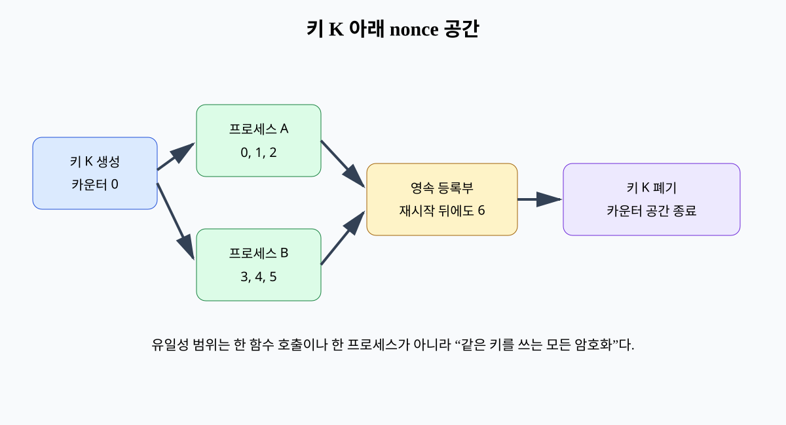
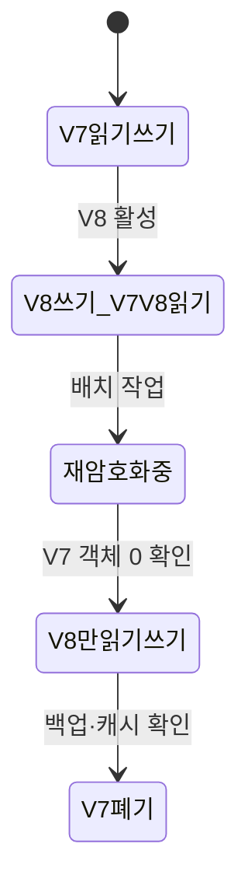

# 11. 데이터 보호와 키 교체

데이터 보호는 암호화 스위치 하나가 아니라 분류, 수집, 사용, 공유, 보존, 삭제의 수명 주기다.

## 1. 데이터 지도

데이터 분류(classification)는 영향에 따라 공개, 내부, 기밀, 매우 민감 같은 등급을 붙인다.

데이터 소유자는 사용 목적과 접근 정책을 승인한다.

관리자(custodian)는 저장과 백업 통제를 운영한다.

처리자(processor)는 업무 목적으로 데이터를 읽거나 변환한다.

각 데이터셋에 위치, 복사본, 스키마, 소유자, 보존 기간, 키 버전을 기록한다.

모르는 복사본은 교체와 삭제에서 빠진다.

## 2. 상태별 보호

전송 중 데이터는 TLS 같은 채널 보호를 쓴다.

저장 데이터는 디스크, 객체, DB 열 등 위협 경계에 맞춰 암호화한다.

사용 중 데이터는 프로세스 메모리에 평문일 수 있다.

디스크 암호화는 디스크 탈취를 줄이지만 실행 중 관리자나 애플리케이션 침해를 막지 못한다.

애플리케이션 열 암호화는 DB 운영자 노출을 줄일 수 있지만 검색·정렬 기능과 키 서비스 의존성이 생긴다.

백업도 같은 분류와 키·접근 정책을 적용한다.

## 3. 데이터 최소화

수집하지 않은 데이터는 유출되지 않는다.

목적에 필요한 필드와 정밀도만 수집한다.

식별자를 제거해도 다른 속성과 결합해 재식별될 수 있다.

가명화는 직접 식별자를 별도 매핑값으로 바꾸지만 매핑 키와 부가 데이터 위험이 남는다.

익명화 주장은 공격자가 가진 외부 데이터와 사용 목적을 포함해 평가한다.

## 4. 키 계층과 envelope encryption

KMS의 KEK가 데이터별 DEK를 감싼다.

DEK는 데이터 암호화에 사용한다.

KEK 접근은 좁고 감사되며, DEK는 짧게 메모리에 존재한다.

키 ID와 버전은 암호문 메타데이터에 저장한다.

AAD에 tenant, object ID, schema version을 묶어 암호문의 위치 이동을 검출한다.

nonce는 같은 DEK 전체에서 유일해야 한다.

## 5. 온라인 교체

dual-read 기간에는 레코드 키 버전으로 정확한 키를 선택한다.

모든 키를 차례로 시도하는 방식은 오류를 숨기고 비용과 오라클 위험을 늘린다.

재암호화 작업은 객체 버전이나 트랜잭션으로 동시 쓰기와 충돌을 처리한다.

진행률은 V7 객체 수, 실패 수, 마지막 성공 위치로 관측한다.

## 6. 삭제의 실제 의미

애플리케이션 행 삭제만으로 replica, snapshot, backup, log의 복사본이 즉시 사라지지 않는다.

논리 삭제는 복구 기간 동안 표시만 숨길 수 있다.

물리 삭제는 저장 엔진 압축이나 vacuum 뒤 반영될 수 있다.

암호학적 삭제는 전용 키를 폐기해 암호문 복구를 어렵게 하지만 키 복사본과 공유 범위를 알아야 한다.

한 키가 여러 고객을 암호화하면 고객 한 명만 암호학적으로 삭제하기 어렵다.

보존 정책은 법적·운영 요구와 삭제 요청을 명시적으로 조정한다.

## 7. 교체가 실패하는 경우

새 키 권한이 일부 서비스에 없어 복호화 오류가 난다.

오래된 worker가 V7으로 계속 새 데이터를 쓴다.

backup restore가 카운터와 키 상태를 과거로 되돌린다.

캐시에 V7 DEK가 남는다.

교체 전 인벤토리, 호환 배포, canary, rollback 조건, 폐기 지연을 설계한다.

키 유출 사고에서는 평상시 교체보다 빠르게 새 쓰기를 차단하고 영향 범위를 조사한다.

## 8. 오해와 반례

오해: DB 암호화를 켜면 DBA도 값을 못 본다.

반례: 서버가 투명하게 복호화하면 충분한 DB 권한을 가진 사용자는 평문을 질의할 수 있다.

오해: 키 교체는 KMS alias만 바꾸면 끝이다.

반례: 옛 암호문, 캐시, 백업, nonce 상태와 소비자 배포가 남는다.

오해: 행 삭제 응답 뒤 모든 복사본이 사라졌다.

반례: WAL, replica, snapshot, backup의 수명은 다르다.

## 9. 문제와 해설

### 문제 1

한 DEK가 모든 고객 데이터를 보호한다. 고객별 암호학적 삭제가 필요한 경우 개선은?

**해설:** 고객별 또는 좁은 데이터 집합별 DEK를 두고 KEK로 감싼다. 고객 DEK와 모든 복사본을 폐기할 수 있어야 하며 공유 백업의 키 메타데이터도 추적한다.

### 문제 2

V8 교체 뒤 V7 사용량이 매시간 3건 남는다. 바로 폐기해도 되는가?

**해설:** 안 된다. 오래된 writer, 재시도 큐, 캐시, 복구 작업을 요청 ID와 서비스 버전으로 찾는다. 새 V7 쓰기를 0으로 만들고 기존 V7 객체와 백업 요구를 확인한다.

### 문제 3

디스크 암호화와 애플리케이션 열 암호화의 위협 경계를 비교하라.

**해설:** 디스크 암호화는 분리된 매체나 snapshot 탈취에 강하지만 실행 중 DB는 평문을 본다. 열 암호화는 DB 계층 노출을 줄일 수 있지만 애플리케이션과 KMS가 평문·키에 접근하고 질의 기능이 제한된다.

## 공식 자료

- [NIST SP 800-57 Part 1 Rev. 5](https://csrc.nist.gov/pubs/sp/800/57/pt1/r5/final)
- [OWASP Cryptographic Storage Cheat Sheet](https://cheatsheetseries.owasp.org/cheatsheets/Cryptographic_Storage_Cheat_Sheet.html)

---

[이전: 공급망과 아티팩트](10-supply-chain-and-artifact-integrity.md) · [목차](README.md) · [다음: 감사 로그와 사고](12-audit-logs-incidents-and-recovery.md)
