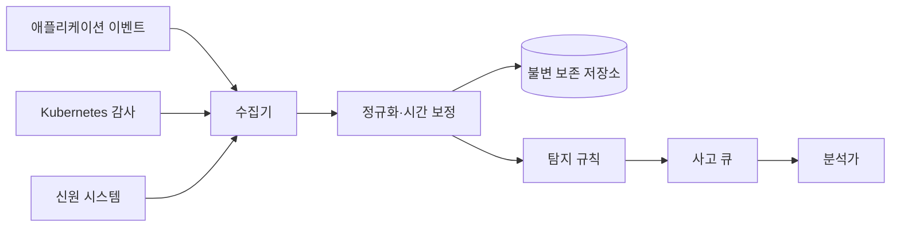
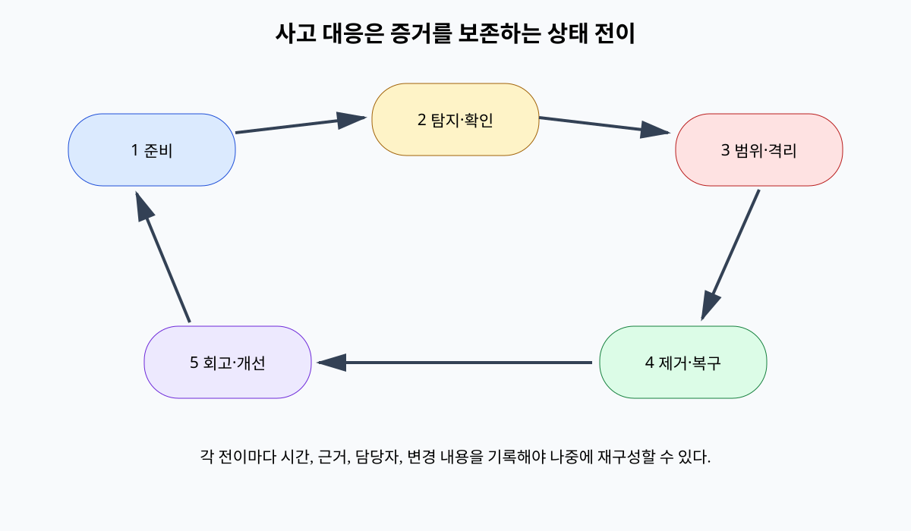

# 12. 감사 로그·사고·복구

감사 로그는 “무슨 일이 있었는가”를 재구성하는 증거다. 로그가 있다는 사실보다 어떤 결정을 어떤 시계와 신원으로 기록했는지가 중요하다.

## 1. 이벤트 구조

이벤트에는 발생 시간과 수집 시간을 구분해 기록한다.

요청 ID와 trace ID는 여러 서비스 기록을 연결한다.

주체 ID와 인증 방법, 세션 ID를 기록한다.

행동, 자원 ID, 정책 버전, 허용·거부 결정을 기록한다.

결과 상태와 변경 전후 버전을 기록한다.

서비스, 노드, 배포 버전 같은 관찰 출처를 기록한다.

비밀번호, 토큰, 개인키, 전체 개인정보는 기록하지 않는다.

필요한 식별자는 마스킹이나 별도 접근 통제로 보호한다.

## 2. 로그 파이프라인

수집기는 backpressure와 손실을 관측해야 한다.

로그 드롭 수가 보이지 않으면 “이벤트 없음”과 “증거 없음”을 구분할 수 없다.

시간 동기화 오차를 기록하고 순서를 단일 timestamp만으로 단정하지 않는다.

중앙 저장소 쓰기 권한과 읽기 권한을 분리한다.

보존 기간과 검색 성능, 개인정보 요구를 함께 정한다.

## 3. 변조 저항과 한계

append-only 권한, 별도 계정, 원격 전송은 침해된 애플리케이션이 과거 로그를 바꾸기 어렵게 한다.

해시 체인은 각 레코드에 이전 digest를 포함해 중간 변경을 탐지할 수 있다.

그러나 공격자가 현재 서명키와 수집기를 장악하면 이후 거짓 기록을 만들 수 있다.

체인의 시작점과 checkpoint를 외부 신뢰 저장소에 고정해야 삭제·재작성 탐지가 강해진다.

로그 무결성은 이벤트 자체가 진실임을 보장하지 않는다.

침해된 서비스가 거짓 사용자 ID를 기록할 수 있어 독립 신원 로그와 비교한다.

## 4. 탐지 규칙

규칙은 관찰 신호, 시간 창, 임계치, 그룹 키를 명확히 한다.

예: 10분 동안 한 계정에서 서로 다른 국가 ASN 3개와 로그인 성공.

예: ServiceAccount가 처음으로 `secrets/list`를 호출.

예: 배포 Admission 거부가 5분에 20건.

임계치를 낮추면 민감도는 높아지지만 오탐이 늘 수 있다.

경보마다 조사에 필요한 원본 이벤트와 자산 중요도를 붙인다.

탐지되지 않았다는 사실이 침해가 없었다는 증명은 아니다.

## 5. 사고 상태 전이

준비 단계에서 연락망, 권한, 증거 보존, 복구 절차를 연습한다.

탐지 뒤 triage가 실제 사고 가능성과 심각도를 평가한다.

범위 확정은 최초 이벤트, 영향 계정, 데이터, 시스템, 지속성 경로를 찾는다.

격리는 공격 확산을 줄이되 증거를 파괴하거나 중요 서비스를 불필요하게 끊지 않게 결정한다.

제거는 악성 상태와 근본 접근 경로를 없앤다.

복구는 깨끗한 상태로 서비스를 되돌리고 강화된 모니터링을 적용한다.

회고는 사람 비난보다 통제와 탐지의 실패 조건을 수정한다.

## 6. 자격 증명 유출 예

12:00에 비정상 Secret 읽기 경보가 발생했다.

분석가는 요청 ID로 주체가 `build-bot`임을 확인한다.

인증 로그에서 11:42 새 IP의 토큰 사용을 찾는다.

RBAC 로그로 읽은 Secret 7개를 열거한다.

토큰을 폐기하고 빌드 계정 새 발급을 중단한다.

읽힌 7개 Secret을 우선 교체하고 의존 서비스 연결을 갱신한다.

CI artifact와 배포 이력을 검사해 지속성 여부를 본다.

타임라인의 각 사실에 로그 출처와 신뢰 수준을 붙인다.

## 7. 복구 검증

백업 성공 메시지만으로 복구 가능성을 증명하지 않는다.

격리 환경에서 복원하고 애플리케이션 불변조건을 검사한다.

RPO는 허용 가능한 데이터 손실 시점 범위다.

RTO는 서비스 복구까지 목표 시간이다.

15분 RPO와 2시간 RTO라면 백업 주기, 복제 지연, 복원 처리량이 이를 만족하는지 측정한다.

랜섬웨어 시나리오에서는 생산 자격 증명으로 백업까지 삭제할 수 없는지 시험한다.

## 8. 오해와 반례

오해: 모든 내용을 로그로 남기면 조사하기 쉽다.

반례: 토큰과 개인정보가 로그에 복제돼 새 유출원이 된다.

오해: 공격 IP를 막았으니 사고가 끝났다.

반례: 탈취된 계정, 지속성 키, 변조된 artifact가 남을 수 있다.

오해: 백업이 매일 성공했으니 복구된다.

반례: 암호화 키가 없거나 schema가 맞지 않아 복원이 실패할 수 있다.

## 9. 문제와 해설

### 문제 1

로그에 API token 전체가 기록됐다. 첫 대응은?

**해설:** 노출된 토큰을 폐기하고 로그 접근자와 복제 위치를 조사한다. 로깅 코드를 수정해 마스킹하고, 이미 저장된 로그는 증거·보존 요구를 고려해 접근 격리와 안전한 정리를 한다.

### 문제 2

서비스 로그와 신원 로그의 시간이 4분 다르다. 타임라인은 어떻게 만드는가?

**해설:** 각 출처의 시계 오차와 수집 시간을 보존하고 요청 ID·세션 ID 같은 인과 연결을 우선한다. 불확실 시간 범위를 표시하며 임의로 정확한 순서를 만들지 않는다.

### 문제 3

Secret 교체 뒤 무엇을 검증해야 사고를 닫을 수 있는가?

**해설:** 옛 값 사용 0, 새 값으로 정상 연결, 캐시·Pod·CI·백업 복사본, 공격자의 지속성, 영향 데이터 접근, 탐지 규칙 개선과 복구 시험을 증거로 확인한다.

## 공식 자료

- [NIST SP 800-61 Rev. 2](https://csrc.nist.gov/pubs/sp/800/61/r2/final)
- [OWASP Logging Cheat Sheet](https://cheatsheetseries.owasp.org/cheatsheets/Logging_Cheat_Sheet.html)

---

[이전: 데이터 보호와 키 교체](11-data-protection-and-key-rotation.md) · [목차](README.md) · [다음: 로컬 교육 모형](13-local-models.md)
