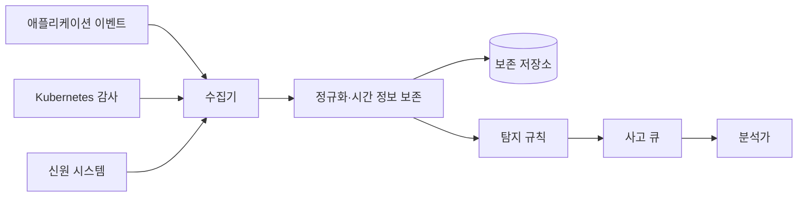

# 12. 감사 로그·사고·복구

감사 로그는 프로그램이 출력한 문장 모음이 아니라 “누가 어떤 객체에 어떤 행동을 요청했고, 어떤 정책이 어떤 결정을 내렸으며, 결과가 무엇이었는가”를 재구성하는 증거다. 로그가 많아도 주체와 객체가 빠지거나 시계가 어긋나거나 수집 중 손실되면 사고 범위를 알 수 없다.

이 장은 하나의 비정상 Secret 읽기 사건을 기준으로 이벤트 생성, 중앙 수집, 탐지, 초기 분류, 범위 확정, 격리, 제거, 복구, 회고까지 연결한다.

## 1. 이벤트와 로그 레코드

**이벤트(event)**는 시스템에서 관찰할 가치가 있는 상태 변화나 판단이다. 로그인 성공·실패, 인가 거부, Secret 읽기, 정책 변경, Pod 생성이 예다.

**로그 레코드(log record)**는 이벤트를 저장·전송할 수 있는 구조화된 바이트로 표현한 것이다. 자유로운 문장만 남기면 서비스마다 필드 이름과 형식이 달라 검색과 연결이 어렵다. JSON 같은 구조를 쓸 수 있지만 형식보다 필드 의미와 수명이 중요하다.

감사 이벤트에는 다음을 분리해 기록한다.

- 이벤트 발생 시각: 원래 서비스가 행동을 관찰한 시각
- 수집 시각: 중앙 수집기가 레코드를 받은 시각
- 주체 ID: 검증된 사용자·ServiceAccount·workload 신원
- 인증 정보: 인증 방식과 세션 식별자, 원문 자격 증명은 제외
- 행동과 객체: `secrets/get`, namespace, 객체 ID
- 정책 결과: allow·deny, 정책 버전과 근거 식별자
- 결과: 성공·실패 코드, 변경 전후 객체 버전
- 출처: 서비스, 노드, Pod, 배포 버전
- 연결 ID: request ID, trace ID, parent span 등

비밀번호, 전체 token, 개인키, 복호화된 Secret과 필요 이상의 개인정보는 기록하지 않는다. 조사에 필요한 식별자는 가명화하거나 별도 접근 통제로 보호한다.

## 2. request ID, trace ID와 인과 관계

한 사용자 요청은 Gateway, 인증 서비스, API, database, queue worker를 거친다. 각 서비스의 로컬 시각만으로 같은 요청을 찾기 어렵다.

**request ID**는 한 요청이나 업무 명령을 연결하는 식별자다. 외부 사용자가 보낸 값을 그대로 신뢰하면 다른 사건과 충돌시키거나 로그를 속일 수 있으므로 경계에서 형식과 길이를 검사하고 내부 ID를 만들 수 있다.

**분산 추적(distributed tracing)**은 여러 서비스의 작업 구간을 span으로 기록하고 부모·자식 관계로 연결하는 관찰 방식이다. **trace ID**는 전체 흐름을, **span ID**는 각 구간을 식별한다.

연결 ID는 보안 증거를 자동으로 진실로 만들지 않는다. 침해된 서비스가 거짓 ID를 쓰거나 전달을 끊을 수 있다. Gateway의 요청 기록, 신원 시스템의 token 사용, Kubernetes 감사 로그처럼 독립 출처를 함께 비교한다.

## 3. 시간은 한 숫자가 아니다

애플리케이션 시계가 12:04, 신원 시스템이 12:00을 가리키고 같은 request ID가 있다면 하나를 임의로 고르지 않는다.

각 레코드에 이벤트 시각, 수집 시각, clock source, 알려진 offset을 보존한다. NTP 같은 시간 동기화 상태와 drift 경보를 기록한다. request ID, 세션, queue offset, database transaction처럼 인과 순서를 보여 주는 다른 증거를 사용한다.

정확한 순서를 확정할 수 없으면 `약 12:00~12:04`처럼 불확실 구간을 표시한다. 사고 보고서에서 추정과 관찰 사실을 구분한다.

시간대도 명시한다. 서로 다른 local timezone 문자열을 합치면 순서가 틀릴 수 있어 UTC와 원래 offset을 일관되게 기록한다.

## 4. 로그 파이프라인과 손실



애플리케이션은 로컬 stdout, 파일, socket 또는 SDK로 이벤트를 내보낸다. **수집기(collector)**는 여러 출처의 레코드를 받아 중앙 파이프라인으로 전달한다. **정규화(normalization)**는 서로 다른 필드를 공통 schema로 매핑하되 원본 의미와 출처를 보존하는 작업이다.

저장소나 네트워크가 느릴 때 producer 속도가 consumer를 넘으면 **backpressure**가 생긴다. 애플리케이션을 멈출지, 메모리에 queue할지, 디스크에 buffer할지, 일부 로그를 버릴지 정책이 필요하다.

드롭 수, queue 깊이, 마지막 성공 전송 시각, parsing 실패를 지표로 낸다. 이것이 없으면 “관련 이벤트가 없다”와 “로그가 수집되지 않았다”를 구분할 수 없다.

보안 감사가 실패했을 때 고위험 변경 요청을 거부할지, 제한적으로 허용하고 강한 경보를 낼지는 서비스 가용성과 규제 요구에 따라 정한다. 암묵적으로 조용히 버리는 상태가 가장 위험하다.

## 5. 보존, 검색과 개인정보

로그도 데이터 자산이다. 인증 정보, IP, 사용자 행동, 객체 이름을 포함해 공격자에게 가치가 있다. 읽기 권한을 분석가 역할로 제한하고 export를 감사한다.

보존 기간은 사고 탐지 지연과 조사 요구를 충족해야 하지만 불필요하게 긴 개인정보 보존은 위험을 늘린다. 실시간 검색용 hot storage, 장기 압축 저장, 법적 hold를 구분할 수 있다.

삭제 요청이 있어도 보안 사고 증거와 법적 보존 의무가 충돌할 수 있다. 필드별 목적과 보존 근거를 정하고, 검색 index와 backup 복사본의 만료도 추적한다.

민감 필드를 마스킹할 때 매번 다른 값으로 완전히 지우면 같은 주체의 사건 연결이 어려울 수 있다. 제한된 상관 식별자와 원본 접근 절차를 설계한다. 단순 해시는 작은 이메일 공간에 대한 사전 계산 공격이 가능해 가명화 방법과 키를 관리한다.

## 6. 변조 저항과 한계

애플리케이션이 자기 로그 저장소의 과거 기록을 삭제할 수 있으면 침해 뒤 증거를 지울 수 있다. 원격 수집, 별도 계정, 추가 전용에 가까운 쓰기 권한, 보존 잠금으로 변경을 어렵게 한다.

**해시 체인(hash chain)**은 각 레코드 또는 batch에 이전 digest를 포함해 중간 삭제와 변경을 탐지하는 구조다.

```text
H0 = trusted checkpoint
H1 = hash(H0 || event1)
H2 = hash(H1 || event2)
```

event1이 바뀌면 이후 체인이 달라진다. 그러나 공격자가 현재 수집기와 서명키를 장악하면 그 이후 거짓 체인을 만들 수 있고, 전체 꼬리를 삭제할 수도 있다. 주기적 checkpoint를 별도 신뢰 저장소나 독립 시스템에 고정해야 탐지가 강해진다.

로그 무결성은 사건 내용이 진실이라는 보장이 아니다. 침해된 서비스가 `subject=alice`라는 거짓 필드를 올바르게 서명할 수 있다. 신원 발급 로그, network, database, cloud control plane처럼 독립 출처와 대조한다.

## 7. 탐지 규칙을 가설로 쓴다

**탐지(detection)**는 관찰 이벤트에서 침해 가능성이 있는 패턴을 찾는 과정이다. **경보(alert)**는 규칙이 조건을 만족해 분석이 필요하다고 만든 작업이다. 경보는 사고 확정이 아니다.

규칙에는 다음을 명확히 한다.

- 관찰 신호와 필요한 필드
- 시간 창
- 임계치
- 사용자·ServiceAccount·IP 같은 그룹 키
- 제외 조건과 자산 중요도
- 조사에 붙일 원본 이벤트

예를 들어 `ServiceAccount build-bot이 이전 30일에 없던 secrets/list를 호출`이라는 규칙은 새 행동을 찾는다. 정상 배포 변경도 같은 신호를 만들 수 있으므로 change ticket과 workload version을 붙인다.

`10분 동안 한 계정에서 세 ASN의 로그인 성공` 규칙은 지리적으로 다른 network 사용을 의심한다. VPN과 mobile carrier가 오탐을 만들 수 있다.

임계치를 낮추면 더 많은 사건을 잡을 수 있지만 오탐도 늘어 분석 queue가 포화될 수 있다. 정밀도와 재현율, 탐지 시간, 분석가 처리량을 함께 측정한다.

탐지되지 않았다는 사실은 침해가 없었다는 증명이 아니다. 로그 범위와 규칙, 공격자의 회피 능력이 관찰 한계를 정한다.

## 8. 사고와 초기 분류

**보안 사고(incident)**는 기밀성·무결성·가용성 또는 정책을 실제로 침해했거나 그 가능성이 높아 대응이 필요한 사건이다.

**초기 분류(triage)**는 경보가 실제 사고일 가능성, 자산 중요도, 현재 진행 여부를 빠르게 판단해 우선순위를 정하는 단계다.

초기 질문은 다음과 같다.

1. 어떤 탐지 규칙이 어떤 원본 이벤트로 발동했는가?
2. 주체와 객체가 실제로 존재하며 정상 변경과 연결되는가?
3. 현재도 공격 행동이 계속되는가?
4. 자격 증명, 고객 데이터, 생산 제어 plane이 관련됐는가?
5. 즉시 격리가 더 큰 피해를 막는가, 중요한 증거를 파괴하는가?

경보를 닫아도 근거와 관찰 범위를 남긴다. 오탐이 반복되면 규칙을 무조건 끄지 말고 정상 행동을 설명하는 신호를 추가한다.

## 9. 사고 대응 상태 전이


**준비(preparation)** 단계에서 연락망, 권한, 도구, 증거 보존, 비상 자격 증명, 복구 절차를 연습한다.

**탐지와 분석**에서 경보를 검증하고 최초 사건, 영향 주체·객체·시스템, 공격자의 지속성 경로를 찾는다.

**격리(containment)**는 확산과 추가 피해를 줄인다. token 폐기, account 정지, network 격리, workload 중지가 예다. 성급한 재부팅은 메모리 증거를 잃거나 공격자가 다른 지속성 경로를 활성화하게 할 수 있어 목표를 정한다.

**제거(eradication)**는 악성 코드, 계정, 설정과 근본 접근 경로를 없앤다. 공격 IP 하나 차단은 탈취된 token과 악성 artifact를 제거하지 않는다.

**복구(recovery)**는 신뢰할 수 있는 상태에서 서비스를 되돌리고 강화된 감시로 재침해 여부를 본다. 복원된 데이터와 schema, 키, 권한 불변조건을 검증한다.

**회고(post-incident review)**는 사람 비난보다 어떤 가정과 통제가 실패했는지, 탐지·격리·복구 시간을 어떻게 줄일지 결정한다.

## 10. 증거 범위와 신뢰 수준

사고 타임라인의 문장마다 출처와 신뢰 수준을 붙인다.

- 관찰 사실: Kubernetes 감사 로그에 11:58 `build-bot`의 `secrets/get` 성공이 있다.
- 추론: 같은 session ID와 새 IP 때문에 token 탈취 가능성이 높다.
- 미확인: Secret 값이 외부로 실제 전송됐는지는 network 증거가 없다.

**증거 보존(chain of custody)**은 누가 언제 어떤 원본을 수집·복사·분석했는지 기록해 변경 여부와 취급 책임을 설명하는 절차다. 원본 disk snapshot, log export, memory dump의 digest와 접근 기록을 보존할 수 있다.

운영 복구를 위해 시스템을 바꿔야 한다면 변경 전후 시각과 명령, 수행자를 기록한다. 완벽한 증거 보존 때문에 현재 피해 확산을 방치하지도 않고, 성급한 정리로 범위를 잃지도 않게 사고 지휘자가 우선순위를 정한다.

## 11. 자격 증명 유출 전체 예제

12:00에 `build-bot`의 비정상 Secret 읽기 경보가 발생했다고 하자.

1. 분석가는 alert가 참조한 Kubernetes audit event의 request ID와 object 7개를 확인한다.
2. 신원 로그에서 같은 session이 11:42 처음 보는 network에서 사용된 사실을 찾는다.
3. CI 변경 기록에 승인된 작업이 없음을 확인한다.
4. token을 폐기하고 build-bot의 새 발급을 일시 중단한다.
5. 공격자가 읽은 7개 Secret의 권한과 소비 서비스를 분류한다.
6. 우선 새 Secret을 발급하고 소비자를 전환한 뒤 옛 값을 폐기한다.
7. registry push, deployment, cloud API 로그를 조사해 지속성 artifact와 새 계정을 찾는다.
8. 격리된 builder에서 알려진 정상 commit으로 artifact를 다시 만들고 digest를 비교한다.
9. 옛 token 사용 0, Secret 전환, 정상 build, 강화된 탐지를 증거로 복구한다.

Secret을 교체했다고 사고를 닫지 않는다. 공격자가 그 값으로 만든 session, 변경한 데이터, 배포한 artifact가 남을 수 있다.

## 12. 복구 검증과 RPO·RTO

backup 성공 메시지는 복구 가능성의 일부 증거일 뿐이다. 격리 환경에서 실제 복원하고 schema migration, key version, 행 수, 참조 무결성, 애플리케이션 핵심 기능을 검사한다.

**RPO**는 허용 가능한 데이터 손실 시점 범위이고 **RTO**는 서비스 복구까지 목표 시간이다. RPO 15분, RTO 2시간이면 backup 주기, 복제 지연, 탐지 시간, 복원 처리량, DNS·자격 증명 전환을 합친 결과가 이를 만족해야 한다.

ransomware 시나리오에서는 생산 관리자 자격 증명이 backup까지 삭제할 수 없는지 시험한다. 복구용 키와 계정이 사고 중에도 사용 가능한지, 평소 너무 넓은 권한으로 노출되지 않는지 확인한다.

복구 뒤에는 일정 기간 인증 실패, 권한 변경, egress, key 사용을 더 민감하게 감시한다. 정상 기준이 사고 전과 달라졌으면 탐지 규칙을 갱신한다.

## 13. 심각도와 격리 순서를 정한다

사고 **심각도(severity)**는 기술적으로 신기한 공격인지가 아니라 영향 자산, 공격자 권한, 확산 가능성, 현재 진행 여부, 복구 난이도를 함께 평가한 우선순위다. 공개 시험 계정의 실패 로그인 100건과 생산 관리자 token의 성공 사용 1건은 횟수만으로 비교하지 않는다.

격리는 효과와 부작용을 표로 적는다. 사용자 token 폐기는 공격자 접근을 빠르게 막지만 자동화 작업을 중단할 수 있다. 노드 전원 차단은 network 활동을 멈추지만 memory 증거와 실행 상태를 잃는다. egress 차단은 유출을 줄이지만 내부 제어 연결도 끊을 수 있다.

즉시 조치에는 승인자를 미리 정한다. 사고 중 일반 관리자 계정이 침해됐을 수 있으므로 별도 비상 계정과 다중 승인을 준비한다. 비상 권한 사용 자체도 독립 저장소에 감사하고 사건 뒤 폐기한다.

## 14. 범위 확정과 threat hunting

**범위 확정(scoping)**은 최초 경보 하나에서 같은 원인과 자격 증명, artifact, network 경로로 영향받은 시스템을 찾는 과정이다. 알려진 한 IP만 검색하면 공격자가 바꾼 주소와 내부 lateral movement를 놓친다.

**threat hunting**은 이미 알려진 경보를 기다리지 않고 공격 가설로 과거와 현재 telemetry를 탐색하는 활동이다. 예를 들어 “build-bot token이 탈취됐다면 Secret 읽기 뒤 registry push나 새 RoleBinding이 있었을 것”이라는 가설을 세워 신원, Kubernetes, registry 로그를 연결한다.

검색 범위에는 token 발급 시각 이전의 최초 침해 가능 시간부터 폐기 뒤 재시도까지 넣는다. 같은 key ID, session, workload image digest, source IP뿐 아니라 새 계정 생성과 정책 변경을 본다. 발견하지 못한 경로는 로그 보존과 수집 범위 때문에 관찰 불가능했는지 기록한다.

## 15. 대응과 복구 지표

측정은 팀 평가가 아니라 개선 지점을 찾기 위한 것이다. 최초 악성 행동부터 탐지까지 시간, 경보부터 triage 시작까지 시간, 격리까지 시간, 복구까지 시간, 영향 객체 수, log 손실률을 기록할 수 있다.

평균 하나만 보면 큰 사고를 숨길 수 있어 사건 유형과 심각도별 분포를 본다. 빨리 닫은 경보가 정확하지 않으면 재침해를 놓친다. 종료 속도와 함께 재개방, false positive, 복구 시험 성공률을 본다.

사고 중 의사소통 기록에는 확인된 사실, 추정, 다음 결정, 소유자, 예정 시각을 분리한다. 고객 통지와 규제 보고는 법무·개인정보 책임자와 정한 절차를 따르되 기술팀이 영향 범위와 불확실성을 과장 없이 제공한다.

## 16. endpoint 증거 수집의 경계

침해된 Pod나 서버에서 process 목록, 열린 network 연결, mount, 실행 파일 digest, memory와 disk snapshot을 수집할 수 있다. 수집 도구 자체가 상태를 바꾸고 민감 데이터를 복사하므로 목적과 최소 범위를 정한다.

실행 중 memory에는 token, DEK, 고객 데이터가 있을 수 있다. dump 전체를 일반 ticket에 첨부하지 않고 제한된 evidence 저장소에 암호화해 보관한다. 분석용 사본을 만들 때 digest와 수행자를 기록하고 원본은 읽기 제한한다.

cloud와 Kubernetes control plane의 감사 로그는 workload 내부 로그보다 독립적일 수 있지만 보존 기간과 필드가 다르다. node가 사라지기 전에 수집해야 하는 증거와 중앙에 이미 있는 증거를 나눠 우선순위를 정한다.

## 17. 외부 의존성과 복구 순서

서비스 하나를 복원해도 DNS, 인증기관, KMS, database, queue, 외부 API가 준비되지 않으면 사용자 기능은 돌아오지 않는다. 복구 runbook은 구성 요소 이름 목록이 아니라 의존 순서와 건강 조건을 적는다.

예를 들어 KMS와 identity service를 먼저 검증하고, database를 복원한 뒤 읽기 전용으로 불변조건을 검사하며, API를 제한된 traffic에 canary로 열고, queue consumer를 마지막에 늘릴 수 있다. producer를 먼저 열면 처리되지 못한 작업이 쌓여 복구를 방해할 수 있다.

복구 완료는 process가 실행 중이라는 신호보다 사용자 관점의 핵심 transaction과 감사·탐지 파이프라인까지 정상이라는 증거로 정한다.

복구 중 임시로 완화한 보안 정책은 소유자와 만료를 가져야 한다. 사고가 끝난 뒤 열린 network 규칙과 비상 관리자 권한이 남으면 복구 절차가 새 취약점을 만든다.

사고 종료 승인은 열린 조사 항목, 임시 예외, 남은 위험과 후속 기한을 명시해 운영 인수자에게 전달한 뒤 이뤄진다.

## 18. 오해와 반례

**“모든 내용을 로그로 남기면 조사하기 쉽다.”** token과 개인정보가 로그에 복제돼 새 유출원이 된다.

**“공격 IP를 막았으니 끝났다.”** 탈취 계정, 지속성 키, 악성 artifact가 남을 수 있다.

**“매일 backup 성공이라 복구된다.”** 키, schema, 권한과 처리량 문제로 restore가 실패할 수 있다.

**“경보가 없으니 침해가 없다.”** 로그 손실과 규칙 범위 밖 행동은 관찰되지 않는다.

## 19. 연습 문제와 자세한 풀이

### 문제 1. token 원문 로그

첫 대응은 무엇인가?

**풀이:** token을 폐기하고 로그 접근자·복제 위치·노출 기간을 조사한다. 로깅 코드를 마스킹하도록 수정하고, 저장 로그는 증거와 보존 요구를 고려해 접근 격리·정리한다.

### 문제 2. 시계 4분 차이

타임라인을 어떻게 만드는가?

**풀이:** 각 출처의 event·ingest time과 clock offset을 보존한다. request ID와 session, queue 순서로 인과를 연결하고 불확실 시간 범위를 표시한다.

### 문제 3. Secret 교체 뒤 종료 조건

무엇을 확인하는가?

**풀이:** 옛 값 사용 0, 새 값 정상 연결, cache·Pod·CI·backup 복사본, 파생 session, 지속성 artifact, 영향 데이터 접근, 탐지 개선과 복구 시험을 확인한다.

### 문제 4. 로그 없음

특정 시간에 이벤트가 없으므로 행동이 없었다고 결론 내릴 수 있는가?

**풀이:** collector drop, queue, parsing failure, 서비스 logging 상태를 먼저 확인한다. 수집 완전성 증거가 없으면 “관찰하지 못함”으로 보고한다.

### 문제 5. 해시 체인

체인이 맞으면 이벤트가 진실인가?

**풀이:** 체인은 저장 뒤 변경 탐지를 돕지만 침해 서비스가 처음부터 거짓 필드를 기록할 수 있다. 독립 신원·network·database 로그와 대조한다.

### 문제 6. 즉시 재부팅

침해 의심 서버를 바로 재부팅해야 하는가?

**풀이:** 확산 위험과 메모리 증거, 서비스 영향을 비교한다. network 격리 후 필요한 volatile 증거를 수집할 수도 있다. 사고 지휘자가 목표와 변경을 기록한다.

### 문제 7. RTO 2시간

복원만 3시간 걸린다.

**풀이:** 목표를 만족하지 못한다. 병렬 복원, 필수 서비스 우선, 따뜻한 대기, 작은 복구 단위와 자동화로 end-to-end 시간을 줄이고 반복 훈련으로 측정한다.

## 공식 근거

- [NIST SP 800-61 Rev. 2: Incident Handling Guide](https://csrc.nist.gov/pubs/sp/800/61/r2/final)
- [NIST SP 800-92: Log Management](https://csrc.nist.gov/pubs/sp/800/92/final)
- [OWASP Logging Cheat Sheet](https://cheatsheetseries.owasp.org/cheatsheets/Logging_Cheat_Sheet.html)

---

[이전: 데이터 보호와 키 교체](11-data-protection-and-key-rotation.md) · [목차](README.md) · [다음: 로컬 교육 모형](13-local-models.md)
