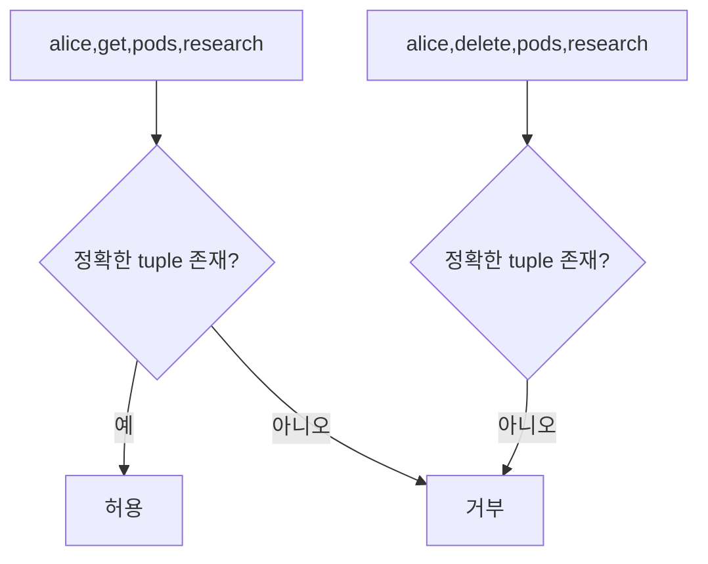
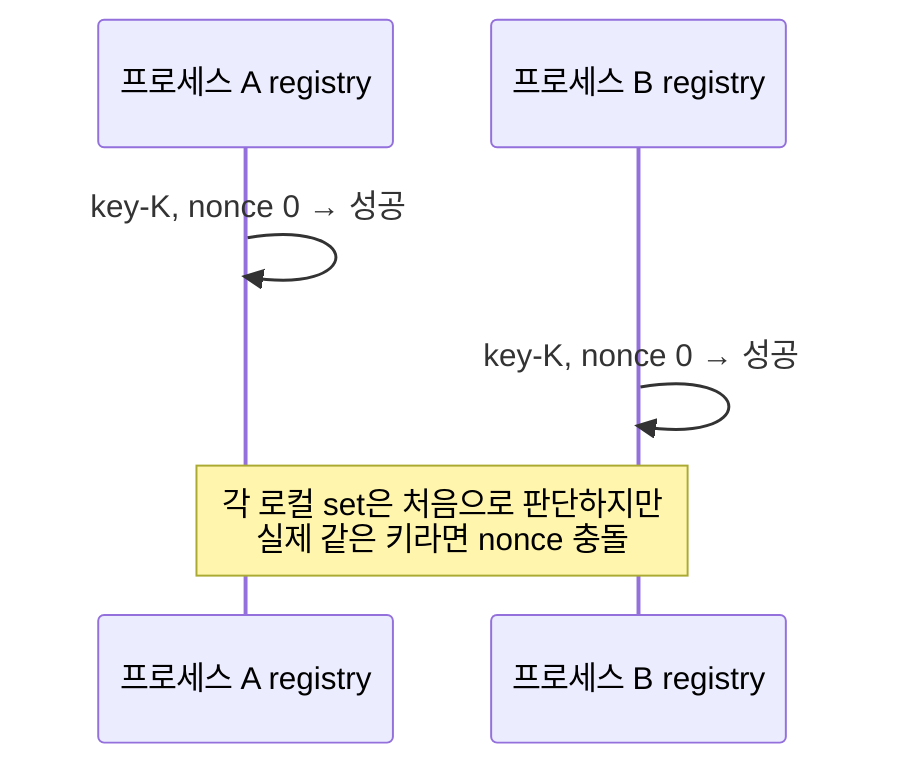

# 13. 로컬 교육 모형

이 장의 세 Python 프로그램은 보안 개념을 작은 상태 전이로 고정해 눈으로 확인하게 한다. 실제 Kubernetes cluster, 암호화 서비스, 사용자 계정을 읽거나 바꾸지 않는다. 출력이 예상과 같다는 사실은 프로그램 안에 표현한 규칙이 일관되다는 뜻이며 실제 배포가 안전하다는 인증이 아니다.

**교육 모형(toy model)**은 현실에서 한 질문에 필요한 객체와 상태만 남긴 프로그램이다. 무엇을 넣지 않았는지 이해하는 것이 실행 결과만큼 중요하다. 이 장에서는 각 파일의 모든 입력, 메모리 상태, 함수 반환, assert, 출력과 경계를 순서대로 읽는다.

## 1. 실행 환경과 공통 경계

[examples 디렉터리](examples/README.md)의 세 파일은 Python 표준 라이브러리만 사용한다. 외부 package를 설치하지 않고 network, 파일, 환경 변수, 운영체제 권한에 접근하지 않는다. 입력은 source code에 고정돼 실행할 때마다 같은 사례를 만든다.

```bash
python3 authorization_model.py
python3 nonce_registry_model.py
python3 integrity_model.py
```

이 명령은 examples 디렉터리에서 실행한다. Python 3가 필요하다. 프로그램은 현재 디렉터리에 파일을 만들지 않는다.

**assert**는 뒤의 조건이 거짓이면 AssertionError로 프로그램을 중단하는 Python 문장이다. 여기서는 개발자가 예상한 결과와 실제 결과가 같은지 확인한다. assert가 모두 통과해도 모형에 쓰지 않은 입력, 경쟁 조건, 재시작, 실제 API 동작은 시험되지 않는다.

## 2. 인가 모형의 입력 객체

[authorization_model.py](examples/authorization_model.py)는 요청 한 건을 네 문자열로 표현한다.

```python
@dataclass(frozen=True)
class Request:
    subject: str
    verb: str
    resource: str
    namespace: str
```

**dataclass**는 관련 필드를 가진 객체를 만들기 쉽게 하는 Python 기능이다. `frozen=True`는 생성 뒤 필드 대입을 막아 사례 실행 중 요청이 바뀌지 않게 한다. 이것은 보안 경계가 아니라 교육 모형의 상태 단순화다.

`subject`는 이미 인증됐다고 가정한 주체 이름이다. 프로그램은 비밀번호나 token을 검증하지 않는다. `verb`는 get·list·create·delete 같은 행동, `resource`는 pods·deployments 같은 객체 종류, `namespace`는 Kubernetes 이름 범위다.

정책은 tuple의 집합이다.

```python
RULES = {
    ("alice", "get", "pods", "research"),
    ("alice", "list", "pods", "research"),
    ("build-bot", "create", "deployments", "staging"),
}
```

**tuple**은 순서가 있는 값 묶음이고 **set**은 중복 없는 값 집합이다. 여기서는 네 필드가 정확히 같은 tuple이 RULES 안에 있을 때만 허용한다.

## 3. 인가 함수의 상태 전이

`authorize`는 Request를 받아 네 필드 tuple을 만들고 `key in RULES` 결과를 반환한다.

```python
def authorize(request: Request) -> bool:
    key = (request.subject, request.verb, request.resource, request.namespace)
    return key in RULES
```

첫 사례 `alice,get,pods,research`는 첫 규칙과 정확히 같아 True다. 두 번째는 verb가 delete라 일치 규칙이 없어 False다. 세 번째는 get pods가 같지만 namespace가 production이라 False다. 네 번째 build-bot 사례는 세 번째 규칙과 같아 True다.

```text
alice     get    pods        research   -> 허용
alice     delete pods        research   -> 거부
alice     get    pods        production -> 거부
build-bot create deployments staging    -> 허용
```

각 case는 예상 boolean을 함께 가진다. `actual is expected` assert가 다르면 요청, 실제값, 예상값을 오류에 넣는다.

이 모형은 정책에 없는 요청을 기본 거부하는 실패 안전 기본값을 보여 준다. wildcard, group, RoleBinding, API group, subresource, 객체 이름, 시간 조건, 명시적 deny와 우선순위는 없다. 문자열 `alice`가 실제 alice인지도 확인하지 않는다.



실제 Kubernetes에서는 여러 binding의 허용이 합쳐지고 Pod create가 간접 권한을 만들 수 있다. 이 출력으로 실제 API 결과를 예측하지 않는다.

## 4. nonce 등록부의 데이터 구조

[nonce_registry_model.py](examples/nonce_registry_model.py)는 한 프로세스 메모리에서 key ID별 사용한 정수 nonce를 기록한다.

```python
@dataclass
class NonceRegistry:
    used: dict[str, set[int]] = field(default_factory=dict)
```

`dict`는 key ID 문자열을 해당 nonce set에 연결한다. 새 객체가 만들어질 때 `default_factory=dict`가 빈 사전을 만든다. class 전체가 공유하는 사전이 아니라 registry instance마다 별도 상태다.

초기 상태는 `{}`다. `reserve(key_id, nonce)`는 먼저 nonce가 음수면 ValueError를 발생시킨다. 그 뒤 `setdefault`로 key ID의 set을 찾거나 새 set을 만든다. nonce가 이미 set에 있으면 False를 반환하고 상태를 바꾸지 않는다. 처음이면 set에 넣고 True를 반환한다.

## 5. nonce 이벤트 네 개의 전체 trace

입력은 다음 고정 목록이다.

```python
events = [("key-A", 0), ("key-A", 1), ("key-B", 0), ("key-A", 0)]
```

상태를 한 단계씩 추적한다.

| 단계 | 입력 | 검사 전 상태 | 반환 | 검사 후 상태 |
|---:|---|---|---|---|
| 1 | key-A, 0 | `{}` | True | `{"key-A": {0}}` |
| 2 | key-A, 1 | A에 0 | True | `{"key-A": {0,1}}` |
| 3 | key-B, 0 | A에 0,1 | True | A에 0,1; B에 0 |
| 4 | key-A, 0 | A에 이미 0 | False | 변화 없음 |

assert는 결과 목록이 `[True, True, True, False]`인지와 최종 used 사전이 정확한지 확인한다. 출력은 성공과 중복 거부를 네 줄로 표시한다.

이 모형이 보여 주는 것은 nonce 0이 전역에서 한 번만 쓰인다는 규칙이 아니다. `(key ID, nonce)` 쌍이 범위다. key-B의 0은 성공한다.



## 6. nonce 모형이 의도적으로 빠뜨린 것

used는 process memory에만 있어 종료하면 사라진다. 재시작한 새 registry는 key-A의 0을 다시 성공시킨다. 두 process가 별도 registry를 가지면 둘 다 같은 쌍을 처음이라고 본다.

검사와 삽입도 여러 process를 위한 원자 transaction이 아니다. 실제 공유 database에서 `존재 검사 → 나중에 insert`로 나누면 두 writer가 동시에 없음으로 보고 둘 다 사용할 수 있다. `(stable_key_id, nonce)` unique constraint와 같은 원자 예약이 필요하다.

key ID 문자열이 실제 key material의 identity를 보증하지 않는다. 같은 key를 `key-A`와 `alias-A`로 부르면 다른 set에 기록돼 중복을 놓친다. 반대로 key rotation 뒤 다른 실제 key가 같은 alias를 쓰면 범위를 지나치게 합칠 수 있다.

counter rollback, VM snapshot, 범위 할당, 저장 손상, registry 가용성, AEAD 호출과 예약 사이 실패도 없다. 예약 뒤 암호화가 실패해 nonce를 건너뛰는 것은 보통 재사용보다 안전하지만 정확한 규격을 따른다.

## 7. 무결성 모형의 입력

[integrity_model.py](examples/integrity_model.py)는 Python `hmac`과 `hashlib`을 사용한다.

```python
demo_key = b"fixed-classroom-key-not-for-production"
original = b"amount=100&to=bob"
changed = b"amount=900&to=bob"
```

앞의 `b`는 문자열이 Unicode text가 아니라 bytes임을 뜻한다. demo key는 실행마다 같은 출력을 위한 교실용 고정값이다. source에 실제 비밀키를 넣어도 된다는 예가 아니다.

`tag` 함수는 HMAC-SHA-256 digest 32바이트를 반환한다. `verify`는 같은 key와 message로 expected tag를 계산하고 `hmac.compare_digest`로 supplied tag와 비교한다.

## 8. HMAC과 공개 해시 trace

1. original message와 demo key로 original tag를 만든다.
2. 같은 original과 tag를 verify하면 expected와 supplied가 같아 True다.
3. changed message와 원본 tag를 verify하면 changed에 대한 expected tag가 달라 False다.
4. assert 두 개가 각각 성공과 실패를 확인한다.
5. SHA-256으로 original과 changed의 공개 digest를 각각 계산한다.
6. 두 digest가 다름을 assert한다.

```text
원본 HMAC 검증: 성공
변조 메시지에 원본 HMAC 사용: 실패
공개 해시는 누구나 다시 계산할 수 있으므로 송신자 인증 수단이 아닙니다.
```

공개 SHA-256이 변조를 전혀 찾지 못한다는 뜻은 아니다. 신뢰한 별도 경로에서 original digest를 받았다면 changed 파일과 다름을 찾는다. 모형의 문장은 공격자가 메시지와 공개 digest를 모두 바꿀 수 있는 환경에서 해시만으로 송신자를 인증할 수 없다는 뜻이다.

HMAC 검증 성공도 메시지가 새것임을 뜻하지 않는다. 공격자가 original과 original tag를 다시 보내면 성공한다. request ID와 서버 처리 상태가 별도다. 같은 HMAC key를 가진 참여자는 모두 태그를 만들 수 있어 어느 한쪽이 만들었다는 제3자 증거도 아니다.

## 9. 세 모형의 상태·보장·경계 비교

| 모형 | 입력 | 변하는 상태 | 출력 | 보여 주는 것 | 보여 주지 않는 것 |
|---|---|---|---|---|---|
| 인가 | Request 4필드 | 없음 | bool | exact allowlist와 default deny | 인증, 실제 RBAC, 간접 권한 |
| nonce | key ID와 int | process memory dict·set | bool | 한 registry의 쌍 중복 | 영속성, 다중 writer, 실제 key identity |
| 무결성 | key·message·tag | 없음 | bool·문장 | HMAC 변조 검증과 공개 hash 차이 | key 관리, replay, signature, protocol |

모형의 **불변조건(invariant)**은 실행 중 항상 유지돼야 하는 규칙이다. 인가에서는 허용 결과가 RULES의 정확한 membership과 같아야 한다. nonce에서는 각 key ID set에 같은 정수가 중복 저장되지 않는다. 무결성에서는 original tag가 changed message를 검증하지 않아야 한다.

불변조건 자체가 현실 보안 요구와 충분히 같은지 검토해야 한다. nonce set 불변조건은 process 하나에서는 참이지만 같은 실제 key 전체의 유일성 요구보다 좁다.

## 10. 안전하게 확장하는 실험

인가 모형에는 group 규칙을 별도 set으로 만들고 direct와 group 허용의 합집합을 계산할 수 있다. deny를 넣는다면 allow와 충돌할 때 우선순위를 먼저 정의하고 case로 고정한다.

nonce 모형에는 새 빈 NonceRegistry를 만들어 재시작을 흉내 내고 이전 0이 다시 허용됨을 관찰할 수 있다. 두 registry를 나란히 만들어 process 분리를 표현한다. 실제 파일과 network를 추가하지 않아도 상태 범위 문제를 볼 수 있다.

무결성 모형에는 request ID를 message bytes에 포함하고 처리 ID set을 추가해 replay를 거부할 수 있다. 같은 ID 두 번을 넣어 두 번째가 거부되는 assert를 만든다. timestamp만 추가하면 허용 시간 창 안 replay가 남는다는 반례도 만든다.

교육 확장에서 암호 알고리즘을 직접 새로 만들거나 생산 key와 고객 데이터를 넣지 않는다. 실제 library 계약을 바꾸지 않고 주변 상태의 의미를 모델링한다.

## 11. 결과를 잘못 일반화하지 않는 법

고정 case 네 개가 통과해도 입력 공간 전체를 시험한 것이 아니다. `resource="pods/log"`, 빈 문자열, Unicode, 매우 긴 값, group, wildcard는 없다.

nonce 결과에 중복이 없다고 cryptographic nonce 안전성을 증명하지 않는다. 생성기의 편향, key alias, process race, rollback이 모형 밖이다.

HMAC example이 성공한다고 자체 network protocol을 배포하지 않는다. key 합의, 방향별 key 분리, canonicalization, replay, error 처리, rotation과 권한이 빠져 있다.

실제 주장에는 사용한 모형, 고정 입력, 포함 상태, 제외 상태를 함께 적는다.

## 12. 실패 사례를 상태표로 설계한다

모형을 확장할 때 정상 사례 수를 늘리는 것보다 경계를 깨는 최소 사례를 먼저 쓴다. 인가 모형에는 빈 subject, 올바른 verb와 다른 namespace, pods와 pods/log, 대소문자가 다른 resource를 넣는다. expected 값을 먼저 적고 함수 결과와 비교한다.

nonce 모형에는 음수 입력이 ValueError인지, 같은 key의 같은 nonce가 상태를 바꾸지 않는지, 다른 key에서 같은 nonce가 허용되는지 확인한다. 두 registry의 상태가 독립임을 명시적으로 출력하면 다중 process 한계가 보인다.

무결성 모형에는 message 한 byte 변경, tag 한 byte 변경, 다른 key를 넣는다. 모두 False여야 한다. 같은 original pair를 두 번 검증하면 둘 다 True라는 replay 반례도 기록한다. 이 결과는 HMAC 실패가 아니라 모형에 freshness 상태가 없음을 보여 준다.

| 실패 주입 | 기대 결과 | 드러나는 경계 |
|---|---|---|
| unknown subject | deny | default deny |
| same nonce twice | second False | local duplicate detection |
| new registry, old nonce | True | no persistence |
| changed message, old tag | False | message integrity |
| original pair replay | True | no replay state |

**property**는 여러 입력에서 유지돼야 하는 일반 규칙이다. 예를 들어 RULES에 없는 모든 생성 Request는 deny여야 한다. 자동 생성 시험을 추가할 수 있지만 생성 범위와 oracle이 정확해야 한다. 실제 Kubernetes 의미를 모르는 generator가 많은 문자열을 시험해도 실제 RBAC 보장은 되지 않는다.

## 13. 모형 변경의 검토 절차

먼저 질문을 한 문장으로 정한다. 다음으로 입력, 상태, 출력과 불변조건을 적고, 그 질문에 필요 없는 network·file·production secret은 넣지 않는다. 정상 사례와 최소 반례를 함께 만든다.

변경 뒤 기존 assert가 계속 통과하는지와 새 assert가 의도한 실패를 잡는지 확인한다. 일부러 잘못된 구현을 넣어 test가 실패하는 mutation 확인도 가능하다. test가 구현 변경을 전혀 감지하지 못하면 증거가 약하다.

마지막으로 README와 장의 한계 목록을 갱신한다. 모형이 점점 실제 system처럼 복잡해지면 검토된 emulator나 격리 integration test로 옮길 시점이다. toy code에 자체 cryptographic protocol과 권한 engine을 계속 덧붙이지 않는다.

모형 실행 결과를 보고할 때 Python version, source commit, 정확한 실행 명령과 exit status를 함께 남긴다. 출력 문장만 복사하면 assert가 모두 실행됐는지와 수정된 source인지 확인하기 어렵다.

세 모형은 교육 질문이 달라 결과 숫자를 서로 비교하는 평가 도구가 아니다. 각 불변조건과 제외 범위를 따로 읽는다.

## 14. 오해와 반례

**“assert가 통과해 설계가 검증됐다.”** 모형에 없는 경쟁·재시작·공격 입력은 관찰하지 않았다.

**“nonce set을 파일에 저장하면 완성이다.”** 다중 writer 원자성, rollback, alias, 손상 복구가 남는다.

**“HMAC 예제가 있어 자체 protocol을 만들 수 있다.”** key 관리와 replay 등 빠진 계약이 많다.

**“인가 모형의 alice는 인증됐다.”** source 문자열을 넣었을 뿐 신원 증거를 검증하지 않는다.

## 15. 연습 문제와 자세한 풀이

### 문제 1. 새 namespace 허용

alice가 development Pod를 읽게 하려면?

**풀이:** 정확한 tuple을 추가한다. 업무 필요, verb, resource, namespace, 만료와 감사를 먼저 정한다. 모든 namespace wildcard로 넓히지 않는다.

### 문제 2. 두 nonce process

각 출력에 중복 거부가 없는데 왜 위험한가?

**풀이:** 각 set이 서로 보이지 않아 같은 실제 key와 nonce 0을 모두 처음이라고 판단한다. 유일성 범위와 상태 범위가 다르다.

### 문제 3. 재시작

새 NonceRegistry가 key-A,0을 허용한다.

**풀이:** memory 상태가 사라졌기 때문이다. 실제 설계는 영속적이고 원자적인 할당 또는 재시작마다 겹치지 않는 key·prefix를 사용한다.

### 문제 4. key alias

같은 key를 A와 alias-A로 예약한다.

**풀이:** 문자열별 set이라 둘 다 성공한다. KMS의 안정된 key version identity처럼 실제 key material 범위를 나타내는 식별자가 필요하다.

### 문제 5. HMAC timestamp

timestamp를 넣으면 replay가 끝나는가?

**풀이:** 허용 창 안 같은 message를 반복할 수 있다. 고유 request ID와 서버의 원자적 처리 기록이 필요하다.

### 문제 6. 공개 SHA-256

어떤 경우 유용한가?

**풀이:** 예상 digest를 신뢰한 별도 경로에서 이미 받았다면 다운로드 손상과 변경을 찾는다. 공격자가 파일과 digest 모두 바꾸는 환경에서는 출처 인증이 없다.

### 문제 7. delete 허용 추가

tuple 하나 추가하면 충분한가?

**풀이:** toy 결과는 바뀌지만 실제로는 객체 소유, 보존 잠금, Admission, audit, 간접 권한을 검토한다. 모형의 allow가 업무 성공 보장은 아니다.

## 공식 근거

- [Python dataclasses](https://docs.python.org/3/library/dataclasses.html)
- [Python hmac](https://docs.python.org/3/library/hmac.html)
- [Python hashlib](https://docs.python.org/3/library/hashlib.html)

---

[이전: 감사 로그와 사고](12-audit-logs-incidents-and-recovery.md) · [목차](README.md) · [다음: 실험과 연구](14-experiments-and-research.md)
