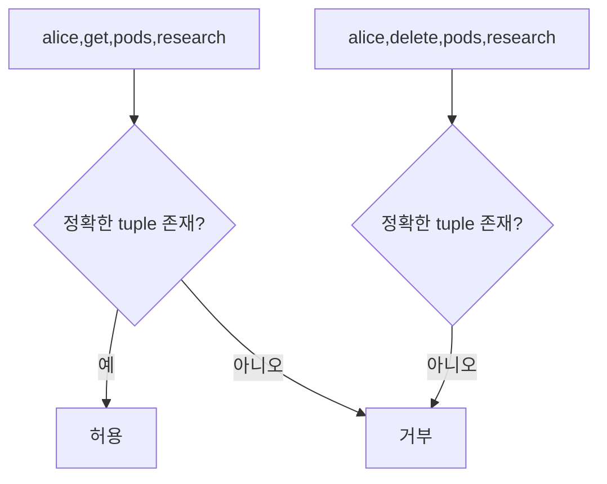

# 13. 로컬 교육 모형

이 장의 세 프로그램은 보안 개념의 상태 전이를 눈으로 확인하는 작은 모형이다. 실제 시스템을 스캔하거나 보안성을 인증하지 않는다.

## 1. 실행 전 경계

[examples 디렉터리](examples/README.md)의 프로그램은 Python 표준 라이브러리만 사용한다.

입력은 코드에 고정돼 있다.

네트워크, 파일, 환경 변수, 계정, 권한을 읽거나 바꾸지 않는다.

assert는 모형이 의도한 결과인지 확인한다.

assert 성공은 실제 Kubernetes, AEAD, 키 관리 시스템이 안전하다는 뜻이 아니다.

## 2. 인가 모형

[authorization_model.py](examples/authorization_model.py)는 요청과 정확히 일치하는 tuple이 정책 집합에 있는지 본다.

요청은 subject, verb, resource, namespace 네 필드를 가진다.

규칙 `("alice", "get", "pods", "research")`는 alice가 research의 pod를 읽는 행동만 허용한다.

같은 alice라도 `delete`는 거부된다.

같은 `get pods`라도 production namespace는 거부된다.

정책에 없는 요청을 기본 거부하는 fail-safe default를 보여 준다.



실제 RBAC는 group, role binding, API group, subresource, wildcard와 집계 규칙이 있다.

이 모형은 인증을 하지 않는다. subject 문자열이 이미 검증됐다고 가정한다.

Admission과 객체 상태도 검사하지 않는다.

따라서 출력 `허용`은 실제 API 호출 허용의 예측이 아니다.

## 3. nonce 등록부 모형

[nonce_registry_model.py](examples/nonce_registry_model.py)는 key ID별로 이미 본 정수 nonce를 set에 저장한다.

`("key-A", 0)`을 처음 예약하면 set에 넣고 성공한다.

`("key-A", 1)`도 성공한다.

`("key-B", 0)`은 키 범위가 달라 성공한다.

다시 `("key-A", 0)`을 넣으면 중복이라 거부한다.

이 동작은 `(키, nonce)` 쌍의 범위를 보여 준다.

하지만 registry는 한 프로세스 메모리에만 있다.

프로세스 재시작 뒤 set은 비어 0을 다시 허용한다.

프로세스 A와 B가 별도 registry를 가지면 둘 다 0을 허용한다.

같은 실제 키를 `key-A`와 `alias-A`로 부르면 서로 다른 set이라 중복을 놓친다.

여러 스레드의 검사와 삽입을 원자적으로 보호하는 저장소도 없다.

실제 설계는 안정된 암호학적 키 식별자, 영속 상태, 원자 예약, 재시작 복구가 필요하다.

프로세스마다 유일한 nonce는 같은 키 전체에서 유일하다는 뜻이 아니다.


## 4. 무결성 모형

[integrity_model.py](examples/integrity_model.py)는 고정된 교실용 키로 HMAC-SHA-256 tag를 만든다.

원본 `amount=100&to=bob`과 원본 tag는 검증된다.

메시지를 `amount=900&to=bob`으로 바꾸고 원본 tag를 붙이면 실패한다.

비교에는 `hmac.compare_digest`를 사용한다.

프로그램은 공개 SHA-256도 누구나 변조 메시지에 다시 계산할 수 있음을 문장으로 설명한다.

고정 키는 재현 가능한 교육 출력용이며 생산 키 생성 예시가 아니다.

소스에 비밀키를 넣어도 된다는 예시가 아니다.

키 배포, 키 보관, replay 차단, 전자서명은 구현하지 않는다.

## 5. 실행 결과 읽기

```text
alice     get    pods        research   -> 허용
alice     delete pods        research   -> 거부
('key-A', 0) -> 예약 성공
('key-A', 0) -> 중복 거부
원본 HMAC 검증: 성공
변조 메시지에 원본 HMAC 사용: 실패
```

텍스트는 고정 입력에 대한 상태 전이의 요약이다.

허용 결과가 많다고 좋은 정책인 것도, 모두 거부된다고 안전한 것도 아니다.

정상 업무 요구와 위협 모델에 맞는 판정인지가 중요하다.

## 6. 모형을 확장하는 안전한 방법

인가 모형에 group을 추가하고 직접 권한과 그룹 권한의 합집합을 관찰할 수 있다.

deny 규칙을 추가하면 우선순위를 명시해야 한다.

nonce 모형에는 프로세스 재시작을 흉내 내는 새 빈 registry를 만들고 중복을 놓치는 assert를 작성할 수 있다.

실제 파일 저장을 추가할 필요 없이 상태 사본을 함수 인자로 넘겨 영속성 개념을 모델링할 수 있다.

무결성 모형에는 request ID를 MAC 입력에 포함하고 처리 ID set으로 replay를 거부할 수 있다.

암호 알고리즘을 직접 새로 만들거나 생산 데이터와 키를 넣지 않는다.

## 7. 오해와 반례

오해: toy model의 assert가 통과해 설계가 검증됐다.

반례: 모형에 포함하지 않은 경쟁, 재시작, 공격 입력은 관찰하지 않았다.

오해: nonce set을 파일에 저장하면 완성이다.

반례: 여러 writer의 원자성, rollback, 키 별칭, 성능과 손상 복구가 남는다.

오해: HMAC 예제가 있으니 자체 프로토콜을 배포해도 된다.

반례: 키 합의, replay, 맥락 결합, 오류 처리 등 빠진 요구가 많다. 검토된 프로토콜과 라이브러리를 쓴다.

## 8. 문제와 해설

### 문제 1

인가 모형에서 alice가 새 namespace를 읽게 하려면 무엇을 추가하고 무엇을 검토해야 하는가?

**해설:** 정확한 tuple 규칙을 추가한다. 업무상 필요, 대상 resource와 verb, 만료, 감사 요구를 검토한다. wildcard로 모든 namespace를 열지 않는다.

### 문제 2

nonce 모형을 두 프로세스에서 실행하면 왜 중복 출력이 없는데도 위험한가?

**해설:** 각 프로세스 set이 서로 보이지 않아 같은 key-K, nonce 0을 모두 처음이라고 판단한다. 유일성 범위와 상태 범위가 다르다.

### 문제 3

HMAC 모형에 timestamp만 넣으면 replay가 완전히 막히는가?

**해설:** 아니다. 허용 시간 창 안에서 같은 메시지를 반복할 수 있다. 고유 request ID나 순번과 서버의 처리 상태가 필요하다.

## 공식 자료

- [Python hmac](https://docs.python.org/3/library/hmac.html)
- [Python dataclasses](https://docs.python.org/3/library/dataclasses.html)

---

[이전: 감사 로그와 사고](12-audit-logs-incidents-and-recovery.md) · [목차](README.md) · [다음: 실험과 연구](14-experiments-and-research.md)
