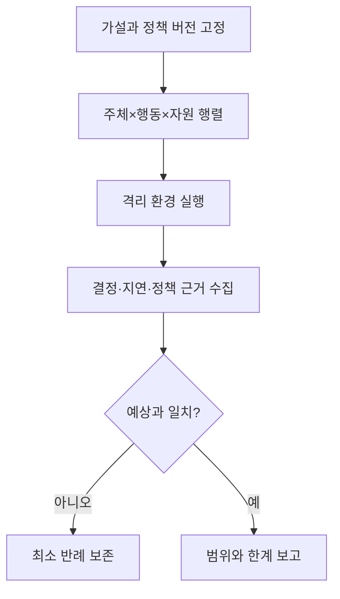

# 14. 실험과 연구 방법

보안 연구는 “공격이 됐다”는 시연과 “정한 조건에서 통제가 어떤 성질을 보였다”는 증거를 구분해야 한다.

## 1. 주장을 측정 가능하게 만든다

나쁜 주장: “RBAC가 안전하다.”

좋은 주장: “정책 버전 17에서 test-reader는 test namespace의 pods/get만 허용되고 준비한 24개 다른 요청은 모두 거부된다.”

나쁜 주장: “키 교체가 빠르다.”

좋은 주장: “100만 객체를 V7에서 V8로 바꿀 때 p95 API 지연을 20% 이내로 유지하고 6시간 안에 V7 객체가 0이 된다.”

독립 변수는 연구자가 바꾸는 조건이다.

종속 변수는 관찰하는 결과다.

통제 변수는 비교 동안 고정하는 환경이다.

혼란 변수(confounder)는 결과에 영향을 주지만 제대로 통제하지 않은 요인이다.

## 2. 가설과 반증 조건

가설은 관찰로 틀릴 수 있어야 한다.

“nonce 서비스는 절대 실패하지 않는다”보다 “프로세스 20개와 재시작 100회에서 같은 key ID의 중복 할당이 0건이다”가 시험 가능하다.

그러나 0건 관찰은 모든 미래 실행의 수학적 증명이 아니다.

실험 범위와 미관찰 조건을 보고한다.

경쟁 조건 연구는 스케줄과 장애 주입을 다양화한다.

암호 안전성은 자체 실험만으로 주장하지 않고 표준, 분석, 검토된 구현을 근거로 한다.

## 3. 안전한 실험 경계

생산 자격 증명과 고객 데이터를 쓰지 않는다.

격리된 계정, namespace, 네트워크, 합성 데이터를 사용한다.

트래픽과 저장 비용 상한을 둔다.

종료 조건과 정리 계획을 미리 쓴다.

외부 시스템 공격이나 허가 없는 스캔을 하지 않는다.

실패 시 영향이 격리 경계를 넘지 않는지 검토한다.

비밀은 결과 파일과 화면 녹화에도 남기지 않는다.

## 4. 실험 설계 예: 인가

정책 행렬의 행은 주체, 열은 행동·자원 조합이다.

허용해야 할 positive case와 거부해야 할 negative case를 모두 만든다.

없는 주체, 만료 토큰, 다른 namespace, subresource, wildcard 경계를 포함한다.

각 case는 예상 결정과 정책 근거를 가진다.

정책 변경 전후 같은 행렬을 실행해 의도하지 않은 권한 증가를 찾는다.

## 5. 실험 설계 예: 키 교체

합성 객체 100,000개를 V7로 만든다.

크기 분포, tenant 수, 동시 읽기·쓰기를 기록한다.

V8 새 쓰기를 켠 시각을 T0로 둔다.

재암호화 처리량, 실패율, API p50/p95/p99, KMS 호출률을 측정한다.

중간에 worker 10% 종료와 재시작을 주입한다.

V7 잔여 객체와 V7 새 쓰기가 모두 0인지 확인한다.

백업 복원본을 포함하지 않았다면 폐기 안전성 주장 범위에서 제외한다.

## 6. 성능과 보안의 trade-off

비밀번호 해시 비용을 높이면 오프라인 공격은 비싸지지만 로그인 CPU와 지연도 늘어난다.

정상 부하와 공격 부하를 구분해 시험한다.

평균만 보면 긴 꼬리 지연을 놓친다.

p95는 요청 100개 중 약 95개가 그 시간 이내라는 분위수다.

서버 종류, CPU quota, 동시성, 알고리즘 버전과 매개변수를 보고한다.

rate limit이 공격을 줄여도 정상 공유 NAT 사용자를 얼마나 막는지 측정한다.

## 7. 재현성과 증거

실험 코드 commit, 구성 digest, 입력 seed, 실행 시각, 환경 버전을 기록한다.

원시 결과와 분석 코드를 분리 보존한다.

실패한 run을 지우지 말고 제외 이유를 기록한다.

그래프 축을 잘라 효과를 과장하지 않는다.

보안 사건 데이터는 개인정보와 공격 기법 노출을 최소화한 형태로 공유한다.

다른 사람이 같은 조건에서 결과를 재현하지 못하면 차이의 원인을 조사한다.

## 8. 음성 결과와 한계

취약점을 찾지 못했다는 결과는 취약점이 없다는 결과가 아니다.

사용한 도구, 규칙, 입력, 시간, 권한이 찾을 수 있는 범위를 정한다.

정적 분석은 런타임 설정을 놓칠 수 있다.

동적 시험은 실행하지 않은 경로를 놓칠 수 있다.

형식 검증도 모델 가정 밖 구현과 운영 오류를 놓칠 수 있다.

여러 증거를 결합하되 보장 범위를 합리적으로 표현한다.

## 9. 오해와 반례

오해: 공격 데모가 한 번 성공했으므로 항상 성공한다.

반례: 버전, 권한, race timing 조건이 달라질 수 있다.

오해: scanner 결과 0건은 안전 인증이다.

반례: signature에 없는 취약점과 업무 로직 문제가 남는다.

오해: 평균 지연이 같으니 보안 통제 비용이 없다.

반례: p99와 CPU 포화, 실패율이 악화될 수 있다.

## 10. 문제와 해설

### 문제 1

`MFA가 공격을 막는다`를 시험 가능한 가설로 바꿔라.

**해설:** “비밀번호만 탈취한 격리 시험 계정의 30개 로그인은 등록된 두 번째 요소 없이 모두 실패하며 성공 세션은 0개다”처럼 조건과 결과를 정한다. 피싱 저항성 등 포함하지 않은 공격은 한계로 쓴다.

### 문제 2

키 교체 처리량이 run마다 크게 다르다. 먼저 고정할 변수는?

**해설:** 객체 크기와 수, 동시 업무 부하, KMS quota와 cache, worker 수와 CPU, 네트워크, 재시도, 저장소 상태를 기록·고정한다.

### 문제 3

취약점 스캔 0건을 어떻게 보고해야 정확한가?

**해설:** 도구와 DB 버전, 대상 artifact digest, 설정, 실행 범위, 실패 여부를 적고 “이 범위에서 알려진 매칭 항목을 발견하지 못함”이라고 쓴다. 안전 보증으로 확대하지 않는다.

## 공식 자료

- [NIST SP 800-115 Technical Guide to Security Testing](https://csrc.nist.gov/pubs/sp/800/115/final)
- [NIST SP 800-53A Rev. 5 Assessing Controls](https://csrc.nist.gov/pubs/sp/800/53/a/r5/final)

---

[이전: 로컬 교육 모형](13-local-models.md) · [목차](README.md) · [다음: 종합 문제·용어집·출처](15-exercises-glossary-and-sources.md)
